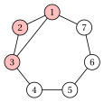

# Maximum clique: limits of approximation

**Part 5 · Approximation algorithms · Chapter 38** · [:material-file-pdf-box: Lecture notes, volume 5 (PDF)](../pdf/lecture-notes-5-approximation-algorithms.pdf) · [:material-presentation: Slides](../pdf/slides-clique-inapproximability.pdf) · [:material-pencil: Exercises: Maximum clique (MCP)](../exercises/clique-inapproximability.md)

!!! nota "Prerequisites"

    - From this module, the chapter [«Principles of approximation algorithms»](https://fabiofurini.github.io/combinatorial-optimization/approximation-algorithms/approximation/): performance ratio for a maximization problem, $\alpha$-approximation algorithm, PTAS.

    - From this module, the chapter [«Clique problems»](https://fabiofurini.github.io/combinatorial-optimization/combinatorial-optimization-problems/clique/): the definitions of the MCP and of the MSSP, the clique number $\omega(G)$, the complement graph and $\omega(G)=\alpha(\overline{G})$.

    - From this module, the chapter [«Vertex coloring: limits of approximation»](https://fabiofurini.github.io/combinatorial-optimization/approximation-algorithms/coloring-inapproximability/): planar graphs and the bound $m\le 3n-6$.

!!! chiave "Objectives"

    At the end of this chapter you will be able to:

    - build the strong product of two graphs and prove $\omega(G\boxtimes H)=\omega(G)\,\omega(H)$;

    - prove that a constant-ratio algorithm for the MCP would give one for every constant ratio;

    - state the results of Håstad and Zuckerman, and conclude that the MCP and the MSSP are not approximable;

    - solve the MCP exactly on planar graphs and on graphs of bounded degree, and approximate the MSSP on graphs of bounded degree.

The problem of this chapter is the [maximum clique problem (MCP)](https://fabiofurini.github.io/combinatorial-optimization/combinatorial-optimization-problems/clique/): its definition and its assumptions are on its page.

## 38.1 Notation

- As on the problem page, $G=(V,E)$ is a simple graph with $n$ vertices and $m$ edges, $N(v)$ is the set of the neighbours of $v$ and $\Delta(G)$ the maximum degree. The optimal value of the MCP is the clique number, $z(I)=\omega(G)$, and that of the MSSP is the stability number $\alpha(G)$.

- <strong>Recall.</strong> As in the chapter [«Principles of approximation algorithms»](https://fabiofurini.github.io/combinatorial-optimization/approximation-algorithms/approximation/#box-2-def-pratio), $\mathscr{A}(I)$ is the number of vertices of the clique returned by the algorithm $\mathscr{A}$. The MCP is a maximization problem, hence

    $$
    \mathscr{A}(I) \le \omega(G) ~~~~~~~\text{and}~~~~~~~ \frac{\omega(G)}{\mathscr{A}(I)} \ge 1
    $$

    for every instance $I$.

- A single vertex is a clique, so the ratio $n$ is trivial. This chapter shows that a polynomial algorithm cannot do much better on all graphs, and then the classes of graphs on which it can.

## 38.2 The MCP is not approximable

### 38.2.1 The strong product

!!! definizione "Definition 38.1: strong product"

    The <strong>strong product</strong> of two graphs $G=(V,E)$ and $H=(W,F)$ is the graph $G\boxtimes H$ with vertex set $V\times W$, in which two distinct vertices $(u,x)$ and $(v,y)$ are adjacent if and only if

    $$
    \big(u=v \ \text{ or }\ \{u,v\}\in E\big) \quad\text{and}\quad \big(x=y \ \text{ or }\ \{x,y\}\in F\big).
    $$

- $G\boxtimes H$ has $|V|\,|W|$ vertices and is built in time polynomial in the size of $G$ and $H$. In particular $G\boxtimes G$ has $n^2$ vertices.

- For a set $K\subseteq V\times W$, the <strong>projection</strong> is $p(K)=\{u\in V:(u,x)\in K \text{ for some } x\}$, and the <strong>fibre</strong> of $u\in p(K)$ is $K_u=\{x\in W:(u,x)\in K\}$.

!!! teorema "Proposition 38.2"

    For every two graphs $G$ and $H$:

    1. if $K\subseteq V\times W$ is a clique of $G\boxtimes H$, then $p(K)$ is a clique of $G$, every fibre $K_u$ is a clique of $H$, and $|K|\le|p(K)|\cdot\max_{u}|K_u|$;

    2. $\omega(G\boxtimes H)=\omega(G)\,\omega(H)$.

??? dimostrazione "Proof"

    <em>Part 1.</em> Let $u\neq v$ be in $p(K)$, with $(u,x),(v,y)\in K$. These two vertices are adjacent and $u\neq v$, so $\{u,v\}\in E$: $p(K)$ is a clique. Let $x\neq y$ be in $K_u$: $(u,x)$ and $(u,y)$ are adjacent, so $\{x,y\}\in F$, and $K_u$ is a clique. The fibres split $K$, hence

    $$
    |K| \;=\; \sum_{u\in p(K)} |K_u| \;\le\; |p(K)|\cdot\max_{u}|K_u| .
    $$

    <em>Part 2.</em> If $K_G$ and $K_H$ are maximum cliques of $G$ and $H$, every two distinct vertices of $K_G\times K_H$ satisfy the definition, so $\omega(G\boxtimes H)\ge\omega(G)\,\omega(H)$. Conversely, by Part 1 every clique $K$ of $G\boxtimes H$ has $|K|\le|p(K)|\cdot\max_u|K_u|\le\omega(G)\,\omega(H)$. □

- The <em>lexicographic</em> product also satisfies $\omega(G[H])=\omega(G)\,\omega(H)$; we use the strong product, whose definition is symmetric in the two graphs.

### 38.2.2 A constant ratio would give every constant ratio

- Part 1 of [Proposition 38.2](#box-2-cli-propprod) is constructive: from a clique $K$ of $G\boxtimes G$, either $p(K)$ or the largest fibre is a clique of $G$ with at least $\sqrt{|K|}$ vertices, since the product of their sizes is at least $|K|$. Both are computed in polynomial time.

!!! teorema "Theorem 38.3"

    If the MCP has a polynomial $\alpha$-approximation algorithm for some constant $\alpha\ge1$, then it has a polynomial $\beta$-approximation algorithm for every constant $\beta>1$.

??? dimostrazione "Proof"

    Let $\mathscr{A}$ be a polynomial $\alpha$-approximation algorithm, and define the algorithm $\mathscr{B}$:

    1. build $G\boxtimes G$ and run $\mathscr{A}$ on it, obtaining a clique $K$;

    2. return the larger of $p(K)$ and of the largest fibre of $K$, a clique of $G$ with at least $\sqrt{|K|}$ vertices.

    By [Proposition 38.2](#box-2-cli-propprod), $\omega(G\boxtimes G)=\omega(G)^2$, so $|K|\ge\frac{\omega(G)^2}{\alpha}$ and

    $$
    \mathscr{B}(I) \;\ge\; \sqrt{|K|} \;\ge\; \frac{\omega(G)}{\sqrt{\alpha}} :
    $$

    $\mathscr{B}$ is a polynomial $\sqrt{\alpha}$-approximation algorithm. Applying the construction $t$ times gives the ratio $\alpha^{1/2^t}$, with $\mathscr{A}$ run on a graph with $n^{2^t}$ vertices. Choose the constant $t$ with $2^t\ge\frac{\ln\alpha}{\ln\beta}$: then $\alpha^{1/2^t}\le\beta$, and $n^{2^t}$ is a polynomial. □

- In other words, the MCP has a constant-ratio algorithm if and only if it has a PTAS: the strong product <em>amplifies</em> any constant ratio. The running time grows like a power $n^{2^t}$, which is polynomial only because $t$ is a constant.

### 38.2.3 The results of Håstad and Zuckerman

- The negative side is known, and we state it without proof: it uses probabilistically checkable proofs.

!!! teorema "Theorem 38.4: Håstad, 1999; Zuckerman, 2007"

    For every $\varepsilon>0$, if $P\neq NP$, no polynomial algorithm $\mathscr{A}$ for the MCP satisfies, for every graph $G$ with $n$ vertices,

    $$
    \frac{\omega(G)}{\mathscr{A}(I)} \;\le\; n^{1-\varepsilon} .
    $$

- Håstad (1999) proved the theorem under the assumption that NP problems cannot be solved in randomized polynomial time ($NP\neq ZPP$); Zuckerman (2007) proved it under $P\neq NP$.

- As for the VCP, the theorem excludes every constant ratio: an $\alpha$-approximation algorithm has ratio at most $\alpha<n^{1/2}$ on the graphs with $n>\alpha^2$ vertices, and the smaller graphs are solved by enumeration in constant time. Combined with [Theorem 38.3](#box-3-cli-thmamp): unless $P=NP$, the MCP has neither a constant ratio nor a PTAS.

!!! chiave ""

    The MCP is not approximable: unless $P=NP$, no polynomial algorithm has a constant performance guarantee, not even a guarantee of the form $n^{1-\varepsilon}$. Positive results exist only on special classes of graphs.

## 38.3 Special cases

### 38.3.1 Planar graphs

!!! teorema "Proposition 38.5"

    Every planar graph has $\omega(G)\le 4$, and on planar graphs the MCP is solved exactly in $O(n^4)$ time.

??? dimostrazione "Proof"

    A subgraph of a planar graph is planar. The complete graph with $5$ vertices has $10$ edges, more than $3\cdot5-6=9$, so it is not planar, and a planar graph has no clique with $5$ vertices. The subsets of at most $4$ vertices are $O(n^4)$, and each one is checked in constant time. □

### 38.3.2 Graphs of bounded maximum degree

!!! teorema "Proposition 38.6"

    Every graph has $\omega(G)\le\Delta(G)+1$, and the MCP is solved exactly in $O(n\,2^{\Delta}\,\Delta^2)$ time, with $\Delta=\Delta(G)$.

??? dimostrazione "Proof"

    A clique that contains the vertex $v$ is contained in $\{v\}\cup N(v)$, which has at most $\Delta+1$ vertices. For every vertex $v$, enumerate the $2^{\deg(v)}\le 2^\Delta$ subsets $S\subseteq N(v)$ and keep the largest $\{v\}\cup S$ that is a clique; checking the pairs of $S$ takes $O(\Delta^2)$ time. Every maximum clique is found from any of its vertices. □

- The time is polynomial for every fixed $\Delta$, and even when $\Delta\le\log_2 n$, since then $2^\Delta\le n$.

### 38.3.3 The maximum stable set problem

- By $\omega(G)=\alpha(\overline{G})$ (chapter [«Clique problems»](../combinatorial-optimization-problems/clique/index.md)), a stable set of $G$ is a clique of $\overline{G}$, which is built in $O(n^2)$ time and has the same $n$.

- An algorithm with ratio $\rho(n)$ for one of the two problems, applied to the complement graph, has the same ratio $\rho(n)$ for the other one.

!!! teorema "Corollary 38.7"

    For every $\varepsilon>0$, if $P\neq NP$, no polynomial algorithm for the MSSP has ratio $\frac{\alpha(G)}{\mathscr{A}(I)}\le n^{1-\varepsilon}$ on every graph. In particular, the MSSP has no constant ratio.

- The special cases do <em>not</em> transfer: the complement of a planar graph, or of a graph of bounded degree, is dense. On those classes the MSSP remains NP-hard, but it is approximable.

!!! teorema "Proposition 38.8"

    On every graph, a <strong>maximal</strong> stable set $S$ (no vertex can be added to it) has $|S|\ge\frac{n}{\Delta(G)+1}$. Hence the greedy algorithm that adds vertices while possible satisfies

    $$
    \frac{\alpha(G)}{|S|} \;\le\; \Delta(G)+1 .
    $$

??? dimostrazione "Proof"

    Every vertex outside $S$ has a neighbour in $S$, otherwise it could be added. Hence $V=\bigcup_{v\in S}\big(\{v\}\cup N(v)\big)$, and $n\le|S|\,(\Delta(G)+1)$. Since $\alpha(G)\le n$, the ratio is at most $\frac{n}{|S|}\le\Delta(G)+1$. □

- On graphs of maximum degree at most a fixed $\Delta$ this is a constant ratio. On planar graphs the MSSP even has a PTAS (Baker, 1994).

## 38.4 Example

!!! esempio "Example 38.1: Strong product and enumeration on the MCP reference instance"

    The reference instance of the MCP is the cycle $1,2,\dots,7,1$ with the chord $\{1,3\}$: $n=7$, $m=8$, $\Delta(G)=3$ and $\omega(G)=3$, with the unique maximum clique $\{1,2,3\}$ (in red).

    { .fig loading=lazy  }

    - <strong>Strong product.</strong> $G\boxtimes G$ has $7^2=49$ vertices and $240$ edges, and $\omega(G\boxtimes G)=3^2=9$, attained by $\{1,2,3\}\times\{1,2,3\}$.

    - Suppose an algorithm returns on $G\boxtimes G$ the clique $K=\{1,2,3\}\times\{4,5\}$, with $|K|=6$. Its projection $p(K)=\{1,2,3\}$ and its fibres $K_u=\{4,5\}$ are cliques of $G$; the larger one has $3\ge\sqrt6$ vertices.

    - <strong>Bounded degree.</strong> The enumeration of [Proposition 38.6](#box-6-cli-propdeg) examines $\sum_v 2^{\deg(v)}=2^3+2^2+2^3+4\cdot 2^2=36$ subsets, and finds $\{1,2,3\}$ from the vertices $1$, $2$ and $3$.

    - <strong>Planarity.</strong> The graph is planar, as the figure shows, and $\omega(G)=3\le 4$.

## 38.5 Sources

- M.R. Garey, D.S. Johnson, <em>Computers and Intractability: A Guide to the Theory of NP-Completeness</em>, W.H. Freeman, 1979 (the self-improvement of the MCP by graph products).

- J. Håstad, Clique is hard to approximate within $n^{1-\varepsilon}$, <em>Acta Mathematica</em> 182(1):105–142, 1999.

- D. Zuckerman, Linear degree extractors and the inapproximability of max clique and chromatic number, <em>Theory of Computing</em> 3:103–128, 2007.

- B.S. Baker, Approximation algorithms for NP-complete problems on planar graphs, <em>Journal of the ACM</em> 41(1):153–180, 1994.

## 38.6 Typical mistakes

!!! attenzione "Warning"

    - <strong>Inverting the ratio.</strong> The MCP is a maximization problem: the ratio is $\frac{\omega(G)}{\mathscr{A}(I)}$, at least $1$.

    - <strong>Iterating the product a number of times that grows with $n$.</strong> The graph after $t$ products has $n^{2^t}$ vertices: polynomial only for a constant $t$, so the amplification gives every constant ratio, not the ratio $1$.

    - <strong>Transferring the special cases to the MSSP.</strong> The complement of a planar graph is not planar: the MCP is easy on planar graphs, the MSSP is NP-hard there.

    - <strong>Confusing the bound $\Delta(G)+1$ of the MCP with that of the MSSP.</strong> For the MCP, $\omega(G)\le\Delta(G)+1$ bounds the optimum and makes enumeration fast; for the MSSP, $\Delta(G)+1$ bounds the ratio of a maximal stable set.

## 38.7 In summary

!!! chiave "In summary"

    - The strong product squares the clique number, and a clique of the product gives back a clique of $G$ of at least the square root of its size: a constant ratio for the MCP would give every constant ratio.

    - By the results of Håstad and Zuckerman, unless $P=NP$ not even the ratio $n^{1-\varepsilon}$ is possible: the MCP is not approximable, and neither is the MSSP, through the complement graph.

    - On planar graphs and on graphs of bounded degree the MCP is solved exactly by enumeration; on graphs of bounded degree a maximal stable set has ratio at most $\Delta(G)+1$ for the MSSP.

    
<table>
    <tr>
    <th>problem and graphs</th>
    <th>algorithm</th>
    <th>result</th>
    </tr>
    <tr>
    <td>MCP, all graphs</td>
    <td>any polynomial</td>
    <td>no constant ratio, unless \(P=NP\)</td>
    </tr>
    <tr>
    <td>MCP, planar</td>
    <td>enumeration</td>
    <td>exact, \(\omega(G)\le4\)</td>
    </tr>
    <tr>
    <td>MCP, maximum degree \(\le\Delta\)</td>
    <td>enumeration</td>
    <td>exact, \(O(n\,2^\Delta\Delta^2)\)</td>
    </tr>
    <tr>
    <td>MSSP, all graphs</td>
    <td>any polynomial</td>
    <td>no constant ratio, unless \(P=NP\)</td>
    </tr>
    <tr>
    <td>MSSP, maximum degree \(\le\Delta\)</td>
    <td>maximal stable set</td>
    <td>ratio \(\le\Delta+1\)</td>
    </tr>
    </table>

    <strong>Dashboard of the reference instance.</strong>

    
<table>
    <tr>
    <th>Instance</th>
    <th>Upper bound</th>
    <th>Value found</th>
    <th>Optimal value</th>
    </tr>
    <tr>
    <td>cycle with a chord</td>
    <td>\(\Delta(G)+1=4\)</td>
    <td>\(3\), enumeration</td>
    <td>\(3\)</td>
    </tr>
    </table>

---

**Exercises on this chapter:** [:material-pencil: Maximum clique (MCP)](../exercises/clique-inapproximability.md)
