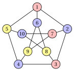
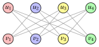

# Limits of approximation: vertex coloring

**Part 5 · Approximation algorithms · Chapter 33** · [:material-file-pdf-box: Lecture notes, volume 5 (PDF)](../pdf/lecture-notes-5-approximation-algorithms.pdf) · [:material-pencil: Exercises: Coloring: limits](../exercises/coloring-approximation.md)

!!! nota "Prerequisites"

    - From this module, the chapter [«Approximation algorithms: definitions»](https://fabiofurini.github.io/combinatorial-optimization/approximation-algorithms/approximation/): performance ratio, relative performance guarantee, tight guarantee and worst-case performance ratio.

    - From this module, the chapter [«Vertex coloring»](https://fabiofurini.github.io/combinatorial-optimization/combinatorial-optimization-problems/coloring/): the definition of the VCP, the Petersen graph and the clique bound $\omega(G)\le\chi(G)$.

    - From this module, the chapter [«Constructive heuristics»](https://fabiofurini.github.io/combinatorial-optimization/heuristic-algorithms/constructive-heuristics/): the greedy coloring as a constructive rule.

    - From the module <em>Algorithms</em> ([module home page](https://fabiofurini.github.io/algorithms/)): the notions of NP-completeness and polynomial time.

!!! chiave "Objectives"

    At the end of this chapter you will be able to:

    - execute the greedy coloring and the $DSATUR$ algorithms by hand;

    - prove that no polynomial algorithm has a ratio below $\frac{4}{3}$ for the VCP, unless $P=NP$;

    - prove the bound $\Delta(G)+1$ of the greedy coloring, and explain why it is not a performance guarantee;

    - build the crown graphs, on which a bad list forces the greedy coloring to use $\frac{n}{2}$ colors.

## 33.1 The problem and the assumptions

!!! definizione "Definition 33.1: Vertex Coloring Problem"

    An instance of the VCP is a simple graph $G=(V,E)$ with $n$ vertices; a coloring assigns a color to each vertex so that adjacent vertices get different colors, and the number of colors is minimized. The optimal value is the <strong>chromatic number</strong> $\chi(G)=z(I)$.

- <strong>Recall.</strong> As in the chapter [«Approximation algorithms: definitions»](https://fabiofurini.github.io/combinatorial-optimization/approximation-algorithms/approximation/#box-2-def-pratio), $z(I)$ is the optimal value of the instance $I$ and $\mathscr{A}(I)$ the value of the solution returned by the algorithm $\mathscr{A}$. The VCP is a minimization problem, hence

    $$
    \mathscr{A}(I) \ge z(I) ~~~~~~~\text{and}~~~~~~~ \frac{\mathscr{A}(I)}{z(I)} \ge 1
    $$

    for every instance $I$, and the worst case performance ratio is $r(\mathscr{A})=\sup_I \mathscr{A}(I)/z(I)$.

- $N(v)$ is the set of neighbours of $v$, $\deg(v)=|N(v)|$ its degree, and $\Delta(G)=\max_{v}\deg(v)$ the maximum degree. The size $\omega(G)$ of a maximum clique is a lower bound: $\omega(G)\le\chi(G)$.

- The instance used in the examples is the graph called <em>Example 2</em> in the notes on coloring problems (the Petersen graph), with $n=10$, $|E|=15$, $\Delta(G)=3$ and $\chi(G)=3$:

    $$
    \begin{aligned}
    E = \big\{ & \{1,2\}, \{1,5\}, \{1,6\}, \{2,3\}, \{2,7\}, \{3,4\}, \{3,8\}, \\
    & \{4,5\}, \{4,9\}, \{5,10\}, \{6,8\}, \{6,9\}, \{7,9\}, \{7,10\}, \{8,10\} \big\}.
    \end{aligned}
    $$

## 33.2 The greedy coloring and DSATUR

### 33.2.1 The greedy coloring { #sez-sec-GC }

!!! chiave ""

    The <em>Greedy Coloring Algorithm</em> (denoted by $GC$) is a constructive heuristic for the VCP. The colors are the integers $1,2,3,\dots$; the algorithm examines the vertices in the order of a given list $\lambda$ and gives each vertex the smallest color not used by its neighbours already colored.

!!! algoritmo "Algorithm: Greedy Coloring"

    

<strong>Input:</strong> VCP instance \(G=(V,E)\) with \(n\) vertices; list \(\lambda[1..n]\)

<strong>Output:</strong> Vertex-color assignment \(col[1..n]\) and number of colors \(nc\)

1<strong>Function</strong> GreedyColoring(\(n, E, \lambda\))

2\(col := \text{new array}[1..n]\), all entries \(0\) ▹ \(0\) = not yet colored

3<strong>for</strong> \(k := 1\) <strong>to</strong> \(n\) <strong>do</strong>

4\(v := \lambda[k]\)

5\(U := \{\, col[u] : u \in N(v),\ col[u] \neq 0 \,\}\)
    \(col[v] \leftarrow \min\{\, c\in\Z_{\ge1} : c \notin U \,\}\) ▹ colors of the colored neighbours smallest free color

6<strong>end</strong>

7<strong>return</strong> \(col\), \(nc = \max_v col[v]\)

- The color classes $Q_c=\{v : col[v]=c\}$ are independent sets by construction, so $GC$ always returns a feasible coloring. It runs in $O(n+|E|)$ time.

- As $LIST$, $GC$ depends on the order of the list, and the order can make a large difference.

!!! esempio "Example 33.1: $GC$ on the Petersen graph, two orders"

    { .fig loading=lazy  }

    <strong>List $\lambda=(1,2,\dots,10)$.</strong> The colors of the colored neighbours $U$ and the color assigned are:

    $$
    \begin{array}{c|cccccccccc}
    \hline {v} & {1} & {2} & {3} & {4} & {5} & {6} & {7} & {8} & {9} & {10} \\
    \hline {U} & {\emptyset} & {\{1\}} & {\{2\}} & {\{1\}} & {\{1,2\}} & {\{1\}} & {\{2\}} & {\{1,2\}} & {\{1,2\}} & {\{1,3\}} \\
    {col[v]} & {1} & {2} & {1} & {2} & {3} & {2} & {1} & {3} & {3} & {2} \\
    \hline
    \end{array}
    $$

    $GC$ uses $3$ colors (red $=1$, blue $=2$, yellow $=3$ in the figure). The outer $5$-cycle $1,2,3,4,5$ is an odd cycle and needs $3$ colors, so $\chi(G)=3$ and this coloring is optimal.

    <strong>List $\lambda=(1,2,3,4,5,7,8,6,9,10)$.</strong> The first five vertices get the same colors as before; then

    $$
    \begin{array}{c|ccccc}
    \hline {v} & {7} & {8} & {6} & {9} & {10} \\
    \hline {U} & {\{2\}} & {\{1\}} & {\{1,2\}} & {\{1,2,3\}} & {\{1,2,3\}} \\
    {col[v]} & {1} & {2} & {3} & {4} & {4} \\
    \hline
    \end{array}
    $$

    and $GC$ uses $4$ colors: vertex $8$ takes color $2$, which the first order gave to vertex $6$, and vertices $9$ and $10$ then see all three colors among their neighbours.

### 33.2.2 DSATUR { #sez-sec-DSATUR }

!!! chiave ""

    The <em>DSATUR Algorithm</em> (Degree of SATURation, denoted by $DSATUR$) is a constructive heuristic for the VCP. It does not use a fixed list: at each step it colors, with the smallest free color, an uncolored vertex of maximum <strong>saturation degree</strong>, i.e., with the largest number of <em>different</em> colors among its neighbours; ties are broken by the largest degree in the subgraph of the uncolored vertices, and then by the smallest index.

!!! algoritmo "Algorithm: DSATUR"

    

<strong>Input:</strong> VCP instance \(G=(V,E)\) with \(n\) vertices

<strong>Output:</strong> Vertex-color assignment \(col[1..n]\) and number of colors \(nc\)

1<strong>Function</strong> DSATUR(\(n, E\))

2\(col := \text{new array}[1..n]\), all entries \(0\)

3<strong>for</strong> \(k := 1\) <strong>to</strong> \(n\) <strong>do</strong>

4<strong>for</strong> each uncolored \(u\) <strong>do</strong>

5\(sat[u] \leftarrow |\{\, col[w] : w\in N(u),\ col[w]\neq0 \,\}|\)
    \(du[u] \leftarrow |\{\, w\in N(u) : col[w]=0 \,\}|\) ▹ saturation degree degree among the uncolored

6<strong>end</strong>

7\(v :=\) the uncolored vertex maximizing \((sat[v], du[v])\) lexicographically (smallest index)

8\(col[v] \leftarrow \min\{\, c\in\Z_{\ge1} : c \neq col[w]~\forall w\in N(v) \,\}\)

9<strong>end</strong>

10<strong>return</strong> \(col\), \(nc = \max_v col[v]\)

- <strong>Why the saturation degree.</strong> A vertex with many different colors around it has few colors left: if we postpone it, it may end up with none of the colors already in use. $DSATUR$ colors first the vertices that are most constrained, the same idea as “the hardest items first” of FFD and $LPT$, but updated dynamically after each assignment.

- $DSATUR$ is $GC$ with a list built on the fly, so every property of $GC$ that holds for every list holds for $DSATUR$ too. A straightforward implementation runs in $O(n^2)$ time.

!!! esempio "Example 33.2: $DSATUR$ on the Petersen graph"

    All the vertices have degree $3$. The vertex chosen at each step, its saturation degree, its degree among the uncolored vertices and its color are:

    
<table>
    <tr>
    <th>step</th>
    <th>\(1\)</th>
    <th>\(2\)</th>
    <th>\(3\)</th>
    <th>\(4\)</th>
    <th>\(5\)</th>
    <th>\(6\)</th>
    <th>\(7\)</th>
    <th>\(8\)</th>
    <th>\(9\)</th>
    <th>\(10\)</th>
    </tr>
    <tr>
    <td>\(v\)</td>
    <td>\(1\)</td>
    <td>\(2\)</td>
    <td>\(3\)</td>
    <td>\(4\)</td>
    <td>\(5\)</td>
    <td>\(6\)</td>
    <td>\(8\)</td>
    <td>\(7\)</td>
    <td>\(9\)</td>
    <td>\(10\)</td>
    </tr>
    <tr>
    <td>\(sat[v]\)</td>
    <td>\(0\)</td>
    <td>\(1\)</td>
    <td>\(1\)</td>
    <td>\(1\)</td>
    <td>\(2\)</td>
    <td>\(1\)</td>
    <td>\(2\)</td>
    <td>\(1\)</td>
    <td>\(2\)</td>
    <td>\(2\)</td>
    </tr>
    <tr>
    <td>\(du[v]\)</td>
    <td>\(3\)</td>
    <td>\(2\)</td>
    <td>\(2\)</td>
    <td>\(2\)</td>
    <td>\(1\)</td>
    <td>\(2\)</td>
    <td>\(1\)</td>
    <td>\(2\)</td>
    <td>\(0\)</td>
    <td>\(0\)</td>
    </tr>
    <tr>
    <td>\(col[v]\)</td>
    <td>\(1\)</td>
    <td>\(2\)</td>
    <td>\(1\)</td>
    <td>\(2\)</td>
    <td>\(3\)</td>
    <td>\(2\)</td>
    <td>\(3\)</td>
    <td>\(1\)</td>
    <td>\(3\)</td>
    <td>\(2\)</td>
    </tr>
    </table>

    At step $1$ all the vertices tie and vertex $1$ is chosen. At step $2$ the vertices $2$, $5$, $6$ have saturation degree $1$ and two uncolored neighbours each: the smallest index, $2$, is chosen. At step $7$ vertex $8$ (neighbours $3$ and $6$, colors $1$ and $2$) has saturation degree $2$ and goes before vertex $7$. $DSATUR$ uses $3=\chi(G)$ colors, the same coloring as $GC$ with the list $(1,2,\dots,10)$.

## 33.3 No ratio below four thirds

- For $P\,||\,C_{\max}$ (chapter [«Approximation for $P\,||\,C_{\max}$»](https://fabiofurini.github.io/combinatorial-optimization/approximation-algorithms/pcmax-approximation/)) and for the metric TSP (chapter [«Approximation for the metric TSP»](https://fabiofurini.github.io/combinatorial-optimization/approximation-algorithms/tsp-approximation/)) simple algorithms have a constant performance guarantee.

- For the VCP one can prove that no polynomial algorithm has a guarantee below a given constant, unless $P=NP$. The proof follows the same scheme as for the general TSP: an approximation algorithm with a too good guarantee would decide in polynomial time an NP-complete problem.

!!! teorema "Proposition 33.2"

    If $P\neq NP$, there is no polynomial algorithm $\mathscr{A}$ for the VCP such that, for every VCP instance $I$,

    $$
    \frac{\mathscr{A}(I)}{z(I)} \;<\; \frac{4}{3} .
    $$

??? dimostrazione "Proof"

    Deciding whether $\chi(G)\le3$ (<strong>3-colorability</strong>) is NP-complete. Suppose that $\mathscr{A}$ exists and run it on a graph $G$. If $\chi(G)\le 3$, then $\mathscr{A}(I)<\frac43\chi(G)\le4$, and, being an integer, $\mathscr{A}(I)\le3$. If $\chi(G)\ge4$, then $\mathscr{A}(I)\ge\chi(G)\ge4$ because $\mathscr{A}$ returns a feasible coloring. Hence $\chi(G)\le3$ if and only if $\mathscr{A}(I)\le3$, and 3-colorability would be decided in polynomial time. □

- The proof uses the fact that $\chi(G)$ is an integer: a ratio below $\frac43$ cannot separate $3$ from $4$ colors. The same argument works for every problem in which deciding $z(I)\le k$ is NP-complete for a fixed $k$: no ratio below $\frac{k+1}{k}$. For the BPP, deciding whether $2$ bins suffice is the NP-complete PARTITION problem, which gives the bound $\frac32$.

- The NP-completeness of 3-colorability, even for planar graphs of maximum degree $4$, is due to Garey, Johnson and Stockmeyer (1976).

!!! nota ""

    <strong>Much stronger results (cited without proof).</strong>

    - Garey and Johnson (1976) raised the bound of [Proposition 33.2](#box-4-prop-VCP43) to $2$: unless $P=NP$, no polynomial algorithm colors every graph with fewer than $2\chi(G)$ colors.

    - Much more is true: the ratio cannot even be bounded by a small power of $n$. For every $\varepsilon>0$, unless $P=NP$, no polynomial algorithm $\mathscr{A}$ satisfies

        $$
        \frac{\mathscr{A}(I)}{\chi(G)} \;\le\; n^{1-\varepsilon}
        $$

        for every graph $G$ with $n$ vertices. Since every graph can be colored with $n$ colors, a ratio of $n$ is trivial: the chromatic number is essentially as hard to approximate as possible (Zuckerman, 2007).

## 33.4 What the greedy coloring guarantees

!!! teorema "Proposition 33.3"

    For every graph $G$ and every list $\lambda$,

    $$
    GC(I) \;\le\; \Delta(G)+1 .
    $$

??? dimostrazione "Proof"

    When vertex $v$ is colored, the set $U$ of the colors of its colored neighbours has at most $\deg(v)\le\Delta(G)$ elements, so one of the colors $1,2,\dots,\Delta(G)+1$ is not in $U$, and the smallest free color is at most $\Delta(G)+1$. □

- The bound holds for $DSATUR$ too, which is $GC$ with a particular list, and it is attained by complete graphs ($\Delta=n-1$, $\chi=n$) and odd cycles ($\Delta=2$, $\chi=3$), whatever the list.

- It is <em>not</em> a performance guarantee: it compares $GC(I)$ with $\Delta(G)+1$, not with $\chi(G)$, and $\Delta(G)+1$ can be much larger than $\chi(G)$. The next proposition shows that a bad list can really force that many colors on a graph that needs only two.

- On the other hand, <strong>some</strong> list is always optimal: if $Q_1,\dots,Q_{\chi(G)}$ are the color classes of an optimal coloring, $GC$ with the vertices of $Q_1$ first, then those of $Q_2$, and so on, gives each vertex of $Q_c$ a color at most $c$, so it uses at most $\chi(G)$ colors. The difficulty is entirely in finding the list.

!!! teorema "Proposition 33.4"

    For every $k\ge3$ there is a graph $G_k$ with $n=2k$ vertices, $\chi(G_k)=2$ and $\Delta(G_k)=k-1$, and a list $\lambda$, such that

    $$
    GC(I_k) \;=\; k \;=\; \frac{n}{2} .
    $$

??? dimostrazione "Proof"

    $G_k$ is the <strong>crown graph</strong>: the vertices are $u_1,\dots,u_k$ and $v_1,\dots,v_k$, and $u_i$ is adjacent to $v_j$ if and only if $i\neq j$ (the complete bipartite graph $K_{k,k}$ without a perfect matching). It is bipartite, with an edge, so $\chi(G_k)=2$; every vertex has degree $k-1$. The list is $\lambda=(u_1,v_1,u_2,v_2,\dots,u_k,v_k)$.

    We show by induction on $i$ that $GC$ gives color $i$ to both $u_i$ and $v_i$. For $i=1$ no neighbour is colored when $u_1$ is examined, and $v_1$ is not adjacent to $u_1$: both get color $1$. When $u_i$ is examined, its colored neighbours are $v_1,\dots,v_{i-1}$, with colors $1,\dots,i-1$ by induction, so $u_i$ gets color $i$; when $v_i$ is examined, its colored neighbours are $u_1,\dots,u_{i-1}$ ($u_i$ is not a neighbour), with colors $1,\dots,i-1$, so $v_i$ gets color $i$ too. Hence $GC(I_k)=k$. □

- On the crown graphs $\frac{GC(I_k)}{\chi(G_k)}=\frac{k}{2}=\frac{n}{4}$, which grows without bound: with an arbitrary list, $GC$ has no constant performance guarantee. The list $(u_1,\dots,u_k,v_1,\dots,v_k)$, the color classes first, gives $2$ colors.

- The crown graphs satisfy the assumptions of the VCP for $k\ge3$: no isolated vertices, and $N(u_i)=\{v_j:j\neq i\}$ is not contained in $N(u_{i'})$ nor in any $N(v_j)\subseteq\{u_1,\dots,u_k\}$.

!!! esempio "Example 33.3: $GC$ and $DSATUR$ on the crown graph $G_4$"

    Number the vertices $u_i=2i-1$ and $v_i=2i$, so that $u_1,v_1,\dots,u_4,v_4$ are $1,2,\dots,8$, and $E=\{\{2i-1,2j\}: i\neq j\}$, with $12$ edges.

    { .fig loading=lazy  }

    With the list $(1,2,\dots,8)=(u_1,v_1,\dots,u_4,v_4)$, $GC$ uses $4$ colors, one for each pair $\{u_i,v_i\}$ (shown in the figure); with the list $(1,3,5,7,2,4,6,8)$ it uses $2$ colors.

    $DSATUR$ chooses vertex $1$ ($u_1$, color $1$), then the vertices $4$, $5$, $2$, $3$, $6$, $7$, $8$, with colors $2,1,2,1,2,1,2$: the vertices $u_i$ get color $1$ and the vertices $v_i$ color $2$, and $DSATUR$ uses $2=\chi(G_4)$ colors. After the first step, every vertex adjacent to a colored vertex has saturation degree $1$, and the vertex chosen is always on the side opposite to the last one colored.

## 33.5 DSATUR as a heuristic

- On bipartite graphs $DSATUR$ always uses at most $2$ colors, as on the crown graphs; this is proved in the paper that introduced it (Brélaz, 1979).

- On general graphs $DSATUR$ is a polynomial algorithm, so by the results of this section it cannot have a performance guarantee below $\frac43$ (and, by the cited results, not even below $n^{1-\varepsilon}$), unless $P=NP$. It is nevertheless one of the most used constructive heuristics for the VCP, because on most graphs it uses few colors more than $\chi(G)$, often none; it is also the base of exact branch and bound algorithms for the VCP, which branch on the vertex chosen by the $DSATUR$ rule.

## 33.6 Sources

- M.R. Garey, D.S. Johnson, L. Stockmeyer, Some simplified NP-complete graph problems, <em>Theoretical Computer Science</em> 1(3):237–267, 1976.

- M.R. Garey, D.S. Johnson, The complexity of near-optimal graph coloring, <em>Journal of the ACM</em> 23(1):43–49, 1976.

- D. Zuckerman, Linear degree extractors and the inapproximability of max clique and chromatic number, <em>Theory of Computing</em> 3:103–128, 2007.

- D. Brélaz, New methods to color the vertices of a graph, <em>Communications of the ACM</em> 22(4):251–256, 1979.

## 33.7 Typical mistakes

!!! attenzione "Warning"

    - <strong>Reading $GC(I)\le\Delta(G)+1$ as a performance guarantee.</strong> It compares the heuristic value with $\Delta(G)+1$, not with $\chi(G)$.

    - <strong>Reading $\frac{4}{3}$ as a guarantee for the VCP.</strong> The result says that no polynomial algorithm has a ratio <em>below</em> $\frac{4}{3}$, unless $P=NP$; it does not give an algorithm with ratio $\frac{4}{3}$.

    - <strong>Reading the bipartite case as a general guarantee.</strong> $DSATUR$ uses at most $2$ colors on every bipartite graph, but on general graphs it is a heuristic: unless $P=NP$, it has no performance guarantee below $\frac{4}{3}$.

## 33.8 In summary

!!! chiave "In summary"

    - The negative result uses a reduction and the fact that $\chi(G)$ is an integer: an algorithm with a ratio below $\frac43$ would decide 3-colorability in polynomial time.

    - The greedy coloring uses at most $\Delta(G)+1$ colors with every list, but this is not a performance guarantee: on the crown graphs a bad list gives $\frac{n}{2}$ colors where $2$ suffice.

    - Some list is always optimal for the greedy coloring; the difficulty is entirely in finding it.

    
<table>
    <tr>
    <th>problem</th>
    <th>algorithm</th>
    <th>worst case ratio</th>
    </tr>
    <tr>
    <td>VCP</td>
    <td>\(GC\) (any list)</td>
    <td>no constant (crown graphs)</td>
    </tr>
    <tr>
    <td>VCP</td>
    <td>\(GC\), \(DSATUR\)</td>
    <td>no constant below \(\frac43\), unless \(P=NP\)</td>
    </tr>
    </table>

    <strong>Dashboard of the reference instance.</strong> The bounds on $z(I)$ found so far:

    
<table>
    <tr>
    <th>Instance</th>
    <th>Lower bound</th>
    <th>Heuristic values</th>
    <th>Optimal value</th>
    </tr>
    <tr>
    <td>VCP, Petersen graph</td>
    <td>\(3\), odd cycle</td>
    <td>\(GC\) \(3\) and \(4\) (two lists), \(DSATUR\) \(3\)</td>
    <td>\(3\)</td>
    </tr>
    </table>

---

**Exercises on this chapter:** [:material-pencil: Coloring: limits](../exercises/coloring-approximation.md)
