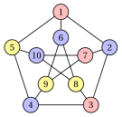

# Vertex coloring: limits of approximation

**Part 5 · Approximation algorithms · Chapter 37** · [:material-file-pdf-box: Lecture notes, volume 5 (PDF)](../pdf/lecture-notes-5-approximation-algorithms.pdf) · [:material-presentation: Slides](../pdf/slides-coloring-inapproximability.pdf) · [:material-pencil: Exercises: Vertex coloring (VCP)](../exercises/coloring-inapproximability.md)

!!! nota "Prerequisites"

    - From this module, the chapter [«Principles of approximation algorithms»](https://fabiofurini.github.io/combinatorial-optimization/approximation-algorithms/approximation/): performance ratio, $\alpha$-approximation algorithm, additive performance guarantee.

    - From this module, the chapter [«Coloring problems»](https://fabiofurini.github.io/combinatorial-optimization/combinatorial-optimization-problems/coloring/): the definition of the VCP, the chromatic number $\chi(G)$, the clique bound $\omega(G)\le\chi(G)$ and the Petersen graph.

    - From the module <em>Algorithms</em> ([module home page](https://fabiofurini.github.io/algorithms/)): breadth-first search, polynomial time and NP-completeness.

!!! chiave "Objectives"

    At the end of this chapter you will be able to:

    - prove that no polynomial algorithm has a performance ratio below $\frac43$ for the VCP, unless $P=NP$;

    - state the result of Zuckerman and explain why the VCP has no constant guarantee;

    - color bipartite graphs and interval graphs optimally, and bound the colors of the greedy coloring by $\Delta(G)+1$;

    - prove that planar graphs can be colored with $5$ colors in polynomial time, and derive an additive guarantee for them.

The problem of this chapter is the [vertex coloring problem (VCP)](https://fabiofurini.github.io/combinatorial-optimization/combinatorial-optimization-problems/coloring/): its definition and its assumptions are on its page.

## 37.1 Notation

- As on the problem page, $G=(V,E)$ is a simple graph with $n$ vertices and $m$ edges, $N(v)$ is the set of the neighbours of $v$, $\deg(v)=|N(v)|$ its degree, and $\Delta(G)=\max_{v\in V}\deg(v)$ the <strong>maximum degree</strong>. The optimal value of the VCP is the chromatic number, $z(I)=\chi(G)$.

- <strong>Recall.</strong> As in the chapter [«Principles of approximation algorithms»](https://fabiofurini.github.io/combinatorial-optimization/approximation-algorithms/approximation/#box-2-def-pratio), $\mathscr{A}(I)$ is the number of colors of the coloring returned by the algorithm $\mathscr{A}$. The VCP is a minimization problem, hence

    $$
    \mathscr{A}(I) \ge \chi(G) ~~~~~~~\text{and}~~~~~~~ \frac{\mathscr{A}(I)}{\chi(G)} \ge 1
    $$

    for every instance $I$.

- Giving each vertex its own color is always feasible, so $\chi(G)\le n$, and the ratio $n$ is trivial. This chapter shows that a polynomial algorithm cannot do much better on all graphs, and then the classes of graphs on which it can.

## 37.2 The VCP is not approximable

### 37.2.1 No ratio below four thirds

- The proof follows the scheme of all the negative results of approximation: an algorithm with a too good guarantee would decide in polynomial time an NP-complete problem.

- The NP-complete problem is <strong>3-colorability</strong>: given a graph $G$, decide whether $\chi(G)\le 3$. It remains NP-complete on planar graphs of maximum degree $4$ (Garey, Johnson and Stockmeyer, 1976).

!!! teorema "Theorem 37.1"

    Let $\mathscr{A}$ be a polynomial algorithm for the VCP. If $P\neq NP$, there is a graph $G$ such that

    $$
    \frac{\mathscr{A}(I)}{\chi(G)} \;\ge\; \frac{4}{3} .
    $$

??? dimostrazione "Proof"

    Suppose that $\frac{\mathscr{A}(I)}{\chi(G)}<\frac43$ for every graph $G$, and run $\mathscr{A}$ on a graph $G$.

    1. If $\chi(G)\le 3$, then $\mathscr{A}(I)<\frac43\,\chi(G)\le 4$. The number of colors is an integer, hence $\mathscr{A}(I)\le 3$.

    2. If $\chi(G)\ge 4$, then $\mathscr{A}(I)\ge\chi(G)\ge 4$, because $\mathscr{A}$ returns a feasible coloring.

    Hence $\chi(G)\le 3$ if and only if $\mathscr{A}(I)\le 3$. Running $\mathscr{A}$ and counting its colors takes polynomial time, so 3-colorability would be in $P$, and $P=NP$. □

- The proof uses only the integrality of $\chi(G)$: a ratio below $\frac43$ cannot confuse $3$ colors with $4$. With $2$ colors the same argument says nothing, because deciding whether $\chi(G)\le 2$ is easy (Section [37.3.1](#sez-vci-sec-bip)).

- The planar graphs of maximum degree $4$ are a special case of the VCP: the theorem holds on them too.

### 37.2.2 Much stronger results

- The theorem excludes only the ratios below $\frac43$. Much more is known, and we state it without proof.

!!! teorema "Theorem 37.2: Zuckerman, 2007"

    For every $\varepsilon>0$, if $P\neq NP$, no polynomial algorithm $\mathscr{A}$ for the VCP satisfies, for every graph $G$ with $n$ vertices,

    $$
    \frac{\mathscr{A}(I)}{\chi(G)} \;\le\; n^{1-\varepsilon} .
    $$

- The ratio $n$ is trivial, so the chromatic number is essentially as hard to approximate as possible. The proof uses probabilistically checkable proofs and extractors.

- Earlier, Garey and Johnson (1976) had raised the bound $\frac43$ to $2$, and Feige and Kilian (1998) had proved the bound $n^{1-\varepsilon}$ under a stronger assumption than $P\neq NP$.

!!! teorema "Corollary 37.3"

    If $P\neq NP$, the VCP has no $\alpha$-approximation algorithm, for any constant $\alpha\ge1$.

??? dimostrazione "Proof"

    Let $\mathscr{A}$ be a polynomial $\alpha$-approximation algorithm, and take $\varepsilon=\frac12$. The graphs with $n>\alpha^2$ vertices satisfy $\frac{\mathscr{A}(I)}{\chi(G)}\le\alpha<n^{1/2}$. The graphs with $n\le\alpha^2$ vertices are solved exactly by enumeration, in a time bounded by a constant that depends only on $\alpha$, with ratio $1\le n^{1/2}$. The resulting algorithm is polynomial and has ratio at most $n^{1/2}$ on every graph, against [Theorem 37.2](#box-2-vci-thmZ). □

!!! chiave ""

    The VCP is not approximable: unless $P=NP$, no polynomial algorithm has a constant performance guarantee, not even a guarantee of the form $n^{1-\varepsilon}$. Positive results exist only on special classes of graphs.

## 37.3 Special cases

- On the four classes of this section the VCP is solved exactly, or with a guarantee, in polynomial time. The classes are recognized from the graph, or given with it (the intervals of an interval graph).

### 37.3.1 Bipartite graphs { #sez-vci-sec-bip }

!!! definizione "Definition 37.4: bipartite graph"

    A graph $G=(V,E)$ is <strong>bipartite</strong> if $\chi(G)\le 2$, i.e., if $V$ can be split into two stable sets.

!!! teorema "Proposition 37.5"

    Deciding whether $\chi(G)\le 2$, and finding a coloring with $2$ colors when it exists, takes $O(n+m)$ time.

??? dimostrazione "Proof"

    Run a breadth-first search from a vertex of each connected component, and let $\ell(v)$ be the level of $v$, its distance from the root of its component. Color $v$ with color $1$ if $\ell(v)$ is even and with color $2$ otherwise.

    1. If no edge joins two vertices of levels with the same parity, the coloring is feasible.

    2. Otherwise, let $\{u,v\}$ be such an edge. The paths of the search tree from the root to $u$ and to $v$, with the edge $\{u,v\}$, form a closed walk of odd length $\ell(u)+\ell(v)+1$. A closed walk of odd length contains a cycle of odd length, which needs $3$ colors: $\chi(G)\ge 3$.

    The search and the check of the edges take $O(n+m)$ time. □

- The proof shows the classical characterization: a graph is bipartite if and only if it has no cycle of odd length (Konig, 1936).

- On a graph with at least one edge, the search gives $\chi(G)=2$, or the certificate $\chi(G)\ge 3$ given by an odd cycle.

### 37.3.2 Graphs of bounded maximum degree

- The <strong>greedy coloring</strong> $GC$ examines the vertices in a given order and gives each vertex the smallest color, among $1,2,3,\dots$, not used by its neighbours already colored. It runs in $O(n+m)$ time.

!!! teorema "Proposition 37.6"

    For every graph $G$ and every order of the vertices,

    $$
    GC(I) \;\le\; \Delta(G)+1 .
    $$

??? dimostrazione "Proof"

    When the vertex $v$ is colored, its neighbours already colored use at most $\deg(v)\le\Delta(G)$ colors. One of the colors $1,2,\dots,\Delta(G)+1$ is therefore free, and the smallest free color is at most $\Delta(G)+1$. □

- The bound compares $GC(I)$ with $\Delta(G)+1$, not with $\chi(G)$: on all graphs it is not a performance guarantee, because $\Delta(G)$ can be $n-1$ while $\chi(G)=2$ (a star).

- On the graphs of maximum degree at most a <em>fixed</em> constant $\Delta$, it is one. Every graph with an edge has $\chi(G)\ge 2$, hence

    $$
    \frac{GC(I)}{\chi(G)} \;\le\; \frac{\Delta+1}{2} .
    $$

- The bound $\Delta(G)+1$ is attained by complete graphs and by cycles of odd length, whatever the order.

- <strong>Remark (Brooks, 1941).</strong> A connected graph that is neither complete nor a cycle of odd length satisfies $\chi(G)\le\Delta(G)$, and such a coloring can be found in linear time.

### 37.3.3 Planar graphs

- A graph is <strong>planar</strong> if it can be drawn in the plane without crossing edges. Whether a graph is planar, and a drawing when it is, can be found in linear time (Hopcroft and Tarjan, 1974).

!!! teorema "Lemma 37.7"

    Every planar graph with $n\ge 3$ vertices has $m\le 3n-6$ edges, and a vertex of degree at most $5$.

??? dimostrazione "Proof"

    Adding edges to a drawing without creating crossings does not decrease $m$, so we may assume that no such edge can be added: the drawing is connected and every face is a triangle. Euler's formula for a connected planar drawing with $f$ faces gives $n-m+f=2$. Every face has $3$ edges and every edge borders $2$ faces, so $3f=2m$, and

    $$
    2 = n-m+f \;=\; n-m+\frac{2m}{3} \qquad\Longrightarrow\qquad m\le 3n-6 .
    $$

    The degrees sum to $2m\le 6n-12<6n$, so some vertex has degree at most $5$. □

!!! teorema "Theorem 37.8: Heawood, 1890"

    Every planar graph can be colored with $5$ colors, and such a coloring can be found in polynomial time.

??? dimostrazione "Proof"

    By induction on $n$; graphs with $n\le 5$ are trivial. Let $v$ be a vertex of degree at most $5$ ([Lemma 37.7](#box-7-vci-lemDeg5)), and color $G-v$, which is planar, with $5$ colors.

    1. If the neighbours of $v$ use at most $4$ colors, $v$ takes the fifth one.

    2. Otherwise $v$ has $5$ neighbours $v_1,\dots,v_5$, in this order around $v$ in the drawing, with colors $1,\dots,5$. Let $H_{13}$ be the graph induced by the vertices of colors $1$ and $3$.

    3. If $v_1$ and $v_3$ are in different components of $H_{13}$, exchange the colors $1$ and $3$ in the component of $v_1$: the coloring stays feasible, and color $1$ becomes free for $v$.

    4. Otherwise a path of colors $1$ and $3$ joins $v_1$ to $v_3$; with $v$, it closes a cycle that separates $v_2$ from $v_4$ in the drawing. A path from $v_2$ to $v_4$ must cross that cycle, so $v_2$ and $v_4$ are in different components of $H_{24}$: exchanging $2$ and $4$ in the component of $v_2$ frees color $2$ for $v$.

    Each step uses a search in $O(n+m)=O(n)$ time, and there are $n$ steps: $O(n^2)$ time in total. □

- <strong>Remark (the four color theorem).</strong> Every planar graph can be colored with $4$ colors (Appel and Haken, 1977). The proof uses a computer; Robertson, Sanders, Seymour and Thomas (1997) simplified it and gave an algorithm that finds such a coloring in $O(n^2)$ time.

- The algorithm $PL$ for planar graphs combines the previous results: if $G$ has no edge, it uses $1$ color; if $G$ is bipartite, it uses $2$ colors ([Proposition 37.5](#box-5-vci-propBFS)); otherwise it uses the $5$ colors of [Theorem 37.8](#box-8-vci-thm5).

!!! teorema "Corollary 37.9"

    $PL$ is a polynomial $2$-additive approximation algorithm for the VCP on planar graphs:

    $$
    PL(I)-\chi(G) \;\le\; 2 .
    $$

    With the four color algorithm in place of the five color one, the additive error is at most $1$.

??? dimostrazione "Proof"

    In the first two cases $PL$ is exact. In the third case $G$ has a cycle of odd length, so $\chi(G)\ge 3$, while $PL(I)\le 5$: the additive error is at most $5-3=2$. With $4$ colors it is at most $4-3=1$. □

- The additive error $1$ cannot be improved to $0$: deciding whether a planar graph has $\chi(G)\le 3$ is NP-complete. For the same reason, the ratio $\frac43$ of the four color version is the best possible on planar graphs ([Theorem 37.1](#box-1-vci-thm43)).

### 37.3.4 Interval graphs

!!! definizione "Definition 37.10: interval graph"

    A graph $G=(V,E)$ is an <strong>interval graph</strong> if every vertex $v$ is associated with a closed interval $[a_v,b_v]$ of the real line, and $\{u,v\}\in E$ if and only if the two intervals intersect.

- Interval graphs describe requests over time that conflict when they overlap: lectures that need a room, reservations that need a resource. A color is a room.

!!! teorema "Proposition 37.11"

    On an interval graph, the greedy coloring with the vertices in order of non-decreasing left endpoint $a_v$ uses $\omega(G)$ colors. It is therefore optimal: $GC(I)=\omega(G)=\chi(G)$.

??? dimostrazione "Proof"

    Let $v$ be a vertex that receives color $k$. The colors $1,\dots,k-1$ are used by neighbours $u$ of $v$ colored before $v$, so with $a_u\le a_v$.

    1. Since $[a_u,b_u]$ intersects $[a_v,b_v]$ and $a_u\le a_v$, we have $b_u\ge a_v$: the point $a_v$ lies in the interval of each of these neighbours, and in the interval of $v$.

    2. The $k$ intervals that contain $a_v$ pairwise intersect, so their vertices form a clique and $k\le\omega(G)$.

    Hence $GC(I)\le\omega(G)\le\chi(G)\le GC(I)$, by the clique bound. □

- Sorting the intervals takes $O(n\log n)$ time, and the coloring $O(n+m)$.

- The order matters: with another order the greedy coloring may use more than $\omega(G)$ colors on an interval graph ([Example 37.2](#box-13-vci-ex-int)).

## 37.4 Examples

!!! esempio "Example 37.1: The special cases on the Petersen graph"

    The reference instance of the VCP is the Petersen graph, with $n=10$, $m=15$ and $\Delta(G)=3$.

    { .fig loading=lazy  }

    - <strong>Is it bipartite?</strong> The search from vertex $1$ gives the levels $0$ to vertex $1$, $1$ to the vertices $2,5,6$, and $2$ to the other six. The edge $\{3,4\}$ joins two vertices of level $2$: with the paths $1,2,3$ and $1,5,4$ it closes the odd cycle $1,2,3,4,5$, so $\chi(G)\ge 3$.

    - <strong>Greedy coloring.</strong> In the order $1,2,\dots,10$, $GC$ gives the colors $1,2,1,2,3,2,1,3,3,2$ (red, blue, yellow in the figure): $GC(I)=3\le\Delta(G)+1=4$.

    - Together, $3\le\chi(G)\le GC(I)=3$: the greedy coloring is optimal on this instance.

!!! esempio "Example 37.2: The greedy coloring on an interval graph"

    Six intervals, with the edges between intersecting intervals:

    { .fig loading=lazy  }

    $$
    [a_v,b_v]:\ [1,4],\ [2,6],\ [3,5],\ [5,8],\ [7,10],\ [9,12],
    $$

    $$
    E=\big\{\{1,2\},\{1,3\},\{2,3\},\{2,4\},\{3,4\},\{4,5\},\{5,6\}\big\}.
    $$

    - The left endpoints are already in increasing order. $GC$ gives the colors $1,2,3,1,2,1$ (red, blue, yellow in the figure): $GC(I)=3$.

    - The intervals $1,2,3$ contain the point $3$, so $\{1,2,3\}$ is a clique and $\omega(G)=3$: the coloring is optimal, as [Proposition 37.11](#box-11-vci-propInt) guarantees.

    - With the order $1,2,3,5,4,6$ the colors are $1,2,3$, then $1$ to vertex $5$ and $4$ to vertex $4$, whose neighbours $2,3,5$ use the colors $1,2,3$: $4$ colors, one more than $\chi(G)$.

## 37.5 Sources

- M.R. Garey, D.S. Johnson, L. Stockmeyer, Some simplified NP-complete graph problems, <em>Theoretical Computer Science</em> 1(3):237–267, 1976.

- M.R. Garey, D.S. Johnson, The complexity of near-optimal graph coloring, <em>Journal of the ACM</em> 23(1):43–49, 1976.

- U. Feige, J. Kilian, Zero knowledge and the chromatic number, <em>Journal of Computer and System Sciences</em> 57(2):187–199, 1998.

- D. Zuckerman, Linear degree extractors and the inapproximability of max clique and chromatic number, <em>Theory of Computing</em> 3:103–128, 2007.

- R.L. Brooks, On colouring the nodes of a network, <em>Proceedings of the Cambridge Philosophical Society</em> 37(2):194–197, 1941.

- P.J. Heawood, Map-colour theorem, <em>Quarterly Journal of Pure and Applied Mathematics</em> 24, 1890.

- J. Hopcroft, R. Tarjan, Efficient planarity testing, <em>Journal of the ACM</em> 21(4):549–568, 1974.

- K. Appel, W. Haken, Every planar map is four colorable, <em>Illinois Journal of Mathematics</em> 21, 1977.

- N. Robertson, D. Sanders, P. Seymour, R. Thomas, The four-colour theorem, <em>Journal of Combinatorial Theory, Series B</em> 70(1):2–44, 1997.

## 37.6 Typical mistakes

!!! attenzione "Warning"

    - <strong>Calling the bound $\Delta(G)+1$ a performance guarantee.</strong> It compares the greedy coloring with $\Delta(G)+1$, not with $\chi(G)$; it becomes a constant ratio only on graphs of bounded maximum degree.

    - <strong>Reading the theorem of $\frac43$ as an upper bound.</strong> It says that ratios below $\frac43$ are impossible, not that a ratio of $\frac43$ is achievable: by the result of Zuckerman, no constant ratio is.

    - <strong>Using the four color theorem as an exact algorithm.</strong> It colors every planar graph with at most $4$ colors, but deciding whether $3$ colors suffice remains NP-complete on planar graphs.

    - <strong>Sorting the intervals by right endpoint, or by length.</strong> [Proposition 37.11](#box-11-vci-propInt) uses the order of the left endpoints: the colors used before $v$ all contain the point $a_v$.

    - <strong>Forgetting the odd cycle.</strong> A breadth-first search that finds a conflict proves $\chi(G)\ge 3$ only through the odd cycle it closes; the cycle is the certificate.

## 37.7 In summary

!!! chiave "In summary"

    - Unless $P=NP$, no polynomial algorithm colors every graph with fewer than $\frac43\chi(G)$ colors: it would decide 3-colorability. By the result of Zuckerman, not even the ratio $n^{1-\varepsilon}$ is possible: the VCP is not approximable.

    - Bipartite graphs and interval graphs are colored optimally in polynomial time; on graphs of bounded degree the greedy coloring has the ratio $\frac{\Delta+1}{2}$; on planar graphs the additive error is at most $2$, or $1$ with the four color theorem.

    
<table>
    <tr>
    <th>graphs</th>
    <th>algorithm</th>
    <th>result</th>
    </tr>
    <tr>
    <td>all graphs</td>
    <td>any polynomial</td>
    <td>no constant ratio, unless \(P=NP\)</td>
    </tr>
    <tr>
    <td>bipartite</td>
    <td>breadth-first search</td>
    <td>exact, \(O(n+m)\)</td>
    </tr>
    <tr>
    <td>maximum degree \(\le\Delta\)</td>
    <td>greedy coloring</td>
    <td>at most \(\Delta+1\) colors</td>
    </tr>
    <tr>
    <td>planar</td>
    <td>\(PL\)</td>
    <td>additive error \(\le 2\) (or \(\le 1\))</td>
    </tr>
    <tr>
    <td>interval</td>
    <td>greedy by left endpoint</td>
    <td>exact, \(\omega(G)\) colors</td>
    </tr>
    </table>

    <strong>Dashboard of the reference instance.</strong>

    
<table>
    <tr>
    <th>Instance</th>
    <th>Lower bound</th>
    <th>Heuristic value</th>
    <th>Optimal value</th>
    </tr>
    <tr>
    <td>Petersen graph</td>
    <td>\(3\), odd cycle</td>
    <td>\(GC\) \(3\)</td>
    <td>\(3\)</td>
    </tr>
    </table>

---

**Exercises on this chapter:** [:material-pencil: Vertex coloring (VCP)](../exercises/coloring-inapproximability.md)
