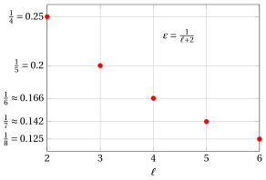
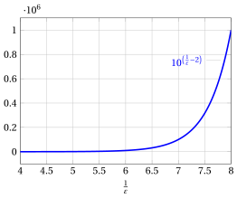

# Approximation algorithms for the knapsack problem

<div class="info-capitolo" markdown>

**Part 5 · Approximation algorithms · Chapter 25** · [:material-file-pdf-box: Lecture notes, volume 5 (PDF)](../pdf/lecture-notes-5-approximation-algorithms.pdf) · [:material-pencil: Exercises](../exercises/knapsack-approximation.md)

</div>

!!! nota "Prerequisites"

    - From this module, the chapter «Approximation algorithms»: performance ratio, relative and absolute performance guarantees, tightness, approximation schemes, PTAS and FPTAS.

    - From this module, the chapters «Knapsack problems» and «Knapsack formulations»: the KP, the LP relaxation $\LP_{\KP}$ and the bound of Dantzig, which uses the split item.

    - From this module, the chapters «Constructive heuristics» and «Dynamic programming for the knapsack problem»: the greedy algorithm and the dynamic programming by profits, used by the Basic-FPTAS algorithm.

!!! chiave "Objectives"

    At the end of this chapter you will be able to:

    - execute the greedy, Ext-Greedy, $H^2$, $H^{\ell}$ and Basic-FPTAS algorithms by hand on a KP instance;

    - explain why the greedy algorithm has no constant guarantee, and why Ext-Greedy has guarantee $2$;

    - prove the guarantees $\frac{4}{3}$ of $H^2$, $\frac{\ell+2}{\ell+1}$ of $H^{\ell}$ and $\frac{1}{1-\varepsilon}$ of the Basic-FPTAS algorithm;

    - compare the running times of $H^{\ell}$ and of the Basic-FPTAS algorithm, and say why only the second one is an FPTAS;

    - explain why an absolute performance guarantee for the KP forces an exact algorithm.

## 25.1 The problem and the assumptions

<a id="box-1-def-KP"></a>

!!! definizione "Definition 25.1: Knapsack Problem"

    Given:

    1. a knapsack of <em>capacity</em> $c \in \Z_{\ge 1}$,

    2. a set $\mathscr{I} = \{1,2,\dots,n\}$ of $n$ items,

    3. for each item $i \in \mathscr{I}$, a <em>profit</em> $p_i \in \Z_{\ge 1}$ and a <em>weight</em> $w_i \in \Z_{\ge 1}$,

    the <strong>Knapsack Problem</strong> (KP) asks to decide which items to insert into the knapsack, so that the total weight of the selected items does not exceed the knapsack capacity, and the total profit of the selected items is maximized.

- We assume that any KP instance $I$ satisfies the problem assumptions, i.e.,

    $$
    0 < w_i \le c ~~~~\text{for all}~~~~ i \in \underbrace{\{1,2,\dots,n\}}_{=\mathscr{I}} ~~~~~~~\text{and}~~~~~~~ \sum_{i \in \mathscr{I}} w_i>c
    $$

    The first assumption guarantees that every item can be selected, the second one that not all the items fit together into the knapsack.

- We denote by $z(I)$ the <strong>optimal value</strong> of the KP on the instance $I$, and by $\mathscr{A}(I)$ the profit of the feasible solution returned by a heuristic algorithm $\mathscr{A}$. Since every heuristic of this document returns a feasible solution,

    $$
    \mathscr{A}(I) \le z(I) ~~~~~~~\text{and}~~~~~~~ \frac{z(I)}{\mathscr{A}(I)} \ge 1
    $$

    for every KP instance $I$.

- We assume throughout that the items are sorted by non-increasing efficiency

    $$
    \frac{p_i}{w_i} \ge \frac{p_{i+1}}{w_{i+1}}
    \qquad \text{for all} \qquad
    i \in \{1,2,\dots,n-1\},
    $$

    which requires $O(n \log n)$ time, a polynomial function of the number $n$ of items.

## 25.2 Split item and residual capacity

- We assume that any KP instance $I$ satisfies the problem assumptions, i.e.,

    $$
    0 < w_i \le c ~~~~\text{for all}~~~~ i \in \underbrace{\{1,2,\dots,n\}}_{=\mathscr{I}} ~~~~~~~\text{and}~~~~~~~ \sum_{i \in \mathscr{I}} w_i>c
    $$

<a id="box-2-def-split"></a>

!!! definizione "Definition 25.2: split item and residual capacity"

    Given a set $\mathscr{I}=\{1,2,\dots,n\}$ of $n$ items  ordered by non-increasing efficiency, the <strong>split item</strong> is the item

    \begin{equation*}
    {s} \in \mathscr{I}
    ~~~~\text{such that }~~~~
    \sum_{i=1}^{s-1} w_i \leq c
    ~~~~\text{and }~~~~
    \sum_{i=1}^{s} w_i > c
    \label{eq:split_item} \tag{25.1}
    \end{equation*}

    and the <strong>residual capacity</strong>  is

    \begin{equation*}
    \mathit{rc} = c - \sum_{i=1}^{s-1} w_i
    \label{eq:residual_capacity} \tag{25.2}
    \end{equation*}

- The split item is the first one that does not fit entirely in the knapsack if all the previous ones are all selected.

- The residual capacity is the knapsack capacity remaining  when all the items that precede the split item are selected.

- Sorting the items by non-increasing efficiency takes $O(n \log n)$ time, and the split item is then found by scanning them. It is worth knowing that the split item can also be found in $O(n)$ time, without sorting, by a weighted median search: the sorting is convenient, not necessary.

<a id="box-3-ex-split"></a>

!!! esempio "Example 25.1: split item and residual capacity"

    We consider a knapsack of capacity $c = 9$ and a set $\mathscr{I} = \{1,2,3,4,5,6,7\}$ of $7$ items ($n = 7$), with the following profits and weights:

    $$
    \begin{array}{l|ccccccc}
    \hline  & {i=1} & {i=2} & {i=3} & {i=4} & {i=5} & {i=6} & {i=7} \\
    \hline {p_i} & {6} & {5} & {8} & {9} & {6} & {7} & {3} \\
    {w_i} & {2} & {3} & {6} & {7} & {5} & {9} & {4} \\
    \hline
    \end{array}
    $$

    We refer to this KP instance as <span style="color:#1971c2">Example 1</span>. The efficiencies of the items are:

    $$
    \frac{p_1}{w_1}=\frac{6}{2},\quad
    \frac{p_2}{w_2}=\frac{5}{3},\quad
    \frac{p_3}{w_3}=\frac{8}{6},\quad
    \frac{p_4}{w_4}=\frac{9}{7},\quad
    \frac{p_5}{w_5}=\frac{6}{5},\quad
    \frac{p_6}{w_6}=\frac{7}{9},\quad
    \frac{p_7}{w_7}=\frac{3}{4}.
    $$

    Thus the items are sorted by non-increasing efficiency: $(1,\,2,\,3,\,4,\,5,\,6,\,7)$. The split item is $s=3$ since:

    $$
    \sum_{i=1}^{2} w_i = 2+3= 5 \le 9 \text{   and   } \sum_{i=1}^{3} w_i = 2+3 + 6= 11 > 9
    $$

    and the  residual capacity is:

    $$
    \mathit{rc} = c - \sum_{i=1}^{2} w_i = 9 - 2 - 3 = 4
    $$

## 25.3 The greedy algorithm

- We assume items are sorted in non-increasing order of efficiency

    $$
    \frac{p_i}{w_i} \ge \frac{p_{i+1}}{w_{i+1}}
    \quad \text{for all} \quad
    i \in \{1,2,\dots,n-1\}
    $$

!!! chiave ""

    The <em>greedy</em> algorithm (denoted by $GR$) is a constructive heuristic for the KP. It builds a feasible solution by processing the items in non-increasing order of <em>efficiency</em>, defined as the ratio between profit and weight. Starting from an empty subset of items, each item is added to the solution if and only if the capacity constraint is not violated.

- The pseudo-code of $GR$ reads as follows:

!!! algoritmo "Algorithm: Greedy"

    <div class="pseudocodice" markdown="0"><div class="pc" style="--liv:0"><strong>Input:</strong> KP instance <span class="arithmatex">\(I\)</span> with <span class="arithmatex">\(n\)</span> items, profits <span class="arithmatex">\(p[1..n]\)</span>, weights <span class="arithmatex">\(w[1..n]\)</span>, capacity <span class="arithmatex">\(c\)</span></div><div class="pc" style="--liv:0"><strong>Output:</strong> Feasible KP solution <span class="arithmatex">\(x[1..n]\)</span></div><div class="pc" style="--liv:0"><span class="pc-n">1</span><strong>Function</strong> Greedy(<span class="arithmatex">\(n, p, w, c\)</span>)</div><div class="pc" style="--liv:1"><span class="pc-n">2</span><span class="arithmatex">\(x := \text{new array}[1..n]\)</span> <span class="pc-com">▹ selected items</span></div><div class="pc" style="--liv:1"><span class="pc-n">3</span><strong>for</strong> <span class="arithmatex">\(i := 1\)</span> <strong>to</strong> <span class="arithmatex">\(n\)</span> <strong>do</strong></div><div class="pc" style="--liv:2"><span class="pc-n">4</span><span class="arithmatex">\(x[i] \leftarrow 0\)</span> <span class="pc-com">▹ item <span class="arithmatex">\(i\)</span> is initially not selected</span></div><div class="pc" style="--liv:1"><span class="pc-n">5</span><strong>end</strong></div><div class="pc" style="--liv:1"><span class="pc-n">6</span><span class="arithmatex">\(rc := c\)</span> <span class="pc-com">▹ residual capacity</span></div><div class="pc" style="--liv:1"><span class="pc-n">7</span><strong>for</strong> <span class="arithmatex">\(i := 1\)</span> <strong>to</strong> <span class="arithmatex">\(n\)</span> <strong>do</strong></div><div class="pc" style="--liv:2"><span class="pc-n">8</span><strong>if</strong> <span class="arithmatex">\(w[i] \le rc\)</span> <strong>then</strong></div><div class="pc" style="--liv:3"><span class="pc-n">9</span><span class="arithmatex">\(x[i] \leftarrow 1\)</span>
    <span class="arithmatex">\(rc \leftarrow rc - w[i]\)</span> <span class="pc-com">▹ select item <span class="arithmatex">\(i\)</span> update residual capacity</span></div><div class="pc" style="--liv:2"><span class="pc-n">10</span><strong>end</strong></div><div class="pc" style="--liv:1"><span class="pc-n">11</span><strong>end</strong></div><div class="pc" style="--liv:1"><span class="pc-n">12</span><strong>return</strong> <span class="arithmatex">\(x\)</span></div></div>

- Given the split item $s$, $GR$ selects all items that precede the split item, i.e.,

    $$
    \{1,2,\dots,s-1\}\subseteq S
    \qquad\text{and}\qquad
    GR(I)\ge \sum_{i=1}^{s-1} p_i.
    $$

    Moreover, item $s$ is not selected by $GR$, while $GR$ may also select some items that follow the split item.

<a id="box-4-ex-GR1"></a>

!!! esempio "Example 25.2: Execution of $GR$"

    For the KP instance of <span style="color:#1971c2">Example 1</span>, the items are sorted by non-increasing efficiency:

    $$
    (1,\,2,\,3,\,4,\,5,\,6,\,7).
    $$

    The execution of $GR$ proceeds as follows:

    1. Item $1$ (weight $w_1=2$) is selected. The available capacity $rc$ becomes $9-2=7$.

    2. Item $2$ (weight $w_2=3$) is selected. The available capacity $rc$ becomes $7-3=4$.

    3. Item $3$ (weight $w_3=6$) is not selected since it does not fit into the available capacity $rc=4$.

    4. Item $4$ (weight $w_4=7$) is not selected since it does not fit into the available capacity $rc=4$.

    5. Item $5$ (weight $w_5=5$) is not selected since it does not fit into the available capacity $rc=4$.

    6. Item $6$ (weight $w_6=9$) is not selected since it does not fit into the available capacity $rc=4$.

    7. Item $7$ (weight $w_7=4$) is selected. The available capacity $rc$ becomes $4-4=0$.

    Hence $GR$ returns the feasible solution:

    $$
    S=\{1,2,7\}.
    $$

    The total profit of the feasible solution is:

    $$
    GR(I)=\sum_{i\in S} p_i = p_1+p_2+p_7 = 6+5+3 = 14.
    $$

    Therefore, $14$ is a valid lower bound on the optimal value $z(I)$:

    $$
    14 \le z(I).
    $$

    In this instance the split item is $s=3$. Accordingly, $GR$ selects all items preceding the split item, i.e., items $1$ and $2$, does not select item $3$ (the split item), and then also selects item $7$, which follows the split item.

<a id="box-5-ex-GR2"></a>

!!! esempio "Example 25.3: Execution of $GR$"

    We consider a knapsack of capacity $c = 10$ and a set $\mathscr{I} = \{1,2,3,4\}$ of $4$ items ($n = 4$), with the following profits and weights:

    $$
    \begin{array}{l|cccc}
    \hline  & {i=1} & {i=2} & {i=3} & {i=4} \\
    \hline {p_i} & {6} & {8} & {19} & {4} \\
    {w_i} & {2} & {3} & {9} & {5} \\
    \hline
    \end{array}
    $$

    We refer to this KP instance as <span style="color:#1971c2">Example 2</span>. The efficiencies of the items are:

    $$
    \frac{p_1}{w_1}=\frac{6}{2},\quad
    \frac{p_2}{w_2}=\frac{8}{3},\quad
    \frac{p_3}{w_3}=\frac{19}{9},\quad
    \frac{p_4}{w_4}=\frac{4}{5}.
    $$

    Thus the items are sorted by non-increasing efficiency: $(1,\,2,\,3,\,4)$. The split item is $s=3$ since:

    $$
    \sum_{i=1}^{2} w_i = 2+3= 5 \le 10
    \ \ \text{   and   }\ \
    \sum_{i=1}^{3} w_i = 2+3+9= 14 > 10
    $$

    and the residual capacity is:

    $$
    \mathit{rc} = c - \sum_{i=1}^{2} w_i = 10 - 2 - 3 = 5.
    $$

    The execution of $GR$ proceeds as follows:

    1. Item $1$ (weight $w_1=2$) is selected. The available capacity $rc$ becomes $10-2=8$.

    2. Item $2$ (weight $w_2=3$) is selected. The available capacity $rc$ becomes $8-3=5$.

    3. Item $3$ (weight $w_3=9$) is not selected since it does not fit into the available capacity $rc=5$.

    4. Item $4$ (weight $w_4=5$) is selected. The available capacity $rc$ becomes $5-5=0$.

    Hence $GR$ returns the feasible solution:

    $$
    S=\{1,2,4\}.
    $$

    The total profit of the feasible solution is:

    $$
    GR(I)=\sum_{i\in S} p_i = p_1+p_2+p_4 = 6+8+4 = 18.
    $$

    Therefore, $18$ is a valid lower bound on the optimal value $z(I)$:

    $$
    18 \le z(I).
    $$

    In this instance the split item is $s=3$. Accordingly, $GR$ selects all items preceding the split item, i.e., items $1$ and $2$, does not select item $3$ (the split item), and then selects item $4$, which follows the split item. Item $3$ has the maximum profit ($p_3=19$) and it is optimal to select it alone, but it is not selected by $GR$.

<a id="box-6-ex-GR3"></a>

!!! esempio "Example 25.4: Execution of $GR$"

    We consider a knapsack of capacity $c = 10$ and a set $\mathscr{I} = \{1,2,3,4,5\}$ of $5$ items ($n = 5$), with the following profits and weights:

    $$
    \begin{array}{l|ccccc}
    \hline  & {i=1} & {i=2} & {i=3} & {i=4} & {i=5} \\
    \hline {p_i} & {4} & {6} & {5} & {12} & {3} \\
    {w_i} & {1} & {2} & {2} & {6} & {2} \\
    \hline
    \end{array}
    $$

    We refer to this KP instance as <span style="color:#1971c2">Example 3</span>. The efficiencies of the items are:

    $$
    \frac{p_1}{w_1}=\frac{4}{1}=4,\quad
    \frac{p_2}{w_2}=\frac{6}{2}=3,\quad
    \frac{p_3}{w_3}=\frac{5}{2}=2.5,\quad
    \frac{p_4}{w_4}=\frac{12}{6}=2,\quad
    \frac{p_5}{w_5}=\frac{3}{2}=1.5.
    $$

    Thus the items are sorted by non-increasing efficiency: $(1,\,2,\,3,\,4,\,5)$. The split item is $s=4$ since:

    $$
    \sum_{i=1}^{3} w_i = 1+2+2= 5 \le 10
    \ \ \text{   and   }\ \
    \sum_{i=1}^{4} w_i = 1+2+2+6= 11 > 10
    $$

    and the residual capacity is:

    $$
    \mathit{rc} = c - \sum_{i=1}^{3} w_i = 10 - 5 = 5.
    $$

    The execution of $GR$ proceeds as follows:

    1. Item $1$ (weight $w_1=1$) is selected. The available capacity $rc$ becomes $10-1=9$.

    2. Item $2$ (weight $w_2=2$) is selected. The available capacity $rc$ becomes $9-2=7$.

    3. Item $3$ (weight $w_3=2$) is selected. The available capacity $rc$ becomes $7-2=5$.

    4. Item $4$ (weight $w_4=6$) is not selected since it does not fit into the available capacity $rc=5$.

    5. Item $5$ (weight $w_5=2$) is selected. The available capacity $rc$ becomes $5-2=3$.

    Hence $GR$ returns the feasible solution:

    $$
    S=\{1,2,3,5\}.
    $$

    The total profit of the feasible solution is:

    $$
    GR(I)=\sum_{i\in S} p_i = p_1+p_2+p_3+p_5 = 4+6+5+3 = 18.
    $$

    Therefore, $18$ is a valid lower bound on the optimal value $z(I)$:

    $$
    18 \le z(I).
    $$

    In this instance the split item is $s=4$. Accordingly, $GR$ selects items $1$, $2$, and $3$ (which precede the split item), skips item $4$ (the split item), and then selects item $5$. The optimal solution is $\tilde{S}=\{2,3,4\}$ with value $z(I)=6+5+12=23$, which is better than the solution found by $GR$.

<a id="box-7-ex-GR4"></a>

!!! esempio "Example 25.5: Execution of $GR$"

    We consider a knapsack of capacity $c = 21$ and a set $\mathscr{I} = \{1,2,3,4,5,6\}$ of $6$ items ($n = 6$), with the following profits and weights:

    $$
    \begin{array}{l|cccccc}
    \hline  & {i=1} & {i=2} & {i=3} & {i=4} & {i=5} & {i=6} \\
    \hline {p_i} & {4} & {6} & {4} & {3} & {2} & {20} \\
    {w_i} & {1} & {2} & {2} & {2} & {2} & {21} \\
    \hline
    \end{array}
    $$

    We refer to this KP instance as <span style="color:#1971c2">Example 4</span>. The efficiencies of the items are:

    $$
    \frac{p_1}{w_1}=\frac{4}{1}=4,\quad
    \frac{p_2}{w_2}=\frac{6}{2}=3,\quad
    \frac{p_3}{w_3}=\frac{4}{2}=2,\quad
    \frac{p_4}{w_4}=\frac{3}{2}=1.5,\quad
    \frac{p_5}{w_5}=\frac{2}{2}=1,\quad
    \frac{p_6}{w_6}=\frac{20}{21}.
    $$

    Thus the items are sorted by non-increasing efficiency: $(1,\,2,\,3,\,4,\,5,\,6)$. The split item is $s=6$ since:

    $$
    \sum_{i=1}^{5} w_i = 1+2+2+2+2= 9 \le 21
    \ \ \text{   and   }\ \
    \sum_{i=1}^{6} w_i = 1+2+2+2+2+21= 30 > 21
    $$

    and the residual capacity is:

    $$
    \mathit{rc} = c - \sum_{i=1}^{5} w_i = 21 - 9 = 12.
    $$

    The execution of $GR$ proceeds as follows:

    1. Item $1$ (weight $w_1=1$) is selected. The available capacity $rc$ becomes $21-1=20$.

    2. Item $2$ (weight $w_2=2$) is selected. The available capacity $rc$ becomes $20-2=18$.

    3. Item $3$ (weight $w_3=2$) is selected. The available capacity $rc$ becomes $18-2=16$.

    4. Item $4$ (weight $w_4=2$) is selected. The available capacity $rc$ becomes $16-2=14$.

    5. Item $5$ (weight $w_5=2$) is selected. The available capacity $rc$ becomes $14-2=12$.

    6. Item $6$ (weight $w_6=21$) is not selected since it does not fit into the available capacity $rc=12$.

    Hence $GR$ returns the feasible solution:

    $$
    S=\{1,2,3,4,5\}.
    $$

    The total profit of the feasible solution is:

    $$
    GR(I)=\sum_{i\in S} p_i = p_1+p_2+p_3+p_4+p_5 = 4+6+4+3+2 = 19.
    $$

    Therefore, $19$ is a valid lower bound on the optimal value $z(I)$:

    $$
    19 \le z(I).
    $$

    In this instance, the item with maximum profit is item $6$ with $p_6=20$, which appears last in the efficiency-sorted order. The greedy algorithm $GR$ selects all items from $1$ to $5$ (which precede the split item), but does not select item $6$ (the split item itself) because its weight $w_6=21$ exceeds the residual capacity $rc=12$. Item $6$ alone would fit into the knapsack (since $w_6=21 \le c=21$) and would give a profit of $20$, which is better than the greedy solution. The optimal solution is $\tilde{S}=\{6\}$ with value $z(I)=20$.

## 25.4 The Ext-Greedy algorithm

!!! chiave ""

    The <em>Ext-Greedy</em> algorithm (denoted by $GR^e$) is a constructive heuristic for the KP. It first computes a feasible solution by running the greedy algorithm $GR$. Then it compares this solution with the best feasible solution consisting of a single item. Finally, it returns the better of the two solutions.

- The pseudo-code of $GR^e$ reads as follows:

!!! algoritmo "Algorithm: Extended Greedy"

    <div class="pseudocodice" markdown="0"><div class="pc" style="--liv:0"><strong>Input:</strong> KP instance <span class="arithmatex">\(I\)</span> with <span class="arithmatex">\(n\)</span> items, profits <span class="arithmatex">\(p[1..n]\)</span>, weights <span class="arithmatex">\(w[1..n]\)</span>, capacity <span class="arithmatex">\(c\)</span></div><div class="pc" style="--liv:0"><strong>Output:</strong> Feasible KP solution <span class="arithmatex">\(x[1..n]\)</span></div><div class="pc" style="--liv:0"><span class="pc-n">1</span><strong>Function</strong> ExtendedGreedy(<span class="arithmatex">\(n, p, w, c\)</span>)</div><div class="pc" style="--liv:1"><span class="pc-n">2</span><span class="arithmatex">\(x := Greedy(n, p, w, c)\)</span>
    <span class="arithmatex">\(z := 0\)</span> <span class="pc-com">▹ greedy solution value of the greedy solution</span></div><div class="pc" style="--liv:1"><span class="pc-n">3</span><strong>for</strong> <span class="arithmatex">\(i := 1\)</span> <strong>to</strong> <span class="arithmatex">\(n\)</span> <strong>do</strong></div><div class="pc" style="--liv:2"><span class="pc-n">4</span><strong>if</strong> <span class="arithmatex">\(x[i] = 1\)</span> <strong>then</strong></div><div class="pc" style="--liv:3"><span class="pc-n">5</span><span class="arithmatex">\(z \leftarrow z + p[i]\)</span> <span class="pc-com">▹ add the profit of a selected item</span></div><div class="pc" style="--liv:2"><span class="pc-n">6</span><strong>end</strong></div><div class="pc" style="--liv:1"><span class="pc-n">7</span><strong>end</strong></div><div class="pc" style="--liv:1"><span class="pc-n">8</span><span class="arithmatex">\(i_m := 1\)</span>
    <span class="arithmatex">\(p_{\max} := p[1]\)</span> <span class="pc-com">▹ best single item</span></div><div class="pc" style="--liv:1"><span class="pc-n">9</span><strong>for</strong> <span class="arithmatex">\(i := 2\)</span> <strong>to</strong> <span class="arithmatex">\(n\)</span> <strong>do</strong></div><div class="pc" style="--liv:2"><span class="pc-n">10</span><strong>if</strong> <span class="arithmatex">\(p[i] > p_{\max}\)</span> <strong>then</strong></div><div class="pc" style="--liv:3"><span class="pc-n">11</span><span class="arithmatex">\(i_m \leftarrow i\)</span>
    <span class="arithmatex">\(p_{\max} \leftarrow p[i]\)</span> <span class="pc-com">▹ update best single item update its profit</span></div><div class="pc" style="--liv:2"><span class="pc-n">12</span><strong>end</strong></div><div class="pc" style="--liv:1"><span class="pc-n">13</span><strong>end</strong></div><div class="pc" style="--liv:1"><span class="pc-n">14</span><span class="arithmatex">\(\bar{x} := \text{new array}[1..n]\)</span> <span class="pc-com">▹ best single-item solution</span></div><div class="pc" style="--liv:1"><span class="pc-n">15</span><strong>for</strong> <span class="arithmatex">\(i := 1\)</span> <strong>to</strong> <span class="arithmatex">\(n\)</span> <strong>do</strong></div><div class="pc" style="--liv:2"><span class="pc-n">16</span><span class="arithmatex">\(\bar{x}[i] \leftarrow 0\)</span></div><div class="pc" style="--liv:1"><span class="pc-n">17</span><strong>end</strong></div><div class="pc" style="--liv:1"><span class="pc-n">18</span><span class="arithmatex">\(\bar{x}[i_m] \leftarrow 1\)</span> <span class="pc-com">▹ select only item <span class="arithmatex">\(i_m\)</span></span></div><div class="pc" style="--liv:1"><span class="pc-n">19</span><strong>if</strong> <span class="arithmatex">\(z < p_{\max}\)</span> <strong>then</strong></div><div class="pc" style="--liv:2"><span class="pc-n">20</span><strong>for</strong> <span class="arithmatex">\(i := 1\)</span> <strong>to</strong> <span class="arithmatex">\(n\)</span> <strong>do</strong></div><div class="pc" style="--liv:3"><span class="pc-n">21</span><span class="arithmatex">\(x[i] \leftarrow \bar{x}[i]\)</span> <span class="pc-com">▹ copy component by component</span></div><div class="pc" style="--liv:2"><span class="pc-n">22</span><strong>end</strong></div><div class="pc" style="--liv:1"><span class="pc-n">23</span><strong>end</strong></div><div class="pc" style="--liv:1"><span class="pc-n">24</span><strong>return</strong> <span class="arithmatex">\(x\)</span></div></div>

- Let $p_{\max}$ be the <strong>maximum profit</strong>

    $$
    p_{\max}=\max\big\{~p_i:\ i\in\mathscr{I} ~\big\}.
    $$

    and let $\bar{S}$ be the <strong>best single-item feasible solution</strong>

    $$
    \bar{S}=\big\{~i_m ~\big\}
    ~~\text{and}~~
    i_m\in \arg\max\big\{~p_i:\ i\in\mathscr{I}~\big\}
    $$

<a id="box-8-ex-GRe1"></a>

!!! esempio "Example 25.6: Execution of $GR^e$"

    We start from the feasible solution computed by $GR$ on the KP instance of <span style="color:#1971c2">Example 1</span>:

    $$
    S=\{1,2,7\},
    \qquad
    GR(I)=\sum_{i\in S} p_i = p_1+p_2+p_7 = 6+5+3 = 14.
    $$

    We now compute the maximum profit of a single item:

    $$
    p_{\max}=\max\big\{~p_i:\ i\in\mathscr{I} ~\big\}=p_4=9,
    \qquad
    \bar{S}=\{4\}.
    $$

    Since $14\ge 9$, $GR^e$ keeps the greedy solution and returns

    $$
    S=\{1,2,7\}.
    $$

<a id="box-9-ex-GRe2"></a>

!!! esempio "Example 25.7: Execution of $GR^e$"

    We start from the feasible solution computed by $GR$ on the KP instance of <span style="color:#1971c2">Example 2</span>:

    $$
    S=\{1,2,4\},
    \qquad
    GR(I)=\sum_{i\in S} p_i = p_1+p_2+p_4 = 6+8+4 = 18.
    $$

    We now compute the maximum profit of a single item:

    $$
    p_{\max}=\max\big\{~p_i:\ i\in\mathscr{I} ~\big\}=p_3=19,
    \qquad
    \bar{S}=\{3\}.
    $$

    Since $18<19$, $GR^e$ replaces the greedy solution with the best single-item feasible solution and returns

    $$
    S=\{3\}.
    $$

- Given the split item $s$, we have

    $$
    GR^e(I)\ge GR(I)\ge \sum_{i=1}^{s-1} p_i.
    $$

    In addition, by definition of $GR^e$, we have

    $$
    GR^e(I)\ge p_{\max}
    $$

- For every KP instance $I$, the objective values satisfy

    $$
    GR(I)\ \le\ GR^e(I)\ \le\ z(I).
    $$

    This holds because $GR^e$ returns the better between the greedy solution and the best single-item feasible solution, so it cannot be worse than $GR$, and any feasible solution value is at most the optimal value $z(I)$.

## 25.5 The $H^2$ algorithm { #sez-sec-H2 }

!!! chiave ""

    The $H^2$ algorithm is a constructive heuristic for the KP; it is the algorithm called $G^{3/4}$ in the literature. It enumerates all feasible pairs of items $(i,k)$ and “guesses” that the two items belong to an optimal solution. For each pair, it fixes $i$ and $k$ in the knapsack, builds a residual instance using the remaining capacity and keeping only items with profit at most $\min\{p_i,p_k\}$, and then completes the partial solution by running the Ext-Greedy algorithm $GR^e$ on the residual instance. Finally, it returns the best solution found over all pairs, also comparing it with the best single-item feasible solution.

!!! algoritmo "Algorithm: $H^2$"

    <div class="pseudocodice" markdown="0"><div class="pc" style="--liv:0"><strong>Input:</strong> KP instance <span class="arithmatex">\(I\)</span> with item set <span class="arithmatex">\(\mathscr{I}=\{1,2,\dots,n\}\)</span>, profits <span class="arithmatex">\(p[1..n]\)</span>, weights <span class="arithmatex">\(w[1..n]\)</span>, capacity <span class="arithmatex">\(c\)</span></div><div class="pc" style="--liv:0"><strong>Output:</strong> Feasible KP value <span class="arithmatex">\(H^2(I)\)</span></div><div class="pc" style="--liv:0"><span class="pc-n">1</span><strong>Function</strong> H2(<span class="arithmatex">\(\mathscr{I}, p, w, c\)</span>)</div><div class="pc" style="--liv:1"><span class="pc-n">2</span><span class="arithmatex">\(p_{\max} := \max\{p[j]: j\in \mathscr{I}\}\)</span></div><div class="pc" style="--liv:1"><span class="pc-n">3</span><span class="arithmatex">\(lb := p_{\max}\)</span>
    <span class="arithmatex">\(\mathscr{P} := \big\{(i,k)\in \mathscr{I}\times\mathscr{I}: i<k,\ w[i]+w[k]\le c\big\}\)</span> <span class="pc-com">▹ best value found</span></div><div class="pc" style="--liv:1"><span class="pc-n">4</span><strong>for each</strong> <span class="arithmatex">\((i,k)\)</span> <strong>in</strong> <span class="arithmatex">\(\mathscr{P}\)</span> <strong>do</strong></div><div class="pc" style="--liv:2"><span class="pc-n">5</span><span class="arithmatex">\(\mathit{rc} := c-w[i]-w[k]\)</span>
    <span class="arithmatex">\(\mathscr{I}(i,k) := \big\{j\in \mathscr{I}\setminus\{i,k\}: p[j]\le \min\{p[i],p[k]\},\ w[j]\le \mathit{rc}\big\}\)</span> <span class="pc-com">▹ residual capacity</span></div><div class="pc" style="--liv:2"><span class="pc-n">6</span><span class="arithmatex">\(I_{ik} := \text{KP instance restricted to } \mathscr{I}(i,k) \text{ with capacity } \mathit{rc}\)</span></div><div class="pc" style="--liv:2"><span class="pc-n">7</span><span class="arithmatex">\(z_{res} := GR^e\big(I_{ik}\big)\)</span>
    <span class="arithmatex">\(lb_{ik} := p[i]+p[k]+z_{res}\)</span> <span class="pc-com">▹ value of <span class="arithmatex">\(GR^e\)</span> on the residual instance</span></div><div class="pc" style="--liv:2"><span class="pc-n">8</span><strong>if</strong> <span class="arithmatex">\(lb_{ik} > lb\)</span> <strong>then</strong></div><div class="pc" style="--liv:3"><span class="pc-n">9</span><span class="arithmatex">\(lb \leftarrow lb_{ik}\)</span></div><div class="pc" style="--liv:2"><span class="pc-n">10</span><strong>end</strong></div><div class="pc" style="--liv:1"><span class="pc-n">11</span><strong>end</strong></div><div class="pc" style="--liv:1"><span class="pc-n">12</span><strong>return</strong> <span class="arithmatex">\(lb\)</span></div></div>

<a id="box-10-def-pairs"></a>

!!! definizione "Definition 25.3: feasible ordered pairs of items"

    Given a KP instance with item set $\mathscr{I}=\{1,2,\dots,n\}$ and knapsack capacity $c$, the <strong>set of all feasible ordered pairs of items</strong> is

    \begin{equation*}
    \mathscr{P}
    =
    \Big\{~~ (j,k)\in \mathscr{I}\times\mathscr{I}:\ j<k,\ \ w_j+w_k\le c ~~\Big\}.
    \label{eq:feasible_pairs} \tag{25.3}
    \end{equation*}

- The $H^2$ algorithm is based on the following idea: an optimal solution either consists of a single item, the one of maximum profit, or contains (at least) two items of “large” profit. The algorithm therefore <em>guesses</em> the two items of largest profit of an optimal solution, by enumerating all the feasible pairs in $\mathscr{P}$, and completes each guess on a residual instance.

- The $H^2$ algorithm considers  the item pairs $(i,k) \in \mathscr{P}$, one at a time, and it executes three operations:

    1. The <strong>first operation</strong>  consists of inserting items $i$ and $k$ into the knapsack. This creates a <strong>partial solution</strong> of profit $p_i+p_k$  and a <strong>residual capacity</strong> $c- w_i-w_k$.

    2. The <strong>second operation</strong> is the creation of a <strong>residual instance</strong> (denoted $I(i,k)$) containing only the items  with profit smaller than or equal to the profits of the two inserted items. The <strong>residual set of item</strong> is:

        $$
        \mathscr{I}(i,k)=\bigg\{j \in \mathscr{I} \setminus \{i,k\}:~~ p_j \le \min \big\{p_{i},p_{k}\},~~ w_{j} \le c - w_{i}-w_{k} \bigg\}
        $$

        The items with weight larger than the residual capacity are also discarded.

    3. The <strong>third operation</strong> is to complete the partial solution by executing the $GR^e$ algorithm on the residual instance $I(i,k)$.

- For each item pair $(i,k) \in \mathscr{P}$, we have the lower bound:

    $$
    lb(i,k) = p_i+p_k + GR^e\big(I(i,k)\big)
    $$

    the global lower bound produced by the $H^2$ algorithm is:

    $$
    H^2(I) = \max \left\{ ~~\max_{(i,k) \in \mathscr{P}} \big\{ ~~lb(i,k)~~ \big\},~~ p_{\max} \right\}
    $$

!!! chiave ""

    This heuristic algorithm can be seen as “guessing” the two items with largest profit in an optimal solution (or the item with the largest profit).

<a id="box-11-ex-G34"></a>

!!! esempio "Example 25.8: $H^2$ algorithm"

    We consider a set $N=\{1,2,3,4,5,6,7\}$ of $7$ items ($n=7$) with the following profits and weights:

    <div class="tabella" markdown="0"><table>
    <tr>
    <td>item</td>
    <td><span class="arithmatex">\(p_j\)</span></td>
    <td><span class="arithmatex">\(w_j\)</span></td>
    <td><span class="arithmatex">\(\frac{p_j}{w_j}\)</span></td>
    <td>efficiency</td>
    </tr>
    <tr>
    <td><span class="arithmatex">\(j=1\)</span></td>
    <td>6</td>
    <td>2</td>
    <td><span class="arithmatex">\(\frac{6}{2}\)</span></td>
    <td><span class="arithmatex">\(=3\)</span></td>
    </tr>
    <tr>
    <td><span class="arithmatex">\(j=2\)</span></td>
    <td>5</td>
    <td>3</td>
    <td><span class="arithmatex">\(\frac{5}{3}\)</span></td>
    <td><span class="arithmatex">\(\approx 1.66\)</span></td>
    </tr>
    <tr>
    <td><span class="arithmatex">\(j=3\)</span></td>
    <td>8</td>
    <td>6</td>
    <td><span class="arithmatex">\(\frac{8}{6}\)</span></td>
    <td><span class="arithmatex">\(\approx 1.33\)</span></td>
    </tr>
    <tr>
    <td><span class="arithmatex">\(j=4\)</span></td>
    <td>9</td>
    <td>7</td>
    <td><span class="arithmatex">\(\frac{9}{7}\)</span></td>
    <td><span class="arithmatex">\(\approx 1.28\)</span></td>
    </tr>
    <tr>
    <td><span class="arithmatex">\(j=5\)</span></td>
    <td>6</td>
    <td>5</td>
    <td><span class="arithmatex">\(\frac{6}{5}\)</span></td>
    <td><span class="arithmatex">\(=1.2\)</span></td>
    </tr>
    <tr>
    <td><span class="arithmatex">\(j=6\)</span></td>
    <td>7</td>
    <td>9</td>
    <td><span class="arithmatex">\(\frac{7}{9}\)</span></td>
    <td><span class="arithmatex">\(\approx 0.77\)</span></td>
    </tr>
    <tr>
    <td><span class="arithmatex">\(j=7\)</span></td>
    <td>3</td>
    <td>4</td>
    <td><span class="arithmatex">\(\frac{3}{4}\)</span></td>
    <td><span class="arithmatex">\(=0.75\)</span></td>
    </tr>
    </table></div>

    and a knapsack capacity $c=12$, so that $p_{\max}=9$. The optimal solution is $\tilde{S}=\{1,2,4\}$, of weight $2+3+7=12$ and value $z(I)=6+5+9=20$. The split item is $s=4$, and $GR^e$ returns the solution $\{1,2,3\}$ with $GR^e(I)=6+5+8=19$.

    <strong>Execution of $H^2$</strong> (initialization $lb=p_{\max}=9$):

    - Pair $(1,2)$: the residual capacity is $\bar c=12-2-3=7$, $\mathscr{I}(1,2)=\{7\}$ and $GR^e\big(I(1,2)\big)=3$, hence $lb(1,2)=6+5+3=14>lb$ and $lb$ is updated to $14$.

    - Pair $(1,3)$: the residual capacity is $\bar c=12-2-6=4$, $\mathscr{I}(1,3)=\{2,7\}$ and $GR^e\big(I(1,3)\big)=5$, hence $lb(1,3)=6+8+5=19>lb$ and $lb$ is updated to $19$.

    - Pair $(1,4)$: the residual capacity is $\bar c=12-2-7=3$, $\mathscr{I}(1,4)=\{2\}$ and $GR^e\big(I(1,4)\big)=5$, hence $lb(1,4)=6+9+5=20>lb$ and $lb$ is updated to $20$.

    - Pair $(1,5)$: the residual capacity is $\bar c=12-2-5=5$, $\mathscr{I}(1,5)=\{2,7\}$ and $GR^e\big(I(1,5)\big)=5$, hence $lb(1,5)=6+6+5=17<lb$.

    - Pair $(1,6)$: the residual capacity is $\bar c=12-2-9=1$, $\mathscr{I}(1,6)=\varnothing$, hence $lb(1,6)=6+7=13<lb$.

    - Pair $(1,7)$: the residual capacity is $\bar c=12-2-4=6$, $\mathscr{I}(1,7)=\varnothing$, hence $lb(1,7)=6+3=9<lb$.

    - The pairs $(i,k)$ with $i \ge 2$ are processed in the same way, and none of them gives a value larger than $20$. Hence $H^2(I)=20=z(I)$: on this instance $H^2$ finds the optimal solution, which $GR^e$ misses.

<a id="box-12-prop-G34time"></a>

!!! teorema "Proposition 25.4"

    The $H^2$ algorithm can be computed in $O(n^3)$ time, and in $O(n^2)$ time with a more careful implementation.

- We do not provide a formal proof but we only give the main ideas in what follows.

- The running time of the $H^2$ algorithm is basically determined by executing the $GR^e$ algorithm, which requires $O(n)$ time, for every pair of items. This number of execution of $GR^e$ is $n \choose 2$ which is in $O(n^2 )$ and hence the total running time is $O(n^3)$.

- With a cleverer  implementation it can be reduced to $O(n^2 )$.

## 25.6 The $H^{\ell}$ algorithm

!!! chiave ""

    The $H^{\ell}$ algorithm is a constructive heuristic for the KP. It first computes the best feasible solution made of at most $\ell-1$ items. Then it enumerates all the feasible sets $L$ of exactly $\ell$ items and “guesses” that they are the $\ell$ items of largest profit of an optimal solution: for each set, it packs the items of $L$, builds a residual instance with the remaining capacity and the items of profit at most $\min\{p_i : i \in L\}$, and completes the partial solution by running the Ext-Greedy algorithm $GR^e$ on the residual instance. Finally, it returns the best solution found.

!!! algoritmo "Algorithm: $H^{\ell}$"

    <div class="pseudocodice" markdown="0"><div class="pc" style="--liv:0"><strong>Input:</strong> KP instance <span class="arithmatex">\(I\)</span> with item set <span class="arithmatex">\(\mathscr{I}=\{1,2,\dots,n\}\)</span>, profits <span class="arithmatex">\(p[1..n]\)</span>, weights <span class="arithmatex">\(w[1..n]\)</span>, capacity <span class="arithmatex">\(c\)</span>, integer <span class="arithmatex">\(\ell\)</span> with <span class="arithmatex">\(2\le\ell\le n\)</span></div><div class="pc" style="--liv:0"><strong>Output:</strong> Feasible KP value <span class="arithmatex">\(H^{\ell}(I)\)</span></div><div class="pc" style="--liv:0"><span class="pc-n">1</span><strong>Function</strong> Hl(<span class="arithmatex">\(\mathscr{I}, p, w, c, \ell\)</span>)</div><div class="pc" style="--liv:1"><span class="pc-n">2</span><span class="arithmatex">\(lb := \max\big\{\sum_{j\in S} p[j] : S \in \widehat{T}(\ell)\big\}\)</span> <span class="pc-com">▹ feasible sets of at most <span class="arithmatex">\(\ell-1\)</span> items</span></div><div class="pc" style="--liv:1"><span class="pc-n">3</span><strong>for each</strong> <span class="arithmatex">\(L\)</span> <strong>in</strong> <span class="arithmatex">\(T(\ell)\)</span> <strong>do</strong> <span class="pc-com">▹ feasible sets of exactly <span class="arithmatex">\(\ell\)</span> items</span></div><div class="pc" style="--liv:2"><span class="pc-n">4</span><span class="arithmatex">\(\mathit{rc} := c-\sum_{i\in L} w[i]\)</span>
    <span class="arithmatex">\(\mathscr{I}(L) := \big\{j\in \mathscr{I}\setminus L: p[j]\le \min_{i\in L} p[i],\ w[j]\le \mathit{rc}\big\}\)</span> <span class="pc-com">▹ residual capacity</span></div><div class="pc" style="--liv:2"><span class="pc-n">5</span><span class="arithmatex">\(lb_L := \sum_{i\in L} p[i] + GR^e\big(I(L)\big)\)</span> <span class="pc-com">▹ complete the guess</span></div><div class="pc" style="--liv:2"><span class="pc-n">6</span><strong>if</strong> <span class="arithmatex">\(lb_L > lb\)</span> <strong>then</strong></div><div class="pc" style="--liv:3"><span class="pc-n">7</span><span class="arithmatex">\(lb \leftarrow lb_L\)</span></div><div class="pc" style="--liv:2"><span class="pc-n">8</span><strong>end</strong></div><div class="pc" style="--liv:1"><span class="pc-n">9</span><strong>end</strong></div><div class="pc" style="--liv:1"><span class="pc-n">10</span><strong>return</strong> <span class="arithmatex">\(lb\)</span></div></div>

- The $H^2$ algorithm guesses the <em>two</em> items of largest profit of an optimal solution. The $H^{\ell}$ algorithm generalizes this idea: it guesses the $\ell$ items of largest profit, for a fixed integer $\ell$ with $2 \le \ell \le n$. For $\ell=2$ it is exactly the $H^2$ algorithm.

- We define the collections of all feasible sets of exactly $\ell$ items and of at most $\ell-1$ items:

    $$
    T(\ell) = \left\{ L  \subseteq \mathscr{I}:~~ \sum_{j \in L} w_j \le c, ~~|L|  = \ell \right\}
    $$

    and

    $$
    {\widehat T}(\ell) = \left\{ L  \subseteq \mathscr{I}:~~ \sum_{j \in L} w_j \le c, ~~|L|  \le \ell-1 \right\}
    $$

- For each set $L \in T(\ell)$ the algorithm executes three operations:

    1. it inserts all items $i \in L$ into the knapsack, which creates a <strong>partial solution</strong> of profit $\sum_{i \in L} p_i$ and a <strong>residual capacity</strong> $c-\sum_{i \in L}w_i$;

    2. it creates the <strong>residual instance</strong> $I(L)$, whose <strong>residual set of items</strong> is

        $$
        \mathscr{I}(L)=\bigg\{j \in \mathscr{I} \setminus L:~~ p_j \le \min \big\{p_{i}: i \in L\},~~ w_{j} \le c - \sum_{i \in L} w_i \bigg\};
        $$

    3. it completes the partial solution by running $GR^e$ on $I(L)$, which gives the value

        $$
        lb(L) = \sum_{i \in L} p_i + GR^e\big(I(L)\big).
        $$

- The value returned by the algorithm is

    $$
    H^{\ell}(I) = \max \left\{ \max_{L \in T(\ell)} lb(L),~~ \max_{S \in {\widehat T}(\ell)} \sum_{j \in S} p_j \right\}.
    $$

<a id="box-13-ex-Hl"></a>

!!! esempio "Example 25.9: Execution of $H^{\ell}$"

    We consider a knapsack of capacity $c = 12$ and a set $\mathscr{I} = \{1,2,3,4,5\}$ of $5$ items ($n=5$), with the following profits and weights:

    $$
    \begin{array}{l|ccccc}
    \hline  & {i=1} & {i=2} & {i=3} & {i=4} & {i=5} \\[1ex]
    \hline {p_i} & {2} & {3} & {3} & {3} & {3} \\[1ex]
    {w_i} & {1} & {3} & {3} & {3} & {3} \\[1ex]
    \hline
    \end{array}
    $$

    The items are sorted by non-increasing efficiency, since $\frac{2}{1}=2>\frac{3}{3}=1$. The optimal solution packs the four items of weight $3$, with $z(I)=12$.

    <strong>With $\ell=2$</strong>, i.e., the $H^2$ algorithm of Section [25.5](#sez-sec-H2). A pair of two items of profit $3$, for instance $L=\{2,3\}$, leaves residual capacity $6$ and the residual set $\mathscr{I}(L)=\{1,4,5\}$: $GR^e$ packs item $1$ and item $4$, of profit $2+3=5$, so $lb(L)=3+3+5=11$. A pair containing item $1$ leaves an empty residual set, since no other item has profit at most $2$. Hence $H^2(I)=11<12$.

    <strong>With $\ell=3$.</strong> A set of three items of profit $3$, for instance $L=\{2,3,4\}$, leaves residual capacity $3$ and the residual set $\mathscr{I}(L)=\{1,5\}$: $GR^e$ returns the best between item $1$ alone (profit $2$, then item $5$ no longer fits) and item $5$ alone (profit $3$), so $lb(L)=9+3=12$. Hence $H^3(I)=12=z(I)$.

    Guessing one item more is enough to find the optimal solution on this instance, on which $H^2$ does not.

<a id="box-14-obs-Hltime"></a>

!!! teorema "Observation 25.5"

    The $H^{\ell}$ algorithm can be computed in $O(n^{\ell+1})$ time.

- The running time is determined by the executions of $GR^e$, which requires $O(n)$ time, one for every set in $T(\ell)$. There are at most $\binom{n}{\ell}$ such sets, which is in $O(n^{\ell})$, hence the total running time is $O(n^{\ell+1})$. With a more careful implementation it can be reduced to $O(n^{\ell})$.

- Besides storing the input data, no significant additional memory is used, and the total space requirement is only $O(n)$.

## 25.7 The Basic-FPTAS algorithm

- The $H^{\ell}$ algorithm enumerates $O(n^{\ell})$ sets of items, a number that grows very quickly with $\ell$. The Basic-FPTAS algorithm follows a completely different route: instead of guessing items, it rounds the profits and solves the rounded instance exactly.

!!! chiave ""

    The <em>Basic-FPTAS</em> algorithm (denoted by $FP^{\varepsilon}$) replaces the item profits by scaled profits, which take few distinct values, and then solves the scaled instance <em>to optimality</em> by dynamic programming by profits. The optimal solution of the scaled instance is returned as a feasible solution of the original instance, which in general is not optimal.

!!! algoritmo "Algorithm: Basic-FPTAS"

    <div class="pseudocodice" markdown="0"><div class="pc" style="--liv:0"><strong>Input:</strong> KP instance <span class="arithmatex">\(I\)</span> with <span class="arithmatex">\(n\)</span> items, profits <span class="arithmatex">\(p[1..n]\)</span>, weights <span class="arithmatex">\(w[1..n]\)</span>, capacity <span class="arithmatex">\(c\)</span>, accuracy <span class="arithmatex">\(\varepsilon \in (0,1)\)</span></div><div class="pc" style="--liv:0"><strong>Output:</strong> Feasible KP solution <span class="arithmatex">\(x[1..n]\)</span></div><div class="pc" style="--liv:0"><span class="pc-n">1</span><strong>Function</strong> BasicFPTAS(<span class="arithmatex">\(n, p, w, c, \varepsilon\)</span>)</div><div class="pc" style="--liv:1"><span class="pc-n">2</span><span class="arithmatex">\(lb := GR^e(I)\)</span>
    <span class="arithmatex">\(K := \varepsilon \cdot lb / n\)</span> <span class="pc-com">▹ value of the Ext-Greedy solution, a lower bound on <span class="arithmatex">\(z(I)\)</span> scaling factor</span></div><div class="pc" style="--liv:1"><span class="pc-n">3</span><strong>for</strong> <span class="arithmatex">\(j := 1\)</span> <strong>to</strong> <span class="arithmatex">\(n\)</span> <strong>do</strong></div><div class="pc" style="--liv:2"><span class="pc-n">4</span><span class="arithmatex">\(p'[j] \leftarrow \lfloor p[j]/K \rfloor\)</span> <span class="pc-com">▹ scaled profit</span></div><div class="pc" style="--liv:1"><span class="pc-n">5</span><strong>end</strong></div><div class="pc" style="--liv:1"><span class="pc-n">6</span><span class="arithmatex">\(Q := \lfloor 2n/\varepsilon \rfloor\)</span>
    <span class="arithmatex">\(x := DPProfits(n, p', w, c, Q)\)</span> <span class="pc-com">▹ upper bound on the optimal value of the scaled instance scaled instance solved to optimality, table truncated at <span class="arithmatex">\(Q\)</span></span></div><div class="pc" style="--liv:1"><span class="pc-n">7</span><strong>return</strong> <span class="arithmatex">\(x\)</span></div></div>

- The <strong>scaling factor</strong> is

    $$
    K = \frac{\varepsilon\,GR^e(I)}{n},
    $$

    and the <strong>scaled profits</strong> are obtained by rounding down the profits to a multiple of $K$:

    $$
    p'_j = \left\lfloor \frac{p_j}{K} \right\rfloor
    \qquad \text{for all} \qquad j \in \mathscr{I}.
    $$

    The scaled instance $I'$ has the same weights and the same capacity as $I$, hence $I$ and $I'$ have exactly the same feasible solutions.

- <strong>The profits are scaled, not the weights.</strong> Rounding the weights down would make infeasible solutions look feasible, and rounding them up would discard solutions that are feasible: in both cases the scaled instance would answer a different question. Rounding the profits down, instead, keeps the set of feasible solutions untouched and only distorts the objective function.

- <strong>The scaled instance is solved by dynamic programming by profits</strong>, the second DP algorithm of the dynamic programming notes: $u(i,q)$ is the minimum total weight of a subset of $\{1,2,\dots,i\}$ of total profit exactly $q$, and the optimal value is the largest $q$ with $u(n,q)\le c$. The table is truncated at $Q=\lfloor 2n/\varepsilon\rfloor$, which is not smaller than the optimal value of the scaled instance ([Observation 25.15](#box-25-obs-fptastime)), so its size is $n\times Q$ and the running time is $O(n\,Q)=O(n^2/\varepsilon)$.

<a id="box-15-ex-fptas"></a>

!!! esempio "Example 25.10: Execution of $FP^{\varepsilon}$"

    We consider a knapsack of capacity $c = 8$ and a set $\mathscr{I} = \{1,2,3,4\}$ of $4$ items ($n = 4$), with the following profits and weights:

    $$
    \begin{array}{l|cccc}
    \hline  & {i=1} & {i=2} & {i=3} & {i=4} \\[1ex]
    \hline {p_i} & {19} & {19} & {14} & {14} \\[1ex]
    {w_i} & {2} & {4} & {3} & {3} \\[1ex]
    \hline
    \end{array}
    $$

    The items are sorted by non-increasing efficiency, since $\frac{19}{2}=9.5 > \frac{19}{4}=4.75 > \frac{14}{3}\approx 4.67$. We run $FP^{\varepsilon}$ with $\varepsilon=\frac{1}{2}$.

    <strong>Lower bound.</strong> $GR$ packs item $1$ (residual capacity $8-2=6$) and item $2$ (residual capacity $6-4=2$), while items $3$ and $4$ do not fit, so $GR(I)=19+19=38$. The best single item has profit $19 \le 38$, hence

    $$
    GR^e(I)=38 .
    $$

    <strong>Scaling.</strong> The scaling factor and the scaled profits are

    $$
    K = \frac{\varepsilon\,GR^e(I)}{n} = \frac{\frac{1}{2}\cdot 38}{4} = 4.75,
    \qquad
    p'_1=p'_2=\left\lfloor \frac{19}{4.75} \right\rfloor = 4,
    \qquad
    p'_3=p'_4=\left\lfloor \frac{14}{4.75} \right\rfloor = 2 .
    $$

    The total scaled profit is $P'=4+4+2+2=12$, not larger than $Q=\lfloor 2n/\varepsilon\rfloor=16$, so the truncation does not act here.

    <strong>Dynamic programming by profits.</strong> On the scaled instance, the minimum weights $u(4,q)$ are

    $$
    \begin{array}{l|ccccccc}
    \hline {q} & {0} & {2} & {4} & {6} & {8} & {10} & {12} \\[1ex]
    \hline {u(4,q)} & {0} & {3} & {2} & {5} & {6} & {9} & {12} \\[1ex]
    \hline
    \end{array}
    $$

    The largest $q$ with $u(4,q)\le c=8$ is $q=8$, attained by the items $\{1,2\}$ of total weight $6$.

    <strong>Solution returned.</strong> $FP^{\varepsilon}$ returns $S=\{1,2\}$, of true profit

    $$
    FP^{\varepsilon}(I)=19+19=38 .
    $$

    The optimal solution is $\tilde{S}=\{1,3,4\}$, of weight $2+3+3=8$ and value $z(I)=19+14+14=47$: the scaling has made items $1$ and $2$ look as good as items $1$, $3$ and $4$ together. The performance ratio is

    $$
    \frac{z(I)}{FP^{\varepsilon}(I)}=\frac{47}{38}\approx 1.24 .
    $$

## 25.8 Performance guarantees

- We now determine the worst case performance ratio of the algorithms of the previous sections. Recall that, the KP being a maximization problem, the performance ratio of an algorithm $\mathscr{A}$ on an instance $I$ is $z(I)/\mathscr{A}(I)\ge 1$, and that $r(\mathscr{A})$ is its supremum over all the instances.

### 25.8.1 The worst case performance ratio of $GR$

<a id="box-16-prop-GRunbounded"></a>

!!! teorema "Proposition 25.6"

    There are KP instances $I$ such that:

    \begin{equation*}
    \frac{ z(I) }{GR(I)}  \to +\infty \qquad \text{as } c \to +\infty . \tag{25.4}
    \end{equation*}

??? dimostrazione "Proof"

    Fix an integer $\vartheta>2$  and consider the KP instance $I_{\vartheta}$ with knapsack capacity $c=\vartheta$ and the items  set $\mathscr{I}=\{1,2\}$, where the item profits and weights are

    $$
    p_1=2,\quad w_1=1,
    \qquad\text{and}\qquad
    p_2=\vartheta,\quad w_2=\vartheta.
    $$

    An optimal solution packs item $2$, and therefore

    $$
    z(I_\vartheta)=\vartheta.
    $$

    Since

    $$
    \frac{p_1}{w_1}=2 \;>\; \frac{p_2}{w_2}=\frac{\vartheta}{\vartheta}=1,
    $$

    $GR$ packs item $1$ first, leaving available capacity $\vartheta-1$, so item $2$ cannot be added. Thus

    $$
    GR(I_\vartheta)=2.
    $$

    Hence,

    $$
    \lim_{\vartheta\to +\infty}\frac{z(I_\vartheta)}{GR(I_\vartheta)}
    =
    \lim_{\vartheta\to +\infty}\frac{\vartheta}{2}
    =
    +\infty.
    $$

    <p class="qed-riga"><span class="qed">□</span></p>

- The observation shows that there is no constant $\alpha \in [1,+\infty)$ such that

    $$
    \frac{z(I)}{GR(I)} \le \alpha \qquad \text{for all instances } I.
    $$

    Equivalently, the ratio $\frac{z(I)}{GR(I)}$ can be made arbitrarily large by a suitable choice of the instance.

    In other words, there is no constant $\alpha \in [1,+\infty)$ such that $GR$ is an $\alpha$-approximation algorithm and the worst-case performance ratio of $GR$ is unbounded:

    $$
    r(GR)=+\infty.
    $$

- A key drawback of $GR$ is that it may fail to select the item with maximum profit (even when that single item is optimal). In particular, by prioritizing efficiency $p_i/w_i$, $GR$ can fill the knapsack with high-efficiency items and leave insufficient available capacity to include the maximum-profit item.

### 25.8.2 The worst case performance ratio of $GR^e$

<a id="box-17-prop-GRe2approx"></a>

!!! teorema "Proposition 25.7"

    For every KP instance $I$, we have:

    \begin{equation*}
    \frac{ z(I) }{GR^e(I)} \le 2 . \tag{25.5}
    \end{equation*}

??? dimostrazione "Proof"

    Assume items are sorted by non-increasing efficiency. Let $s$ be the split item and $\mathit{rc}$ be the residual capacity. We have

    $$
    \underbrace{\sum_{i=1}^{s-1} p_i \;+\; p_s\frac{\mathit{rc}}{w_s}}_{=z\big({\rm LP_{KP}}\big)}
    \ \le\
    \sum_{i=1}^{s-1} p_i \;+\; p_s
    \qquad\text{since}\qquad \mathit{rc} < w_s,
    $$

    where $z\big({\rm LP_{KP}}\big)$ is the optimal solution value of the LP relaxation of the natural ILP formulation of the KP. Accordingly,

    $$
    z(I) \le z\big({\rm LP_{KP}}\big) \le \sum_{i=1}^{s-1} p_i + p_s \le \sum_{i=1}^{s-1} p_i + p_{\max},
    $$

    since by definition of $p_{\max}$ we have $p_{\max}\ge p_s$. 

    Moreover,

    $$
    GR^e(I)\ge GR(I)\ge \sum_{i=1}^{s-1} p_i
    ~~~\text{and}~~~
    GR^e(I)\ge p_{\max}.
    $$

    Summing these two inequalities yields

    $$
    2\,GR^e(I)=GR^e(I)+GR^e(I)\ \ge\ \sum_{i=1}^{s-1} p_i + p_{\max}.
    $$

    Therefore,

    $$
    z(I)\le \sum_{i=1}^{s-1} p_i + p_{\max}\ \le\ 2\,GR^e(I).
    $$

    Dividing by $GR^e(I)>0$ yields

    $$
    \frac{z(I)}{GR^e(I)}\le 2.
    $$

    <p class="qed-riga"><span class="qed">□</span></p>

<a id="box-18-prop-GRetight"></a>

!!! teorema "Proposition 25.8"

    There are KP instances $I$ such that:

    \begin{equation*}
    \frac{ z(I) }{GR^e(I)}  \to 2 \text{    as    } c \to +\infty . \tag{25.6}
    \end{equation*}

??? dimostrazione "Proof"

    Fix an integer $\vartheta>2$ and consider the KP instance $I_\vartheta$ with capacity $c=2\vartheta$ and $3$ items:

    $$
    p_1=2,\ w_1=1,
    \qquad
    p_2=\vartheta,\ w_2=\vartheta,
    \qquad
    p_3=\vartheta,\ w_3=\vartheta.
    $$

    Items $2$ and $3$ fit together into the knapsack since $w_2+w_3=2\vartheta=c$; hence an optimal solution packs items $2$ and $3$ and

    $$
    z(I_\vartheta)=2\vartheta.
    $$

    Moreover,

    $$
    \frac{p_1}{w_1}=2 \;>\; \frac{p_2}{w_2}=\frac{p_3}{w_3}=1,
    $$

    so $GR$ packs item $1$ first. After packing item $1$, the available capacity is $2\vartheta-1$, hence exactly one of items $2$ and $3$ can be added. Therefore $GR$ returns a feasible solution of value $\vartheta+2$. Since $p_{\max}=\max\{p_1,p_2,p_3\}=\vartheta$, we have $\vartheta+2>p_{\max}$, and thus

    $$
    GR^e(I_\vartheta)=\vartheta+2.
    $$

    Consequently,

    $$
    \lim_{\vartheta\to +\infty}\frac{z(I_\vartheta)}{GR^e(I_\vartheta)}
    =
    \lim_{\vartheta\to +\infty}\frac{2\vartheta}{\vartheta+2}
    =
    \lim_{\vartheta\to +\infty}\frac{2}{1+\frac{2}{\vartheta}}
    =
    2.
    $$

    <p class="qed-riga"><span class="qed">□</span></p>

!!! chiave ""

    From [Proposition 25.7](#box-17-prop-GRe2approx) and [Proposition 25.8](#box-18-prop-GRetight) it follows that the worst case performance ratio of $GR^e$ is two, i.e., we have

    $$
    r(GR^e)=2
    $$

    and $GR^e$ is a $2$-approximation algorithm.

- A key strength of $GR^e$ is that it mitigates the main weakness of $GR$: even if the greedy packing misses a very profitable item because of the efficiency ordering, $GR^e$ explicitly compares the greedy solution with the best single-item feasible solution and returns the better one, thereby guaranteeing a constant-factor approximation algorithm.

- However, the guarantee $r(GR^e)=2$ is tight: there are instances in which $GR^e$ is misled by efficiency and, after selecting an early high-efficiency item, it no longer has enough capacity to pack together the two items with the largest profits (which form the optimal solution), yielding a ratio arbitrarily close to $2$.

!!! chiave ""

    - Getting a solution which is in the worst-case only half as good as the optimal solution does not sound very impressive.

    - Hence, it is worthwhile trying to find a better approximation algorithm, possibly at the cost of an increased running time.

- In the previous worst-case example the $GR^e$ made the “mistake” of excluding item $3$ which had a very high profit value.  To avoid such a mistake we need more advanced heuristic algorithms.

### 25.8.3 The worst case performance ratio of $H^2$

<a id="box-19-prop-G34approx"></a>

!!! teorema "Proposition 25.9"

    For every KP instance $I$, we have:

    \begin{equation*}
    \frac{ z(I) }{H^2(I)} \le \frac{4}{3} . \tag{25.7}
    \end{equation*}

??? dimostrazione "Proof"

    If $z(I)$ is generated by a single item, we have $H^2(I)=z(I)$.

    Otherwise consider a feasible pair $(\tilde{\imath},\tilde{k}) \in \mathscr{P}$ which contributes the highest profit in an optimal solution. The residual instance is $I(\tilde{\imath},\tilde{k})$ and the residual set of items is $\mathscr{I}(\tilde{\imath},\tilde{k})$. The $H^2$ algorithm considers this pair of items during its execution and applies $GR^e$ on the residual instance $I(\tilde{\imath},\tilde{k})$.

    The pair contains the two items of largest profit of an optimal solution, so every other item of that solution has profit at most $\min\{p_{\tilde{\imath}},p_{\tilde{k}}\}$ and fits into the residual capacity: it belongs to $\mathscr{I}(\tilde{\imath},\tilde{k})$. The optimal solution value can therefore be written as:

    \begin{equation*}
    z(I) = z\big(I(\tilde{\imath},\tilde{k})\big) + p_{\tilde{\imath}} + p_{\tilde{k}} \label{HHHH} \tag{25.8}
    \end{equation*}

    where $z\big(I(\tilde{\imath},\tilde{k})\big)$ is the optimal solution value of the residual instance $I(\tilde{\imath},\tilde{k})$.

    From of the operations of $H^2$, we have:

    \begin{equation*}
    H^2(I) ~~\ge~~ p_{\tilde{\imath}} + p_{\tilde{k}} + GR^e\big(I(\tilde{\imath},\tilde{k})\big)
    \label{KKKK} \tag{25.9}
    \end{equation*}

    and since $GR^e$ is a $2$-approximation algorithm, i.e., $GR^e(I)\ge\frac{1}{2}\,z(I)$, we have:

    $$
    GR^e\big(I(\tilde{\imath},\tilde{k})\big) ~~\ge~~ \frac{1}{2} \: z\big(I(\tilde{\imath},\tilde{k})\big)
    $$

    Accordingly:

    $$
    H^2(I) \ge p_{\tilde{\imath}} + p_{\tilde{k}} + \frac{1}{2} \: z\big(I(\tilde{\imath},\tilde{k})\big)
    $$

    Moreover, due to $\eqref{HHHH}$, we have:

    $$
    H^2(I) \ge p_{\tilde{\imath}} + p_{\tilde{k}} + \frac{1}{2} \big( z(I) - p_{\tilde{\imath}} - p_{\tilde{k}} \big) = \frac{1}{2} \big(z(I) + p_{\tilde{\imath}} +p_{\tilde{k}} \big)
    $$

    We consider two possible cases:

    - Case $i)$:

        $$
        p_{\tilde{\imath}} + p_{\tilde{k}} \ge \frac{1}{2}\: z(I)
        $$

        We have in this case:

        \begin{align*}
        H^2(I) & \ge  \frac{1}{2} \big(z(I) + p_{\tilde{\imath}} +p_{\tilde{k}} \big)\\[2ex]
        &\ge \frac{1}{2} \left(z(I) + \frac{1}{2}\: z(I) \right) = \frac{3}{4} \: z(I)
        \end{align*}

        and accordingly

        $$
        H^2(I) \ge \frac{3}{4} \: z(I)
        $$

    - Case $ii)$:

        $$
        p_{\tilde{\imath}} + p_{\tilde{k}} < \frac{1}{2}\: z(I)
        $$

        Since their profits sum to less than $\frac{1}{2}\,z(I)$, at least one of the two items $\tilde{\imath}$, $\tilde{k}$ has a profit smaller than $\frac{1}{4}\,z(I)$.

        From  LP$_\text{KP}$ of the residual instance $I(\tilde{\imath},\tilde{k})$,  we have:

        \begin{align*}
        z\big(I(\tilde{\imath},\tilde{k})\big) &\le z\big({\rm LP_{KP}}\big)\\[2ex]
        &\le GR^e\big(I(\tilde{\imath},\tilde{k})\big)+ p_{s}\\[2ex]
        &\le GR^e\big(I(\tilde{\imath},\tilde{k})\big) + \frac{1}{4} \: z(I)
        \end{align*}

        where $s$ is the split item of $I(\tilde{\imath},\tilde{k})$ and $p_s < \frac{1}{4} z(I)$ since all items must have a profit smaller than or equal to  $\frac{1}{4} z(I)$ (by construction of the residual instance). If all the items of the residual instance fit into the residual capacity there is no split item: then $GR^e$ packs all of them, $z\big(I(\tilde{\imath},\tilde{k})\big)=GR^e\big(I(\tilde{\imath},\tilde{k})\big)$, and the inequalities hold with $p_s:=0$. 

        We have:

        \begin{align*}
        z(I) & = p_{\tilde{\imath}} + p_{\tilde{k}} + z\big(I(\tilde{\imath},\tilde{k})\big)\\[2ex]
        & \le  \underbrace{p_{\tilde{\imath}} + p_{\tilde{k}} + GR^e\big(I(\tilde{\imath},\tilde{k})\big)}_{\le H^2(I), ~~ \text{eq. } \eqref{KKKK}} + \frac{1}{4} \: z(I) \\[2ex]
        & \le H^2(I) + \frac{1}{4} \: z(I)
        \end{align*}

        and accordingly:

        $$
        H^2(I) \ge \frac{3}{4} \: z(I)
        $$

    In both cases $H^2(I) \ge \frac{3}{4}\,z(I)$, that is, dividing by $H^2(I)>0$,

    $$
    \frac{z(I)}{H^2(I)} \le \frac{4}{3}.
    $$

    <p class="qed-riga"><span class="qed">□</span></p>

<a id="box-20-prop-G34tight"></a>

!!! teorema "Proposition 25.10"

    There are KP instances $I_M$ such that:

    \begin{equation*}
    \frac{ z(I_M) }{H^2(I_M)} \;\to\; \frac{4}{3} \qquad\text{as}\qquad M\to+\infty . \tag{25.10}
    \end{equation*}

??? dimostrazione "Proof"

    Let us consider the KP instance $I_M$ with capacity $c=4\:M$ and $5$ items:

    $$
    p_1=2,~~w_1= 1, \text{  and  } p_2=p_3=p_4=p_5=M,~~w_2=w_3=w_4=w_5=M,
    $$

    where $M \in \Z_{\ge 1}, M>2$ is an integer number. An optimal solution packs the four big items, since $w_2+w_3+w_4+w_5=4\:M=c$, hence

    $$
    z(I_M)=4\:M.
    $$

    The efficiencies are

    $$
    \frac{p_1}{w_1}=2 ~~~~>~~~~ \frac{p_2}{w_2}=\frac{p_3}{w_3}=\frac{p_4}{w_4}=\frac{p_5}{w_5} = \frac{M}{M}=1
    $$

    so item $1$ comes first in the efficiency order.

    We consider the two possible kinds of pair examined by $H^2$:

    1. a pair of two big items: the residual capacity is $2\:M$ and the residual instance keeps item $1$ and the two remaining big items, so $GR^e$ packs item $1$ and one big item, for a total value of $3\:M + 2$;

    2. a pair consisting of item $1$ and one big item: the residual instance is empty, because no item has profit at most $\min\{2,M\}=2$, for a total value of $M + 2$.

    The first kind of pair gives the larger value, hence

    $$
    H^2(I_M)= 3\:M+2
    $$

    Consequently,

    $$
    \lim_{M\to\infty}\frac{z(I_M)}{H^2(I_M)}
    =\lim_{M\to\infty}\frac{4\:M}{3\:M+2}
    =\lim_{M\to\infty}\frac{4}{3+\frac{2}{M}}
    =\frac{4}{3}.
    $$

    <p class="qed-riga"><span class="qed">□</span></p>

!!! chiave ""

    From [Proposition 25.9](#box-19-prop-G34approx) and [Proposition 25.10](#box-20-prop-G34tight) it follows that the worst case performance ratio of $H^2$ is four thirds, i.e., we have

    $$
    r(H^2)=\frac{4}{3}
    $$

    and $H^2$ is a $\frac{4}{3}$-approximation algorithm. Guessing two items instead of one brings the ratio down from the $2$ of $GR^e$ to $\frac{4}{3}$.

### 25.8.4 The worst case performance ratio of $H^{\ell}$

<a id="box-21-prop-Hlapprox"></a>

!!! teorema "Proposition 25.11"

    For every KP instance $I$, we have:

    \begin{equation*}
    \frac{ z(I) }{H^{\ell}(I)} \le \frac{\ell+2}{\ell+1} . \tag{25.11}
    \end{equation*}

??? dimostrazione "Proof"

    If an optimal solution contains at most $\ell-1$ items, the algorithm finds it among the sets of $\widehat{T}(\ell)$, and $H^{\ell}(I)=z(I)$.

    Otherwise, let $\tilde{L} \in T(\ell)$ be the set of the $\ell$ items of largest profit of an optimal solution. The algorithm considers $\tilde{L}$ during its execution and applies $GR^e$ to the residual instance $I(\tilde{L})$. All the other items of the optimal solution belong to $\mathscr{I}(\tilde{L})$, hence

    \begin{equation*}
    z(I) = \sum_{i \in \tilde{L}} p_{i} + z\big(I(\tilde{L})\big),  \label{eq:Hlsplit} \tag{25.12}
    \end{equation*}

    where $z\big(I(\tilde{L})\big)$ is the optimal value of the residual instance. From the operations of $H^{\ell}$, and since $GR^e$ is a $2$-approximation algorithm,

    $$
    H^{\ell}(I) \;\ge\; \sum_{i \in \tilde{L}} p_i + GR^e\big(I(\tilde{L})\big)
    \;\ge\; \sum_{i \in \tilde{L}} p_i + \frac{1}{2}\, z\big(I(\tilde{L})\big)
    \;=\; \frac{1}{2} \Big(z(I) + \sum_{i \in \tilde{L}} p_i \Big),
    $$

    where the last equality follows from $\eqref{eq:Hlsplit}$. We consider two cases.

    - Case $i)$: $\displaystyle \sum_{i \in \tilde{L}} p_i \ge \frac{\ell}{\ell+2}\, z(I)$. Then

        $$
        H^{\ell}(I) \;\ge\; \frac{1}{2} \left(z(I) + \frac{\ell}{\ell+2}\, z(I) \right) = \frac{\ell + 1 }{\ell + 2}\, z(I).
        $$

    - Case $ii)$: $\displaystyle \sum_{i \in \tilde{L}} p_i < \frac{\ell}{\ell+2}\, z(I)$. Then at least one item of $\tilde{L}$ has profit smaller than $\frac{1}{\ell+2}\, z(I)$, and so do all the items of the residual instance, whose profits are at most $\min\{p_i : i \in \tilde{L}\}$. Let $s$ be the split item of $I(\tilde{L})$ (if there is none, $GR^e$ packs all the items of $I(\tilde{L})$, and the inequalities below hold with $p_s:=0$). The LP relaxation of the residual instance gives

        $$
        z\big(I(\tilde{L})\big) \;\le\; z\big({\rm LP_{KP}}\big) \;\le\; GR^e\big(I(\tilde{L})\big) + p_{s}
        \;<\; GR^e\big(I(\tilde{L})\big) + \frac{1}{\ell +2}\, z(I),
        $$

        and therefore, by $\eqref{eq:Hlsplit}$,

        $$
        z(I) \;<\; \sum_{i \in \tilde{L}} p_{i} + GR^e\big(I(\tilde{L})\big) + \frac{1}{\ell +2}\, z(I)
        \;\le\; H^{\ell}(I) + \frac{1}{\ell +2}\, z(I),
        $$

        that is, $H^{\ell}(I) > \frac{\ell+1}{\ell+2}\, z(I)$.

    In both cases $H^{\ell}(I) \ge \frac{\ell+1}{\ell+2}\, z(I)$, and dividing by $H^{\ell}(I)>0$ gives the statement. <span class="qed">□</span>

<a id="box-22-prop-Hltight"></a>

!!! teorema "Proposition 25.12"

    There are KP instances $I_M$ such that:

    \begin{equation*}
    \frac{ z(I_M) }{H^{\ell}(I_M)} \;\to\; \frac{\ell+2}{\ell+1} \qquad\text{as}\qquad M\to+\infty . \tag{25.13}
    \end{equation*}

??? dimostrazione "Proof"

    Fix an integer $M>2$ and consider the KP instance $I_M$ with capacity $c=(\ell +2)\,M$ and $n=\ell +3$ items, where

    $$
    p_1=2,~~w_1= 1, \text{  and  } p_j=w_j=M ~~\text{for}~~ j \in \{2,3,\dots,n\}.
    $$

    An optimal solution packs the $\ell+2$ items of weight $M$, which fill the knapsack, hence $z(I_M)=(\ell +2)\,M$. Item $1$ comes first in the efficiency order, since $\frac{p_1}{w_1}=2>1$. The sets $L$ examined by $H^{\ell}$ are of two kinds:

    1. $L$ made of $\ell$ items of profit $M$: the residual capacity is $2M$, the residual instance keeps item $1$ and the two remaining items of profit $M$, and $GR^e$ packs item $1$ and one of them, for a total value of $\ell M + M + 2=(\ell+1)\,M + 2$;

    2. $L$ containing item $1$ and $\ell -1$ items of profit $M$: the residual instance is empty, since no item has profit at most $\min\{2,M\}=2$, for a total value of $(\ell -1)\,M + 2$.

    The sets of at most $\ell-1$ items give at most $(\ell-1)\,M+2$ as well. Hence $H^{\ell}(I_M)= (\ell +1)\,M + 2$ and

    $$
    \lim_{M\to\infty}\frac{z(I_M)}{H^{\ell}(I_M)}
    =\lim_{M\to\infty}\frac{(\ell+2)\,M}{(\ell+1)\,M+2}
    =\lim_{M\to\infty}\frac{\ell+2}{\ell+1+\frac{2}{M}}
    =\frac{\ell+2}{\ell+1}.
    $$

    For $\ell=2$ this is the instance used for $H^2$. <span class="qed">□</span>

!!! chiave ""

    From [Proposition 25.11](#box-21-prop-Hlapprox) and [Proposition 25.12](#box-22-prop-Hltight) it follows that the worst case performance ratio of $H^{\ell}$ is

    $$
    r(H^{\ell})=\frac{\ell+2}{\ell+1}
    $$

    and $H^{\ell}$ is a $\frac{\ell+2}{\ell+1}$-approximation algorithm. For $\ell=2$ we find again $r(H^2)=\frac{4}{3}$, and the ratio tends to $1$ as $\ell$ grows.

### 25.8.5 Approximation schemes

- We recall the definitions of the approximation algorithms notes. The <strong>relative error</strong> of an algorithm $\mathscr{A}$ on a KP instance $I$ is $\frac{z(I)-\mathscr{A}(I)}{z(I)}$. An <strong>approximation scheme</strong> is a family of algorithms $\{\mathscr{A}_{\varepsilon}\}_{\varepsilon\in(0,1)}$ such that, for every $\varepsilon$ and every instance $I$, the relative error of $\mathscr{A}_{\varepsilon}$ is at most $\varepsilon$; for a maximization problem this means that $\mathscr{A}_{\varepsilon}$ is a $\frac{1}{1-\varepsilon}$-approximation algorithm. The scheme is a <strong>PTAS</strong> if, for every fixed $\varepsilon$, the running time of $\mathscr{A}_{\varepsilon}$ is polynomial in the size of the instance, and an <strong>FPTAS</strong> if it is polynomial both in the size of the instance and in the accuracy $\frac{1}{\varepsilon}$.

- By [Proposition 25.11](#box-21-prop-Hlapprox), $H^{\ell}(I)\ge\frac{\ell+1}{\ell+2}\,z(I)$, hence the relative error of $H^{\ell}$ is at most

    $$
    1-\frac{\ell+1}{\ell+2}=\frac{1}{\ell+2},
    $$

    which tends to $0$ as $\ell$ grows:

{ .fig .ovale loading=lazy style="width:59%" }

- The relation can be read the other way round: given the relative error $\varepsilon$ to be attained, it is enough to choose $\ell$ with $\frac{1}{\ell+2}\le\varepsilon$, i.e., $\ell \ge \frac{1}{\varepsilon}-2$.

!!! chiave ""

    By choosing

    $$
    \ell(\varepsilon) = \min \left\{ \max\left\{ \left\lceil \frac{1}{\varepsilon}\right\rceil -2,\; 2\right\},\; n \right\}
    $$

    we obtain the $H^{\varepsilon}$ algorithm, i.e., $H^{\ell}$ with $\ell=\ell(\varepsilon)$, whose relative error is at most $\varepsilon$ for every $\varepsilon \in (0,1)$.

- For $\varepsilon \ge \frac{1}{4}$ we have $\ell(\varepsilon)=2$, and $H^{\varepsilon}$ is the $H^2$ algorithm. The size $\ell$ of the guessed sets cannot exceed $n$, and with $\ell=n$ the algorithm enumerates all the feasible solutions and is exact.

<a id="box-23-obs-Hepsptas"></a>

!!! teorema "Observation 25.13"

    The family $\{H^{\varepsilon}\}_{\varepsilon\in(0,1)}$ is a PTAS for the knapsack problem.

- For every fixed $\varepsilon$, $\ell(\varepsilon)$ is a constant, and by [Observation 25.5](#box-14-obs-Hltime) the running time $O\big(n^{\ell(\varepsilon)+1}\big)$ is polynomial in the size $n$ of the instance.

- However, $H^{\varepsilon}$ is <strong>not</strong> an FPTAS: the exponent $\ell(\varepsilon)=\left\lceil \frac{1}{\varepsilon}\right\rceil-2$ grows with the accuracy $\frac{1}{\varepsilon}$, so the running time is not polynomial in $\frac{1}{\varepsilon}$. The plot shows, for $n=10$ items and $4\le\frac{1}{\varepsilon}\le 8$, the number $n^{\frac{1}{\varepsilon}-2}$, a lower bound on $n^{\ell(\varepsilon)}$ (the cap $\ell(\varepsilon)\le n$ is not active, since $\frac{1}{\varepsilon}\le 12$):

{ .fig .ovale loading=lazy style="width:53%" }

- The $H^{\varepsilon}$ algorithm is a straightforward method and quite easy to implement, but its running time explodes as the required accuracy grows. Even for a moderate relative error $\varepsilon=\frac{1}{10}$, i.e., a deviation of $10$ percent from the optimal value, we have $\ell(\varepsilon)=8$ and a running time of $O(n^9)$, or still $O(n^8)$ with the improved implementation.

### 25.8.6 The worst case performance ratio of the Basic-FPTAS

<a id="box-24-prop-fptas"></a>

!!! teorema "Proposition 25.14"

    For every KP instance $I$ and every $\varepsilon \in (0,1)$, we have:

    \begin{equation*}
    \frac{ z(I) }{FP^{\varepsilon}(I)} \le \frac{1}{1-\varepsilon} . \tag{25.14}
    \end{equation*}

??? dimostrazione "Proof"

    Let $\tilde{S}$ be an optimal solution of $I$ and let $S$ be the solution returned by $FP^{\varepsilon}$, i.e., an optimal solution of the scaled instance $I'$. Since $I$ and $I'$ have the same feasible solutions, $\tilde{S}$ is feasible for $I'$ as well, and by optimality of $S$ for $I'$,

    $$
    \sum_{j\in S} p'_j \;\ge\; \sum_{j\in \tilde{S}} p'_j .
    $$

    By definition of the scaled profits, $K\,p'_j \le p_j$ and $K\,p'_j > p_j-K$ for every item $j$. Therefore

    $$
    FP^{\varepsilon}(I)=\sum_{j\in S} p_j
    \;\ge\; K\sum_{j\in S} p'_j
    \;\ge\; K\sum_{j\in \tilde{S}} p'_j
    \;>\; \sum_{j\in \tilde{S}} \big( p_j-K \big)
    \;=\; z(I) - |\tilde{S}|\,K .
    $$

    Since an optimal solution contains at most $n$ items and $K = \varepsilon\,GR^e(I)/n$,

    $$
    |\tilde{S}|\,K \;\le\; n\,K \;=\; \varepsilon\,GR^e(I) \;\le\; \varepsilon\,z(I),
    $$

    where the last inequality holds because $GR^e(I)$ is the value of a feasible solution. Combining the two displays,

    $$
    FP^{\varepsilon}(I) \;\ge\; z(I) - \varepsilon\,z(I) \;=\; (1-\varepsilon)\,z(I),
    $$

    and dividing by $FP^{\varepsilon}(I)>0$ gives the statement. On the instance of [Example 25.10](#box-15-ex-fptas), with $\varepsilon=\frac{1}{2}$, the ratio is $\frac{47}{38}\approx 1.24$, well below the bound $\frac{1}{1-\varepsilon}=2$. <span class="qed">□</span>

<a id="box-25-obs-fptastime"></a>

!!! teorema "Observation 25.15"

    The $FP^{\varepsilon}$ algorithm can be computed in $O\big(n^2/\varepsilon\big)$ time.

??? dimostrazione "Proof"

    Let $\tilde{q}$ be the optimal value of the scaled instance $I'$. Every feasible solution of $I'$ is feasible for $I$, hence

    $$
    \tilde{q} \;\le\; \frac{z(I)}{K} \;\le\; \frac{2\,GR^e(I)}{K} \;=\; \frac{2\,GR^e(I)\,n}{\varepsilon\,GR^e(I)}
    \;=\; \frac{2n}{\varepsilon},
    $$

    where $z(I)\le 2\,GR^e(I)$ is exactly the relative performance guarantee of $GR^e$. Since $\tilde{q}$ is an integer, $\tilde{q}\le Q=\lfloor 2n/\varepsilon\rfloor$, and truncating the table of the dynamic program at $Q$ does not change the result.

    The table has $n+1$ rows and $Q+1$ columns, so the dynamic program runs in $O(n\,Q)=O(n^2/\varepsilon)$ time, and the scaling and the call to $GR^e$ take $O(n)$ and $O(n\log n)$ time.

    Without the truncation, the table would reach the total scaled profit $P'=\sum_{j}p'_j$. Since $p_j\le GR^e(I)$ gives $p'_j\le \frac{n}{\varepsilon}$, we only have $P'\le \frac{n^2}{\varepsilon}$, which can be reached, and the running time would be $O(n\,P')=O(n^3/\varepsilon)$. <span class="qed">□</span>

!!! chiave ""

    From [Proposition 25.14](#box-24-prop-fptas) and [Observation 25.15](#box-25-obs-fptastime) it follows that the family $\{FP^{\varepsilon}\}_{\varepsilon\in(0,1)}$ is an <strong>approximation scheme</strong> whose running time is polynomial both in the size $n$ of the instance and in the accuracy $\frac{1}{\varepsilon}$, i.e., an <strong>FPTAS</strong> for the knapsack problem.

- The guarantee of $GR^e$ is used twice, and in two different roles: $GR^e(I)\le z(I)$ fixes the scaling factor, and $z(I)\le 2\,GR^e(I)$ bounds the size of the dynamic programming table. A better heuristic in place of $GR^e$ would shorten the table, not improve the guarantee.

## 25.9 Absolute performance guarantee

- Unfortunately, there is only a negative result concerning absolute performance guarantees for the knapsack problem.

- The following theorem says that if an approximation algorithm would have an absolute performance guarantee $k$ for some fixed $k$, then this algorithm could be used to solve any instance of a knapsack problem to optimality.

    !!! chiave ""

        Let $f(n,c)$ be a function describing the running time of an algorithm for the KP  with $n$ items and capacity $c$.

<a id="box-26-thm-absolute"></a>

!!! teorema "Theorem 25.16"

    Let $A$ be an approximation algorithm for the KP with absolute performance guarantee $k$ and running time in $O\big(f( n, c)\big)$ for any instance with $n$ items and capacity $c$. Then $A$ also computes the optimal solution of any such instance in $O(f(n,c))$ time.

??? dimostrazione "Proof"

    Consider an approximation algorithm $A$ for the KP with absolute performance guarantee $k$ and let $I$ be given by

    $$
    p_1,\dots,p_n,~~ w_1, \dots, w_n,~~c.
    $$

    We construct the new instance $I'$ with

    $$
    p'_1,\dots,p'_n,~~ w'_1, \dots, w'_n,~~c'
    $$

    such that

    $$
    p'_j=(k+1)\:p_j,~~w_j'=w_j,~~\forall j \in \mathscr{I}, \text{  and  } c'=c.
    $$

    - Both instances $I$ and $I'$ have exactly the same set of feasible solutions.

    - Since the objective function value of a solution of $I'$ is exactly $k + 1$ times as large as the objective function value of the same solution for $I$, the two instances also have the same optimal solutions.

    Applying algorithm $A$ to the instance $I'$ yields a solution of value $A(I')$ with

    $$
    z(I')-A(I') \le k
    $$

    using the absolute performance guarantee of $A$.

    Interpreting the output of $A$ as a solution for $I$ yields a feasible solution of value $A(I)$, and

    $$
    A(I') = (k+ 1) \: A(I) \qquad\text{and}\qquad z(I')=(k+1)\,z(I)
    $$

    Inserting in the above inequality yields

    $$
    (k+ 1)\: z(I) - (k+ 1)\: A(I) \le k \Longleftrightarrow z(I) - A(I) \le \frac{k}{k+1}
    $$

    But since all profit values are integer, also $z(I) - A(I)$ must be integer and hence this inequality implies

    $$
    z(I) - A(I) \le \left\lfloor \frac{k}{k+1} \right\rfloor \Longrightarrow z(I) - A(I) \le 0 \Longrightarrow z(I) = A(I)
    $$

    Since the approximate solution of $I'$ was computed in $O(f(n,c))$ running time an optimal solution of $I$ could be constructed within the same time. <span class="qed">□</span>

- This theorem  indicates that an algorithm with fixed absolute performance  guarantee for the KP would have the same unpleasant running time as an optimal algorithm.

    !!! chiave ""

        It is very unlikely that an exact algorithm for KP with a running time polynomial in $n$ exists.

- Hence, also approximation algorithms with fixed absolute performance guarantee are bound to have a pseudo-polynomial running time which is unpleasantly dependent on the magnitude of the input values.

## 25.10 Typical mistakes

!!! attenzione "Warning"

    - <strong>Stopping the greedy algorithm at the split item.</strong> $GR$ skips the split item $s$ but keeps scanning, and it may select items that follow $s$ ([Example 25.2](#box-4-ex-GR1)).

    - <strong>Confusing $i_m$ and $s$.</strong> In $GR^e$ the item $i_m$ is the item of maximum profit $p_{\max}$, not the split item $s$: the two coincide only by chance.

    - <strong>Forgetting to sort by efficiency.</strong> All the algorithms of this chapter assume the items sorted by non-increasing $\frac{p_j}{w_j}$; the split item and the greedy solution depend on the order.

    - <strong>Calling $H^{\ell}$ an FPTAS.</strong> Its running time $O(n^{\ell+1})$ has the exponent $\ell(\varepsilon)=\lceil \frac{1}{\varepsilon}\rceil-2$ growing with $\frac{1}{\varepsilon}$: $H^{\varepsilon}$ is a PTAS, not an FPTAS.

    - <strong>Scaling the weights.</strong> The Basic-FPTAS algorithm rounds down the profits only; the weights and the capacity are untouched, so that the feasible solutions are the same.

    - <strong>Counting the whole table of the dynamic program.</strong> The bound $O(n^2/\varepsilon)$ holds because the table is truncated at $\lfloor 2n/\varepsilon\rfloor$; the total scaled profit can be as large as $\frac{n^2}{\varepsilon}$.

## 25.11 In summary

!!! chiave "In summary"

    - $GR$ has no constant guarantee, $GR^e$ (the better of $GR$ and the best single item) has $r(GR^e)=2$, $H^2$ has $r(H^2)=\frac{4}{3}$ and $H^{\ell}$ has $r(H^{\ell})=\frac{\ell+2}{\ell+1}$.

    - $\{H^{\varepsilon}\}$ is a PTAS with running time $O(n^{\ell+1})$; the Basic-FPTAS algorithm rounds down the profits, solves the scaled instance exactly by dynamic programming, and is an FPTAS: it guarantees $\frac{1}{1-\varepsilon}$ in time $O(n^2/\varepsilon)$.

    - No algorithm with a fixed absolute performance guarantee exists, unless it solves the KP exactly.

    <strong>Dashboard of the KP instance</strong> of [Example 25.1](#box-3-ex-split) ($c=9$, $p=(6,5,8,9,6,7,3)$, $w=(2,3,6,7,5,9,4)$). The bounds on $z(I)$ found so far:

    <div class="tabella" markdown="0"><table>
    <tr>
    <th>Source</th>
    <th>Lower bound</th>
    <th>Upper bound</th>
    <th>From</th>
    </tr>
    <tr>
    <td>Dantzig bound</td>
    <td>–</td>
    <td><span class="arithmatex">\(16\)</span></td>
    <td><span class="arithmatex">\(\left\lfloor \frac{49}{3} \right\rfloor\)</span>, with <span class="arithmatex">\(s=3\)</span> and <span class="arithmatex">\(rc=4\)</span></td>
    </tr>
    <tr>
    <td>This chapter, <span class="arithmatex">\(GR\)</span> and <span class="arithmatex">\(GR^e\)</span></td>
    <td><span class="arithmatex">\(14\)</span></td>
    <td>–</td>
    <td><span class="arithmatex">\(S=\{1,2,7\}\)</span></td>
    </tr>
    <tr>
    <td>This chapter, <span class="arithmatex">\(H^2\)</span> and <span class="arithmatex">\(H^3\)</span></td>
    <td><span class="arithmatex">\(15\)</span></td>
    <td>–</td>
    <td><span class="arithmatex">\(S=\{1,4\}\)</span></td>
    </tr>
    <tr>
    <td>This chapter, <span class="arithmatex">\(FP^{\varepsilon}\)</span> with <span class="arithmatex">\(\varepsilon=\frac{1}{2}\)</span></td>
    <td><span class="arithmatex">\(15\)</span></td>
    <td>–</td>
    <td><span class="arithmatex">\(K=1\)</span>, the scaled instance is the original one</td>
    </tr>
    <tr>
    <td>Best bounds</td>
    <td><span class="arithmatex">\(15\)</span></td>
    <td><span class="arithmatex">\(16\)</span></td>
    <td>the gap is <span class="arithmatex">\(1\)</span>; the optimal value is <span class="arithmatex">\(15\)</span></td>
    </tr>
    </table></div>

## 25.12 <code>C++</code> implementation

- In this section we use 0-based indexing for the items. The algorithmic logic is unchanged.

- The following is a <code>C++</code> implementation of the <strong>greedy algorithm</strong>.

??? codice "GreedyKP.cpp"

    ```cpp
    // items are assumed to be sorted by non-increasing efficiency
    // x[i] stores the selection decision for item i
    // the function returns the profit of the solution x

    int GreedyKP(int n, int c, int* w, int* p, int* x)
    {
        for (int i = 0; i < n; ++i)
        {
            x[i] = 0;                       // item i is initially not selected
        }
        int rc = c;                         // residual capacity

        for (int i = 0; i < n; ++i)
        {
            if (w[i] <= rc)
            {
                x[i] = 1;                   // select item i
                rc = rc - w[i];             // update residual capacity
            }
        }

        // profit of the solution x, returned for convenience
        int z = 0;
        for (int i = 0; i < n; ++i)
        {
            if (x[i] == 1) z = z + p[i];
        }
        return z;
    }
    ```

This is the step-by-step execution of the C++ implementation of $GR$ for <strong>Example 1</strong>.

Initialization

$$
\begin{array}{c|c|c|c|c|c|c|c|}
{x[i]} & {i=0} & {i=1} & {i=2} & {i=3} & {i=4} & {i=5} & {i=6} \\
& - & - & - & - & - & - & -
\end{array}
$$

$rc=9$

1. Iteration 1 – Item $0$ is selected

    $$
    \begin{array}{c|c|c|c|c|c|c|c|}
    {x[i]} & {i=0} & {i=1} & {i=2} & {i=3} & {i=4} & {i=5} & {i=6} \\
    & \bbox[#9999ff]{1} & - & - & - & - & - & -
    \end{array}
    $$

    $rc=7$

2. Iteration 2 – Item $1$ is selected

    $$
    \begin{array}{c|c|c|c|c|c|c|c|}
    {x[i]} & {i=0} & {i=1} & {i=2} & {i=3} & {i=4} & {i=5} & {i=6} \\
    & 1 & \bbox[#9999ff]{1} & - & - & - & - & -
    \end{array}
    $$

    $rc=4$

3. Iteration 3 – Item $2$ is not selected

    $$
    \begin{array}{c|c|c|c|c|c|c|c|}
    {x[i]} & {i=0} & {i=1} & {i=2} & {i=3} & {i=4} & {i=5} & {i=6} \\
    & 1 & 1 & \bbox[#9999ff]{0} & - & - & - & -
    \end{array}
    $$

    $rc=4$

4. Iteration 4 – Item $3$ is not selected

    $$
    \begin{array}{c|c|c|c|c|c|c|c|}
    {x[i]} & {i=0} & {i=1} & {i=2} & {i=3} & {i=4} & {i=5} & {i=6} \\
    & 1 & 1 & 0 & \bbox[#9999ff]{0} & - & - & -
    \end{array}
    $$

    $rc=4$

5. Iteration 5 – Item $4$ is not selected

    $$
    \begin{array}{c|c|c|c|c|c|c|c|}
    {x[i]} & {i=0} & {i=1} & {i=2} & {i=3} & {i=4} & {i=5} & {i=6} \\
    & 1 & 1 & 0 & 0 & \bbox[#9999ff]{0} & - & -
    \end{array}
    $$

    $rc=4$

6. Iteration 6 – Item $5$ is not selected

    $$
    \begin{array}{c|c|c|c|c|c|c|c|}
    {x[i]} & {i=0} & {i=1} & {i=2} & {i=3} & {i=4} & {i=5} & {i=6} \\
    & 1 & 1 & 0 & 0 & 0 & \bbox[#9999ff]{0} & -
    \end{array}
    $$

    $rc=4$

7. Iteration 7 – Item $6$ is selected

    $$
    \begin{array}{c|c|c|c|c|c|c|c|}
    {x[i]} & {i=0} & {i=1} & {i=2} & {i=3} & {i=4} & {i=5} & {i=6} \\
    & 1 & 1 & 0 & 0 & 0 & 0 & \bbox[#9999ff]{1}
    \end{array}
    $$

    $rc=0$

- The value computed is

    $$
    z = 14
    $$

This is the step-by-step execution of the C++ implementation of $GR$ for <strong>Example 2</strong>.

Initialization

$$
\begin{array}{c|c|c|c|c|}
{x[i]} & {i=0} & {i=1} & {i=2} & {i=3} \\
& - & - & - & -
\end{array}
$$

$rc=10$

1. Iteration 1 – Item $0$ is selected

    $$
    \begin{array}{c|c|c|c|c|}
    {x[i]} & {i=0} & {i=1} & {i=2} & {i=3} \\
    & \bbox[#9999ff]{1} & - & - & -
    \end{array}
    $$

    $rc=8$

2. Iteration 2 – Item $1$ is selected

    $$
    \begin{array}{c|c|c|c|c|}
    {x[i]} & {i=0} & {i=1} & {i=2} & {i=3} \\
    & 1 & \bbox[#9999ff]{1} & - & -
    \end{array}
    $$

    $rc=5$

3. Iteration 3 – Item $2$ is not selected

    $$
    \begin{array}{c|c|c|c|c|}
    {x[i]} & {i=0} & {i=1} & {i=2} & {i=3} \\
    & 1 & 1 & \bbox[#9999ff]{0} & -
    \end{array}
    $$

    $rc=5$

4. Iteration 4 – Item $3$ is selected

    $$
    \begin{array}{c|c|c|c|c|}
    {x[i]} & {i=0} & {i=1} & {i=2} & {i=3} \\
    & 1 & 1 & 0 & \bbox[#9999ff]{1}
    \end{array}
    $$

    $rc=0$

- The value computed is

    $$
    z = 18
    $$

- The following is a <code>C++</code> implementation of the <strong>extended greedy algorithm</strong>.

??? codice "ExtendedGreedyKP.cpp"

    ```cpp
    // items are assumed to be sorted by non-increasing efficiency
    // x[i] stores the selection decision for item i
    // the function returns the profit of the solution x

    int ExtendedGreedyKP(int n, int c, int* w, int* p, int* x)
    {
        GreedyKP(n, c, w, p, x);            // greedy solution

        int z = 0;                          // value of the greedy solution
        for (int i = 0; i < n; ++i)
        {
            if (x[i] == 1)
            {
                z = z + p[i];               // add the profit of a selected item
            }
        }

        int im = 0;                         // best single item
        int pm = p[0];
        for (int i = 1; i < n; ++i)
        {
            if (p[i] > pm)
            {
                im = i;                     // update best single item
                pm = p[i];                  // update its profit
            }
        }

        int* xhat = new int[n];             // best single-item solution
        for (int i = 0; i < n; ++i)
        {
            xhat[i] = 0;
        }
        xhat[im] = 1;                       // select only item im

        if (z < pm)
        {
            for (int i = 0; i < n; ++i)
            {
                x[i] = xhat[i];             // copy component by component
            }
            z = pm;
        }

        delete[] xhat;
        return z;
    }
    ```

- This is the step-by-step execution of the C++ implementation of $GR^e$ for <strong>Example 1</strong>.

Initialization

The solution computed by GR is

$$
\begin{array}{c|c|c|c|c|c|c|c|}
{x[i]} & {i=0} & {i=1} & {i=2} & {i=3} & {i=4} & {i=5} & {i=6} \\
& 1 & 1 & 0 & 0 & 0 & 0 & 1
\end{array}
$$

The value computed is

$$
z = 14
$$

The maximum profit is:

$$
p_{\max}=9,
$$

and the item of maximum profit is (0-based indexing)

$$
i_m=3.
$$

Since $14\ge 9$, $GR^e$ keeps the greedy solution

- This is the step-by-step execution of the C++ implementation of $GR^e$ for <strong>Example 2</strong>.

Initialization

The solution computed by $GR$ is

$$
\begin{array}{c|c|c|c|c|}
{x[i]} & {i=0} & {i=1} & {i=2} & {i=3} \\
& 1 & 1 & 0 & 1
\end{array}
$$

The value computed is

$$
z = 18
$$

The maximum profit is:

$$
p_{\max}=19,
$$

and the item of maximum profit is (0-based indexing)

$$
i_m=2.
$$

Since $18<19$, $GR^e$ replaces the greedy solution with the best single-item feasible solution, i.e.,

$$
\begin{array}{c|c|c|c|c|}
{x[i]} & {i=0} & {i=1} & {i=2} & {i=3} \\
& 0 & 0 & 1 & 0
\end{array}
$$

The updated value is

$$
z = 19.
$$

- The following is a <code>C++</code> implementation of the <strong>$H^2$ algorithm</strong>. It calls <code>ExtendedGreedyKP</code> on the residual instance of every feasible pair, exactly as the pseudo-code does, and it keeps the best solution found.

??? codice "H2KP.cpp"

    ```cpp
    // items are assumed to be sorted by non-increasing efficiency
    // the function returns H2(I), the value of the best solution found;
    // in addition, x stores that solution, which the pseudo-code does not record

    int H2KP(int n, int c, int* w, int* p, int* x)
    {
        int im = 0;
        for (int j = 1; j < n; ++j)
        {
            if (p[j] > p[im]) im = j;
        }
        int pmax = p[im];
        int lb = pmax;                                  // best value found
        for (int j = 0; j < n; ++j) x[j] = 0;           // record the solution
        x[im] = 1;

        // residual instance I_ik: items, profits, weights and its solution
        int* idx = new int[n];
        int* pr  = new int[n];
        int* wr  = new int[n];
        int* xr  = new int[n];

        for (int i = 0; i < n; ++i)
        {
            for (int k = i + 1; k < n; ++k)
            {
                if (w[i] + w[k] > c) continue;          // the pair (i,k) is not in P

                int cbar = c - w[i] - w[k];             // residual capacity
                int pmin = (p[i] < p[k] ? p[i] : p[k]);

                // residual set I(i,k)
                int m = 0;
                for (int j = 0; j < n; ++j)
                {
                    if (j != i && j != k && p[j] <= pmin && w[j] <= cbar)
                    {
                        idx[m] = j; pr[m] = p[j]; wr[m] = w[j]; m++;
                    }
                }

                // value of GR^e on the residual instance
                int zres = (m > 0) ? ExtendedGreedyKP(m, cbar, wr, pr, xr) : 0;
                int lbik = p[i] + p[k] + zres;

                if (lbik > lb)
                {
                    lb = lbik;
                    for (int j = 0; j < n; ++j) x[j] = 0;   // record the solution
                    x[i] = 1; x[k] = 1;
                    for (int j = 0; j < m; ++j) if (xr[j] == 1) x[idx[j]] = 1;
                }
            }
        }

        delete[] idx; delete[] pr; delete[] wr; delete[] xr;
        return lb;
    }
    ```

- On the KP instance of [Example 25.8](#box-11-ex-G34), with $n=7$ items and capacity $c=12$, the function returns $lb=20$ with $x=(1,1,0,1,0,0,0)$, i.e., the solution $S=\{1,2,4\}$ already found in that example, which is optimal for that instance.

- The two nested loops over $i$ and $k$ perform $O(n^2)$ iterations, and each iteration builds the residual instance and runs <code>ExtendedGreedyKP</code> in $O(n)$ time: this is the $O(n^3)$ running time of [Proposition 25.4](#box-12-prop-G34time).

- The following is a <code>C++</code> implementation of the <strong>$H^{\ell}$ algorithm</strong>. The function <code>NextSubset</code> enumerates the subsets of exactly $r$ items in lexicographic order; the preprocessing examines the subsets of at most $\ell-1$ items, and each subset of exactly $\ell$ items is completed by <code>ExtendedGreedyKP</code> on its residual instance, as in the pseudo-code.

??? codice "HlKP.cpp"

    ```cpp
    // items are assumed to be sorted by non-increasing efficiency
    // l is the number of guessed items, with 2 <= l <= n
    // the function returns H^l(I), the value of the best solution found;
    // in addition, x stores that solution, which the pseudo-code does not record

    // next subset of r indices of {0,...,n-1} in lexicographic order (false at the end)
    static bool NextSubset(int* L, int r, int n)
    {
        int t = r - 1;
        while (t >= 0 && L[t] == n - r + t) t--;
        if (t < 0) return false;
        L[t]++;
        for (int u = t + 1; u < r; ++u) L[u] = L[u - 1] + 1;
        return true;
    }

    int HlKP(int n, int c, int* w, int* p, int l, int* x)
    {
        int* L    = new int[l];
        char* inL = new char[n];
        int* idx  = new int[n];
        int* pr   = new int[n];
        int* wr   = new int[n];
        int* xr   = new int[n];

        // lb := best value of the feasible sets of at most l-1 items
        int lb = 0;
        for (int j = 0; j < n; ++j) x[j] = 0;
        for (int r = 1; r <= l - 1; ++r)
        {
            for (int t = 0; t < r; ++t) L[t] = t;
            do
            {
                int wS = 0, pS = 0;
                for (int t = 0; t < r; ++t) { wS += w[L[t]]; pS += p[L[t]]; }
                if (wS <= c && pS > lb)
                {
                    lb = pS;
                    for (int j = 0; j < n; ++j) x[j] = 0;   // record the solution
                    for (int t = 0; t < r; ++t) x[L[t]] = 1;
                }
            } while (NextSubset(L, r, n));
        }

        // foreach L in T(l): the feasible sets of exactly l items
        for (int t = 0; t < l; ++t) L[t] = t;
        do
        {
            int wL = 0, pL = 0, pmin = p[L[0]];
            for (int j = 0; j < n; ++j) inL[j] = 0;
            for (int t = 0; t < l; ++t)
            {
                wL += w[L[t]]; pL += p[L[t]]; inL[L[t]] = 1;
                if (p[L[t]] < pmin) pmin = p[L[t]];
            }
            if (wL > c) continue;                       // L is not in T(l)

            int cbar = c - wL;                          // residual capacity

            // residual set I(L)
            int m = 0;
            for (int j = 0; j < n; ++j)
            {
                if (!inL[j] && p[j] <= pmin && w[j] <= cbar)
                {
                    idx[m] = j; pr[m] = p[j]; wr[m] = w[j]; m++;
                }
            }

            // complete the guess
            int lbL = pL + ((m > 0) ? ExtendedGreedyKP(m, cbar, wr, pr, xr) : 0);

            if (lbL > lb)
            {
                lb = lbL;
                for (int j = 0; j < n; ++j) x[j] = inL[j];  // record the solution
                for (int j = 0; j < m; ++j) if (xr[j] == 1) x[idx[j]] = 1;
            }
        } while (NextSubset(L, l, n));

        delete[] L; delete[] inL; delete[] idx; delete[] pr; delete[] wr; delete[] xr;
        return lb;
    }
    ```

- The following is a <code>C++</code> implementation of <strong>dynamic programming by profits</strong>, the second DP algorithm of the dynamic programming notes, used by the Basic-FPTAS algorithm. The table <code>u[i][q]</code> stores $u(i,q)$, and an optimal solution is reconstructed backwards. The parameter <code>qmax</code> truncates the table: only the profits $q\le\min\{P,\texttt{qmax}\}$ are computed, where $P$ is the total profit.

??? codice "DPProfits.cpp"

    ```cpp
    // dynamic programming by profits (second DP algorithm of the dynamic programming notes)
    // u(i,q) = minimum total weight of a subset of {0,...,i-1} with total profit exactly q
    // the table is truncated at the profit qmax: only the values q = 0,...,min{P, qmax} are computed,
    // where P is the total profit; qmax must be at least the optimal value of the instance
    // the function returns the optimal value, i.e., the largest q with u(n,q) <= c,
    // and stores an optimal solution in x

    int DPProfits(int n, int c, int* w, int* p, int qmax, int* x)
    {
        const int INF = 2147483647;
        int P = 0;                                  // total profit
        for (int i = 0; i < n; ++i) P += p[i];
        if (P > qmax) P = qmax;                     // truncation of the table

        // table u[i][q], i = 0,...,n and q = 0,...,P (P = min{total profit, qmax})
        int** u = new int*[n + 1];
        for (int i = 0; i <= n; ++i) u[i] = new int[P + 1];

        u[0][0] = 0;
        for (int q = 1; q <= P; ++q) u[0][q] = INF; // no item: only q = 0 is attained

        for (int i = 1; i <= n; ++i)
        {
            for (int q = 0; q <= P; ++q)
            {
                u[i][q] = u[i - 1][q];              // item i-1 is not selected
                if (p[i - 1] <= q && u[i - 1][q - p[i - 1]] != INF
                    && w[i - 1] + u[i - 1][q - p[i - 1]] < u[i][q])
                {
                    u[i][q] = w[i - 1] + u[i - 1][q - p[i - 1]];   // item i-1 is selected
                }
            }
        }

        // optimal value: the largest profit attained within the capacity
        int qstar = 0;
        for (int q = 0; q <= P; ++q) if (u[n][q] <= c) qstar = q;

        // reconstruct an optimal solution backwards
        int q = qstar;
        for (int i = n; i >= 1; --i)
        {
            if (u[i][q] == u[i - 1][q]) x[i - 1] = 0;
            else { x[i - 1] = 1; q -= p[i - 1]; }
        }

        for (int i = 0; i <= n; ++i) delete[] u[i];
        delete[] u;
        return qstar;
    }
    ```

- The following is a <code>C++</code> implementation of the <strong>Basic-FPTAS algorithm</strong>. The accuracy $\varepsilon$ is passed as a fraction $\frac{\texttt{eps\_num}}{\texttt{eps\_den}}$, so that the scaled profits $\left\lfloor\frac{p_j}{K}\right\rfloor=\left\lfloor\frac{p_j\, n\, \texttt{eps\_den}}{\texttt{eps\_num}\, GR^e(I)}\right\rfloor$ are computed in exact integer arithmetic, without rounding errors, and the table of <code>DPProfits</code> is truncated at $\lfloor 2n/\varepsilon\rfloor$.

??? codice "BasicFPTAS.cpp"

    ```cpp
    // items are assumed to be sorted by non-increasing efficiency
    // the accuracy is eps = eps_num / eps_den, with 0 < eps < 1
    // x[i] stores the selection decision for item i
    // the function returns the profit, in the original instance, of the solution x

    int BasicFPTAS(int n, int c, int* w, int* p, int eps_num, int eps_den, int* x)
    {
        int lb = ExtendedGreedyKP(n, c, w, p, x);   // value of the Ext-Greedy solution

        // scaling factor K = eps * lb / n and scaled profits p'[j] = floor(p[j] / K);
        // with eps = eps_num / eps_den, p[j] / K = p[j] * n * eps_den / (eps_num * lb),
        // which is computed in exact integer arithmetic
        int* ps = new int[n];                       // scaled profits p'
        for (int j = 0; j < n; ++j)
        {
            ps[j] = (int)(((long long)p[j] * n * eps_den) / ((long long)eps_num * lb));
        }

        // the optimal value of the scaled instance is at most floor(2n / eps): the table is truncated there
        int qmax = (int)((2LL * n * eps_den) / eps_num);

        DPProfits(n, c, w, ps, qmax, x);            // scaled instance solved to optimality

        // profit of the solution x in the original instance
        int z = 0;
        for (int j = 0; j < n; ++j)
        {
            if (x[j] == 1) z = z + p[j];
        }

        delete[] ps;
        return z;
    }
    ```

- All the functions of this section are in the folder <code>KP\_HEUR\_CODE/src</code>. The command <code>make test</code> compiles them and runs every example of these notes and every instance of the exercises, checking the value found against the expected one.
