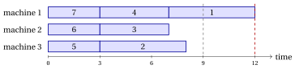

# Approximation for $P\|C_{\max}$

**Part 5 · Approximation algorithms · Chapter 40** · [:material-file-pdf-box: Lecture notes, volume 5 (PDF)](../pdf/lecture-notes-5-approximation-algorithms.pdf) · [:material-pencil: Exercises: Identical parallel machines (P||Cmax)](../exercises/pcmax-approximation.md) · [:material-gesture-tap: App: Tight instances](../lab/tight-instances.md)

!!! nota "Prerequisites"

    - From this module, the chapter [«Principles of approximation algorithms»](https://fabiofurini.github.io/combinatorial-optimization/approximation-algorithms/approximation/): performance ratio, relative performance guarantee, tight guarantee and worst-case performance ratio.

    - From this module, the chapter [«Scheduling problems»](https://fabiofurini.github.io/combinatorial-optimization/combinatorial-optimization-problems/pcmax/): the definition and the reference instance of $P\,||\,C_{\max}$, and its elementary lower bound.

    - From this module, the chapter [«Constructive heuristics»](https://fabiofurini.github.io/combinatorial-optimization/heuristic-algorithms/constructive-heuristics/): the algorithms $LIST$ and $LPT$ as constructive rules.

!!! chiave "Objectives"

    At the end of this chapter you will be able to:

    - execute $LIST$ and $LPT$ by hand and draw the resulting schedule;

    - prove the guarantees $2-\frac{1}{m}$ of $LIST$ and $\frac{4}{3}-\frac{1}{3m}$ of $LPT$;

    - build the families of instances that make these guarantees tight;

    - explain why sorting the jobs by non-increasing processing time improves the guarantee.

The problem of this chapter is the [scheduling problem on identical parallel machines ($P\,||\,C_{\max}$)](https://fabiofurini.github.io/combinatorial-optimization/combinatorial-optimization-problems/pcmax/): its definition and its assumptions are on its page.

## 40.1 Notation

- As on the problem page, there are $m$ identical machines and a set $\mathscr{J}=\{1,2,\dots,n\}$ of jobs with processing times $t_j$. A solution assigns each job $j\in\mathscr{J}$ to a machine $mach_j=h$; the set of jobs of machine $h$ is $J_h$, its load is $L_h=\sum_{j\in J_h}t_j$, and the makespan is $C_{\max}=\max_h L_h$.

- <strong>Recall.</strong> As in the chapter [«Principles of approximation algorithms»](https://fabiofurini.github.io/combinatorial-optimization/approximation-algorithms/approximation/#box-2-def-pratio), $z(I)$ is the optimal value of the instance $I$ and $\mathscr{A}(I)$ the value of the solution returned by the algorithm $\mathscr{A}$. $P\,||\,C_{\max}$ is a minimization problem, hence

    $$
    \mathscr{A}(I) \ge z(I) ~~~~~~~\text{and}~~~~~~~ \frac{\mathscr{A}(I)}{z(I)} \ge 1
    $$

    for every instance $I$, and the worst case performance ratio is $r(\mathscr{A})=\sup_I \mathscr{A}(I)/z(I)$.

- We use the elementary lower bound of the notes on combinatorial optimization problems:

    \begin{equation*}
    \label{eq:pcmaxlb}
    z(I) \;\ge\; \max\left\{ \max_{j\in\mathscr{J}} t_j,\;\; \frac{\sum_{j\in\mathscr{J}} t_j}{m} \right\}. \tag{40.1}
    \end{equation*}

- The reference instance has $m=3$ and $t=(5,5,4,4,3,3,3)$; the bound gives $\max\{5,27/3\}=9$, and $z(I)=9$ with $J_1=\{1,3\}$, $J_2=\{2,4\}$, $J_3=\{5,6,7\}$.

## 40.2 The algorithms $LIST$ and $LPT$

### 40.2.1 List scheduling { #sez-sec-LIST }

!!! chiave ""

    The <em>List Scheduling Algorithm</em> (denoted by $LIST$) is a constructive heuristic for $P\,||\,C_{\max}$. It examines the jobs in the order of a given list $\lambda$ and assigns each job to a machine with the smallest current load (in case of ties, the machine with the smallest index).

!!! algoritmo "Algorithm: List Scheduling"

    

<strong>Input:</strong> \(P\,||\,C_{\max}\) instance with \(n\) jobs, times \(t[1..n]\), \(m\) machines; list \(\lambda[1..n]\)

<strong>Output:</strong> Job-machine assignment \(mach[1..n]\) and makespan \(C_{\max}\)

1<strong>Function</strong> ListScheduling(\(n, m, t, \lambda\))

2\(mach := \text{new array}[1..n]\) ▹ job-machine assignment

3<strong>for</strong> \(h := 1\) <strong>to</strong> \(m\) <strong>do</strong>

4\(L[h] \leftarrow 0\) ▹ loads of the machines

5<strong>end</strong>

6<strong>for</strong> \(k := 1\) <strong>to</strong> \(n\) <strong>do</strong>

7\(j := \lambda[k]\)
    \(s :=\) a machine with minimum \(L[s]\) (smallest index)
    \(mach[j] \leftarrow s\)
    \(L[s] \leftarrow L[s] + t[j]\) ▹ \(k\)-th job of the list least loaded machine assign job \(j\) to machine \(s\)

8<strong>end</strong>

9<strong>return</strong> \(mach\), \(C_{\max}=\max_h L[h]\)

- $LIST$ is the same algorithm of the notes on constructive heuristics, where it is introduced as a greedy rule. Here we are interested in its worst case: how bad can a list be?

- Each machine processes its jobs without idle times, so the job $j$ assigned at iteration $k$ <strong>starts</strong> at time $S_j$, equal to the load of its machine just before the assignment, and ends at $S_j+t_j$.

!!! esempio "Example 40.1: $LIST$ on the reference instance, shortest jobs first"

    Consider the list $\lambda=(7,6,5,4,3,2,1)$. The loads before each assignment and the chosen machine are:

    
<table>
    <tr>
    <th>job \(j\)</th>
    <th>\(t_j\)</th>
    <th>loads \((L_1,L_2,L_3)\) before</th>
    <th>machine</th>
    </tr>
    <tr>
    <td>\(7\)</td>
    <td>\(3\)</td>
    <td>\((0,0,0)\)</td>
    <td>\(1\)</td>
    </tr>
    <tr>
    <td>\(6\)</td>
    <td>\(3\)</td>
    <td>\((3,0,0)\)</td>
    <td>\(2\)</td>
    </tr>
    <tr>
    <td>\(5\)</td>
    <td>\(3\)</td>
    <td>\((3,3,0)\)</td>
    <td>\(3\)</td>
    </tr>
    <tr>
    <td>\(4\)</td>
    <td>\(4\)</td>
    <td>\((3,3,3)\)</td>
    <td>\(1\)</td>
    </tr>
    <tr>
    <td>\(3\)</td>
    <td>\(4\)</td>
    <td>\((7,3,3)\)</td>
    <td>\(2\)</td>
    </tr>
    <tr>
    <td>\(2\)</td>
    <td>\(5\)</td>
    <td>\((7,7,3)\)</td>
    <td>\(3\)</td>
    </tr>
    <tr>
    <td>\(1\)</td>
    <td>\(5\)</td>
    <td>\((7,7,8)\)</td>
    <td>\(1\)</td>
    </tr>
    </table>

    The final loads are $(12,7,8)$, with $J_1=\{7,4,1\}$, $J_2=\{6,3\}$, $J_3=\{5,2\}$, and $LIST(I)=12$:

    { .fig loading=lazy  }

    The last job, job $1$, starts at $S_1=7$, the smallest load at that moment: all the machines are busy until time $7$ at least. This is the observation on which the guarantee of $LIST$ is built.

### 40.2.2 Longest processing time first { #sez-sec-LPT }

!!! chiave ""

    The <em>Longest Processing Time first Algorithm</em> (denoted by $LPT$) is a constructive heuristic for $P\,||\,C_{\max}$. It sorts the jobs by non-increasing processing time and applies $LIST$ to this list: each job, from the longest to the shortest, is assigned to a least loaded machine.

!!! algoritmo "Algorithm: Longest Processing Time first"

    

<strong>Input:</strong> \(P\,||\,C_{\max}\) instance with \(n\) jobs, times \(t[1..n]\), \(m\) machines

<strong>Output:</strong> Job-machine assignment \(mach[1..n]\) and makespan \(C_{\max}\)

1<strong>Function</strong> LPT(\(n, m, t\))

2\(\lambda :=\) the jobs sorted by non-increasing \(t[j]\) (ties by index) ▹ longest jobs first

3<strong>return</strong> ListScheduling(\(n, m, t, \lambda\))

- In the proofs it is convenient to renumber the jobs in the order of $\lambda$, so that $t_1\ge t_2\ge\dots\ge t_n$ and $LPT$ assigns the jobs in the order $1,2,\dots,n$.

!!! esempio "Example 40.2: $LPT$ on the reference instance"

    The jobs are already sorted, $\lambda=(1,2,3,4,5,6,7)$. Jobs $1$, $2$, $3$ go to the three empty machines, with loads $(5,5,4)$; job $4$ goes to machine $3$, the least loaded: $(5,5,8)$; job $5$ goes to machine $1$: $(8,5,8)$; job $6$ to machine $2$: $(8,8,8)$; job $7$ finds three machines with load $8$ and goes to machine $1$: $(11,8,8)$. Hence $J_1=\{1,5,7\}$, $J_2=\{2,6\}$, $J_3=\{3,4\}$ and $LPT(I)=11$:

    { .fig loading=lazy  }

    With $z(I)=9$, the ratio is $\frac{11}{9}$: sorting improves the makespan from $12$ to $11$, but the last job, short as it is, unbalances three perfectly balanced machines.

## 40.3 A property of list scheduling

- The guarantees of the next section compare the value of a heuristic solution with the lower bound $\eqref{eq:pcmaxlb}$ on $z(I)$. Besides the bound, they use one property of the schedules built by $LIST$: the job that ends last cannot start too late.

!!! teorema "Observation 40.1"

    Let $\ell$ be a job that ends last in a schedule built by $LIST$ (with any list). Then its starting time satisfies

    $$
    S_\ell \;\le\; \frac{1}{m}\sum_{j\in\mathscr{J}\setminus\{\ell\}} t_j .
    $$

??? dimostrazione "Proof"

    When $\ell$ is assigned, $S_\ell$ is the smallest of the $m$ loads, hence it is not larger than their average. The loads at that moment contain only jobs assigned before $\ell$, so their sum is at most $\sum_{j\neq\ell}t_j$, and $S_\ell\le\frac1m\sum_{j\neq\ell}t_j$. □

## 40.4 Performance guarantees

### 40.4.1 The worst case performance ratio of LIST

!!! teorema "Proposition 40.2"

    For every $P\,||\,C_{\max}$ instance $I$ and every list $\lambda$,

    $$
    \frac{LIST(I)}{z(I)} \;\le\; 2-\frac{1}{m} .
    $$

??? dimostrazione "Proof"

    Let $\ell$ be a job that ends last, so that $LIST(I)=S_\ell+t_\ell$. By [Observation 40.1](#box-3-obs-start),

    $$
    LIST(I) \;\le\; \frac{1}{m}\sum_{j\neq\ell} t_j + t_\ell
    \;=\; \underbrace{\frac{1}{m}\sum_{j\in\mathscr{J}} t_j}_{\le\, z(I)} + \Big(1-\frac1m\Big)\underbrace{t_\ell}_{\le\, z(I)}
    \;\le\; \Big(2-\frac1m\Big)\,z(I),
    $$

    where both bounds come from $\eqref{eq:pcmaxlb}$. Dividing by $z(I)$ gives the claim. □

!!! teorema "Proposition 40.3"

    For every $m\ge 2$ there is a $P\,||\,C_{\max}$ instance $I_m$ with $m$ machines and a list $\lambda$ such that

    $$
    \frac{LIST(I_m)}{z(I_m)} \;=\; 2-\frac{1}{m} .
    $$

??? dimostrazione "Proof"

    $I_m$ has $n=m(m-1)+1$ jobs: jobs $1,\dots,m(m-1)$ with $t_j=1$ and job $n$ with $t_n=m$; the list is $\lambda=(1,2,\dots,n)$. We have $n>m$ for $m\ge2$.

    The unit jobs are assigned in rounds of $m$: in each round all the machines have the same load, the jobs go to machines $1,2,\dots,m$ in this order and every load grows by $1$. After the $m-1$ rounds all the loads are $m-1$, and job $n$ starts at $m-1$ on machine $1$:

    $$
    LIST(I_m)=(m-1)+m=2m-1 .
    $$

    Putting job $n$ alone on machine $1$ and the $m(m-1)$ unit jobs $m$ per machine on machines $2,\dots,m$ gives makespan $m$, and $\eqref{eq:pcmaxlb}$ gives $z(I_m)\ge t_n=m$. Hence $z(I_m)=m$ and

    $$
    \frac{LIST(I_m)}{z(I_m)}=\frac{2m-1}{m}=2-\frac1m .
    $$

    
□

!!! chiave ""

    From [Proposition 40.2](#box-4-prop-LIST) and [Proposition 40.3](#box-5-prop-LISTtight) it follows that $LIST$ is a $\left(2-\frac1m\right)$-approximation algorithm, whatever the list, and that the worst case performance ratio of $LIST$ on $m$ machines is

    $$
    r(LIST)=2-\frac{1}{m}
    $$

- For $m=3$ the family has $t=(1,1,1,1,1,1,3)$, $LIST(I_3)=5$ and $z(I_3)=3$. The bad job is the long one, put last: $LPT$ would put it first and find the optimum.

- On [Example 40.1](#box-1-ex-list), $LIST(I)=12\le\frac53\cdot9=15$.

- The bound and the family are due to Graham (1966).

### 40.4.2 The worst case performance ratio of LPT

!!! teorema "Proposition 40.4"

    For every $P\,||\,C_{\max}$ instance $I$,

    $$
    \frac{LPT(I)}{z(I)} \;\le\; \frac{4}{3}-\frac{1}{3m} .
    $$

??? dimostrazione "Proof"

    Number the jobs so that $t_1\ge t_2\ge\dots\ge t_n$, the order in which $LPT$ assigns them, and let $\ell$ be a job that ends last, so that $LPT(I)=S_\ell+t_\ell$. The jobs after $\ell$ play no role: let $I'$ be the instance with the jobs $1,\dots,\ell$ only. $LPT$ assigns them on $I'$ exactly as on $I$, so $LPT(I')=LPT(I)$, and $z(I')\le z(I)$ since a schedule of $I$ restricted to the jobs of $I'$ is a schedule of $I'$. It is therefore enough to prove $LPT(I')\le\left(\frac43-\frac1{3m}\right)z(I')$. In $I'$ the job $\ell$ is the shortest one. We distinguish two cases.

    <strong>Case 1: $t_\ell\le\frac{z(I')}{3}$.</strong> As in the proof of [Proposition 40.2](#box-4-prop-LIST), with [Observation 40.1](#box-3-obs-start) applied to $I'$,

    $$
    LPT(I') \;\le\; \frac1m\sum_{j=1}^{\ell} t_j + \Big(1-\frac1m\Big)t_\ell
    \;\le\; z(I') + \Big(1-\frac1m\Big)\frac{z(I')}{3}
    \;=\; \Big(\frac43-\frac1{3m}\Big)\,z(I').
    $$

    <strong>Case 2: $t_\ell>\frac{z(I')}{3}$.</strong> Every job of $I'$ is longer than $\frac{z(I')}{3}$, so in an optimal schedule of $I'$ no machine has three jobs, and $\ell\le 2m$. If $\ell\le m$, job $\ell$ starts on an empty machine and $LPT(I')=t_\ell\le z(I')$. Otherwise $\ell=m+r$ with $1\le r\le m$; let $k:=m-r+1$, so that $1\le k\le m$. We show that $z(I')\ge t_k+t_\ell\ge LPT(I')$.

    <em>Lower bound.</em> Consider an optimal schedule of $I'$. If two of the jobs $1,\dots,k$ share a machine, its load is at least $2t_k\ge t_k+t_\ell$. Otherwise they lie on $k$ different machines; the other $m-k=r-1$ machines receive at most $2(r-1)$ jobs, while the jobs $k+1,\dots,\ell$ are $\ell-k=2r-1$. So one of them shares a machine with one of the jobs $1,\dots,k$, and that load is at least $t_k+t_\ell$. In both cases $z(I')\ge t_k+t_\ell$.

    <em>Upper bound.</em> The first $m$ jobs go to $m$ different machines, since an empty machine has load $0$ and every job has positive length. Before job $\ell$, the $m$ machines hold $\ell-1=m+r-1$ jobs, each machine at least one, so at most $r-1$ machines hold two jobs or more and at least $m-r+1=k$ machines hold exactly one job, one of the jobs $1,\dots,m$. These are $k$ different jobs among $1,\dots,m$, so the largest index among them is at least $k$, and its length is at most $t_k$. Hence the smallest load before job $\ell$ is $S_\ell\le t_k$, and $LPT(I')=S_\ell+t_\ell\le t_k+t_\ell$.

    Therefore $LPT(I')\le z(I')$ in Case 2, which is even better than the claim. □

!!! teorema "Proposition 40.5"

    For every $m\ge 2$ there is a $P\,||\,C_{\max}$ instance $I_m$ with $m$ machines such that

    $$
    \frac{LPT(I_m)}{z(I_m)} \;=\; \frac{4}{3}-\frac{1}{3m} .
    $$

??? dimostrazione "Proof"

    $I_m$ has $n=2m+1$ jobs, already sorted: two jobs of each length $2m-1,2m-2,\dots,m+1$, and three jobs of length $m$,

    $$
    t=(2m-1,\,2m-1,\,2m-2,\,2m-2,\,\dots,\,m+1,\,m+1,\,m,\,m,\,m).
    $$

    For $j\le 2m$ the length is $t_j=2m-\lceil j/2\rceil$, and $t_{2m+1}=m$.

    <em>Optimum.</em> The total length is $2\sum_{v=m+1}^{2m-1}v+3m=3m^2$, so $\eqref{eq:pcmaxlb}$ gives $z(I_m)\ge 3m$. The schedule that pairs a job of length $v$ with a job of length $3m-v$, for $v=m+1,\dots,2m-1$ (both lengths lie in $\{m+1,\dots,2m-1\}$, and each length is used twice), fills $m-1$ machines with load $3m$, and puts the three jobs of length $m$ on the last machine, again with load $3m$. Hence $z(I_m)=3m$.

    <em>$LPT$.</em> Jobs $1,\dots,m$ go to machines $1,\dots,m$. Then job $m+1$ goes to a machine with the smallest single job, $t_m$, and its load becomes $t_m+t_{m+1}$. In general, we claim that job $m+q$, for $q=1,\dots,m$, goes to a machine whose only job has length $t_{m+1-q}$, and the load becomes

    $$
    t_{m+1-q}+t_{m+q}=3m-1 .
    $$

    <em>The identity.</em> With $j=m+1-q$, so that $2m+1-j=m+q$: if $j=2i-1$ is odd then $\lceil j/2\rceil=i$ and $\lceil (2m+1-j)/2\rceil=m-i+1$, and if $j=2i$ is even the two ceilings are again $i$ and $m-i+1$. In both cases $t_j+t_{2m+1-j}=(2m-i)+(m+i-1)=3m-1$.

    <em>The claim.</em> It follows by induction. A machine with two jobs has load $3m-1>2m-1\ge$ any single job, so it is never the least loaded while machines with one job remain. Among the machines with one job, the least loaded holds the shortest remaining job, of length $t_{m+1-q}$ (with equal lengths the loads are the same).

    After $2m$ jobs all the loads are $3m-1$, and the last job, of length $m$, gives

    $$
    LPT(I_m)=3m-1+m=4m-1, \qquad \frac{LPT(I_m)}{z(I_m)}=\frac{4m-1}{3m}=\frac43-\frac1{3m}.
    $$

    
□

!!! chiave ""

    From [Proposition 40.4](#box-6-prop-LPT) and [Proposition 40.5](#box-7-prop-LPTtight) it follows that $LPT$ is a $\left(\frac43-\frac1{3m}\right)$-approximation algorithm, and that its worst case performance ratio on $m$ machines is

    $$
    r(LPT)=\frac{4}{3}-\frac{1}{3m}
    $$

    Sorting the list lowers the guarantee of $LIST$ from $2-\frac1m$ to $\frac43-\frac1{3m}$.

- For $m=3$ the family is $t=(5,5,4,4,3,3,3)$, the reference instance: the loads after six jobs are $(8,8,8)=3m-1$, the seventh job gives $LPT(I)=11=4m-1$, and $z(I)=9=3m$ ([Example 40.2](#box-2-ex-lpt)). The reference instance is a worst case for $LPT$: $\frac{11}{9}=\frac43-\frac19$.

- On the tight instances the last job has $t_\ell=m=\frac{z(I_m)}{3}$: they lie exactly on the border between the two cases of the proof, and every inequality of Case 1 holds with equality.

- The bound and the family are due to Graham (1969).

## 40.5 Sources

- R.L. Graham, Bounds for certain multiprocessing anomalies, <em>Bell System Technical Journal</em> 45(9):1563–1581, 1966.

- R.L. Graham, Bounds on multiprocessing timing anomalies, <em>SIAM Journal on Applied Mathematics</em> 17(2):416–429, 1969.

## 40.6 Typical mistakes

!!! attenzione "Warning"

    - <strong>Using the guarantee of $LPT$ for an unsorted list.</strong> $LIST$ has the guarantee $2-\frac{1}{m}$ for every list; the better guarantee $\frac{4}{3}-\frac{1}{3m}$ needs the jobs sorted by non-increasing processing time.

    - <strong>Computing the ratio with the lower bound.</strong> The bound $\eqref{eq:pcmaxlb}$ can be smaller than $z(I)$: the ratio $\mathscr{A}(I)/\LB$ is only an upper bound on the performance ratio $\mathscr{A}(I)/z(I)$, and the two coincide only when the bound is tight.

    - <strong>Breaking ties with another rule.</strong> $LIST$ assigns each job to a least loaded machine of smallest index; another tie rule can give a different schedule, and the solutions of the exercises follow the rule of the List Scheduling algorithm.

## 40.7 In summary

!!! chiave "In summary"

    - The guarantees of $LIST$ and $LPT$ are proved with the load bound $\eqref{eq:pcmaxlb}$ on $z(I)$ and with [Observation 40.1](#box-3-obs-start): the job that ends last starts no later than the average load of the other jobs.

    - Both ratios are tight, with Graham's families of instances; for $m=3$ the reference instance is the tight instance of $LPT$.

    - Sorting the list lowers the guarantee from $2-\frac1m$ to $\frac43-\frac1{3m}$.

    
<table>
    <tr>
    <th>problem</th>
    <th>algorithm</th>
    <th>worst case ratio</th>
    </tr>
    <tr>
    <td>\(P\,||\,C_{\max}\)</td>
    <td>\(LIST\)</td>
    <td>\(2-\frac1m\) (tight)</td>
    </tr>
    <tr>
    <td>\(P\,||\,C_{\max}\)</td>
    <td>\(LPT\)</td>
    <td>\(\frac43-\frac1{3m}\) (tight)</td>
    </tr>
    </table>

    <strong>Dashboard of the reference instance.</strong> The bounds on $z(I)$ found so far:

    
<table>
    <tr>
    <th>Instance</th>
    <th>Lower bound</th>
    <th>Heuristic values</th>
    <th>Optimal value</th>
    </tr>
    <tr>
    <td>\(P\,||\,C_{\max}\), \(m=3\), \(t=(5,5,4,4,3,3,3)\)</td>
    <td>\(9\), load bound</td>
    <td>\(LIST\) \(12\) (list \(7,6,\dots,1\)), \(LPT\) \(11\)</td>
    <td>\(9\)</td>
    </tr>
    </table>

---

**Exercises on this chapter:** [:material-pencil: Identical parallel machines (P||Cmax)](../exercises/pcmax-approximation.md)

<!-- laboratorio-interattivo: sezione generata da interattivi.py -->

:material-flask-outline: **In the interactive lab:** [Tight instances](../lab/tight-instances.md#voce=lpt).