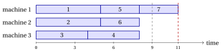
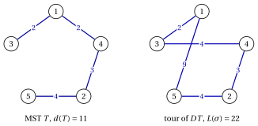
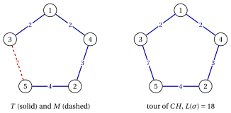
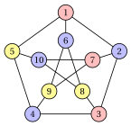
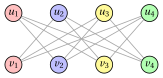

# $P\|C_{\max}$, metric TSP and the limits of approximation

**Part 5 · Approximation algorithms · Chapter 26** · [:material-file-pdf-box: Lecture notes, volume 5 (PDF)](../pdf/lecture-notes-5-approximation-algorithms.pdf) · [:material-pencil: Exercises](../exercises/pcmax-tsp-coloring-approximation.md)

!!! nota "Prerequisites"

    - From this module, the chapter «Approximation algorithms»: performance ratio, relative performance guarantee, tight guarantee and worst-case performance ratio.

    - From this module, the chapters «Parallel machine scheduling», «Travelling salesman problems» and «Vertex coloring problems»: the definitions and the reference instances of $P\,||\,C_{\max}$, of the TSP and of the VCP, and the elementary lower bounds.

    - From this module, the chapter «Constructive heuristics»: the algorithms $LIST$, $LPT$ and the greedy coloring as constructive rules.

    - From the module <em>Algorithms</em> ([module home page](https://fabiofurini.github.io/algorithms/)): minimum spanning trees (Kruskal), Eulerian circuits and the notions of NP-completeness and polynomial time.

!!! chiave "Objectives"

    At the end of this chapter you will be able to:

    - execute $LIST$, $LPT$, the double tree, the Christofides, the greedy coloring and the $DSATUR$ algorithms by hand;

    - prove the guarantees $2-\frac{1}{m}$ of $LIST$, $\frac{4}{3}-\frac{1}{3m}$ of $LPT$, $2$ of the double tree and $\frac{3}{2}$ of the Christofides algorithm;

    - build the families of instances that make these guarantees tight;

    - prove that no constant guarantee exists for the general TSP, and none below $\frac{4}{3}$ for the VCP, unless $P=NP$;

    - explain why the triangle inequality is what makes the TSP approximable.

## 26.1 The problems and the assumptions

- The chapter deals with three minimization problems, defined in the chapters on combinatorial optimization problems. For two of them, $P\,||\,C_{\max}$ and the metric TSP, simple algorithms have a constant performance guarantee.

- For the general TSP and for the Vertex Coloring Problem we prove the opposite: unless $P=NP$, no polynomial algorithm can have a (good) constant guarantee.

- As in the other notes on approximation algorithms, $z(I)$ is the optimal value of the instance $I$ and $\mathscr{A}(I)$ the value of the solution returned by the algorithm $\mathscr{A}$. All three problems are minimization problems, hence

    $$
    \mathscr{A}(I) \ge z(I) ~~~~~~~\text{and}~~~~~~~ \frac{\mathscr{A}(I)}{z(I)} \ge 1
    $$

    for every instance $I$, and the worst case performance ratio is $r(\mathscr{A})=\sup_I \mathscr{A}(I)/z(I)$.

### 26.1.1 Scheduling on identical parallel machines

!!! definizione "Definition 26.1: Scheduling on identical parallel machines"

    An instance of $P\,||\,C_{\max}$ has $m$ identical machines and a set $\mathscr{J}=\{1,2,\dots,n\}$ of jobs with processing times $t_j\in\Z_{\ge 1}$. A solution assigns each job to a machine, $mach_j=h$, the set of jobs of machine $h$ is $J_h$, its load is $L_h=\sum_{j\in J_h}t_j$, and the makespan $C_{\max}=\max_h L_h$ is minimized.

- We assume $n>m$.

- We use the elementary lower bound of the notes on combinatorial optimization problems:

    \begin{equation*}
    \label{eq:pcmaxlb}
    z(I) \;\ge\; \max\left\{ \max_{j\in\mathscr{J}} t_j,\;\; \frac{\sum_{j\in\mathscr{J}} t_j}{m} \right\}. \tag{26.1}
    \end{equation*}

- The reference instance has $m=3$ and $t=(5,5,4,4,3,3,3)$; the bound gives $\max\{5,27/3\}=9$, and $z(I)=9$ with $J_1=\{1,3\}$, $J_2=\{2,4\}$, $J_3=\{5,6,7\}$.

### 26.1.2 The metric Travelling Salesman Problem

!!! definizione "Definition 26.2: metric TSP"

    An instance of the TSP has a set $\mathscr{V}=\{1,2,\dots,n\}$ of cities, $n\ge 3$, and symmetric distances $d_{ij}=d_{ji}\in\Z_{\ge 1}$; a tour $\sigma$ is a permutation of $\mathscr{V}$, of length $L(\sigma)=\sum_{k=1}^{n-1} d_{\sigma_k\sigma_{k+1}}+d_{\sigma_n\sigma_1}$, and the length is minimized. The instance is <strong>metric</strong> if the distances satisfy the triangle inequality

    \begin{equation*}
    \label{eq:triangle}
    d_{ij} \le d_{ik} + d_{kj} \qquad \text{for all distinct } i,j,k \in \mathscr{V}. \tag{26.2}
    \end{equation*}

- The reference instance has $5$ cities, it is metric, and its unique optimal tour is $(1,3,5,2,4)$, with $z(I)=18$. Its distances are:

    
<table>
    <tr>
    <th>\(d_{ij}\)</th>
    <th>\(1\)</th>
    <th>\(2\)</th>
    <th>\(3\)</th>
    <th>\(4\)</th>
    <th>\(5\)</th>
    </tr>
    <tr>
    <td>\(1\)</td>
    <td>—</td>
    <td>\(5\)</td>
    <td>\(2\)</td>
    <td>\(2\)</td>
    <td>\(9\)</td>
    </tr>
    <tr>
    <td>\(2\)</td>
    <td>\(5\)</td>
    <td>—</td>
    <td>\(4\)</td>
    <td>\(3\)</td>
    <td>\(4\)</td>
    </tr>
    <tr>
    <td>\(3\)</td>
    <td>\(2\)</td>
    <td>\(4\)</td>
    <td>—</td>
    <td>\(4\)</td>
    <td>\(7\)</td>
    </tr>
    <tr>
    <td>\(4\)</td>
    <td>\(2\)</td>
    <td>\(3\)</td>
    <td>\(4\)</td>
    <td>—</td>
    <td>\(7\)</td>
    </tr>
    <tr>
    <td>\(5\)</td>
    <td>\(9\)</td>
    <td>\(4\)</td>
    <td>\(7\)</td>
    <td>\(7\)</td>
    <td>—</td>
    </tr>
    </table>

### 26.1.3 The Vertex Coloring Problem

!!! definizione "Definition 26.3: Vertex Coloring Problem"

    An instance of the VCP is a simple graph $G=(V,E)$ with $n$ vertices; a coloring assigns a color to each vertex so that adjacent vertices get different colors, and the number of colors is minimized. The optimal value is the <strong>chromatic number</strong> $\chi(G)=z(I)$.

- $N(v)$ is the set of neighbours of $v$, $\deg(v)=|N(v)|$ its degree, and $\Delta(G)=\max_{v}\deg(v)$ the maximum degree. The size $\omega(G)$ of a maximum clique is a lower bound: $\omega(G)\le\chi(G)$.

- The instance used in the examples is the graph called <em>Example 2</em> in the notes on coloring problems (the Petersen graph), with $n=10$, $|E|=15$, $\Delta(G)=3$ and $\chi(G)=3$:

    $$
    \begin{aligned}
    E = \big\{ & \{1,2\}, \{1,5\}, \{1,6\}, \{2,3\}, \{2,7\}, \{3,4\}, \{3,8\}, \\
    & \{4,5\}, \{4,9\}, \{5,10\}, \{6,8\}, \{6,9\}, \{7,9\}, \{7,10\}, \{8,10\} \big\}.
    \end{aligned}
    $$

## 26.2 Scheduling on parallel machines

### 26.2.1 List scheduling { #sez-sec-LIST }

!!! chiave ""

    The <em>List Scheduling Algorithm</em> (denoted by $LIST$) is a constructive heuristic for $P\,||\,C_{\max}$. It examines the jobs in the order of a given list $\lambda$ and assigns each job to a machine with the smallest current load (in case of ties, the machine with the smallest index).

!!! algoritmo "Algorithm: List Scheduling"

    

<strong>Input:</strong> \(P\,||\,C_{\max}\) instance with \(n\) jobs, times \(t[1..n]\), \(m\) machines; list \(\lambda[1..n]\)

<strong>Output:</strong> Job-machine assignment \(mach[1..n]\) and makespan \(C_{\max}\)

1<strong>Function</strong> ListScheduling(\(n, m, t, \lambda\))

2\(mach := \text{new array}[1..n]\) ▹ job-machine assignment

3<strong>for</strong> \(h := 1\) <strong>to</strong> \(m\) <strong>do</strong>

4\(L[h] \leftarrow 0\) ▹ loads of the machines

5<strong>end</strong>

6<strong>for</strong> \(k := 1\) <strong>to</strong> \(n\) <strong>do</strong>

7\(j := \lambda[k]\)
    \(s :=\) a machine with minimum \(L[s]\) (smallest index)
    \(mach[j] \leftarrow s\)
    \(L[s] \leftarrow L[s] + t[j]\) ▹ \(k\)-th job of the list least loaded machine assign job \(j\) to machine \(s\)

8<strong>end</strong>

9<strong>return</strong> \(mach\), \(C_{\max}=\max_h L[h]\)

- $LIST$ is the same algorithm of the notes on constructive heuristics, where it is introduced as a greedy rule. Here we are interested in its worst case: how bad can a list be?

- Each machine processes its jobs without idle times, so the job $j$ assigned at iteration $k$ <strong>starts</strong> at time $S_j$, equal to the load of its machine just before the assignment, and ends at $S_j+t_j$.

!!! esempio "Example 26.1: $LIST$ on the reference instance, shortest jobs first"

    Consider the list $\lambda=(7,6,5,4,3,2,1)$. The loads before each assignment and the chosen machine are:

    
<table>
    <tr>
    <th>job \(j\)</th>
    <th>\(t_j\)</th>
    <th>loads \((L_1,L_2,L_3)\) before</th>
    <th>machine</th>
    </tr>
    <tr>
    <td>\(7\)</td>
    <td>\(3\)</td>
    <td>\((0,0,0)\)</td>
    <td>\(1\)</td>
    </tr>
    <tr>
    <td>\(6\)</td>
    <td>\(3\)</td>
    <td>\((3,0,0)\)</td>
    <td>\(2\)</td>
    </tr>
    <tr>
    <td>\(5\)</td>
    <td>\(3\)</td>
    <td>\((3,3,0)\)</td>
    <td>\(3\)</td>
    </tr>
    <tr>
    <td>\(4\)</td>
    <td>\(4\)</td>
    <td>\((3,3,3)\)</td>
    <td>\(1\)</td>
    </tr>
    <tr>
    <td>\(3\)</td>
    <td>\(4\)</td>
    <td>\((7,3,3)\)</td>
    <td>\(2\)</td>
    </tr>
    <tr>
    <td>\(2\)</td>
    <td>\(5\)</td>
    <td>\((7,7,3)\)</td>
    <td>\(3\)</td>
    </tr>
    <tr>
    <td>\(1\)</td>
    <td>\(5\)</td>
    <td>\((7,7,8)\)</td>
    <td>\(1\)</td>
    </tr>
    </table>

    The final loads are $(12,7,8)$, with $J_1=\{7,4,1\}$, $J_2=\{6,3\}$, $J_3=\{5,2\}$, and $LIST(I)=12$:

    { .fig loading=lazy  }

    The last job, job $1$, starts at $S_1=7$, the smallest load at that moment: all the machines are busy until time $7$ at least. This is the observation on which the guarantee of $LIST$ is built.

### 26.2.2 Longest processing time first { #sez-sec-LPT }

!!! chiave ""

    The <em>Longest Processing Time first Algorithm</em> (denoted by $LPT$) is a constructive heuristic for $P\,||\,C_{\max}$. It sorts the jobs by non-increasing processing time and applies $LIST$ to this list: each job, from the longest to the shortest, is assigned to a least loaded machine.

!!! algoritmo "Algorithm: Longest Processing Time first"

    

<strong>Input:</strong> \(P\,||\,C_{\max}\) instance with \(n\) jobs, times \(t[1..n]\), \(m\) machines

<strong>Output:</strong> Job-machine assignment \(mach[1..n]\) and makespan \(C_{\max}\)

1<strong>Function</strong> LPT(\(n, m, t\))

2\(\lambda :=\) the jobs sorted by non-increasing \(t[j]\) (ties by index) ▹ longest jobs first

3<strong>return</strong> ListScheduling(\(n, m, t, \lambda\))

- In the proofs it is convenient to renumber the jobs in the order of $\lambda$, so that $t_1\ge t_2\ge\dots\ge t_n$ and $LPT$ assigns the jobs in the order $1,2,\dots,n$.

!!! esempio "Example 26.2: $LPT$ on the reference instance"

    The jobs are already sorted, $\lambda=(1,2,3,4,5,6,7)$. Jobs $1$, $2$, $3$ go to the three empty machines, with loads $(5,5,4)$; job $4$ goes to machine $3$, the least loaded: $(5,5,8)$; job $5$ goes to machine $1$: $(8,5,8)$; job $6$ to machine $2$: $(8,8,8)$; job $7$ finds three machines with load $8$ and goes to machine $1$: $(11,8,8)$. Hence $J_1=\{1,5,7\}$, $J_2=\{2,6\}$, $J_3=\{3,4\}$ and $LPT(I)=11$:

    { .fig loading=lazy  }

    With $z(I)=9$, the ratio is $\frac{11}{9}$: sorting improves the makespan from $12$ to $11$, but the last job, short as it is, unbalances three perfectly balanced machines.

## 26.3 The metric TSP

- The two algorithms of this section build a tour from a <strong>minimum spanning tree</strong> (MST) of the complete graph on $\mathscr{V}$, with edge weights $d_{ij}$. We compute it with Kruskal's algorithm: the edges are examined by non-decreasing distance (ties by the pair of indices) and an edge is taken if it does not close a cycle with the edges already taken. The weight of a tree $T$ is $d(T)=\sum_{\{i,j\}\in T}d_{ij}$.

- Both algorithms first build a closed walk that passes through every city, possibly more than once, and then turn it into a tour by <strong>shortcutting</strong>: the walk is followed and every city already visited is skipped, i.e., a city is kept only at its first occurrence.

- A closed walk that uses every edge of a (multi)graph exactly once is an <strong>Eulerian circuit</strong>. In the examples we build it with <strong>Fleury's rule</strong>: start from city $1$ and, at each step, leave the current city along an unused edge towards the neighbour of smallest index, unless that edge is a <em>bridge</em> of the unused edges (its removal disconnects them) and another edge is available.

### 26.3.1 The double tree algorithm { #sez-sec-DT }

!!! chiave ""

    The <em>Double Tree Algorithm</em> (denoted by $DT$) is a constructive heuristic for the metric TSP. It computes a minimum spanning tree $T$, doubles each of its edges, follows an Eulerian circuit of the doubled tree, and shortcuts it into a tour.

!!! algoritmo "Algorithm: Double Tree"

    

<strong>Input:</strong> metric TSP instance with \(n\) cities and distances \(d[1..n][1..n]\)

<strong>Output:</strong> a tour \(\sigma\) and its length \(L(\sigma)\)

1<strong>Function</strong> DoubleTree(\(n, d\))

2\(T :=\) a minimum spanning tree of the complete graph (Kruskal)

3\(D :=\) the multigraph with two copies of each edge of \(T\)

4\(W :=\) an Eulerian circuit of \(D\) from city \(1\) (Fleury)

5\(\sigma :=\) the cities of \(W\) in order of first occurrence ▹ shortcutting

6<strong>return</strong> \(\sigma\), \(L(\sigma)\)

- In the doubled tree, Fleury's rule never goes back to the parent while a child has still to be visited, because the last copy of the edge towards the parent is a bridge. The Eulerian circuit is therefore a depth-first visit of $T$ from city $1$, with the children in increasing order, and the tour $\sigma$ is the order in which the visit meets the cities for the first time (the <em>preorder</em>).

- With Kruskal's algorithm and a depth-first visit, $DT$ runs in $O(n^2\log n)$ time.

!!! esempio "Example 26.3: $DT$ on the TSP reference instance"

    Kruskal's algorithm examines $\{1,3\}$ ($2$, taken), $\{1,4\}$ ($2$, taken), $\{2,4\}$ ($3$, taken), $\{2,3\}$ ($4$, it closes the cycle $2,3,1,4$: rejected), $\{2,5\}$ ($4$, taken). The tree is $T=\{\{1,3\},\{1,4\},\{2,4\},\{2,5\}\}$, with $d(T)=2+2+3+4=11$, and it is the unique MST of the instance.

    { .fig loading=lazy  }

    The Eulerian circuit of the doubled tree from city $1$ is

    $$
    W=(1,3,1,4,2,5,2,4,1), \qquad 2+2+2+3+4+4+3+2=22=2\,d(T).
    $$

    Keeping each city at its first occurrence gives $\sigma=(1,3,4,2,5)$, of length

    $$
    L(\sigma)=d_{13}+d_{34}+d_{42}+d_{25}+d_{51}=2+4+3+4+9=22.
    $$

    The shortcuts replace $3\to1\to4$ ($2+2$) by $3\to4$ ($4$) and $5\to2\to4\to1$ ($4+3+2$) by $5\to1$ ($9$): on this instance both triangle inequalities used hold with equality, and shortcutting saves nothing. Hence $DT(I)=22$ and $\frac{DT(I)}{z(I)}=\frac{22}{18}=\frac{11}{9}$.

### 26.3.2 The Christofides algorithm { #sez-sec-CH }

!!! chiave ""

    The <em>Christofides Algorithm</em> (denoted by $CH$) is a constructive heuristic for the metric TSP. It computes a minimum spanning tree $T$ and, instead of doubling it, adds to $T$ a minimum weight perfect matching $M$ on the cities of odd degree in $T$; then it follows an Eulerian circuit of $T\cup M$ and shortcuts it into a tour.

!!! algoritmo "Algorithm: Christofides"

    

<strong>Input:</strong> metric TSP instance with \(n\) cities and distances \(d[1..n][1..n]\)

<strong>Output:</strong> a tour \(\sigma\) and its length \(L(\sigma)\)

1<strong>Function</strong> Christofides(\(n, d\))

2\(T :=\) a minimum spanning tree of the complete graph (Kruskal)

3\(O := \{\, v\in\mathscr{V} : v \text{ has odd degree in } T \,\}\)
    \(M :=\) a minimum weight perfect matching of the cities in \(O\) ▹ \(|O|\) is even

4\(D := T \cup M\) 
    \(W :=\) an Eulerian circuit of \(D\) from city \(1\) (Fleury) ▹ multigraph, all degrees even

5\(\sigma :=\) the cities of \(W\) in order of first occurrence ▹ shortcutting

6<strong>return</strong> \(\sigma\), \(L(\sigma)\)

- <strong>Why $|O|$ is even.</strong> The degrees of a graph sum up to twice the number of edges, an even number, so the number of vertices of odd degree is even, and a perfect matching of $O$ exists (the graph is complete).

- <strong>Why $T\cup M$ has even degrees.</strong> Each city of $O$ gets exactly one more edge from $M$, and the other cities none. If an edge belongs to both $T$ and $M$, $D$ contains two copies of it.

- A minimum weight perfect matching can be computed in polynomial time, $O(n^3)$, with Edmonds' blossom algorithm; in the examples and exercises $|O|\le 4$ and the matchings are enumerated ($|O|=4$ gives $3$ perfect matchings).

!!! esempio "Example 26.4: $CH$ on the TSP reference instance"

    The MST is the one of [Example 26.3](#box-6-ex-dt), with degrees $\deg(1)=2$, $\deg(2)=2$, $\deg(3)=1$, $\deg(4)=2$, $\deg(5)=1$. Hence $O=\{3,5\}$ and the only perfect matching is $M=\{\{3,5\}\}$, with $d(M)=7$.

    { .fig loading=lazy  }

    $T\cup M$ is a cycle through all the cities. Fleury's rule from city $1$ (neighbours $3$ and $4$) goes to $3$ and gives $W=(1,3,5,2,4,1)$, of length $d(T)+d(M)=11+7=18$, in which no city is repeated: no shortcut is needed and $\sigma=(1,3,5,2,4)$, with $CH(I)=18=z(I)$. On the reference instance $CH$ finds the optimal tour, while $DT$ is $4$ units above it.

## 26.4 Vertex coloring

### 26.4.1 The greedy coloring { #sez-sec-GC }

!!! chiave ""

    The <em>Greedy Coloring Algorithm</em> (denoted by $GC$) is a constructive heuristic for the VCP. The colors are the integers $1,2,3,\dots$; the algorithm examines the vertices in the order of a given list $\lambda$ and gives each vertex the smallest color not used by its neighbours already colored.

!!! algoritmo "Algorithm: Greedy Coloring"

    

<strong>Input:</strong> VCP instance \(G=(V,E)\) with \(n\) vertices; list \(\lambda[1..n]\)

<strong>Output:</strong> Vertex-color assignment \(col[1..n]\) and number of colors \(nc\)

1<strong>Function</strong> GreedyColoring(\(n, E, \lambda\))

2\(col := \text{new array}[1..n]\), all entries \(0\) ▹ \(0\) = not yet colored

3<strong>for</strong> \(k := 1\) <strong>to</strong> \(n\) <strong>do</strong>

4\(v := \lambda[k]\)

5\(U := \{\, col[u] : u \in N(v),\ col[u] \neq 0 \,\}\)
    \(col[v] \leftarrow \min\{\, c\in\Z_{\ge1} : c \notin U \,\}\) ▹ colors of the colored neighbours smallest free color

6<strong>end</strong>

7<strong>return</strong> \(col\), \(nc = \max_v col[v]\)

- The color classes $Q_c=\{v : col[v]=c\}$ are independent sets by construction, so $GC$ always returns a feasible coloring. It runs in $O(n+|E|)$ time.

- As $LIST$, $GC$ depends on the order of the list, and the order can make a large difference.

!!! esempio "Example 26.5: $GC$ on the Petersen graph, two orders"

    { .fig loading=lazy  }

    <strong>List $\lambda=(1,2,\dots,10)$.</strong> The colors of the colored neighbours $U$ and the color assigned are:

    
<table>
    <tr>
    <th>\(v\)</th>
    <th>\(1\)</th>
    <th>\(2\)</th>
    <th>\(3\)</th>
    <th>\(4\)</th>
    <th>\(5\)</th>
    <th>\(6\)</th>
    <th>\(7\)</th>
    <th>\(8\)</th>
    <th>\(9\)</th>
    <th>\(10\)</th>
    </tr>
    <tr>
    <td>\(U\)</td>
    <td>\(\emptyset\)</td>
    <td>\(\{1\}\)</td>
    <td>\(\{2\}\)</td>
    <td>\(\{1\}\)</td>
    <td>\(\{1,2\}\)</td>
    <td>\(\{1\}\)</td>
    <td>\(\{2\}\)</td>
    <td>\(\{1,2\}\)</td>
    <td>\(\{1,2\}\)</td>
    <td>\(\{1,3\}\)</td>
    </tr>
    <tr>
    <td>\(col[v]\)</td>
    <td>\(1\)</td>
    <td>\(2\)</td>
    <td>\(1\)</td>
    <td>\(2\)</td>
    <td>\(3\)</td>
    <td>\(2\)</td>
    <td>\(1\)</td>
    <td>\(3\)</td>
    <td>\(3\)</td>
    <td>\(2\)</td>
    </tr>
    </table>

    $GC$ uses $3$ colors (red $=1$, blue $=2$, yellow $=3$ in the figure). The outer $5$-cycle $1,2,3,4,5$ is an odd cycle and needs $3$ colors, so $\chi(G)=3$ and this coloring is optimal.

    <strong>List $\lambda=(1,2,3,4,5,7,8,6,9,10)$.</strong> The first five vertices get the same colors as before; then

    
<table>
    <tr>
    <th>\(v\)</th>
    <th>\(7\)</th>
    <th>\(8\)</th>
    <th>\(6\)</th>
    <th>\(9\)</th>
    <th>\(10\)</th>
    </tr>
    <tr>
    <td>\(U\)</td>
    <td>\(\{2\}\)</td>
    <td>\(\{1\}\)</td>
    <td>\(\{1,2\}\)</td>
    <td>\(\{1,2,3\}\)</td>
    <td>\(\{1,2,3\}\)</td>
    </tr>
    <tr>
    <td>\(col[v]\)</td>
    <td>\(1\)</td>
    <td>\(2\)</td>
    <td>\(3\)</td>
    <td>\(4\)</td>
    <td>\(4\)</td>
    </tr>
    </table>

    and $GC$ uses $4$ colors: vertex $8$ takes color $2$, which the first order gave to vertex $6$, and vertices $9$ and $10$ then see all three colors among their neighbours.

### 26.4.2 DSATUR { #sez-sec-DSATUR }

!!! chiave ""

    The <em>DSATUR Algorithm</em> (Degree of SATURation, denoted by $DSATUR$) is a constructive heuristic for the VCP. It does not use a fixed list: at each step it colors, with the smallest free color, an uncolored vertex of maximum <strong>saturation degree</strong>, i.e., with the largest number of <em>different</em> colors among its neighbours; ties are broken by the largest degree in the subgraph of the uncolored vertices, and then by the smallest index.

!!! algoritmo "Algorithm: DSATUR"

    

<strong>Input:</strong> VCP instance \(G=(V,E)\) with \(n\) vertices

<strong>Output:</strong> Vertex-color assignment \(col[1..n]\) and number of colors \(nc\)

1<strong>Function</strong> DSATUR(\(n, E\))

2\(col := \text{new array}[1..n]\), all entries \(0\)

3<strong>for</strong> \(k := 1\) <strong>to</strong> \(n\) <strong>do</strong>

4<strong>for</strong> each uncolored \(u\) <strong>do</strong>

5\(sat[u] \leftarrow |\{\, col[w] : w\in N(u),\ col[w]\neq0 \,\}|\)
    \(du[u] \leftarrow |\{\, w\in N(u) : col[w]=0 \,\}|\) ▹ saturation degree degree among the uncolored

6<strong>end</strong>

7\(v :=\) the uncolored vertex maximizing \((sat[v], du[v])\) lexicographically (smallest index)

8\(col[v] \leftarrow \min\{\, c\in\Z_{\ge1} : c \neq col[w]~\forall w\in N(v) \,\}\)

9<strong>end</strong>

10<strong>return</strong> \(col\), \(nc = \max_v col[v]\)

- <strong>Why the saturation degree.</strong> A vertex with many different colors around it has few colors left: if we postpone it, it may end up with none of the colors already in use. $DSATUR$ colors first the vertices that are most constrained, the same idea as “the hardest items first” of FFD and $LPT$, but updated dynamically after each assignment.

- $DSATUR$ is $GC$ with a list built on the fly, so every property of $GC$ that holds for every list holds for $DSATUR$ too. A straightforward implementation runs in $O(n^2)$ time.

!!! esempio "Example 26.6: $DSATUR$ on the Petersen graph"

    All the vertices have degree $3$. The vertex chosen at each step, its saturation degree, its degree among the uncolored vertices and its color are:

    
<table>
    <tr>
    <th>step</th>
    <th>\(1\)</th>
    <th>\(2\)</th>
    <th>\(3\)</th>
    <th>\(4\)</th>
    <th>\(5\)</th>
    <th>\(6\)</th>
    <th>\(7\)</th>
    <th>\(8\)</th>
    <th>\(9\)</th>
    <th>\(10\)</th>
    </tr>
    <tr>
    <td>\(v\)</td>
    <td>\(1\)</td>
    <td>\(2\)</td>
    <td>\(3\)</td>
    <td>\(4\)</td>
    <td>\(5\)</td>
    <td>\(6\)</td>
    <td>\(8\)</td>
    <td>\(7\)</td>
    <td>\(9\)</td>
    <td>\(10\)</td>
    </tr>
    <tr>
    <td>\(sat[v]\)</td>
    <td>\(0\)</td>
    <td>\(1\)</td>
    <td>\(1\)</td>
    <td>\(1\)</td>
    <td>\(2\)</td>
    <td>\(1\)</td>
    <td>\(2\)</td>
    <td>\(1\)</td>
    <td>\(2\)</td>
    <td>\(2\)</td>
    </tr>
    <tr>
    <td>\(du[v]\)</td>
    <td>\(3\)</td>
    <td>\(2\)</td>
    <td>\(2\)</td>
    <td>\(2\)</td>
    <td>\(1\)</td>
    <td>\(2\)</td>
    <td>\(1\)</td>
    <td>\(2\)</td>
    <td>\(0\)</td>
    <td>\(0\)</td>
    </tr>
    <tr>
    <td>\(col[v]\)</td>
    <td>\(1\)</td>
    <td>\(2\)</td>
    <td>\(1\)</td>
    <td>\(2\)</td>
    <td>\(3\)</td>
    <td>\(2\)</td>
    <td>\(3\)</td>
    <td>\(1\)</td>
    <td>\(3\)</td>
    <td>\(2\)</td>
    </tr>
    </table>

    At step $1$ all the vertices tie and vertex $1$ is chosen. At step $2$ the vertices $2$, $5$, $6$ have saturation degree $1$ and two uncolored neighbours each: the smallest index, $2$, is chosen. At step $7$ vertex $8$ (neighbours $3$ and $6$, colors $1$ and $2$) has saturation degree $2$ and goes before vertex $7$. $DSATUR$ uses $3=\chi(G)$ colors, the same coloring as $GC$ with the list $(1,2,\dots,10)$.

## 26.5 Structural properties

- The guarantees of the next section compare the value of a heuristic solution with a lower bound on $z(I)$. For $P\,||\,C_{\max}$ the lower bound is $\eqref{eq:pcmaxlb}$; for the metric TSP we need three properties: shortcutting does not increase the length, an MST is shorter than any tour, and so is (twice) a minimum perfect matching of an even set of cities.

!!! teorema "Observation 26.4"

    Let $\ell$ be a job that ends last in a schedule built by $LIST$ (with any list). Then its starting time satisfies

    $$
    S_\ell \;\le\; \frac{1}{m}\sum_{j\in\mathscr{J}\setminus\{\ell\}} t_j .
    $$

??? dimostrazione "Proof"

    When $\ell$ is assigned, $S_\ell$ is the smallest of the $m$ loads, hence it is not larger than their average. The loads at that moment contain only jobs assigned before $\ell$, so their sum is at most $\sum_{j\neq\ell}t_j$, and $S_\ell\le\frac1m\sum_{j\neq\ell}t_j$. □

!!! teorema "Observation 26.5"

    In a metric TSP instance, let $W$ be a closed walk that visits every city at least once, and let $\sigma$ be the tour obtained from $W$ by shortcutting. Then $L(\sigma)\le$ length of $W$.

??? dimostrazione "Proof"

    Each edge $\{\sigma_k,\sigma_{k+1}\}$ of the tour (and the closing edge $\{\sigma_n,\sigma_1\}$) replaces a stretch $\sigma_k=u_0,u_1,\dots,u_q=\sigma_{k+1}$ of $W$ whose inner cities are skipped. Applying the triangle inequality $\eqref{eq:triangle}$ $q-1$ times,

    $$
    d_{u_0u_q} \;\le\; d_{u_0u_1}+d_{u_1u_q} \;\le\; \dots \;\le\; \sum_{p=0}^{q-1} d_{u_pu_{p+1}} .
    $$

    The stretches are disjoint parts of $W$, so summing over all the edges of $\sigma$ gives $L(\sigma)\le$ length of $W$. □

!!! teorema "Observation 26.6"

    For every TSP instance (metric or not) and every minimum spanning tree $T$,

    $$
    d(T) \;\le\; z(I) .
    $$

??? dimostrazione "Proof"

    Removing any edge from an optimal tour leaves a path through all the cities, which is a spanning tree. Its weight is $z(I)$ minus the removed distance, at most $z(I)$ since distances are positive, and the MST weighs no more than any spanning tree. □

!!! teorema "Observation 26.7"

    In a metric TSP instance, let $O\subseteq\mathscr{V}$ with $|O|$ even and $|O|\ge 2$, and let $M$ be a minimum weight perfect matching of $O$. Then

    $$
    d(M) \;\le\; \frac{z(I)}{2} .
    $$

??? dimostrazione "Proof"

    Let $\tilde\sigma$ be an optimal tour and shortcut it to the cities of $O$: we obtain a cycle $o_1,o_2,\dots,o_{|O|},o_1$ through the cities of $O$ which, by [Observation 26.5](#box-11-obs-shortcut), has length at most $z(I)$. Since $|O|$ is even, its edges split into two perfect matchings of $O$, taking alternately one edge each:

    $$
    M_1=\{\{o_1,o_2\},\{o_3,o_4\},\dots\}, \qquad M_2=\{\{o_2,o_3\},\{o_4,o_5\},\dots,\{o_{|O|},o_1\}\}.
    $$

    Hence $d(M_1)+d(M_2)\le z(I)$, one of the two weighs at most $\frac{z(I)}{2}$, and $d(M)\le \min\{d(M_1),d(M_2)\}\le\frac{z(I)}{2}$. (For $|O|=2$ the cycle is the edge $\{o_1,o_2\}$ travelled twice and $M_1=M_2$.) □

- The last property we need is classical: a connected multigraph in which every vertex has even degree has an Eulerian circuit (a classical result of Euler), and Fleury's rule finds one. The doubled tree of $DT$ and the multigraph $T\cup M$ of $CH$ are connected (they contain $T$) and have even degrees.

- On the reference instance: $d(T)=11\le 18$, and with $O=\{3,5\}$ the optimal tour shortcut to $O$ is $3,5,3$, of length $14\le18$, so $d(M)=7\le 9$.

## 26.6 Performance guarantees

### 26.6.1 The worst case performance ratio of LIST

!!! teorema "Proposition 26.8"

    For every $P\,||\,C_{\max}$ instance $I$ and every list $\lambda$,

    $$
    \frac{LIST(I)}{z(I)} \;\le\; 2-\frac{1}{m} .
    $$

??? dimostrazione "Proof"

    Let $\ell$ be a job that ends last, so that $LIST(I)=S_\ell+t_\ell$. By [Observation 26.4](#box-10-obs-start),

    $$
    LIST(I) \;\le\; \frac{1}{m}\sum_{j\neq\ell} t_j + t_\ell
    \;=\; \underbrace{\frac{1}{m}\sum_{j\in\mathscr{J}} t_j}_{\le\, z(I)} + \Big(1-\frac1m\Big)\underbrace{t_\ell}_{\le\, z(I)}
    \;\le\; \Big(2-\frac1m\Big)\,z(I),
    $$

    where both bounds come from $\eqref{eq:pcmaxlb}$. Dividing by $z(I)$ gives the claim. □

!!! teorema "Proposition 26.9"

    For every $m\ge 2$ there is a $P\,||\,C_{\max}$ instance $I_m$ with $m$ machines and a list $\lambda$ such that

    $$
    \frac{LIST(I_m)}{z(I_m)} \;=\; 2-\frac{1}{m} .
    $$

??? dimostrazione "Proof"

    $I_m$ has $n=m(m-1)+1$ jobs: jobs $1,\dots,m(m-1)$ with $t_j=1$ and job $n$ with $t_n=m$; the list is $\lambda=(1,2,\dots,n)$. We have $n>m$ for $m\ge2$.

    The unit jobs are assigned in rounds of $m$: in each round all the machines have the same load, the jobs go to machines $1,2,\dots,m$ in this order and every load grows by $1$. After the $m-1$ rounds all the loads are $m-1$, and job $n$ starts at $m-1$ on machine $1$:

    $$
    LIST(I_m)=(m-1)+m=2m-1 .
    $$

    Putting job $n$ alone on machine $1$ and the $m(m-1)$ unit jobs $m$ per machine on machines $2,\dots,m$ gives makespan $m$, and $\eqref{eq:pcmaxlb}$ gives $z(I_m)\ge t_n=m$. Hence $z(I_m)=m$ and

    $$
    \frac{LIST(I_m)}{z(I_m)}=\frac{2m-1}{m}=2-\frac1m .
    $$

    
□

!!! chiave ""

    From [Proposition 26.8](#box-14-prop-LIST) and [Proposition 26.9](#box-15-prop-LISTtight) it follows that $LIST$ is a $\left(2-\frac1m\right)$-approximation algorithm, whatever the list, and that the worst case performance ratio of $LIST$ on $m$ machines is

    $$
    r(LIST)=2-\frac{1}{m}
    $$

- For $m=3$ the family has $t=(1,1,1,1,1,1,3)$, $LIST(I_3)=5$ and $z(I_3)=3$. The bad job is the long one, put last: $LPT$ would put it first and find the optimum.

- On [Example 26.1](#box-4-ex-list), $LIST(I)=12\le\frac53\cdot9=15$.

- The bound and the family are due to Graham (1966).

### 26.6.2 The worst case performance ratio of LPT

!!! teorema "Proposition 26.10"

    For every $P\,||\,C_{\max}$ instance $I$,

    $$
    \frac{LPT(I)}{z(I)} \;\le\; \frac{4}{3}-\frac{1}{3m} .
    $$

??? dimostrazione "Proof"

    Number the jobs so that $t_1\ge t_2\ge\dots\ge t_n$, the order in which $LPT$ assigns them, and let $\ell$ be a job that ends last, so that $LPT(I)=S_\ell+t_\ell$. The jobs after $\ell$ play no role: let $I'$ be the instance with the jobs $1,\dots,\ell$ only. $LPT$ assigns them on $I'$ exactly as on $I$, so $LPT(I')=LPT(I)$, and $z(I')\le z(I)$ since a schedule of $I$ restricted to the jobs of $I'$ is a schedule of $I'$. It is therefore enough to prove $LPT(I')\le\left(\frac43-\frac1{3m}\right)z(I')$. In $I'$ the job $\ell$ is the shortest one. We distinguish two cases.

    <strong>Case 1: $t_\ell\le\frac{z(I')}{3}$.</strong> As in the proof of [Proposition 26.8](#box-14-prop-LIST), with [Observation 26.4](#box-10-obs-start) applied to $I'$,

    $$
    LPT(I') \;\le\; \frac1m\sum_{j=1}^{\ell} t_j + \Big(1-\frac1m\Big)t_\ell
    \;\le\; z(I') + \Big(1-\frac1m\Big)\frac{z(I')}{3}
    \;=\; \Big(\frac43-\frac1{3m}\Big)\,z(I').
    $$

    <strong>Case 2: $t_\ell>\frac{z(I')}{3}$.</strong> Every job of $I'$ is longer than $\frac{z(I')}{3}$, so in an optimal schedule of $I'$ no machine has three jobs, and $\ell\le 2m$. If $\ell\le m$, job $\ell$ starts on an empty machine and $LPT(I')=t_\ell\le z(I')$. Otherwise $\ell=m+r$ with $1\le r\le m$; let $k:=m-r+1$, so that $1\le k\le m$. We show that $z(I')\ge t_k+t_\ell\ge LPT(I')$.

    <em>Lower bound.</em> Consider an optimal schedule of $I'$. If two of the jobs $1,\dots,k$ share a machine, its load is at least $2t_k\ge t_k+t_\ell$. Otherwise they lie on $k$ different machines; the other $m-k=r-1$ machines receive at most $2(r-1)$ jobs, while the jobs $k+1,\dots,\ell$ are $\ell-k=2r-1$. So one of them shares a machine with one of the jobs $1,\dots,k$, and that load is at least $t_k+t_\ell$. In both cases $z(I')\ge t_k+t_\ell$.

    <em>Upper bound.</em> The first $m$ jobs go to $m$ different machines, since an empty machine has load $0$ and every job has positive length. Before job $\ell$, the $m$ machines hold $\ell-1=m+r-1$ jobs, each machine at least one, so at most $r-1$ machines hold two jobs or more and at least $m-r+1=k$ machines hold exactly one job, one of the jobs $1,\dots,m$. These are $k$ different jobs among $1,\dots,m$, so the largest index among them is at least $k$, and its length is at most $t_k$. Hence the smallest load before job $\ell$ is $S_\ell\le t_k$, and $LPT(I')=S_\ell+t_\ell\le t_k+t_\ell$.

    Therefore $LPT(I')\le z(I')$ in Case 2, which is even better than the claim. □

!!! teorema "Proposition 26.11"

    For every $m\ge 2$ there is a $P\,||\,C_{\max}$ instance $I_m$ with $m$ machines such that

    $$
    \frac{LPT(I_m)}{z(I_m)} \;=\; \frac{4}{3}-\frac{1}{3m} .
    $$

??? dimostrazione "Proof"

    $I_m$ has $n=2m+1$ jobs, already sorted: two jobs of each length $2m-1,2m-2,\dots,m+1$, and three jobs of length $m$,

    $$
    t=(2m-1,\,2m-1,\,2m-2,\,2m-2,\,\dots,\,m+1,\,m+1,\,m,\,m,\,m).
    $$

    For $j\le 2m$ the length is $t_j=2m-\lceil j/2\rceil$, and $t_{2m+1}=m$.

    <em>Optimum.</em> The total length is $2\sum_{v=m+1}^{2m-1}v+3m=3m^2$, so $\eqref{eq:pcmaxlb}$ gives $z(I_m)\ge 3m$. The schedule that pairs a job of length $v$ with a job of length $3m-v$, for $v=m+1,\dots,2m-1$ (both lengths lie in $\{m+1,\dots,2m-1\}$, and each length is used twice), fills $m-1$ machines with load $3m$, and puts the three jobs of length $m$ on the last machine, again with load $3m$. Hence $z(I_m)=3m$.

    <em>$LPT$.</em> Jobs $1,\dots,m$ go to machines $1,\dots,m$. Then job $m+1$ goes to a machine with the smallest single job, $t_m$, and its load becomes $t_m+t_{m+1}$. In general, we claim that job $m+q$, for $q=1,\dots,m$, goes to a machine whose only job has length $t_{m+1-q}$, and the load becomes

    $$
    t_{m+1-q}+t_{m+q}=3m-1 .
    $$

    <em>The identity.</em> With $j=m+1-q$, so that $2m+1-j=m+q$: if $j=2i-1$ is odd then $\lceil j/2\rceil=i$ and $\lceil (2m+1-j)/2\rceil=m-i+1$, and if $j=2i$ is even the two ceilings are again $i$ and $m-i+1$. In both cases $t_j+t_{2m+1-j}=(2m-i)+(m+i-1)=3m-1$.

    <em>The claim.</em> It follows by induction. A machine with two jobs has load $3m-1>2m-1\ge$ any single job, so it is never the least loaded while machines with one job remain. Among the machines with one job, the least loaded holds the shortest remaining job, of length $t_{m+1-q}$ (with equal lengths the loads are the same).

    After $2m$ jobs all the loads are $3m-1$, and the last job, of length $m$, gives

    $$
    LPT(I_m)=3m-1+m=4m-1, \qquad \frac{LPT(I_m)}{z(I_m)}=\frac{4m-1}{3m}=\frac43-\frac1{3m}.
    $$

    
□

!!! chiave ""

    From [Proposition 26.10](#box-16-prop-LPT) and [Proposition 26.11](#box-17-prop-LPTtight) it follows that $LPT$ is a $\left(\frac43-\frac1{3m}\right)$-approximation algorithm, and that its worst case performance ratio on $m$ machines is

    $$
    r(LPT)=\frac{4}{3}-\frac{1}{3m}
    $$

    Sorting the list lowers the guarantee of $LIST$ from $2-\frac1m$ to $\frac43-\frac1{3m}$.

- For $m=3$ the family is $t=(5,5,4,4,3,3,3)$, the reference instance: the loads after six jobs are $(8,8,8)=3m-1$, the seventh job gives $LPT(I)=11=4m-1$, and $z(I)=9=3m$ ([Example 26.2](#box-5-ex-lpt)). The reference instance is a worst case for $LPT$: $\frac{11}{9}=\frac43-\frac19$.

- On the tight instances the last job has $t_\ell=m=\frac{z(I_m)}{3}$: they lie exactly on the border between the two cases of the proof, and every inequality of Case 1 holds with equality.

- The bound and the family are due to Graham (1969).

### 26.6.3 The worst case performance ratio of DT

!!! teorema "Proposition 26.12"

    For every metric TSP instance $I$,

    $$
    \frac{DT(I)}{z(I)} \;\le\; 2 .
    $$

??? dimostrazione "Proof"

    The Eulerian circuit $W$ of the doubled tree uses every edge of $T$ twice, so its length is $2\,d(T)$, and it visits every city because $T$ is spanning. By [Observation 26.5](#box-11-obs-shortcut) and [Observation 26.6](#box-12-obs-mst),

    $$
    DT(I)=L(\sigma) \;\le\; 2\,d(T) \;\le\; 2\,z(I).
    $$

    
□

!!! teorema "Proposition 26.13"

    There are metric TSP instances $I_n$, $n\ge5$ odd, such that

    $$
    \frac{DT(I_n)}{z(I_n)} \;=\; \frac{2n}{n+2} \;\to\; 2 \qquad\text{as}\qquad n\to+\infty .
    $$

??? dimostrazione "Proof"

    Let $n=2k+1$ with $k\ge2$, $a:=n$ and $b:=n+1$. City $1$ is a centre and the cities $2,\dots,n$ are leaves; the leaves are joined by the path

    $$
    P=(3,5,\dots,2k+1,\,2,4,\dots,2k),
    $$

    whose consecutive cities never have consecutive indices (the differences are $2$, and $2k-1\ge3$ for the edge $\{2k+1,2\}$). The distances are

    $$
    d_{ij}=
    \begin{cases}
    a & \text{if } i=1 \text{ or } j=1,\\
    b & \text{if } \{i,j\} \text{ is an edge of } P,\\
    2a & \text{otherwise.}
    \end{cases}
    $$

    All distances lie between $a$ and $2a$, so $d_{ij}\le 2a\le d_{ik}+d_{kj}$: the instance is metric.

    <em>$DT$.</em> The only distances equal to $a$ are those from the centre, and a spanning tree has $n-1$ edges, each of weight at least $a$: the star centred at $1$ is the unique MST, with $d(T)=(n-1)a$. The depth-first visit from city $1$ meets the leaves in increasing order, $\sigma=(1,2,3,\dots,n)$, and no pair of consecutive leaves is an edge of $P$:

    $$
    DT(I_n)=a+(n-2)\,2a+a=2(n-1)a=2n(n-1).
    $$

    <em>Optimum.</em> A tour has exactly two edges at city $1$ (length $a$ each) and $n-2$ edges between leaves (length at least $b$ each), so $z(I_n)\ge 2a+(n-2)b$. The tour $(1,3,5,\dots,2k+1,2,4,\dots,2k)$ follows $P$ and attains this value, hence

    $$
    z(I_n)=2a+(n-2)b=2n+(n-2)(n+1)=(n+2)(n-1).
    $$

    Therefore

    $$
    \frac{DT(I_n)}{z(I_n)}=\frac{2n(n-1)}{(n+2)(n-1)}=\frac{2n}{n+2}=\frac{2}{1+\frac2n}\;\to\;2 .
    $$

    
□

!!! chiave ""

    From [Proposition 26.12](#box-18-prop-DT) and [Proposition 26.13](#box-19-prop-DTtight) it follows that $DT$ is a $2$-approximation algorithm for the metric TSP, and that its worst case performance ratio is

    $$
    r(DT)=2
    $$

- For $n=5$: $a=5$, $b=6$, $P=(3,5,2,4)$, $DT(I_5)=40$, $z(I_5)=28$ and the ratio is $\frac{10}{7}$; for $n=7$ and $n=9$ the ratios are $\frac{14}{9}$ and $\frac{18}{11}$.

- On the reference instance $DT(I)=22=2\,d(T)$: the upper bound of the proof is attained, but $z(I)=18>d(T)=11$, and the ratio is only $\frac{11}{9}$.

- The analysis of $DT$ is due to Rosenkrantz, Stearns and Lewis (1977).

### 26.6.4 The worst case performance ratio of CH

!!! teorema "Proposition 26.14"

    For every metric TSP instance $I$,

    $$
    \frac{CH(I)}{z(I)} \;\le\; \frac{3}{2} .
    $$

??? dimostrazione "Proof"

    The Eulerian circuit $W$ of $T\cup M$ uses every edge once, so its length is $d(T)+d(M)$, and it visits every city. By [Observation 26.5](#box-11-obs-shortcut), [Observation 26.6](#box-12-obs-mst) and [Observation 26.7](#box-13-obs-matching) (with the set $O$ of odd-degree cities, $|O|\ge2$ because a tree with at least two vertices has at least two leaves),

    $$
    CH(I)=L(\sigma) \;\le\; d(T)+d(M) \;\le\; z(I)+\frac{z(I)}{2} \;=\; \frac32\,z(I).
    $$

    
□

!!! teorema "Proposition 26.15"

    There are metric TSP instances $I_n$, $n\ge5$ odd, such that

    $$
    \frac{CH(I_n)}{z(I_n)} \;\to\; \frac{3}{2} \qquad\text{as}\qquad n\to+\infty .
    $$

??? dimostrazione "Proof"

    Let $n\ge5$ be odd, $a:=n$ and $b:=n+1$, so that $a<b<2a$. Consider the graph $H$ on the cities $1,\dots,n$ with the edges $\{i,i+1\}$ of length $a$ and $\{i,i+2\}$ of length $b$ (a strip of triangles), and let $d_{ij}$ be the length of a shortest path from $i$ to $j$ in $H$; shortest path distances always satisfy the triangle inequality. A path from $i$ to $j>i$ advances by $1$ (cost $a$) or by $2$ (cost $b$) at each edge, and since $b<2a$ it is best to advance by $2$ as much as possible:

    $$
    d_{ij}=\left\lfloor\frac{|i-j|}{2}\right\rfloor b+\big(|i-j| \bmod 2\big)\, a .
    $$

    <em>$CH$.</em> The distances equal to $a$ are exactly those between consecutive cities, so, as in the previous proof, the path $T=\{\{1,2\},\{2,3\},\dots,\{n-1,n\}\}$ is the unique MST, with $d(T)=(n-1)a$.

    Its odd-degree cities are $O=\{1,n\}$, so $M=\{\{1,n\}\}$, with $d(M)=\frac{n-1}{2}b$. $T\cup M$ is the cycle $1,2,\dots,n,1$, Fleury's rule follows it from city $1$ towards city $2$, and no shortcut is needed:

    $$
    CH(I_n)=(n-1)a+\frac{n-1}{2}\,b=(n-1)\,\frac{3n+1}{2}.
    $$

    <em>An upper bound on the optimum.</em> The tour $(1,3,5,\dots,n,n-1,n-3,\dots,2)$ uses $n-2$ edges of length $b$ and the two edges $\{n,n-1\}$ and $\{2,1\}$ of length $a$, so

    $$
    z(I_n)\le (n-2)b+2a=(n-2)(n+1)+2n=(n+2)(n-1).
    $$

    Together with [Proposition 26.14](#box-20-prop-CH),

    $$
    \frac32 \;\ge\; \frac{CH(I_n)}{z(I_n)} \;\ge\; \frac{(n-1)(3n+1)}{2(n+2)(n-1)}=\frac{3n+1}{2n+4}
    =\frac{3+\frac1n}{2+\frac4n}\;\to\;\frac32 .
    $$

    
□

!!! chiave ""

    From [Proposition 26.14](#box-20-prop-CH) and [Proposition 26.15](#box-21-prop-CHtight) it follows that $CH$ is a $\frac32$-approximation algorithm for the metric TSP, and that its worst case performance ratio is

    $$
    r(CH)=\frac32
    $$

- For $n=5,7,9$ the enumeration of all the tours shows that the upper bound on $z(I_n)$ is the optimum ($28$, $54$, $88$), and the ratios are $\frac{32}{28}=\frac87$, $\frac{66}{54}=\frac{11}{9}$, $\frac{112}{88}=\frac{14}{11}$.

- The algorithm was found independently by Christofides (1976) and Serdyukov (1978). For more than forty years no polynomial algorithm with a better constant was known for the metric TSP; the first improvement, by an extremely small constant, is a randomized algorithm by Karlin, Klein and Oveis Gharan (2021).

## 26.7 The limits of approximation

- The guarantees of the previous section are <em>positive</em> results. For other problems one can prove that no polynomial algorithm has a constant guarantee, or a guarantee below a given constant, unless $P=NP$. The proofs all follow the same scheme: an approximation algorithm with a too good guarantee would decide in polynomial time an NP-complete problem.

### 26.7.1 The general TSP

!!! teorema "Proposition 26.16"

    Let $\alpha\ge1$ be a constant. If $P\neq NP$, there is no polynomial algorithm $\mathscr{A}$ for the TSP such that, for every TSP instance $I$,

    $$
    \frac{\mathscr{A}(I)}{z(I)} \;\le\; \alpha .
    $$

??? dimostrazione "Proof"

    The <strong>Hamiltonian cycle problem</strong> asks whether a graph $G=(V,E)$ has a cycle through all its vertices; it is NP-complete. Suppose that $\mathscr{A}$ exists, and, given a graph $G$ with $n\ge3$ vertices, build the TSP instance $I_G$ on the cities $\mathscr{V}=V$ with

    $$
    d_{ij}=
    \begin{cases}
    1 & \text{if } \{i,j\}\in E,\\
    \lceil\alpha n\rceil+1 & \text{otherwise.}
    \end{cases}
    $$

    If $G$ has a Hamiltonian cycle, that cycle is a tour of length $n$, so $z(I_G)=n$ and $\mathscr{A}(I_G)\le\alpha n$. If $G$ has no Hamiltonian cycle, every tour uses at least one pair $\{i,j\}\notin E$, so

    $$
    \mathscr{A}(I_G)\;\ge\; z(I_G) \;\ge\; (n-1)+\lceil\alpha n\rceil+1 \;>\; \alpha n .
    $$

    Hence $G$ is Hamiltonian if and only if $\mathscr{A}(I_G)\le\alpha n$. Building $I_G$ and running $\mathscr{A}$ takes polynomial time, so the Hamiltonian cycle problem would be in $P$, and $P=NP$. □

- The instance $I_G$ is <strong>not metric</strong> as soon as $G$ has a path $i,k,j$ with $\{i,j\}\notin E$: $d_{ij}=\lceil\alpha n\rceil+1>2=d_{ik}+d_{kj}$. This is why [Proposition 26.16](#box-22-prop-TSPinapx) does not contradict the guarantees of $DT$ and $CH$: the triangle inequality is exactly what makes the TSP approximable.

- The result and its proof are due to Sahni and Gonzalez (1976), and the NP-completeness of the Hamiltonian cycle problem to Karp (1972).

### 26.7.2 Vertex coloring: no ratio below four thirds

!!! teorema "Proposition 26.17"

    If $P\neq NP$, there is no polynomial algorithm $\mathscr{A}$ for the VCP such that, for every VCP instance $I$,

    $$
    \frac{\mathscr{A}(I)}{z(I)} \;<\; \frac{4}{3} .
    $$

??? dimostrazione "Proof"

    Deciding whether $\chi(G)\le3$ (<strong>3-colorability</strong>) is NP-complete. Suppose that $\mathscr{A}$ exists and run it on a graph $G$. If $\chi(G)\le 3$, then $\mathscr{A}(I)<\frac43\chi(G)\le4$, and, being an integer, $\mathscr{A}(I)\le3$. If $\chi(G)\ge4$, then $\mathscr{A}(I)\ge\chi(G)\ge4$ because $\mathscr{A}$ returns a feasible coloring. Hence $\chi(G)\le3$ if and only if $\mathscr{A}(I)\le3$, and 3-colorability would be decided in polynomial time. □

- The proof uses the fact that $\chi(G)$ is an integer: a ratio below $\frac43$ cannot separate $3$ from $4$ colors. The same argument works for every problem in which deciding $z(I)\le k$ is NP-complete for a fixed $k$: no ratio below $\frac{k+1}{k}$. For the BPP, deciding whether $2$ bins suffice is the NP-complete PARTITION problem, which gives the bound $\frac32$.

- The NP-completeness of 3-colorability, even for planar graphs of maximum degree $4$, is due to Garey, Johnson and Stockmeyer (1976).

!!! nota ""

    <strong>Much stronger results (cited without proof).</strong>

    - Garey and Johnson (1976) raised the bound of [Proposition 26.17](#box-23-prop-VCP43) to $2$: unless $P=NP$, no polynomial algorithm colors every graph with fewer than $2\chi(G)$ colors.

    - Much more is true: the ratio cannot even be bounded by a small power of $n$. For every $\varepsilon>0$, unless $P=NP$, no polynomial algorithm $\mathscr{A}$ satisfies

        $$
        \frac{\mathscr{A}(I)}{\chi(G)} \;\le\; n^{1-\varepsilon}
        $$

        for every graph $G$ with $n$ vertices. Since every graph can be colored with $n$ colors, a ratio of $n$ is trivial: the chromatic number is essentially as hard to approximate as possible (Zuckerman, 2007).

### 26.7.3 What the greedy coloring guarantees

!!! teorema "Proposition 26.18"

    For every graph $G$ and every list $\lambda$,

    $$
    GC(I) \;\le\; \Delta(G)+1 .
    $$

??? dimostrazione "Proof"

    When vertex $v$ is colored, the set $U$ of the colors of its colored neighbours has at most $\deg(v)\le\Delta(G)$ elements, so one of the colors $1,2,\dots,\Delta(G)+1$ is not in $U$, and the smallest free color is at most $\Delta(G)+1$. □

- The bound holds for $DSATUR$ too, which is $GC$ with a particular list, and it is attained by complete graphs ($\Delta=n-1$, $\chi=n$) and odd cycles ($\Delta=2$, $\chi=3$), whatever the list.

- It is <em>not</em> a performance guarantee: it compares $GC(I)$ with $\Delta(G)+1$, not with $\chi(G)$, and $\Delta(G)+1$ can be much larger than $\chi(G)$. The next proposition shows that a bad list can really force that many colors on a graph that needs only two.

- On the other hand, <strong>some</strong> list is always optimal: if $Q_1,\dots,Q_{\chi(G)}$ are the color classes of an optimal coloring, $GC$ with the vertices of $Q_1$ first, then those of $Q_2$, and so on, gives each vertex of $Q_c$ a color at most $c$, so it uses at most $\chi(G)$ colors. The difficulty is entirely in finding the list.

!!! teorema "Proposition 26.19"

    For every $k\ge3$ there is a graph $G_k$ with $n=2k$ vertices, $\chi(G_k)=2$ and $\Delta(G_k)=k-1$, and a list $\lambda$, such that

    $$
    GC(I_k) \;=\; k \;=\; \frac{n}{2} .
    $$

??? dimostrazione "Proof"

    $G_k$ is the <strong>crown graph</strong>: the vertices are $u_1,\dots,u_k$ and $v_1,\dots,v_k$, and $u_i$ is adjacent to $v_j$ if and only if $i\neq j$ (the complete bipartite graph $K_{k,k}$ without a perfect matching). It is bipartite, with an edge, so $\chi(G_k)=2$; every vertex has degree $k-1$. The list is $\lambda=(u_1,v_1,u_2,v_2,\dots,u_k,v_k)$.

    We show by induction on $i$ that $GC$ gives color $i$ to both $u_i$ and $v_i$. For $i=1$ no neighbour is colored when $u_1$ is examined, and $v_1$ is not adjacent to $u_1$: both get color $1$. When $u_i$ is examined, its colored neighbours are $v_1,\dots,v_{i-1}$, with colors $1,\dots,i-1$ by induction, so $u_i$ gets color $i$; when $v_i$ is examined, its colored neighbours are $u_1,\dots,u_{i-1}$ ($u_i$ is not a neighbour), with colors $1,\dots,i-1$, so $v_i$ gets color $i$ too. Hence $GC(I_k)=k$. □

- On the crown graphs $\frac{GC(I_k)}{\chi(G_k)}=\frac{k}{2}=\frac{n}{4}$, which grows without bound: with an arbitrary list, $GC$ has no constant performance guarantee. The list $(u_1,\dots,u_k,v_1,\dots,v_k)$, the color classes first, gives $2$ colors.

- The crown graphs satisfy the assumptions of the VCP for $k\ge3$: no isolated vertices, and $N(u_i)=\{v_j:j\neq i\}$ is not contained in $N(u_{i'})$ nor in any $N(v_j)\subseteq\{u_1,\dots,u_k\}$.

!!! esempio "Example 26.7: $GC$ and $DSATUR$ on the crown graph $G_4$"

    Number the vertices $u_i=2i-1$ and $v_i=2i$, so that $u_1,v_1,\dots,u_4,v_4$ are $1,2,\dots,8$, and $E=\{\{2i-1,2j\}: i\neq j\}$, with $12$ edges.

    { .fig loading=lazy  }

    With the list $(1,2,\dots,8)=(u_1,v_1,\dots,u_4,v_4)$, $GC$ uses $4$ colors, one for each pair $\{u_i,v_i\}$ (shown in the figure); with the list $(1,3,5,7,2,4,6,8)$ it uses $2$ colors.

    $DSATUR$ chooses vertex $1$ ($u_1$, color $1$), then the vertices $4$, $5$, $2$, $3$, $6$, $7$, $8$, with colors $2,1,2,1,2,1,2$: the vertices $u_i$ get color $1$ and the vertices $v_i$ color $2$, and $DSATUR$ uses $2=\chi(G_4)$ colors. After the first step, every vertex adjacent to a colored vertex has saturation degree $1$, and the vertex chosen is always on the side opposite to the last one colored.

### 26.7.4 DSATUR as a heuristic

- On bipartite graphs $DSATUR$ always uses at most $2$ colors, as on the crown graphs; this is proved in the paper that introduced it (Brélaz, 1979).

- On general graphs $DSATUR$ is a polynomial algorithm, so by the results of this section it cannot have a performance guarantee below $\frac43$ (and, by the cited results, not even below $n^{1-\varepsilon}$), unless $P=NP$. It is nevertheless one of the most used constructive heuristics for the VCP, because on most graphs it uses few colors more than $\chi(G)$, often none; it is also the base of exact branch and bound algorithms for the VCP, which branch on the vertex chosen by the $DSATUR$ rule.

## 26.8 Sources

- R.L. Graham, Bounds for certain multiprocessing anomalies, <em>Bell System Technical Journal</em> 45(9):1563–1581, 1966.

- R.L. Graham, Bounds on multiprocessing timing anomalies, <em>SIAM Journal on Applied Mathematics</em> 17(2):416–429, 1969.

- D.J. Rosenkrantz, R.E. Stearns, P.M. Lewis II, An analysis of several heuristics for the traveling salesman problem, <em>SIAM Journal on Computing</em> 6(3):563–581, 1977.

- N. Christofides, Worst-case analysis of a new heuristic for the travelling salesman problem, Report 388, Carnegie-Mellon University, 1976.

- A.I. Serdyukov, On some extremal walks in graphs, <em>Upravlyaemye Sistemy</em> 17:76–79, 1978.

- S. Sahni, T. Gonzalez, P-complete approximation problems, <em>Journal of the ACM</em> 23(3):555–565, 1976.

- R.M. Karp, Reducibility among combinatorial problems, in <em>Complexity of Computer Computations</em>, Plenum Press, 85–103, 1972.

- M.R. Garey, D.S. Johnson, L. Stockmeyer, Some simplified NP-complete graph problems, <em>Theoretical Computer Science</em> 1(3):237–267, 1976.

- M.R. Garey, D.S. Johnson, The complexity of near-optimal graph coloring, <em>Journal of the ACM</em> 23(1):43–49, 1976.

- D. Zuckerman, Linear degree extractors and the inapproximability of max clique and chromatic number, <em>Theory of Computing</em> 3:103–128, 2007.

- D. Brélaz, New methods to color the vertices of a graph, <em>Communications of the ACM</em> 22(4):251–256, 1979.

## 26.9 Typical mistakes

!!! attenzione "Warning"

    - <strong>Using the guarantee of $LPT$ for an unsorted list.</strong> $LIST$ has the guarantee $2-\frac{1}{m}$ for every list; the better guarantee $\frac{4}{3}-\frac{1}{3m}$ needs the jobs sorted by non-increasing processing time.

    - <strong>Applying $DT$ or $CH$ to a non-metric instance.</strong> The guarantees $2$ and $\frac{3}{2}$ use the triangle inequality, in the shortcutting step; without it no constant guarantee exists.

    - <strong>Shortcutting a city that is visited for the first time.</strong> Following the Eulerian circuit, a city is skipped only if it has already been visited; the first occurrence is kept.

    - <strong>Matching the wrong cities in $CH$.</strong> The perfect matching is computed on the cities of <em>odd</em> degree in the spanning tree, whose number is even, and has minimum weight.

    - <strong>Reading $GC(I)\le\Delta(G)+1$ as a performance guarantee.</strong> It compares the heuristic value with $\Delta(G)+1$, not with $\chi(G)$.

    - <strong>Reading $\frac{4}{3}$ as a guarantee for the VCP.</strong> The result says that no polynomial algorithm has a ratio <em>below</em> $\frac{4}{3}$, unless $P=NP$; it does not give an algorithm with ratio $\frac{4}{3}$.

## 26.10 In summary

!!! chiave "In summary"

    - The worst-case ratios of the positive results are proved with a lower bound on $z(I)$: the load bound for $P\,||\,C_{\max}$, the minimum spanning tree and half of the matching for the metric TSP.

    - All the ratios are tight, with families of instances: Graham's for $LIST$ and $LPT$, and families built here for $DT$ and $CH$.

    - The negative results use a reduction: an algorithm with a too good guarantee would decide an NP-complete problem in polynomial time.

    
<table>
    <tr>
    <th>problem</th>
    <th>algorithm</th>
    <th>worst case ratio</th>
    </tr>
    <tr>
    <td>\(P\,||\,C_{\max}\)</td>
    <td>\(LIST\)</td>
    <td>\(2-\frac1m\) (tight)</td>
    </tr>
    <tr>
    <td>\(P\,||\,C_{\max}\)</td>
    <td>\(LPT\)</td>
    <td>\(\frac43-\frac1{3m}\) (tight)</td>
    </tr>
    <tr>
    <td>metric TSP</td>
    <td>\(DT\)</td>
    <td>\(2\) (tight)</td>
    </tr>
    <tr>
    <td>metric TSP</td>
    <td>\(CH\)</td>
    <td>\(\frac32\) (tight)</td>
    </tr>
    <tr>
    <td>general TSP</td>
    <td>any</td>
    <td>no constant, unless \(P=NP\)</td>
    </tr>
    <tr>
    <td>VCP</td>
    <td>\(GC\), \(DSATUR\)</td>
    <td>no constant below \(\frac43\), unless \(P=NP\)</td>
    </tr>
    </table>

    <strong>Dashboard of the reference instances.</strong> The bounds on $z(I)$ found so far:

    
<table>
    <tr>
    <th>Instance</th>
    <th>Lower bound</th>
    <th>Heuristic values</th>
    <th>Optimal value</th>
    </tr>
    <tr>
    <td>\(P\,||\,C_{\max}\), \(m=3\), \(t=(5,5,4,4,3,3,3)\)</td>
    <td>\(9\), load bound</td>
    <td>\(LIST\) \(12\) (list \(7,6,\dots,1\)), \(LPT\) \(11\)</td>
    <td>\(9\)</td>
    </tr>
    <tr>
    <td>metric TSP, \(5\) cities</td>
    <td>\(11\), minimum spanning tree</td>
    <td>\(DT\) \(22\), \(CH\) \(18\)</td>
    <td>\(18\)</td>
    </tr>
    <tr>
    <td>VCP, Petersen graph</td>
    <td>\(3\), odd cycle</td>
    <td>\(GC\) \(3\) and \(4\) (two lists), \(DSATUR\) \(3\)</td>
    <td>\(3\)</td>
    </tr>
    </table>

