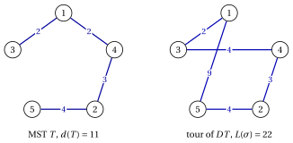
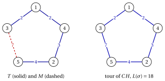

# Approximation for the metric TSP

**Part 5 · Approximation algorithms · Chapter 39** · [:material-file-pdf-box: Lecture notes, volume 5 (PDF)](../pdf/lecture-notes-5-approximation-algorithms.pdf) · [:material-pencil: Exercises: General and metric TSP](../exercises/tsp-approximation.md)

!!! nota "Prerequisites"

    - From this module, the chapter [«Principles of approximation algorithms»](https://fabiofurini.github.io/combinatorial-optimization/approximation-algorithms/approximation/): performance ratio, relative performance guarantee, tight guarantee and worst-case performance ratio.

    - From this module, the chapter [«Routing problems»](https://fabiofurini.github.io/combinatorial-optimization/combinatorial-optimization-problems/tsp/): the definition and the reference instance of the TSP.

    - From the module <em>Algorithms</em> ([module home page](https://fabiofurini.github.io/algorithms/)): minimum spanning trees (Kruskal), Eulerian circuits and the notions of NP-completeness and polynomial time.

!!! chiave "Objectives"

    At the end of this chapter you will be able to:

    - prove that no constant guarantee exists for the general TSP, unless $P=NP$;

    - explain why the triangle inequality is what makes the TSP approximable;

    - execute the double tree and the Christofides algorithms by hand on a metric instance;

    - prove the guarantees $2$ of the double tree and $\frac{3}{2}$ of the Christofides algorithm;

    - build the families of instances that make these guarantees tight.

The problem of this chapter is the [travelling salesman problem (TSP)](https://fabiofurini.github.io/combinatorial-optimization/combinatorial-optimization-problems/tsp/): its definition and its assumptions are on its page.

## 39.1 The general TSP is not approximable

- As on the problem page, an instance has a set $\mathscr{V}=\{1,2,\dots,n\}$ of cities, $n\ge 3$, and symmetric distances $d_{ij}=d_{ji}\in\Z_{\ge 1}$; a tour $\sigma$ is a permutation of $\mathscr{V}$, of length $L(\sigma)=\sum_{k=1}^{n-1} d_{\sigma_k\sigma_{k+1}}+d_{\sigma_n\sigma_1}$, and the length is minimized.

- <strong>Recall.</strong> As in the chapter [«Principles of approximation algorithms»](https://fabiofurini.github.io/combinatorial-optimization/approximation-algorithms/approximation/#box-2-def-pratio), $z(I)$ is the optimal value of the instance $I$ and $\mathscr{A}(I)$ the value of the solution returned by the algorithm $\mathscr{A}$. The TSP is a minimization problem, hence

    $$
    \mathscr{A}(I) \ge z(I) ~~~~~~~\text{and}~~~~~~~ \frac{\mathscr{A}(I)}{z(I)} \ge 1
    $$

    for every instance $I$, and the worst case performance ratio is $r(\mathscr{A})=\sup_I \mathscr{A}(I)/z(I)$.

- For the general TSP no polynomial algorithm has a constant guarantee, unless $P=NP$. The proof follows the scheme of all such results: an approximation algorithm with a too good guarantee would decide in polynomial time an NP-complete problem.

!!! teorema "Proposition 39.1"

    Let $\alpha\ge1$ be a constant. If $P\neq NP$, there is no polynomial algorithm $\mathscr{A}$ for the TSP such that, for every TSP instance $I$,

    $$
    \frac{\mathscr{A}(I)}{z(I)} \;\le\; \alpha .
    $$

??? dimostrazione "Proof"

    The <strong>Hamiltonian cycle problem</strong> asks whether a graph $G=(V,E)$ has a cycle through all its vertices; it is NP-complete. Suppose that $\mathscr{A}$ exists, and, given a graph $G$ with $n\ge3$ vertices, build the TSP instance $I_G$ on the cities $\mathscr{V}=V$ with

    $$
    d_{ij}=
    \begin{cases}
    1 & \text{if } \{i,j\}\in E,\\
    \lceil\alpha n\rceil+1 & \text{otherwise.}
    \end{cases}
    $$

    If $G$ has a Hamiltonian cycle, that cycle is a tour of length $n$, so $z(I_G)=n$ and $\mathscr{A}(I_G)\le\alpha n$. If $G$ has no Hamiltonian cycle, every tour uses at least one pair $\{i,j\}\notin E$, so

    $$
    \mathscr{A}(I_G)\;\ge\; z(I_G) \;\ge\; (n-1)+\lceil\alpha n\rceil+1 \;>\; \alpha n .
    $$

    Hence $G$ is Hamiltonian if and only if $\mathscr{A}(I_G)\le\alpha n$. Building $I_G$ and running $\mathscr{A}$ takes polynomial time, so the Hamiltonian cycle problem would be in $P$, and $P=NP$. □

- The instance $I_G$ violates the <strong>triangle inequality</strong> $d_{ij}\le d_{ik}+d_{kj}$ as soon as $G$ has a path $i,k,j$ with $\{i,j\}\notin E$: $d_{ij}=\lceil\alpha n\rceil+1>2=d_{ik}+d_{kj}$. The proof needs such huge distances, and it says nothing on the instances that satisfy the inequality.

- The result and its proof are due to Sahni and Gonzalez (1976), and the NP-completeness of the Hamiltonian cycle problem to Karp (1972).

!!! chiave ""

    The general TSP is not approximable: unless $P=NP$, no polynomial algorithm has a constant performance guarantee. The <em>metric</em> TSP, the special case with the triangle inequality, is approximable, and the rest of the chapter is devoted to it.

## 39.2 A special case: the metric TSP

!!! definizione "Definition 39.2: metric TSP"

    An instance of the TSP, with cities $\mathscr{V}=\{1,2,\dots,n\}$ and symmetric distances $d_{ij}=d_{ji}\in\Z_{\ge 1}$, is <strong>metric</strong> if the distances satisfy the triangle inequality

    \begin{equation*}
    \label{eq:triangle}
    d_{ij} \le d_{ik} + d_{kj} \qquad \text{for all distinct } i,j,k \in \mathscr{V}. \tag{39.1}
    \end{equation*}

- The <strong>metric TSP</strong> is the TSP restricted to the metric instances. The instances $I_G$ of [Proposition 39.1](#box-1-prop-TSPinapx) are not metric: the triangle inequality is exactly what makes the TSP approximable, and every guarantee of the next sections uses it.

- The reference instance has $5$ cities, it is metric, and its unique optimal tour is $(1,3,5,2,4)$, with $z(I)=18$. Its distances are:

    $$
    \begin{array}{c|ccccc}
    \hline {d_{ij}} & {1} & {2} & {3} & {4} & {5} \\
    \hline {1} & --- & {5} & {2} & {2} & {9} \\
    {2} & {5} & --- & {4} & {3} & {4} \\
    {3} & {2} & {4} & --- & {4} & {7} \\
    {4} & {2} & {3} & {4} & --- & {7} \\
    {5} & {9} & {4} & {7} & {7} & --- \\
    \hline
    \end{array}
    $$

## 39.3 The double tree and the Christofides algorithms

- The two algorithms of this section build a tour from a <strong>minimum spanning tree</strong> (MST) of the complete graph on $\mathscr{V}$, with edge weights $d_{ij}$. We compute it with Kruskal's algorithm: the edges are examined by non-decreasing distance (ties by the pair of indices) and an edge is taken if it does not close a cycle with the edges already taken. The weight of a tree $T$ is $d(T)=\sum_{\{i,j\}\in T}d_{ij}$.

- Both algorithms first build a closed walk that passes through every city, possibly more than once, and then turn it into a tour by <strong>shortcutting</strong>: the walk is followed and every city already visited is skipped, i.e., a city is kept only at its first occurrence.

- A closed walk that uses every edge of a (multi)graph exactly once is an <strong>Eulerian circuit</strong>. In the examples we build it with <strong>Fleury's rule</strong>: start from city $1$ and, at each step, leave the current city along an unused edge towards the neighbour of smallest index, unless that edge is a <em>bridge</em> of the unused edges (its removal disconnects them) and another edge is available.

### 39.3.1 The double tree algorithm { #sez-sec-DT }

!!! chiave ""

    The <em>Double Tree Algorithm</em> (denoted by $DT$) is a constructive heuristic for the metric TSP. It computes a minimum spanning tree $T$, doubles each of its edges, follows an Eulerian circuit of the doubled tree, and shortcuts it into a tour.

!!! algoritmo "Algorithm: Double Tree"

    

<strong>Input:</strong> metric TSP instance with \(n\) cities and distances \(d[1..n][1..n]\)

<strong>Output:</strong> a tour \(\sigma\) and its length \(L(\sigma)\)

1<strong>Function</strong> DoubleTree(\(n, d\))

2\(T :=\) a minimum spanning tree of the complete graph (Kruskal)

3\(D :=\) the multigraph with two copies of each edge of \(T\)

4\(W :=\) an Eulerian circuit of \(D\) from city \(1\) (Fleury)

5\(\sigma :=\) the cities of \(W\) in order of first occurrence ▹ shortcutting

6<strong>return</strong> \(\sigma\), \(L(\sigma)\)

- In the doubled tree, Fleury's rule never goes back to the parent while a child has still to be visited, because the last copy of the edge towards the parent is a bridge. The Eulerian circuit is therefore a depth-first visit of $T$ from city $1$, with the children in increasing order, and the tour $\sigma$ is the order in which the visit meets the cities for the first time (the <em>preorder</em>).

- With Kruskal's algorithm and a depth-first visit, $DT$ runs in $O(n^2\log n)$ time.

!!! esempio "Example 39.1: $DT$ on the TSP reference instance"

    Kruskal's algorithm examines $\{1,3\}$ ($2$, taken), $\{1,4\}$ ($2$, taken), $\{2,4\}$ ($3$, taken), $\{2,3\}$ ($4$, it closes the cycle $2,3,1,4$: rejected), $\{2,5\}$ ($4$, taken). The tree is $T=\{\{1,3\},\{1,4\},\{2,4\},\{2,5\}\}$, with $d(T)=2+2+3+4=11$, and it is the unique MST of the instance.

    { .fig loading=lazy  }

    The Eulerian circuit of the doubled tree from city $1$ is

    $$
    W=(1,3,1,4,2,5,2,4,1), \qquad 2+2+2+3+4+4+3+2=22=2\,d(T).
    $$

    Keeping each city at its first occurrence gives $\sigma=(1,3,4,2,5)$, of length

    $$
    L(\sigma)=d_{13}+d_{34}+d_{42}+d_{25}+d_{51}=2+4+3+4+9=22.
    $$

    The shortcuts replace $3\to1\to4$ ($2+2$) by $3\to4$ ($4$) and $5\to2\to4\to1$ ($4+3+2$) by $5\to1$ ($9$): on this instance both triangle inequalities used hold with equality, and shortcutting saves nothing. Hence $DT(I)=22$ and $\frac{DT(I)}{z(I)}=\frac{22}{18}=\frac{11}{9}$.

### 39.3.2 The Christofides algorithm { #sez-sec-CH }

!!! chiave ""

    The <em>Christofides Algorithm</em> (denoted by $CH$) is a constructive heuristic for the metric TSP. It computes a minimum spanning tree $T$ and, instead of doubling it, adds to $T$ a minimum weight perfect matching $M$ on the cities of odd degree in $T$; then it follows an Eulerian circuit of $T\cup M$ and shortcuts it into a tour.

!!! algoritmo "Algorithm: Christofides"

    

<strong>Input:</strong> metric TSP instance with \(n\) cities and distances \(d[1..n][1..n]\)

<strong>Output:</strong> a tour \(\sigma\) and its length \(L(\sigma)\)

1<strong>Function</strong> Christofides(\(n, d\))

2\(T :=\) a minimum spanning tree of the complete graph (Kruskal)

3\(O := \{\, v\in\mathscr{V} : v \text{ has odd degree in } T \,\}\)
    \(M :=\) a minimum weight perfect matching of the cities in \(O\) ▹ \(|O|\) is even

4\(D := T \cup M\) 
    \(W :=\) an Eulerian circuit of \(D\) from city \(1\) (Fleury) ▹ multigraph, all degrees even

5\(\sigma :=\) the cities of \(W\) in order of first occurrence ▹ shortcutting

6<strong>return</strong> \(\sigma\), \(L(\sigma)\)

- <strong>Why $|O|$ is even.</strong> The degrees of a graph sum up to twice the number of edges, an even number, so the number of vertices of odd degree is even, and a perfect matching of $O$ exists (the graph is complete).

- <strong>Why $T\cup M$ has even degrees.</strong> Each city of $O$ gets exactly one more edge from $M$, and the other cities none. If an edge belongs to both $T$ and $M$, $D$ contains two copies of it.

- A minimum weight perfect matching can be computed in polynomial time, $O(n^3)$, with Edmonds' blossom algorithm; in the examples and exercises $|O|\le 4$ and the matchings are enumerated ($|O|=4$ gives $3$ perfect matchings).

!!! esempio "Example 39.2: $CH$ on the TSP reference instance"

    The MST is the one of [Example 39.1](#box-3-ex-dt), with degrees $\deg(1)=2$, $\deg(2)=2$, $\deg(3)=1$, $\deg(4)=2$, $\deg(5)=1$. Hence $O=\{3,5\}$ and the only perfect matching is $M=\{\{3,5\}\}$, with $d(M)=7$.

    { .fig loading=lazy  }

    $T\cup M$ is a cycle through all the cities. Fleury's rule from city $1$ (neighbours $3$ and $4$) goes to $3$ and gives $W=(1,3,5,2,4,1)$, of length $d(T)+d(M)=11+7=18$, in which no city is repeated: no shortcut is needed and $\sigma=(1,3,5,2,4)$, with $CH(I)=18=z(I)$. On the reference instance $CH$ finds the optimal tour, while $DT$ is $4$ units above it.

## 39.4 Structural properties

- The guarantees of the next section compare the length of a heuristic tour with a lower bound on $z(I)$. We need three properties: shortcutting does not increase the length, an MST is shorter than any tour, and so is (twice) a minimum perfect matching of an even set of cities.

!!! teorema "Observation 39.3"

    In a metric TSP instance, let $W$ be a closed walk that visits every city at least once, and let $\sigma$ be the tour obtained from $W$ by shortcutting. Then $L(\sigma)\le$ length of $W$.

??? dimostrazione "Proof"

    Each edge $\{\sigma_k,\sigma_{k+1}\}$ of the tour (and the closing edge $\{\sigma_n,\sigma_1\}$) replaces a stretch $\sigma_k=u_0,u_1,\dots,u_q=\sigma_{k+1}$ of $W$ whose inner cities are skipped. Applying the triangle inequality $\eqref{eq:triangle}$ $q-1$ times,

    $$
    d_{u_0u_q} \;\le\; d_{u_0u_1}+d_{u_1u_q} \;\le\; \dots \;\le\; \sum_{p=0}^{q-1} d_{u_pu_{p+1}} .
    $$

    The stretches are disjoint parts of $W$, so summing over all the edges of $\sigma$ gives $L(\sigma)\le$ length of $W$. □

!!! teorema "Observation 39.4"

    For every TSP instance (metric or not) and every minimum spanning tree $T$,

    $$
    d(T) \;\le\; z(I) .
    $$

??? dimostrazione "Proof"

    Removing any edge from an optimal tour leaves a path through all the cities, which is a spanning tree. Its weight is $z(I)$ minus the removed distance, at most $z(I)$ since distances are positive, and the MST weighs no more than any spanning tree. □

!!! teorema "Observation 39.5"

    In a metric TSP instance, let $O\subseteq\mathscr{V}$ with $|O|$ even and $|O|\ge 2$, and let $M$ be a minimum weight perfect matching of $O$. Then

    $$
    d(M) \;\le\; \frac{z(I)}{2} .
    $$

??? dimostrazione "Proof"

    Let $\tilde\sigma$ be an optimal tour and shortcut it to the cities of $O$: we obtain a cycle $o_1,o_2,\dots,o_{|O|},o_1$ through the cities of $O$ which, by [Observation 39.3](#box-5-obs-shortcut), has length at most $z(I)$. Since $|O|$ is even, its edges split into two perfect matchings of $O$, taking alternately one edge each:

    $$
    M_1=\{\{o_1,o_2\},\{o_3,o_4\},\dots\}, \qquad M_2=\{\{o_2,o_3\},\{o_4,o_5\},\dots,\{o_{|O|},o_1\}\}.
    $$

    Hence $d(M_1)+d(M_2)\le z(I)$, one of the two weighs at most $\frac{z(I)}{2}$, and $d(M)\le \min\{d(M_1),d(M_2)\}\le\frac{z(I)}{2}$. (For $|O|=2$ the cycle is the edge $\{o_1,o_2\}$ travelled twice and $M_1=M_2$.) □

- The last property we need is classical: a connected multigraph in which every vertex has even degree has an Eulerian circuit (a classical result of Euler), and Fleury's rule finds one. The doubled tree of $DT$ and the multigraph $T\cup M$ of $CH$ are connected (they contain $T$) and have even degrees.

- On the reference instance: $d(T)=11\le 18$, and with $O=\{3,5\}$ the optimal tour shortcut to $O$ is $3,5,3$, of length $14\le18$, so $d(M)=7\le 9$.

## 39.5 Performance guarantees

### 39.5.1 The worst case performance ratio of DT

!!! teorema "Proposition 39.6"

    For every metric TSP instance $I$,

    $$
    \frac{DT(I)}{z(I)} \;\le\; 2 .
    $$

??? dimostrazione "Proof"

    The Eulerian circuit $W$ of the doubled tree uses every edge of $T$ twice, so its length is $2\,d(T)$, and it visits every city because $T$ is spanning. By [Observation 39.3](#box-5-obs-shortcut) and [Observation 39.4](#box-6-obs-mst),

    $$
    DT(I)=L(\sigma) \;\le\; 2\,d(T) \;\le\; 2\,z(I).
    $$

    
□

!!! teorema "Proposition 39.7"

    There are metric TSP instances $I_n$, $n\ge5$ odd, such that

    $$
    \frac{DT(I_n)}{z(I_n)} \;=\; \frac{2n}{n+2} \;\to\; 2 \qquad\text{as}\qquad n\to+\infty .
    $$

??? dimostrazione "Proof"

    Let $n=2k+1$ with $k\ge2$, $a:=n$ and $b:=n+1$. City $1$ is a centre and the cities $2,\dots,n$ are leaves; the leaves are joined by the path

    $$
    P=(3,5,\dots,2k+1,\,2,4,\dots,2k),
    $$

    whose consecutive cities never have consecutive indices (the differences are $2$, and $2k-1\ge3$ for the edge $\{2k+1,2\}$). The distances are

    $$
    d_{ij}=
    \begin{cases}
    a & \text{if } i=1 \text{ or } j=1,\\
    b & \text{if } \{i,j\} \text{ is an edge of } P,\\
    2a & \text{otherwise.}
    \end{cases}
    $$

    All distances lie between $a$ and $2a$, so $d_{ij}\le 2a\le d_{ik}+d_{kj}$: the instance is metric.

    <em>$DT$.</em> The only distances equal to $a$ are those from the centre, and a spanning tree has $n-1$ edges, each of weight at least $a$: the star centred at $1$ is the unique MST, with $d(T)=(n-1)a$. The depth-first visit from city $1$ meets the leaves in increasing order, $\sigma=(1,2,3,\dots,n)$, and no pair of consecutive leaves is an edge of $P$:

    $$
    DT(I_n)=a+(n-2)\,2a+a=2(n-1)a=2n(n-1).
    $$

    <em>Optimum.</em> A tour has exactly two edges at city $1$ (length $a$ each) and $n-2$ edges between leaves (length at least $b$ each), so $z(I_n)\ge 2a+(n-2)b$. The tour $(1,3,5,\dots,2k+1,2,4,\dots,2k)$ follows $P$ and attains this value, hence

    $$
    z(I_n)=2a+(n-2)b=2n+(n-2)(n+1)=(n+2)(n-1).
    $$

    Therefore

    $$
    \frac{DT(I_n)}{z(I_n)}=\frac{2n(n-1)}{(n+2)(n-1)}=\frac{2n}{n+2}=\frac{2}{1+\frac2n}\;\to\;2 .
    $$

    
□

!!! chiave ""

    From [Proposition 39.6](#box-8-prop-DT) and [Proposition 39.7](#box-9-prop-DTtight) it follows that $DT$ is a $2$-approximation algorithm for the metric TSP, and that its worst case performance ratio is

    $$
    r(DT)=2
    $$

- For $n=5$: $a=5$, $b=6$, $P=(3,5,2,4)$, $DT(I_5)=40$, $z(I_5)=28$ and the ratio is $\frac{10}{7}$; for $n=7$ and $n=9$ the ratios are $\frac{14}{9}$ and $\frac{18}{11}$.

- On the reference instance $DT(I)=22=2\,d(T)$: the upper bound of the proof is attained, but $z(I)=18>d(T)=11$, and the ratio is only $\frac{11}{9}$.

- The analysis of $DT$ is due to Rosenkrantz, Stearns and Lewis (1977).

### 39.5.2 The worst case performance ratio of CH

!!! teorema "Proposition 39.8"

    For every metric TSP instance $I$,

    $$
    \frac{CH(I)}{z(I)} \;\le\; \frac{3}{2} .
    $$

??? dimostrazione "Proof"

    The Eulerian circuit $W$ of $T\cup M$ uses every edge once, so its length is $d(T)+d(M)$, and it visits every city. By [Observation 39.3](#box-5-obs-shortcut), [Observation 39.4](#box-6-obs-mst) and [Observation 39.5](#box-7-obs-matching) (with the set $O$ of odd-degree cities, $|O|\ge2$ because a tree with at least two vertices has at least two leaves),

    $$
    CH(I)=L(\sigma) \;\le\; d(T)+d(M) \;\le\; z(I)+\frac{z(I)}{2} \;=\; \frac32\,z(I).
    $$

    
□

!!! teorema "Proposition 39.9"

    There are metric TSP instances $I_n$, $n\ge5$ odd, such that

    $$
    \frac{CH(I_n)}{z(I_n)} \;\to\; \frac{3}{2} \qquad\text{as}\qquad n\to+\infty .
    $$

??? dimostrazione "Proof"

    Let $n\ge5$ be odd, $a:=n$ and $b:=n+1$, so that $a<b<2a$. Consider the graph $H$ on the cities $1,\dots,n$ with the edges $\{i,i+1\}$ of length $a$ and $\{i,i+2\}$ of length $b$ (a strip of triangles), and let $d_{ij}$ be the length of a shortest path from $i$ to $j$ in $H$; shortest path distances always satisfy the triangle inequality. A path from $i$ to $j>i$ advances by $1$ (cost $a$) or by $2$ (cost $b$) at each edge, and since $b<2a$ it is best to advance by $2$ as much as possible:

    $$
    d_{ij}=\left\lfloor\frac{|i-j|}{2}\right\rfloor b+\big(|i-j| \bmod 2\big)\, a .
    $$

    <em>$CH$.</em> The distances equal to $a$ are exactly those between consecutive cities, so, as in the previous proof, the path $T=\{\{1,2\},\{2,3\},\dots,\{n-1,n\}\}$ is the unique MST, with $d(T)=(n-1)a$.

    Its odd-degree cities are $O=\{1,n\}$, so $M=\{\{1,n\}\}$, with $d(M)=\frac{n-1}{2}b$. $T\cup M$ is the cycle $1,2,\dots,n,1$, Fleury's rule follows it from city $1$ towards city $2$, and no shortcut is needed:

    $$
    CH(I_n)=(n-1)a+\frac{n-1}{2}\,b=(n-1)\,\frac{3n+1}{2}.
    $$

    <em>An upper bound on the optimum.</em> The tour $(1,3,5,\dots,n,n-1,n-3,\dots,2)$ uses $n-2$ edges of length $b$ and the two edges $\{n,n-1\}$ and $\{2,1\}$ of length $a$, so

    $$
    z(I_n)\le (n-2)b+2a=(n-2)(n+1)+2n=(n+2)(n-1).
    $$

    Together with [Proposition 39.8](#box-10-prop-CH),

    $$
    \frac32 \;\ge\; \frac{CH(I_n)}{z(I_n)} \;\ge\; \frac{(n-1)(3n+1)}{2(n+2)(n-1)}=\frac{3n+1}{2n+4}
    =\frac{3+\frac1n}{2+\frac4n}\;\to\;\frac32 .
    $$

    
□

!!! chiave ""

    From [Proposition 39.8](#box-10-prop-CH) and [Proposition 39.9](#box-11-prop-CHtight) it follows that $CH$ is a $\frac32$-approximation algorithm for the metric TSP, and that its worst case performance ratio is

    $$
    r(CH)=\frac32
    $$

- For $n=5,7,9$ the enumeration of all the tours shows that the upper bound on $z(I_n)$ is the optimum ($28$, $54$, $88$), and the ratios are $\frac{32}{28}=\frac87$, $\frac{66}{54}=\frac{11}{9}$, $\frac{112}{88}=\frac{14}{11}$.

- The algorithm was found independently by Christofides (1976) and Serdyukov (1978). For more than forty years no polynomial algorithm with a better constant was known for the metric TSP; the first improvement, by an extremely small constant, is a randomized algorithm by Karlin, Klein and Oveis Gharan (2021).

## 39.6 Sources

- D.J. Rosenkrantz, R.E. Stearns, P.M. Lewis II, An analysis of several heuristics for the traveling salesman problem, <em>SIAM Journal on Computing</em> 6(3):563–581, 1977.

- N. Christofides, Worst-case analysis of a new heuristic for the travelling salesman problem, Report 388, Carnegie-Mellon University, 1976.

- A.I. Serdyukov, On some extremal walks in graphs, <em>Upravlyaemye Sistemy</em> 17:76–79, 1978.

- S. Sahni, T. Gonzalez, P-complete approximation problems, <em>Journal of the ACM</em> 23(3):555–565, 1976.

- R.M. Karp, Reducibility among combinatorial problems, in <em>Complexity of Computer Computations</em>, Plenum Press, 85–103, 1972.

## 39.7 Typical mistakes

!!! attenzione "Warning"

    - <strong>Applying $DT$ or $CH$ to a non-metric instance.</strong> The guarantees $2$ and $\frac{3}{2}$ use the triangle inequality, in the shortcutting step; without it no constant guarantee exists.

    - <strong>Shortcutting a city that is visited for the first time.</strong> Following the Eulerian circuit, a city is skipped only if it has already been visited; the first occurrence is kept.

    - <strong>Matching the wrong cities in $CH$.</strong> The perfect matching is computed on the cities of <em>odd</em> degree in the spanning tree, whose number is even, and has minimum weight.

## 39.8 In summary

!!! chiave "In summary"

    - The general TSP is not approximable: an algorithm with a constant guarantee would decide the Hamiltonian cycle problem in polynomial time.

    - The metric TSP is the special case that approximates. The guarantees of $DT$ and $CH$ are proved with lower bounds on $z(I)$: the minimum spanning tree and half of the minimum perfect matching; shortcutting, which uses the triangle inequality, turns the Eulerian circuit into a tour that is not longer.

    - Both ratios are tight, with families of instances built in this chapter.

    
<table>
    <tr>
    <th>problem</th>
    <th>algorithm</th>
    <th>worst case ratio</th>
    </tr>
    <tr>
    <td>general TSP</td>
    <td>any polynomial</td>
    <td>no constant, unless \(P=NP\)</td>
    </tr>
    <tr>
    <td>metric TSP</td>
    <td>\(DT\)</td>
    <td>\(2\) (tight)</td>
    </tr>
    <tr>
    <td>metric TSP</td>
    <td>\(CH\)</td>
    <td>\(\frac32\) (tight)</td>
    </tr>
    </table>

    <strong>Dashboard of the reference instance.</strong> The bounds on $z(I)$ found so far:

    
<table>
    <tr>
    <th>Instance</th>
    <th>Lower bound</th>
    <th>Heuristic values</th>
    <th>Optimal value</th>
    </tr>
    <tr>
    <td>metric TSP, \(5\) cities</td>
    <td>\(11\), minimum spanning tree</td>
    <td>\(DT\) \(22\), \(CH\) \(18\)</td>
    <td>\(18\)</td>
    </tr>
    </table>

---

**Exercises on this chapter:** [:material-pencil: General and metric TSP](../exercises/tsp-approximation.md)
