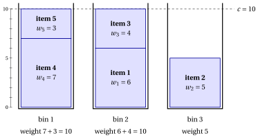

# 3.2 The bin packing problem { #sez-sec-bp-BPP }

**Part 1 · Combinatorial optimization problems · Chapter 3** · [:material-book-open-variant: Chapter 3: Packing problems](index.md) · [:material-file-pdf-box: Lecture notes, volume 1 (PDF)](../../pdf/lecture-notes-1-combinatorial-optimization-problems.pdf) · [:material-presentation: Slides](../../pdf/slides-bin-packing.pdf) · [:material-pencil: Exercises: Packing problems](../../exercises/bin-packing.md)

!!! definizione "Definition 3.1: Bin Packing Problem"

    Given:

    1. an infinite number of bins, each with <em>capacity</em> $c \in \Z_{\ge 1}$,

    2. a set $\mathscr{I} = \{1,2,\dots,n\}$ of $n$ items,

    3. for each item $j \in \mathscr{I}$, a <em>weight</em> $w_j \in \Z_{\ge 1}$,

    the <strong>Bin Packing Problem</strong> (BPP) asks to decide in which bin to place each item, so that the total weight of the items in any bin does not exceed the bin capacity, and the total number of bins used is minimized.

- A <strong>BPP instance</strong> is specified by:

    1. two integer numbers:

        - the bin capacity $c \in \Z_{\ge 1}$,

        - the number of items $n \in \Z_{\ge 1}$,

    2. one vector of integer numbers of length $n$:

        - $\vet{w} \in \Z_{\ge 1}^n$, containing the item weights.

- A <strong>BPP feasible solution</strong> is a family of <strong>packing patterns</strong>, i.e., subsets of items each assigned to one bin,

    $$
    \mathcal{P} \subseteq 2^{\mathscr{I}}
    $$

    such that:

    - **(i)** $\mathcal{P}$ forms a partition of $\mathscr{I}$ into <em>nonempty</em> packing patterns, namely

        $$
        \begin{gathered}
        P\neq \emptyset, \quad \text{for all } \, P\in\mathcal{P},\\
        P\cap P'=\emptyset, \quad \text{for all } \, P,P'\in\mathcal{P}\ \text{with } P\neq P',\\
        \bigcup_{P\in\mathcal{P}} P=\mathscr{I};
        \end{gathered}
        $$

    - **(ii)** the total weight of every packing pattern in $\mathcal{P}$ respects the bin capacity, namely

        $$
        \sum_{j\in P} w_j \le c, \quad \text{for all }\, P\in\mathcal{P}.
        $$

    Accordingly, the BPP can be equivalently stated as the problem of determining a partition of the item set into packing patterns such that the total weight of the items in each packing pattern does not exceed the bin capacity, and the number of packing patterns (bins) is minimized.

    !!! chiave ""

        Given a BPP instance, the BPP can be formally stated as:

        \begin{equation*}
        \label{BPP}
        \tilde{\mathcal{P}}
        \in
        \argmin_{\mathcal{P}\subseteq 2^{\mathscr{I}}}
        \left\{
        |\mathcal{P}|
        \;:\;
        \begin{array}{l}
        P\neq \emptyset, \quad \forall\, P\in\mathcal{P},\\[8pt]
        P\cap P'=\emptyset, \quad \forall\, P,P'\in\mathcal{P},\, P\neq P',\\[8pt]
        \displaystyle \bigcup_{P\in\mathcal{P}} P=\mathscr{I},\\[14pt]
        \displaystyle \sum_{j\in P} w_j \le c, \quad \forall\, P\in\mathcal{P}
        \end{array}
        \right\}. \tag{3.1}
        \end{equation*}

!!! esempio "Example 3.1: BPP instances"

    We consider a bin of capacity $c = 10$ and a set $\mathscr{I} = \{1,2,3,4,5\}$ of $5$ items ($n = 5$), with the following item weights:

    
<table>
    <tr>
    <th>Items</th>
    <th></th>
    <th>\(j=1\)</th>
    <th>\(j=2\)</th>
    <th>\(j=3\)</th>
    <th>\(j=4\)</th>
    <th>\(j=5\)</th>
    </tr>
    <tr>
    <td>Weights</td>
    <td>\(w_j\)</td>
    <td>\(6\)</td>
    <td>\(5\)</td>
    <td>\(4\)</td>
    <td>\(7\)</td>
    <td>\(3\)</td>
    </tr>
    </table>

    In the drawing every bin is a box of height $c=10$ and every item a block of height $w_j$. The three bins hold $\{4,5\}$, $\{1,3\}$ and $\{2\}$; we show below that $3$ bins are the minimum.

    { .fig loading=lazy  }

    We call this BPP instance [Example 3.1](#box-2-ex-bpp): it is the reference instance of the chapter.

## 3.2.1 Assumptions

- We make the following assumptions:

    1. The total weight of all items exceeds the bin capacity (otherwise, all items could fit in a single bin). Formally:

        $$
        \sum_{j \in \mathscr{I}} w_j > c
        $$

    2. Each item individually fits into a single bin (otherwise, it cannot be packed at all). Formally:

        $$
        w_j \le c,~~~~ \forall j \in \mathscr{I}
        $$

## 3.2.2 Counting the solutions, a first solution and a simple bound

- <strong>Candidate solutions.</strong> The candidate solutions are the partitions of $\mathscr{I}$: they are counted by the Bell numbers ([Chapter 1 «Combinatorial optimization problems»](https://fabiofurini.github.io/combinatorial-optimization/combinatorial-optimization-problems/combinatorial-optimization/counting-the-solutions/)). For [Example 3.1](#box-2-ex-bpp) we have $B(5) = 52$ partitions.

- <strong>Feasible solutions.</strong> A partition is feasible if every bin weighs at most $10$. Enumeration gives $11$ feasible partitions: $1$ with $5$ bins (one item per bin), $6$ with $4$ bins and $4$ with $3$ bins. Two bins are not enough, since the total weight $25$ exceeds $2 \cdot 10$.

- <strong>A first solution, by eye.</strong> We pair the heavy items with the light ones: item $4$ (weight $7$) with item $5$ (weight $3$), and item $1$ (weight $6$) with item $3$ (weight $4$); item $2$ (weight $5$) stays alone. The solution

    $$
    \mathcal{P} = \big\{\, \{4,5\},~ \{1,3\},~ \{2\} \,\big\}
    $$

    uses $3$ bins, of weights $10$, $10$ and $5$: it is a <strong>primal bound</strong>, $\UB = 3 \ge z(I)$.

!!! teorema "Observation 3.2: weight bound"

    Every feasible solution uses at least

    $$
    \left\lceil \frac{\sum_{j \in \mathscr{I}} w_j}{c} \right\rceil
    $$

    bins, so this value is a dual bound.

??? dimostrazione "Proof"

    If a solution uses $k$ bins, the total weight it carries is at most $k \, c$. The total weight of the items is $\sum_{j} w_j$, hence $k\,c \ge \sum_{j} w_j$. The number $k$ is an integer, so $k \ge \lceil \sum_j w_j / c \rceil$. □

- <strong>The dual bound and the gap.</strong> In [Example 3.1](#box-2-ex-bpp) we have $\sum_j w_j = 25$ and $c = 10$, so $\LB = \lceil 25/10 \rceil = 3$. The two bounds coincide: the gap is zero, the solution found by eye is optimal and $z(I) = 3$, without enumerating the partitions.

- The optimal solution is not unique: there are $4$ optimal partitions,

    $$
    \begin{array}{ll}
    \{\{1\},\{2,3\},\{4,5\}\}, & \{\{2\},\{1,3\},\{4,5\}\},\\[0.5ex]
    \{\{4\},\{1,5\},\{2,3\}\}, & \{\{4\},\{1,3\},\{2,5\}\}.
    \end{array}
    $$

---

**Next:** [3.3 The cutting stock problem](the-cutting-stock-problem.md)
