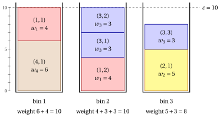

# 3.3 The cutting stock problem { #sez-sec-bp-CSP }

**Part 1 · Combinatorial optimization problems · Chapter 3** · [:material-book-open-variant: Chapter 3: Packing problems](index.md) · [:material-file-pdf-box: Lecture notes, volume 1 (PDF)](../../pdf/lecture-notes-1-combinatorial-optimization-problems.pdf) · [:material-presentation: Slides](../../pdf/slides-bin-packing.pdf) · [:material-pencil: Exercises: Packing problems](../../exercises/bin-packing.md)

!!! definizione "Definition 3.3: Cutting Stock Problem"

    Given:

    1. an infinite number of bins, each with <em>capacity</em> $c \in \Z_{\ge 1}$,

    2. a set $\mathscr{I} = \{1,2,\dots,n\}$ of $n$ items,

    3. for each item $j \in \mathscr{I}$, a <em>weight</em> $w_j \in \Z_{\ge 1}$ and a <em>number of required copies</em> $d_j \in \Z_{\ge 1}$,

    the <strong>Cutting Stock Problem</strong> (CSP) asks to decide in which bin to place each copy of every item, so that the total weight of all item copies in any bin does not exceed the bin capacity, the required number of copies of each item is placed into the bins, and the total number of bins used is minimized.

- A <strong>CSP instance</strong> is specified by:

    1. two integer numbers:

        - the bin capacity $c \in \Z_{\ge 1}$,

        - the number of items $n \in \Z_{\ge 1}$,

    2. two vectors of integer numbers of length $n$:

        - $\vet{w} \in \Z_{\ge 1}^n$, containing the item weights,

        - $\vet{d} \in \Z_{\ge 1}^n$, containing the required number of copies for each item.

- The problem is called the <em>Cutting Stock Problem</em> because, in its classical application, the bins correspond to large stock rolls (or sheets of material) that must be cut in order to produce the required copies of the items, also known as item demands.

- Given a CSP instance, we define the <strong>extended set of items</strong> as

    \begin{equation*}
    \label{ExtSetCSP}
    \hat{\mathscr{I}}
    =
    \big\{\, (j,k) : j \in \mathscr{I},~ k \in \{1,2,\dots,d_j\} \,\big\}, \tag{3.2}
    \end{equation*}

    where each pair $(j,k)$ represents the $k$-th required copy of item $j$. The cardinality of the extended set of items is

    $$
    |\hat{\mathscr{I}}| = \sum_{j\in \mathscr{I}} d_j.
    $$

- A <strong>CSP feasible solution</strong> is a family of <strong>packing patterns</strong>, i.e., subsets of item copies each assigned to one bin,

    $$
    \mathcal{P} \subseteq 2^{\hat{\mathscr{I}}}
    $$

    such that:

    - **(i)** $\mathcal{P}$ forms a partition of $\hat{\mathscr{I}}$ into <em>nonempty</em> packing patterns, namely

        $$
        \begin{gathered}
        P\neq \emptyset, \quad \text{for all } P\in\mathcal{P},\\
        P\cap P'=\emptyset, \quad \text{for all } P,P'\in\mathcal{P}\ \text{with } P\neq P',\\
        \bigcup_{P\in\mathcal{P}} P=\hat{\mathscr{I}};
        \end{gathered}
        $$

    - **(ii)** the total weight of the item copies in every packing pattern does not exceed the bin capacity, namely

        $$
        \sum_{(j,k)\in P} w_j \le c, \quad \text{for all } P\in\mathcal{P}.
        $$

    Accordingly, the CSP can be equivalently stated as the problem of determining a partition of the extended item set into packing patterns such that the total weight in each packing pattern does not exceed the bin capacity, and the number of packing patterns (bins) is minimized.

    !!! chiave ""

        Given a CSP instance, the CSP can be formally stated as:

        \begin{equation*}
        \label{CSP}
        \tilde{\mathcal{P}}
        \in
        \argmin_{\mathcal{P}\subseteq 2^{\hat{\mathscr{I}}}}
        \left\{
        |\mathcal{P}|
        \;:\;
        \begin{array}{l}
        P\neq \emptyset, \quad \forall\, P\in\mathcal{P},\\[8pt]
        P\cap P'=\emptyset, \quad \forall\, P,P'\in\mathcal{P},\, P\neq P',\\[8pt]
        \displaystyle \bigcup_{P\in\mathcal{P}} P=\hat{\mathscr{I}},\\[14pt]
        \displaystyle \sum_{(j,k)\in P} w_j \le c, \quad \forall\, P\in\mathcal{P}
        \end{array}
        \right\}. \tag{3.3}
        \end{equation*}

!!! esempio "Example 3.2: CSP instances"

    We consider bins of capacity $c = 10$ and a set $\mathscr{I} = \{1,2,3,4\}$ of $4$ items ($n=4$), with the following weights and required copies:

    
<table>
    <tr>
    <th>Items</th>
    <th></th>
    <th>\(j=1\)</th>
    <th>\(j=2\)</th>
    <th>\(j=3\)</th>
    <th>\(j=4\)</th>
    </tr>
    <tr>
    <td>Weights</td>
    <td>\(w_j\)</td>
    <td>\(4\)</td>
    <td>\(5\)</td>
    <td>\(3\)</td>
    <td>\(6\)</td>
    </tr>
    <tr>
    <td>Copies</td>
    <td>\(d_j\)</td>
    <td>\(2\)</td>
    <td>\(1\)</td>
    <td>\(3\)</td>
    <td>\(1\)</td>
    </tr>
    </table>

    In the drawing the copies of the same item have the same colour, and the copy $(j,k)$ is a block of height $w_j$. The $7$ copies fit in $3$ bins, of weights $10$, $10$ and $8$.

    { .fig loading=lazy  }

    We call this CSP instance [Example 3.2](#box-5-ex-csp): it is the reference CSP instance of the chapter.

## 3.3.1 Assumptions

- We make the following assumptions:

    1. The total weight of all required item copies exceeds the bin capacity (otherwise, all copies could fit in a single bin). Formally:

        $$
        \sum_{j\in \mathscr{I}} d_j\, w_j \;>\; c.
        $$

    2. Each item individually fits into a single bin (otherwise, no copy of that item can be packed at all). Formally:

        $$
        w_j \le c, \qquad \forall\, j\in \mathscr{I}.
        $$

## 3.3.2 Counting the solutions, a first solution and a simple bound

- <strong>Candidate solutions.</strong> The instance of [Example 3.2](#box-5-ex-csp) has $2+1+3+1 = 7$ copies. The partitions of the extended set of items are counted by $B(7) = 877$, where identical copies are counted as different items; $262$ of them are feasible.

- <strong>A first solution, by eye.</strong> We pair item $4$ (weight $6$) with a copy of item $1$ (weight $4$), put the other copy of item $1$ with two copies of item $3$ ($4+3+3$), and the last copy of item $3$ with item $2$ ($3+5$):

    $$
    \mathcal{P} = \big\{\, \{(4,1),(1,1)\},~ \{(1,2),(3,1),(3,2)\},~ \{(2,1),(3,3)\} \,\big\}
    $$

    uses $3$ bins, of weights $10$, $10$ and $8$, hence $\UB = 3$.

- <strong>The dual bound and the gap.</strong> The weight bound of the bin packing problem holds with the weights of all the copies: $\LB = \lceil \sum_j d_j w_j / c \rceil = \lceil 28/10 \rceil = 3$. The gap is zero, so the solution is optimal and $z(I) = 3$.

## 3.4 Remarks

- The worst-case behaviour of simple packing rules, such as First Fit, was analysed by Garey, Graham and Ullman (1972) and by Johnson, Demers, Ullman, Garey and Graham (1974).

- Johnson et al. (1974) proved that First Fit uses at most $\tfrac{17}{10}$ of the optimal number of bins, plus $2$.

## 3.5 Typical mistakes

!!! attenzione "Warning"

    - <strong>Believing that the weight bound is always tight.</strong> With three items of weight $6$ and $c = 10$ the bound gives $\lceil 18/10 \rceil = 2$, but no two items fit together, so $3$ bins are needed.

    - <strong>Counting the bins by the weights alone.</strong> The weight bound ignores how the items fit together; it is a dual bound, and the primal bound still needs a solution.

    - <strong>Listing the same packing twice.</strong> In the cutting stock problem the copies of an item are interchangeable: partitions that differ only by the exchange of identical copies are the same packing.

    - <strong>Ignoring the order of the bins.</strong> A solution is a partition: $\{\{4,5\},\{1,3\},\{2\}\}$ and $\{\{2\},\{4,5\},\{1,3\}\}$ are the same solution.

    - <strong>Forgetting the assumptions.</strong> An item with $w_j > c$ fits in no bin, and if the total weight is at most $c$ one bin is enough.

## 3.6 In summary

!!! chiave "In summary"

    - The BPP partitions the items into the minimum number of bins of capacity $c$; the cutting stock problem is the BPP with several identical copies of every item, and the BPP is the case $d_j = 1$.

    - A solution is a partition, so the candidates are counted by the Bell numbers and grow very fast.

    - A solution found by eye is a primal bound; the weight bound $\lceil \sum_j w_j / c \rceil$ is a dual bound.

    - When the two bounds coincide, the gap is zero and the solution is certified optimal.

    <strong>Dashboard of the reference instances.</strong>

    
<table>
    <tr>
    <th>instance (min)</th>
    <th>lower bound</th>
    <th>upper bound</th>
    <th>from</th>
    </tr>
    <tr>
    <td>BPP, <a href="../the-bin-packing-problem/#box-2-ex-bpp">Example 3.1</a></td>
    <td>\(3\) (weight bound)</td>
    <td>\(3\) (by eye)</td>
    <td>this chapter</td>
    </tr>
    <tr>
    <td>CSP, <a href="#box-5-ex-csp">Example 3.2</a></td>
    <td>\(3\) (weight bound)</td>
    <td>\(3\) (by eye)</td>
    <td>this chapter</td>
    </tr>
    </table>

---

**Exercises on this chapter:** [:material-pencil: Packing problems](../../exercises/bin-packing.md)

---

**In depth:** [:material-view-list: what the course does on this problem](../../catalogue/bin-packing-problem.md)

