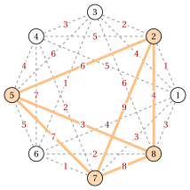

# The maximum clique problem

**Part 1 · Combinatorial optimization problems · Chapter 5** · [:material-file-pdf-box: Lecture notes, volume 1 (PDF)](../pdf/lecture-notes-1-combinatorial-optimization-problems.pdf) · [:material-pencil: Exercises: Maximum clique](../exercises/clique.md)

!!! nota "Prerequisites"

    - From this module, the chapter [«Combinatorial optimization problems»](https://fabiofurini.github.io/combinatorial-optimization/combinatorial-optimization-problems/combinatorial-optimization/): instances, feasible solutions, primal and dual bounds, and the gap.

    - From this module, the chapter [«Vertex coloring»](https://fabiofurini.github.io/combinatorial-optimization/combinatorial-optimization-problems/coloring/): graphs, neighbourhoods, degrees, the complement graph and the chromatic number $\chi(G)$.

!!! chiave "Objectives"

    At the end of this chapter you will be able to:

    - state the maximum clique problem and the maximum stable set problem, and pass from one to the other through the complement graph;

    - describe an instance and a feasible solution, and count the candidate solutions of a small graph;

    - find a clique by hand and compute four simple upper bounds on the clique number;

    - state the weighted variants of the problem and its complexity.

## 5.1 The maximum clique problem

!!! definizione "Definition 5.1: clique and clique number"

    Let $G=(V,E)$ be a simple undirected graph with $n$ vertices and $m$ edges.

    1. A <strong>clique</strong> is a subset $K \subseteq V$ of pairwise adjacent vertices: $\{u,v\} \in E$ for all $u,v \in K$ with $u \neq v$. Equivalently, $K$ induces a complete graph.

    2. The <strong>clique number</strong> $\omega(G)$ is the largest number of vertices of a clique of $G$.

!!! definizione "Definition 5.2: Maximum Clique Problem"

    Given:

    1. a simple <em>graph</em> $G = (V,E)$, where

        $$
        V = \{1,2,\dots,n\}
        $$

        is the set of $n$ <em>vertices</em>, and

        $$
        E \subseteq \big\{\, \{u,v\} : u,v \in V,~ u \neq v \,\big\}
        $$

        is the set of $m$ <em>edges</em>,

    the <strong>Maximum Clique Problem</strong> (MCP) asks to find a clique $K \subseteq V$ of $G$ whose number of vertices is maximum. Its optimal value is the clique number $\omega(G)$.

!!! definizione "Definition 5.3: stable set and Maximum Stable Set Problem"

    Let $G=(V,E)$ be a graph.

    1. A <strong>stable set</strong> (also called <strong>independent set</strong>) is a subset $Q \subseteq V$ of pairwise non-adjacent vertices: $\{u,v\} \notin E$ for all $u,v \in Q$ with $u \neq v$.

    2. The <strong>Maximum Stable Set Problem</strong> (MSSP) asks to find a stable set of $G$ whose number of vertices is maximum. Its optimal value is the <strong>stability number</strong> $\alpha(G)$.

!!! definizione "Definition 5.4: complement graph"

    The <strong>complement graph</strong> of $G=(V,E)$ is the graph $\overline{G}=(V,\overline{E})$ with the same vertices and the edge set

    $$
    \overline{E} = \big\{\, \{u,v\} : u,v \in V,~ u \neq v,~ \{u,v\} \notin E \,\big\}.
    $$

    The pairs in $\overline{E}$ are the <strong>non-edges</strong> of $G$, and $|\overline{E}| = \binom{n}{2} - m$.

!!! teorema "Proposition 5.5: clique number and stability number"

    A subset $K \subseteq V$ is a clique of $G$ if and only if it is a stable set of $\overline{G}$. Hence

    $$
    \omega(G) = \alpha(\overline{G}) \qquad\text{and}\qquad \alpha(G) = \omega(\overline{G}).
    $$

??? dimostrazione "Proof"

    Two distinct vertices $u,v$ are adjacent in $G$ if and only if they are not adjacent in $\overline{G}$. So all the pairs of $K$ are edges of $G$ exactly when no pair of $K$ is an edge of $\overline{G}$. The two problems have the same feasible solutions, hence the same optimal value. The second equality follows since $\overline{\overline{G}} = G$. □

!!! chiave ""

    The MCP on $G$ and the MSSP on $\overline{G}$ are the same problem: a maximum clique of $G$ is a maximum stable set of $\overline{G}$. Whatever we learn on one of the two problems holds for the other one.

- A <strong>MCP instance</strong> is specified by:

    1. two integer numbers: the number of vertices $n \in \Z_{\ge 1}$ and the number of edges $m \in \Z_{\ge 1}$;

    2. two vectors of integer numbers of length $m$: $\vet{u} \in \Z_{\ge 1}^m$ and $\vet{v} \in \Z_{\ge 1}^m$, with the two endpoints of the edges.

- A <strong>MCP feasible solution</strong> is a clique $K \subseteq V$. The empty set and a single vertex are cliques, so every instance has feasible solutions.

!!! chiave ""

    Given a MCP instance, the MCP can be formally stated as:

    \begin{equation*}
    \label{mcpP:MCP}
    \tilde{K}
    \in
    \argmax_{K\subseteq V}
    \Big\{\,
    |K|
    \;:\;
    \{u,v\}\in E, \quad \forall\, u,v\in K\ \text{with } u\neq v
    \,\Big\},
    \qquad |\tilde{K}| = \omega(G). \tag{5.1}
    \end{equation*}

!!! esempio "Example 5.1: MCP instance: a cycle with a chord"

    We consider the graph $G=(V,E)$ with $7$ vertices ($n=7$) and $8$ edges ($m=8$): the cycle $1,2,\dots,7,1$ and the chord $\{1,3\}$. On the right, its complement graph $\overline{G}$, with the $\binom{7}{2}-8=13$ non-edges of $G$.

    { .fig loading=lazy  }

    The vertex set and the edge set are:

    $$
    V=\{1,\dots,7\},\qquad
    E=\big\{\{1,2\},\{1,3\},\{1,7\},\{2,3\},\{3,4\},\{4,5\},\{5,6\},\{6,7\}\big\}.
    $$

    We call this MCP instance [Example 5.1](#box-6-mcpP-ex1): it is the reference instance of the chapter.

!!! esempio "Example 5.2: MCP instance: a dense graph with $8$ vertices"

    We consider the graph $G=(V,E)$ with $8$ vertices placed on a circle, where every vertex is adjacent to all the others except the opposite one. It has $m=\binom{8}{2}-4=24$ edges, and its complement has only the $4$ edges $\{1,5\},\{2,6\},\{3,7\},\{4,8\}$. A maximum clique $\tilde K=\{1,3,4,6\}$ is in red.

    { .fig loading=lazy  }

    In $\overline{G}$ the red vertices form a stable set: they take one vertex from each of the $4$ edges. We call this MCP instance [Example 5.2](#box-7-mcpP-ex2).

- The Petersen graph of the chapter «Vertex coloring» has no triangle, so its largest cliques are its edges and $\omega(G)=2$.

### 5.1.1 Assumptions

- We consider nontrivial instances: the graph has at least one edge and at least one non-edge. Formally:

    $$
    1 \le m < \binom{n}{2}.
    $$

- The assumption can be made without loss of generality: if the graph has no edge, every single vertex is a maximum clique and $\omega(G)=1$; if the graph is complete, $V$ itself is a clique and $\omega(G)=n$.

## 5.2 Counting the solutions, a first solution and the bounds

- <strong>Candidate solutions.</strong> The candidate solutions are the subsets of $V$: there are $2^n$ of them. For [Example 5.1](#box-6-mcpP-ex1) we have $2^7=128$ subsets, and only $17$ of them are cliques:

    
<table>
    <tr>
    <th>number of vertices</th>
    <th>\(0\)</th>
    <th>\(1\)</th>
    <th>\(2\)</th>
    <th>\(3\)</th>
    <th>total</th>
    </tr>
    <tr>
    <td>cliques</td>
    <td>\(1\)</td>
    <td>\(7\)</td>
    <td>\(8\)</td>
    <td>\(1\)</td>
    <td>\(17\)</td>
    </tr>
    </table>

    The only clique with $3$ vertices is $\{1,2,3\}$, so the optimal solution is unique and $\omega(G)=3$.

- For [Example 5.2](#box-7-mcpP-ex2) we have $2^8=256$ subsets and $81$ cliques. A clique takes at most one vertex from each pair $\{1,5\},\{2,6\},\{3,7\},\{4,8\}$: the maximum cliques take exactly one, so there are $2^4=16$ of them and $\omega(G)=4$.

- <strong>A first solution, by hand.</strong> We start from a vertex of maximum degree and add, one at a time, a vertex adjacent to all the vertices already chosen. In [Example 5.1](#box-6-mcpP-ex1), vertex $1$ has degree $3$; we add its neighbour $2$, and then $3$, which is adjacent to both.

- No other vertex is adjacent to $1$, $2$ and $3$, so we stop with $K=\{1,2,3\}$. It is a <strong>primal bound</strong>: $\LB = 3 \le \omega(G)$.

### 5.2.1 Simple upper bounds

- The MCP is a maximization problem: a dual bound is an <strong>upper bound</strong> on $\omega(G)$. We denote by $\deg(v)$ the degree of a vertex and by $\Delta$ the maximum degree of the graph.

!!! teorema "Observation 5.6: degree bound"

    For every graph $G=(V,E)$ we have $\omega(G) \le \Delta + 1$.

??? dimostrazione "Proof"

    In a clique $K$, every vertex is adjacent to the other $|K|-1$ vertices of $K$, so its degree is at least $|K|-1$. Hence $|K|-1 \le \Delta$ for every clique. □

!!! teorema "Observation 5.7: edge bound"

    For every graph $G=(V,E)$ we have $\omega(G)\,(\omega(G)-1)/2 \le m$.

??? dimostrazione "Proof"

    A clique with $k$ vertices contains all the $\binom{k}{2} = k(k-1)/2$ pairs of its vertices as edges, and these are edges of $G$. □

!!! teorema "Observation 5.8: degree count bound"

    Let $k^{\max}$ be the largest integer $k$ such that at least $k$ vertices of $G$ have degree at least $k-1$. Then $\omega(G) \le k^{\max}$.

??? dimostrazione "Proof"

    A clique with $k$ vertices has $k$ vertices, each of degree at least $k-1$ (proof of the degree bound). So $k=\omega(G)$ satisfies the condition, and $\omega(G)\le k^{\max}$. □

!!! teorema "Observation 5.9: coloring bound"

    For every graph $G=(V,E)$ we have $\omega(G) \le \chi(G)$. In particular, the number of colors of any feasible coloring of $G$ is an upper bound on $\omega(G)$.

??? dimostrazione "Proof"

    The vertices of a clique are pairwise adjacent, so they take pairwise different colors: a coloring with $k$ colors has $k \ge |K|$ for every clique $K$. This is the clique bound of the chapter «Vertex coloring», read from the side of the clique. □

- <strong>Bounds on [Example 5.1](#box-6-mcpP-ex1).</strong> Vertices $1$ and $3$ have degree $3$, the other five have degree $2$. The degree bound gives $\Delta+1=4$, and the edge bound gives $4$ too, since $4\cdot 3/2 = 6 \le 8 < 10 = 5 \cdot 4/2$.

- Only $2$ vertices have degree at least $3$, so $k=4$ fails the condition of the degree count bound, while $k=3$ satisfies it: $k^{\max}=3$. The coloring $\{1,4,6\},\{2,5,7\},\{3\}$ gives $3$ as well. The gap with $\LB=3$ is zero.

- <strong>Bounds on [Example 5.2](#box-7-mcpP-ex2).</strong> Every vertex has degree $6$: the degree bound and the degree count bound give $7$, and the edge bound gives $7$, since $7 \cdot 6/2 = 21 \le 24 < 28$.

- The four pairs $\{1,5\},\{2,6\},\{3,7\},\{4,8\}$ are stable sets, so they color the graph with $4$ colors: the coloring bound gives $4 = \omega(G)$. On dense graphs the bounds based on degrees are weak, and a good coloring is much better.

## 5.3 Weighted variants

- Let $\vet{w} \in \Z_{\ge 1}^n$ be a <strong>vertex-weight vector</strong>, with a weight $w_v$ for each vertex $v \in V$, and let $\vet{r} \in \Z_{\ge 1}^m$ be an <strong>edge-weight vector</strong>, with a weight $r_{uv}$ for each edge $\{u,v\} \in E$. For a clique $K$ we define

    $$
    w(K) = \sum_{v \in K} w_v
    \qquad\text{and}\qquad
    r(K) = \sum_{\{u,v\} \in E[K]} r_{uv},
    $$

    where $E[K]$ is the set of the edges with both endpoints in $K$.

!!! definizione "Definition 5.10: weighted maximum clique problems"

    1. Given a graph $G$ and a vertex-weight vector $\vet{w}$, the <strong>vertex-weighted maximum clique problem</strong> asks to find a clique $K$ of $G$ with maximum total vertex weight $w(K)$.

    2. Given a graph $G$ and an edge-weight vector $\vet{r}$, the <strong>edge-weighted maximum clique problem</strong> asks to find a clique $K$ of $G$ with maximum total edge weight $r(K)$.

- With all the weights $w_v=1$ the first problem is the MCP. The edge-weighted problem rewards the cliques with many heavy edges, and with $r_{uv}=1$ it is again the MCP, since $r(K)=\binom{|K|}{2}$ grows with $|K|$.

!!! esempio "Example 5.3: vertex-weighted maximum clique problem"

    We add to the graph of [Example 5.2](#box-7-mcpP-ex2) the vertex weights in blue. The vertex-weighted maximum clique is $\{2,3,5,8\}$, with weight $8+9+6+9=32$: it is unique, and it is not the maximum clique in red of [Example 5.2](#box-7-mcpP-ex2), whose weight is $5+9+5+5=24$.

    { .fig loading=lazy  }

    A clique takes at most one vertex from each pair $\{1,5\},\{2,6\},\{3,7\},\{4,8\}$; taking the heavier one of each pair gives $6+8+9+9=32$, and these four vertices form a clique.

!!! esempio "Example 5.4: edge-weighted maximum clique problem"

    We add to the graph of [Example 5.2](#box-7-mcpP-ex2) the edge weights in red. The edge-weighted maximum clique is $\{2,5,7,8\}$, in violet: its six edges weigh $6+4+9+7+3+8=37$, and the enumeration of the $16$ maximum cliques shows that it is the unique optimal solution.

    { .fig loading=lazy  }

## 5.4 Complexity

- The <strong>decision version</strong> of the MCP asks, for a graph $G$ and an integer $k$, whether $G$ has a clique with $k$ vertices. Karp (1972) included it among his $21$ NP-complete problems, so the MCP is NP-hard. By [Proposition 5.5](#box-5-mcpP-prop-omega-alpha), the same holds for the MSSP.

- Listing all the subsets of $V$ and checking the pairs of each one takes $O(2^n\, n^2)$ steps. For a <em>fixed</em> $k$, the $\binom{n}{k}$ subsets with $k$ vertices are checked in $O(n^k\, k^2)$ steps: a polynomial for every fixed $k$, but the exponent grows with the size of the clique.

- The MCP is also hard to approximate: Håstad (1999) proved that, for every $\varepsilon>0$, no polynomial algorithm guarantees a clique with at least $\omega(G)/n^{1-\varepsilon}$ vertices, unless every problem in NP can be solved in randomized polynomial time.

## 5.5 Remarks

- In a coloring, every color class is a stable set: the MSSP is the problem of the largest color class, and the clique number is the dual bound of the chapter «Vertex coloring».

- Applications of cliques and stable sets:

    - groups of pairwise connected members in social networks;

    - groups of pairwise compatible tasks or exams, in scheduling and in the planning of timetables;

    - common substructures of two molecules, in chemistry and in biology;

    - codes that correct errors, as large sets of words pairwise far apart.

## 5.6 Typical mistakes

!!! attenzione "Warning"

    - <strong>Confusing a maximal clique with a maximum clique.</strong> A clique is maximal when no vertex can be added to it; it is maximum when no clique is larger. In [Example 5.1](#box-6-mcpP-ex1), $\{4,5\}$ is maximal but not maximum.

    - <strong>Building the complement graph with the edges of $G$.</strong> The edges of $\overline{G}$ are exactly the pairs that are <em>not</em> edges of $G$: there are $\binom{n}{2}-m$ of them.

    - <strong>Using a lower bound as an upper bound.</strong> A clique found by hand gives $\LB \le \omega(G)$; the degree bounds and a coloring give $\UB \ge \omega(G)$. In this chapter the problem is a maximization.

    - <strong>Believing that the coloring bound is tight.</strong> On the cycle with $5$ vertices $\omega(G)=2$ and $\chi(G)=3$.

## 5.7 In summary

!!! chiave "In summary"

    - The MCP looks for the largest set of pairwise adjacent vertices; its optimal value is the clique number $\omega(G)$.

    - A clique of $G$ is a stable set of $\overline{G}$: the MCP on $G$ is the MSSP on $\overline{G}$, and $\omega(G)=\alpha(\overline{G})$.

    - A clique found by hand is a primal bound; the degree bound, the edge bound, the degree count bound and the number of colors of a coloring are dual bounds.

    - The MCP is NP-hard and hard to approximate; its weighted variants weigh the vertices or the edges.

    <strong>Dashboard of the reference instances.</strong>

    
<table>
    <tr>
    <th>instance (max)</th>
    <th>lower bound</th>
    <th>upper bound</th>
    <th>from</th>
    </tr>
    <tr>
    <td>[Example 5.1](#box-6-mcpP-ex1) (cycle with a chord)</td>
    <td>\(3\) (by hand)</td>
    <td>\(3\) (degree count, coloring)</td>
    <td>this chapter</td>
    </tr>
    <tr>
    <td>[Example 5.2](#box-7-mcpP-ex2) (dense graph)</td>
    <td>\(4\) (by hand)</td>
    <td>\(4\) (coloring)</td>
    <td>this chapter</td>
    </tr>
    </table>

---

**Exercises on this chapter:** [:material-pencil: Maximum clique](../exercises/clique.md)
