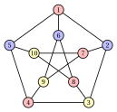

# Vertex coloring

**Part 1 · Combinatorial optimization problems · Chapter 4** · [:material-file-pdf-box: Lecture notes, volume 1 (PDF)](../pdf/lecture-notes-1-combinatorial-optimization-problems.pdf)

!!! nota "Prerequisites"

    - From this module, the chapter «Combinatorial optimization problems»: instances, feasible solutions, primal and dual bounds, the gap, and the Bell numbers that count the partitions of a set.

    - From the chapter «Bin packing and cutting stock problems»: the weight bound as an example of a dual bound.

    - No knowledge of graph theory is needed: the definitions used here are recalled in a short section.

!!! chiave "Objectives"

    At the end of this chapter you will be able to:

    - use the basic notions on graphs: neighbourhood, degree, induced graph, complement graph, clique and stable set;

    - state the definition of the vertex coloring problem and the assumptions on the graph;

    - count the candidate solutions of a small instance and recognize that they are partitions;

    - find a coloring by hand and compute the clique bound and the stable set bound;

    - explain why the clique bound is not always tight.

## 4.1 Why vertex coloring problems?

- <strong>A story.</strong> Six exams must be scheduled in the exam session, and two exams that share at least one student cannot take place on the same day. What is the minimum number of days? The vertices are the exams, the edges join the exams with students in common, and the colors are the days.

- <strong>History.</strong> Brooks (1941) proved that a connected graph that is neither complete nor an odd cycle can be colored with at most $\Delta$ colors, where $\Delta$ is the largest degree. Karp (1972) included the chromatic number among his $21$ NP-complete problems, and Garey, Johnson and Stockmeyer (1976) proved that deciding whether $3$ colors are enough remains NP-complete on planar graphs of maximum degree $4$.

- <strong>A challenge.</strong> Before reading on, try to answer two questions on the Petersen graph of [Example 4.2](#box-4-ex-vcp2). How many colors are needed? How can we prove that fewer colors are not enough, without listing all the partitions? The clique bound is not enough here, and the chapter shows why.

## 4.2 A short review of graphs

- A <strong>graph</strong> $G = (V,E)$ is given by a finite set $V$ of <strong>vertices</strong> and a set $E$ of <strong>edges</strong>, each edge being a $2$-element subset of $V$. We write $n = |V|$ and $m = |E|$; the vertices are labelled $1,2,\dots,n$. All the graphs of this chapter are simple and undirected.

- Two distinct vertices $u$ and $v$ are <strong>adjacent</strong> if $\{u,v\} \in E$. The <strong>neighbourhood</strong> of a vertex $v$ is the set $N(v) = \{\, u \in V : \{u,v\} \in E \,\}$, and its <strong>degree</strong> is $\deg(v) = |N(v)|$.

- For a subset $U \subseteq V$ the <strong>induced graph</strong> $G[U] = (U, E[U])$ has the vertices of $U$ and the edges of $E$ with both endpoints in $U$.

- The <strong>complement graph</strong> $\overline{G} = (V, \overline{E})$ has the same vertices as $G$, and two distinct vertices are adjacent in $\overline{G}$ if and only if they are not adjacent in $G$.

!!! definizione "Definition 4.1: clique and stable set"

    Let $G = (V,E)$ be a graph.

    1. A <strong>clique</strong> is a subset $K \subseteq V$ of pairwise adjacent vertices: $\{u,v\} \in E$ for all $u,v \in K$ with $u \neq v$.

    2. A <strong>stable set</strong> (also called <strong>independent set</strong>) is a subset $Q \subseteq V$ of pairwise non-adjacent vertices: $\{u,v\} \notin E$ for all $u,v \in Q$ with $u \neq v$.

    The <strong>clique number</strong> $\omega(G)$ is the largest number of vertices of a clique, and the <strong>stability number</strong> $\alpha(G)$ is the largest number of vertices of a stable set.

- A stable set of $G$ is a clique of the complement graph $\overline{G}$, and vice versa. A vertex alone and the empty set are both a clique and a stable set.

!!! chiave ""

    A clique is a group of vertices that pairwise <em>conflict</em>; a stable set is a group of vertices with no conflict. In a coloring, the vertices of a clique need different colors, and the vertices of a stable set can share one.

## 4.3 The vertex coloring problem

!!! definizione "Definition 4.2: Vertex Coloring Problem"

    Given:

    1. a simple <em>graph</em> $G = (V,E)$, where

        $$
        V = \{1,2,\dots,n\}
        $$

        is the set of $n$ <em>vertices</em>, and

        $$
        E \subseteq \big\{\, \{u,v\} : u,v \in V,~ u \neq v \,\big\}
        $$

        is the set of $m$ <em>edges</em>,

    the <strong>Vertex Coloring Problem</strong> (VCP) asks to decide how to assign a color to each vertex, so that no two adjacent vertices share the same color, and the total number of colors used is minimized.

- A <strong>VCP instance</strong> is specified by:

    1. two integer numbers:

        - the number of vertices $n \in \Z_{\ge 1}$,

        - the number of edges $m \in \Z_{\ge 1}$,

    2. two vectors of integer numbers of length $m$:

        - $\vet{u} \in \Z_{\ge 1}^m$, containing the first endpoint of the edges,

        - $\vet{v} \in \Z_{\ge 1}^m$, containing the second endpoint of the edges.

- A <strong>VCP feasible solution</strong> is a family of <strong>color classes</strong>, i.e., subsets of vertices each assigned to one color,

    $$
    \mathcal{Q} \subseteq 2^{V}
    $$

    such that:

    - **(i)** $\mathcal{Q}$ forms a partition of $V$ into <em>nonempty</em> color classes, namely

        $$
        \begin{gathered}
        Q\neq \emptyset, \quad \text{for all } Q\in\mathcal{Q},\\
        Q\cap Q'=\emptyset, \quad \text{for all } Q,Q'\in\mathcal{Q}\ \text{with } Q\neq Q',\\
        \bigcup_{Q\in\mathcal{Q}} Q=V;
        \end{gathered}
        $$

    - **(ii)** each color class in $\mathcal{Q}$ is an <em>stable set</em>, namely

        $$
        \{u,v\}\notin E, \quad \text{for all } Q\in\mathcal{Q},\ \text{for all } u,v\in Q\ \text{with } u\neq v.
        $$

    Accordingly, the VCP can be equivalently stated as the problem of determining a partition of the vertex set into color classes such that each color class is an stable set (i.e., its vertices can receive the same color), and the number of color classes (colors) is minimized.

!!! chiave ""

    Given a VCP instance, the VCP can be formally stated as:

    \begin{equation*}
    \label{VCP}
    \tilde{\mathcal{Q}}
    \in
    \argmin_{\mathcal{Q}\subseteq 2^{V}}
    \left\{
    |\mathcal{Q}|
    \;:\;
    \begin{array}{l}
    Q\neq \emptyset, \quad \forall\, Q\in\mathcal{Q},\\[8pt]
    Q\cap Q'=\emptyset, \quad \forall\, Q,Q'\in\mathcal{Q}\ \text{with } Q\neq Q',\\[8pt]
    \displaystyle \bigcup_{Q\in\mathcal{Q}} Q=V,\\[12pt]
    \{u,v\}\notin E, \quad \forall\, Q\in\mathcal{Q},\ \forall\, u,v\in Q\ \text{with } u\neq v
    \end{array}
    \right\}. \tag{4.1}
    \end{equation*}

- The optimal value of the VCP is the <strong>chromatic number</strong> $\chi(G)$ of the graph: the minimum number of colors (stable sets) needed to color all the vertices. The color classes of a solution are stable sets, and the number of classes is the number of colors used.

!!! esempio "Example 4.1: VCP instance: a triangle"

    We consider the following graph $G = (V,E)$ with $3$ vertices ($n=3$) and $3$ edges ($m=3$):

    { .fig .ovale loading=lazy style="width:24%" }

    The vertex set $V$ and the edge set $E$ are:

    $$
    V = \big\{~ 1,~ 2,~ 3 ~\big\}, \qquad E = \big\{~ \{1,2\},~ \{1,3\},~ \{2,3\} ~\big\}.
    $$

    We call this VCP instance [Example 4.1](#box-3-ex-vcp1).

!!! esempio "Example 4.2: VCP instance: the Petersen graph"

    We consider now the following graph $G = (V,E)$ with $10$ vertices ($n=10$) and $15$ edges ($m=15$):

    { .fig .ovale loading=lazy style="width:47%" }

    The vertex set $V$ and the edge set $E$ are:

    $$
    V = \big\{~ 1,~ 2,~ 3,~ 4,~ 5,~ 6,~ 7,~ 8,~ 9,~ 10 ~\big\},
    $$

    $$
    \begin{aligned}
    E = \big\{~ & \{1,2\},~ \{1,5\},~ \{1,6\},~ \{2,3\},~ \{2,7\},\\
    & \{3,4\},~ \{3,8\},~ \{4,5\},~ \{4,9\},~ \{5,10\},\\
    & \{6,8\},~ \{6,9\},~ \{7,9\},~ \{7,10\},~ \{8,10\} ~\big\}.
    \end{aligned}
    $$

    We call this VCP instance [Example 4.2](#box-4-ex-vcp2): it is the reference instance of the chapter.

### 4.3.1 Assumptions

- We make the following assumptions:

    1. The graph has no isolated vertices. An isolated vertex can receive any color used by the rest of the graph; if the graph has no edges, the optimal value is one. Formally:

        $$
        \deg(v) \ge 1, \qquad \forall\, v \in V.
        $$

    2. No vertex has its neighbourhood contained in the neighbourhood of another vertex. Formally:

        $$
        N(u) \not\subseteq N(v), \qquad \forall\, u,v \in V,~ u \neq v.
        $$

- The second assumption can be made without loss of generality, because:

    1. if $N(u) \subseteq N(v)$, the vertex $u$ can be removed without changing the chromatic number: every coloring of $G \setminus \{u\}$ extends to $u$ with the color of $v$;

    2. the vertices $u$ and $v$ are not adjacent: otherwise $v \in N(u) \subseteq N(v)$, which is impossible in a simple graph, so $u$ and $v$ can share a color.

### 4.3.2 Two simple bounds

!!! teorema "Observation 4.3: clique bound"

    For every graph $G = (V,E)$ we have

    $$
    \omega(G) \le \chi(G).
    $$

??? dimostrazione "Proof"

    Since all vertices in any clique are pairwise adjacent, they must all receive different colors in any VCP feasible solution. Thus, at least $\omega(G)$ different colors are needed to color the vertices of any maximum clique, implying $\omega(G) \le \chi(G)$. □

!!! teorema "Observation 4.4: stable set bound"

    For every graph $G = (V,E)$ we have

    $$
    \left\lceil \frac{n}{\alpha(G)} \right\rceil \le \chi(G).
    $$

??? dimostrazione "Proof"

    In a feasible solution with $k$ color classes, every class is a stable set, so it has at most $\alpha(G)$ vertices. The $n$ vertices are covered by the classes, hence $n \le k \, \alpha(G)$. The number $k$ is an integer, so $k \ge \lceil n/\alpha(G) \rceil$. □

- The clique bound is useful when the graph has a large clique, and the stable set bound when its stable sets are small. Both are dual bounds: a clique and a stable set are found without knowing $\chi(G)$.

### 4.3.3 Counting the solutions, a first solution and the bounds

- <strong>Candidate solutions.</strong> The candidate solutions are the partitions of $V$, counted by the Bell numbers (Chapter «Combinatorial optimization problems»). For [Example 4.1](#box-3-ex-vcp1) we have $B(3) = 5$ partitions and only one is feasible: three singletons, since every pair of vertices is adjacent. Hence $\chi(G) = 3$.

- For [Example 4.2](#box-4-ex-vcp2) we have $B(10) = 115\,975$ partitions, and $7\,430$ of them are feasible, that is, have only stable sets as classes.

- <strong>A first solution, by eye.</strong> The coloring shown in [Example 4.2](#box-4-ex-vcp2) uses $3$ colors:

    $$
    \mathcal{Q} = \big\{\, \{1,4,7,8\},~ \{2,5,6\},~ \{3,9,10\} \,\big\}.
    $$

    No edge joins two vertices of the same class, so it is feasible: it is a <strong>primal bound</strong>, $\UB = 3 \ge \chi(G)$.

- <strong>Dual bounds on the Petersen graph.</strong> The graph has no triangle, so $\omega(G) = 2$ and the clique bound gives only $\LB = 2$: a gap of $1$ remains.

- The vertices $1,2,3,4,5$ form a cycle with $5$ vertices, and so do $6,7,8,9,10$ (the edges of the figure). A stable set contains at most $2$ vertices of each cycle, so $\alpha(G) \le 4$; the set $\{1,4,7,8\}$ shows that $\alpha(G) = 4$.

- The stable set bound gives $\lceil 10/4 \rceil = 3$. The two bounds coincide: the gap is zero and $\chi(G) = 3$.

## 4.4 Typical mistakes

!!! attenzione "Warning"

    - <strong>Confusing a clique with a stable set.</strong> In a clique all the pairs are edges and the vertices need different colors; in a stable set no pair is an edge and the vertices can share a color.

    - <strong>Believing that the clique bound is tight.</strong> It is not: the Petersen graph has $\omega(G) = 2$ and $\chi(G) = 3$, and the same happens for a cycle with $5$ vertices.

    - <strong>Counting the permutations of the colors as different solutions.</strong> A solution is a partition of the vertices into stable sets: exchanging the names of two colors gives the same solution.

    - <strong>Using a class that is not a stable set.</strong> A color class with two adjacent vertices makes the solution infeasible, whatever the number of colors.

    - <strong>Forgetting the assumptions.</strong> An isolated vertex and a vertex with $N(u) \subseteq N(v)$ can be removed before solving, without changing the chromatic number.

## 4.5 In summary

!!! chiave "In summary"

    - The VCP partitions the vertices of a graph into the minimum number of stable sets; the optimal value is the chromatic number $\chi(G)$.

    - A clique needs different colors and a stable set can share one; the cliques of $G$ are the stable sets of the complement graph.

    - A coloring found by eye is a primal bound; the clique bound $\omega(G)$ and the stable set bound $\lceil n/\alpha(G) \rceil$ are dual bounds.

    - The bounds do not always meet: on the Petersen graph the clique bound leaves a gap, the stable set bound closes it.

    <strong>Dashboard of the reference instances.</strong>

    
<table>
    <tr>
    <th>instance (min)</th>
    <th>lower bound</th>
    <th>upper bound</th>
    <th>from</th>
    </tr>
    <tr>
    <td>[Example 4.1](#box-3-ex-vcp1) (triangle)</td>
    <td>\(3\) (clique bound)</td>
    <td>\(3\) (by eye)</td>
    <td>this chapter</td>
    </tr>
    <tr>
    <td>[Example 4.2](#box-4-ex-vcp2) (Petersen)</td>
    <td>\(3\) (stable set bound)</td>
    <td>\(3\) (by eye)</td>
    <td>this chapter</td>
    </tr>
    </table>

