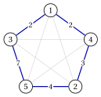
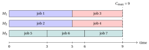
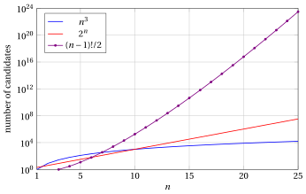
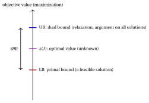
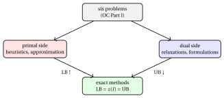

# Combinatorial optimization problems

**Part 1 · Combinatorial optimization problems · Chapter 1** · [:material-file-pdf-box: Lecture notes, volume 1 (PDF)](../pdf/lecture-notes-1-combinatorial-optimization-problems.pdf) · [:material-pencil: Exercises: Combinatorial optimization](../exercises/combinatorial-optimization.md)

!!! nota "Prerequisites"

    - From the <em>Preliminaries</em>: optimization problems (feasible region, objective function, optimal solution and optimal value), binomial coefficients and partitions of a finite set.

    - No knowledge of integer programming is needed: the bounds of this chapter come from combinatorial arguments.

!!! chiave "Objectives"

    At the end of this chapter you will be able to:

    - recognize a combinatorial optimization problem and the combinatorial object behind its solutions (a subset, an ordering, a partition, an assignment);

    - state in words the six problems of the course: knapsack, bin packing, vertex coloring, travelling salesman, scheduling on parallel machines and capacitated lot sizing;

    - count the solutions of these problems ($2^n$ subsets, $(n-1)!/2$ tours, Bell numbers for the partitions) and estimate the computing time of a brute force enumeration;

    - define primal bounds, dual bounds and the gap, and use them to certify that a solution is optimal;

    - place a problem in the classes P, NP and NP-hard, and tell a pseudo-polynomial algorithm from a polynomial one.

## 1.1 Combinatorial optimization problems

!!! definizione "Definition 1.1: combinatorial optimization problem"

    Given:

    1. a <u>finite</u> set $\mathscr{U} = \{1,2,\dots,n\}$, called the <strong>ground set</strong>,

    2. a family $\mathcal{F} \subseteq 2^{\mathscr{U}}$ of subsets of $\mathscr{U}$, called the <strong>feasible solutions</strong>,

    3. an <strong>objective function</strong> $f : \mathcal{F} \rr \R$,

    the associated <strong>combinatorial optimization problem</strong> asks to find a feasible solution $\tilde S \in \mathcal{F}$ such that

    $$
    f(\tilde S) \ge f(S), \qquad \forall S \in \mathcal{F} \qquad \text{(maximization form)},
    $$

    or such that

    $$
    f(\tilde S) \le f(S), \qquad \forall S \in \mathcal{F} \qquad \text{(minimization form)}.
    $$

- The feasible region $\mathcal{F}$ is a <strong>finite</strong> set, since $|2^{\mathscr{U}}| = 2^n$. Accordingly, an optimal solution always exists whenever $\mathcal{F} \neq \emptyset$.

- In most problems the objective function is <strong>linear</strong> (additive): each element $j \in \mathscr{U}$ has a weight $c_j$ and

    $$
    f(S) = \sum_{j \in S} c_j .
    $$

    This is the case of the knapsack problem (profits) and of the travelling salesman problem (distances). Some problems have a different objective, for example the <strong>makespan</strong> of the scheduling problem of Section [1.2](#sez-sec-six), which is a maximum and not a sum.

- A <strong>problem</strong> is a general question with symbolic data; an <strong>instance</strong> $I$ of the problem is obtained by fixing the numbers. We denote by $z(I)$ the optimal value of the instance $I$.

!!! chiave ""

    <strong>Combinatorial optimization</strong> is the study of optimization problems on <strong>discrete structures</strong> and <strong>combinatorial objects</strong>, such as graphs, subsets, permutations, sequences, partitions, coverings and packings.

- The <strong>main characteristics</strong> of combinatorial optimization problems are:

    1. the set of feasible solutions is <strong>finite</strong>;

    2. the number of feasible solutions is typically <strong>enormous</strong>: it grows exponentially (or faster) with the size of the instance;

    3. finding an optimal solution can be <strong>computationally very difficult</strong> (Section [1.6](#sez-sec-complexity));

    4. specialized algorithms are needed to explore the solution space without enumerating it.

### 1.1.1 Four kinds of discrete decisions

- The discrete decisions met in practice fall into a few families, each one associated with a combinatorial object:

<table>
<tr>
<th><strong>Decision</strong></th>
<th><strong>Examples</strong></th>
<th><strong>Combinatorial object</strong></th>
</tr>
<tr>
<td>IN/OUT (inclusion)</td>
<td>select projects to fund with a limited budget; choose the products of a portfolio</td>
<td>a <strong>subset</strong></td>
</tr>
<tr>
<td>ordering, sequencing</td>
<td>order in which jobs are processed; order of visit of the customers</td>
<td>a <strong>permutation</strong></td>
</tr>
<tr>
<td>partitioning, packing</td>
<td>split items among bins; group exams into days</td>
<td>a <strong>partition</strong></td>
</tr>
<tr>
<td>assignment</td>
<td>assign jobs to machines, students to projects</td>
<td>a <strong>function</strong> (a partition with labelled classes)</td>
</tr>
</table>

- A fifth family, <strong>counting</strong> decisions (how many units to produce, how many operators in a shift), leads to integer quantities, modelled by integer variables (module <em>Integer Linear Programming</em>, [Chapter 1 «Integer linear programming»](https://fabiofurini.github.io/integer-linear-programming/models-and-bounds/ilp/)).

## 1.2 The six problems of the course { #sez-sec-six }

- The course is built around <strong>six problems</strong>. Each one is defined here in words, with a small instance; the formal definitions and the variants are in Chapters OC 2–7.

- The same problems return in every part of the course, solved each time with a different method; the reference instances of the knapsack, bin packing and coloring problems are introduced in Chapters OC 2–4.

### 1.2.1 Knapsack problem

!!! definizione "Definition 1.2: Knapsack Problem"

    Given $n$ items with profits $p_j$ and weights $w_j$, and a capacity $c$, the <strong>knapsack problem</strong> (KP) asks to select a <strong>subset</strong> of items of total weight at most $c$ and maximum total profit.

!!! esempio "Example 1.1: a small knapsack instance"

    We consider the instance with $n=4$ items and capacity $c=9$:

    
<table>
    <tr>
    <th>item \(j\)</th>
    <th>1</th>
    <th>2</th>
    <th>3</th>
    <th>4</th>
    </tr>
    <tr>
    <td>profit \(p_j\)</td>
    <td>10</td>
    <td>7</td>
    <td>6</td>
    <td>4</td>
    </tr>
    <tr>
    <td>weight \(w_j\)</td>
    <td>5</td>
    <td>4</td>
    <td>3</td>
    <td>3</td>
    </tr>
    </table>

    The subset $\{1,3\}$ has weight $5+3=8 \le 9$ and profit $10+6=16$; the subset $\{1,2\}$ has weight $5+4=9 \le 9$ and profit $10+7=17$. We call this instance [Example 1.1](#box-3-ex-oc1-kp).

### 1.2.2 Bin packing problem

!!! definizione "Definition 1.3: Bin Packing Problem"

    Given $n$ items with weights $w_j$ and identical bins of capacity $c$, the <strong>bin packing problem</strong> (BPP) asks to <strong>partition</strong> the items into the minimum number of bins, so that the total weight in each bin is at most $c$.

!!! esempio "Example 1.2: a small bin packing instance"

    We consider $n=6$ items with weights $\vet{w} = (4,4,5,3,2,3)$ and capacity $c=7$, and we call this instance [Example 1.2](#box-5-ex-oc1-bpp). The partition $\{1,4\},\{2,6\},\{3,5\}$ uses $3$ bins, each one filled exactly:

    { .fig loading=lazy  }

### 1.2.3 Vertex coloring problem

!!! definizione "Definition 1.4: Vertex Coloring Problem"

    Given a graph $G=(V, E)$, the <strong>vertex coloring problem</strong> (VCP) asks to assign a color to each vertex so that adjacent vertices have different colors, using the minimum number of colors. Equivalently, it asks to <strong>partition</strong> $V$ into the minimum number of <strong>stable sets</strong> (sets of pairwise non-adjacent vertices). The minimum is the <strong>chromatic number</strong> $\chi(G)$.

- In [Example 1.3](#box-7-ex-oc1-vcp) the vertices are exams, the edges join the exams with students in common, and the colors are the days of the exam session.

!!! esempio "Example 1.3: an exam calendar"

    We consider the exams 1 Calculus, 2 Linear algebra, 3 Physics, 4 Programming, 5 Statistics and 6 Operations research, with the conflicts

    $$
    E = \big\{ \{1,2\},\{1,3\},\{2,3\},\{2,4\},\{3,5\},\{4,5\},\{4,6\},\{5,6\} \big\}.
    $$

    The coloring on the right uses $3$ days: day 1 for $\{1,4\}$, day 2 for $\{2,5\}$, day 3 for $\{3,6\}$. Fewer days are impossible, since the exams $1,2,3$ are pairwise in conflict.

    { .fig loading=lazy  }

    We call this instance [Example 1.3](#box-7-ex-oc1-vcp).

### 1.2.4 Travelling salesman problem

!!! definizione "Definition 1.5: Travelling Salesman Problem"

    Given $n$ cities and the distance $d_{ij}$ between each pair of cities, the <strong>travelling salesman problem</strong> (TSP) asks to find a <strong>tour</strong>, that is a cyclic <strong>ordering</strong> of the cities visiting each city exactly once, of minimum total length.

!!! esempio "Example 1.4: a small TSP instance"

    We consider $n=5$ cities with the symmetric distances

    $$
    \begin{array}{c|ccccc}
    \hline {d_{ij}} & {1} & {2} & {3} & {4} & {5} \\
    \hline {1} & --- & {5} & {2} & {2} & {9} \\
    {2} & {5} & --- & {4} & {3} & {4} \\
    {3} & {2} & {4} & --- & {4} & {7} \\
    {4} & {2} & {3} & {4} & --- & {7} \\
    {5} & {9} & {4} & {7} & {7} & --- \\
    \hline
    \end{array}
    $$

    The tour $(1,3,5,2,4)$, in bold, has length $2+7+4+3+2=18$.

    { .fig loading=lazy  }

    We call this instance [Example 1.4](#box-9-ex-oc1-tsp).

### 1.2.5 Scheduling on identical parallel machines

!!! definizione "Definition 1.6: Scheduling on identical parallel machines"

    Given $n$ jobs with processing times $t_j$ and $m$ identical machines, the problem $P\|C_{\max}$ asks to <strong>assign</strong> each job to a machine so as to minimize the <strong>makespan</strong> $C_{\max}$, that is the largest load $L_h$ of a machine.

!!! esempio "Example 1.5: a small $P\|C_{\max}$ instance"

    We consider $n=7$ jobs with $\vet{t}=(5,5,4,4,3,3,3)$ and $m=3$ machines, and we call this instance [Example 1.5](#box-11-ex-oc1-pcm). The assignment $J_1=\{1,3\}$, $J_2=\{2,4\}$, $J_3=\{5,6,7\}$ gives the loads $L_1=5+4=9$, $L_2=5+4=9$, $L_3=3+3+3=9$, hence $C_{\max}=9$:

    { .fig loading=lazy  }

### 1.2.6 Capacitated lot sizing

!!! definizione "Definition 1.7: Capacitated Lot Sizing Problem"

    Given $m$ periods and, for each period, a demand, a production capacity, a setup cost (a fixed cost paid when the line produces), a unit production cost and a unit holding cost for the stock, the <strong>capacitated lot sizing problem</strong> (CLS) asks to choose the periods with a setup and the production quantities, so that the demand of every period is satisfied, the capacities are respected and the total cost (setup, production and holding costs) is minimum.

- The combinatorial part of the decision is the <strong>subset</strong> of periods with a setup: with $m$ periods there are $2^m$ possible choices. Once the setups are fixed, the quantities are found by linear programming.

<table>
<tr>
<th><strong>Problem</strong></th>
<th><strong>A solution is</strong></th>
</tr>
<tr>
<td>knapsack (KP)</td>
<td>a subset of items</td>
</tr>
<tr>
<td>bin packing (BPP)</td>
<td>a partition of the items into bins</td>
</tr>
<tr>
<td>vertex coloring (VCP)</td>
<td>a partition into stable sets</td>
</tr>
<tr>
<td>TSP</td>
<td>a cyclic ordering of the cities</td>
</tr>
<tr>
<td>\(P\|C_{\max}\)</td>
<td>an assignment of jobs to machines</td>
</tr>
<tr>
<td>lot sizing (CLS)</td>
<td>setup periods and quantities</td>
</tr>
</table>

## 1.3 Counting the solutions { #sez-sec-counting }

- Before solving a problem we ask <strong>how many</strong> candidate solutions it has. The answer depends only on the combinatorial object: subsets, orderings or partitions.

### 1.3.1 Subsets

!!! teorema "Proposition 1.8"

    A set with $n$ elements has $2^n$ subsets.

??? dimostrazione "Proof"

    A subset $S \subseteq \{1,2,\dots,n\}$ is identified by the binary vector ${\vet{x}} \in \{0,1\}^n$ with $x_j = 1$ if and only if $j \in S$. Each of the $n$ components takes $2$ values independently, hence there are $2 \cdot 2 \cdots 2 = 2^n$ vectors. Equivalently, the number of subsets with $k$ elements is $\binom{n}{k}$, and we have:

    $$
    \sum_{k=0}^{n} \binom{n}{k} = 2^n .
    $$

    
□

- Geometrically, the $2^n$ binary vectors are the vertices of the unit hypercube $[0,1]^n$: the square for $n=2$ ($4$ vertices) and the cube for $n=3$ ($8$ vertices).

- The candidate solutions of the knapsack problem with $n$ items and the setup choices of the lot sizing problem with $m$ periods are subsets: $2^n$ and $2^m$ of them, respectively.

### 1.3.2 Orderings and tours

- The $n$ elements of a set can be ordered in $n! = n \cdot (n-1) \cdots 2 \cdot 1$ ways (<strong>permutations</strong>).

!!! teorema "Proposition 1.9"

    For $n \ge 3$ cities with symmetric distances, the number of distinct tours is

    $$
    \frac{(n-1)!}{2}.
    $$

??? dimostrazione "Proof"

    A tour is a cyclic sequence of the $n$ cities. Since the starting city does not change the tour, we can always start from city $1$: the remaining $n-1$ cities can be ordered in $(n-1)!$ ways. Each tour is obtained twice, once for each direction of travel, for example $(1,3,5,2,4)$ and $(1,4,2,5,3)$, and both directions have the same length when the distances are symmetric. Hence the number of distinct tours is $(n-1)!/2$. □

!!! esempio "Example 1.6: counting the tours"

    For the TSP of [Example 1.4](#box-9-ex-oc1-tsp) we have $(5-1)!/2 = 24/2 = 12$ tours. Their lengths, computed by enumeration, are:

    
<table>
    <tr>
    <th>tour</th>
    <th>\(L\)</th>
    <th>tour</th>
    <th>\(L\)</th>
    <th>tour</th>
    <th>\(L\)</th>
    </tr>
    <tr>
    <td>\((1,3,5,2,4)\)</td>
    <td>\(\mathbf{18}\)</td>
    <td>\((1,3,4,2,5)\)</td>
    <td>\(22\)</td>
    <td>\((1,2,3,5,4)\)</td>
    <td>\(25\)</td>
    </tr>
    <tr>
    <td>\((1,3,2,5,4)\)</td>
    <td>\(19\)</td>
    <td>\((1,4,3,2,5)\)</td>
    <td>\(23\)</td>
    <td>\((1,3,2,4,5)\)</td>
    <td>\(25\)</td>
    </tr>
    <tr>
    <td>\((1,2,5,3,4)\)</td>
    <td>\(22\)</td>
    <td>\((1,2,4,5,3)\)</td>
    <td>\(24\)</td>
    <td>\((1,4,2,3,5)\)</td>
    <td>\(25\)</td>
    </tr>
    <tr>
    <td>\((1,2,5,4,3)\)</td>
    <td>\(22\)</td>
    <td></td>
    <td></td>
    <td>\((1,2,4,3,5)\)</td>
    <td>\(28\)</td>
    </tr>
    <tr>
    <td></td>
    <td></td>
    <td></td>
    <td></td>
    <td>\((1,2,3,4,5)\)</td>
    <td>\(29\)</td>
    </tr>
    </table>

    The tour $(1,3,5,2,4)$ is the unique optimal tour, and $z(I)=18$.

### 1.3.3 Partitions and Bell numbers

- A <strong>partition</strong> of a finite set $A$ is a collection of non-empty, pairwise disjoint subsets of $A$ whose union is $A$. The solutions of the bin packing problem and of the vertex coloring problem are partitions (of the items and of the vertices).

- The number of partitions of a set with $n$ elements is the <strong>Bell number</strong> $B(n)$, defined by the recursion:

    \begin{equation*}
    \label{eq:oc1-bell}
    B(0) = 1, \qquad B(n) = \sum_{k=0}^{n-1} \binom{n-1}{k} \, B(k), \quad \forall n \ge 1 . \tag{1.1}
    \end{equation*}

    The recursion counts the partitions by the block that contains element $n$: if this block has $n-1-k$ further elements, they can be chosen in $\binom{n-1}{n-1-k}=\binom{n-1}{k}$ ways, and the remaining $k$ elements are partitioned in $B(k)$ ways.

- The first Bell numbers are:

    $$
    \begin{array}{c|ccccccccccc}
    n & 0 & 1 & 2 & 3 & 4 & 5 & 6 & 7 & 8 & 9 & 10 \\ \hline
    B(n) & 1 & 1 & 2 & 5 & 15 & 52 & 203 & 877 & 4140 & 21147 & 115975
    \end{array}
    $$

- An <strong>assignment</strong> of $n$ jobs to $m$ machines is a function from jobs to machines: there are $m^n$ of them. Since the machines of $P\|C_{\max}$ are identical, two assignments that differ only by a renaming of the machines are the same schedule; the distinct schedules are the partitions of the jobs into at most $m$ blocks.

!!! esempio "Example 1.7: how many candidate solutions"

    For these instances, the number of candidates and of feasible solutions, computed by enumeration, are:

    
<table>
    <tr>
    <th>instance</th>
    <th>candidates</th>
    <th>number</th>
    <th>feasible</th>
    </tr>
    <tr>
    <td>KP, [Example 1.1](#box-3-ex-oc1-kp)</td>
    <td>subsets of \(4\) items</td>
    <td>\(2^4=16\)</td>
    <td>\(11\)</td>
    </tr>
    <tr>
    <td>BPP, [Example 1.2](#box-5-ex-oc1-bpp)</td>
    <td>partitions of \(6\) items</td>
    <td>\(B(6)=203\)</td>
    <td>\(30\)</td>
    </tr>
    <tr>
    <td>VCP, [Example 1.3](#box-7-ex-oc1-vcp)</td>
    <td>partitions of \(6\) vertices</td>
    <td>\(B(6)=203\)</td>
    <td>\(22\)</td>
    </tr>
    <tr>
    <td>TSP, [Example 1.4](#box-9-ex-oc1-tsp)</td>
    <td>tours of \(5\) cities</td>
    <td>\(4!/2=12\)</td>
    <td>\(12\)</td>
    </tr>
    <tr>
    <td>\(P\|C_{\max}\), [Example 1.5](#box-11-ex-oc1-pcm)</td>
    <td>assignments of \(7\) jobs</td>
    <td>\(3^7=2187\)</td>
    <td>\(2187\)</td>
    </tr>
    <tr>
    <td></td>
    <td>partitions into at most \(3\) blocks</td>
    <td>\(1+63+301=365\)</td>
    <td>\(365\)</td>
    </tr>
    </table>

    For the bin packing instance, a partition is feasible when every block weighs at most $7$; for the coloring instance, when every block is a stable set. The $365$ schedules of $P\|C_{\max}$ are the partitions of $7$ jobs into $1$, $2$ or $3$ blocks ($1$, $63$ and $301$ of them).

## 1.4 Combinatorial explosion and brute force { #sez-sec-bruteforce }

- Since the feasible region is finite, a combinatorial optimization problem can always be solved by <strong>complete enumeration</strong>: we list all candidate solutions, discard the infeasible ones and keep the best. This algorithm is called <strong>brute force</strong>.

!!! algoritmo "Algorithm"

    - <strong>Input:</strong> An instance of a combinatorial optimization problem in maximization form.

    - <strong>Output:</strong> An optimal solution and the optimal value.

    - **Step 0:** <strong>Initialization</strong>. Set $\bar S \leftarrow$ none and $\LB \leftarrow -\infty$.

    - **Step 1:** <strong>Enumeration</strong>. For each candidate solution $S$ (subset, tour, partition):

        1. if $S$ is not feasible, discard it;

        2. if $S$ is feasible and $f(S) > \LB$, set $\bar S \leftarrow S$ and $\LB \leftarrow f(S)$.

    - **Step 2:** <strong>Output</strong>. Return $\tilde S = \bar S$ and $z(I) = \LB$. <code>STOP</code>

!!! esempio "Example 1.8: brute force on the knapsack instance"

    For the knapsack instance of [Example 1.1](#box-3-ex-oc1-kp) the $2^4=16$ subsets are:

    
<table>
    <tr>
    <th>\(S\)</th>
    <th>weight</th>
    <th>profit</th>
    <th>feasible</th>
    <th>\(S\)</th>
    <th>weight</th>
    <th>profit</th>
    <th>feasible</th>
    </tr>
    <tr>
    <td>\(\emptyset\)</td>
    <td>\(0\)</td>
    <td>\(0\)</td>
    <td>yes</td>
    <td>\(\{2,3\}\)</td>
    <td>\(7\)</td>
    <td>\(13\)</td>
    <td>yes</td>
    </tr>
    <tr>
    <td>\(\{1\}\)</td>
    <td>\(5\)</td>
    <td>\(10\)</td>
    <td>yes</td>
    <td>\(\{2,4\}\)</td>
    <td>\(7\)</td>
    <td>\(11\)</td>
    <td>yes</td>
    </tr>
    <tr>
    <td>\(\{2\}\)</td>
    <td>\(4\)</td>
    <td>\(7\)</td>
    <td>yes</td>
    <td>\(\{3,4\}\)</td>
    <td>\(6\)</td>
    <td>\(10\)</td>
    <td>yes</td>
    </tr>
    <tr>
    <td>\(\{3\}\)</td>
    <td>\(3\)</td>
    <td>\(6\)</td>
    <td>yes</td>
    <td>\(\{1,2,3\}\)</td>
    <td>\(12\)</td>
    <td>\(23\)</td>
    <td>no</td>
    </tr>
    <tr>
    <td>\(\{4\}\)</td>
    <td>\(3\)</td>
    <td>\(4\)</td>
    <td>yes</td>
    <td>\(\{1,2,4\}\)</td>
    <td>\(12\)</td>
    <td>\(21\)</td>
    <td>no</td>
    </tr>
    <tr>
    <td>\(\{1,2\}\)</td>
    <td>\(9\)</td>
    <td>\(\mathbf{17}\)</td>
    <td>yes</td>
    <td>\(\{1,3,4\}\)</td>
    <td>\(11\)</td>
    <td>\(20\)</td>
    <td>no</td>
    </tr>
    <tr>
    <td>\(\{1,3\}\)</td>
    <td>\(8\)</td>
    <td>\(16\)</td>
    <td>yes</td>
    <td>\(\{2,3,4\}\)</td>
    <td>\(10\)</td>
    <td>\(17\)</td>
    <td>no</td>
    </tr>
    <tr>
    <td>\(\{1,4\}\)</td>
    <td>\(8\)</td>
    <td>\(14\)</td>
    <td>yes</td>
    <td>\(\{1,2,3,4\}\)</td>
    <td>\(15\)</td>
    <td>\(27\)</td>
    <td>no</td>
    </tr>
    </table>

    Among the $11$ feasible subsets, the best one is $\tilde S = \{1,2\}$, with $z(I)=17$. It is the only optimal solution: the infeasible subset $\{2,3,4\}$ also has profit $17$, but weight $10 > 9$.

### 1.4.1 Exponential growth

- Brute force works for the small instances above, but the number of candidates grows very quickly with the size $n$ of the instance. The following table compares polynomial and exponential growth.

$$
\begin{array}{rrrrrr}
\hline {n} & {n^2} & {n^3} & {2^n} & {(n-1)!/2} & {B(n)} \\
\hline {5} & {25} & {125} & {32} & {12} & {52} \\
{10} & {100} & {1\,000} & {1\,024} & {181\,440} & {115\,975} \\
{15} & {225} & {3\,375} & {32\,768} & {\approx 4.36 \cdot 10^{10}} & {\approx 1.38 \cdot 10^{9}} \\
{20} & {400} & {8\,000} & {1\,048\,576} & {\approx 6.08 \cdot 10^{16}} & {\approx 5.17 \cdot 10^{13}} \\
{25} & {625} & {15\,625} & {\approx 3.36 \cdot 10^{7}} & {\approx 3.10 \cdot 10^{23}} & {\approx 4.64 \cdot 10^{18}} \\
{30} & {900} & {27\,000} & {\approx 1.07 \cdot 10^{9}} & {\approx 4.42 \cdot 10^{30}} & {\approx 8.47 \cdot 10^{23}} \\
\hline
\end{array}
$$

{ .fig .cornice loading=lazy style="width:65%" }

### 1.4.2 Computing times

- We assume that a computer evaluates $10^9$ candidate solutions per second, and we compute the time of a complete enumeration (one year $=365.25$ days):

<table>
<tr>
<th>\(n\)</th>
<th>\(2^n\)</th>
<th>time at \(10^9\) per second</th>
<th>time at \(10^{12}\) per second</th>
</tr>
<tr>
<td>\(10\)</td>
<td>\(1\,024\)</td>
<td>\(\approx 1.02\) microseconds</td>
<td>\(\approx 1.02\) nanoseconds</td>
</tr>
<tr>
<td>\(20\)</td>
<td>\(\approx 1.05 \cdot 10^{6}\)</td>
<td>\(\approx 1.05\) milliseconds</td>
<td>\(\approx 1.05\) microseconds</td>
</tr>
<tr>
<td>\(30\)</td>
<td>\(\approx 1.07 \cdot 10^{9}\)</td>
<td>\(\approx 1.07\) seconds</td>
<td>\(\approx 1.07\) milliseconds</td>
</tr>
<tr>
<td>\(40\)</td>
<td>\(\approx 1.10 \cdot 10^{12}\)</td>
<td>\(\approx 18.3\) minutes</td>
<td>\(\approx 1.10\) seconds</td>
</tr>
<tr>
<td>\(50\)</td>
<td>\(\approx 1.13 \cdot 10^{15}\)</td>
<td>\(\approx 13.0\) days</td>
<td>\(\approx 18.8\) minutes</td>
</tr>
<tr>
<td>\(60\)</td>
<td>\(\approx 1.15 \cdot 10^{18}\)</td>
<td>\(\approx 36.5\) years</td>
<td>\(\approx 13.3\) days</td>
</tr>
<tr>
<td>\(70\)</td>
<td>\(\approx 1.18 \cdot 10^{21}\)</td>
<td>\(\approx 3.74 \cdot 10^{4}\) years</td>
<td>\(\approx 37.4\) years</td>
</tr>
<tr>
<td>\(80\)</td>
<td>\(\approx 1.21 \cdot 10^{24}\)</td>
<td>\(\approx 3.83 \cdot 10^{7}\) years</td>
<td>\(\approx 3.83 \cdot 10^{4}\) years</td>
</tr>
</table>

<table>
<tr>
<th></th>
<th colspan="3">TSP: \((n-1)!/2\) tours</th>
<th colspan="2">partitions: \(B(n)\)</th>
</tr>
<tr>
<td>\(n\)</td>
<td>number</td>
<td>\(10^9\) per second</td>
<td>\(10^{12}\) per second</td>
<td>number</td>
<td>\(10^9\) per second</td>
</tr>
<tr>
<td>\(10\)</td>
<td>\(181\,440\)</td>
<td>\(\approx 181\) microseconds</td>
<td>\(\approx 181\) nanoseconds</td>
<td>\(115\,975\)</td>
<td>\(\approx 116\) microseconds</td>
</tr>
<tr>
<td>\(15\)</td>
<td>\(\approx 4.36 \cdot 10^{10}\)</td>
<td>\(\approx 43.6\) seconds</td>
<td>\(\approx 43.6\) milliseconds</td>
<td>\(\approx 1.38 \cdot 10^{9}\)</td>
<td>\(\approx 1.38\) seconds</td>
</tr>
<tr>
<td>\(20\)</td>
<td>\(\approx 6.08 \cdot 10^{16}\)</td>
<td>\(\approx 1.93\) years</td>
<td>\(\approx 16.9\) hours</td>
<td>\(\approx 5.17 \cdot 10^{13}\)</td>
<td>\(\approx 14.4\) hours</td>
</tr>
<tr>
<td>\(25\)</td>
<td>\(\approx 3.10 \cdot 10^{23}\)</td>
<td>\(\approx 9.83 \cdot 10^{6}\) years</td>
<td>\(\approx 9.83 \cdot 10^{3}\) years</td>
<td>\(\approx 4.64 \cdot 10^{18}\)</td>
<td>\(\approx 147\) years</td>
</tr>
</table>

- A computer $1000$ times faster does not change the picture: since $2^{10} = 1024 > 1000$, it enumerates in the same time the subsets of only about $10$ more items. For the TSP the gain is even smaller: going from $n$ to $n+1$ cities multiplies the number of tours by $n$, and $15 \cdot 16 \cdot 17 = 4080 > 1000$, so from $15$ cities the faster computer gains fewer than $3$ cities.

!!! chiave ""

    Complete enumeration is possible only for <strong>very small instances</strong>. Faster computers do not help: an exponential number of candidates defeats any constant speed-up. We need smarter approaches, which <strong>exclude</strong> whole parts of the solution space without exploring them.

## 1.5 Primal bounds, dual bounds and gap { #sez-sec-bounds }

- The smarter approaches rest on a simple idea: instead of computing $z(I)$ directly, we <strong>enclose</strong> it between two numbers. One comes from a feasible solution, the other from an argument that holds for <em>all</em> feasible solutions.

!!! definizione "Definition 1.10: primal and dual bounds"

    Consider an instance $I$ of a combinatorial optimization problem with feasible solutions $\mathcal F$, objective function $f$ and optimal value $z(I)$.

    1. A <strong>primal bound</strong> is the value $f(\bar S)$ of a feasible solution $\bar S \in \mathcal F$.

    2. A <strong>dual bound</strong> is a number $\beta$ such that

        $$
        f(S) \le \beta, \qquad \forall S \in \mathcal F \qquad \text{(maximization form)},
        $$

        or such that

        $$
        f(S) \ge \beta, \qquad \forall S \in \mathcal F \qquad \text{(minimization form)}.
        $$

- In the <strong>maximization form</strong> a primal bound is a <strong>lower bound</strong> and a dual bound is an <strong>upper bound</strong>:

    $$
    \LB = f(\bar S) \;\le\; z(I) \;\le\; \UB .
    $$

- In the <strong>minimization form</strong> the roles are exchanged: a primal bound is an <strong>upper bound</strong> $\UB = f(\bar S)$ and a dual bound is a <strong>lower bound</strong> $\LB$, with $\LB \le z(I) \le \UB$.

- Primal bounds come from feasible solutions, for example found by <strong>heuristic algorithms</strong>; dual bounds come from <strong>relaxations</strong> (for example the linear programming relaxation) or from combinatorial arguments.

{ .fig loading=lazy  }

!!! definizione "Definition 1.11: gap"

    Let $\LB \le z(I) \le \UB$ be a lower and an upper bound of an instance $I$, one primal and one dual. The <strong>absolute gap</strong> is $\UB - \LB$ and, for $\LB \neq 0$, the <strong>relative gap</strong> (or simply <strong>gap</strong>) is

    $$
    gap(I) = \frac{\UB - \LB}{|\LB|}.
    $$

- The denominator is always the <strong>lower bound</strong>: in the maximization form it is the value of the feasible solution, as in the optimality gap of the integer linear programming module; in the minimization form it is the dual bound.

- With this choice the gap is never smaller than the relative error of the feasible solution with respect to $z(I)$ (chapter «Heuristic algorithms»): a gap of $5\%$ guarantees a solution within $5\%$ of the optimum.

- If the gap is zero, the feasible solution $\bar S$ is optimal and the dual bound is a <strong>certificate</strong> of its optimality.

!!! teorema "Observation 1.12"

    If $f(S) \in \Z$ for every $S \in \mathcal F$, then in the maximization form $\lfloor \beta \rfloor$ is also a dual bound, and in the minimization form $\lceil \beta \rceil$ is also a dual bound.

??? dimostrazione "Proof"

    In the maximization form, for every $S \in \mathcal F$ we have $f(S) \le \beta$ and $f(S) \in \Z$; the largest integer not greater than $\beta$ is $\lfloor \beta \rfloor$, hence $f(S) \le \lfloor \beta \rfloor$. The minimization form is analogous. □

!!! esempio "Example 1.9: bounds on the small instances"

    <strong>Knapsack</strong> ([Example 1.1](#box-3-ex-oc1-kp), maximization).

    - <em>Primal bound.</em> The greedy algorithm inserts the items by non-increasing efficiency $p_j/w_j$: the efficiencies are $2$, $\tfrac{7}{4}$, $2$, $\tfrac{4}{3}$, so the order is $1,3,2,4$ (ties by index). It inserts items $1$ and $3$ (residual capacity $1$), and items $2$ and $4$ do not fit: $\LB = 16$.

    - <em>Dual bound.</em> The sum of all profits gives $27$. A better bound is the continuous relaxation, where items can be taken fractionally: items $1$ and $3$ fill $8$ units and $\tfrac{1}{4}$ of item $2$ fills the last one,

        $$
        \UB = 10 + 6 + \tfrac{1}{4} \cdot 7 = \tfrac{71}{4} = 17.75 .
        $$

    - The profits are integer, so $\lfloor 17.75 \rfloor = 17$ is a dual bound ([Observation 1.12](#box-20-obs-rounding)). The gap between $16$ and $17$ is $1$ (relative gap $\tfrac{1}{16} = 6.25\%$). The solution $\{1,2\}$ of value $17$ closes it, and it is optimal.

    <strong>Bin packing</strong> ([Example 1.2](#box-5-ex-oc1-bpp), minimization).

    - <em>Primal bound.</em> First Fit puts each item into the first bin where it fits and returns $\{1,4\},\{2,5\},\{3\},\{6\}$: $\UB = 4$.

    - <em>Dual bound.</em> Each bin holds at most $7$ of the total weight $21$, so $\LB = \lceil 21/7 \rceil = 3$. The solution of [Example 1.2](#box-5-ex-oc1-bpp) uses $3$ bins and is optimal.

    <strong>Scheduling</strong> ([Example 1.5](#box-11-ex-oc1-pcm), minimization).

    - <em>Primal bound.</em> The LPT rule (longest job first, on the least loaded machine) gives the loads $11, 8, 8$: $\UB = 11$.

    - <em>Dual bound.</em> The makespan is at least the average load and at least the longest job: $\LB = \max\{\lceil 27/3 \rceil, 5\} = 9$. The schedule of [Example 1.5](#box-11-ex-oc1-pcm) has makespan $9$ and is optimal.

    <strong>TSP</strong> ([Example 1.4](#box-9-ex-oc1-tsp), minimization).

    - <em>Primal bound.</em> The nearest neighbour heuristic from city $1$ builds the tour $(1,3,2,4,5)$ of length $25$: $\UB = 25$.

    - <em>Dual bound.</em> Each city is entered and left by two edges of the tour, at least as long as its two shortest edges; summing over the cities counts every edge twice:

        $$
        \LB = \Big\lceil \tfrac{1}{2}\big( (2+2) + (3+4) + (2+4) + (2+3) + (4+7) \big) \Big\rceil
        = \Big\lceil \tfrac{33}{2} \Big\rceil = 17 .
        $$

    - The optimal tour has length $18$: a gap of $1$ remains, and only the enumeration of [Example 1.6](#box-15-ex-oc1-count-tsp) certifies the optimum.

- These bounds start the <strong>dashboard</strong> of the course: for each instance we record the best primal and dual bounds found so far. Every following chapter improves one side or the other.

<table>
<tr>
<th>instance</th>
<th>sense</th>
<th>primal bound (heuristic)</th>
<th>dual bound (argument)</th>
<th>optimum</th>
</tr>
<tr>
<td>KP</td>
<td>max</td>
<td>\(16\) (greedy)</td>
<td>\(17\) (\(\lfloor 71/4 \rfloor\))</td>
<td>\(17\)</td>
</tr>
<tr>
<td>BPP</td>
<td>min</td>
<td>\(4\) (First Fit)</td>
<td>\(3\) (\(\lceil 21/7 \rceil\))</td>
<td>\(3\)</td>
</tr>
<tr>
<td>\(P\|C_{\max}\)</td>
<td>min</td>
<td>\(11\) (LPT)</td>
<td>\(9\) (average load)</td>
<td>\(9\)</td>
</tr>
<tr>
<td>TSP</td>
<td>min</td>
<td>\(25\) (nearest neighbour)</td>
<td>\(17\) (two shortest edges)</td>
<td>\(18\)</td>
</tr>
</table>

## 1.6 A glimpse of computational complexity { #sez-sec-complexity }

- Brute force takes exponential time. Is there an algorithm that solves these problems in polynomial time? Computational complexity classifies problems according to this question; here we give only the definitions needed in the course.

- The <strong>size</strong> of an instance is the number of bits needed to write it. For example, a knapsack instance has size of the order of $n \log_2 (\max_j \{p_j, w_j\}) + \log_2 c$: a number $c$ is written with about $\log_2 c$ bits, not with $c$ symbols.

- An algorithm is <strong>polynomial</strong> if its running time is bounded by a polynomial in the size of the instance.

- The <strong>decision version</strong> of an optimization problem asks a yes/no question, for example: “is there a feasible subset with profit at least $k$?”.

!!! definizione "Definition 1.13: the classes P and NP"

    1. <strong>P</strong> is the class of decision problems that can be solved by a polynomial algorithm.

    2. <strong>NP</strong> is the class of decision problems whose “yes” instances admit a certificate that can be checked in polynomial time (for the knapsack: a subset, whose weight and profit are computed in time linear in $n$).

    3. A decision problem in NP is <strong>NP-complete</strong> if every problem in NP can be reduced to it in polynomial time. An optimization problem is <strong>NP-hard</strong> if its decision version is NP-complete (more generally, if a polynomial algorithm for it would give a polynomial algorithm for an NP-complete problem).

- It is not known whether $P = NP$. No polynomial algorithm is known for any NP-complete problem, and it is widely believed that none exists: for an NP-hard problem we do not expect a polynomial exact algorithm.

### 1.6.1 Pseudo-polynomial algorithms and strong NP-hardness

- Some NP-hard problems can be solved in time polynomial in $n$ <strong>and in the value</strong> of the numbers of the instance. For example, the knapsack problem with integer data can be solved by dynamic programming in $O(n\,c)$ time (Part III of the course). This is not polynomial: $c$ is exponential in its number of bits $\log_2 c$.

!!! definizione "Definition 1.14: pseudo-polynomial algorithm, weak and strong NP-hardness"

    1. An algorithm is <strong>pseudo-polynomial</strong> if its running time is bounded by a polynomial in the size of the instance and in the largest number appearing in it.

    2. An NP-hard problem is <strong>strongly NP-hard</strong> if it remains NP-hard when all its numbers are bounded by a polynomial in the size of the instance (equivalently, when the numbers are written in unary). Otherwise, if it admits a pseudo-polynomial algorithm, it is called <strong>weakly NP-hard</strong> (NP-hard in the ordinary sense).

- A strongly NP-hard problem has no pseudo-polynomial algorithm, unless $P = NP$.

- The six problems of the course are all NP-hard, but not all in the same way:

<table>
<tr>
<th><strong>Problem</strong></th>
<th><strong>Complexity</strong></th>
<th><strong>Remark</strong></th>
</tr>
<tr>
<td>knapsack</td>
<td>weakly NP-hard</td>
<td>pseudo-polynomial dynamic programming in \(O(n\,c)\)</td>
</tr>
<tr>
<td>bin packing</td>
<td>strongly NP-hard</td>
<td>no pseudo-polynomial algorithm unless \(P=NP\)</td>
</tr>
<tr>
<td>vertex coloring</td>
<td>strongly NP-hard</td>
<td>deciding whether \(\chi(G) \le 3\) is NP-complete; the instance contains no numbers</td>
</tr>
<tr>
<td>TSP</td>
<td>strongly NP-hard</td>
<td>contains the Hamiltonian cycle problem</td>
</tr>
<tr>
<td>\(P\|C_{\max}\)</td>
<td>strongly NP-hard (\(m\) part of the input)</td>
<td>weakly NP-hard for a fixed number of machines, e.g. \(m=2\)</td>
</tr>
<tr>
<td>lot sizing</td>
<td>NP-hard (capacitated)</td>
<td>the uncapacitated single-item case is polynomial (Wagner–Whitin); the capacitated single-item case with integer data has a pseudo-polynomial dynamic program</td>
</tr>
</table>

!!! chiave ""

    NP-hardness does not mean that an instance cannot be solved: it means that no algorithm is expected to solve <em>every</em> instance in polynomial time. In practice we combine <strong>exact methods</strong> that close the gap between primal and dual bounds, <strong>heuristics</strong> that find good solutions quickly, and <strong>approximation algorithms</strong> that guarantee a bounded gap in the worst case.

## 1.7 Roadmap of the course

- The guiding question of the course is: <strong>how do we solve a combinatorial optimization problem, exactly or not, and how do we certify how far we are from the optimum?</strong>

- Each stage answers a question and works on the primal side, on the dual side, or on both, always on the same six problems.

<table>
<tr>
<th><strong>Stage</strong></th>
<th><strong>Guiding question</strong></th>
<th><strong>Where</strong></th>
</tr>
<tr>
<td>The problems</td>
<td>What do we want to solve, and why is it hard?</td>
<td>OC Part I (this chapter, the six problems)</td>
</tr>
<tr>
<td>The language</td>
<td>How do we write it?</td>
<td>integer linear programming; module <em>MIP modelling</em></td>
</tr>
<tr>
<td>The primal side</td>
<td>How do I find a good solution quickly?</td>
<td>heuristics (OC Part IV), MIP heuristics</td>
</tr>
<tr>
<td>The dual side</td>
<td>How do I prove that no better solution exists?</td>
<td>linear relaxation and dual bounds</td>
</tr>
<tr>
<td>Stronger formulations</td>
<td>How do I make the bound tighter?</td>
<td>ideal formulations, valid inequalities, covers; formulations of the six problems (OC Part II)</td>
</tr>
<tr>
<td>Closing the gap</td>
<td>How do I find the optimum and certify it?</td>
<td>cutting planes, branch and bound, branch and cut, MIP solvers; dynamic programming (OC Part III)</td>
</tr>
<tr>
<td>The guarantees</td>
<td>How wrong can a heuristic be, in the worst case?</td>
<td>approximation algorithms (OC Part V)</td>
</tr>
<tr>
<td>Tailor-made</td>
<td>What do we gain by knowing the problem?</td>
<td>specialized algorithms (OC Part VI)</td>
</tr>
</table>

{ .fig loading=lazy  }

- The arrows refer to a maximization problem: the primal side raises the lower bound, the dual side lowers the upper bound, and an exact method stops when the two meet.

## 1.8 Typical mistakes

!!! attenzione "Warning"

    - <strong>Confusing candidate and feasible solutions.</strong> The numbers $2^n$, $(n-1)!/2$ and $B(n)$ count the candidates; the feasible solutions can be far fewer, for example $11$ subsets out of $16$ in [Example 1.1](#box-3-ex-oc1-kp).

    - <strong>Exchanging the two directions of the bounds.</strong> In a maximization problem a primal bound is a lower bound and a dual bound is an upper bound; in a minimization problem the roles are exchanged.

    - <strong>Rounding a dual bound when the objective is not integer.</strong> The rounding of [Observation 1.12](#box-20-obs-rounding) needs $f(S) \in \Z$ for every feasible solution.

    - <strong>Counting equivalent solutions twice.</strong> A tour and its reverse are the same tour, and two assignments that differ by a renaming of identical machines are the same schedule.

    - <strong>Reading NP-hard as unsolvable.</strong> NP-hardness is a statement on the worst case: many instances of practical size are solved, and the rest of the course shows how.

## 1.9 In summary

!!! chiave "In summary"

    - A combinatorial optimization problem has a <strong>finite</strong> set of feasible solutions, which are subsets, orderings, partitions or assignments.

    - The six problems of the course are knapsack (a subset), bin packing and vertex coloring (a partition), TSP (a cyclic ordering), $P\|C_{\max}$ (an assignment) and capacitated lot sizing (a subset of setup periods).

    - The number of candidate solutions is $2^n$ for subsets, $(n-1)!/2$ for tours and $B(n)$ for partitions: brute force is limited to very small instances, even on much faster computers.

    - A <strong>primal bound</strong> is the value of a feasible solution, a <strong>dual bound</strong> holds for all feasible solutions; the optimum lies between them, and a zero <strong>gap</strong> certifies optimality.

    - All six problems are NP-hard; the knapsack problem is weakly NP-hard (pseudo-polynomial dynamic programming), bin packing is strongly NP-hard.

    <strong>Dashboard after this chapter.</strong>

    
<table>
    <tr>
    <th>instance</th>
    <th>lower bound</th>
    <th>upper bound</th>
    <th>from</th>
    </tr>
    <tr>
    <td>KP, [Example 1.1](#box-3-ex-oc1-kp) (max)</td>
    <td>\(16\) (greedy)</td>
    <td>\(17\) (\(\lfloor 71/4 \rfloor\))</td>
    <td>this chapter</td>
    </tr>
    <tr>
    <td>BPP, [Example 1.2](#box-5-ex-oc1-bpp) (min)</td>
    <td>\(3\) (\(\lceil 21/7 \rceil\))</td>
    <td>\(4\) (First Fit)</td>
    <td>this chapter</td>
    </tr>
    <tr>
    <td>\(P\|C_{\max}\), [Example 1.5](#box-11-ex-oc1-pcm) (min)</td>
    <td>\(9\) (average load)</td>
    <td>\(11\) (LPT)</td>
    <td>this chapter</td>
    </tr>
    <tr>
    <td>TSP, [Example 1.4](#box-9-ex-oc1-tsp) (min)</td>
    <td>\(17\) (two shortest edges)</td>
    <td>\(25\) (nearest neighbour)</td>
    <td>this chapter</td>
    </tr>
    </table>

## 1.10 Exercises

!!! esercizio "Exercise: Recognizing the problems (basic)"

    For each situation, name the combinatorial object of a solution (subset, ordering, partition, assignment), the problem of the course it corresponds to, and the number of candidate solutions.

    <strong>Questions</strong>

    1. A research fund must choose which of $12$ proposals to finance with a fixed budget.

    2. A technician must visit $8$ sites (her office included) and come back to the office.

    3. $8$ boxes must be loaded into identical vans of the same capacity, using as few vans as possible (count the ways of grouping the boxes).

    4. $8$ jobs must be assigned to $3$ identical machines (count the assignments).

    5. A factory must decide in which of the next $12$ weeks to set up its line.

??? soluzione "Solution"

    1. A subset of proposals, knapsack problem: $2^{12} = 4096$ subsets.

    2. A cyclic ordering of the $8$ sites, TSP: $(8-1)!/2 = 5040/2 = 2520$ tours.

    3. A partition of the boxes, bin packing problem: $B(8) = 4140$ partitions.

    4. An assignment of jobs to machines, $P\|C_{\max}$: $3^8 = 6561$ assignments.

    5. A subset of weeks, lot sizing: $2^{12} = 4096$ choices of the setup periods.

!!! esercizio "Exercise: Brute force, greedy and bound on a knapsack (standard)"

    Consider the knapsack instance with $n=4$ items, capacity $c=10$, profits $\vet{p} = (7,6,5,4)$ and weights $\vet{w} = (6,5,4,3)$.

    <strong>Questions</strong>

    1. Solve the instance by brute force, listing the $16$ subsets with weight and profit.

    2. Apply the greedy algorithm by non-increasing efficiency $p_j/w_j$ and compute the relative gap between its value and the optimum.

    3. Compute the dual bound of the continuous relaxation and round it.

??? soluzione "Solution"

    1. The subsets are:

        
<table>
        <tr>
        <th>\(S\)</th>
        <th>weight</th>
        <th>profit</th>
        <th>feasible</th>
        <th>\(S\)</th>
        <th>weight</th>
        <th>profit</th>
        <th>feasible</th>
        </tr>
        <tr>
        <td>\(\emptyset\)</td>
        <td>\(0\)</td>
        <td>\(0\)</td>
        <td>yes</td>
        <td>\(\{2,3\}\)</td>
        <td>\(9\)</td>
        <td>\(11\)</td>
        <td>yes</td>
        </tr>
        <tr>
        <td>\(\{1\}\)</td>
        <td>\(6\)</td>
        <td>\(7\)</td>
        <td>yes</td>
        <td>\(\{2,4\}\)</td>
        <td>\(8\)</td>
        <td>\(10\)</td>
        <td>yes</td>
        </tr>
        <tr>
        <td>\(\{2\}\)</td>
        <td>\(5\)</td>
        <td>\(6\)</td>
        <td>yes</td>
        <td>\(\{3,4\}\)</td>
        <td>\(7\)</td>
        <td>\(9\)</td>
        <td>yes</td>
        </tr>
        <tr>
        <td>\(\{3\}\)</td>
        <td>\(4\)</td>
        <td>\(5\)</td>
        <td>yes</td>
        <td>\(\{1,2,3\}\)</td>
        <td>\(15\)</td>
        <td>\(18\)</td>
        <td>no</td>
        </tr>
        <tr>
        <td>\(\{4\}\)</td>
        <td>\(3\)</td>
        <td>\(4\)</td>
        <td>yes</td>
        <td>\(\{1,2,4\}\)</td>
        <td>\(14\)</td>
        <td>\(17\)</td>
        <td>no</td>
        </tr>
        <tr>
        <td>\(\{1,2\}\)</td>
        <td>\(11\)</td>
        <td>\(13\)</td>
        <td>no</td>
        <td>\(\{1,3,4\}\)</td>
        <td>\(13\)</td>
        <td>\(16\)</td>
        <td>no</td>
        </tr>
        <tr>
        <td>\(\{1,3\}\)</td>
        <td>\(10\)</td>
        <td>\(\mathbf{12}\)</td>
        <td>yes</td>
        <td>\(\{2,3,4\}\)</td>
        <td>\(12\)</td>
        <td>\(15\)</td>
        <td>no</td>
        </tr>
        <tr>
        <td>\(\{1,4\}\)</td>
        <td>\(9\)</td>
        <td>\(11\)</td>
        <td>yes</td>
        <td>\(\{1,2,3,4\}\)</td>
        <td>\(18\)</td>
        <td>\(22\)</td>
        <td>no</td>
        </tr>
        </table>

        There are $10$ feasible subsets; the optimal solution is $\tilde S = \{1,3\}$ with $z(I) = 12$.

    2. The efficiencies are $\tfrac{7}{6}, \tfrac{6}{5}, \tfrac{5}{4}, \tfrac{4}{3}$, so the order is $4,3,2,1$. The greedy algorithm inserts item $4$ (residual capacity $7$) and item $3$ (residual capacity $3$); items $2$ and $1$ do not fit. It returns $\{3,4\}$ with value $9$. The relative gap with respect to the optimum is $\tfrac{12-9}{9} = \tfrac{1}{3}$.

    3. The continuous relaxation takes items $4$ and $3$ and $\tfrac{3}{5}$ of item $2$: $\UB = 4 + 5 + \tfrac{3}{5} \cdot 6 = \tfrac{63}{5} = 12.6$. Since profits are integer, $\lfloor 12.6 \rfloor = 12$ is a dual bound, equal to the optimum: the solution $\{1,3\}$ is certified optimal without enumeration.

!!! esercizio "Exercise: The tours of a small TSP (basic)"

    Consider $4$ cities with symmetric distances $d_{12}=4$, $d_{13}=6$, $d_{14}=5$, $d_{23}=3$, $d_{24}=7$, $d_{34}=2$.

    <strong>Questions</strong>

    1. List all distinct tours with their length and find an optimal tour.

    2. How many distinct tours are there with $6$ cities? And with $10$ cities?

??? soluzione "Solution"

    1. There are $(4-1)!/2 = 3$ tours, all starting from city $1$:

        $$
        \begin{array}{ll}
        (1,2,3,4): & 4+3+2+5 = 14,\\
        (1,2,4,3): & 4+7+2+6 = 19,\\
        (1,3,2,4): & 6+3+7+5 = 21.
        \end{array}
        $$

        The optimal tour is $(1,2,3,4)$, with length $14$.

    2. With $6$ cities: $5!/2 = 60$ tours; with $10$ cities: $9!/2 = 181\,440$ tours.

!!! esercizio "Exercise: How large can n be? (standard)"

    A computer evaluates $10^9$ candidate solutions per second, and we allow one hour of computation.

    <strong>Questions</strong>

    1. What is the largest number $n$ of items for which all subsets of a knapsack instance can be enumerated?

    2. What is the largest number $n$ of cities for which all tours of a TSP instance can be enumerated?

    3. Answer the same questions for a computer $1000$ times faster.

??? soluzione "Solution"

    In one hour the computer evaluates $3600 \cdot 10^9 = 3.6 \cdot 10^{12}$ candidates.

    1. $2^{41} \approx 2.20 \cdot 10^{12} \le 3.6 \cdot 10^{12} < 2^{42} \approx 4.40 \cdot 10^{12}$, hence $n = 41$ items.

    2. For $16$ cities $15!/2 \approx 6.54 \cdot 10^{11} \le 3.6 \cdot 10^{12}$, while for $17$ cities $16!/2 \approx 1.05 \cdot 10^{13} > 3.6 \cdot 10^{12}$; hence $n = 16$ cities.

    3. The budget becomes $3.6 \cdot 10^{15}$. For the knapsack, $2^{51} \approx 2.25 \cdot 10^{15} \le 3.6 \cdot 10^{15} < 2^{52} \approx 4.50 \cdot 10^{15}$, hence $n = 51$ items: $10$ more. For the TSP, $18!/2 \approx 3.20 \cdot 10^{15} \le 3.6 \cdot 10^{15} < 19!/2 \approx 6.08 \cdot 10^{16}$, hence $n = 19$ cities: only $3$ more.

!!! esercizio "Exercise: LPT, bounds and gap on $P\|C_{\max}$ (standard)"

    Consider the instance of $P\|C_{\max}$ with $m = 2$ machines and $n = 5$ jobs with processing times $\vet{t} = (5,4,3,3,3)$.

    <strong>Questions</strong>

    1. Apply the LPT rule (jobs by non-increasing processing time, each one on the least loaded machine, ties broken by the smallest machine index) and give the makespan: is it a primal or a dual bound?

    2. Compute the dual bound $\max\{\lceil \sum_j t_j / m \rceil, \max_j t_j\}$ and the absolute and relative gaps.

    3. Find an optimal schedule and explain why it is optimal.

??? soluzione "Solution"

    1. LPT assigns job $1$ ($5$) to $M_1$ and job $2$ ($4$) to $M_2$; job $3$ ($3$) to $M_2$ (load $7$); job $4$ ($3$) to $M_1$ (load $8$); job $5$ ($3$) to $M_2$ (load $10$). Hence $J_1 = \{1,4\}$, $J_2 = \{2,3,5\}$ and $C_{\max} = 10$. It is the value of a feasible solution of a minimization problem, hence a primal bound: $\UB = 10$.

    2. $\sum_j t_j = 18$, hence $\LB = \max\{\lceil 18/2 \rceil, 5\} = 9$. The absolute gap is $10-9 = 1$ and the relative gap is $\tfrac{1}{9} \approx 11.1\%$.

    3. The schedule $J_1 = \{1,2\}$, $J_2 = \{3,4,5\}$ has loads $5+4 = 9$ and $3+3+3 = 9$, hence $C_{\max} = 9 = \LB$. The gap is zero, so this schedule is optimal and $z(I) = 9$.

---

**Exercises on this chapter:** [:material-pencil: Combinatorial optimization](../exercises/combinatorial-optimization.md)
