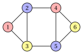

# 1.4 Primal bounds, dual bounds and gap { #sez-sec-bounds }

**Part 1 · Combinatorial optimization problems · Chapter 1** · [:material-book-open-variant: Chapter 1: Combinatorial optimization](index.md) · [:material-file-pdf-box: Lecture notes, volume 1 (PDF)](../../pdf/lecture-notes-1-combinatorial-optimization-problems.pdf) · [:material-pencil: Exercises: Combinatorial optimization](../../exercises/combinatorial-optimization.md)

- The smarter approaches rest on a simple idea: instead of computing $z(I)$ directly, we <strong>enclose</strong> it between two numbers. One comes from a feasible solution, the other from an argument that holds for <em>all</em> feasible solutions.

!!! definizione "Definition 1.4: primal and dual bounds"

    Consider an instance $I$ of a combinatorial optimization problem with feasible solutions $\mathcal F$, objective function $f$ and optimal value $z(I)$.

    1. A <strong>primal bound</strong> is the value $f(\bar S)$ of a feasible solution $\bar S \in \mathcal F$.

    2. A <strong>dual bound</strong> is a number $\beta$ such that

        $$
        f(S) \le \beta, \qquad \forall S \in \mathcal F \qquad \text{(maximization form)},
        $$

        or such that

        $$
        f(S) \ge \beta, \qquad \forall S \in \mathcal F \qquad \text{(minimization form)}.
        $$

- In the <strong>maximization form</strong> a primal bound is a <strong>lower bound</strong> and a dual bound is an <strong>upper bound</strong>:

    $$
    \LB = f(\bar S) \;\le\; z(I) \;\le\; \UB .
    $$

- In the <strong>minimization form</strong> the roles are exchanged: a primal bound is an <strong>upper bound</strong> $\UB = f(\bar S)$ and a dual bound is a <strong>lower bound</strong> $\LB$, with $\LB \le z(I) \le \UB$.

- Primal bounds come from feasible solutions, for example found by <strong>heuristic algorithms</strong>; dual bounds come from <strong>relaxations</strong> (for example the linear programming relaxation) or from combinatorial arguments.

{ .fig loading=lazy  }

!!! definizione "Definition 1.5: gap"

    Let $\LB \le z(I) \le \UB$ be a lower and an upper bound of an instance $I$, one primal and one dual. The <strong>absolute gap</strong> is $\UB - \LB$ and, for $\LB \neq 0$, the <strong>relative gap</strong> (or simply <strong>gap</strong>) is

    $$
    gap(I) = \frac{\UB - \LB}{|\LB|}.
    $$

- The denominator is always the <strong>lower bound</strong>: in the maximization form it is the value of the feasible solution, as in the optimality gap of the integer linear programming module; in the minimization form it is the dual bound.

- With this choice the gap is never smaller than the relative error of the feasible solution with respect to $z(I)$ (chapter «Heuristic algorithms»): a gap of $5\%$ guarantees a solution within $5\%$ of the optimum.

- If the gap is zero, the feasible solution $\bar S$ is optimal and the dual bound is a <strong>certificate</strong> of its optimality.

!!! teorema "Observation 1.6"

    If $f(S) \in \Z$ for every $S \in \mathcal F$, then in the maximization form $\lfloor \beta \rfloor$ is also a dual bound, and in the minimization form $\lceil \beta \rceil$ is also a dual bound.

??? dimostrazione "Proof"

    In the maximization form, for every $S \in \mathcal F$ we have $f(S) \le \beta$ and $f(S) \in \Z$; the largest integer not greater than $\beta$ is $\lfloor \beta \rfloor$, hence $f(S) \le \lfloor \beta \rfloor$. The minimization form is analogous. □

!!! esempio "Example 1.4: bounds on the small instance"

    We consider again the instance of [Example 1.1](combinatorial-optimization-problems.md#box-2-ex-oc1-small) (maximization), and we suppose that we have not enumerated its subsets.

    - <em>Primal bound.</em> We start from $\emptyset$ and examine the elements by non-increasing weight, adding each one if the set stays feasible: $\{1\}$ is feasible, $\{1,2\}$ is not, $\{1,3\}$ is feasible, $\{1,3,4\}$ is not. The feasible solution $\bar S = \{1,3\}$ gives $\LB = 11$.

    - <em>A first dual bound.</em> The weights are positive, so $f(S) \le f(\mathscr{U}) = 20$ for every $S \in \mathcal F$.

    - <em>A better dual bound.</em> No feasible subset contains both $1$ and $2$, so a feasible subset takes at most one of the weights $7$ and $6$:

        $$
        f(S) \le \max\{7,6\} + 4 + 3 = 14, \qquad \forall S \in \mathcal F .
        $$

        The absolute gap is $14-11 = 3$ and the relative gap is $\tfrac{3}{11} \approx 27.3\%$.

    - <em>A better primal bound.</em> The feasible solution $\{2,3,4\}$ gives $\LB = 13$: the gap drops to $\tfrac{1}{13} \approx 7.7\%$.

    - <em>Closing the gap.</em> The only feasible subset with $3$ elements is $\{2,3,4\}$, and a subset with at most $2$ elements has value at most $7+6 = 13$. Hence $\UB = 13 = \LB$: the gap is zero, and this argument is a certificate that $\{2,3,4\}$ is optimal, without listing the $16$ subsets.

    If an argument gave instead the dual bound $13.5$, then $\lfloor 13.5 \rfloor = 13$ would also be a dual bound, since all values $f(S)$ are integer ([Observation 1.6](#box-9-obs-rounding)).

- In the rest of the course, every chapter on a problem records, for its instances, the best primal and dual bounds found so far; every method improves one side or the other.

---

**Next:** [A glimpse of computational complexity](a-glimpse-of-computational-complexity.md)
