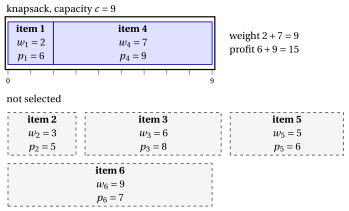

# Knapsack problems

**Part 1 · Combinatorial optimization problems · Chapter 2** · [:material-file-pdf-box: Lecture notes, volume 1 (PDF)](../../pdf/lecture-notes-1-combinatorial-optimization-problems.pdf) · [:material-pencil: Exercises: Knapsack problems](../../exercises/knapsack.md)

!!! nota "Prerequisites"

    - From this module, the chapter «Combinatorial optimization problems»: instances, feasible solutions, primal and dual bounds and the gap.

    - From the <em>Preliminaries</em>: subsets of a finite set and the number $2^n$ of subsets.

!!! chiave "Objectives"

    At the end of this chapter you will be able to:

    - state the definition of the 0/1 knapsack problem and of its variants, with instances and feasible solutions;

    - explain the assumptions on the data and why they can be made without loss of generality;

    - count the candidate solutions and the feasible solutions of a small instance;

    - find a feasible solution by hand and compute a simple combinatorial dual bound;

    - tell the variants apart: copies of the items, several resources, several knapsacks, classes of items.

## 2.1 The 0/1 knapsack problem

!!! definizione "Definition 2.1: 0/1 Knapsack Problem"

    Given:

    1. a knapsack of <em>capacity</em> $c \in \Z_{\ge 1}$,

    2. a set $\mathscr{I} = \{1,2,\dots,n\}$ of $n$ items,

    3. for each item $j \in \mathscr{I}$, a <em>profit</em> $p_j \in \Z_{\ge 1}$ and a <em>weight</em> $w_j \in \Z_{\ge 1}$,

    the <strong>0/1 Knapsack Problem</strong> (KP) asks to decide which items to insert into the knapsack, so that the total weight of the selected items does not exceed the knapsack capacity, and the total profit of the selected items is maximized.

- A <strong>KP instance</strong> is specified by:

    1. two integer numbers:

        - the number of items $n \in \Z_{\ge 1}$,

        - the knapsack capacity $c \in \Z_{\ge 1}$,

    2. two vectors of integer numbers of length $n$:

        - $\vet{p} \in \Z_{\ge 1}^n$, containing the item profits,

        - $\vet{w} \in \Z_{\ge 1}^n$, containing the item weights.

- A <strong>KP feasible solution</strong> is a subset of items

    $$
    S \subseteq \mathscr{I}
    $$

    such that the total weight of the selected items does not exceed the knapsack capacity, namely

    $$
    \sum_{j\in S} w_j \le c .
    $$

    Accordingly, the KP can be equivalently stated as the problem of selecting a subset of items whose total weight respects the knapsack capacity, and whose total profit is maximized.

    !!! chiave ""

        Given a KP instance, the KP can be formally stated as:

        \begin{equation*}
        \label{KP}
        \tilde{S}\in \arg\max_{S \subseteq \mathscr{I}}
        \left\{~~ \sum_{j \in S} p_j \;\;:\;\; \sum_{j \in S} w_j \le c ~~\right\}. \tag{2.1}
        \end{equation*}

!!! esempio "Example 2.1: KP instance"

    We consider a knapsack of capacity $c = 9$ and a set $\mathscr{I} = \{1,2,3,4,5,6\}$ of $6$ items ($n = 6$), with the following profits and weights:

    
<table>
    <tr>
    <th>Items</th>
    <th></th>
    <th>\(j = 1\)</th>
    <th>\(j = 2\)</th>
    <th>\(j = 3\)</th>
    <th>\(j = 4\)</th>
    <th>\(j = 5\)</th>
    <th>\(j = 6\)</th>
    </tr>
    <tr>
    <td>Profits</td>
    <td>\(p_j\)</td>
    <td>\(6\)</td>
    <td>\(5\)</td>
    <td>\(8\)</td>
    <td>\(9\)</td>
    <td>\(6\)</td>
    <td>\(7\)</td>
    </tr>
    <tr>
    <td>Weights</td>
    <td>\(w_j\)</td>
    <td>\(2\)</td>
    <td>\(3\)</td>
    <td>\(6\)</td>
    <td>\(7\)</td>
    <td>\(5\)</td>
    <td>\(9\)</td>
    </tr>
    </table>

    In the drawing, the knapsack is a box of length $c=9$ and every item is a block of length $w_j$. The items $1$ and $4$ fill the knapsack, with weight $9$ and profit $15$; the other items stay out (dashed).

    { .fig loading=lazy  }

    We call this KP instance [Example 2.1](#box-2-ex-kp): it is the reference instance of the chapter.

### 2.1.1 Assumptions

- We make the following assumptions:

    1. The total weight of all items exceeds the knapsack capacity (otherwise, all items could be selected). Formally:

        $$
        \sum_{j \in \mathscr{I}} w_j > c
        $$

    2. Each item individually fits into the knapsack (otherwise, it cannot be selected). Formally:

        $$
        w_j \le c,~~~~ \forall j \in \mathscr{I}
        $$

### 2.1.2 Counting the solutions, a first solution and a simple bound

- <strong>Candidate solutions.</strong> Every subset of $\mathscr{I}$ is a candidate solution, so there are $2^n$ of them (Chapter «Combinatorial optimization problems»). For [Example 2.1](#box-2-ex-kp) we have $2^6 = 64$.

- <strong>Feasible solutions.</strong> The three lightest items weigh $2+3+5 = 10 > 9$, so no subset with three or more items is feasible. The feasible solutions are the empty set, the $6$ singletons and the $6$ pairs of the following table: $13$ solutions out of $64$.

<table>
<tr>
<th>pair \(S\)</th>
<th>\(\{1,2\}\)</th>
<th>\(\{1,3\}\)</th>
<th>\(\{1,4\}\)</th>
<th>\(\{1,5\}\)</th>
<th>\(\{2,3\}\)</th>
<th>\(\{2,5\}\)</th>
</tr>
<tr>
<td>weight</td>
<td>\(5\)</td>
<td>\(8\)</td>
<td>\(9\)</td>
<td>\(7\)</td>
<td>\(9\)</td>
<td>\(8\)</td>
</tr>
<tr>
<td>profit</td>
<td>\(11\)</td>
<td>\(14\)</td>
<td>\(\mathbf{15}\)</td>
<td>\(12\)</td>
<td>\(13\)</td>
<td>\(11\)</td>
</tr>
</table>

- <strong>A first solution, by eye.</strong> Item $4$ has the largest profit ($9$, weight $7$). The residual capacity $9-7=2$ is enough for item $1$ (weight $2$, profit $6$). The subset $\{1,4\}$ has weight $9$ and profit $15$: it is a <strong>primal bound</strong>, $\LB = 15 \le z(I)$.

!!! teorema "Observation 2.2: cardinality bound"

    Let $\bar k$ be the largest integer such that the $\bar k$ lightest items weigh at most $c$. Every feasible subset has at most $\bar k$ items, hence $z(I)$ is at most the sum of the $\bar k$ largest profits.

??? dimostrazione "Proof"

    A subset with $k$ items weighs at least as much as the $k$ lightest items. If $k > \bar k$, the $k$ lightest items weigh more than $c$, so the subset is not feasible. The profit of a subset with at most $\bar k$ items is at most the sum of the $\bar k$ largest profits. □

- <strong>A first dual bound.</strong> In [Example 2.1](#box-2-ex-kp) we have $\bar k = 2$, since $2+3 = 5 \le 9$ and $2+3+5 = 10 > 9$. The two largest profits are $9$ and $8$, so $\UB = 17$. The sum of all the profits, $41$, is a much weaker dual bound.

- <strong>The gap.</strong> We have $15 \le z(I) \le 17$: the absolute gap is $2$ and the relative gap is $\tfrac{2}{15}$. Listing the $13$ feasible subsets shows that $\{1,4\}$ is the unique optimal solution and $z(I) = 15$; for larger instances we need stronger bounds, which come from relaxations (module <em>Integer linear programming</em>).

-   **Definition**

    The 0/1 knapsack problem · Assumptions · Counting the solutions, a first solution and a simple bound

    [:octicons-arrow-right-24: Open](#21-the-01-knapsack-problem)

-   **2.2 The subset sum problem**

    [:octicons-arrow-right-24: Open](the-subset-sum-problem.md)

-   **2.3 The bounded knapsack problem**

    [:octicons-arrow-right-24: Open](the-bounded-knapsack-problem.md)

-   **2.4 The unbounded knapsack problem**

    [:octicons-arrow-right-24: Open](the-unbounded-knapsack-problem.md)

-   **2.5 The multidimensional knapsack problem**

    [:octicons-arrow-right-24: Open](the-multidimensional-knapsack-problem.md)

-   **2.6 The multiple knapsack problem**

    [:octicons-arrow-right-24: Open](the-multiple-knapsack-problem.md)

-   **2.7 The multiple-choice knapsack problem**

    [:octicons-arrow-right-24: Open](the-multiple-choice-knapsack-problem.md)

-   **2.8 The knapsack problem with setups**

    The variants at a glance · Remarks · Typical mistakes · In summary

    [:octicons-arrow-right-24: Open](the-knapsack-problem-with-setups.md)

---

**Next:** [2.2 The subset sum problem](the-subset-sum-problem.md)

---

**Exercises on this chapter:** [:material-pencil: Knapsack problems](../../exercises/knapsack.md)

---

**In depth:** [:material-star-outline: the course on this problem](../../selected-problems/knapsack.md)
