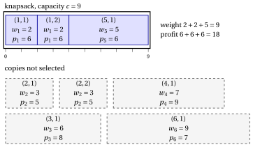

# 2.4 The bounded knapsack problem { #sez-sec-kp-BKP }

**Part 1 · Combinatorial optimization problems · Chapter 2** · [:material-book-open-variant: Chapter 2: Knapsack problems](index.md) · [:material-file-pdf-box: Lecture notes, volume 1 (PDF)](../../pdf/lecture-notes-1-combinatorial-optimization-problems.pdf) · [:material-presentation: Slides](../../pdf/slides-knapsack.pdf) · [:material-pencil: Exercises: Knapsack problems](../../exercises/knapsack.md) · [:material-gesture-tap: App: Brute force on the 0/1 knapsack problem](../../lab/kp-brute-force.md)

!!! definizione "Definition 2.4: Bounded Knapsack Problem"

    Given:

    1. a knapsack of <em>capacity</em> $c \in \Z_{\ge 1}$,

    2. a set $\mathscr{I} = \{1,2,\dots,n\}$ of $n$ items,

    3. for each item $j \in \mathscr{I}$, a <em>profit</em> $p_j \in \Z_{\ge 1}$, a <em>weight</em> $w_j \in \Z_{\ge 1}$, and a <em>number of available copies</em> $b_j \in \Z_{\ge 1}$,

    the <strong>Bounded Knapsack Problem</strong> (BKP) asks to decide how many copies of each item to insert into the knapsack, so that the total weight of all selected item copies does not exceed the knapsack capacity, each item is taken no more than its available copies, and the total profit of all selected item copies is maximized.

- A <strong>BKP instance</strong> is specified by:

    1. two integer numbers:

        - the number of items $n \in \Z_{\ge 1}$,

        - the knapsack capacity $c \in \Z_{\ge 1}$,

    2. three vectors of integer numbers of length $n$:

        - $\vet{p} \in \Z_{\ge 1}^n$, containing the item profits,

        - $\vet{w} \in \Z_{\ge 1}^n$, containing the item weights,

        - $\vet{b} \in \Z_{\ge 1}^n$, containing the number of available copies of each item.

- Given a BKP instance, we define the <strong>extended set of items</strong> as

    \begin{equation*}
    \label{ExtSet}
    \hat{\mathscr{I}}
    =
    \big\{\, (j,k) : j \in \mathscr{I},~ k \in \{1,2,\dots,b_j\} \,\big\}, \tag{2.3}
    \end{equation*}

    where each pair $(j,k)$ represents the $k$-th available copy of item $j$. The cardinality of the extended set of items is

    $$
    |\hat{\mathscr{I}}| = \sum_{j \in \mathscr{I}} b_j.
    $$

- A <strong>BKP feasible solution</strong> is a subset of items

    $$
    S \subseteq \hat{\mathscr{I}}
    $$

    such that the total weight of the selected items does not exceed the knapsack capacity, namely

    $$
    \sum_{(j,k)\in S} w_j \le c .
    $$

    Accordingly, the BKP can be equivalently stated as the problem of selecting a subset of the extended set of items whose total weight respects the knapsack capacity, and whose total profit is maximized.

    !!! chiave ""

        Given a BKP instance, the BKP can be formally stated as:

        \begin{equation*}
        \label{BKP}
        \tilde{S}\in
        \arg\max_{S \subseteq \hat{\mathscr{I}} }
        \left\{~~ \sum_{(j,k) \in S} p_j
        \;:\; \sum_{(j,k) \in S} w_j \le c ~~\right\}. \tag{2.4}
        \end{equation*}

!!! esempio "Example 2.3: BKP instance"

    We consider a knapsack of capacity $c = 9$ and a set $\mathscr{I} = \{1,2,3,4,5,6\}$ of $6$ items ($n = 6$), with the following profits, weights, and available copies:

    
<table>
    <tr>
    <th>Items</th>
    <th></th>
    <th>\(j = 1\)</th>
    <th>\(j = 2\)</th>
    <th>\(j = 3\)</th>
    <th>\(j = 4\)</th>
    <th>\(j = 5\)</th>
    <th>\(j = 6\)</th>
    </tr>
    <tr>
    <td>Profits</td>
    <td>\(p_j\)</td>
    <td>\(6\)</td>
    <td>\(5\)</td>
    <td>\(8\)</td>
    <td>\(9\)</td>
    <td>\(6\)</td>
    <td>\(7\)</td>
    </tr>
    <tr>
    <td>Weights</td>
    <td>\(w_j\)</td>
    <td>\(2\)</td>
    <td>\(3\)</td>
    <td>\(6\)</td>
    <td>\(7\)</td>
    <td>\(5\)</td>
    <td>\(9\)</td>
    </tr>
    <tr>
    <td>Available copies</td>
    <td>\(b_j\)</td>
    <td>\(2\)</td>
    <td>\(2\)</td>
    <td>\(1\)</td>
    <td>\(1\)</td>
    <td>\(1\)</td>
    <td>\(1\)</td>
    </tr>
    </table>

    The extended set of items is:

    $$
    \hat{\mathscr{I}} \;=\; \big\{~(1,1),(1,2),\; (2,1),(2,2),\; (3,1),\; (4,1),\; (5,1),\; (6,1) ~\big\}.
    $$

    Each copy $(j,k)$ has profit $p_j$ and weight $w_j$.

    
<table>
    <tr>
    <th>Copy label</th>
    <th>1</th>
    <th>2</th>
    <th>3</th>
    <th>4</th>
    <th>5</th>
    <th>6</th>
    <th>7</th>
    <th>8</th>
    </tr>
    <tr>
    <td>\((j,k)\)</td>
    <td>\((1,1)\)</td>
    <td>\((1,2)\)</td>
    <td>\((2,1)\)</td>
    <td>\((2,2)\)</td>
    <td>\((3,1)\)</td>
    <td>\((4,1)\)</td>
    <td>\((5,1)\)</td>
    <td>\((6,1)\)</td>
    </tr>
    <tr>
    <td>Profit \(p_j\)</td>
    <td>\(6\)</td>
    <td>\(6\)</td>
    <td>\(5\)</td>
    <td>\(5\)</td>
    <td>\(8\)</td>
    <td>\(9\)</td>
    <td>\(6\)</td>
    <td>\(7\)</td>
    </tr>
    <tr>
    <td>Weight \(w_j\)</td>
    <td>\(2\)</td>
    <td>\(2\)</td>
    <td>\(3\)</td>
    <td>\(3\)</td>
    <td>\(6\)</td>
    <td>\(7\)</td>
    <td>\(5\)</td>
    <td>\(9\)</td>
    </tr>
    </table>

    The drawing shows an optimal solution: the two copies of item $1$ and the copy of item $5$, with weight $2+2+5=9$ and profit $6+6+6=18$.

    { .fig loading=lazy  }

## 2.4.1 Assumptions

- We make the following assumptions:

    1. The total weight of all available copies of all items exceeds the knapsack capacity (otherwise, all copies could be selected). Formally:

        $$
        \sum_{j \in \mathscr{I}} b_j \, w_j > c
        $$

    2. Each item individually fits into the knapsack (otherwise, it cannot be selected). Formally:

        $$
        w_j \le c, \qquad \forall j \in \mathscr{I}
        $$

    3. The total weight of all available copies of any single item does not exceed the knapsack capacity (otherwise, that item could never be taken in the maximum allowed number of copies). Formally:

        $$
        b_j \, w_j \le c, \qquad \forall j \in \mathscr{I}
        $$

---

**Next:** [2.5 The unbounded knapsack problem](the-unbounded-knapsack-problem.md)
