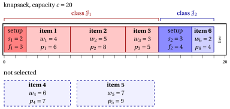

# 2.9 The knapsack problem with setups { #sez-sec-kp-KPS }

**Part 1 · Combinatorial optimization problems · Chapter 2** · [:material-book-open-variant: Chapter 2: Knapsack problems](index.md) · [:material-file-pdf-box: Lecture notes, volume 1 (PDF)](../../pdf/lecture-notes-1-combinatorial-optimization-problems.pdf) · [:material-pencil: Exercises: Knapsack problems](../../exercises/knapsack.md) · [:material-gesture-tap: App: Brute force on the 0/1 knapsack problem](../../lab/kp-brute-force.md)

!!! definizione "Definition 2.9: Knapsack Problem with Setups"

    Given:

    1. a knapsack of <em>capacity</em> $c \in \Z_{\ge 1}$,

    2. a set $\mathscr{I} = \{1,2,\dots,n\}$ of $n$ items,

    3. the set of items is partitioned into $q \in \Z_{\ge 2}$ classes,

    4. for each class $h \in \{1,2,\dots,q\}$, the subset $\mathscr{J}_h \subseteq \mathscr{I}$ contains the items of that class, with an associated <em>setup cost</em> $f_h \in \Z_{\ge 1}$ and a <em>setup weight</em> $s_h \in \Z_{\ge 1}$,

    5. for each item $j \in \mathscr{I}$, a <em>revenue</em> $p_j \in \Z_{\ge 1}$ and a <em>weight</em> $w_j \in \Z_{\ge 1}$,

    the <strong>Knapsack Problem with Setups</strong> (KPS) asks to decide which items to insert into the knapsack, so that the total weight of the selected items plus the setup weights of their classes does not exceed the knapsack capacity, and the total revenue of the selected items minus the setup costs of their classes is maximized.

- A <strong>KPS instance</strong> is specified by:

    1. two integer numbers:

        - the number of items $n \in \Z_{\ge 1}$,

        - the knapsack capacity $c \in \Z_{\ge 1}$,

    2. one vector of integer numbers of length $n$:

        - $\vet{p} \in \Z_{\ge 1}^n$, containing the item revenues,

    3. one vector of integer numbers of length $n$:

        - $\vet{w} \in \Z_{\ge 1}^n$, containing the item weights,

    4. one integer number:

        - the number of classes $q \in \Z_{\ge 2}$,

    5. one family of subsets:

        - $\{ \mathscr{J}_1, \mathscr{J}_2, \dots, \mathscr{J}_q \}$, a partition of $\mathscr{I}$ into $q$ classes, where $\mathscr{J}_h \subseteq \mathscr{I}$ is the set of items belonging to class $h$,

    6. two vectors of integer numbers of length $q$:

        - $\vet{f} \in \Z_{\ge 1}^q$, containing the setup costs of the classes,

        - $\vet{s} \in \Z_{\ge 1}^q$, containing the setup weights of the classes.

- A <strong>KPS feasible solution</strong> is a subset of items

    $$
    S \subseteq \mathscr{I}.
    $$

    Given $S$, define the set of <strong>activated classes</strong> as

    $$
    \mathscr{H}(S) \;:=\; \big\{\, h\in\{1,2,\dots,q\} : S\cap \mathscr{J}_h \neq \emptyset \,\big\}.
    $$

    The subset $S$ is feasible if the total weight of the selected items plus the setup weights of the activated classes does not exceed the knapsack capacity, namely

    $$
    \sum_{j\in S} w_j \;+\; \sum_{h\in \mathscr{H}(S)} s_h \;\le\; c.
    $$

    Accordingly, the KPS can be equivalently stated as the problem of selecting a subset of items so as to maximize the total revenue of the selected items minus the setup costs of their activated classes.

    !!! chiave ""

        Given a KPS instance, the KPS can be formally stated as:

        \begin{equation*}
        \label{KPS}
        \tilde{S}\in \argmax_{S \subseteq \mathscr{I}}
        \left\{~~
        \sum_{j \in S} p_j \;-\; \sum_{h\in \mathscr{H}(S)} f_h
        \;\;:\;\;
        \sum_{j\in S} w_j \;+\; \sum_{h\in \mathscr{H}(S)} s_h \le c
        ~~\right\}. \tag{2.11}
        \end{equation*}

!!! esempio "Example 2.8: KPS instance"

    We consider a knapsack of capacity $c = 20$ and a set $\mathscr{I} = \{1,2,3,4,5,6\}$ of $6$ items ($n = 6$). The items are partitioned into $q = 2$ classes: $\mathscr{J}_1 = \{1,2,3\}$ and $\mathscr{J}_2 = \{4,5,6\}$. Each class has a setup cost and a setup weight: $f_1 = 3$, $s_1 = 2$ for class 1, and $f_2 = 4$, $s_2 = 3$ for class 2. The item revenues and weights are given as follows:

    
<table>
    <tr>
    <th>Items</th>
    <th></th>
    <th>\(j = 1\)</th>
    <th>\(j = 2\)</th>
    <th>\(j = 3\)</th>
    <th>\(j = 4\)</th>
    <th>\(j = 5\)</th>
    <th>\(j = 6\)</th>
    </tr>
    <tr>
    <td>Revenues</td>
    <td>\(p_j\)</td>
    <td>\(6\)</td>
    <td>\(8\)</td>
    <td>\(5\)</td>
    <td>\(7\)</td>
    <td>\(9\)</td>
    <td>\(4\)</td>
    </tr>
    <tr>
    <td>Weights</td>
    <td>\(w_j\)</td>
    <td>\(4\)</td>
    <td>\(5\)</td>
    <td>\(3\)</td>
    <td>\(6\)</td>
    <td>\(7\)</td>
    <td>\(2\)</td>
    </tr>
    </table>

    In the drawing the classes have two colours, and a darker block is the setup of a class, with its weight $s_h$ and its cost $f_h$. An optimal solution, $\{1,2,3,6\}$, activates both classes: the weight is $(2+4+5+3)+(3+2)=19\le 20$ and the value is $(6+8+5+4)-(3+4)=16$.

    { .fig loading=lazy  }

## 2.9.1 Assumptions

- We make the following assumptions:

    1. Each class contains at least one item. Formally:

        $$
        \mathscr{J}_h \neq \emptyset \qquad \forall\, h\in\{1,2,\dots,q\}.
        $$

    2. Each item can fit into the knapsack together with the setup weight of its class (otherwise, it can never be selected). Formally:

        $$
        w_j + s_h \le c \qquad \forall\, h\in\{1,2,\dots,q\},\ \forall\, j\in \mathscr{J}_h.
        $$

## 2.10 Remarks

- Dantzig (1957) sorted the items by non-increasing efficiency $p_j/w_j$ and used this order to solve the continuous version of the KP; the same order returns in the bounds of the following chapters.

- Karp (1972) put the subset sum problem, called knapsack in his paper, among the first $21$ NP-complete problems. The KP contains the SSP as the special case $p_j = w_j$, so it is NP-hard.

- Ibarra and Kim (1975) gave the first fully polynomial-time approximation scheme for the KP.

## 2.11 Typical mistakes

!!! attenzione "Warning"

    - <strong>Confusing the KP with the SSP.</strong> The SSP asks for a total weight <em>exactly</em> equal to $c$ and has a yes/no answer; it is the KP with $p_j = w_j$, where the answer is yes if the optimal value is $c$.

    - <strong>Stopping at the order of efficiency.</strong> Taking the items in the order $1, 2, 3, \dots$ of non-increasing $p_j/w_j$ gives $\{1,2\}$ with profit $11$, while the optimal solution of [Example 2.1](the-0-1-knapsack-problem.md#box-2-ex-kp) is $\{1,4\}$ with profit $15$.

    - <strong>Counting identical copies as different solutions.</strong> In the BKP and in the UKP the copies $(j,k)$ of the same item are interchangeable: different subsets of the extended set of items can give the same packing.

    - <strong>Choosing at most one item per class.</strong> In the MCKP exactly one item per class is selected, so an instance can be infeasible; in the KPS a class with no selected item costs nothing.

    - <strong>Forgetting the assumptions.</strong> An item with $w_j > c$ can never be selected, and if all the items fit the problem is trivial: both cases are removed before solving.

## 2.12 In summary

!!! chiave "In summary"

    - The KP selects a subset of items of weight at most $c$ and maximum profit; a solution is a subset, and $2^n$ subsets are candidates.

    - The SSP, the BKP, the UKP, the MDKP, the MKP, the MCKP and the KPS change the number of copies, of resources, of knapsacks or the structure of the items; each one has its assumptions on the data.

    - A solution found by eye is a primal bound; the cardinality bound is a dual bound that uses only the weights and the profits.

    - The order of efficiency is not enough to find an optimal solution, even on a small instance.

    <strong>Dashboard of the reference instance.</strong>

    
<table>
    <tr>
    <th>KP, <a href="../the-0-1-knapsack-problem/#box-2-ex-kp">Example 2.1</a> (max)</th>
    <th>lower bound</th>
    <th>upper bound</th>
    <th>from</th>
    </tr>
    <tr>
    <td>this chapter</td>
    <td>\(15\) (by eye)</td>
    <td>\(17\) (cardinality bound)</td>
    <td>definition</td>
    </tr>
    </table>

---

**Exercises on this chapter:** [:material-pencil: Knapsack problems](../../exercises/knapsack.md)

---

**In depth:** [:material-view-list: what the course does on this problem](../../catalogue/knapsack-problem.md)

