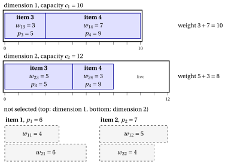

# 2.5 The multidimensional knapsack problem

**Part 1 · Combinatorial optimization problems · Chapter 2** · [:material-book-open-variant: Chapter 2: Knapsack](index.md) · [:material-file-pdf-box: Lecture notes, volume 1 (PDF)](../../pdf/lecture-notes-1-combinatorial-optimization-problems.pdf) · [:material-pencil: Exercises: Knapsack](../../exercises/knapsack.md)

!!! definizione "Definition 2.6: Multidimensional Knapsack Problem"

    Given:

    1. a $k$-dimensional knapsack,

    2. for each dimension $d \in \underbrace{\{1,2,\dots,k\}}_{=\mathscr{D}}$, a <em>capacity</em> $c_d \in \Z_{\ge 1}$,

    3. a set $\mathscr{I} = \{1,2,\dots,n\}$ of $n$ items,

    4. for each item $j \in \mathscr{I}$, a <em>profit</em> $p_j \in \Z_{\ge 1}$,

    5. for each dimension $d \in \mathscr{D}$ and each item $j \in \mathscr{I}$, a <em>weight</em> $w_{dj} \in \Z_{\ge 1}$,

    the <strong>Multidimensional Knapsack Problem</strong> (MDKP) asks to decide which items to insert into the knapsack, so that for every dimension the total weight of the selected items does not exceed the corresponding capacity, and the total profit of the selected items is maximized.

- A <strong>MDKP instance</strong> is specified by:

    1. two integer numbers:

        - the number of items $n \in \Z_{\ge 1}$,

        - the number of dimensions $k \in \Z_{\ge 1}$,

    2. one vector of integer numbers of length $n$:

        - $\vet{p} \in \Z_{\ge 1}^n$, containing the item profits,

    3. one vector of integer numbers of length $k$:

        - $\vet{c} \in \Z_{\ge 1}^k$, containing the knapsack capacities for each dimension,

    4. one matrix of integer numbers with $k$ rows and $n$ columns:

        - $\vet{W} \in \Z_{\ge 1}^{k \times n}$,  containing the  the weight of the items for each dimension.

- A <strong>MDKP feasible solution</strong> is a subset of items

    $$
    S \subseteq \mathscr{I}
    $$

    such that the capacity constraints are satisfied in every dimension, namely

    $$
    \sum_{j\in S} w_{dj} \le c_d \qquad \forall\, d\in \mathscr{D}.
    $$

    Accordingly, the MDKP can be equivalently stated as the problem of selecting a subset of items whose total weight respects the knapsack capacities in every dimension, and whose total profit is maximized.

    !!! chiave ""

        Given a MDKP instance, the MDKP can be formally stated as:

        \begin{equation*}
        \label{MDKP}
        \tilde{S}\in \argmax_{S \subseteq \mathscr{I}}
        \left\{~~ \sum_{j \in S} p_j \;\;:\;\; \sum_{j\in S} w_{dj} \le c_d \ \ \forall\, d\in \mathscr{D} ~~\right\}. \tag{2.8}
        \end{equation*}

!!! esempio "Example 2.5: MDKP instance"

    We consider a $2$-dimensional knapsack ($k=2$) with capacities $c_1 = 10$ and $c_2 = 12$, and a set $\mathscr{I} = \{1,2,3,4\}$ of $4$ items ($n = 4$), with the following profits and weights:

    
<table>
    <tr>
    <th>Items</th>
    <th></th>
    <th>\(j = 1\)</th>
    <th>\(j = 2\)</th>
    <th>\(j = 3\)</th>
    <th>\(j = 4\)</th>
    </tr>
    <tr>
    <td>Profits</td>
    <td>\(p_j\)</td>
    <td>\(6\)</td>
    <td>\(7\)</td>
    <td>\(5\)</td>
    <td>\(9\)</td>
    </tr>
    <tr>
    <td>Weights (dim. \(1\))</td>
    <td>\(w_{1j}\)</td>
    <td>\(4\)</td>
    <td>\(5\)</td>
    <td>\(3\)</td>
    <td>\(7\)</td>
    </tr>
    <tr>
    <td>Weights (dim. \(2\))</td>
    <td>\(w_{2j}\)</td>
    <td>\(6\)</td>
    <td>\(4\)</td>
    <td>\(5\)</td>
    <td>\(3\)</td>
    </tr>
    </table>

    The drawing has one box per dimension, of length $c_1=10$ and $c_2=12$: a selected item occupies a block of length $w_{1j}$ in the first box and one of length $w_{2j}$ in the second. The optimal solution $\{3,4\}$ fills the first dimension and uses $8$ units of the second, with profit $5+9=14$.

    { .fig loading=lazy  }

## 2.5.1 Assumptions

- We make the following assumptions:

    1. The set of all items does <em>not</em> fit in the knapsack (otherwise, selecting all items is feasible and optimal). Formally,

        $$
        \exists\, d\in \mathscr{D} \ \text{such that}\ \sum_{j\in \mathscr{I}} w_{dj} \;>\; c_d .
        $$

    2. Each item individually fits in the knapsack in every dimension (otherwise, it can never be selected). Formally,

        $$
        w_{dj} \le c_d, \qquad \forall\, d\in \mathscr{D},\ \forall\, j\in \mathscr{I}.
        $$

---

**Next:** [2.6 The multiple knapsack problem](the-multiple-knapsack-problem.md)
