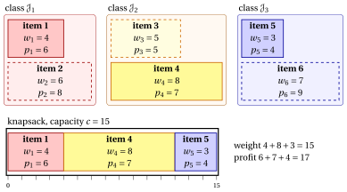

# 2.7 The multiple-choice knapsack problem

**Part 1 · Combinatorial optimization problems · Chapter 2** · [:material-book-open-variant: Chapter 2: Knapsack](index.md) · [:material-file-pdf-box: Lecture notes, volume 1 (PDF)](../../pdf/lecture-notes-1-combinatorial-optimization-problems.pdf) · [:material-pencil: Exercises: Knapsack](../../exercises/knapsack.md)

!!! definizione "Definition 2.8: Multiple-Choice Knapsack Problem"

    Given:

    1. a knapsack of <em>capacity</em> $c \in \Z_{\ge 1}$,

    2. a set $\mathscr{I} = \{1,2,\dots,n\}$ of $n$ items,

    3. the set of items is partitioned into $q \in \Z_{\ge 2}$ classes,

    4. for each class $h \in \{1,2,\dots,q\}$, the subset $\mathscr{J}_h \subseteq \mathscr{I}$ contains the items of that class,

    5. for each item $j \in \mathscr{I}$, a <em>profit</em> $p_j \in \Z_{\ge 1}$ and a <em>weight</em> $w_j \in \Z_{\ge 1}$,

    the <strong>Multiple-Choice Knapsack Problem</strong> (MCKP) asks to decide which items to insert into the knapsack, so that exactly one item is selected from each class, the total weight of the selected items does not exceed the knapsack capacity, and the total profit of the selected items is maximized.

- A <strong>MCKP instance</strong> is specified by:

    1. two integer numbers:

        - the number of items $n \in \Z_{\ge 1}$,

        - the knapsack capacity $c \in \Z_{\ge 1}$,

    2. one vector of integer numbers of length $n$:

        - $\vet{p} \in \Z_{\ge 1}^n$, containing the item profits,

    3. one vector of integer numbers of length $n$:

        - $\vet{w} \in \Z_{\ge 1}^n$, containing the item weights,

    4. one integer number:

        - the number of classes $q \in \Z_{\ge 2}$,

    5. one family of subsets:

        - $\{ \mathscr{J}_1, \mathscr{J}_2, \dots, \mathscr{J}_q \}$, a partition of $\mathscr{I}$ into $q$ classes, where $\mathscr{J}_h \subseteq \mathscr{I}$ is the set of items belonging to class $h$.

- A <strong>MCKP feasible solution</strong> is a subset of items

    $$
    S \subseteq \mathscr{I}
    $$

    such that:

    - **(i)** exactly one item is selected from each class, namely

        $$
        |S \cap \mathscr{J}_h| = 1 \qquad \text{for all } h\in\{1,2,\dots,q\};
        $$

    - **(ii)** the total weight of the selected items does not exceed the knapsack capacity, namely

        $$
        \sum_{j\in S} w_j \le c.
        $$

    Accordingly, the MCKP can be equivalently stated as the problem of selecting exactly one item from each class such that the knapsack capacity is respected and the total profit is maximized.

    !!! chiave ""

        Given a MCKP instance, the MCKP can be formally stated as:

        \begin{equation*}
        \label{MCKP}
        \tilde{S}\in \argmax_{S \subseteq \mathscr{I}}
        \left\{
        ~~ \sum_{j \in S} p_j
        \;\;:\;\;
        \sum_{j \in S} w_j \le c,\ \
        |S \cap \mathscr{J}_h| = 1 \ \ \forall\, h\in\{1,2,\dots,q\}
        ~~\right\}. \tag{2.10}
        \end{equation*}

!!! esempio "Example 2.7: MCKP instance"

    We consider a knapsack of capacity $c = 15$ and a set $\mathscr{I} = \{1,2,3,4,5,6\}$ of $6$ items ($n = 6$). The items are partitioned into $q = 3$ classes: $\mathscr{J}_1 = \{1,2\}$, $\mathscr{J}_2 = \{3,4\}$, $\mathscr{J}_3 = \{5,6\}$. The profits and weights are given as follows:

    
<table>
    <tr>
    <th>Items</th>
    <th></th>
    <th>\(j = 1\)</th>
    <th>\(j = 2\)</th>
    <th>\(j = 3\)</th>
    <th>\(j = 4\)</th>
    <th>\(j = 5\)</th>
    <th>\(j = 6\)</th>
    </tr>
    <tr>
    <td>Profits</td>
    <td>\(p_j\)</td>
    <td>\(6\)</td>
    <td>\(8\)</td>
    <td>\(5\)</td>
    <td>\(7\)</td>
    <td>\(4\)</td>
    <td>\(9\)</td>
    </tr>
    <tr>
    <td>Weights</td>
    <td>\(w_j\)</td>
    <td>\(4\)</td>
    <td>\(6\)</td>
    <td>\(5\)</td>
    <td>\(8\)</td>
    <td>\(3\)</td>
    <td>\(7\)</td>
    </tr>
    </table>

    In the drawing every class is a coloured group, and the item chosen in each class is drawn solid, the other one dashed. The optimal solution $\{1,4,5\}$ fills the knapsack, with weight $4+8+3=15$ and profit $6+7+4=17$.

    { .fig loading=lazy  }

## 2.7.1 Assumptions

- We make the following assumptions:

    1. Each class contains at least one item (otherwise, selecting exactly one item from each class is impossible). Formally:

        $$
        \mathscr{J}_h \neq \emptyset \qquad \forall\, h\in\{1,\dots,q\}.
        $$

    2. The instance is feasible, i.e., there exists at least one choice of exactly one item per class that fits in the knapsack. A necessary and sufficient (and easy-to-check) condition is:

        $$
        \sum_{h=1}^{q}\ \min_{j\in \mathscr{J}_h} w_j \;\le\; c.
        $$

---

**Next:** [2.8 The knapsack problem with setups](the-knapsack-problem-with-setups.md)
