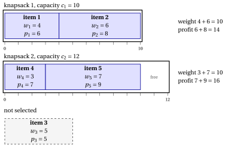

# 2.7 The multiple knapsack problem { #sez-sec-kp-MKP }

**Part 1 · Combinatorial optimization problems · Chapter 2** · [:material-book-open-variant: Chapter 2: Knapsack problems](index.md) · [:material-file-pdf-box: Lecture notes, volume 1 (PDF)](../../pdf/lecture-notes-1-combinatorial-optimization-problems.pdf) · [:material-presentation: Slides](../../pdf/slides-knapsack.pdf) · [:material-pencil: Exercises: Knapsack problems](../../exercises/knapsack.md) · [:material-gesture-tap: App: Brute force on the 0/1 knapsack problem](../../lab/kp-brute-force.md)

!!! definizione "Definition 2.7: Multiple Knapsack Problem"

    Given:

    1. $m \in \Z_{\ge 1}$ knapsacks,

    2. for each knapsack $k \in \underbrace{\{1,2,\dots,m\}}_{=\mathscr{K}}$, a <em>capacity</em> $c_k \in \Z_{\ge 1}$,

    3. a set $\mathscr{I} = \{1,2,\dots,n\}$ of $n$ items,

    4. for each item $j \in \mathscr{I}$, a <em>profit</em> $p_j \in \Z_{\ge 1}$ and a <em>weight</em> $w_{j} \in \Z_{\ge 1}$,

    the <strong>Multiple Knapsack Problem</strong> (MKP) asks to decide which items to insert into each knapsack, so that in every knapsack the total weight of the assigned items does not exceed its capacity, and the total profit of the selected items is maximized.

- An <strong>MKP instance</strong> is specified by:

    1. two integer numbers:

        - the number of items $n \in \Z_{\ge 1}$,

        - the number of knapsacks $m \in \Z_{\ge 1}$,

    2. one vector of integer numbers of length $n$:

        - $\vet{p} \in \Z_{\ge 1}^n$, containing the item profits,

    3. one vector of integer numbers of length $n$:

        - $\vet{w} \in \Z_{\ge 1}^n$, containing the item weights,

    4. one vector of integer numbers of length $m$:

        - $\vet{c} \in \Z_{\ge 1}^m$, containing the capacities of the knapsacks.

- An <strong>MKP feasible solution</strong> is a family of subsets of items

    $$
    \mathcal{S}=\{S_k\}_{k\in \mathscr{K}},
    \qquad S_k \subseteq \mathscr{I} \ \ \text{for all } k\in \mathscr{K},
    $$

    such that:

    - **(i)** each item is assigned to at most one knapsack, namely

        $$
        S_k \cap S_{k'}=\emptyset \quad \text{for all } k,k'\in \mathscr{K}\ \text{with } k\neq k';
        $$

    - **(ii)** the total weight of the items assigned to each knapsack respects its capacity, namely

        $$
        \sum_{j\in S_k} w_j \le c_k \quad \text{for all } k\in \mathscr{K}.
        $$

    Accordingly, the MKP can be equivalently stated as the problem of selecting pairwise disjoint subsets of items, one subset for each knapsack, such that every knapsack capacity is respected and the total profit is maximized.

    !!! chiave ""

        Given an MKP instance, the MKP can be formally stated as:

        \begin{equation*}
        \label{MKP}
        \tilde{\mathcal{S}}
        \in
        \argmax_{\mathcal{S}=\{S_k\}_{k\in \mathscr{K}}}
        \left\{
        \sum_{k\in \mathscr{K}} \ \sum_{j\in S_k} p_j
        \;:\;
        \begin{array}{l}
        S_k \subseteq \mathscr{I} \quad \forall\, k\in \mathscr{K},\\[6pt]
        S_k \cap S_{k'}=\emptyset \quad \forall\, k,k'\in \mathscr{K}\ \text{with } k\neq k',\\[10pt]
        \displaystyle \sum_{j\in S_k} w_j \le c_k \quad \forall\, k\in \mathscr{K}
        \end{array}
        \right\}. \tag{2.9}
        \end{equation*}

!!! esempio "Example 2.6: MKP instance"

    We consider $m = 2$ knapsacks with capacities $c_1 = 10$ and $c_2 = 12$, and a set $\mathscr{I} = \{1,2,3,4,5\}$ of $5$ items ($n = 5$), with the following profits and weights:

    
<table>
    <tr>
    <th>Items</th>
    <th></th>
    <th>\(j = 1\)</th>
    <th>\(j = 2\)</th>
    <th>\(j = 3\)</th>
    <th>\(j = 4\)</th>
    <th>\(j = 5\)</th>
    </tr>
    <tr>
    <td>Profits</td>
    <td>\(p_j\)</td>
    <td>\(6\)</td>
    <td>\(8\)</td>
    <td>\(5\)</td>
    <td>\(7\)</td>
    <td>\(9\)</td>
    </tr>
    <tr>
    <td>Weights</td>
    <td>\(w_j\)</td>
    <td>\(4\)</td>
    <td>\(6\)</td>
    <td>\(5\)</td>
    <td>\(3\)</td>
    <td>\(7\)</td>
    </tr>
    </table>

    The drawing shows an optimal solution: $S_1=\{1,2\}$ in knapsack $1$ and $S_2=\{4,5\}$ in knapsack $2$, with total profit $14+16=30$; item $3$ stays out.

    { .fig loading=lazy  }

## 2.7.1 Assumptions

- We make the following assumptions:

    1. The set of all items does <em>not</em> fit in the knapsacks altogether (otherwise, selecting all items is feasible and optimal). Formally,

        $$
        \sum_{j\in \mathscr{I}} w_j \;>\; \sum_{k\in \mathscr{K}} c_k .
        $$

    2. Each item individually fits in (at least) one knapsack (otherwise, it can never be selected). Formally,

        $$
        \forall\, j\in \mathscr{I}\quad \exists\, k\in \mathscr{K}\ \text{such that}\ w_j \le c_k .
        $$

---

**Next:** [2.8 The multiple-choice knapsack problem](the-multiple-choice-knapsack-problem.md)
