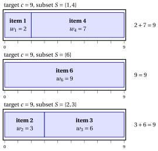

# 2.3 The subset sum problem { #sez-sec-kp-SSP }

**Part 1 · Combinatorial optimization problems · Chapter 2** · [:material-book-open-variant: Chapter 2: Knapsack problems](index.md) · [:material-file-pdf-box: Lecture notes, volume 1 (PDF)](../../pdf/lecture-notes-1-combinatorial-optimization-problems.pdf) · [:material-pencil: Exercises: Knapsack problems](../../exercises/knapsack.md)

!!! definizione "Definition 2.3: Subset Sum Problem"

    Given:

    1. a target value $c \in \Z_{\ge 1}$,

    2. a set $\mathscr{I} = \{1,2,\dots,n\}$ of $n$ items,

    3. for each item $j \in \mathscr{I}$, a <em>weight</em> $w_j \in \Z_{\ge 1}$,

    the <strong>Subset Sum Problem</strong> (SSP) asks whether there exists a subset of items whose total weight is exactly equal to the target value $c$.

- An <strong>SSP instance</strong> is specified by:

    1. two integer numbers:

        - the number of items $n \in \Z_{\ge 1}$,

        - the target value $c \in \Z_{\ge 1}$,

    2. one vector of integer numbers of length $n$:

        - $\vet{w} \in \Z_{\ge 1}^n$, containing the item weights.

- An <strong>SSP feasible solution</strong> is a subset of items

    $$
    S \subseteq \mathscr{I}
    $$

    such that the total weight of the selected items is exactly equal to the target value, namely

    $$
    \sum_{j\in S} w_j = c .
    $$

    Accordingly, the SSP can be equivalently stated as the problem of selecting a subset of items whose total weight matches the target value exactly.

    !!! chiave ""

        Given an SSP instance, the SSP can be formally stated as:

        \begin{equation*}
        \label{SSP}
        \text{find } S \subseteq \mathscr{I}
        \quad \text{such that} \quad
        \sum_{j \in S} w_j = c . \tag{2.2}
        \end{equation*}

!!! esempio "Example 2.2: SSP instance"

    We consider a target value $c = 9$ and a set $\mathscr{I} = \{1,2,3,4,5,6\}$ of $6$ items ($n = 6$), with the following weights:

    
<table>
    <tr>
    <th>Items</th>
    <th></th>
    <th>\(j = 1\)</th>
    <th>\(j = 2\)</th>
    <th>\(j = 3\)</th>
    <th>\(j = 4\)</th>
    <th>\(j = 5\)</th>
    <th>\(j = 6\)</th>
    </tr>
    <tr>
    <td>Weights</td>
    <td>\(w_j\)</td>
    <td>\(2\)</td>
    <td>\(3\)</td>
    <td>\(6\)</td>
    <td>\(7\)</td>
    <td>\(5\)</td>
    <td>\(9\)</td>
    </tr>
    </table>

    For instance, the subset $S=\{1,4\}$ is feasible since $w_1+w_4=2+7=9$. Also, the subset $S=\{6\}$ is feasible since $w_6=9$. The drawing shows the three subsets whose weights fill the box of length $c=9$ exactly: $\{1,4\}$, $\{6\}$ and $\{2,3\}$.

    { .fig loading=lazy  }

- The SSP is not an <strong>optimization problem</strong>, since its answer is either <strong>yes</strong> or <strong>no</strong>. However, it can be solved by using an optimization problem.

- An SSP instance can be solved as a KP instance by setting the profit of each item equal to its weight, namely

    $$
    p_j = w_j, \qquad \forall j\in \mathscr{I}.
    $$

    In this case, we solve the following KP:

    \begin{equation*}
    \tilde{S}\in \arg\max_{S \subseteq \mathscr{I}}
    \left\{~~ \sum_{j \in S} w_j \;\;:\;\; \sum_{j \in S} w_j \le c ~~\right\}.
    \end{equation*}

    If $\sum_{j\in \tilde{S}} w_j = c$, then the answer to the SSP is <strong>yes</strong>; otherwise, if $\sum_{j\in \tilde{S}} w_j < c$, the answer is <strong>no</strong>.

## 2.3.1 Assumptions

- We make the following assumptions:

    1. The total weight of all items is at least the target value (otherwise, no feasible subset can exist). Formally:

        $$
        \sum_{j \in \mathscr{I}} w_j \ge c
        $$

    2. Each item weight is not larger than the target value (otherwise, it cannot belong to any feasible subset). Formally:

        $$
        w_j \le c,~~~~ \forall j \in \mathscr{I}
        $$

---

**Next:** [2.4 The bounded knapsack problem](the-bounded-knapsack-problem.md)
