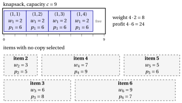

# 2.5 The unbounded knapsack problem { #sez-sec-kp-UKP }

**Part 1 · Combinatorial optimization problems · Chapter 2** · [:material-book-open-variant: Chapter 2: Knapsack problems](index.md) · [:material-file-pdf-box: Lecture notes, volume 1 (PDF)](../../pdf/lecture-notes-1-combinatorial-optimization-problems.pdf) · [:material-pencil: Exercises: Knapsack problems](../../exercises/knapsack.md) · [:material-gesture-tap: App: Brute force on the 0/1 knapsack problem](../../lab/kp-brute-force.md)

!!! definizione "Definition 2.5: Unbounded Knapsack Problem"

    Given:

    1. a knapsack of <em>capacity</em> $c \in \Z_{\ge 1}$,

    2. a set $\mathscr{I} = \{1,2,\dots,n\}$ of $n$ items,

    3. for each item $j \in \mathscr{I}$, which is available in an unlimited number of copies, a <em>profit</em> $p_j \in \Z_{\ge 1}$ and a <em>weight</em> $w_j \in \Z_{\ge 1}$,

    the <strong>Unbounded Knapsack Problem</strong> (UKP) asks to decide how many copies of each item to insert into the knapsack, so that the total weight of all selected item copies does not exceed the knapsack capacity and the total profit of all selected item copies is maximized.

- A <strong>UKP instance</strong> is specified by:

    1. two integer numbers:

        - the number of items $n \in \Z_{\ge 1}$,

        - the knapsack capacity $c \in \Z_{\ge 1}$,

    2. two vectors of integer numbers of length $n$:

        - $\vet{p} \in \Z_{\ge 1}^n$, containing the item profits,

        - $\vet{w} \in \Z_{\ge 1}^n$, containing the item weights.

- Given a UKP instance, we first define for each item $j \in \mathscr{I}$ the <strong>maximum feasible number of copies</strong>

    \begin{equation*}
    \label{maxCopies}
    \hat{b}_j \;=\; \left\lfloor \frac{c}{w_j} \right\rfloor, \tag{2.5}
    \end{equation*}

    that is, the largest number of copies of item $j$ that can be inserted into the knapsack without exceeding its capacity.

- We then define the <strong>extended set of items</strong> as

    \begin{equation*}
    \label{ExtSetUKP}
    \hat{\mathscr{I}} \;=\; \big\{\, (j,k) : j \in \mathscr{I},~ k \in \{1,2,\dots,\hat{b}_j\} \,\big\}, \tag{2.6}
    \end{equation*}

    where each pair $(j,k)$ represents the $k$-th copy of item $j$. The cardinality of the extended set of items is

    $$
    |\hat{\mathscr{I}}| \;=\; \sum_{j \in \mathscr{I}} \hat{b}_j.
    $$

- A <strong>UKP feasible solution</strong> is a subset of items

    $$
    S \subseteq \hat{\mathscr{I}}
    $$

    such that the total weight of the selected items does not exceed the knapsack capacity, namely

    $$
    \sum_{(j,k)\in S} w_j \le c .
    $$

    Accordingly, the UKP can be equivalently stated as the problem of selecting a subset of the extended set of items whose total weight respects the knapsack capacity, and whose total profit is maximized.

    !!! chiave ""

        Given a UKP instance, the UKP can be formally stated as:

        \begin{equation*}
        \label{UKP}
        \tilde{S} \in
        \argmax_{S \subseteq \hat{\mathscr{I}} }
        \left\{ \sum_{(j,k) \in S} p_j
        \;:\; \sum_{(j,k) \in S} w_j \le c \right\}. \tag{2.7}
        \end{equation*}

!!! esempio "Example 2.4: UKP instance"

    We consider a knapsack of capacity $c = 9$ and a set $\mathscr{I} = \{1,2,3,4,5,6\}$ of $6$ items ($n = 6$), with the following profits and weights:

    
<table>
    <tr>
    <th>Items</th>
    <th></th>
    <th>\(j = 1\)</th>
    <th>\(j = 2\)</th>
    <th>\(j = 3\)</th>
    <th>\(j = 4\)</th>
    <th>\(j = 5\)</th>
    <th>\(j = 6\)</th>
    </tr>
    <tr>
    <td>Profits</td>
    <td>\(p_j\)</td>
    <td>\(6\)</td>
    <td>\(5\)</td>
    <td>\(8\)</td>
    <td>\(9\)</td>
    <td>\(6\)</td>
    <td>\(7\)</td>
    </tr>
    <tr>
    <td>Weights</td>
    <td>\(w_j\)</td>
    <td>\(2\)</td>
    <td>\(3\)</td>
    <td>\(6\)</td>
    <td>\(7\)</td>
    <td>\(5\)</td>
    <td>\(9\)</td>
    </tr>
    </table>

    The maximum feasible number of copies of each item are:

    $$
    \hat b_1 = \underbrace{\left\lfloor \tfrac{9}{2} \right\rfloor}_{=4}, \quad
    \hat b_2 = \underbrace{\left\lfloor \tfrac{9}{3} \right\rfloor}_{=3}, \quad
    \hat b_3 = \underbrace{\left\lfloor \tfrac{9}{6} \right\rfloor}_{=1}, \quad
    \hat b_4 = \underbrace{\left\lfloor \tfrac{9}{7} \right\rfloor}_{=1}, \quad
    \hat b_5 = \underbrace{\left\lfloor \tfrac{9}{5} \right\rfloor}_{=1}, \quad
    \hat b_6 = \underbrace{\left\lfloor \tfrac{9}{9} \right\rfloor}_{=1}.
    $$

    The extended set of items is:

    $$
    \hat{\mathscr{I}} \;=\; \big\{~ (1,1),(1,2),(1,3),(1,4),\; (2,1),(2,2),(2,3),\; (3,1),\; (4,1),\; (5,1),\; (6,1) ~\big\}.
    $$

    Each copy $(j,k)$ has profit $p_j$ and weight $w_j$.

    
<table>
    <tr>
    <th>Copy label</th>
    <th>1</th>
    <th>2</th>
    <th>3</th>
    <th>4</th>
    <th>5</th>
    <th>6</th>
    <th>7</th>
    <th>8</th>
    <th>9</th>
    <th>10</th>
    <th>11</th>
    </tr>
    <tr>
    <td>\((j,k)\)</td>
    <td>\((1,1)\)</td>
    <td>\((1,2)\)</td>
    <td>\((1,3)\)</td>
    <td>\((1,4)\)</td>
    <td>\((2,1)\)</td>
    <td>\((2,2)\)</td>
    <td>\((2,3)\)</td>
    <td>\((3,1)\)</td>
    <td>\((4,1)\)</td>
    <td>\((5,1)\)</td>
    <td>\((6,1)\)</td>
    </tr>
    <tr>
    <td>Profit \(p_j\)</td>
    <td>\(6\)</td>
    <td>\(6\)</td>
    <td>\(6\)</td>
    <td>\(6\)</td>
    <td>\(5\)</td>
    <td>\(5\)</td>
    <td>\(5\)</td>
    <td>\(8\)</td>
    <td>\(9\)</td>
    <td>\(6\)</td>
    <td>\(7\)</td>
    </tr>
    <tr>
    <td>Weight \(w_j\)</td>
    <td>\(2\)</td>
    <td>\(2\)</td>
    <td>\(2\)</td>
    <td>\(2\)</td>
    <td>\(3\)</td>
    <td>\(3\)</td>
    <td>\(3\)</td>
    <td>\(6\)</td>
    <td>\(7\)</td>
    <td>\(5\)</td>
    <td>\(9\)</td>
    </tr>
    </table>

    The drawing shows an optimal solution: four copies of item $1$, with weight $4\cdot 2=8$ and profit $4\cdot 6=24$; one unit of capacity stays free.

    { .fig loading=lazy  }

## 2.5.1 Assumptions

- We make the following assumptions:

    1. The total weight of all possible copies of all items (up to the maximum number that can fit in the knapsack) exceeds the knapsack capacity (otherwise, all copies could be selected). Formally:

        $$
        \sum_{j \in \mathscr{I}} \hat b_j \, w_j > c
        $$

    2. Each item individually fits into the knapsack (otherwise, it cannot be selected). Formally:

        $$
        w_j \le c, \qquad \forall j \in \mathscr{I}
        $$

---

**Next:** [2.6 The multidimensional knapsack problem](the-multidimensional-knapsack-problem.md)
