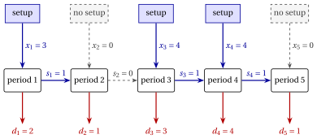

# Lot sizing problems

**Part 1 · Combinatorial optimization problems · Chapter 8** · [:material-file-pdf-box: Lecture notes, volume 1 (PDF)](../../pdf/lecture-notes-1-combinatorial-optimization-problems.pdf) · [:material-pencil: Exercises: Lot sizing problems](../../exercises/lot-sizing.md)

!!! nota "Prerequisites"

    - From this module, the chapter «Combinatorial optimization problems»: what a combinatorial optimization problem is, the number of candidate solutions, and primal and dual bounds.

!!! chiave "Objectives"

    At the end of this chapter you will be able to:

    - describe a production plan by its quantities, stocks and setups, and compute its cost;

    - state the capacitated lot sizing problem and name its main variants;

    - decide whether a plan is feasible, and count the feasible setup choices of an instance;

    - build a first plan by hand, merging the demands of consecutive periods;

    - compute a lower bound on the cost from the number of setups that the total demand requires.

## 8.1 The capacitated lot sizing problem

!!! definizione "Definition 8.1: Capacitated lot sizing problem"

    Given:

    1. a set $T = \{1,2,\dots,m\}$ of $m$ <em>time periods</em>,

    2. for each period $t \in T$, a <em>demand</em> $d_t \in \Z_{\ge 1}$ and a <em>capacity</em> $cap_t \in \Z_{\ge 1}$, both counted in units of one product,

    3. for each period $t \in T$, three non-negative integer costs: the <em>setup cost</em> $sc_t$, the <em>variable production cost</em> $vc_t$ per unit produced and the <em>holding cost</em> $hc_t$ per unit kept in stock at the end of the period,

    the <strong>capacitated lot sizing problem</strong> (CLS) asks to decide how much to produce in every period, so that every demand is satisfied with what is produced and what is in stock, the capacities are respected, and the total cost of setups, production and holding is minimized.

- A <strong>CLS instance</strong> is specified by:

    1. one integer number:

        - the number of periods $m \in \Z_{\ge 1}$,

    2. five vectors of integer numbers of length $m$:

        - $\vet{d},\ \vet{cap} \in \Z_{\ge 1}^m$, containing demands and capacities,

        - $\vet{sc},\ \vet{vc},\ \vet{hc} \in \Z_{\ge 0}^m$, containing the costs.

- A <strong>CLS feasible solution</strong> is a <strong>production plan</strong>, that is a vector of integer quantities

    $$
    \vet{x} = (x_1,x_2,\dots,x_m) \in \Z_{\ge 0}^m ,
    $$

    where $x_t$ is the quantity produced in period $t$. The stock left at the end of period $t$ is

    $$
    s_t(\vet{x}) = \sum_{u=1}^{t} (x_u - d_u),
    $$

    because the stock of period $t-1$ plus the production of period $t$ must cover the demand of period $t$, and what remains is the stock of period $t$. The plan is <strong>feasible</strong> if

    $$
    x_t \le cap_t \quad \text{and} \quad s_t(\vet{x}) \ge 0 \qquad \forall t \in T, \qquad s_m(\vet{x}) = 0.
    $$

- There is a <strong>setup</strong> in period $t$ when $x_t > 0$: we write $y_t = 1$ in this case and $y_t = 0$ otherwise. The <strong>cost</strong> of a plan is

    $$
    c(\vet{x}) = \sum_{t \in T} \bigl( sc_t\, y_t + vc_t\, x_t + hc_t\, s_t(\vet{x}) \bigr).
    $$

    !!! chiave ""

        Given a CLS instance, the CLS can be formally stated as:

        \begin{equation*}
        \label{CLS}
        \tilde{\vet{x}}
        \in
        \argmin_{\vet{x}}
        \left\{
        c(\vet{x})
        \;:\;
        x_t \le cap_t,~ s_t(\vet{x}) \ge 0,~ \forall t \in T,~ s_m(\vet{x}) = 0,~ \vet{x} \in \Z_{\ge 0}^m
        \right\}. \tag{8.1}
        \end{equation*}

- We denote by $z(I)$ the cost of an optimal plan $\tilde{\vet{x}}$ of the instance $I$.

!!! esempio "Example 8.1: CLS instance"

    We consider $m=5$ periods, with the following data, all integer:

    
<table>
    <tr>
    <th>period \(t\)</th>
    <th>\(1\)</th>
    <th>\(2\)</th>
    <th>\(3\)</th>
    <th>\(4\)</th>
    <th>\(5\)</th>
    </tr>
    <tr>
    <td>demand \(d_t\)</td>
    <td>\(2\)</td>
    <td>\(1\)</td>
    <td>\(3\)</td>
    <td>\(4\)</td>
    <td>\(1\)</td>
    </tr>
    <tr>
    <td>capacity \(cap_t\)</td>
    <td>\(4\)</td>
    <td>\(4\)</td>
    <td>\(4\)</td>
    <td>\(4\)</td>
    <td>\(4\)</td>
    </tr>
    <tr>
    <td>setup cost \(sc_t\)</td>
    <td>\(50\)</td>
    <td>\(50\)</td>
    <td>\(50\)</td>
    <td>\(50\)</td>
    <td>\(50\)</td>
    </tr>
    <tr>
    <td>production cost \(vc_t\)</td>
    <td>\(0\)</td>
    <td>\(0\)</td>
    <td>\(0\)</td>
    <td>\(0\)</td>
    <td>\(0\)</td>
    </tr>
    <tr>
    <td>holding cost \(hc_t\)</td>
    <td>\(10\)</td>
    <td>\(10\)</td>
    <td>\(10\)</td>
    <td>\(10\)</td>
    <td>\(10\)</td>
    </tr>
    </table>

    This is the lot sizing instance of the course on MIP heuristics, with the demands counted in units of ten items. The total demand is $2+1+3+4+1=11$. We call this CLS instance [Example 8.1](#box-2-ex-cls5): it is the reference instance of the chapter.

    The plan $\vet{x}=(3,0,4,4,0)$ is feasible: the stocks are $s=(1,0,1,1,0)$, all non-negative, with $s_5=0$, and every quantity is at most $4$. There are $3$ setups, in the periods $1$, $3$ and $4$:

    $$
    c(\vet{x}) = 3\cdot 50 + 10\cdot(1+0+1+1+0) = 150+30=180.
    $$

    The plan is drawn below, period by period from left to right: the production $x_t$ enters a period from above, through a setup (solid) or not at all (dashed); the stock $s_t$ passes to the next period; the demand $d_t$ leaves the period from below.

    { .fig loading=lazy  }

    Every period has capacity $cap_t=4$, and the three setups cost $50$ each.

### 8.1.1 Assumptions

- We make the following assumptions:

    1. The stock is empty at the beginning and at the end of the horizon. Leaving stock at the end only adds cost, so no optimal plan needs it; an initial stock is a variant of the problem (next section).

    2. The capacities allow to satisfy the demands, period after period (otherwise there is no feasible plan). Formally:

        $$
        \sum_{u=1}^{t} cap_u \ge \sum_{u=1}^{t} d_u, ~~~~ \forall t \in T
        $$

    3. The quantities are integer. With integer data, once the periods with a setup are fixed, what remains is a minimum cost flow problem, which has an integer optimal solution: restricting the quantities to integers does not change the optimal cost.

-   **Definition**

    The capacitated lot sizing problem · Assumptions

    [:octicons-arrow-right-24: Open](#81-the-capacitated-lot-sizing-problem)

-   **8.2 Variants**

    A first plan by hand · A combinatorial lower bound · Remarks · Typical mistakes · In summary

    [:octicons-arrow-right-24: Open](variants.md)

---

**Next:** [8.2 Variants](variants.md)

---

**Exercises on this chapter:** [:material-pencil: Lot sizing problems](../../exercises/lot-sizing.md)

---

**In depth:** [:material-star-outline: the course on this problem](../../selected-problems/lot-sizing.md)
