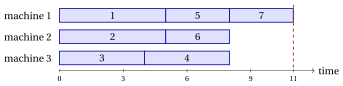

# Parallel machine scheduling

**Part 1 · Combinatorial optimization problems · Chapter 7** · [:material-file-pdf-box: Lecture notes, volume 1 (PDF)](../../pdf/lecture-notes-1-combinatorial-optimization-problems.pdf) · [:material-pencil: Exercises: Machine scheduling](../../exercises/pcmax.md)

!!! nota "Prerequisites"

    - From this module, the chapter «Combinatorial optimization problems»: what a combinatorial optimization problem is, the number of candidate solutions, and primal and dual bounds.

    - From the same chapter, the reference $P\,||\,C_{\max}$ instance with $7$ jobs and $3$ machines, and the partitions of a set (Bell and Stirling numbers).

!!! chiave "Objectives"

    At the end of this chapter you will be able to:

    - classify a scheduling problem with the three-field notation, and state the problem $P\,||\,C_{\max}$;

    - describe a schedule by the sets of jobs of the machines, and compute loads and makespan;

    - count the assignments and the distinct schedules of an instance;

    - build a first schedule by hand, assigning every job to the least loaded machine;

    - compute a lower bound on the optimal makespan and use it to prove that a schedule is optimal.

-   **Definition**

    Scheduling on identical parallel machines

    [:octicons-arrow-right-24: Open](#71-scheduling-on-identical-parallel-machines)

-   **Remarks and summary**

    [:octicons-arrow-right-24: Open](remarks-and-summary.md)

## 7.1 Scheduling on identical parallel machines

!!! definizione "Definition 7.1: Scheduling on identical parallel machines"

    Given:

    1. a set of $m$ identical <em>machines</em>,

    2. a set $\mathscr{J} = \{1,2,\dots,n\}$ of $n$ <em>jobs</em>,

    3. for each job $j \in \mathscr{J}$, a <em>processing time</em> $t_j \in \Z_{\ge 1}$,

    the problem $P\,||\,C_{\max}$ asks to assign each job to a machine, so that the time needed to complete all the jobs, i.e., the largest total processing time assigned to a machine, is minimized.

- The name $P\,||\,C_{\max}$ comes from the three-field notation of scheduling problems (Section [7.2](#sez-sec-threefield)).

- A <strong>$P\,||\,C_{\max}$ instance</strong> is specified by:

    1. two integer numbers:

        - the number of machines $m \in \Z_{\ge 1}$,

        - the number of jobs $n \in \Z_{\ge 1}$,

    2. one vector of integer numbers of length $n$:

        - $\vet{t} \in \Z_{\ge 1}^n$, containing the processing times.

- A <strong>$P\,||\,C_{\max}$ feasible solution</strong> is an assignment of the jobs to the machines, which we store in a vector $\mathrm{mach}=(\mathrm{mach}_1,\mathrm{mach}_2,\dots,\mathrm{mach}_n)$:

    $$
    \mathrm{mach}_j = h \quad \Longleftrightarrow \quad \text{job } j \text{ is assigned to machine } h .
    $$

    The set of jobs assigned to machine $h$ is $J_h = \{ j \in \mathscr{J} : \mathrm{mach}_j = h\}$, and its <strong>load</strong> is

    $$
    L_h = \sum_{j \in J_h} t_j .
    $$

    Each machine processes its jobs one after the other, without idle times, so machine $h$ completes its jobs at time $L_h$. The <strong>makespan</strong> of the solution is the completion time of the last job,

    $$
    C_{\max} = \max_{h \in \{1,2,\dots,m\}} L_h .
    $$

- The order in which a machine processes its jobs does not change its load: a solution is fully described by the sets $J_1,J_2,\dots,J_m$, which form a partition of $\mathscr{J}$ (some of them may be empty).

    !!! chiave ""

        Given a $P\,||\,C_{\max}$ instance, the problem can be formally stated as:

        \begin{equation*}
        \label{PCmax}
        \min
        \left\{
        \max_{h \in \{1,\dots,m\}} \sum_{j \in J_h} t_j
        \;:\;
        J_1,J_2,\dots,J_m \text{ is a partition of } \mathscr{J}
        \right\}. \tag{7.1}
        \end{equation*}

- We denote by $z(I)$ the optimal makespan of the instance $I$.

### 7.1.1 Assumptions

- We make the following assumption:

    1. There are more jobs than machines (otherwise each job gets a machine of its own, and the optimal makespan is $\max_j t_j$). Formally:

        $$
        n > m
        $$

!!! esempio "Example 7.1: $P\,||\,C_{\max}$ instance"

    We consider $m=3$ machines and a set $\mathscr{J}=\{1,2,\dots,7\}$ of $7$ jobs ($n=7$), with the following processing times:

    $$
    \begin{array}{l|ccccccc}
    \hline  & {j=1} & {j=2} & {j=3} & {j=4} & {j=5} & {j=6} & {j=7} \\[1ex]
    \hline {t_j} & {5} & {5} & {4} & {4} & {3} & {3} & {3} \\
    \hline
    \end{array}
    $$

    This is the $P\,||\,C_{\max}$ instance of the MIP modelling course. The assignment $\mathrm{mach}=(1,2,3,3,1,2,1)$ gives $J_1=\{1,5,7\}$, $J_2=\{2,6\}$, $J_3=\{3,4\}$, with loads $L_1=11$, $L_2=8$, $L_3=8$ and makespan $11$:

    { .fig loading=lazy  }

## 7.2 The three-field notation { #sez-sec-threefield }

- Scheduling problems are classified with the <strong>three-field notation</strong> $\alpha\,|\,\beta\,|\,\gamma$ of Graham, Lawler, Lenstra and Rinnooy Kan, where:

    1. $\alpha$ describes the <strong>machine environment</strong>: $1$ for a single machine, $P$ for identical parallel machines, $Q$ for parallel machines with different speeds, $R$ for unrelated parallel machines;

    2. $\beta$ describes the <strong>job characteristics</strong>, such as release dates $r_j$ or precedence constraints <em>prec</em>; an empty field means that there are none;

    3. $\gamma$ describes the <strong>objective function</strong>, such as the makespan $C_{\max}$ or the total completion time $\sum_j C_j$.

- In this notation, $P\,||\,C_{\max}$ is the problem of scheduling jobs without additional characteristics on identical parallel machines, minimizing the makespan.

## 7.3 Counting the solutions

- Every job can be assigned to any of the $m$ machines, independently of the others: there are $m^n$ assignments $\mathrm{mach}$.

- The machines are identical, so two assignments that differ only by the names of the machines describe the same schedule. The distinct schedules are the partitions of $\mathscr{J}$ into at most $m$ non-empty sets, and their number is

    $$
    \sum_{k=1}^{m} S(n,k),
    $$

    where $S(n,k)$ is the Stirling number of the second kind, the number of partitions of $n$ elements into exactly $k$ non-empty sets.

!!! esempio "Example 7.2: counting the schedules"

    For the instance of [Example 7.1](#box-2-ex-pcmax7) there are $3^7=2187$ assignments. The Stirling numbers are $S(7,1)=1$, $S(7,2)=63$ and $S(7,3)=301$, so the distinct schedules are

    $$
    1+63+301=365.
    $$

    By enumeration, the schedules with the smallest makespan, $9$, are exactly two:

    $$
    \{1,3\},\{2,4\},\{5,6,7\} \qquad \text{and} \qquad \{1,4\},\{2,3\},\{5,6,7\},
    $$

    which give $3!\cdot 2=12$ of the $2187$ assignments. The optimal schedule is therefore not unique.

- The growth is exponential in $n$: with $3$ machines, $20$ jobs have $3^{20} \approx 3.5\cdot 10^9$ assignments, and $30$ jobs have $3^{30} \approx 2.1\cdot 10^{14}$.

## 7.4 A first schedule by hand

- A simple way to build a schedule is to take the jobs one by one, in the order $1,2,\dots,n$, and to assign each job to the machine with the smallest load at that moment; in case of a tie we take the machine with the smallest index.

!!! esempio "Example 7.3: assigning every job to the least loaded machine"

    On the instance of [Example 7.1](#box-2-ex-pcmax7) the loads of the three machines evolve as follows:

    
<table>
    <tr>
    <th>job \(j\) (\(t_j\))</th>
    <th>machine chosen</th>
    <th>loads \((L_1,L_2,L_3)\)</th>
    </tr>
    <tr>
    <td>\(1\) (\(5\))</td>
    <td>\(1\)</td>
    <td>\((5,0,0)\)</td>
    </tr>
    <tr>
    <td>\(2\) (\(5\))</td>
    <td>\(2\)</td>
    <td>\((5,5,0)\)</td>
    </tr>
    <tr>
    <td>\(3\) (\(4\))</td>
    <td>\(3\)</td>
    <td>\((5,5,4)\)</td>
    </tr>
    <tr>
    <td>\(4\) (\(4\))</td>
    <td>\(3\)</td>
    <td>\((5,5,8)\)</td>
    </tr>
    <tr>
    <td>\(5\) (\(3\))</td>
    <td>\(1\)</td>
    <td>\((8,5,8)\)</td>
    </tr>
    <tr>
    <td>\(6\) (\(3\))</td>
    <td>\(2\)</td>
    <td>\((8,8,8)\)</td>
    </tr>
    <tr>
    <td>\(7\) (\(3\))</td>
    <td>\(1\)</td>
    <td>\((11,8,8)\)</td>
    </tr>
    </table>

    We obtain the assignment $\mathrm{mach}=(1,2,3,3,1,2,1)$ of the example, with makespan $11$.

- When the last job arrives all the machines have load $8$: whichever machine receives it, the largest load becomes $8+3=11$.

- We do not know yet whether $11$ is far from the optimal makespan: we need a lower bound.

## 7.5 A combinatorial lower bound

!!! teorema "Observation 7.2"

    For every $P\,||\,C_{\max}$ instance, the optimal makespan $z(I)$ satisfies

    $$
    z(I) \;\ge\; \max\left\{ \max_{j\in\mathscr{J}} t_j,\;\; \left\lceil \frac{\sum_{j\in\mathscr{J}} t_j}{m} \right\rceil \right\}.
    $$

- The machine processing the longest job has load at least $\max_j t_j$.

- The $m$ loads sum up to $\sum_j t_j$, so the largest one is at least their average $\frac{1}{m}\sum_j t_j$, and, being an integer, at least its ceiling.

!!! esempio "Example 7.4: the bound on the reference instance"

    On the instance of [Example 7.1](#box-2-ex-pcmax7) the bound is $\max\{5,\lceil 27/3\rceil\}=9$. Together with the schedule of the previous section,

    $$
    9 \le z(I) \le 11.
    $$

    The assignment $\mathrm{mach}=(1,2,1,2,3,3,3)$ gives $J_1=\{1,3\}$, $J_2=\{2,4\}$, $J_3=\{5,6,7\}$, all with load $9$, and makespan $9$:

    { .fig loading=lazy  }

    It attains the lower bound, so it is optimal: $z(I)=9$. The three machines finish together, and no idle time is left before the makespan.

- The bound is not always attained. With $m=2$ machines and three jobs of processing times $(4,3,3)$ it gives $\max\{4,\lceil 10/2\rceil\}=5$, but the best schedule is $\{1\},\{2,3\}$, with makespan $6$.

## 7.6 Relation with the bin packing problem

- Given a value $T$, a schedule with makespan at most $T$ exists if and only if the jobs, seen as items of weight $t_j$, can be packed into $m$ bins of capacity $T$: the machines are the bins and the loads are the total weights of the packing patterns.

- The two problems fix and minimize opposite quantities:

    
<table>
    <tr>
    <th></th>
    <th>number of bins / machines</th>
    <th>capacity / makespan</th>
    </tr>
    <tr>
    <td>BPP</td>
    <td>minimized</td>
    <td>fixed (\(c\))</td>
    </tr>
    <tr>
    <td>\(P\,||\,C_{\max}\)</td>
    <td>fixed (\(m\))</td>
    <td>minimized</td>
    </tr>
    </table>

- For this reason the two problems share many ideas: several heuristic algorithms for one of them have a counterpart for the other.

---

**Next:** [Remarks and summary](remarks-and-summary.md)

---

**Exercises on this chapter:** [:material-pencil: Machine scheduling](../../exercises/pcmax.md)

---

**In depth:** [:material-star-outline: the course on this problem](../../selected-problems/pcmax.md)
