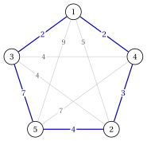

# 6.2 The travelling salesman problem { #sez-sec-tsp-TSP }

**Part 1 · Combinatorial optimization problems · Chapter 6** · [:material-book-open-variant: Chapter 6: Routing problems](index.md) · [:material-file-pdf-box: Lecture notes, volume 1 (PDF)](../../pdf/lecture-notes-1-combinatorial-optimization-problems.pdf) · [:material-pencil: Exercises: Routing problems](../../exercises/tsp.md)

!!! definizione "Definition 6.1: Travelling salesman problem"

    Given:

    1. a set $\mathscr{V} = \{1,2,\dots,n\}$ of $n$ <em>cities</em>,

    2. for each pair of distinct cities $i,j \in \mathscr{V}$, a <em>distance</em> $d_{ij} \in \Z_{\ge 1}$, with $d_{ij}=d_{ji}$,

    the <strong>travelling salesman problem</strong> (TSP) asks to find a closed route that starts from a city, visits every other city exactly once and returns to the starting city, so that the total distance travelled is minimized.

- A <strong>TSP instance</strong> is specified by:

    1. one integer number:

        - the number of cities $n \in \Z_{\ge 3}$,

    2. one symmetric matrix of integer numbers of size $n \times n$:

        - $D=(d_{ij})$, containing the distances; the diagonal entries are not used.

- A <strong>TSP feasible solution</strong>, called a <strong>tour</strong>, is a permutation of the cities

    $$
    \sigma = (\sigma_1,\sigma_2,\dots,\sigma_n),
    $$

    read as the closed route $\sigma_1 \to \sigma_2 \to \dots \to \sigma_n \to \sigma_1$. Its <strong>length</strong> is

    $$
    L(\sigma) = \sum_{k=1}^{n-1} d_{\sigma_k \sigma_{k+1}} + d_{\sigma_n \sigma_1},
    $$

    where the last term is the distance travelled to return to the starting city.

- Different permutations may describe the same tour: the starting city can be any of the $n$ cities, and, since the distances are symmetric, the tour can be travelled in either direction.

    !!! chiave ""

        Given a TSP instance, the TSP can be formally stated as:

        \begin{equation*}
        \label{TSP}
        \tilde{\sigma}
        \in
        \argmin_{\sigma}
        \left\{
        L(\sigma) = \sum_{k=1}^{n-1} d_{\sigma_k \sigma_{k+1}} + d_{\sigma_n \sigma_1}
        \;:\;
        \sigma \text{ is a permutation of } \mathscr{V}
        \right\}. \tag{6.1}
        \end{equation*}

- We denote by $z(I)$ the length of an optimal tour $\tilde{\sigma}$ of the instance $I$.

## 6.2.1 Assumptions

- We make the following assumptions:

    1. There are at least three cities (with one or two cities there is only one route). Formally:

        $$
        n \ge 3
        $$

    2. The distances are symmetric (travelling from $i$ to $j$ costs as much as travelling from $j$ to $i$). Formally:

        $$
        d_{ij}=d_{ji},~~~~ \forall i,j \in \mathscr{V},~ i\neq j
        $$

!!! esempio "Example 6.1: TSP instance"

    We consider a set $\mathscr{V}=\{1,2,3,4,5\}$ of $5$ cities ($n=5$), with the following distances:

    $$
    \begin{array}{c|ccccc}
    \hline {d_{ij}} & {1} & {2} & {3} & {4} & {5} \\
    \hline {1} & --- & {5} & {2} & {2} & {9} \\
    {2} & {5} & --- & {4} & {3} & {4} \\
    {3} & {2} & {4} & --- & {4} & {7} \\
    {4} & {2} & {3} & {4} & --- & {7} \\
    {5} & {9} & {4} & {7} & {7} & --- \\
    \hline
    \end{array}
    $$

    This is the TSP instance of the MIP modelling course. The instance can be drawn as a complete graph, with one node per city and one edge, labelled with the distance, per pair of cities. The bold edges form the tour $\sigma=(1,3,5,2,4)$, and the cities are drawn in the order of the tour:

    { .fig loading=lazy  }

    Its length is $L(\sigma)=d_{13}+d_{35}+d_{52}+d_{24}+d_{41}=2+7+4+3+2=18$.

## 6.3 Counting the tours

!!! teorema "Proposition 6.2"

    A TSP instance with $n \ge 3$ cities has

    $$
    \frac{n!}{2n} = \frac{(n-1)!}{2}
    $$

    distinct tours.

- There are $n!$ permutations of the cities. Each tour is described by $n$ permutations, one for every possible starting city, so there are $n!/n=(n-1)!$ cyclic orderings of the cities.

- The distances are symmetric, so the tour travelled backwards has the same length and is not a new solution: every tour is counted twice, and we divide by $2$.

!!! esempio "Example 6.2: enumeration of the tours"

    The instance of [Example 6.1](#box-2-ex-tsp5) has $\frac{(5-1)!}{2}=12$ distinct tours, which can be enumerated:

    
<table>
    <tr>
    <th>tour</th>
    <th>\(L\)</th>
    <th>tour</th>
    <th>\(L\)</th>
    <th>tour</th>
    <th>\(L\)</th>
    </tr>
    <tr>
    <td>\((1,3,5,2,4)\)</td>
    <td>\(18\)</td>
    <td>\((1,3,4,2,5)\)</td>
    <td>\(22\)</td>
    <td>\((1,2,3,5,4)\)</td>
    <td>\(25\)</td>
    </tr>
    <tr>
    <td>\((1,3,2,5,4)\)</td>
    <td>\(19\)</td>
    <td>\((1,4,3,2,5)\)</td>
    <td>\(23\)</td>
    <td>\((1,3,2,4,5)\)</td>
    <td>\(25\)</td>
    </tr>
    <tr>
    <td>\((1,2,5,3,4)\)</td>
    <td>\(22\)</td>
    <td>\((1,2,4,5,3)\)</td>
    <td>\(24\)</td>
    <td>\((1,4,2,3,5)\)</td>
    <td>\(25\)</td>
    </tr>
    <tr>
    <td>\((1,2,5,4,3)\)</td>
    <td>\(22\)</td>
    <td></td>
    <td></td>
    <td>\((1,2,4,3,5)\)</td>
    <td>\(28\)</td>
    </tr>
    <tr>
    <td></td>
    <td></td>
    <td></td>
    <td></td>
    <td>\((1,2,3,4,5)\)</td>
    <td>\(29\)</td>
    </tr>
    </table>

    Hence the tour $\sigma=(1,3,5,2,4)$ is the unique optimal tour, and $z(I)=18$.

- The number of tours grows faster than any exponential function:

    $$
    \begin{array}{rrrrr}
    \hline {n} & {5} & {10} & {15} & {20} \\
    \hline {\frac{(n-1)!}{2}} & {12} & {181\,440} & {\approx 4.4\cdot 10^{10}} & {\approx 6.1\cdot 10^{16}} \\
    \hline
    \end{array}
    $$

- A computer that evaluates $10^9$ tours per second needs about $6.1\cdot 10^{7}$ seconds, that is about two years, to list the tours of $20$ cities. Enumeration is therefore useful only as a check on tiny instances, and the algorithms of this course must do better.

## 6.4 A first tour by hand

- The simplest way to build a tour is the <strong>nearest neighbour rule</strong>: start from a city and, as long as there are unvisited cities, move to the closest unvisited one; at the end, return to the starting city. In case of a tie we take the city with the smallest index.

!!! esempio "Example 6.3: nearest neighbour from city $1$"

    On the instance of [Example 6.1](#box-2-ex-tsp5), starting from city $1$:

    1. from $1$ the closest cities are $3$ and $4$, both at distance $2$: we go to $3$;

    2. from $3$ the unvisited cities $2$ and $4$ are both at distance $4$: we go to $2$;

    3. from $2$ the closest unvisited city is $4$, at distance $3$; then only $5$ is left, at distance $d_{45}=7$;

    4. we return from $5$ to $1$ at distance $d_{51}=9$.

    The tour is $\sigma=(1,3,2,4,5)$, of length $2+4+3+7+9=25$.

- The last edges of the nearest neighbour tour are forced, and may be very long: here the final edge $\{5,1\}$ costs $9$. The tour of length $25$ is worse than the optimal one, of length $18$, by $7$.

- From the nearest neighbour tour alone we cannot tell how far we are from the optimum: we need a lower bound.

## 6.5 A combinatorial lower bound

- For a city $i$, let $a_i \le b_i$ be the two smallest distances from $i$ to the other cities.

!!! teorema "Observation 6.3"

    For every symmetric TSP instance, the optimal length satisfies

    $$
    z(I) \;\ge\; \left\lceil \frac{1}{2} \sum_{i \in \mathscr{V}} (a_i + b_i) \right\rceil .
    $$

- In a tour, every city is entered by one edge and left by another one, so it has exactly two edges of the tour, each at least as long as $a_i$ and $b_i$ respectively.

- Summing over all the cities, every edge of the tour is counted twice, once for each of its end cities: hence $2L(\sigma) \ge \sum_i (a_i + b_i)$ for every tour $\sigma$.

- The distances are integer, so is $L(\sigma)$, and we can round the bound up.

!!! esempio "Example 6.4: the bound on the reference instance"

    For the instance of [Example 6.1](#box-2-ex-tsp5) the two smallest distances of each city are:

    
<table>
    <tr>
    <th>city \(i\)</th>
    <th>\(1\)</th>
    <th>\(2\)</th>
    <th>\(3\)</th>
    <th>\(4\)</th>
    <th>\(5\)</th>
    <th>sum</th>
    </tr>
    <tr>
    <td>\(a_i\)</td>
    <td>\(2\)</td>
    <td>\(3\)</td>
    <td>\(2\)</td>
    <td>\(2\)</td>
    <td>\(4\)</td>
    <td></td>
    </tr>
    <tr>
    <td>\(b_i\)</td>
    <td>\(2\)</td>
    <td>\(4\)</td>
    <td>\(4\)</td>
    <td>\(3\)</td>
    <td>\(7\)</td>
    <td></td>
    </tr>
    <tr>
    <td>\(a_i+b_i\)</td>
    <td>\(4\)</td>
    <td>\(7\)</td>
    <td>\(6\)</td>
    <td>\(5\)</td>
    <td>\(11\)</td>
    <td>\(33\)</td>
    </tr>
    </table>

    Hence $z(I) \ge \lceil 33/2 \rceil = 17$. Together with the nearest neighbour tour we obtain

    $$
    17 \le z(I) \le 25,
    $$

    an absolute gap of $8$, that is a relative gap of $\frac{8}{17} \approx 47.1\%$. The tour $(1,3,5,2,4)$ of length $18$ closes most of it, and only the enumeration of the $12$ tours proves that $18$ is optimal.

---

**Next:** [6.6 Variants: metric and asymmetric TSP](variants-metric-and-asymmetric-tsp.md)
