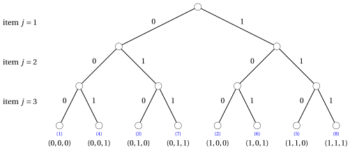
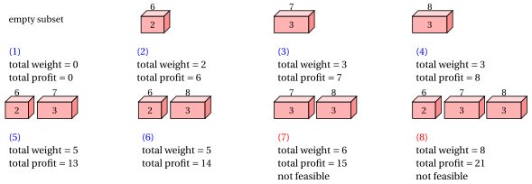
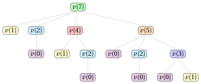
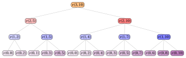

# Dynamic programming for knapsack problems

**Part 3 · Dynamic programming · Chapter 15** · [:material-file-pdf-box: Lecture notes, volume 3 (PDF)](../pdf/lecture-notes-3-dynamic-programming.pdf) · [:material-pencil: Exercises](../exercises/dp-knapsack.md)

## 15.1 A DP algorithm for the Knapsack Problem

!!! nota "Prerequisites"

    - From this module, the chapter «Principles of dynamic programming»: optimal substructure, overlapping subproblems, recurrence relations, base cases, and the top-down and bottom-up approaches.

    - From this module, the chapter «Knapsack problems»: the KP, the binary encoding of a solution, and the $2^n$ subsets of items.

    - From the module <em>Algorithms</em>: how to read [pseudocode (Chapter 2)](https://fabiofurini.github.io/algorithms/basic-algorithms/02-pseudo-code/), and [the size of the input of an algorithm (Chapter 11)](https://fabiofurini.github.io/algorithms/analysis/11-input-size/) (needed to explain why $\Theta(nc)$ is pseudo-polynomial).

!!! nota "Where we were"

    - <strong>As a problem</strong>: the KP, its instances and the $2^n$ subsets (chapter «Knapsack problems»).

    - <strong>As a model</strong>: the ILP model, its LP relaxation and the dual bounds (chapter «Knapsack formulations»).

    - <strong>Now, as a table</strong>: the DP algorithm computes the optimal value exactly, with no model and no solver.

!!! chiave "Objectives"

    At the end of this chapter you will be able to:

    - write the recurrence $v(j,k)$ of the KP, explain why it is correct, and compute the table by hand with the top-down approach, the bottom-up approach and a single vector;

    - reconstruct an optimal solution from the matrix ${s}$ of the decisions;

    - count the steps of the DP algorithm and explain why $\Theta(nc)$ is pseudo-polynomial, not polynomial;

    - describe the states $(w,p)$, discard the dominated ones, and run the DP algorithm on lists of states;

    - exchange the roles of profits and weights, and compute the optimal value from the table $u(j,q)$.

### 15.1.1 Problem definition

!!! definizione "Definition 15.1: Knapsack Problem"

    Given:

    1. a knapsack of <em>capacity</em> $c \in \Z_{\ge 1}$,

    2. a set $\Ioggetti = \{1,2,\ldots,n\}$ of $n$ items,

    3. for each item $j \in \Ioggetti$, a <em>profit</em> $p_j \in \Z_{\ge 1}$ and a <em>weight</em> $w_j \in \Z_{\ge 1}$,

    the <strong>Knapsack Problem</strong> (KP) asks to decide which items to insert into the knapsack, so that the total weight of the selected items does not exceed the knapsack capacity, and the total profit of the selected items is maximized.

!!! esempio "Example 15.1: KP instance"

    We consider a knapsack of capacity $c = 5$ and a set $\{1,2,3\}$ of $3$ items ($n = 3$), with the following profits and weights:

    
<table>
    <tr>
    <th></th>
    <th>\(j = 1\)</th>
    <th>\(j = 2\)</th>
    <th>\(j = 3\)</th>
    </tr>
    <tr>
    <td>\(p_j\)</td>
    <td>\(6\)</td>
    <td>\(7\)</td>
    <td>\(8\)</td>
    </tr>
    <tr>
    <td>\(w_j\)</td>
    <td>\(2\)</td>
    <td>\(3\)</td>
    <td>\(3\)</td>
    </tr>
    </table>

    We refer to this KP instance as Example 1.

!!! chiave ""

    The number of possible subsets of items is $2^n$ since, for each item, there is an independent option of inserting it or not into the knapsack. Some subsets may not respect the knapsack capacity. Accordingly, the number of feasible solutions is at most $2^n$.

- The number of possible KP solutions grows exponentially with the number $n$ of items. Therefore, enumerating all possible solutions quickly becomes impractical as $n$ increases.

#### Encoding of feasible solutions

!!! chiave ""

    A <em>feasible solution</em> of the KP is a subset of items whose total weight does not exceed the knapsack capacity.

- A KP feasible solution can be described by the binary vector

    $$
    (x_1,x_2,\dots,x_n)
    $$

    where each component has the following meaning:

    $$
    x_j =
    \left\{
    \begin{array}{ll}
    1 & \textrm{if item } j \textrm{ is selected,}\\[1ex]
    0 & \textrm{otherwise,}
    \end{array}
    \right.
    \qquad \forall j \in \{1,2,\dots,n\}.
    $$

    Since the solution is feasible, the total weight of the selected items must not exceed the knapsack capacity:

    $$
    \sum_{j=1}^{n} w_j x_j \le c.
    $$

    The total profit of a feasible solution is

    $$
    \sum_{j=1}^{n} p_j x_j.
    $$

!!! esempio "Example 15.2: Enumeration of all possible KP solutions"

    We consider the KP instance of Example 1 with a knapsack of capacity $c=5$ and the following profits and weights:

    
<table>
    <tr>
    <th></th>
    <th>\(j = 1\)</th>
    <th>\(j = 2\)</th>
    <th>\(j = 3\)</th>
    </tr>
    <tr>
    <td>\(p_j\)</td>
    <td>\(6\)</td>
    <td>\(7\)</td>
    <td>\(8\)</td>
    </tr>
    <tr>
    <td>\(w_j\)</td>
    <td>\(2\)</td>
    <td>\(3\)</td>
    <td>\(3\)</td>
    </tr>
    </table>

    There are $2^3 = 8$ possible subsets of items, corresponding to the different ways of selecting or not selecting the items.

    In the following binary tree, each level corresponds to an item: an edge labeled $1$ means that the item is selected, while an edge labeled $0$ means that it is not selected. Each leaf represents one complete subset of items and reports the corresponding vector.

    { .fig .ovale loading=lazy style="width:95%" }

    The figure below shows the subsets associated with the leaves of the tree, through the labels $(1),(2),\ldots,(8)$. For each selected item, the number written inside the parallelepiped is its weight, while the number above it is its profit. The width of each parallelepiped is proportional to the item weight. Subsets whose total weight exceeds the knapsack capacity are marked as not feasible.

    { .fig .ovale loading=lazy style="width:100%" }

    
<table>
    <tr>
    <th>Label</th>
    <th>Solution vector</th>
    <th>Total weight</th>
    <th>Total profit</th>
    <th>Feasible?</th>
    </tr>
    <tr>
    <td>\((1)\)</td>
    <td>\((0,0,0)\)</td>
    <td>\(0\)</td>
    <td>\(0\)</td>
    <td>yes</td>
    </tr>
    <tr>
    <td>\((2)\)</td>
    <td>\((1,0,0)\)</td>
    <td>\(2\)</td>
    <td>\(6\)</td>
    <td>yes</td>
    </tr>
    <tr>
    <td>\((3)\)</td>
    <td>\((0,1,0)\)</td>
    <td>\(3\)</td>
    <td>\(7\)</td>
    <td>yes</td>
    </tr>
    <tr>
    <td>\((4)\)</td>
    <td>\((0,0,1)\)</td>
    <td>\(3\)</td>
    <td>\(8\)</td>
    <td>yes</td>
    </tr>
    <tr>
    <td>\((5)\)</td>
    <td>\((1,1,0)\)</td>
    <td>\(2+3=5\)</td>
    <td>\(6+7=13\)</td>
    <td>yes</td>
    </tr>
    <tr>
    <td>\((6)\)</td>
    <td>\((1,0,1)\)</td>
    <td>\(2+3=5\)</td>
    <td>\(6+8=14\)</td>
    <td>yes</td>
    </tr>
    <tr>
    <td>\((7)\)</td>
    <td>\((0,1,1)\)</td>
    <td>\(3+3=6\)</td>
    <td>\(7+8=15\)</td>
    <td>no</td>
    </tr>
    <tr>
    <td>\((8)\)</td>
    <td>\((1,1,1)\)</td>
    <td>\(2+3+3=8\)</td>
    <td>\(6+7+8=21\)</td>
    <td>no</td>
    </tr>
    </table>

### 15.1.2 A first DP algorithm

- <u>Step 1</u>: computation of the optimal value

    !!! chiave ""

        For any $j \in \{0,1,\dots,n\}$ and $k \in \{0,1,\dots,c\}$, let $v(j,k)$ be the optimal value of the KP subinstance given by:

        1. a knapsack of capacity $k$,

        2. a set $\{1,2,\dots,j\}$ of available items,

        3. for each item $h \in \{1,2,\dots,j\}$, a profit $p_h$ and a weight $w_h$.

        The recursive formula to compute $v(j,k)$ reads as follows:

        \begin{equation*}
        \label{eq:1}
        v(j,k)= \left\{ \begin{array}{ll}
        0 & \textrm{if $j=0$ or $k=0$,}\\[2ex]
        v(j-1,k) & \textrm{if $1\le j \le n$, $1\le k \le c$, and $w_j>k$,}\\[2ex]
        \begin{array}[t]{@{}l@{}}\displaystyle \max \bigg\{ v(j-1,k),\\ \qquad p_j+v(j-1,k-w_j) \bigg\}\end{array} & \begin{array}[t]{@{}l@{}}\textrm{if $1\le j \le n$,}\\ \textrm{$1\le k \le c$, $w_j\le k$.}\end{array}
        \end{array} \right. \tag{15.1}
        \end{equation*}

    - The recursive decomposition process of formula $\eqref{eq:1}$ generates at most $2$ <strong>independent subproblems</strong>, corresponding to whether or not to select item $j$ for a knapsack of capacity $k$. If $w_j>k$, item $j$ cannot be selected, and therefore the only feasible option is not to select it. Here, $v(0,k)=0$ since no item is available, and $v(j,0)=0$ since no capacity is available.

    - If $w_j\le k$, the optimal value $v(j,k)$ is obtained by trying the two possible options, selecting or not selecting item $j$, and selecting the one that maximizes the profit. The corresponding values are $p_j+v(j-1,k-w_j)$ and $v(j-1,k)$, respectively. If $w_j>k$, item $j$ cannot be selected, and therefore $v(j,k)=v(j-1,k)$.

    - Hence, an optimal solution for the subinstance with capacity $k$ and available items $\{1,2,\dots,j\}$ is built by combining the chosen decision on item $j$ with an optimal solution of the corresponding residual subproblem.

        $\rightsquigarrow$ <strong>Optimal Substructure verified!</strong>

    - Different sequences of decisions on the items, possibly made for different values of $j$ and $k$, can lead to the same subproblem, and therefore the same value $v(j,k)$ may need to be computed several times during the recursive evaluation of formula $\eqref{eq:1}$.

        $\rightsquigarrow$ <strong>Overlapping Subproblems verified!</strong>

    - A <strong>first method</strong> to compute the optimal value $v(n,c)$ of the KP instance is the <strong>top-down approach</strong>. The method starts from the call with $j=n$ and $k=c$ and evaluates formula $\eqref{eq:1}$ recursively: each call considers item $j$ and either does not select it, or also considers selecting it when it fits. The recursion stops when no items are left or when the residual capacity is equal to $0$.

    - The <strong>recursion tree</strong> of the function $v$ has one node for each recursive call, labeled with the function call it represents. The root represents the initial call. The children of a node represent the recursive calls made by that call. The leaf nodes represent the base cases.

        

        !!! esempio "Example 15.3: Recursion tree"

            We consider the KP instance of Example 1. This is the recursion tree of the top-down approach to compute $v(3,5)$:

            { .fig loading=lazy  }

            The function is called $12$ times, and the same subproblem is solved more than once: $v(1,2)$ is called $2$ times (shown with a red border), and so are $v(0,2)$ and $v(0,0)$.

    - The value $v(j,k)$ can be computed once the values required by the right-hand side of formula $\eqref{eq:1}$ are known. In particular, ${v}(j-1,k)$ is needed when item $j$ is not selected and, if $w_j\le k$, ${v}(j-1,k-w_j)$ is needed when item $j$ is selected. Therefore, for a fixed value of $j$, all values $v(j,k)$ can be computed by considering the capacity values $k$ in increasing order.

        

        !!! esempio "Example 15.4: Computing the values of the $v$ function"

            We consider the KP instance of Example 1 with a knapsack of capacity $c=5$ and the following profits and weights:

            
<table>
            <tr>
            <th></th>
            <th>\(j = 1\)</th>
            <th>\(j = 2\)</th>
            <th>\(j = 3\)</th>
            </tr>
            <tr>
            <td>\(p_j\)</td>
            <td>\(6\)</td>
            <td>\(7\)</td>
            <td>\(8\)</td>
            </tr>
            <tr>
            <td>\(w_j\)</td>
            <td>\(2\)</td>
            <td>\(3\)</td>
            <td>\(3\)</td>
            </tr>
            </table>

            The values of the function $v$ are computed as follows:

            - The base cases give $v(0,k)=0$ for all $k \ge 0$.

            - Once we have computed the base cases, we can compute $v(1,2)$:

                $$
                v(1,2) = \max\{v(0,2),\, v(0,0)+p_1\} = \max\{0,\, 0+6\} = 6
                $$

            - We can also compute $v(1,5)$:

                $$
                v(1,5) = \max\{v(0,5),\, v(0,3)+p_1\} = \max\{0,\, 0+6\} = 6
                $$

            - Since $w_2=3 > k=2$, item $2$ cannot fit, so:

                $$
                v(2,2) = v(1,2) = 6
                $$

            - Once we have computed $v(1,2)$ and $v(1,5)$, we can compute $v(2,5)$:

                $$
                v(2,5) = \max\{v(1,5),\, v(1,2)+p_2\} = \max\{6,\, 6+7\} = 13
                $$

            - Once we have computed $v(2,5)$ and $v(2,2)$, we can compute $v(3,5)$:

                $$
                v(3,5) = \max\{v(2,5),\, v(2,2)+p_3\} = \max\{13,\, 6+8\} = 14
                $$

    - We can avoid solving the same subproblems repeatedly by storing the value of each subproblem as soon as it is computed. The values are stored in a <strong>lookup table</strong>.

    - Since solving any particular subproblem depends only on subproblems with a smaller value of $j$, we can solve the subproblems in increasing order of $j$ and, for each fixed value of $j$, in increasing order of capacity, starting from the base cases $v(0,k)=0$ and $v(j,0)=0$ and building up to $v(n,c)$: this observation naturally leads to a <strong>much more efficient method</strong> to compute the optimal value $v(n,c)$ of the KP instance.

    - A <strong>second method</strong> to compute the optimal value $v(n,c)$ of the KP instance is the <strong>bottom-up approach</strong>. The method starts from the base cases and evaluates formula $\eqref{eq:1}$ for increasing values of $j \in \{1,2,\dots,n\}$ and $k \in \{0,1,\dots,c\}$: each value $v(j,k)$ is computed using already-computed values, until the value $v(n,c)$ of the KP instance is obtained.

        This is the pseudo-code of the <strong>DP algorithm using the bottom-up approach</strong>:

        !!! algoritmo "Algorithm: DP"

            

<strong>Input:</strong> A KP instance given by the number \(n\) of items, arrays \(p[1..n]\) and \(w[1..n]\) of item profits and weights, and the knapsack capacity \(c\)

<strong>Output:</strong> The optimal value of the KP instance

1<strong>Function</strong> DP(\(n,p,w,c\))

2\({v} := \textnormal{new array}[0..n][0..c]\)

3<strong>for</strong> \(k := 0\) <strong>to</strong> \(c\)  <strong>do</strong>

4\({v}[0][k] \leftarrow 0\)

5<strong>end</strong>

6<strong>for</strong> \(j := 1\) <strong>to</strong> \(n\)  <strong>do</strong>

7<strong>for</strong> \(k := 0\) <strong>to</strong> \(c\)  <strong>do</strong>

8<strong>if</strong> \(k < w[j]\)  <strong>then</strong>

9\({v}[j][k] \leftarrow {v}[j-1][k]\)

10<strong>else</strong>

11<strong>if</strong> \({v}[j-1][k-w[j]] + p[j] > {v}[j-1][k]\)  <strong>then</strong>

12\({v}[j][k] \leftarrow {v}[j-1][k-w[j]] + p[j]\)

13<strong>else</strong>

14\({v}[j][k] \leftarrow {v}[j-1][k]\)

15<strong>end</strong>

16<strong>end</strong>

17<strong>end</strong>

18<strong>end</strong>

19<strong>return</strong> \({v}[n][c]\)

        - The matrix ${v}[0..n][0..c]$ is the <strong>lookup table</strong>: it stores the optimal values of all subproblems.

        - The first loop initializes the values ${v}[0][k]=0$ for all capacities $k \in \{0,1,\dots,c\}$, corresponding to the case in which no item is available.

        - The outer loop, over items $j \in \{1,2,\dots,n\}$, computes the rows of the matrix in increasing order of $j$.

        - The inner loop, over $k \in \{0,1,\dots,c\}$, computes the optimal value ${v}[j][k]$ for each capacity $k$.

        - If item $j$ does not fit, then ${v}[j][k] \leftarrow {v}[j-1][k]$.

        - Otherwise, the DP algorithm compares the value obtained by not selecting item $j$, namely ${v}[j-1][k]$, with the value obtained by selecting item $j$, namely $p[j]+{v}[j-1][k-w[j]]$.

        - Finally, the optimal value of the KP instance is returned as ${v}[n][c]$.

        

        !!! esempio "Example 15.5: Execution of the DP algorithm"

            We consider the KP instance of Example 1 with a knapsack of capacity $c=5$ and the following profits and weights:

            
<table>
            <tr>
            <th></th>
            <th>\(j = 1\)</th>
            <th>\(j = 2\)</th>
            <th>\(j = 3\)</th>
            </tr>
            <tr>
            <td>\(p_j\)</td>
            <td>\(6\)</td>
            <td>\(7\)</td>
            <td>\(8\)</td>
            </tr>
            <tr>
            <td>\(w_j\)</td>
            <td>\(2\)</td>
            <td>\(3\)</td>
            <td>\(3\)</td>
            </tr>
            </table>

            For each step of the DP algorithm, the table shows the values of $j$ and $k$, the cell ${v}[j][k]$, and the operation performed.

            
<table>
            <tr>
            <th>\(j\)</th>
            <th>\(k\)</th>
            <th>\({v}[j][k]\)</th>
            <th>Action</th>
            </tr>
            <tr>
            <td>\(0\)</td>
            <td>\(0\)</td>
            <td>\(0\)</td>
            <td>\({v}[0][0]\leftarrow 0\)</td>
            </tr>
            <tr>
            <td>\(0\)</td>
            <td>\(1\)</td>
            <td>\(0\)</td>
            <td>\({v}[0][1]\leftarrow 0\)</td>
            </tr>
            <tr>
            <td>\(0\)</td>
            <td>\(2\)</td>
            <td>\(0\)</td>
            <td>\({v}[0][2]\leftarrow 0\)</td>
            </tr>
            <tr>
            <td>\(0\)</td>
            <td>\(3\)</td>
            <td>\(0\)</td>
            <td>\({v}[0][3]\leftarrow 0\)</td>
            </tr>
            <tr>
            <td>\(0\)</td>
            <td>\(4\)</td>
            <td>\(0\)</td>
            <td>\({v}[0][4]\leftarrow 0\)</td>
            </tr>
            <tr>
            <td>\(0\)</td>
            <td>\(5\)</td>
            <td>\(0\)</td>
            <td>\({v}[0][5]\leftarrow 0\)</td>
            </tr>
            <tr>
            <td>\(1\)</td>
            <td>\(0\)</td>
            <td>\(0\)</td>
            <td>\({v}[1][0]\leftarrow {v}[0][0]=0\)</td>
            </tr>
            <tr>
            <td>\(1\)</td>
            <td>\(1\)</td>
            <td>\(0\)</td>
            <td>\({v}[1][1]\leftarrow {v}[0][1]=0\)</td>
            </tr>
            <tr>
            <td>\(1\)</td>
            <td>\(2\)</td>
            <td>\(6\)</td>
            <td>\(\max\{{v}[0][2],p[1]+{v}[0][0]\}=\max\{0,6+0\}=6\)</td>
            </tr>
            <tr>
            <td>\(1\)</td>
            <td>\(3\)</td>
            <td>\(6\)</td>
            <td>\(\max\{{v}[0][3],p[1]+{v}[0][1]\}=\max\{0,6+0\}=6\)</td>
            </tr>
            <tr>
            <td>\(1\)</td>
            <td>\(4\)</td>
            <td>\(6\)</td>
            <td>\(\max\{{v}[0][4],p[1]+{v}[0][2]\}=\max\{0,6+0\}=6\)</td>
            </tr>
            <tr>
            <td>\(1\)</td>
            <td>\(5\)</td>
            <td>\(6\)</td>
            <td>\(\max\{{v}[0][5],p[1]+{v}[0][3]\}=\max\{0,6+0\}=6\)</td>
            </tr>
            <tr>
            <td>\(2\)</td>
            <td>\(0\)</td>
            <td>\(0\)</td>
            <td>\({v}[2][0]\leftarrow {v}[1][0]=0\)</td>
            </tr>
            <tr>
            <td>\(2\)</td>
            <td>\(1\)</td>
            <td>\(0\)</td>
            <td>\({v}[2][1]\leftarrow {v}[1][1]=0\)</td>
            </tr>
            <tr>
            <td>\(2\)</td>
            <td>\(2\)</td>
            <td>\(6\)</td>
            <td>\({v}[2][2]\leftarrow {v}[1][2]=6\)</td>
            </tr>
            <tr>
            <td>\(2\)</td>
            <td>\(3\)</td>
            <td>\(7\)</td>
            <td>\(\max\{{v}[1][3],p[2]+{v}[1][0]\}=\max\{6,7+0\}=7\)</td>
            </tr>
            <tr>
            <td>\(2\)</td>
            <td>\(4\)</td>
            <td>\(7\)</td>
            <td>\(\max\{{v}[1][4],p[2]+{v}[1][1]\}=\max\{6,7+0\}=7\)</td>
            </tr>
            <tr>
            <td>\(2\)</td>
            <td>\(5\)</td>
            <td>\(13\)</td>
            <td>\(\max\{{v}[1][5],p[2]+{v}[1][2]\}=\max\{6,7+6\}=13\)</td>
            </tr>
            <tr>
            <td>\(3\)</td>
            <td>\(0\)</td>
            <td>\(0\)</td>
            <td>\({v}[3][0]\leftarrow {v}[2][0]=0\)</td>
            </tr>
            <tr>
            <td>\(3\)</td>
            <td>\(1\)</td>
            <td>\(0\)</td>
            <td>\({v}[3][1]\leftarrow {v}[2][1]=0\)</td>
            </tr>
            <tr>
            <td>\(3\)</td>
            <td>\(2\)</td>
            <td>\(6\)</td>
            <td>\({v}[3][2]\leftarrow {v}[2][2]=6\)</td>
            </tr>
            <tr>
            <td>\(3\)</td>
            <td>\(3\)</td>
            <td>\(8\)</td>
            <td>\(\max\{{v}[2][3],p[3]+{v}[2][0]\}=\max\{7,8+0\}=8\)</td>
            </tr>
            <tr>
            <td>\(3\)</td>
            <td>\(4\)</td>
            <td>\(8\)</td>
            <td>\(\max\{{v}[2][4],p[3]+{v}[2][1]\}=\max\{7,8+0\}=8\)</td>
            </tr>
            <tr>
            <td>\(3\)</td>
            <td>\(5\)</td>
            <td>\(14\)</td>
            <td>\(\max\{{v}[2][5],p[3]+{v}[2][2]\}=\max\{13,8+6\}=14\)</td>
            </tr>
            </table>

            After the execution of the DP algorithm, this is the matrix ${v}$:

            
<table>
            <tr>
            <td>\({v}[j][k]\)</td>
            <td>\(k=0\)</td>
            <td>\(k=1\)</td>
            <td>\(k=2\)</td>
            <td>\(k=3\)</td>
            <td>\(k=4\)</td>
            <td>\(k=5\)</td>
            </tr>
            <tr>
            <td>\(j=0\)</td>
            <td>0</td>
            <td>0</td>
            <td>0</td>
            <td>0</td>
            <td>0</td>
            <td>0</td>
            </tr>
            <tr>
            <td>\(j=1\)</td>
            <td>0</td>
            <td>0</td>
            <td>6</td>
            <td>6</td>
            <td>6</td>
            <td>6</td>
            </tr>
            <tr>
            <td>\(j=2\)</td>
            <td>0</td>
            <td>0</td>
            <td>6</td>
            <td>7</td>
            <td>7</td>
            <td>13</td>
            </tr>
            <tr>
            <td>\(j=3\)</td>
            <td>0</td>
            <td>0</td>
            <td>6</td>
            <td>8</td>
            <td>8</td>
            <td>14</td>
            </tr>
            </table>

    - After the execution of the DP algorithm, the matrix ${v}$ contains the optimal value ${v}[j][k]=v(j,k)$ for every item $j \in \{0,1,\dots,n\}$ and every capacity value $k \in \{0,1,\dots,c\}$.

    - The DP algorithm computes the row $j$ of the matrix ${v}$ using only the row $j-1$. Therefore, when only the optimal value of the KP instance is required, it is not necessary to store the whole matrix: a single vector ${v}[0..c]$ is sufficient, which uses $c+1$ cells instead of the $(n+1)(c+1)$ cells of the matrix.

    - The vector is initialized with the base cases ${v}[k]=0$ for all $k \in \{0,1,\dots,c\}$, which correspond to the row $j=0$ of the matrix. Then, for each item $j \in \{1,2,\dots,n\}$, the vector is updated so that it contains the row $j$ of the matrix.

    - The order in which the cells are updated is essential. When the cell ${v}[k]$ is updated for item $j$, the value ${v}[k-w_j]$ must still be the one of the row $j-1$, that is $v(j-1,k-w_j)$. Since $k-w_j<k$, this is guaranteed if the capacity values are considered in <strong>decreasing</strong> order $k=c,c-1,\dots,w_j$: when the cell $k$ is updated, the cell $k-w_j$ has not been updated yet during the current pass.

    - If the capacity values were considered in increasing order, the value ${v}[k-w_j]$ would already be the one of the row $j$, that is $v(j,k-w_j)$, and item $j$ could be selected more than once, which is not allowed in the KP.

    - For every capacity value $k<w_j$, item $j$ does not fit and therefore ${v}[k]$ must keep the value $v(j-1,k)$: no update is performed, and the inner loop can stop at $k=w_j$.

        This is the pseudo-code of the <strong>DP algorithm using a single vector</strong>:

        !!! algoritmo "Algorithm: DP\_Vector"

            

<strong>Input:</strong> A KP instance given by the number \(n\) of items, arrays \(p[1..n]\) and \(w[1..n]\) of item profits and weights, and the knapsack capacity \(c\)

<strong>Output:</strong> The optimal value of the KP instance

1<strong>Function</strong> DP_Vector(\(n,p,w,c\))

2\({v} := \textnormal{new array}[0..c]\)

3<strong>for</strong> \(k := 0\) <strong>to</strong> \(c\)  <strong>do</strong>

4\({v}[k] \leftarrow 0\)

5<strong>end</strong>

6<strong>for</strong> \(j := 1\) <strong>to</strong> \(n\)  <strong>do</strong>

7<strong>for</strong> \(k := c\) <strong>to</strong> \(w[j]\)  <strong>do</strong>

8<strong>if</strong> \(p[j] + {v}[k-w[j]] > {v}[k]\)  <strong>then</strong>

9\({v}[k] \leftarrow p[j] + {v}[k-w[j]]\)

10<strong>end</strong>

11<strong>end</strong>

12<strong>end</strong>

13<strong>return</strong> \({v}[c]\)

        - The vector ${v}[0..c]$ is the <strong>lookup table</strong>: at the end of the pass for item $j$, it stores the row $j$ of the matrix ${v}$ of the DP algorithm.

        - The first loop initializes the values ${v}[k]=0$ for all capacities $k \in \{0,1,\dots,c\}$, corresponding to the case in which no item is available.

        - The outer loop, over items $j \in \{1,2,\dots,n\}$, performs one pass of the vector for each item.

        - The inner loop, over $k \in \{w[j],w[j]+1,\dots,c\}$, considers the capacity values in decreasing order, so that the cells that are still needed with their previous value are not yet modified.

        - The condition compares the value obtained by not selecting item $j$, namely the current value ${v}[k]$, with the value obtained by selecting item $j$, namely $p[j]+{v}[k-w[j]]$. The cell is updated only when selecting item $j$ is strictly better.

        - Finally, the optimal value of the KP instance is returned as ${v}[c]$.

        

        !!! esempio "Example 15.6: Execution of the DP algorithm using a single vector"

            We consider the KP instance of Example 1 with a knapsack of capacity $c=5$ and the following profits and weights:

            
<table>
            <tr>
            <th></th>
            <th>\(j = 1\)</th>
            <th>\(j = 2\)</th>
            <th>\(j = 3\)</th>
            </tr>
            <tr>
            <td>\(p_j\)</td>
            <td>\(6\)</td>
            <td>\(7\)</td>
            <td>\(8\)</td>
            </tr>
            <tr>
            <td>\(w_j\)</td>
            <td>\(2\)</td>
            <td>\(3\)</td>
            <td>\(3\)</td>
            </tr>
            </table>

            The first loop initializes ${v}[k]=0$ for all $k \in \{0,1,\dots,5\}$. For each step of the two nested loops, the table shows the values of $j$ and $k$, the cell ${v}[k]$ after the step, and the operation performed.

            
<table>
            <tr>
            <th>\(j\)</th>
            <th>\(k\)</th>
            <th>\({v}[k]\)</th>
            <th>Action</th>
            </tr>
            <tr>
            <td>\(1\)</td>
            <td>\(5\)</td>
            <td>\(6\)</td>
            <td>\(p[1]+{v}[3]=6+0>{v}[5]=0\): \({v}[5]\leftarrow 6\)</td>
            </tr>
            <tr>
            <td>\(1\)</td>
            <td>\(4\)</td>
            <td>\(6\)</td>
            <td>\(p[1]+{v}[2]=6+0>{v}[4]=0\): \({v}[4]\leftarrow 6\)</td>
            </tr>
            <tr>
            <td>\(1\)</td>
            <td>\(3\)</td>
            <td>\(6\)</td>
            <td>\(p[1]+{v}[1]=6+0>{v}[3]=0\): \({v}[3]\leftarrow 6\)</td>
            </tr>
            <tr>
            <td>\(1\)</td>
            <td>\(2\)</td>
            <td>\(6\)</td>
            <td>\(p[1]+{v}[0]=6+0>{v}[2]=0\): \({v}[2]\leftarrow 6\)</td>
            </tr>
            <tr>
            <td>\(2\)</td>
            <td>\(5\)</td>
            <td>\(13\)</td>
            <td>\(p[2]+{v}[2]=7+6>{v}[5]=6\): \({v}[5]\leftarrow 13\)</td>
            </tr>
            <tr>
            <td>\(2\)</td>
            <td>\(4\)</td>
            <td>\(7\)</td>
            <td>\(p[2]+{v}[1]=7+0>{v}[4]=6\): \({v}[4]\leftarrow 7\)</td>
            </tr>
            <tr>
            <td>\(2\)</td>
            <td>\(3\)</td>
            <td>\(7\)</td>
            <td>\(p[2]+{v}[0]=7+0>{v}[3]=6\): \({v}[3]\leftarrow 7\)</td>
            </tr>
            <tr>
            <td>\(3\)</td>
            <td>\(5\)</td>
            <td>\(14\)</td>
            <td>\(p[3]+{v}[2]=8+6>{v}[5]=13\): \({v}[5]\leftarrow 14\)</td>
            </tr>
            <tr>
            <td>\(3\)</td>
            <td>\(4\)</td>
            <td>\(8\)</td>
            <td>\(p[3]+{v}[1]=8+0>{v}[4]=7\): \({v}[4]\leftarrow 8\)</td>
            </tr>
            <tr>
            <td>\(3\)</td>
            <td>\(3\)</td>
            <td>\(8\)</td>
            <td>\(p[3]+{v}[0]=8+0>{v}[3]=7\): \({v}[3]\leftarrow 8\)</td>
            </tr>
            </table>

            This is the content of the vector ${v}$ after the initialization and after each pass of the outer loop:

            
<table>
            <tr>
            <td>\({v}[k]\)</td>
            <td>\(0\)</td>
            <td>\(1\)</td>
            <td>\(2\)</td>
            <td>\(3\)</td>
            <td>\(4\)</td>
            <td>\(5\)</td>
            </tr>
            <tr>
            <td>initialization</td>
            <td>0</td>
            <td>0</td>
            <td>0</td>
            <td>0</td>
            <td>0</td>
            <td>0</td>
            </tr>
            <tr>
            <td>pass \(j=1\)</td>
            <td>0</td>
            <td>0</td>
            <td>6</td>
            <td>6</td>
            <td>6</td>
            <td>6</td>
            </tr>
            <tr>
            <td>pass \(j=2\)</td>
            <td>0</td>
            <td>0</td>
            <td>6</td>
            <td>7</td>
            <td>7</td>
            <td>13</td>
            </tr>
            <tr>
            <td>pass \(j=3\)</td>
            <td>0</td>
            <td>0</td>
            <td>6</td>
            <td>8</td>
            <td>8</td>
            <td>14</td>
            </tr>
            </table>

            Each pass transforms the vector ${v}$ from the row $j-1$ into the row $j$ of the matrix ${v}$ reported in [Example 15.5](#box-17-texkpbu). The optimal value of the KP instance is ${v}[5]=14$.

    - The vector version computes only the optimal value of the KP instance. The information needed to construct an optimal solution, which is described in Step 2, records the decision taken for every item $j$ and every capacity value $k$, and therefore cannot be stored in a single vector.

- <u>Step 2</u>: computation of an optimal solution

    - To compute an optimal solution, i.e., the binary vector $(x_1,x_2,\dots,x_n)$, it is necessary to store some additional information.

    - For each item $j$ and capacity value $k$, in addition to the optimal value ${v}[j][k]$, we store ${s}[j][k]$, which tells whether item $j$ is selected in an optimal solution for the subproblem restricted to items $\{1,2,\dots,j\}$ and capacity $k$.

    - More precisely, ${s}[j][k]$ is equal to $1$ if item $j$ is selected when computing the value ${v}[j][k]$, and it is equal to $0$ otherwise.

        This is the pseudo-code of the <strong>DP algorithm using the bottom-up approach</strong> with the storing of the information necessary to construct an optimal solution:

        !!! algoritmo "Algorithm: DP\_InfoSol"

            

<strong>Input:</strong> A KP instance given by the number \(n\) of items, arrays \(p[1..n]\) and \(w[1..n]\) of item profits and weights, and the knapsack capacity \(c\)

<strong>Output:</strong> The optimal value of the KP instance and the matrix of binary information \({s}[0..n][0..c]\)

1<strong>Function</strong> DP_InfoSol(\(n,p,w,c\))

2\({v} := \textnormal{new array}[0..n][0..c]\)

3\({s} := \textnormal{new array}[0..n][0..c]\)

4<strong>for</strong> \(k := 0\) <strong>to</strong> \(c\) <strong>do</strong>

5\({v}[0][k] \leftarrow 0\)

6\({s}[0][k] \leftarrow 0\)

7<strong>end</strong>

8<strong>for</strong> \(j := 1\) <strong>to</strong> \(n\) <strong>do</strong>

9<strong>for</strong> \(k := 0\) <strong>to</strong> \(c\) <strong>do</strong>

10<strong>if</strong> \(k < w[j]\) <strong>then</strong>

11\({v}[j][k] \leftarrow {v}[j-1][k]\)

12\({s}[j][k] \leftarrow 0\)

13<strong>else</strong>

14<strong>if</strong> \({v}[j-1][k-w[j]] + p[j] > {v}[j-1][k]\) <strong>then</strong>

15\({v}[j][k] \leftarrow {v}[j-1][k-w[j]] + p[j]\)

16\({s}[j][k] \leftarrow 1\)

17<strong>else</strong>

18\({v}[j][k] \leftarrow {v}[j-1][k]\)

19\({s}[j][k] \leftarrow 0\)

20<strong>end</strong>

21<strong>end</strong>

22<strong>end</strong>

23<strong>end</strong>

24<strong>return</strong> \({v}[n][c], {s}\)

        - The DP algorithm uses the additional matrix ${s}$, which keeps track of the decision made when ${v}[j][k]$ is computed. If item $j$ is selected, ${s}[j][k]\leftarrow 1$ stores this decision; otherwise, ${s}[j][k]\leftarrow 0$ stores that item $j$ is not selected.

        

        !!! esempio "Example 15.7: Computation of the additional information"

            We consider the KP instance of Example 1 with a knapsack of capacity $c=5$ and the following profits and weights:

            
<table>
            <tr>
            <th></th>
            <th>\(j = 1\)</th>
            <th>\(j = 2\)</th>
            <th>\(j = 3\)</th>
            </tr>
            <tr>
            <td>\(p_j\)</td>
            <td>\(6\)</td>
            <td>\(7\)</td>
            <td>\(8\)</td>
            </tr>
            <tr>
            <td>\(w_j\)</td>
            <td>\(2\)</td>
            <td>\(3\)</td>
            <td>\(3\)</td>
            </tr>
            </table>

            For each step of the DP algorithm, the table shows the values of $j$ and $k$, the cell ${s}[j][k]$, and the operation performed.

            
<table>
            <tr>
            <th>\(j\)</th>
            <th>\(k\)</th>
            <th>\({s}[j][k]\)</th>
            <th>Action</th>
            </tr>
            <tr>
            <td>\(0\)</td>
            <td>\(0\)</td>
            <td>\(0\)</td>
            <td>\({s}[0][0]\leftarrow 0\)</td>
            </tr>
            <tr>
            <td>\(0\)</td>
            <td>\(1\)</td>
            <td>\(0\)</td>
            <td>\({s}[0][1]\leftarrow 0\)</td>
            </tr>
            <tr>
            <td>\(0\)</td>
            <td>\(2\)</td>
            <td>\(0\)</td>
            <td>\({s}[0][2]\leftarrow 0\)</td>
            </tr>
            <tr>
            <td>\(0\)</td>
            <td>\(3\)</td>
            <td>\(0\)</td>
            <td>\({s}[0][3]\leftarrow 0\)</td>
            </tr>
            <tr>
            <td>\(0\)</td>
            <td>\(4\)</td>
            <td>\(0\)</td>
            <td>\({s}[0][4]\leftarrow 0\)</td>
            </tr>
            <tr>
            <td>\(0\)</td>
            <td>\(5\)</td>
            <td>\(0\)</td>
            <td>\({s}[0][5]\leftarrow 0\)</td>
            </tr>
            <tr>
            <td>\(1\)</td>
            <td>\(0\)</td>
            <td>\(0\)</td>
            <td>\(0<2\): \({s}[1][0]\leftarrow 0\)</td>
            </tr>
            <tr>
            <td>\(1\)</td>
            <td>\(1\)</td>
            <td>\(0\)</td>
            <td>\(1<2\): \({s}[1][1]\leftarrow 0\)</td>
            </tr>
            <tr>
            <td>\(1\)</td>
            <td>\(2\)</td>
            <td>\(1\)</td>
            <td>\(p[1]+{v}[0][0]=6+0>{v}[0][2]=0\): \({s}[1][2]\leftarrow 1\)</td>
            </tr>
            <tr>
            <td>\(1\)</td>
            <td>\(3\)</td>
            <td>\(1\)</td>
            <td>\(p[1]+{v}[0][1]=6+0>{v}[0][3]=0\): \({s}[1][3]\leftarrow 1\)</td>
            </tr>
            <tr>
            <td>\(1\)</td>
            <td>\(4\)</td>
            <td>\(1\)</td>
            <td>\(p[1]+{v}[0][2]=6+0>{v}[0][4]=0\): \({s}[1][4]\leftarrow 1\)</td>
            </tr>
            <tr>
            <td>\(1\)</td>
            <td>\(5\)</td>
            <td>\(1\)</td>
            <td>\(p[1]+{v}[0][3]=6+0>{v}[0][5]=0\): \({s}[1][5]\leftarrow 1\)</td>
            </tr>
            <tr>
            <td>\(2\)</td>
            <td>\(0\)</td>
            <td>\(0\)</td>
            <td>\(0<3\): \({s}[2][0]\leftarrow 0\)</td>
            </tr>
            <tr>
            <td>\(2\)</td>
            <td>\(1\)</td>
            <td>\(0\)</td>
            <td>\(1<3\): \({s}[2][1]\leftarrow 0\)</td>
            </tr>
            <tr>
            <td>\(2\)</td>
            <td>\(2\)</td>
            <td>\(0\)</td>
            <td>\(2<3\): \({s}[2][2]\leftarrow 0\)</td>
            </tr>
            <tr>
            <td>\(2\)</td>
            <td>\(3\)</td>
            <td>\(1\)</td>
            <td>\(p[2]+{v}[1][0]=7+0>{v}[1][3]=6\): \({s}[2][3]\leftarrow 1\)</td>
            </tr>
            <tr>
            <td>\(2\)</td>
            <td>\(4\)</td>
            <td>\(1\)</td>
            <td>\(p[2]+{v}[1][1]=7+0>{v}[1][4]=6\): \({s}[2][4]\leftarrow 1\)</td>
            </tr>
            <tr>
            <td>\(2\)</td>
            <td>\(5\)</td>
            <td>\(1\)</td>
            <td>\(p[2]+{v}[1][2]=7+6>{v}[1][5]=6\): \({s}[2][5]\leftarrow 1\)</td>
            </tr>
            <tr>
            <td>\(3\)</td>
            <td>\(0\)</td>
            <td>\(0\)</td>
            <td>\(0<3\): \({s}[3][0]\leftarrow 0\)</td>
            </tr>
            <tr>
            <td>\(3\)</td>
            <td>\(1\)</td>
            <td>\(0\)</td>
            <td>\(1<3\): \({s}[3][1]\leftarrow 0\)</td>
            </tr>
            <tr>
            <td>\(3\)</td>
            <td>\(2\)</td>
            <td>\(0\)</td>
            <td>\(2<3\): \({s}[3][2]\leftarrow 0\)</td>
            </tr>
            <tr>
            <td>\(3\)</td>
            <td>\(3\)</td>
            <td>\(1\)</td>
            <td>\(p[3]+{v}[2][0]=8+0>{v}[2][3]=7\): \({s}[3][3]\leftarrow 1\)</td>
            </tr>
            <tr>
            <td>\(3\)</td>
            <td>\(4\)</td>
            <td>\(1\)</td>
            <td>\(p[3]+{v}[2][1]=8+0>{v}[2][4]=7\): \({s}[3][4]\leftarrow 1\)</td>
            </tr>
            <tr>
            <td>\(3\)</td>
            <td>\(5\)</td>
            <td>\(1\)</td>
            <td>\(p[3]+{v}[2][2]=8+6>{v}[2][5]=13\): \({s}[3][5]\leftarrow 1\)</td>
            </tr>
            </table>

            This is the matrix ${s}$ after the execution of the DP algorithm:

            
<table>
            <tr>
            <td>\({s}[j][k]\)</td>
            <td>\(k=0\)</td>
            <td>\(k=1\)</td>
            <td>\(k=2\)</td>
            <td>\(k=3\)</td>
            <td>\(k=4\)</td>
            <td>\(k=5\)</td>
            </tr>
            <tr>
            <td>\(j=0\)</td>
            <td>0</td>
            <td>0</td>
            <td>0</td>
            <td>0</td>
            <td>0</td>
            <td>0</td>
            </tr>
            <tr>
            <td>\(j=1\)</td>
            <td>0</td>
            <td>0</td>
            <td>1</td>
            <td>1</td>
            <td>1</td>
            <td>1</td>
            </tr>
            <tr>
            <td>\(j=2\)</td>
            <td>0</td>
            <td>0</td>
            <td>0</td>
            <td>1</td>
            <td>1</td>
            <td>1</td>
            </tr>
            <tr>
            <td>\(j=3\)</td>
            <td>0</td>
            <td>0</td>
            <td>0</td>
            <td>1</td>
            <td>1</td>
            <td>1</td>
            </tr>
            </table>

    - Once the matrix ${s}$ has been computed, an optimal solution can be reconstructed by scanning the items from $j=n$ down to $j=1$, starting from capacity $k=c$ and $x_j=0$ for all $j \in \{1,2,\dots,n\}$:

        $$
        \begin{array}{ll}
        x_j \leftarrow 1,\quad k \leftarrow k-w_j & \textrm{if ${s}[j][k]=1$,}\\[1ex]
        x_j \leftarrow 0 & \textrm{if ${s}[j][k]=0$.}
        \end{array}
        $$

        This yields the vector $(x_1,x_2,\dots,x_n)$, where $x_j$ is equal to $1$ if item $j$ is selected in an optimal solution, and $0$ otherwise.

        !!! algoritmo "Algorithm: DP\_Reconstruct"

            

<strong>Input:</strong> The number \(n\) of items, the knapsack capacity \(c\), the array \(w[1..n]\) of item weights, and the matrix \({s}[0..n][0..c]\)

<strong>Output:</strong> An optimal solution of the KP instance

1<strong>Function</strong> DP_Reconstruct(\(n,c,w,s\))

2\(x := \textnormal{new array}[1..n]\)

3<strong>for</strong> \(j := 1\) <strong>to</strong> \(n\) <strong>do</strong>

4\(x[j] \leftarrow 0\)

5<strong>end</strong>

6\(k := c\)

7<strong>for</strong> \(j := n\) <strong>to</strong> \(1\) <strong>do</strong>

8<strong>if</strong> \({s}[j][k] = 1\) <strong>then</strong>

9\(x[j] \leftarrow 1\)

10\(k \leftarrow k-w[j]\)

11<strong>end</strong>

12<strong>end</strong>

13<strong>return</strong> \(x\)

        

        !!! esempio "Example 15.8: Computing an optimal solution"

            After the execution of the DP algorithm on the instance of Example 1, we have the following matrix ${s}$:

            
<table>
            <tr>
            <td>\({s}[j][k]\)</td>
            <td>\(k=0\)</td>
            <td>\(k=1\)</td>
            <td>\(k=2\)</td>
            <td>\(k=3\)</td>
            <td>\(k=4\)</td>
            <td>\(k=5\)</td>
            </tr>
            <tr>
            <td>\(j=0\)</td>
            <td>0</td>
            <td>0</td>
            <td>0</td>
            <td>0</td>
            <td>0</td>
            <td>0</td>
            </tr>
            <tr>
            <td>\(j=1\)</td>
            <td>0</td>
            <td>0</td>
            <td>1</td>
            <td>1</td>
            <td>1</td>
            <td>1</td>
            </tr>
            <tr>
            <td>\(j=2\)</td>
            <td>0</td>
            <td>0</td>
            <td>0</td>
            <td>1</td>
            <td>1</td>
            <td>1</td>
            </tr>
            <tr>
            <td>\(j=3\)</td>
            <td>0</td>
            <td>0</td>
            <td>0</td>
            <td>1</td>
            <td>1</td>
            <td>1</td>
            </tr>
            </table>

            We can reconstruct an optimal solution by starting from $j=3$ and $k=5$ as follows:

            
<table>
            <tr>
            <th>Iteration</th>
            <th>\(j\)</th>
            <th>\(k\)</th>
            <th>\({s}[j][k]\)</th>
            <th>\(x[1]\)</th>
            <th>\(x[2]\)</th>
            <th>\(x[3]\)</th>
            <th>Action</th>
            </tr>
            <tr>
            <td>\(-\)</td>
            <td>\(-\)</td>
            <td>\(-\)</td>
            <td>\(-\)</td>
            <td>0</td>
            <td>0</td>
            <td>0</td>
            <td>\(k=5\)</td>
            </tr>
            <tr>
            <td>\(1\)</td>
            <td>\(3\)</td>
            <td>\(5\)</td>
            <td>\(1\)</td>
            <td>0</td>
            <td>0</td>
            <td class="cella-blu">1</td>
            <td>\(k\leftarrow 5-3=2\)</td>
            </tr>
            <tr>
            <td>\(2\)</td>
            <td>\(2\)</td>
            <td>\(2\)</td>
            <td>\(0\)</td>
            <td>0</td>
            <td>0</td>
            <td>1</td>
            <td>no update</td>
            </tr>
            <tr>
            <td>\(3\)</td>
            <td>\(1\)</td>
            <td>\(2\)</td>
            <td>\(1\)</td>
            <td class="cella-blu">1</td>
            <td>0</td>
            <td>1</td>
            <td>\(k\leftarrow 2-2=0\)</td>
            </tr>
            </table>

            Thus, the vector

            $$
            (1,0,1)
            $$

            is an optimal solution. The corresponding optimal value is $6+8=14$.

#### Number of steps

- Let $S(n,c)$ denote the number of steps executed by <code>DP</code> in the worst case, where $n$ is the number of items and $c$ is the knapsack capacity. We compute $S(n,c)$ by counting how many times the lines of the pseudo-code of <code>DP</code> are executed.

- In the worst case, the condition at line [11](#box-13-kpbu-h) is checked whenever the item fits. Since the item weights are positive integers, this happens at most $nc$ times. The number of executions of the relevant lines is:

    - Line [2](#box-6-kpbu-a) is executed $1$ time.

    - Line [3](#box-7-kpbu-b) is executed $c+1$ times.

    - Line [4](#box-8-kpbu-c) is executed $c+1$ times.

    - Line [6](#box-9-kpbu-d) is executed $n$ times.

    - Line [7](#box-10-kpbu-e) is executed $n(c+1)$ times.

    - Line [8](#box-11-kpbu-f) is executed $n(c+1)$ times.

    - Line [11](#box-13-kpbu-h) is executed at most $nc$ times.

    - one among Line [9](#box-12-kpbu-g), Line [12](#box-14-kpbu-i), and Line [14](#box-15-kpbu-j) is executed for each pair $(j,k)$, and therefore these assignment lines are executed $n(c+1)$ times in total.

    - Line [19](#box-16-kpbu-k) is executed $1$ time.

    Therefore, the total number of steps in the worst case is

    $$
    1+(c+1)+(c+1)+n+n(c+1)+n(c+1)+nc+n(c+1)+1.
    $$

    Thus,

    $$
    S(n,c)=4nc+4n+2c+4.
    $$

    Hence,

    $$
    S(n,c)=\Theta(nc).
    $$

    Indeed,

    $$
    \lim_{n,c\to\infty}
    \frac{4nc+4n+2c+4}{nc}
    =
    \lim_{n,c\to\infty}
    \left(4+\frac{4}{c}+\frac{2}{n}+\frac{4}{nc}\right)
    =
    4\in\mathbb{R}_{>0}.
    $$

    !!! chiave ""

        The DP algorithm executes

        $$
        S(n,c)=\Theta(nc)
        $$

        steps in the worst case.

- The version <code>DP\_InfoSol</code> stores the additional matrix ${s}$ and performs only a constant number of extra operations inside the same loops. Therefore, its number of steps remains $\Theta(nc)$.

- The version <code>DP\_Vector</code> uses a single vector instead of the matrix and executes the same two nested loops, whose inner loop performs at most $c+1$ iterations for each item. Therefore, its number of steps remains $\Theta(nc)$, while the number of cells of the lookup table decreases from $(n+1)(c+1)$ to $c+1$.

#### An implementation with lists

- <u>Step 1</u>: computation of the optimal value

    - The DP algorithm of this section stores one value for every pair given by an item and a capacity value, that is $(n+1)(c+1)$ values in total. Each row of the matrix ${v}$ is non-decreasing in the capacity value and changes only at a few capacity values: every other cell repeats the value of the cell on its left.

    - This subsection describes a <strong>different implementation of the same DP algorithm</strong>. The recursive decomposition and the optimal substructure are the ones of formula $\eqref{eq:1}$: what changes is the data structure. Instead of a whole row of the matrix, only the pairs at which the row changes are stored, that is only the pairs that are actually obtained by a subset of items. These pairs are kept in a list, one list for each item.

    !!! chiave ""

        A <strong>state</strong> is a pair $(w,p)$, where $w$ is the total weight and $p$ is the total profit of a subset of items whose total weight does not exceed the knapsack capacity $c$.

    - The empty subset gives the state $(0,0)$. A subset of the items $\{1,2,\dots,j\}$ gives a state obtained by summing the weights and the profits of its items.

    - Two different subsets can give the same state. In this case the two subsets are interchangeable: both occupy the same weight in the knapsack and both give the same profit, and therefore it is enough to keep one state.

    - More generally, a state can be discarded whenever another state is at least as good in both components.

        !!! chiave ""

            Given two states $(w,p)$ and $(w',p')$ with $(w,p)\ne(w',p')$, the state $(w,p)$ <strong>dominates</strong> the state $(w',p')$ if

            $$
            w\le w' \qquad \textrm{and} \qquad p\ge p'.
            $$

            A state is <strong>non-dominated</strong> if no other state dominates it.

    - A dominated state can be discarded. Indeed, let $(w,p)$ dominate $(w',p')$ and let $S'$ be a subset of the remaining items that can be added to $(w',p')$ without exceeding the capacity. Since $w\le w'$, the same subset $S'$ can also be added to $(w,p)$, and since $p\ge p'$ the resulting total profit is not smaller. Therefore no optimal solution is lost.

        !!! chiave ""

            For any $j \in \{0,1,\dots,n\}$, let $L_j$ be the list of the non-dominated states of the KP subinstance given by:

            1. a knapsack of capacity $c$,

            2. a set $\{1,2,\dots,j\}$ of available items,

            3. for each item $h \in \{1,2,\dots,j\}$, a profit $p_h$ and a weight $w_h$.

            The states of $L_j$ are sorted by strictly increasing weight.

            The recursive formula to compute $L_j$ reads as follows:

            \begin{equation*}
            \label{eq:4}
            L_j= \left\{ \begin{array}{ll}
            \big\{(0,0)\big\} & \textrm{if $j=0$,}\\[2ex]
            \textrm{nd}\big(L_{j-1}\cup M_j\big) & \textrm{if $1\le j \le n$,}
            \end{array} \right. \tag{15.2}
            \end{equation*}

            where $\textrm{nd}(S)$ denotes the list of the non-dominated states of a set $S$ of states, and

            $$
            M_j=\big\{\,(w+w_j,\;p+p_j)\;:\;(w,p)\in L_{j-1},\ w+w_j\le c\,\big\}.
            $$

    - The recursive decomposition process of formula $\eqref{eq:4}$ generates at most $2$ <strong>independent subproblems</strong> for each state of $L_{j-1}$, corresponding to whether or not to select item $j$. If item $j$ is not selected, the state is unchanged and belongs to $L_{j-1}$. If item $j$ is selected, the state becomes $(w+w_j,p+p_j)$ and belongs to $M_j$; this option is available only when $w+w_j\le c$. Here, $L_0=\{(0,0)\}$ since the only subset of an empty set of items is the empty subset.

    - Hence, every non-dominated state reachable with the items $\{1,2,\dots,j\}$ is built by combining the chosen decision on item $j$ with a non-dominated state reachable with the items $\{1,2,\dots,j-1\}$.

        $\rightsquigarrow$ <strong>Optimal Substructure verified!</strong>

    - Different subsets of the items $\{1,2,\dots,j\}$ can give the same state, and a state can also be dominated by another one. In both cases a single state is kept in $L_j$, and all the subsets that lead to it are treated at once in the following iterations.

        $\rightsquigarrow$ <strong>Overlapping Subproblems verified!</strong>

    - The optimal value of the KP instance is the largest profit stored in the last list.

        !!! chiave ""

            The optimal value of the KP instance is

            \begin{equation*}
            \label{eq:5}
            \max \big\{\, p \;:\; (w,p)\in L_n \,\big\}. \tag{15.3}
            \end{equation*}

    - In a list of non-dominated states sorted by strictly increasing weight, the profits are also strictly increasing: if a state had a weight larger than another one and a profit not larger, it would be dominated. Therefore the maximum of formula $\eqref{eq:5}$ is the profit of the last state of $L_n$.

    - The list $L_j$ holds the information of the row $j$ of the matrix ${v}$ in compressed form:

        $$
        {v}[j][k]=\max\big\{\,p \;:\; (w,p)\in L_j,\ w\le k\,\big\} \qquad \forall k \in \{0,1,\dots,c\}.
        $$

        Every state $(w,p)$ of $L_j$ is a capacity value at which the row increases, and $p$ is the new value.

        

        !!! esempio "Example 15.9: The lists of states"

            We consider the KP instance of Example 1 with a knapsack of capacity $c=5$ and the following profits and weights:

            
<table>
            <tr>
            <th></th>
            <th>\(j = 1\)</th>
            <th>\(j = 2\)</th>
            <th>\(j = 3\)</th>
            </tr>
            <tr>
            <td>\(p_j\)</td>
            <td>\(6\)</td>
            <td>\(7\)</td>
            <td>\(8\)</td>
            </tr>
            <tr>
            <td>\(w_j\)</td>
            <td>\(2\)</td>
            <td>\(3\)</td>
            <td>\(3\)</td>
            </tr>
            </table>

            Each shaded band collects the states of one list. An arc entering the band of $L_j$ corresponds to the decision taken on item $j$: a horizontal arc means that item $j$ is not selected, while a slanted arc means that item $j$ is selected. The thick arcs give the states of an optimal solution.

            { .fig loading=lazy  }

            The two crossed states of the last band are dominated and are therefore discarded: $(3,7)$ is dominated by $(3,8)$ and $(5,13)$ is dominated by $(5,14)$. Selecting item $3$ from the states $(3,7)$ and $(5,13)$ of $L_2$ would give the total weights $6$ and $8$, which exceed the knapsack capacity $c=5$, and therefore no arc leaves these two states towards the states of $M_3$.

    - The lists are computed for increasing values of $j \in \{1,2,\dots,n\}$, starting from $L_0=\{(0,0)\}$: each list $L_j$ is computed from the already-computed list $L_{j-1}$, until the list $L_n$ is obtained.

    - The list $L_{j-1}$ and the list $M_j$ are both sorted by increasing weight, because $M_j$ is obtained from $L_{j-1}$ by adding the same weight $w_j$ to every state. Therefore the union of formula $\eqref{eq:4}$ is computed by scanning the two lists at the same time, as in the merge of two sorted lists.

    - To describe the scanning order we use the following convention.

        !!! chiave ""

            The state $(w,p)$ <strong>precedes</strong> the state $(w',p')$ if

            $$
            w<w' \qquad \textrm{or} \qquad \textrm{($w=w'$ and $p>p'$)}.
            $$

        - If the states are scanned in this order, a state is non-dominated if and only if its profit is strictly larger than the largest profit of the states already scanned. Indeed, every state already scanned has a weight not larger, and therefore it dominates the current state as soon as its profit is not smaller.

        This is the pseudo-code of the <strong>DP algorithm using lists</strong>:

        !!! algoritmo "Algorithm: DP\_Lists"

            

<strong>Input:</strong> A KP instance given by the number \(n\) of items, arrays \(p[1..n]\) and \(w[1..n]\) of item profits and weights, and the knapsack capacity \(c\)

<strong>Output:</strong> The optimal value of the KP instance

1<strong>Function</strong> DP_Lists(\(n,p,w,c\))

2\(L := \textnormal{new list containing the single state } (0,0)\)

3<strong>for</strong> \(j := 1\) <strong>to</strong> \(n\)  <strong>do</strong>

4\(M := \textnormal{new empty list}\)

5<strong>for</strong> \(h := 1\) <strong>to</strong> \(|L|\)  <strong>do</strong>

6<strong>if</strong> \(L[h].w + w[j] \le c\)  <strong>then</strong>

7append $(L[h].w + w[j],

8L[h].p + p[j])\(to\)M$

9<strong>end</strong>

10<strong>end</strong>

11\(L \leftarrow \textnormal{\tt Merge}(L,M)\)

12<strong>end</strong>

13<strong>return</strong> \(L[|L|].p\)

        This is the pseudo-code of the procedure that merges two lists and discards the dominated states:

        !!! algoritmo "Algorithm: Merge"

            

<strong>Input:</strong> Two lists \(L\) and \(M\) of states, both sorted by increasing weight

<strong>Output:</strong> The list of the non-dominated states of \(L\cup M\), sorted by increasing weight

1<strong>Function</strong> Merge(\(L,M\))

2\(R := \textnormal{new empty list}\)

3\(h := 1\)

4\(k := 1\)

5\(\pi := -1\)

6<strong>while</strong> \(h \le |L|\) <strong>or</strong> \(k \le |M|\)  <strong>do</strong>

7<strong>if</strong> \(k>|M|\) <strong>or</strong> (\(h\le |L|\) <strong>and</strong> \(L[h]\) precedes \(M[k]\))  <strong>then</strong>

8\((a,b) \leftarrow L[h]\)

9\(h \leftarrow h+1\)

10<strong>else</strong>

11\((a,b) \leftarrow M[k]\)

12\(k \leftarrow k+1\)

13<strong>end</strong>

14<strong>if</strong> \(b > \pi\)  <strong>then</strong>

15append \((a,b)\) to \(R\)

16\(\pi \leftarrow b\)

17<strong>end</strong>

18<strong>end</strong>

19<strong>return</strong> \(R\)

        - The list $L$ is the <strong>lookup table</strong>: at the end of the iteration for item $j$, it stores the list $L_j$.

        - The list $L$ is initialized with the single state $(0,0)$, which is the list $L_0$.

        - The outer loop, over items $j \in \{1,2,\dots,n\}$, computes one list for each item.

        - The inner loop builds the list $M$ of the states obtained by selecting item $j$. A state is added to $M$ only when the resulting total weight does not exceed the knapsack capacity.

        - The procedure <code>Merge</code> scans the two lists at the same time and keeps a state only when its profit is strictly larger than the largest profit already appended, which is stored in the auxiliary variable $\pi$. The initial value $\pi=-1$ guarantees that the first scanned state is always appended.

        - Since the states of $L$ are sorted by strictly increasing weight and strictly increasing profit, the largest profit is the one of the last state. Therefore the optimal value of the KP instance is returned as $L[|L|].p$.

        

        !!! esempio "Example 15.10: Execution of the DP algorithm"

            We consider the KP instance of Example 1 with a knapsack of capacity $c=5$ and the following profits and weights:

            
<table>
            <tr>
            <th></th>
            <th>\(j = 1\)</th>
            <th>\(j = 2\)</th>
            <th>\(j = 3\)</th>
            </tr>
            <tr>
            <td>\(p_j\)</td>
            <td>\(6\)</td>
            <td>\(7\)</td>
            <td>\(8\)</td>
            </tr>
            <tr>
            <td>\(w_j\)</td>
            <td>\(2\)</td>
            <td>\(3\)</td>
            <td>\(3\)</td>
            </tr>
            </table>

            For each item $j$, the table shows the list $M_j$ of the states obtained by selecting item $j$ and the resulting list $L_j$.

            
<table>
            <tr>
            <th>\(j\)</th>
            <th>\(M_j\)</th>
            <th>\(L_j\)</th>
            </tr>
            <tr>
            <td>\(0\)</td>
            <td>\(-\)</td>
            <td>\(\{(0,0)\}\)</td>
            </tr>
            <tr>
            <td>\(1\)</td>
            <td>\(\{(2,6)\}\)</td>
            <td>\(\{(0,0),(2,6)\}\)</td>
            </tr>
            <tr>
            <td>\(2\)</td>
            <td>\(\{(3,7),(5,13)\}\)</td>
            <td>\(\{(0,0),(2,6),(3,7),(5,13)\}\)</td>
            </tr>
            <tr>
            <td>\(3\)</td>
            <td>\(\{(3,8),(5,14)\}\)</td>
            <td>\(\{(0,0),(2,6),(3,8),(5,14)\}\)</td>
            </tr>
            </table>

            For each state scanned by <code>Merge</code>, the table shows the value of $j$, the state, the list it is taken from, and the operation performed.

            
<table>
            <tr>
            <th>\(j\)</th>
            <th>state</th>
            <th>from</th>
            <th>Action</th>
            </tr>
            <tr>
            <td>\(1\)</td>
            <td>\((0,0)\)</td>
            <td>\(L_{0}\)</td>
            <td>\(0>\pi=-1\): append</td>
            </tr>
            <tr>
            <td>\(1\)</td>
            <td>\((2,6)\)</td>
            <td>\(M_1\)</td>
            <td>\(6>\pi=0\): append</td>
            </tr>
            <tr>
            <td>\(2\)</td>
            <td>\((0,0)\)</td>
            <td>\(L_{1}\)</td>
            <td>\(0>\pi=-1\): append</td>
            </tr>
            <tr>
            <td>\(2\)</td>
            <td>\((2,6)\)</td>
            <td>\(L_{1}\)</td>
            <td>\(6>\pi=0\): append</td>
            </tr>
            <tr>
            <td>\(2\)</td>
            <td>\((3,7)\)</td>
            <td>\(M_2\)</td>
            <td>\(7>\pi=6\): append</td>
            </tr>
            <tr>
            <td>\(2\)</td>
            <td>\((5,13)\)</td>
            <td>\(M_2\)</td>
            <td>\(13>\pi=7\): append</td>
            </tr>
            <tr>
            <td>\(3\)</td>
            <td>\((0,0)\)</td>
            <td>\(L_{2}\)</td>
            <td>\(0>\pi=-1\): append</td>
            </tr>
            <tr>
            <td>\(3\)</td>
            <td>\((2,6)\)</td>
            <td>\(L_{2}\)</td>
            <td>\(6>\pi=0\): append</td>
            </tr>
            <tr>
            <td>\(3\)</td>
            <td>\((3,8)\)</td>
            <td>\(M_3\)</td>
            <td>\(8>\pi=6\): append</td>
            </tr>
            <tr>
            <td>\(3\)</td>
            <td>\((3,7)\)</td>
            <td>\(L_{2}\)</td>
            <td>\(7\le\pi=8\): discard (dominated)</td>
            </tr>
            <tr>
            <td>\(3\)</td>
            <td>\((5,14)\)</td>
            <td>\(M_3\)</td>
            <td>\(14>\pi=8\): append</td>
            </tr>
            <tr>
            <td>\(3\)</td>
            <td>\((5,13)\)</td>
            <td>\(L_{2}\)</td>
            <td>\(13\le\pi=14\): discard (dominated)</td>
            </tr>
            </table>

            The last state of $L_3$ is $(5,14)$, and therefore the optimal value of the KP instance is $14$.

    - After the execution of the DP algorithm, the list $L$ contains the non-dominated states $L_n$ of the KP instance, sorted by strictly increasing weight and strictly increasing profit.

- <u>Step 2</u>: computation of an optimal solution

    - To compute an optimal solution, i.e., the binary vector $(x_1,x_2,\dots,x_n)$, it is necessary to store some additional information. The list $L_n$ alone gives the optimal value, but it does not say which items produce the state that attains it.

    - For each item $j$ and each position $h \in \{1,2,\dots,|L_j|\}$, in addition to the state $L_j[h]$, we store two values:

        - ${\sigma}_j[h]$, which is equal to $1$ if item $j$ is selected in the state $L_j[h]$, and is equal to $0$ otherwise;

        - ${\rho}_j[h]$, which is the position in $L_{j-1}$ of the state from which $L_j[h]$ is obtained.

    - A state taken from $L_{j-1}$ gives ${\sigma}_j[h]=0$, while a state taken from $M_j$ gives ${\sigma}_j[h]=1$. In both cases ${\rho}_j[h]$ is the position of the state of $L_{j-1}$ that generated it.

    - The DP algorithm must also keep all the lists $L_0,L_1,\dots,L_n$, and not only the last one, because the reconstruction goes backwards through them.

        

        !!! esempio "Example 15.11: Computation of the additional information"

            We consider the KP instance of Example 1. For each item $j$ and each position $h$, the table shows the state $L_j[h]$ and the stored values ${\sigma}_j[h]$ and ${\rho}_j[h]$.

            
<table>
            <tr>
            <th>\(j\)</th>
            <th>\(h\)</th>
            <th>\(L_j[h]\)</th>
            <th>\(\sigma_j[h]\)</th>
            <th>\(\rho_j[h]\)</th>
            </tr>
            <tr>
            <td>\(1\)</td>
            <td>\(1\)</td>
            <td>\((0,0)\)</td>
            <td>\(0\)</td>
            <td>\(1\)</td>
            </tr>
            <tr>
            <td>\(1\)</td>
            <td>\(2\)</td>
            <td>\((2,6)\)</td>
            <td>\(1\)</td>
            <td>\(1\)</td>
            </tr>
            <tr>
            <td>\(2\)</td>
            <td>\(1\)</td>
            <td>\((0,0)\)</td>
            <td>\(0\)</td>
            <td>\(1\)</td>
            </tr>
            <tr>
            <td>\(2\)</td>
            <td>\(2\)</td>
            <td>\((2,6)\)</td>
            <td>\(0\)</td>
            <td>\(2\)</td>
            </tr>
            <tr>
            <td>\(2\)</td>
            <td>\(3\)</td>
            <td>\((3,7)\)</td>
            <td>\(1\)</td>
            <td>\(1\)</td>
            </tr>
            <tr>
            <td>\(2\)</td>
            <td>\(4\)</td>
            <td>\((5,13)\)</td>
            <td>\(1\)</td>
            <td>\(2\)</td>
            </tr>
            <tr>
            <td>\(3\)</td>
            <td>\(1\)</td>
            <td>\((0,0)\)</td>
            <td>\(0\)</td>
            <td>\(1\)</td>
            </tr>
            <tr>
            <td>\(3\)</td>
            <td>\(2\)</td>
            <td>\((2,6)\)</td>
            <td>\(0\)</td>
            <td>\(2\)</td>
            </tr>
            <tr>
            <td>\(3\)</td>
            <td>\(3\)</td>
            <td>\((3,8)\)</td>
            <td>\(1\)</td>
            <td>\(1\)</td>
            </tr>
            <tr>
            <td>\(3\)</td>
            <td>\(4\)</td>
            <td>\((5,14)\)</td>
            <td>\(1\)</td>
            <td>\(2\)</td>
            </tr>
            </table>

            For instance, the state $L_3[4]=(5,14)$ has ${\sigma}_3[4]=1$ and ${\rho}_3[4]=2$: it is obtained by selecting item $3$ from the state $L_2[2]=(2,6)$, since $2+w_3=2+3=5$ and $6+p_3=6+8=14$.

    - Once the lists and the stored values have been computed, an optimal solution is reconstructed by scanning the items from $j=n$ down to $j=1$, starting from the last position $h=|L_n|$, which holds the state of largest profit:

        $$
        \begin{array}{ll}
        x_j \leftarrow {\sigma}_j[h],\quad h \leftarrow {\rho}_j[h] & \textrm{for $j=n,n-1,\dots,1$.}
        \end{array}
        $$

        This yields the vector $(x_1,x_2,\dots,x_n)$, where $x_j$ is equal to $1$ if item $j$ is selected in an optimal solution, and $0$ otherwise.

        !!! algoritmo "Algorithm: DP\_Lists\_Reconstruct"

            

<strong>Input:</strong> The number \(n\) of items, the lists \(L_0,L_1,\dots,L_n\), and the stored values \({\sigma}\) and \({\rho}\)

<strong>Output:</strong> An optimal solution of the KP instance

1<strong>Function</strong> DP_Lists_Reconstruct(\(n,L,\sigma,\rho\))

2\(x := \textnormal{new array}[1..n]\)

3<strong>for</strong> \(j := 1\) <strong>to</strong> \(n\) <strong>do</strong>

4\(x[j] \leftarrow 0\)

5<strong>end</strong>

6\(h := |L_n|\)

7<strong>for</strong> \(j := n\) <strong>to</strong> \(1\) <strong>do</strong>

8\(x[j] \leftarrow {\sigma}_j[h]\)

9\(h \leftarrow {\rho}_j[h]\)

10<strong>end</strong>

11<strong>return</strong> \(x\)

        

        !!! esempio "Example 15.12: Computing an optimal solution"

            After the execution of the DP algorithm on the instance of Example 1, the last list is

            $$
            L_3=\big\{(0,0),(2,6),(3,8),(5,14)\big\}
            $$

            and the optimal value is the profit of its last state, that is $14$.

            We can reconstruct an optimal solution by starting from $j=3$ and $h=|L_3|=4$ as follows:

            
<table>
            <tr>
            <th>Iteration</th>
            <th>\(j\)</th>
            <th>\(h\)</th>
            <th>\(L_j[h]\)</th>
            <th>\({\sigma}_j[h]\)</th>
            <th>\({\rho}_j[h]\)</th>
            <th>\(x[1]\)</th>
            <th>\(x[2]\)</th>
            <th>\(x[3]\)</th>
            <th>Action</th>
            </tr>
            <tr>
            <td>\(-\)</td>
            <td>\(-\)</td>
            <td>\(-\)</td>
            <td>\(-\)</td>
            <td>\(-\)</td>
            <td>\(-\)</td>
            <td>0</td>
            <td>0</td>
            <td>0</td>
            <td>\(h=4\)</td>
            </tr>
            <tr>
            <td>\(1\)</td>
            <td>\(3\)</td>
            <td>\(4\)</td>
            <td>\((5,14)\)</td>
            <td>\(1\)</td>
            <td>\(2\)</td>
            <td>0</td>
            <td>0</td>
            <td class="cella-blu">1</td>
            <td>\(h\leftarrow 2\)</td>
            </tr>
            <tr>
            <td>\(2\)</td>
            <td>\(2\)</td>
            <td>\(2\)</td>
            <td>\((2,6)\)</td>
            <td>\(0\)</td>
            <td>\(2\)</td>
            <td>0</td>
            <td>0</td>
            <td>1</td>
            <td>\(h\leftarrow 2\)</td>
            </tr>
            <tr>
            <td>\(3\)</td>
            <td>\(1\)</td>
            <td>\(2\)</td>
            <td>\((2,6)\)</td>
            <td>\(1\)</td>
            <td>\(1\)</td>
            <td class="cella-blu">1</td>
            <td>0</td>
            <td>1</td>
            <td>\(h\leftarrow 1\)</td>
            </tr>
            </table>

            Thus, the vector

            $$
            (1,0,1)
            $$

            is an optimal solution. The corresponding optimal value is $6+8=14$.

#### Number of steps

- Let $S(n,c)$ denote the number of steps executed by <code>DP\_Lists</code> in the worst case, where $n$ is the number of items and $c$ is the knapsack capacity.

- The states of a list have strictly increasing weights, and every weight belongs to $\{0,1,\dots,c\}$: therefore $|L_j|\le c+1$ for all $j \in \{0,1,\dots,n\}$, and $|M_j|\le|L_{j-1}|$.

- For each item, <code>DP\_Lists</code> scans $L_{j-1}$ once to build $M_j$ and then calls <code>Merge</code>, which scans $|L_{j-1}|+|M_j|\le 2(c+1)$ states and performs a constant number of operations for each of them. Therefore the number of steps executed for each item is $\Theta(c)$ in the worst case, and

    $$
    S(n,c)=\Theta(nc).
    $$

- The three implementations have the same order of growth, but they do not store the same amount of information. The matrix ${v}$ always has $(n+1)(c+1)$ cells, while the lists contain only the states that are actually reachable: a list reaches the bound $c+1$ only when every capacity value is the total weight of a subset of the items. On the KP instance of Example 1 the lists contain $1$, $2$, $4$, and $4$ states, against the $24$ cells of the matrix ${v}$.

- The list $L_j$ also satisfies $|L_j|\le 2^j$, since the items $\{1,2,\dots,j\}$ have $2^j$ subsets. Therefore

    $$
    |L_j|\le \min\big\{2^j,\,c+1\big\},
    $$

    and the number of states stays small while $j$ is small, whatever the knapsack capacity.

### 15.1.3 A second DP algorithm

- <u>Step 1</u>: computation of the optimal value

    - In the DP algorithm of the previous section, a subproblem is identified by a capacity value, and its optimal value is the maximum total profit that can be obtained without exceeding that capacity. In the DP algorithm of this section, the roles of the profits and of the weights are exchanged: a subproblem is identified by a profit value, and its optimal value is the minimum total weight needed to obtain exactly that profit.

    - Since each profit $p_j$ is a positive integer and each item can be selected at most once, the total profit of a feasible solution is an integer between $0$ and the total profit of all the items

        $$
        P=\sum_{j=1}^{n} p_j.
        $$

        Therefore, it is enough to consider the profit values $q \in \{0,1,\dots,P\}$.

    - The number of subproblems of this DP algorithm grows with the total profit $P$. To keep the number of subproblems small, the DP algorithm is illustrated on the following KP instance, which has the same item weights and the same knapsack capacity as the KP instance of Example 1, and smaller item profits.

    

    !!! esempio "Example 15.13: KP instance"

        We consider a knapsack of capacity $c = 5$ and a set $\{1,2,3\}$ of $3$ items ($n = 3$), with the following profits and weights:

        
<table>
        <tr>
        <th></th>
        <th>\(j = 1\)</th>
        <th>\(j = 2\)</th>
        <th>\(j = 3\)</th>
        </tr>
        <tr>
        <td>\(p_j\)</td>
        <td>\(3\)</td>
        <td>\(3\)</td>
        <td>\(4\)</td>
        </tr>
        <tr>
        <td>\(w_j\)</td>
        <td>\(2\)</td>
        <td>\(3\)</td>
        <td>\(3\)</td>
        </tr>
        </table>

        We refer to this KP instance as [Example 15.13](#box-55-texkp2instance).

    !!! chiave ""

        For any $j \in \{0,1,\dots,n\}$ and $q \in \{0,1,\dots,P\}$, let $u(j,q)$ be the optimal value of the minimum-weight subinstance given by:

        1. a target profit $q$,

        2. a set $\{1,2,\dots,j\}$ of available items,

        3. for each item $h \in \{1,2,\dots,j\}$, a profit $p_h$ and a weight $w_h$,

        which asks to select a subset of the available items whose total profit is equal to $q$, so that the total weight of the selected items is minimized.

        The recursive formula to compute $u(j,q)$ reads as follows:

        \begin{equation*}
        \label{eq:2}
        u(j,q)= \left\{ \begin{array}{ll}
        0 & \textrm{if $q=0$,}\\[2ex]
        +\infty & \textrm{if $j=0$ and $1\le q \le P$,}\\[2ex]
        u(j-1,q) & \textrm{if $1\le j \le n$, $1\le q \le P$, and $p_j>q$,}\\[2ex]
        \begin{array}[t]{@{}l@{}}\displaystyle \min \bigg\{ u(j-1,q),\\ \qquad w_j+u(j-1,q-p_j) \bigg\}\end{array} & \begin{array}[t]{@{}l@{}}\textrm{if $1\le j \le n$,}\\ \textrm{$1\le q \le P$, $p_j\le q$.}\end{array}
        \end{array} \right. \tag{15.4}
        \end{equation*}

    - The recursive decomposition process of formula $\eqref{eq:2}$ generates at most $2$ <strong>independent subproblems</strong>, corresponding to whether or not to select item $j$ to reach the target profit $q$. If $p_j>q$, selecting item $j$ would exceed the target profit, and therefore the only feasible option is not to select it. Here, $u(j,0)=0$ since the empty subset has total profit $0$ and total weight $0$. Moreover, $u(0,q)=+\infty$ for $q\ge 1$: in this case no item is available, so no subset has total profit equal to $q$. The value $+\infty$ is used to rule out this infeasible case.

    - If $p_j\le q$, the optimal value $u(j,q)$ is obtained by trying the two possible options, selecting or not selecting item $j$, and selecting the one that minimizes the total weight. The corresponding values are $w_j+u(j-1,q-p_j)$ and $u(j-1,q)$, respectively. If $p_j>q$, item $j$ cannot be selected, and therefore $u(j,q)=u(j-1,q)$.

    - Hence, a minimum-weight subset with total profit $q$ and available items $\{1,2,\dots,j\}$ is built by combining the chosen decision on item $j$ with a minimum-weight subset of the corresponding residual subproblem.

        $\rightsquigarrow$ <strong>Optimal Substructure verified!</strong>

    - Different sequences of decisions on the items, possibly made for different values of $j$ and $q$, can lead to the same subproblem, and therefore the same value $u(j,q)$ may need to be computed several times during the recursive evaluation of formula $\eqref{eq:2}$.

        $\rightsquigarrow$ <strong>Overlapping Subproblems verified!</strong>

    - The values $u(n,q)$ do not give the optimal value of the KP instance directly: they give, for each target profit $q$, the minimum total weight needed to obtain it. A subset with total profit $q$ fits into the knapsack if and only if its minimum total weight does not exceed the capacity, that is, if and only if $u(n,q)\le c$.

        !!! chiave ""

            The optimal value of the KP instance is

            \begin{equation*}
            \label{eq:3}
            \max \bigg\{ q \in \{0,1,\dots,P\} \;:\; u(n,q)\le c \bigg\}. \tag{15.5}
            \end{equation*}

        - The set in formula $\eqref{eq:3}$ is never empty, since $u(n,0)=0\le c$, and therefore the maximum is always well defined.

    - A <strong>first method</strong> to compute the optimal value of the KP instance is the <strong>top-down approach</strong>. The method evaluates formula $\eqref{eq:2}$ recursively, starting from the call with $j=n$, for each target profit $q \in \{0,1,\dots,P\}$: each call considers item $j$ and either does not select it, or also considers selecting it when its profit does not exceed the target profit. The recursion stops when no items are left or when the target profit is equal to $0$. Finally, formula $\eqref{eq:3}$ is applied to the computed values.

    - The <strong>recursion tree</strong> of the function $u$ has one node for each recursive call, labeled with the function call it represents. The root represents the initial call. The children of a node represent the recursive calls made by that call. The leaf nodes represent the base cases.

        

        !!! esempio "Example 15.14: Recursion tree"

            We consider the KP instance of [Example 15.13](#box-55-texkp2instance). This is the recursion tree of the top-down approach to compute $u(3,7)$:

            { .fig loading=lazy  }

            The function is called $13$ times, and the same subproblem is solved more than once: $u(0,4)$ is called $2$ times (shown with a red border). Moreover, the top-down approach must be applied to every target profit $q \in \{0,1,\dots,10\}$, and the same subproblem is generated by different initial calls: for instance, the initial call $u(3,3)$ generates the calls $u(2,3)$, $u(1,3)$, $u(1,0)$, $u(0,3)$, and $u(0,0)$, which are already generated by the initial call $u(3,7)$ shown above.

    - The value $u(j,q)$ can be computed once the values required by the right-hand side of formula $\eqref{eq:2}$ are known. In particular, $u(j-1,q)$ is needed when item $j$ is not selected and, if $p_j\le q$, $u(j-1,q-p_j)$ is needed when item $j$ is selected. Therefore, for a fixed value of $j$, all values $u(j,q)$ can be computed by considering the profit values $q$ in increasing order.

        

        !!! esempio "Example 15.15: Computing the values of the $u$ function"

            We consider the KP instance of [Example 15.13](#box-55-texkp2instance) with a knapsack of capacity $c=5$ and the following profits and weights:

            
<table>
            <tr>
            <th></th>
            <th>\(j = 1\)</th>
            <th>\(j = 2\)</th>
            <th>\(j = 3\)</th>
            </tr>
            <tr>
            <td>\(p_j\)</td>
            <td>\(3\)</td>
            <td>\(3\)</td>
            <td>\(4\)</td>
            </tr>
            <tr>
            <td>\(w_j\)</td>
            <td>\(2\)</td>
            <td>\(3\)</td>
            <td>\(3\)</td>
            </tr>
            </table>

            The total profit of all the items is $P=3+3+4=10$. The values of the function $u$ are computed as follows:

            - The base cases give $u(0,0)=0$ and $u(0,q)=+\infty$ for all $q \ge 1$.

            - The first case of formula $\eqref{eq:2}$ ($q=0$) gives the base case:

                $$
                u(1,0) = u(0,0) = 0
                $$

            - Once we have computed the base cases, we can compute $u(1,3)$:

                $$
                u(1,3) = \min\{u(0,3),\, w_1+u(0,0)\} = \min\{+\infty,\, 2+0\} = 2
                $$

            - We can also compute $u(1,4)$ and $u(1,7)$:

                $$
                u(1,4) = \min\{u(0,4),\, w_1+u(0,1)\} = \min\{+\infty,\, +\infty\} = +\infty
                $$

                $$
                u(1,7) = \min\{u(0,7),\, w_1+u(0,4)\} = \min\{+\infty,\, +\infty\} = +\infty
                $$

            - Once we have computed $u(1,3)$ and $u(1,0)$, we can compute $u(2,3)$:

                $$
                u(2,3) = \min\{u(1,3),\, w_2+u(1,0)\} = \min\{2,\, 3+0\} = 2
                $$

            - Once we have computed $u(1,7)$ and $u(1,4)$, we can compute $u(2,7)$:

                $$
                u(2,7) = \min\{u(1,7),\, w_2+u(1,4)\} = \min\{+\infty,\, +\infty\} = +\infty
                $$

            - Once we have computed $u(2,7)$ and $u(2,3)$, we can compute $u(3,7)$:

                $$
                u(3,7) = \min\{u(2,7),\, w_3+u(2,3)\} = \min\{+\infty,\, 3+2\} = 5
                $$

            - Therefore, a total profit of $7$ can be obtained with a total weight of $5$, which does not exceed the knapsack capacity $c=5$.

    - We can avoid solving the same subproblems repeatedly by storing the value of each subproblem as soon as it is computed. The values are stored in a <strong>lookup table</strong>.

    - Since solving any particular subproblem depends only on subproblems with a smaller value of $j$, we can solve the subproblems in increasing order of $j$ and, for each fixed value of $j$, in increasing order of target profit, starting from the base cases $u(0,0)=0$, $u(0,q)=+\infty$ for all $q \in \{1,2,\dots,P\}$, and $u(j,0)=0$, and building up to the values $u(n,q)$ for all $q \in \{0,1,\dots,P\}$: this observation naturally leads to a <strong>much more efficient method</strong> to compute the optimal value of the KP instance.

    - A <strong>second method</strong> to compute the optimal value of the KP instance is the <strong>bottom-up approach</strong>. The method starts from the base cases and evaluates formula $\eqref{eq:2}$ for increasing values of $j \in \{1,2,\dots,n\}$ and $q \in \{0,1,\dots,P\}$: each value $u(j,q)$ is computed using already-computed values, until all the values $u(n,q)$ are obtained. The optimal value of the KP instance is then obtained by applying formula $\eqref{eq:3}$.

        This is the pseudo-code of the <strong>DP algorithm using the bottom-up approach</strong>:

        !!! algoritmo "Algorithm: DP2"

            

<strong>Input:</strong> A KP instance given by the number \(n\) of items, arrays \(p[1..n]\) and \(w[1..n]\) of item profits and weights, and the knapsack capacity \(c\)

<strong>Output:</strong> The optimal value of the KP instance

1<strong>Function</strong> DP2(\(n,p,w,c\))

2\(P := 0\)

3<strong>for</strong> \(j := 1\) <strong>to</strong> \(n\)  <strong>do</strong>

4\(P \leftarrow P + p[j]\)

5<strong>end</strong>

6\({u} := \textnormal{new array}[0..n][0..P]\)

7\({u}[0][0] \leftarrow 0\)

8<strong>for</strong> \(q := 1\) <strong>to</strong> \(P\)  <strong>do</strong>

9\({u}[0][q] \leftarrow +\infty\)

10<strong>end</strong>

11<strong>for</strong> \(j := 1\) <strong>to</strong> \(n\)  <strong>do</strong>

12<strong>for</strong> \(q := 0\) <strong>to</strong> \(P\)  <strong>do</strong>

13<strong>if</strong> \(q < p[j]\)  <strong>then</strong>

14\({u}[j][q] \leftarrow {u}[j-1][q]\)

15<strong>else</strong>

16<strong>if</strong> \(w[j] + {u}[j-1][q-p[j]] < {u}[j-1][q]\)  <strong>then</strong>

17\({u}[j][q] \leftarrow w[j] + {u}[j-1][q-p[j]]\)

18<strong>else</strong>

19\({u}[j][q] \leftarrow {u}[j-1][q]\)

20<strong>end</strong>

21<strong>end</strong>

22<strong>end</strong>

23<strong>end</strong>

24\(z := 0\)

25<strong>for</strong> \(q := 0\) <strong>to</strong> \(P\)  <strong>do</strong>

26<strong>if</strong> \({u}[n][q] \le c\)  <strong>then</strong>

27\(z \leftarrow q\)

28<strong>end</strong>

29<strong>end</strong>

30<strong>return</strong> \(z\)

        - The first loop computes the total profit $P$ of all the items, which is the largest target profit that has to be considered.

        - The matrix ${u}[0..n][0..P]$ is the <strong>lookup table</strong>: it stores the optimal values of all subproblems.

        - The second loop initializes the values ${u}[0][0]=0$ and ${u}[0][q]=+\infty$ for all target profits $q \in \{1,2,\dots,P\}$, corresponding to the case in which no item is available.

        - The outer loop, over items $j \in \{1,2,\dots,n\}$, computes the rows of the matrix in increasing order of $j$.

        - The inner loop, over $q \in \{0,1,\dots,P\}$, computes the optimal value ${u}[j][q]$ for each target profit $q$.

        - If the profit of item $j$ exceeds the target profit, then ${u}[j][q] \leftarrow {u}[j-1][q]$.

        - Otherwise, the DP algorithm compares the value obtained by not selecting item $j$, namely ${u}[j-1][q]$, with the value obtained by selecting item $j$, namely $w[j]+{u}[j-1][q-p[j]]$.

        - The auxiliary variable $z$ stores the largest target profit whose minimum total weight does not exceed the knapsack capacity. It is initialized to $0$, which is always a feasible target profit since ${u}[n][0]=0\le c$. The last loop scans the target profits in increasing order and updates $z$ whenever ${u}[n][q]\le c$, so that at the end $z$ is the maximum of formula $\eqref{eq:3}$.

        - Finally, the optimal value of the KP instance is returned as $z$.

        

        !!! esempio "Example 15.16: Execution of the DP algorithm"

            We consider the KP instance of [Example 15.13](#box-55-texkp2instance) with a knapsack of capacity $c=5$ and the following profits and weights:

            
<table>
            <tr>
            <th></th>
            <th>\(j = 1\)</th>
            <th>\(j = 2\)</th>
            <th>\(j = 3\)</th>
            </tr>
            <tr>
            <td>\(p_j\)</td>
            <td>\(3\)</td>
            <td>\(3\)</td>
            <td>\(4\)</td>
            </tr>
            <tr>
            <td>\(w_j\)</td>
            <td>\(2\)</td>
            <td>\(3\)</td>
            <td>\(3\)</td>
            </tr>
            </table>

            The total profit of all the items is $P=3+3+4=10$. For each step of the DP algorithm, the table shows the values of $j$ and $q$, the cell ${u}[j][q]$, and the operation performed.

            
<table>
            <tr>
            <th>\(j\)</th>
            <th>\(q\)</th>
            <th>\({u}[j][q]\)</th>
            <th>Action</th>
            </tr>
            <tr>
            <td>\(0\)</td>
            <td>\(0\)</td>
            <td>\(0\)</td>
            <td>\({u}[0][0]\leftarrow 0\)</td>
            </tr>
            <tr>
            <td>\(0\)</td>
            <td>\(1\)</td>
            <td>\(+\infty\)</td>
            <td>\({u}[0][1]\leftarrow +\infty\)</td>
            </tr>
            <tr>
            <td>\(0\)</td>
            <td>\(2\)</td>
            <td>\(+\infty\)</td>
            <td>\({u}[0][2]\leftarrow +\infty\)</td>
            </tr>
            <tr>
            <td>\(0\)</td>
            <td>\(3\)</td>
            <td>\(+\infty\)</td>
            <td>\({u}[0][3]\leftarrow +\infty\)</td>
            </tr>
            <tr>
            <td>\(0\)</td>
            <td>\(4\)</td>
            <td>\(+\infty\)</td>
            <td>\({u}[0][4]\leftarrow +\infty\)</td>
            </tr>
            <tr>
            <td>\(0\)</td>
            <td>\(5\)</td>
            <td>\(+\infty\)</td>
            <td>\({u}[0][5]\leftarrow +\infty\)</td>
            </tr>
            <tr>
            <td>\(0\)</td>
            <td>\(6\)</td>
            <td>\(+\infty\)</td>
            <td>\({u}[0][6]\leftarrow +\infty\)</td>
            </tr>
            <tr>
            <td>\(0\)</td>
            <td>\(7\)</td>
            <td>\(+\infty\)</td>
            <td>\({u}[0][7]\leftarrow +\infty\)</td>
            </tr>
            <tr>
            <td>\(0\)</td>
            <td>\(8\)</td>
            <td>\(+\infty\)</td>
            <td>\({u}[0][8]\leftarrow +\infty\)</td>
            </tr>
            <tr>
            <td>\(0\)</td>
            <td>\(9\)</td>
            <td>\(+\infty\)</td>
            <td>\({u}[0][9]\leftarrow +\infty\)</td>
            </tr>
            <tr>
            <td>\(0\)</td>
            <td>\(10\)</td>
            <td>\(+\infty\)</td>
            <td>\({u}[0][10]\leftarrow +\infty\)</td>
            </tr>
            <tr>
            <td>\(1\)</td>
            <td>\(0\)</td>
            <td>\(0\)</td>
            <td>\({u}[1][0]\leftarrow {u}[0][0]=0\)</td>
            </tr>
            <tr>
            <td>\(1\)</td>
            <td>\(1\)</td>
            <td>\(+\infty\)</td>
            <td>\({u}[1][1]\leftarrow {u}[0][1]=+\infty\)</td>
            </tr>
            <tr>
            <td>\(1\)</td>
            <td>\(2\)</td>
            <td>\(+\infty\)</td>
            <td>\({u}[1][2]\leftarrow {u}[0][2]=+\infty\)</td>
            </tr>
            <tr>
            <td>\(1\)</td>
            <td>\(3\)</td>
            <td>\(2\)</td>
            <td>\(\min\{{u}[0][3],w[1]+{u}[0][0]\}=\min\{+\infty,2+0\}=2\)</td>
            </tr>
            <tr>
            <td>\(1\)</td>
            <td>\(4\)</td>
            <td>\(+\infty\)</td>
            <td>\(\min\{{u}[0][4],w[1]+{u}[0][1]\}=\min\{+\infty,+\infty\}=+\infty\)</td>
            </tr>
            <tr>
            <td>\(1\)</td>
            <td>\(5\)</td>
            <td>\(+\infty\)</td>
            <td>\(\min\{{u}[0][5],w[1]+{u}[0][2]\}=\min\{+\infty,+\infty\}=+\infty\)</td>
            </tr>
            <tr>
            <td>\(1\)</td>
            <td>\(6\)</td>
            <td>\(+\infty\)</td>
            <td>\(\min\{{u}[0][6],w[1]+{u}[0][3]\}=\min\{+\infty,+\infty\}=+\infty\)</td>
            </tr>
            <tr>
            <td>\(1\)</td>
            <td>\(7\)</td>
            <td>\(+\infty\)</td>
            <td>\(\min\{{u}[0][7],w[1]+{u}[0][4]\}=\min\{+\infty,+\infty\}=+\infty\)</td>
            </tr>
            <tr>
            <td>\(1\)</td>
            <td>\(8\)</td>
            <td>\(+\infty\)</td>
            <td>\(\min\{{u}[0][8],w[1]+{u}[0][5]\}=\min\{+\infty,+\infty\}=+\infty\)</td>
            </tr>
            <tr>
            <td>\(1\)</td>
            <td>\(9\)</td>
            <td>\(+\infty\)</td>
            <td>\(\min\{{u}[0][9],w[1]+{u}[0][6]\}=\min\{+\infty,+\infty\}=+\infty\)</td>
            </tr>
            <tr>
            <td>\(1\)</td>
            <td>\(10\)</td>
            <td>\(+\infty\)</td>
            <td>\(\min\{{u}[0][10],w[1]+{u}[0][7]\}=\min\{+\infty,+\infty\}=+\infty\)</td>
            </tr>
            <tr>
            <td>\(2\)</td>
            <td>\(0\)</td>
            <td>\(0\)</td>
            <td>\({u}[2][0]\leftarrow {u}[1][0]=0\)</td>
            </tr>
            <tr>
            <td>\(2\)</td>
            <td>\(1\)</td>
            <td>\(+\infty\)</td>
            <td>\({u}[2][1]\leftarrow {u}[1][1]=+\infty\)</td>
            </tr>
            <tr>
            <td>\(2\)</td>
            <td>\(2\)</td>
            <td>\(+\infty\)</td>
            <td>\({u}[2][2]\leftarrow {u}[1][2]=+\infty\)</td>
            </tr>
            <tr>
            <td>\(2\)</td>
            <td>\(3\)</td>
            <td>\(2\)</td>
            <td>\(\min\{{u}[1][3],w[2]+{u}[1][0]\}=\min\{2,3+0\}=2\)</td>
            </tr>
            <tr>
            <td>\(2\)</td>
            <td>\(4\)</td>
            <td>\(+\infty\)</td>
            <td>\(\min\{{u}[1][4],w[2]+{u}[1][1]\}=\min\{+\infty,+\infty\}=+\infty\)</td>
            </tr>
            <tr>
            <td>\(2\)</td>
            <td>\(5\)</td>
            <td>\(+\infty\)</td>
            <td>\(\min\{{u}[1][5],w[2]+{u}[1][2]\}=\min\{+\infty,+\infty\}=+\infty\)</td>
            </tr>
            <tr>
            <td>\(2\)</td>
            <td>\(6\)</td>
            <td>\(5\)</td>
            <td>\(\min\{{u}[1][6],w[2]+{u}[1][3]\}=\min\{+\infty,3+2\}=5\)</td>
            </tr>
            <tr>
            <td>\(2\)</td>
            <td>\(7\)</td>
            <td>\(+\infty\)</td>
            <td>\(\min\{{u}[1][7],w[2]+{u}[1][4]\}=\min\{+\infty,+\infty\}=+\infty\)</td>
            </tr>
            <tr>
            <td>\(2\)</td>
            <td>\(8\)</td>
            <td>\(+\infty\)</td>
            <td>\(\min\{{u}[1][8],w[2]+{u}[1][5]\}=\min\{+\infty,+\infty\}=+\infty\)</td>
            </tr>
            <tr>
            <td>\(2\)</td>
            <td>\(9\)</td>
            <td>\(+\infty\)</td>
            <td>\(\min\{{u}[1][9],w[2]+{u}[1][6]\}=\min\{+\infty,+\infty\}=+\infty\)</td>
            </tr>
            <tr>
            <td>\(2\)</td>
            <td>\(10\)</td>
            <td>\(+\infty\)</td>
            <td>\(\min\{{u}[1][10],w[2]+{u}[1][7]\}=\min\{+\infty,+\infty\}=+\infty\)</td>
            </tr>
            <tr>
            <td>\(3\)</td>
            <td>\(0\)</td>
            <td>\(0\)</td>
            <td>\({u}[3][0]\leftarrow {u}[2][0]=0\)</td>
            </tr>
            <tr>
            <td>\(3\)</td>
            <td>\(1\)</td>
            <td>\(+\infty\)</td>
            <td>\({u}[3][1]\leftarrow {u}[2][1]=+\infty\)</td>
            </tr>
            <tr>
            <td>\(3\)</td>
            <td>\(2\)</td>
            <td>\(+\infty\)</td>
            <td>\({u}[3][2]\leftarrow {u}[2][2]=+\infty\)</td>
            </tr>
            <tr>
            <td>\(3\)</td>
            <td>\(3\)</td>
            <td>\(2\)</td>
            <td>\({u}[3][3]\leftarrow {u}[2][3]=2\)</td>
            </tr>
            <tr>
            <td>\(3\)</td>
            <td>\(4\)</td>
            <td>\(3\)</td>
            <td>\(\min\{{u}[2][4],w[3]+{u}[2][0]\}=\min\{+\infty,3+0\}=3\)</td>
            </tr>
            <tr>
            <td>\(3\)</td>
            <td>\(5\)</td>
            <td>\(+\infty\)</td>
            <td>\(\min\{{u}[2][5],w[3]+{u}[2][1]\}=\min\{+\infty,+\infty\}=+\infty\)</td>
            </tr>
            <tr>
            <td>\(3\)</td>
            <td>\(6\)</td>
            <td>\(5\)</td>
            <td>\(\min\{{u}[2][6],w[3]+{u}[2][2]\}=\min\{5,+\infty\}=5\)</td>
            </tr>
            <tr>
            <td>\(3\)</td>
            <td>\(7\)</td>
            <td>\(5\)</td>
            <td>\(\min\{{u}[2][7],w[3]+{u}[2][3]\}=\min\{+\infty,3+2\}=5\)</td>
            </tr>
            <tr>
            <td>\(3\)</td>
            <td>\(8\)</td>
            <td>\(+\infty\)</td>
            <td>\(\min\{{u}[2][8],w[3]+{u}[2][4]\}=\min\{+\infty,+\infty\}=+\infty\)</td>
            </tr>
            <tr>
            <td>\(3\)</td>
            <td>\(9\)</td>
            <td>\(+\infty\)</td>
            <td>\(\min\{{u}[2][9],w[3]+{u}[2][5]\}=\min\{+\infty,+\infty\}=+\infty\)</td>
            </tr>
            <tr>
            <td>\(3\)</td>
            <td>\(10\)</td>
            <td>\(8\)</td>
            <td>\(\min\{{u}[2][10],w[3]+{u}[2][6]\}=\min\{+\infty,3+5\}=8\)</td>
            </tr>
            </table>

            After the execution of the two nested loops of the DP algorithm, this is the matrix ${u}$:

            
<table>
            <tr>
            <td>\({u}[j][q]\)</td>
            <td>\(0\)</td>
            <td>\(1\)</td>
            <td>\(2\)</td>
            <td>\(3\)</td>
            <td>\(4\)</td>
            <td>\(5\)</td>
            <td>\(6\)</td>
            <td>\(7\)</td>
            <td>\(8\)</td>
            <td>\(9\)</td>
            <td>\(10\)</td>
            </tr>
            <tr>
            <td>\(j=0\)</td>
            <td>0</td>
            <td>\(+\infty\)</td>
            <td>\(+\infty\)</td>
            <td>\(+\infty\)</td>
            <td>\(+\infty\)</td>
            <td>\(+\infty\)</td>
            <td>\(+\infty\)</td>
            <td>\(+\infty\)</td>
            <td>\(+\infty\)</td>
            <td>\(+\infty\)</td>
            <td>\(+\infty\)</td>
            </tr>
            <tr>
            <td>\(j=1\)</td>
            <td>0</td>
            <td>\(+\infty\)</td>
            <td>\(+\infty\)</td>
            <td>2</td>
            <td>\(+\infty\)</td>
            <td>\(+\infty\)</td>
            <td>\(+\infty\)</td>
            <td>\(+\infty\)</td>
            <td>\(+\infty\)</td>
            <td>\(+\infty\)</td>
            <td>\(+\infty\)</td>
            </tr>
            <tr>
            <td>\(j=2\)</td>
            <td>0</td>
            <td>\(+\infty\)</td>
            <td>\(+\infty\)</td>
            <td>2</td>
            <td>\(+\infty\)</td>
            <td>\(+\infty\)</td>
            <td>5</td>
            <td>\(+\infty\)</td>
            <td>\(+\infty\)</td>
            <td>\(+\infty\)</td>
            <td>\(+\infty\)</td>
            </tr>
            <tr>
            <td>\(j=3\)</td>
            <td>0</td>
            <td>\(+\infty\)</td>
            <td>\(+\infty\)</td>
            <td>2</td>
            <td>3</td>
            <td>\(+\infty\)</td>
            <td>5</td>
            <td>5</td>
            <td>\(+\infty\)</td>
            <td>\(+\infty\)</td>
            <td>8</td>
            </tr>
            </table>

            The last loop of the DP algorithm scans the last row of the matrix ${u}$ and keeps the largest target profit whose minimum total weight does not exceed the knapsack capacity $c=5$:

            
<table>
            <tr>
            <th>\(q\)</th>
            <th>\({u}[3][q]\)</th>
            <th>Action</th>
            </tr>
            <tr>
            <td>\(0\)</td>
            <td>\(0\)</td>
            <td>\({u}[3][0]=0\le 5\): \(z\leftarrow 0\)</td>
            </tr>
            <tr>
            <td>\(1\)</td>
            <td>\(+\infty\)</td>
            <td>\({u}[3][1]=+\infty> 5\): no update</td>
            </tr>
            <tr>
            <td>\(2\)</td>
            <td>\(+\infty\)</td>
            <td>\({u}[3][2]=+\infty> 5\): no update</td>
            </tr>
            <tr>
            <td>\(3\)</td>
            <td>\(2\)</td>
            <td>\({u}[3][3]=2\le 5\): \(z\leftarrow 3\)</td>
            </tr>
            <tr>
            <td>\(4\)</td>
            <td>\(3\)</td>
            <td>\({u}[3][4]=3\le 5\): \(z\leftarrow 4\)</td>
            </tr>
            <tr>
            <td>\(5\)</td>
            <td>\(+\infty\)</td>
            <td>\({u}[3][5]=+\infty> 5\): no update</td>
            </tr>
            <tr>
            <td>\(6\)</td>
            <td>\(5\)</td>
            <td>\({u}[3][6]=5\le 5\): \(z\leftarrow 6\)</td>
            </tr>
            <tr>
            <td>\(7\)</td>
            <td>\(5\)</td>
            <td>\({u}[3][7]=5\le 5\): \(z\leftarrow 7\)</td>
            </tr>
            <tr>
            <td>\(8\)</td>
            <td>\(+\infty\)</td>
            <td>\({u}[3][8]=+\infty> 5\): no update</td>
            </tr>
            <tr>
            <td>\(9\)</td>
            <td>\(+\infty\)</td>
            <td>\({u}[3][9]=+\infty> 5\): no update</td>
            </tr>
            <tr>
            <td>\(10\)</td>
            <td>\(8\)</td>
            <td>\({u}[3][10]=8> 5\): no update</td>
            </tr>
            </table>

            Thus, the optimal value of the KP instance is $z=7$.

    - After the execution of the DP algorithm, the matrix ${u}$ contains the optimal value ${u}[j][q]=u(j,q)$ for every item $j \in \{0,1,\dots,n\}$ and every target profit $q \in \{0,1,\dots,P\}$.

    - The DP algorithm computes the row $j$ of the matrix ${u}$ using only the row $j-1$. Therefore, when only the optimal value of the KP instance is required, it is not necessary to store the whole matrix: a single vector ${u}[0..P]$ is sufficient, which uses $P+1$ cells instead of the $(n+1)(P+1)$ cells of the matrix.

    - The vector is initialized with the base cases ${u}[0]=0$ and ${u}[q]=+\infty$ for all $q \in \{1,2,\dots,P\}$, which correspond to the row $j=0$ of the matrix. Then, for each item $j \in \{1,2,\dots,n\}$, the vector is updated so that it contains the row $j$ of the matrix.

    - The order in which the cells are updated is essential. When the cell ${u}[q]$ is updated for item $j$, the value ${u}[q-p_j]$ must still be the one of the row $j-1$, that is $u(j-1,q-p_j)$. Since $q-p_j<q$, this is guaranteed if the target profits are considered in <strong>decreasing</strong> order $q=P,P-1,\dots,p_j$: when the cell $q$ is updated, the cell $q-p_j$ has not been updated yet during the current pass.

    - If the target profits were considered in increasing order, the value ${u}[q-p_j]$ would already be the one of the row $j$, that is $u(j,q-p_j)$, and item $j$ could be selected more than once, which is not allowed in the KP.

    - For every target profit $q<p_j$, the profit of item $j$ exceeds the target profit and therefore ${u}[q]$ must keep the value $u(j-1,q)$: no update is performed, and the inner loop can stop at $q=p_j$.

        This is the pseudo-code of the <strong>DP algorithm using a single vector</strong>:

        !!! algoritmo "Algorithm: DP2\_Vector"

            

<strong>Input:</strong> A KP instance given by the number \(n\) of items, arrays \(p[1..n]\) and \(w[1..n]\) of item profits and weights, and the knapsack capacity \(c\)

<strong>Output:</strong> The optimal value of the KP instance

1<strong>Function</strong> DP2_Vector(\(n,p,w,c\))

2\(P := 0\)

3<strong>for</strong> \(j := 1\) <strong>to</strong> \(n\)  <strong>do</strong>

4\(P \leftarrow P + p[j]\)

5<strong>end</strong>

6\({u} := \textnormal{new array}[0..P]\)

7\({u}[0] \leftarrow 0\)

8<strong>for</strong> \(q := 1\) <strong>to</strong> \(P\)  <strong>do</strong>

9\({u}[q] \leftarrow +\infty\)

10<strong>end</strong>

11<strong>for</strong> \(j := 1\) <strong>to</strong> \(n\)  <strong>do</strong>

12<strong>for</strong> \(q := P\) <strong>to</strong> \(p[j]\)  <strong>do</strong>

13<strong>if</strong> \(w[j] + {u}[q-p[j]] < {u}[q]\)  <strong>then</strong>

14\({u}[q] \leftarrow w[j] + {u}[q-p[j]]\)

15<strong>end</strong>

16<strong>end</strong>

17<strong>end</strong>

18\(z := 0\)

19<strong>for</strong> \(q := 0\) <strong>to</strong> \(P\)  <strong>do</strong>

20<strong>if</strong> \({u}[q] \le c\)  <strong>then</strong>

21\(z \leftarrow q\)

22<strong>end</strong>

23<strong>end</strong>

24<strong>return</strong> \(z\)

        - The vector ${u}[0..P]$ is the <strong>lookup table</strong>: at the end of the pass for item $j$, it stores the row $j$ of the matrix ${u}$ of the DP algorithm.

        - The second loop initializes the values ${u}[0]=0$ and ${u}[q]=+\infty$ for all target profits $q \in \{1,2,\dots,P\}$, corresponding to the case in which no item is available.

        - The outer loop, over items $j \in \{1,2,\dots,n\}$, performs one pass of the vector for each item.

        - The inner loop, over $q \in \{p[j],p[j]+1,\dots,P\}$, considers the target profits in decreasing order, so that the cells that are still needed with their previous value are not yet modified.

        - The condition compares the value obtained by not selecting item $j$, namely the current value ${u}[q]$, with the value obtained by selecting item $j$, namely $w[j]+{u}[q-p[j]]$. The cell is updated only when selecting item $j$ is strictly better.

        - The last loop scans the vector and returns the largest target profit whose minimum total weight does not exceed the knapsack capacity, as in formula $\eqref{eq:3}$.

        

        !!! esempio "Example 15.17: Execution of the DP algorithm using a single vector"

            We consider the KP instance of [Example 15.13](#box-55-texkp2instance) with a knapsack of capacity $c=5$ and the following profits and weights:

            
<table>
            <tr>
            <th></th>
            <th>\(j = 1\)</th>
            <th>\(j = 2\)</th>
            <th>\(j = 3\)</th>
            </tr>
            <tr>
            <td>\(p_j\)</td>
            <td>\(3\)</td>
            <td>\(3\)</td>
            <td>\(4\)</td>
            </tr>
            <tr>
            <td>\(w_j\)</td>
            <td>\(2\)</td>
            <td>\(3\)</td>
            <td>\(3\)</td>
            </tr>
            </table>

            The total profit of all the items is $P=3+3+4=10$ and the second loop initializes ${u}[0]=0$ and ${u}[q]=+\infty$ for all $q \in \{1,2,\dots,10\}$. For each step of the two nested loops, the table shows the values of $j$ and $q$, the cell ${u}[q]$ after the step, and the operation performed.

            
<table>
            <tr>
            <th>\(j\)</th>
            <th>\(q\)</th>
            <th>\({u}[q]\)</th>
            <th>Action</th>
            </tr>
            <tr>
            <td>\(1\)</td>
            <td>\(10\)</td>
            <td>\(+\infty\)</td>
            <td>\(w[1]+{u}[7]=+\infty\ge {u}[10]=+\infty\): no update</td>
            </tr>
            <tr>
            <td>\(1\)</td>
            <td>\(9\)</td>
            <td>\(+\infty\)</td>
            <td>\(w[1]+{u}[6]=+\infty\ge {u}[9]=+\infty\): no update</td>
            </tr>
            <tr>
            <td>\(1\)</td>
            <td>\(8\)</td>
            <td>\(+\infty\)</td>
            <td>\(w[1]+{u}[5]=+\infty\ge {u}[8]=+\infty\): no update</td>
            </tr>
            <tr>
            <td>\(1\)</td>
            <td>\(7\)</td>
            <td>\(+\infty\)</td>
            <td>\(w[1]+{u}[4]=+\infty\ge {u}[7]=+\infty\): no update</td>
            </tr>
            <tr>
            <td>\(1\)</td>
            <td>\(6\)</td>
            <td>\(+\infty\)</td>
            <td>\(w[1]+{u}[3]=+\infty\ge {u}[6]=+\infty\): no update</td>
            </tr>
            <tr>
            <td>\(1\)</td>
            <td>\(5\)</td>
            <td>\(+\infty\)</td>
            <td>\(w[1]+{u}[2]=+\infty\ge {u}[5]=+\infty\): no update</td>
            </tr>
            <tr>
            <td>\(1\)</td>
            <td>\(4\)</td>
            <td>\(+\infty\)</td>
            <td>\(w[1]+{u}[1]=+\infty\ge {u}[4]=+\infty\): no update</td>
            </tr>
            <tr>
            <td>\(1\)</td>
            <td>\(3\)</td>
            <td>\(2\)</td>
            <td>\(w[1]+{u}[0]=2<{u}[3]=+\infty\): \({u}[3]\leftarrow 2\)</td>
            </tr>
            <tr>
            <td>\(2\)</td>
            <td>\(10\)</td>
            <td>\(+\infty\)</td>
            <td>\(w[2]+{u}[7]=+\infty\ge {u}[10]=+\infty\): no update</td>
            </tr>
            <tr>
            <td>\(2\)</td>
            <td>\(9\)</td>
            <td>\(+\infty\)</td>
            <td>\(w[2]+{u}[6]=+\infty\ge {u}[9]=+\infty\): no update</td>
            </tr>
            <tr>
            <td>\(2\)</td>
            <td>\(8\)</td>
            <td>\(+\infty\)</td>
            <td>\(w[2]+{u}[5]=+\infty\ge {u}[8]=+\infty\): no update</td>
            </tr>
            <tr>
            <td>\(2\)</td>
            <td>\(7\)</td>
            <td>\(+\infty\)</td>
            <td>\(w[2]+{u}[4]=+\infty\ge {u}[7]=+\infty\): no update</td>
            </tr>
            <tr>
            <td>\(2\)</td>
            <td>\(6\)</td>
            <td>\(5\)</td>
            <td>\(w[2]+{u}[3]=5<{u}[6]=+\infty\): \({u}[6]\leftarrow 5\)</td>
            </tr>
            <tr>
            <td>\(2\)</td>
            <td>\(5\)</td>
            <td>\(+\infty\)</td>
            <td>\(w[2]+{u}[2]=+\infty\ge {u}[5]=+\infty\): no update</td>
            </tr>
            <tr>
            <td>\(2\)</td>
            <td>\(4\)</td>
            <td>\(+\infty\)</td>
            <td>\(w[2]+{u}[1]=+\infty\ge {u}[4]=+\infty\): no update</td>
            </tr>
            <tr>
            <td>\(2\)</td>
            <td>\(3\)</td>
            <td>\(2\)</td>
            <td>\(w[2]+{u}[0]=3\ge {u}[3]=2\): no update</td>
            </tr>
            <tr>
            <td>\(3\)</td>
            <td>\(10\)</td>
            <td>\(8\)</td>
            <td>\(w[3]+{u}[6]=8<{u}[10]=+\infty\): \({u}[10]\leftarrow 8\)</td>
            </tr>
            <tr>
            <td>\(3\)</td>
            <td>\(9\)</td>
            <td>\(+\infty\)</td>
            <td>\(w[3]+{u}[5]=+\infty\ge {u}[9]=+\infty\): no update</td>
            </tr>
            <tr>
            <td>\(3\)</td>
            <td>\(8\)</td>
            <td>\(+\infty\)</td>
            <td>\(w[3]+{u}[4]=+\infty\ge {u}[8]=+\infty\): no update</td>
            </tr>
            <tr>
            <td>\(3\)</td>
            <td>\(7\)</td>
            <td>\(5\)</td>
            <td>\(w[3]+{u}[3]=5<{u}[7]=+\infty\): \({u}[7]\leftarrow 5\)</td>
            </tr>
            <tr>
            <td>\(3\)</td>
            <td>\(6\)</td>
            <td>\(5\)</td>
            <td>\(w[3]+{u}[2]=+\infty\ge {u}[6]=5\): no update</td>
            </tr>
            <tr>
            <td>\(3\)</td>
            <td>\(5\)</td>
            <td>\(+\infty\)</td>
            <td>\(w[3]+{u}[1]=+\infty\ge {u}[5]=+\infty\): no update</td>
            </tr>
            <tr>
            <td>\(3\)</td>
            <td>\(4\)</td>
            <td>\(3\)</td>
            <td>\(w[3]+{u}[0]=3<{u}[4]=+\infty\): \({u}[4]\leftarrow 3\)</td>
            </tr>
            </table>

            This is the content of the vector ${u}$ after the initialization and after each pass of the outer loop:

            
<table>
            <tr>
            <td>\({u}[q]\)</td>
            <td>\(0\)</td>
            <td>\(1\)</td>
            <td>\(2\)</td>
            <td>\(3\)</td>
            <td>\(4\)</td>
            <td>\(5\)</td>
            <td>\(6\)</td>
            <td>\(7\)</td>
            <td>\(8\)</td>
            <td>\(9\)</td>
            <td>\(10\)</td>
            </tr>
            <tr>
            <td>initialization</td>
            <td>0</td>
            <td>\(+\infty\)</td>
            <td>\(+\infty\)</td>
            <td>\(+\infty\)</td>
            <td>\(+\infty\)</td>
            <td>\(+\infty\)</td>
            <td>\(+\infty\)</td>
            <td>\(+\infty\)</td>
            <td>\(+\infty\)</td>
            <td>\(+\infty\)</td>
            <td>\(+\infty\)</td>
            </tr>
            <tr>
            <td>pass \(j=1\)</td>
            <td>0</td>
            <td>\(+\infty\)</td>
            <td>\(+\infty\)</td>
            <td>2</td>
            <td>\(+\infty\)</td>
            <td>\(+\infty\)</td>
            <td>\(+\infty\)</td>
            <td>\(+\infty\)</td>
            <td>\(+\infty\)</td>
            <td>\(+\infty\)</td>
            <td>\(+\infty\)</td>
            </tr>
            <tr>
            <td>pass \(j=2\)</td>
            <td>0</td>
            <td>\(+\infty\)</td>
            <td>\(+\infty\)</td>
            <td>2</td>
            <td>\(+\infty\)</td>
            <td>\(+\infty\)</td>
            <td>5</td>
            <td>\(+\infty\)</td>
            <td>\(+\infty\)</td>
            <td>\(+\infty\)</td>
            <td>\(+\infty\)</td>
            </tr>
            <tr>
            <td>pass \(j=3\)</td>
            <td>0</td>
            <td>\(+\infty\)</td>
            <td>\(+\infty\)</td>
            <td>2</td>
            <td>3</td>
            <td>\(+\infty\)</td>
            <td>5</td>
            <td>5</td>
            <td>\(+\infty\)</td>
            <td>\(+\infty\)</td>
            <td>8</td>
            </tr>
            </table>

            Each pass transforms the vector ${u}$ from the row $j-1$ into the row $j$ of the matrix ${u}$ reported in [Example 15.16](#box-77-texkp2bu). The last loop then scans the vector and gives the optimal value $z=7$ of the KP instance, as in [Example 15.16](#box-77-texkp2bu).

    - The vector version computes only the optimal value of the KP instance. The information needed to construct an optimal solution, which is described in Step 2, records the decision taken for every item $j$ and every target profit $q$, and therefore cannot be stored in a single vector.

- <u>Step 2</u>: computation of an optimal solution

    - To compute an optimal solution, i.e., the binary vector $(x_1,x_2,\dots,x_n)$, it is necessary to store some additional information.

    - For each item $j$ and target profit $q$, in addition to the optimal value ${u}[j][q]$, we store ${s}[j][q]$, which tells whether item $j$ is selected in a minimum-weight subset of the items $\{1,2,\dots,j\}$ with total profit equal to $q$.

    - More precisely, ${s}[j][q]$ is equal to $1$ if item $j$ is selected when computing the value ${u}[j][q]$, and it is equal to $0$ otherwise.

        This is the pseudo-code of the <strong>DP algorithm using the bottom-up approach</strong> with the storing of the information necessary to construct an optimal solution:

        !!! algoritmo "Algorithm: DP2\_InfoSol"

            

<strong>Input:</strong> A KP instance given by the number \(n\) of items, arrays \(p[1..n]\) and \(w[1..n]\) of item profits and weights, and the knapsack capacity \(c\)

<strong>Output:</strong> The optimal value of the KP instance and the matrix of binary information \({s}[0..n][0..P]\)

1<strong>Function</strong> DP2_InfoSol(\(n,p,w,c\))

2\(P := 0\)

3<strong>for</strong> \(j := 1\) <strong>to</strong> \(n\) <strong>do</strong>

4\(P \leftarrow P + p[j]\)

5<strong>end</strong>

6\({u} := \textnormal{new array}[0..n][0..P]\)

7\({s} := \textnormal{new array}[0..n][0..P]\)

8\({u}[0][0] \leftarrow 0\)

9\({s}[0][0] \leftarrow 0\)

10<strong>for</strong> \(q := 1\) <strong>to</strong> \(P\) <strong>do</strong>

11\({u}[0][q] \leftarrow +\infty\)

12\({s}[0][q] \leftarrow 0\)

13<strong>end</strong>

14<strong>for</strong> \(j := 1\) <strong>to</strong> \(n\) <strong>do</strong>

15<strong>for</strong> \(q := 0\) <strong>to</strong> \(P\) <strong>do</strong>

16<strong>if</strong> \(q < p[j]\) <strong>then</strong>

17\({u}[j][q] \leftarrow {u}[j-1][q]\)

18\({s}[j][q] \leftarrow 0\)

19<strong>else</strong>

20<strong>if</strong> \(w[j] + {u}[j-1][q-p[j]] < {u}[j-1][q]\) <strong>then</strong>

21\({u}[j][q] \leftarrow w[j] + {u}[j-1][q-p[j]]\)

22\({s}[j][q] \leftarrow 1\)

23<strong>else</strong>

24\({u}[j][q] \leftarrow {u}[j-1][q]\)

25\({s}[j][q] \leftarrow 0\)

26<strong>end</strong>

27<strong>end</strong>

28<strong>end</strong>

29<strong>end</strong>

30\(z := 0\)

31<strong>for</strong> \(q := 0\) <strong>to</strong> \(P\) <strong>do</strong>

32<strong>if</strong> \({u}[n][q] \le c\) <strong>then</strong>

33\(z \leftarrow q\)

34<strong>end</strong>

35<strong>end</strong>

36<strong>return</strong> \(z, {s}\)

        - The DP algorithm uses the additional matrix ${s}$, which keeps track of the decision made when ${u}[j][q]$ is computed. If item $j$ is selected, ${s}[j][q]\leftarrow 1$ stores this decision; otherwise, ${s}[j][q]\leftarrow 0$ stores that item $j$ is not selected.

        

        !!! esempio "Example 15.18: Computation of the additional information"

            We consider the KP instance of [Example 15.13](#box-55-texkp2instance) with a knapsack of capacity $c=5$ and the following profits and weights:

            
<table>
            <tr>
            <th></th>
            <th>\(j = 1\)</th>
            <th>\(j = 2\)</th>
            <th>\(j = 3\)</th>
            </tr>
            <tr>
            <td>\(p_j\)</td>
            <td>\(3\)</td>
            <td>\(3\)</td>
            <td>\(4\)</td>
            </tr>
            <tr>
            <td>\(w_j\)</td>
            <td>\(2\)</td>
            <td>\(3\)</td>
            <td>\(3\)</td>
            </tr>
            </table>

            For each step of the DP algorithm, the table shows the values of $j$ and $q$, the cell ${s}[j][q]$, and the operation performed.

            
<table>
            <tr>
            <th>\(j\)</th>
            <th>\(q\)</th>
            <th>\({s}[j][q]\)</th>
            <th>Action</th>
            </tr>
            <tr>
            <td>\(0\)</td>
            <td>\(0\)</td>
            <td>\(0\)</td>
            <td>\({s}[0][0]\leftarrow 0\)</td>
            </tr>
            <tr>
            <td>\(0\)</td>
            <td>\(1\)</td>
            <td>\(0\)</td>
            <td>\({s}[0][1]\leftarrow 0\)</td>
            </tr>
            <tr>
            <td>\(0\)</td>
            <td>\(2\)</td>
            <td>\(0\)</td>
            <td>\({s}[0][2]\leftarrow 0\)</td>
            </tr>
            <tr>
            <td>\(0\)</td>
            <td>\(3\)</td>
            <td>\(0\)</td>
            <td>\({s}[0][3]\leftarrow 0\)</td>
            </tr>
            <tr>
            <td>\(0\)</td>
            <td>\(4\)</td>
            <td>\(0\)</td>
            <td>\({s}[0][4]\leftarrow 0\)</td>
            </tr>
            <tr>
            <td>\(0\)</td>
            <td>\(5\)</td>
            <td>\(0\)</td>
            <td>\({s}[0][5]\leftarrow 0\)</td>
            </tr>
            <tr>
            <td>\(0\)</td>
            <td>\(6\)</td>
            <td>\(0\)</td>
            <td>\({s}[0][6]\leftarrow 0\)</td>
            </tr>
            <tr>
            <td>\(0\)</td>
            <td>\(7\)</td>
            <td>\(0\)</td>
            <td>\({s}[0][7]\leftarrow 0\)</td>
            </tr>
            <tr>
            <td>\(0\)</td>
            <td>\(8\)</td>
            <td>\(0\)</td>
            <td>\({s}[0][8]\leftarrow 0\)</td>
            </tr>
            <tr>
            <td>\(0\)</td>
            <td>\(9\)</td>
            <td>\(0\)</td>
            <td>\({s}[0][9]\leftarrow 0\)</td>
            </tr>
            <tr>
            <td>\(0\)</td>
            <td>\(10\)</td>
            <td>\(0\)</td>
            <td>\({s}[0][10]\leftarrow 0\)</td>
            </tr>
            <tr>
            <td>\(1\)</td>
            <td>\(0\)</td>
            <td>\(0\)</td>
            <td>\(0<3\): \({s}[1][0]\leftarrow 0\)</td>
            </tr>
            <tr>
            <td>\(1\)</td>
            <td>\(1\)</td>
            <td>\(0\)</td>
            <td>\(1<3\): \({s}[1][1]\leftarrow 0\)</td>
            </tr>
            <tr>
            <td>\(1\)</td>
            <td>\(2\)</td>
            <td>\(0\)</td>
            <td>\(2<3\): \({s}[1][2]\leftarrow 0\)</td>
            </tr>
            <tr>
            <td>\(1\)</td>
            <td>\(3\)</td>
            <td>\(1\)</td>
            <td>\(w[1]+{u}[0][0]=2+0 < {u}[0][3]=+\infty\): \({s}[1][3]\leftarrow 1\)</td>
            </tr>
            <tr>
            <td>\(1\)</td>
            <td>\(4\)</td>
            <td>\(0\)</td>
            <td>\(w[1]+{u}[0][1]=+\infty \ge {u}[0][4]=+\infty\): \({s}[1][4]\leftarrow 0\)</td>
            </tr>
            <tr>
            <td>\(1\)</td>
            <td>\(5\)</td>
            <td>\(0\)</td>
            <td>\(w[1]+{u}[0][2]=+\infty \ge {u}[0][5]=+\infty\): \({s}[1][5]\leftarrow 0\)</td>
            </tr>
            <tr>
            <td>\(1\)</td>
            <td>\(6\)</td>
            <td>\(0\)</td>
            <td>\(w[1]+{u}[0][3]=+\infty \ge {u}[0][6]=+\infty\): \({s}[1][6]\leftarrow 0\)</td>
            </tr>
            <tr>
            <td>\(1\)</td>
            <td>\(7\)</td>
            <td>\(0\)</td>
            <td>\(w[1]+{u}[0][4]=+\infty \ge {u}[0][7]=+\infty\): \({s}[1][7]\leftarrow 0\)</td>
            </tr>
            <tr>
            <td>\(1\)</td>
            <td>\(8\)</td>
            <td>\(0\)</td>
            <td>\(w[1]+{u}[0][5]=+\infty \ge {u}[0][8]=+\infty\): \({s}[1][8]\leftarrow 0\)</td>
            </tr>
            <tr>
            <td>\(1\)</td>
            <td>\(9\)</td>
            <td>\(0\)</td>
            <td>\(w[1]+{u}[0][6]=+\infty \ge {u}[0][9]=+\infty\): \({s}[1][9]\leftarrow 0\)</td>
            </tr>
            <tr>
            <td>\(1\)</td>
            <td>\(10\)</td>
            <td>\(0\)</td>
            <td>\(w[1]+{u}[0][7]=+\infty \ge {u}[0][10]=+\infty\): \({s}[1][10]\leftarrow 0\)</td>
            </tr>
            <tr>
            <td>\(2\)</td>
            <td>\(0\)</td>
            <td>\(0\)</td>
            <td>\(0<3\): \({s}[2][0]\leftarrow 0\)</td>
            </tr>
            <tr>
            <td>\(2\)</td>
            <td>\(1\)</td>
            <td>\(0\)</td>
            <td>\(1<3\): \({s}[2][1]\leftarrow 0\)</td>
            </tr>
            <tr>
            <td>\(2\)</td>
            <td>\(2\)</td>
            <td>\(0\)</td>
            <td>\(2<3\): \({s}[2][2]\leftarrow 0\)</td>
            </tr>
            <tr>
            <td>\(2\)</td>
            <td>\(3\)</td>
            <td>\(0\)</td>
            <td>\(w[2]+{u}[1][0]=3+0 \ge {u}[1][3]=2\): \({s}[2][3]\leftarrow 0\)</td>
            </tr>
            <tr>
            <td>\(2\)</td>
            <td>\(4\)</td>
            <td>\(0\)</td>
            <td>\(w[2]+{u}[1][1]=+\infty \ge {u}[1][4]=+\infty\): \({s}[2][4]\leftarrow 0\)</td>
            </tr>
            <tr>
            <td>\(2\)</td>
            <td>\(5\)</td>
            <td>\(0\)</td>
            <td>\(w[2]+{u}[1][2]=+\infty \ge {u}[1][5]=+\infty\): \({s}[2][5]\leftarrow 0\)</td>
            </tr>
            <tr>
            <td>\(2\)</td>
            <td>\(6\)</td>
            <td>\(1\)</td>
            <td>\(w[2]+{u}[1][3]=3+2 < {u}[1][6]=+\infty\): \({s}[2][6]\leftarrow 1\)</td>
            </tr>
            <tr>
            <td>\(2\)</td>
            <td>\(7\)</td>
            <td>\(0\)</td>
            <td>\(w[2]+{u}[1][4]=+\infty \ge {u}[1][7]=+\infty\): \({s}[2][7]\leftarrow 0\)</td>
            </tr>
            <tr>
            <td>\(2\)</td>
            <td>\(8\)</td>
            <td>\(0\)</td>
            <td>\(w[2]+{u}[1][5]=+\infty \ge {u}[1][8]=+\infty\): \({s}[2][8]\leftarrow 0\)</td>
            </tr>
            <tr>
            <td>\(2\)</td>
            <td>\(9\)</td>
            <td>\(0\)</td>
            <td>\(w[2]+{u}[1][6]=+\infty \ge {u}[1][9]=+\infty\): \({s}[2][9]\leftarrow 0\)</td>
            </tr>
            <tr>
            <td>\(2\)</td>
            <td>\(10\)</td>
            <td>\(0\)</td>
            <td>\(w[2]+{u}[1][7]=+\infty \ge {u}[1][10]=+\infty\): \({s}[2][10]\leftarrow 0\)</td>
            </tr>
            <tr>
            <td>\(3\)</td>
            <td>\(0\)</td>
            <td>\(0\)</td>
            <td>\(0<4\): \({s}[3][0]\leftarrow 0\)</td>
            </tr>
            <tr>
            <td>\(3\)</td>
            <td>\(1\)</td>
            <td>\(0\)</td>
            <td>\(1<4\): \({s}[3][1]\leftarrow 0\)</td>
            </tr>
            <tr>
            <td>\(3\)</td>
            <td>\(2\)</td>
            <td>\(0\)</td>
            <td>\(2<4\): \({s}[3][2]\leftarrow 0\)</td>
            </tr>
            <tr>
            <td>\(3\)</td>
            <td>\(3\)</td>
            <td>\(0\)</td>
            <td>\(3<4\): \({s}[3][3]\leftarrow 0\)</td>
            </tr>
            <tr>
            <td>\(3\)</td>
            <td>\(4\)</td>
            <td>\(1\)</td>
            <td>\(w[3]+{u}[2][0]=3+0 < {u}[2][4]=+\infty\): \({s}[3][4]\leftarrow 1\)</td>
            </tr>
            <tr>
            <td>\(3\)</td>
            <td>\(5\)</td>
            <td>\(0\)</td>
            <td>\(w[3]+{u}[2][1]=+\infty \ge {u}[2][5]=+\infty\): \({s}[3][5]\leftarrow 0\)</td>
            </tr>
            <tr>
            <td>\(3\)</td>
            <td>\(6\)</td>
            <td>\(0\)</td>
            <td>\(w[3]+{u}[2][2]=+\infty \ge {u}[2][6]=5\): \({s}[3][6]\leftarrow 0\)</td>
            </tr>
            <tr>
            <td>\(3\)</td>
            <td>\(7\)</td>
            <td>\(1\)</td>
            <td>\(w[3]+{u}[2][3]=3+2 < {u}[2][7]=+\infty\): \({s}[3][7]\leftarrow 1\)</td>
            </tr>
            <tr>
            <td>\(3\)</td>
            <td>\(8\)</td>
            <td>\(0\)</td>
            <td>\(w[3]+{u}[2][4]=+\infty \ge {u}[2][8]=+\infty\): \({s}[3][8]\leftarrow 0\)</td>
            </tr>
            <tr>
            <td>\(3\)</td>
            <td>\(9\)</td>
            <td>\(0\)</td>
            <td>\(w[3]+{u}[2][5]=+\infty \ge {u}[2][9]=+\infty\): \({s}[3][9]\leftarrow 0\)</td>
            </tr>
            <tr>
            <td>\(3\)</td>
            <td>\(10\)</td>
            <td>\(1\)</td>
            <td>\(w[3]+{u}[2][6]=3+5 < {u}[2][10]=+\infty\): \({s}[3][10]\leftarrow 1\)</td>
            </tr>
            </table>

            This is the matrix ${s}$ after the execution of the DP algorithm:

            
<table>
            <tr>
            <td>\({s}[j][q]\)</td>
            <td>\(0\)</td>
            <td>\(1\)</td>
            <td>\(2\)</td>
            <td>\(3\)</td>
            <td>\(4\)</td>
            <td>\(5\)</td>
            <td>\(6\)</td>
            <td>\(7\)</td>
            <td>\(8\)</td>
            <td>\(9\)</td>
            <td>\(10\)</td>
            </tr>
            <tr>
            <td>\(j=0\)</td>
            <td>0</td>
            <td>0</td>
            <td>0</td>
            <td>0</td>
            <td>0</td>
            <td>0</td>
            <td>0</td>
            <td>0</td>
            <td>0</td>
            <td>0</td>
            <td>0</td>
            </tr>
            <tr>
            <td>\(j=1\)</td>
            <td>0</td>
            <td>0</td>
            <td>0</td>
            <td>1</td>
            <td>0</td>
            <td>0</td>
            <td>0</td>
            <td>0</td>
            <td>0</td>
            <td>0</td>
            <td>0</td>
            </tr>
            <tr>
            <td>\(j=2\)</td>
            <td>0</td>
            <td>0</td>
            <td>0</td>
            <td>0</td>
            <td>0</td>
            <td>0</td>
            <td>1</td>
            <td>0</td>
            <td>0</td>
            <td>0</td>
            <td>0</td>
            </tr>
            <tr>
            <td>\(j=3\)</td>
            <td>0</td>
            <td>0</td>
            <td>0</td>
            <td>0</td>
            <td>1</td>
            <td>0</td>
            <td>0</td>
            <td>1</td>
            <td>0</td>
            <td>0</td>
            <td>1</td>
            </tr>
            </table>

    - Once the matrix ${s}$ has been computed, an optimal solution can be reconstructed by scanning the items from $j=n$ down to $j=1$, starting from the target profit $q=z$ returned by the DP algorithm and $x_j=0$ for all $j \in \{1,2,\dots,n\}$:

        $$
        \begin{array}{ll}
        x_j \leftarrow 1,\quad q \leftarrow q-p_j & \textrm{if ${s}[j][q]=1$,}\\[1ex]
        x_j \leftarrow 0 & \textrm{if ${s}[j][q]=0$.}
        \end{array}
        $$

        This yields the vector $(x_1,x_2,\dots,x_n)$, where $x_j$ is equal to $1$ if item $j$ is selected in an optimal solution, and $0$ otherwise.

        !!! algoritmo "Algorithm: DP2\_Reconstruct"

            

<strong>Input:</strong> The number \(n\) of items, the optimal value \(z\) of the KP instance, the array \(p[1..n]\) of item profits, and the matrix \({s}[0..n][0..P]\)

<strong>Output:</strong> An optimal solution of the KP instance

1<strong>Function</strong> DP2_Reconstruct(\(n,z,p,s\))

2\(x := \textnormal{new array}[1..n]\)

3<strong>for</strong> \(j := 1\) <strong>to</strong> \(n\) <strong>do</strong>

4\(x[j] \leftarrow 0\)

5<strong>end</strong>

6\(q := z\)

7<strong>for</strong> \(j := n\) <strong>to</strong> \(1\) <strong>do</strong>

8<strong>if</strong> \({s}[j][q] = 1\) <strong>then</strong>

9\(x[j] \leftarrow 1\)

10\(q \leftarrow q-p[j]\)

11<strong>end</strong>

12<strong>end</strong>

13<strong>return</strong> \(x\)

        

        !!! esempio "Example 15.19: Computing an optimal solution"

            After the execution of the DP algorithm on the instance of [Example 15.13](#box-55-texkp2instance), the optimal value is $z=7$ and we have the following matrix ${s}$:

            
<table>
            <tr>
            <td>\({s}[j][q]\)</td>
            <td>\(0\)</td>
            <td>\(1\)</td>
            <td>\(2\)</td>
            <td>\(3\)</td>
            <td>\(4\)</td>
            <td>\(5\)</td>
            <td>\(6\)</td>
            <td>\(7\)</td>
            <td>\(8\)</td>
            <td>\(9\)</td>
            <td>\(10\)</td>
            </tr>
            <tr>
            <td>\(j=0\)</td>
            <td>0</td>
            <td>0</td>
            <td>0</td>
            <td>0</td>
            <td>0</td>
            <td>0</td>
            <td>0</td>
            <td>0</td>
            <td>0</td>
            <td>0</td>
            <td>0</td>
            </tr>
            <tr>
            <td>\(j=1\)</td>
            <td>0</td>
            <td>0</td>
            <td>0</td>
            <td>1</td>
            <td>0</td>
            <td>0</td>
            <td>0</td>
            <td>0</td>
            <td>0</td>
            <td>0</td>
            <td>0</td>
            </tr>
            <tr>
            <td>\(j=2\)</td>
            <td>0</td>
            <td>0</td>
            <td>0</td>
            <td>0</td>
            <td>0</td>
            <td>0</td>
            <td>1</td>
            <td>0</td>
            <td>0</td>
            <td>0</td>
            <td>0</td>
            </tr>
            <tr>
            <td>\(j=3\)</td>
            <td>0</td>
            <td>0</td>
            <td>0</td>
            <td>0</td>
            <td>1</td>
            <td>0</td>
            <td>0</td>
            <td>1</td>
            <td>0</td>
            <td>0</td>
            <td>1</td>
            </tr>
            </table>

            We can reconstruct an optimal solution by starting from $j=3$ and $q=z=7$ as follows:

            
<table>
            <tr>
            <th>Iteration</th>
            <th>\(j\)</th>
            <th>\(q\)</th>
            <th>\({s}[j][q]\)</th>
            <th>\(x[1]\)</th>
            <th>\(x[2]\)</th>
            <th>\(x[3]\)</th>
            <th>Action</th>
            </tr>
            <tr>
            <td>\(-\)</td>
            <td>\(-\)</td>
            <td>\(-\)</td>
            <td>\(-\)</td>
            <td>0</td>
            <td>0</td>
            <td>0</td>
            <td>\(q=7\)</td>
            </tr>
            <tr>
            <td>\(1\)</td>
            <td>\(3\)</td>
            <td>\(7\)</td>
            <td>\(1\)</td>
            <td>0</td>
            <td>0</td>
            <td class="cella-blu">1</td>
            <td>\(q\leftarrow 7-4=3\)</td>
            </tr>
            <tr>
            <td>\(2\)</td>
            <td>\(2\)</td>
            <td>\(3\)</td>
            <td>\(0\)</td>
            <td>0</td>
            <td>0</td>
            <td>1</td>
            <td>no update</td>
            </tr>
            <tr>
            <td>\(3\)</td>
            <td>\(1\)</td>
            <td>\(3\)</td>
            <td>\(1\)</td>
            <td class="cella-blu">1</td>
            <td>0</td>
            <td>1</td>
            <td>\(q\leftarrow 3-3=0\)</td>
            </tr>
            </table>

            Thus, the vector

            $$
            (1,0,1)
            $$

            is an optimal solution. The corresponding optimal value is $3+4=7$.

#### Number of steps

- Let $S(n,P)$ denote the number of steps executed by <code>DP2</code> in the worst case, where $n$ is the number of items and $P=\sum_{j=1}^{n}p_j$ is the total profit of all the items. We compute $S(n,P)$ by counting how many times the lines of the pseudo-code of <code>DP2</code> are executed.

- The condition at line [16](#box-69-kpbu2-l) is checked only when $q\ge p[j]$, that is for $P+1-p_j$ target profits for each item $j$, and therefore $n(P+1)-P$ times in total. The number of executions of the relevant lines is:

    - Line [2](#box-58-kpbu2-a) is executed $1$ time.

    - Line [3](#box-59-kpbu2-b) is executed $n$ times.

    - Line [4](#box-60-kpbu2-c) is executed $n$ times.

    - Line [6](#box-61-kpbu2-d) is executed $1$ time.

    - Line [7](#box-62-kpbu2-e) is executed $1$ time.

    - Line [8](#box-63-kpbu2-f) is executed $P$ times.

    - Line [9](#box-64-kpbu2-g) is executed $P$ times.

    - Line [11](#box-65-kpbu2-h) is executed $n$ times.

    - Line [12](#box-66-kpbu2-i) is executed $n(P+1)$ times.

    - Line [13](#box-67-kpbu2-j) is executed $n(P+1)$ times.

    - Line [16](#box-69-kpbu2-l) is executed $n(P+1)-P$ times.

    - one among Line [14](#box-68-kpbu2-k), Line [17](#box-70-kpbu2-m), and Line [19](#box-71-kpbu2-n) is executed for each pair $(j,q)$, and therefore these assignment lines are executed $n(P+1)$ times in total.

    - Line [24](#box-72-kpbu2-o) is executed $1$ time.

    - Line [25](#box-73-kpbu2-p) is executed $P+1$ times.

    - Line [26](#box-74-kpbu2-q) is executed $P+1$ times.

    - Line [27](#box-75-kpbu2-r) is executed at most $P+1$ times.

    - Line [30](#box-76-kpbu2-s) is executed $1$ time.

    Therefore, the total number of steps in the worst case is

    $$
    \begin{split}&1+n+n+1+1+P+P+n+n(P+1)+n(P+1)\\&{}+\big(n(P+1)-P\big)+n(P+1)+1+(P+1)+(P+1)+(P+1)+1.\end{split}
    $$

    Thus,

    $$
    S(n,P)=4nP+7n+4P+8.
    $$

    Hence,

    $$
    S(n,P)=\Theta(nP).
    $$

    Indeed,

    $$
    \lim_{n,P\to\infty}
    \frac{4nP+7n+4P+8}{nP}
    =
    \lim_{n,P\to\infty}
    \left(4+\frac{7}{P}+\frac{4}{n}+\frac{8}{nP}\right)
    =
    4\in\mathbb{R}_{>0}.
    $$

    !!! chiave ""

        The DP algorithm executes

        $$
        S(n,P)=\Theta(nP)
        $$

        steps in the worst case, where $P=\sum_{j=1}^{n}p_j$.

- The version <code>DP2\_InfoSol</code> stores the additional matrix ${s}$ and performs only a constant number of extra operations inside the same loops. Therefore, its number of steps remains $\Theta(nP)$.

- The version <code>DP2\_Vector</code> uses a single vector instead of the matrix and executes the same two nested loops, whose inner loop performs at most $P+1$ iterations for each item. Therefore, its number of steps remains $\Theta(nP)$, while the number of cells of the lookup table decreases from $(n+1)(P+1)$ to $P+1$.

#### An implementation with lists

- <u>Step 1</u>: computation of the optimal value

    - The DP algorithm of this section stores one value for every pair given by an item and a target profit, that is $(n+1)(P+1)$ values in total. Many of these values are equal to $+\infty$, because no subset of the available items has that total profit.

    - This subsection describes a <strong>different implementation of the same DP algorithm</strong>. The recursive decomposition and the optimal substructure are the ones of formula $\eqref{eq:2}$: what changes is the data structure. Instead of a whole row of the matrix, only the pairs that are actually obtained by a subset of items are stored, and among them only those that can lead to an optimal solution. These pairs are kept in a list, one list for each item.

    !!! chiave ""

        A <strong>state</strong> is a pair $(w,p)$, where $w$ is the total weight and $p$ is the total profit of a subset of items.

    - The empty subset gives the state $(0,0)$. A subset of the items $\{1,2,\dots,j\}$ gives a state obtained by summing the weights and the profits of its items.

    - Two different subsets can give the same state, and in this case it is enough to keep one of them. More generally, a state can be discarded whenever another state is at least as good in both components.

        !!! chiave ""

            Given two states $(w,p)$ and $(w',p')$ with $(w,p)\ne(w',p')$, the state $(w,p)$ <strong>dominates</strong> the state $(w',p')$ if

            $$
            w\le w' \qquad \textrm{and} \qquad p\ge p'.
            $$

            A state is <strong>non-dominated</strong> if no other state dominates it.

    - A dominated state can be discarded. Indeed, let $(w,p)$ dominate $(w',p')$ and let $S'$ be a subset of the remaining items that can be added to $(w',p')$ without exceeding the capacity. Since $w\le w'$, the same subset $S'$ can also be added to $(w,p)$, and since $p\ge p'$ the resulting total profit is not smaller. Therefore no optimal solution is lost.

        !!! chiave ""

            For any $j \in \{0,1,\dots,n\}$, let $L_j$ be the list of the non-dominated states that can be obtained by selecting a subset of the items $\{1,2,\dots,j\}$, sorted by strictly increasing weight.

            The recursive formula to compute $L_j$ reads as follows:

            \begin{equation*}
            \label{eq:6}
            L_j= \left\{ \begin{array}{ll}
            \big\{(0,0)\big\} & \textrm{if $j=0$,}\\[2ex]
            \textrm{nd}\big(L_{j-1}\cup M_j\big) & \textrm{if $1\le j \le n$,}
            \end{array} \right. \tag{15.6}
            \end{equation*}

            where $\textrm{nd}(S)$ denotes the list of the non-dominated states of a set $S$ of states, and

            $$
            M_j=\big\{\,(w+w_j,\;p+p_j)\;:\;(w,p)\in L_{j-1}\,\big\}.
            $$

    - The recursive decomposition process of formula $\eqref{eq:6}$ generates $2$ <strong>independent subproblems</strong> for each state of $L_{j-1}$, corresponding to whether or not to select item $j$. If item $j$ is not selected, the state is unchanged and belongs to $L_{j-1}$. If item $j$ is selected, the state becomes $(w+w_j,p+p_j)$ and belongs to $M_j$. Here, $L_0=\{(0,0)\}$ since the only subset of an empty set of items is the empty subset.

    - As in formula $\eqref{eq:2}$, the knapsack capacity does not appear in the recursion: the list $L_j$ collects the states of <em>all</em> the subsets of the items $\{1,2,\dots,j\}$, including those whose total weight exceeds the capacity.

    - Hence, every non-dominated state reachable with the items $\{1,2,\dots,j\}$ is built by combining the chosen decision on item $j$ with a non-dominated state reachable with the items $\{1,2,\dots,j-1\}$.

        $\rightsquigarrow$ <strong>Optimal Substructure verified!</strong>

    - Different subsets of the items $\{1,2,\dots,j\}$ can give the same state, and a state can also be dominated by another one. In both cases a single state is kept in $L_j$, and all the subsets that lead to it are treated at once in the following iterations.

        $\rightsquigarrow$ <strong>Overlapping Subproblems verified!</strong>

    - The knapsack capacity is used only at the end, exactly as in formula $\eqref{eq:3}$: among the states of $L_n$, only those whose total weight does not exceed the capacity correspond to a feasible solution.

        !!! chiave ""

            The optimal value of the KP instance is

            \begin{equation*}
            \label{eq:7}
            \max \big\{\, p \;:\; (w,p)\in L_n,\ w\le c \,\big\}. \tag{15.7}
            \end{equation*}

    - The set in formula $\eqref{eq:7}$ is never empty, since $(0,0)\in L_n$ and $0\le c$, and therefore the maximum is always well defined.

    - The list $L_j$ holds the information of the row $j$ of the matrix ${u}$ in compressed form:

        $$
        \min\big\{\,w \;:\; (w,p)\in L_j,\ p\ge q\,\big\}=\min_{q'\ge q}\ {u}[j][q'] \qquad \forall q \in \{0,1,\dots,P\}.
        $$

        The target profits whose row entry is $+\infty$ leave no state in the list, and a target profit whose minimum weight is not smaller than the one of a larger target profit leaves no state either.

        

        !!! esempio "Example 15.20: The lists of states"

            We consider the KP instance of [Example 15.13](#box-55-texkp2instance) with a knapsack of capacity $c=5$ and the following profits and weights:

            
<table>
            <tr>
            <th></th>
            <th>\(j = 1\)</th>
            <th>\(j = 2\)</th>
            <th>\(j = 3\)</th>
            </tr>
            <tr>
            <td>\(p_j\)</td>
            <td>\(3\)</td>
            <td>\(3\)</td>
            <td>\(4\)</td>
            </tr>
            <tr>
            <td>\(w_j\)</td>
            <td>\(2\)</td>
            <td>\(3\)</td>
            <td>\(3\)</td>
            </tr>
            </table>

            Each shaded band collects the states of one list. An arc entering the band of $L_j$ corresponds to the decision taken on item $j$: a horizontal arc means that item $j$ is not selected, while a slanted arc means that item $j$ is selected. The thick arcs give the states of an optimal solution.

            { .fig loading=lazy  }

            The two crossed states are dominated and are therefore discarded: $(3,3)$ is dominated by $(2,3)$ and $(5,6)$ is dominated by $(5,7)$. The state $(8,10)$, drawn with a dashed border, has a total weight larger than the knapsack capacity $c=5$: it is kept in the list, because the capacity is not used during the recursion, and it is discarded only by formula $\eqref{eq:7}$.

    - The list $L_{j-1}$ and the list $M_j$ are both sorted by increasing weight, because $M_j$ is obtained from $L_{j-1}$ by adding the same weight $w_j$ to every state. Therefore the union of formula $\eqref{eq:6}$ is computed by scanning the two lists at the same time, as in the merge of two sorted lists.

    - To describe the scanning order we use the following convention.

        !!! chiave ""

            The state $(w,p)$ <strong>precedes</strong> the state $(w',p')$ if

            $$
            w<w' \qquad \textrm{or} \qquad \textrm{($w=w'$ and $p>p'$)}.
            $$

        - If the states are scanned in this order, a state is non-dominated if and only if its profit is strictly larger than the largest profit of the states already scanned. Indeed, every state already scanned has a weight not larger, and therefore it dominates the current state as soon as its profit is not smaller.

        This is the pseudo-code of the <strong>DP algorithm using lists</strong>:

        !!! algoritmo "Algorithm: DP2\_Lists"

            

<strong>Input:</strong> A KP instance given by the number \(n\) of items, arrays \(p[1..n]\) and \(w[1..n]\) of item profits and weights, and the knapsack capacity \(c\)

<strong>Output:</strong> The optimal value of the KP instance

1<strong>Function</strong> DP2_Lists(\(n,p,w,c\))

2\(L := \textnormal{new list containing the single state } (0,0)\)

3<strong>for</strong> \(j := 1\) <strong>to</strong> \(n\)  <strong>do</strong>

4\(M := \textnormal{new empty list}\)

5<strong>for</strong> \(h := 1\) <strong>to</strong> \(|L|\)  <strong>do</strong>

6append $(L[h].w + w[j],

7L[h].p + p[j])\(to\)M$

8<strong>end</strong>

9\(L \leftarrow \textnormal{\tt Merge}(L,M)\)

10<strong>end</strong>

11\(z := 0\)

12<strong>for</strong> \(h := 1\) <strong>to</strong> \(|L|\)  <strong>do</strong>

13<strong>if</strong> \(L[h].w \le c\)  <strong>then</strong>

14\(z \leftarrow L[h].p\)

15<strong>end</strong>

16<strong>end</strong>

17<strong>return</strong> \(z\)

        This is the pseudo-code of the procedure that merges two lists and discards the dominated states:

        !!! algoritmo "Algorithm: Merge"

            

<strong>Input:</strong> Two lists \(L\) and \(M\) of states, both sorted by increasing weight

<strong>Output:</strong> The list of the non-dominated states of \(L\cup M\), sorted by increasing weight

1<strong>Function</strong> Merge(\(L,M\))

2\(R := \textnormal{new empty list}\)

3\(h := 1\)

4\(k := 1\)

5\(\pi := -1\)

6<strong>while</strong> \(h \le |L|\) <strong>or</strong> \(k \le |M|\)  <strong>do</strong>

7<strong>if</strong> \(k>|M|\) <strong>or</strong> (\(h\le |L|\) <strong>and</strong> \(L[h]\) precedes \(M[k]\))  <strong>then</strong>

8\((a,b) \leftarrow L[h]\)

9\(h \leftarrow h+1\)

10<strong>else</strong>

11\((a,b) \leftarrow M[k]\)

12\(k \leftarrow k+1\)

13<strong>end</strong>

14<strong>if</strong> \(b > \pi\)  <strong>then</strong>

15append \((a,b)\) to \(R\)

16\(\pi \leftarrow b\)

17<strong>end</strong>

18<strong>end</strong>

19<strong>return</strong> \(R\)

        - The list $L$ is the <strong>lookup table</strong>: at the end of the iteration for item $j$, it stores the list $L_j$.

        - The list $L$ is initialized with the single state $(0,0)$, which is the list $L_0$.

        - The outer loop, over items $j \in \{1,2,\dots,n\}$, computes one list for each item.

        - The inner loop builds the list $M$ of the states obtained by selecting item $j$. No state is discarded here, because the knapsack capacity is not used during the recursion.

        - The procedure <code>Merge</code> scans the two lists at the same time and keeps a state only when its profit is strictly larger than the largest profit already appended, which is stored in the auxiliary variable $\pi$. The initial value $\pi=-1$ guarantees that the first scanned state is always appended.

        - The last loop implements formula $\eqref{eq:7}$. The states of $L$ have strictly increasing weights and strictly increasing profits, and therefore the auxiliary variable $z$ ends with the profit of the last state whose weight does not exceed the knapsack capacity.

        - Finally, the optimal value of the KP instance is returned as $z$.

        

        !!! esempio "Example 15.21: Execution of the DP algorithm"

            We consider the KP instance of [Example 15.13](#box-55-texkp2instance) with a knapsack of capacity $c=5$ and the following profits and weights:

            
<table>
            <tr>
            <th></th>
            <th>\(j = 1\)</th>
            <th>\(j = 2\)</th>
            <th>\(j = 3\)</th>
            </tr>
            <tr>
            <td>\(p_j\)</td>
            <td>\(3\)</td>
            <td>\(3\)</td>
            <td>\(4\)</td>
            </tr>
            <tr>
            <td>\(w_j\)</td>
            <td>\(2\)</td>
            <td>\(3\)</td>
            <td>\(3\)</td>
            </tr>
            </table>

            For each item $j$, the table shows the list $M_j$ of the states obtained by selecting item $j$ and the resulting list $L_j$.

            
<table>
            <tr>
            <th>\(j\)</th>
            <th>\(M_j\)</th>
            <th>\(L_j\)</th>
            </tr>
            <tr>
            <td>\(0\)</td>
            <td>\(-\)</td>
            <td>\(\{(0,0)\}\)</td>
            </tr>
            <tr>
            <td>\(1\)</td>
            <td>\(\{(2,3)\}\)</td>
            <td>\(\{(0,0),(2,3)\}\)</td>
            </tr>
            <tr>
            <td>\(2\)</td>
            <td>\(\{(3,3),(5,6)\}\)</td>
            <td>\(\{(0,0),(2,3),(5,6)\}\)</td>
            </tr>
            <tr>
            <td>\(3\)</td>
            <td>\(\{(3,4),(5,7),(8,10)\}\)</td>
            <td>\(\{(0,0),(2,3),(3,4),(5,7),(8,10)\}\)</td>
            </tr>
            </table>

            For each state scanned by <code>Merge</code>, the table shows the value of $j$, the state, the list it is taken from, and the operation performed.

            
<table>
            <tr>
            <th>\(j\)</th>
            <th>state</th>
            <th>from</th>
            <th>Action</th>
            </tr>
            <tr>
            <td>\(1\)</td>
            <td>\((0,0)\)</td>
            <td>\(L_{0}\)</td>
            <td>\(0>\pi=-1\): append</td>
            </tr>
            <tr>
            <td>\(1\)</td>
            <td>\((2,3)\)</td>
            <td>\(M_1\)</td>
            <td>\(3>\pi=0\): append</td>
            </tr>
            <tr>
            <td>\(2\)</td>
            <td>\((0,0)\)</td>
            <td>\(L_{1}\)</td>
            <td>\(0>\pi=-1\): append</td>
            </tr>
            <tr>
            <td>\(2\)</td>
            <td>\((2,3)\)</td>
            <td>\(L_{1}\)</td>
            <td>\(3>\pi=0\): append</td>
            </tr>
            <tr>
            <td>\(2\)</td>
            <td>\((3,3)\)</td>
            <td>\(M_2\)</td>
            <td>\(3\le\pi=3\): discard (dominated)</td>
            </tr>
            <tr>
            <td>\(2\)</td>
            <td>\((5,6)\)</td>
            <td>\(M_2\)</td>
            <td>\(6>\pi=3\): append</td>
            </tr>
            <tr>
            <td>\(3\)</td>
            <td>\((0,0)\)</td>
            <td>\(L_{2}\)</td>
            <td>\(0>\pi=-1\): append</td>
            </tr>
            <tr>
            <td>\(3\)</td>
            <td>\((2,3)\)</td>
            <td>\(L_{2}\)</td>
            <td>\(3>\pi=0\): append</td>
            </tr>
            <tr>
            <td>\(3\)</td>
            <td>\((3,4)\)</td>
            <td>\(M_3\)</td>
            <td>\(4>\pi=3\): append</td>
            </tr>
            <tr>
            <td>\(3\)</td>
            <td>\((5,7)\)</td>
            <td>\(M_3\)</td>
            <td>\(7>\pi=4\): append</td>
            </tr>
            <tr>
            <td>\(3\)</td>
            <td>\((5,6)\)</td>
            <td>\(L_{2}\)</td>
            <td>\(6\le\pi=7\): discard (dominated)</td>
            </tr>
            <tr>
            <td>\(3\)</td>
            <td>\((8,10)\)</td>
            <td>\(M_3\)</td>
            <td>\(10>\pi=7\): append</td>
            </tr>
            </table>

            The last loop scans $L_3$ and keeps the profit of the last state whose weight does not exceed $c=5$: the states $(0,0)$, $(2,3)$, $(3,4)$ and $(5,7)$ give $z\leftarrow 0$, $z\leftarrow 3$, $z\leftarrow 4$ and $z\leftarrow 7$, while the state $(8,10)$ causes no update since $8>5$. Therefore the optimal value of the KP instance is $7$.

    - After the execution of the DP algorithm, the list $L$ contains the non-dominated states $L_n$, sorted by strictly increasing weight and strictly increasing profit.

- <u>Step 2</u>: computation of an optimal solution

    - To compute an optimal solution, i.e., the binary vector $(x_1,x_2,\dots,x_n)$, it is necessary to store some additional information. The list $L_n$ alone gives the optimal value, but it does not say which items produce the state that attains it.

    - For each item $j$ and each position $h \in \{1,2,\dots,|L_j|\}$, in addition to the state $L_j[h]$, we store two values:

        - ${\sigma}_j[h]$, which is equal to $1$ if item $j$ is selected in the state $L_j[h]$, and is equal to $0$ otherwise;

        - ${\rho}_j[h]$, which is the position in $L_{j-1}$ of the state from which $L_j[h]$ is obtained.

    - A state taken from $L_{j-1}$ gives ${\sigma}_j[h]=0$, while a state taken from $M_j$ gives ${\sigma}_j[h]=1$. In both cases ${\rho}_j[h]$ is the position of the state of $L_{j-1}$ that generated it.

    - The DP algorithm must also keep all the lists $L_0,L_1,\dots,L_n$, and not only the last one, because the reconstruction goes backwards through them.

        

        !!! esempio "Example 15.22: Computation of the additional information"

            We consider the KP instance of [Example 15.13](#box-55-texkp2instance). For each item $j$ and each position $h$, the table shows the state $L_j[h]$ and the stored values ${\sigma}_j[h]$ and ${\rho}_j[h]$.

            
<table>
            <tr>
            <th>\(j\)</th>
            <th>\(h\)</th>
            <th>\(L_j[h]\)</th>
            <th>\(\sigma_j[h]\)</th>
            <th>\(\rho_j[h]\)</th>
            </tr>
            <tr>
            <td>\(1\)</td>
            <td>\(1\)</td>
            <td>\((0,0)\)</td>
            <td>\(0\)</td>
            <td>\(1\)</td>
            </tr>
            <tr>
            <td>\(1\)</td>
            <td>\(2\)</td>
            <td>\((2,3)\)</td>
            <td>\(1\)</td>
            <td>\(1\)</td>
            </tr>
            <tr>
            <td>\(2\)</td>
            <td>\(1\)</td>
            <td>\((0,0)\)</td>
            <td>\(0\)</td>
            <td>\(1\)</td>
            </tr>
            <tr>
            <td>\(2\)</td>
            <td>\(2\)</td>
            <td>\((2,3)\)</td>
            <td>\(0\)</td>
            <td>\(2\)</td>
            </tr>
            <tr>
            <td>\(2\)</td>
            <td>\(3\)</td>
            <td>\((5,6)\)</td>
            <td>\(1\)</td>
            <td>\(2\)</td>
            </tr>
            <tr>
            <td>\(3\)</td>
            <td>\(1\)</td>
            <td>\((0,0)\)</td>
            <td>\(0\)</td>
            <td>\(1\)</td>
            </tr>
            <tr>
            <td>\(3\)</td>
            <td>\(2\)</td>
            <td>\((2,3)\)</td>
            <td>\(0\)</td>
            <td>\(2\)</td>
            </tr>
            <tr>
            <td>\(3\)</td>
            <td>\(3\)</td>
            <td>\((3,4)\)</td>
            <td>\(1\)</td>
            <td>\(1\)</td>
            </tr>
            <tr>
            <td>\(3\)</td>
            <td>\(4\)</td>
            <td>\((5,7)\)</td>
            <td>\(1\)</td>
            <td>\(2\)</td>
            </tr>
            <tr>
            <td>\(3\)</td>
            <td>\(5\)</td>
            <td>\((8,10)\)</td>
            <td>\(1\)</td>
            <td>\(3\)</td>
            </tr>
            </table>

            For instance, the state $L_3[4]=(5,7)$ has ${\sigma}_3[4]=1$ and ${\rho}_3[4]=2$: it is obtained by selecting item $3$ from the state $L_2[2]=(2,3)$, since $2+w_3=2+3=5$ and $3+p_3=3+4=7$.

    - The reconstruction starts from the position $h^\star$ of the state that attains the maximum of formula $\eqref{eq:7}$, that is the position at which the last loop of <code>DP2\_Lists</code> updates $z$ for the last time. It is not in general the last position of $L_n$, because the last states of $L_n$ may have a total weight larger than the knapsack capacity.

    - An optimal solution is then reconstructed by scanning the items from $j=n$ down to $j=1$, starting from $h=h^\star$:

        $$
        \begin{array}{ll}
        x_j \leftarrow {\sigma}_j[h],\quad h \leftarrow {\rho}_j[h] & \textrm{for $j=n,n-1,\dots,1$.}
        \end{array}
        $$

        This yields the vector $(x_1,x_2,\dots,x_n)$, where $x_j$ is equal to $1$ if item $j$ is selected in an optimal solution, and $0$ otherwise.

        !!! algoritmo "Algorithm: DP2\_Lists\_Reconstruct"

            

<strong>Input:</strong> The number \(n\) of items, the position \(h^\star\) of the optimal state in \(L_n\), and the stored values \({\sigma}\) and \({\rho}\)

<strong>Output:</strong> An optimal solution of the KP instance

1<strong>Function</strong> DP2_Lists_Reconstruct(\(n,h^\star,\sigma,\rho\))

2\(x := \textnormal{new array}[1..n]\)

3<strong>for</strong> \(j := 1\) <strong>to</strong> \(n\) <strong>do</strong>

4\(x[j] \leftarrow 0\)

5<strong>end</strong>

6\(h := h^\star\)

7<strong>for</strong> \(j := n\) <strong>to</strong> \(1\) <strong>do</strong>

8\(x[j] \leftarrow {\sigma}_j[h]\)

9\(h \leftarrow {\rho}_j[h]\)

10<strong>end</strong>

11<strong>return</strong> \(x\)

        

        !!! esempio "Example 15.23: Computing an optimal solution"

            After the execution of the DP algorithm on the instance of [Example 15.13](#box-55-texkp2instance), the last list is

            $$
            L_3=\big\{(0,0),(2,3),(3,4),(5,7),(8,10)\big\}
            $$

            and the maximum of formula $\eqref{eq:7}$ is attained by the state $L_3[4]=(5,7)$, so that $h^\star=4$ and the optimal value is $7$.

            We can reconstruct an optimal solution by starting from $j=3$ and $h=h^\star=4$ as follows:

            
<table>
            <tr>
            <th>Iteration</th>
            <th>\(j\)</th>
            <th>\(h\)</th>
            <th>\(L_j[h]\)</th>
            <th>\({\sigma}_j[h]\)</th>
            <th>\({\rho}_j[h]\)</th>
            <th>\(x[1]\)</th>
            <th>\(x[2]\)</th>
            <th>\(x[3]\)</th>
            <th>Action</th>
            </tr>
            <tr>
            <td>\(-\)</td>
            <td>\(-\)</td>
            <td>\(-\)</td>
            <td>\(-\)</td>
            <td>\(-\)</td>
            <td>\(-\)</td>
            <td>0</td>
            <td>0</td>
            <td>0</td>
            <td>\(h=4\)</td>
            </tr>
            <tr>
            <td>\(1\)</td>
            <td>\(3\)</td>
            <td>\(4\)</td>
            <td>\((5,7)\)</td>
            <td>\(1\)</td>
            <td>\(2\)</td>
            <td>0</td>
            <td>0</td>
            <td class="cella-blu">1</td>
            <td>\(h\leftarrow 2\)</td>
            </tr>
            <tr>
            <td>\(2\)</td>
            <td>\(2\)</td>
            <td>\(2\)</td>
            <td>\((2,3)\)</td>
            <td>\(0\)</td>
            <td>\(2\)</td>
            <td>0</td>
            <td>0</td>
            <td>1</td>
            <td>\(h\leftarrow 2\)</td>
            </tr>
            <tr>
            <td>\(3\)</td>
            <td>\(1\)</td>
            <td>\(2\)</td>
            <td>\((2,3)\)</td>
            <td>\(1\)</td>
            <td>\(1\)</td>
            <td class="cella-blu">1</td>
            <td>0</td>
            <td>1</td>
            <td>\(h\leftarrow 1\)</td>
            </tr>
            </table>

            Thus, the vector

            $$
            (1,0,1)
            $$

            is an optimal solution. The corresponding optimal value is $3+4=7$.

#### Number of steps

- Let $S(n,P)$ denote the number of steps executed by <code>DP2\_Lists</code> in the worst case, where $n$ is the number of items and $P=\sum_{j=1}^{n}p_j$ is the total profit of all the items.

- The states of a list have strictly increasing profits, and every profit belongs to $\{0,1,\dots,P\}$: therefore $|L_j|\le P+1$ for all $j \in \{0,1,\dots,n\}$, and $|M_j|=|L_{j-1}|$.

- For each item, <code>DP2\_Lists</code> scans $L_{j-1}$ once to build $M_j$ and then calls <code>Merge</code>, which scans $|L_{j-1}|+|M_j|\le 2(P+1)$ states and performs a constant number of operations for each of them. The final loop scans $L_n$ once. Therefore

    $$
    S(n,P)=\Theta(nP).
    $$

- The matrix ${u}$ always has $(n+1)(P+1)$ cells, most of which are equal to $+\infty$, while the lists contain only the states that are actually reachable. On the KP instance of [Example 15.13](#box-55-texkp2instance) the lists contain $1$, $2$, $3$, and $5$ states, against the $44$ cells of the matrix ${u}$.

- The list $L_j$ also satisfies $|L_j|\le 2^j$, since the items $\{1,2,\dots,j\}$ have $2^j$ subsets. Therefore

    $$
    |L_j|\le \min\big\{2^j,\,P+1\big\}.
    $$

### 15.1.4 Typical mistakes

!!! attenzione "Warning"

    - <strong>Updating the single vector in increasing order of capacity.</strong> The cell ${v}[k-w_j]$ would already contain row $j$, and item $j$ could be selected more than once; the capacities are scanned from $c$ downwards.

    - <strong>Forgetting the base cases.</strong> With no item available the optimal value is $0$ for every capacity: $v(0,k)=0$ for all $k \in \{0,1,\dots,c\}$, not only for $k=0$.

    - <strong>Reconstructing with the wrong index.</strong> At every step the item index decreases by one, while the capacity decreases by $w_j$ only if item $j$ is selected.

    - <strong>Calling $\Theta(nc)$ polynomial.</strong> The capacity $c$ is written with $\log c$ digits, so the running time is exponential in the size of the input.

    - <strong>Reading $u(n,q)$ as the optimal value.</strong> In the second DP algorithm $u(n,q)$ is a minimum weight; the optimal value is the largest $q$ with $u(n,q)\le c$.

### 15.1.5 In summary

!!! chiave "In summary"

    - The recurrence $v(j,k)$ chooses between leaving item $j$ out and taking it; it has the optimal substructure and overlapping subproblems.

    - The matrix is filled bottom-up in $\Theta(nc)$ steps; a single vector scanned downwards gives the optimal value with only $c+1$ cells.

    - An optimal solution comes from the matrix ${s}$ of the decisions, read backwards from $(n,c)$.

    - The running time $\Theta(nc)$ is pseudo-polynomial; the lists of non-dominated states store only the states that can be reached.

    - Exchanging profits and weights gives $\Theta(nP)$ steps, which is better when the total profit $P$ is small.

    <strong>Dashboard of the KP example.</strong> Example 1 ($c=5$, three items) with the bounds found so far:

    
<table>
    <tr>
    <th>Method</th>
    <th>Lower bound</th>
    <th>Upper bound</th>
    <th>Origin</th>
    </tr>
    <tr>
    <td>DP algorithm</td>
    <td>\(14\)</td>
    <td>\(14\)</td>
    <td>optimal value, \(\Theta(nc)\) steps</td>
    </tr>
    </table>

## 15.2 A DP algorithm for the Unbounded Knapsack Problem

!!! nota "Prerequisites"

    - From this chapter, the DP algorithm for the KP: the recurrence $v(j,k)$ over items and capacities, and the reconstruction of a solution.

    - From this module, the chapter «Principles of dynamic programming»: optimal substructure, overlapping subproblems, base cases.

    - From the module <em>Algorithms</em>: [pseudocode conventions (Chapter 2)](https://fabiofurini.github.io/algorithms/basic-algorithms/02-pseudo-code/) and [the size of the input (Chapter 11)](https://fabiofurini.github.io/algorithms/analysis/11-input-size/).

!!! chiave "Objectives"

    At the end of this chapter you will be able to:

    - explain why the UKP differs from the KP, and write the recurrence $v(k)$ over the capacities only;

    - run the DP algorithm on the capacities and on the pairs (item type, capacity), by hand;

    - reconstruct an optimal solution, including the case in which part of the capacity is left unused;

    - count the steps of the two DP algorithms and compare them.

### 15.2.1 Problem definition

!!! definizione "Definition 15.2: Unbounded Knapsack Problem"

    Given:

    1. a knapsack of <em>capacity</em> $c \in \Z_{\ge 1}$,

    2. a set $\Ioggetti = \{1,2,\ldots,n\}$ of $n$ item types,

    3. for each item type $j \in \Ioggetti$, a <em>profit</em> $p_j \in \Z_{\ge 1}$ and a <em>weight</em> $w_j \in \Z_{\ge 1}$,

    the <strong>Unbounded Knapsack Problem</strong> (UKP) asks to decide how many copies of each item type to insert into the knapsack, so that the total weight does not exceed the capacity and the total profit is maximized. Each item type is available in infinitely many copies.

!!! esempio "Example 15.24: UKP instance"

    We consider a knapsack of capacity $c=7$ and $4$ item types, with the following profits and weights:

    
<table>
    <tr>
    <th></th>
    <th>\(j=1\)</th>
    <th>\(j=2\)</th>
    <th>\(j=3\)</th>
    <th>\(j=4\)</th>
    </tr>
    <tr>
    <td>\(p_j\)</td>
    <td>4</td>
    <td>5</td>
    <td>10</td>
    <td>11</td>
    </tr>
    <tr>
    <td>\(w_j\)</td>
    <td>2</td>
    <td>3</td>
    <td>5</td>
    <td>6</td>
    </tr>
    </table>

    We refer to this UKP instance as Example 1.

!!! chiave ""

    For each item type $j$, a feasible solution can use at most $\lfloor c/w_j \rfloor$ copies of item type $j$, since using more copies would already exceed the capacity $c$ with item type $j$ alone. Accordingly, the number of feasible solutions is at most $\prod_{j=1}^{n}\big(\lfloor c/w_j \rfloor+1\big)$.

- The number of possible UKP solutions grows quickly with the number $n$ of item types and the capacity $c$, since each variable $x_j$ can independently take any of $\lfloor c/w_j \rfloor+1$ values. Therefore, enumerating all possible solutions quickly becomes impractical as $n$ or $c$ increases.

#### Encoding of feasible solutions

A feasible solution is described by the integer vector

$$
(x_1,x_2,\dots,x_n),
$$

where $x_j\in\Z_{\ge 0}$ is the number of copies of item type $j$ selected. The solution is feasible if

$$
\sum_{j=1}^{n} w_j x_j \le c.
$$

Its total profit is

$$
\sum_{j=1}^{n} p_j x_j.
$$

!!! chiave ""

    The main difference with the $0$–$1$ Knapsack Problem is that the variables are no longer binary. In UKP, each variable $x_j$ can take any nonnegative integer value, provided that the capacity constraint is respected.

### 15.2.2 A first DP algorithm

- <u>Step 1</u>: computation of the optimal value

    !!! chiave ""

        For any $k \in \{0,1,\dots,c\}$, let $v(k)$ be the optimal value of the UKP subinstance given by:

        1. a knapsack of capacity $k$,

        2. the set $\{1,2,\dots,n\}$ of $n$ item types,

        3. for each item type $j \in \{1,2,\dots,n\}$, a profit $p_j$ and a weight $w_j$.

        The recursive formula to compute $v(k)$ reads as follows:

        \begin{equation*}
        \label{eq:ukp1}
        v(k)=
        \left\{
        \begin{array}{ll}
        0, & \textrm{if $k=0$,}\\[1ex]
        \displaystyle \max_{j \,:\, w_j\le k}\{p_j+v(k-w_j)\}, & \textrm{if $k\ge 1$ and $w_j\le k$ for some $j$,}\\[2ex]
        0, & \textrm{if $k\ge 1$ and $w_j> k$ for every $j$.}
        \end{array}
        \right. \tag{15.8}
        \end{equation*}

    - The recursive decomposition process of formula $\eqref{eq:ukp1}$ generates at most $n$ <strong>independent subproblems</strong>, each corresponding to a possible choice of an item type $j$, among those with $w_j\le k$, to be inserted as one of the items of the knapsack of capacity $k$. Here, $v(0)=0$ since a knapsack of capacity $0$ cannot contain any item and has profit $0$. Moreover, if $w_j>k$ for every item type $j$, no item fits into the knapsack: the only feasible choice is to insert no item, and therefore $v(k)=0$.

    - The optimal value $v(k)$ is obtained by trying every item type $j$ with $w_j\le k$ and selecting the one that maximizes the sum $p_j+v(k-w_j)$ of the profit of the chosen item type and the optimal value of the residual subproblem. Since item type $j$ is available in infinitely many copies, it may also be chosen again while solving the residual subproblem of capacity $k-w_j$.

    - Hence, an optimal solution for a knapsack of capacity $k$ is built by combining the chosen item type $j$ with an optimal solution of the residual subproblem of capacity $k-w_j$.

        $\rightsquigarrow$ <strong>Optimal Substructure verified!</strong>

    - Different choices of the first item type, possibly made for different values of $k$, can lead to the same residual capacity, and therefore the same value $v(k)$ may need to be computed several times during the recursive evaluation of formula $\eqref{eq:ukp1}$.

        $\rightsquigarrow$ <strong>Overlapping Subproblems verified!</strong>

    - A <strong>first method</strong> to compute the optimal value $v(c)$ of the UKP instance is the <strong>top-down approach</strong>. The method starts from the call with $k=c$ and evaluates formula $\eqref{eq:ukp1}$ recursively: each call for a knapsack of capacity $k$ triggers further calls for capacity $k-w_j$, for every item type $j$ with $w_j\le k$, until the base case $v(0)$ is reached or no item type fits into the residual capacity.

    - The <strong>recursion tree</strong> of the function $v$ has one node for each recursive call, labeled with the function call it represents. The root represents the initial call. The children of a node represent the recursive calls made by that call. The leaf nodes represent the base cases.

        

        !!! esempio "Example 15.25: Recursion tree"

            We consider the UKP instance of Example 1, with capacity $c=7$ and item types with weights $w_1=2$, $w_2=3$, $w_3=5$, $w_4=6$. This is the recursion tree of the top-down approach to compute $v(7)$:

            { .fig loading=lazy  }

            The function $v$ is called $15$ times, and the same subproblems are solved multiple times: $v(2)$ is called $3$ times, $v(1)$ is called $3$ times, and $v(0)$ is called $5$ times. All the other calls are made only once.

    - The value $v(k)$, for a generic capacity $k$, can be computed once the values $v(k')$ are known for all smaller capacities $k'<k$.

        

        !!! esempio "Example 15.26: Computing the values of the $v$ function"

            We consider the UKP instance of Example 1 with a knapsack of capacity $c=7$ and the following profits and weights:

            
<table>
            <tr>
            <th></th>
            <th>\(j=1\)</th>
            <th>\(j=2\)</th>
            <th>\(j=3\)</th>
            <th>\(j=4\)</th>
            </tr>
            <tr>
            <td>\(p_j\)</td>
            <td>4</td>
            <td>5</td>
            <td>10</td>
            <td>11</td>
            </tr>
            <tr>
            <td>\(w_j\)</td>
            <td>2</td>
            <td>3</td>
            <td>5</td>
            <td>6</td>
            </tr>
            </table>

            The value of the function $v$ can be computed by starting from the base case $v(0)=0$ and then computing the values of $v(1),v(2),\dots,v(7)$ in order, as follows:

            - Since no item type has $w_j\le 1$, we have:

                $$
                v(1)=0.
                $$

            - Once we have computed $v(0)$, we can compute $v(2)$, as follows:

                $$
                v(2)=p_1+v(0)=4+0=4.
                $$

            - Once we have computed $v(1)$ and $v(0)$, we can compute $v(3)$, as follows:

                $$
                v(3)=\max\{p_1+v(1),p_2+v(0)\}=\max\{4+0,5+0\}=5.
                $$

            - Once we have computed $v(2)$ and $v(1)$, we can compute $v(4)$, as follows:

                $$
                v(4)=\max\{p_1+v(2),p_2+v(1)\}=\max\{4+4,5+0\}=8.
                $$

            - Once we have computed $v(3)$, $v(2)$ and $v(0)$, we can compute $v(5)$, as follows:

                $$
                v(5)=\max\{p_1+v(3),p_2+v(2),p_3+v(0)\}=\max\{4+5,5+4,10+0\}=10.
                $$

            - Once we have computed $v(4)$, $v(3)$, $v(1)$ and $v(0)$, we can compute $v(6)$, as follows:

                \begin{align*}
                v(6)&=\max\{p_1+v(4),p_2+v(3),p_3+v(1),p_4+v(0)\}\\ &=\max\{4+8,5+5,10+0,11+0\}=12.
                \end{align*}

            - Once we have computed $v(5)$, $v(4)$, $v(2)$ and $v(1)$, we can compute $v(7)$, as follows:

                \begin{align*}
                v(7)&=\max\{p_1+v(5),p_2+v(4),p_3+v(2),p_4+v(1)\}\\ &=\max\{4+10,5+8,10+4,11+0\}=14.
                \end{align*}

    - We can avoid solving the same subproblems repeatedly by storing the value of each subproblem as soon as it is computed. The values are stored in a <strong>lookup table</strong>.

    - Since solving a subproblem with value $v(k)$ depends only on subproblems with values $v(k')$, with $k'<k$, we can solve the subproblems for increasing values of $k$, starting from the base case $v(0)=0$ and building up to $v(c)$: this observation naturally leads to a <strong>much more efficient method</strong> to compute the optimal value $v(c)$ of the UKP instance.

    - A <strong>second method</strong> to compute the optimal value $v(c)$ of the UKP instance is the <strong>bottom-up approach</strong>. The method starts from the base case $v(0)=0$ and evaluates formula $\eqref{eq:ukp1}$ for increasing capacities $k \in \{1,2,\dots,c\}$: each value $v(k)$ is computed using the already-computed values $v(0),v(1),\dots,v(k-1)$, until the value $v(c)$ of the UKP instance is obtained.

        This is the pseudo-code of the <strong>DP algorithm using the bottom-up approach</strong>:

        !!! algoritmo "Algorithm: UKP\_DP1"

            

<strong>Input:</strong> A UKP instance given by \(n\), arrays \(p[1..n]\), \(w[1..n]\), and capacity \(c\)

<strong>Output:</strong> The optimal value of the UKP instance

1<strong>Function</strong> UKP_DP1(\(n,p,w,c\))

2\(v := \textnormal{new array}[0..c]\)

3\(v[0] \leftarrow 0\)

4<strong>for</strong> \(k := 1\) <strong>to</strong> \(c\)  <strong>do</strong>

5\(m := 0\)

6<strong>for</strong> \(j := 1\) <strong>to</strong> \(n\)  <strong>do</strong>

7<strong>if</strong> \(w[j] \le k\)  <strong>then</strong>

8<strong>if</strong> \(p[j]+v[k-w[j]] > m\)  <strong>then</strong>

9\(m \leftarrow p[j]+v[k-w[j]]\)

10<strong>end</strong>

11<strong>end</strong>

12<strong>end</strong>

13\(v[k] \leftarrow m\)

14<strong>end</strong>

15<strong>return</strong> \(v[c]\)

        - The vector $v[0..c]$ is the <strong>lookup table</strong>: it stores the optimal values of all subproblems, with the base case $v[0]=0$.

        - The outer loop, over $k \in \{1,2,\dots,c\}$, computes $v[k]$ in increasing order of capacity.

        - The inner loop, over $j \in \{1,2,\dots,n\}$, examines every item type; the condition $w[j]\le k$ checks whether item type $j$ fits into capacity $k$, and keeps in $m$ the largest value $p[j]+v[k-w[j]]$ found so far. If no item type fits, $m$ remains equal to its initial value $0$.

        - At the end of the inner loop, $v[k] \leftarrow m$ stores the optimal value $v[k]$.

        - Finally, the optimal value $v[c]$ of the UKP instance is returned.

        

        !!! esempio "Example 15.27: Execution of the DP algorithm"

            We consider the UKP instance of Example 1 with a knapsack of capacity $c=7$ and the following profits and weights:

            
<table>
            <tr>
            <th></th>
            <th>\(j=1\)</th>
            <th>\(j=2\)</th>
            <th>\(j=3\)</th>
            <th>\(j=4\)</th>
            </tr>
            <tr>
            <td>\(p_j\)</td>
            <td>4</td>
            <td>5</td>
            <td>10</td>
            <td>11</td>
            </tr>
            <tr>
            <td>\(w_j\)</td>
            <td>2</td>
            <td>3</td>
            <td>5</td>
            <td>6</td>
            </tr>
            </table>

            For each step of the DP algorithm, the table shows the values of $k$ and $j$, the current value of $m$, and the cell $v[k]$. The cell of $m$ is highlighted in <mark>red</mark> when updated; the cell of $v[k]$ is highlighted in <mark>blue</mark> when assigned.

            
<table>
            <tr>
            <th>\(k\)</th>
            <th>\(j\)</th>
            <th>\(v[k]\)</th>
            <th>\(m\)</th>
            <th>Action</th>
            </tr>
            <tr>
            <td>\(-\)</td>
            <td>\(-\)</td>
            <td class="cella-blu">0</td>
            <td>\(-\)</td>
            <td>\(v[0]\leftarrow 0\)</td>
            </tr>
            <tr>
            <td></td>
            <td>\(-\)</td>
            <td>\(-\)</td>
            <td>0</td>
            <td>\(m := 0\)</td>
            </tr>
            <tr>
            <td>1</td>
            <td>1</td>
            <td>\(-\)</td>
            <td>0</td>
            <td>\(w[1]=2>1\): skip</td>
            </tr>
            <tr>
            <td></td>
            <td>2</td>
            <td>\(-\)</td>
            <td>0</td>
            <td>\(w[2]=3>1\): skip</td>
            </tr>
            <tr>
            <td></td>
            <td>3</td>
            <td>\(-\)</td>
            <td>0</td>
            <td>\(w[3]=5>1\): skip</td>
            </tr>
            <tr>
            <td></td>
            <td>4</td>
            <td>\(-\)</td>
            <td>0</td>
            <td>\(w[4]=6>1\): skip</td>
            </tr>
            <tr>
            <td></td>
            <td>\(-\)</td>
            <td class="cella-blu">0</td>
            <td>0</td>
            <td>\(v[1]\leftarrow m=0\)</td>
            </tr>
            <tr>
            <td></td>
            <td>\(-\)</td>
            <td>\(-\)</td>
            <td>0</td>
            <td>\(m := 0\)</td>
            </tr>
            <tr>
            <td>2</td>
            <td>1</td>
            <td>\(-\)</td>
            <td class="cella-rossa">4</td>
            <td>\(p[1]{+}v[0]=4{+}0=4>m=0\): \(m\leftarrow 4\)</td>
            </tr>
            <tr>
            <td></td>
            <td>2</td>
            <td>\(-\)</td>
            <td>4</td>
            <td>\(w[2]=3>2\): skip</td>
            </tr>
            <tr>
            <td></td>
            <td>3</td>
            <td>\(-\)</td>
            <td>4</td>
            <td>\(w[3]=5>2\): skip</td>
            </tr>
            <tr>
            <td></td>
            <td>4</td>
            <td>\(-\)</td>
            <td>4</td>
            <td>\(w[4]=6>2\): skip</td>
            </tr>
            <tr>
            <td></td>
            <td>\(-\)</td>
            <td class="cella-blu">4</td>
            <td>4</td>
            <td>\(v[2]\leftarrow m=4\)</td>
            </tr>
            <tr>
            <td></td>
            <td>\(-\)</td>
            <td>\(-\)</td>
            <td>0</td>
            <td>\(m := 0\)</td>
            </tr>
            <tr>
            <td>3</td>
            <td>1</td>
            <td>\(-\)</td>
            <td class="cella-rossa">4</td>
            <td>\(p[1]{+}v[1]=4{+}0=4>m=0\): \(m\leftarrow 4\)</td>
            </tr>
            <tr>
            <td></td>
            <td>2</td>
            <td>\(-\)</td>
            <td class="cella-rossa">5</td>
            <td>\(p[2]{+}v[0]=5{+}0=5>m=4\): \(m\leftarrow 5\)</td>
            </tr>
            <tr>
            <td></td>
            <td>3</td>
            <td>\(-\)</td>
            <td>5</td>
            <td>\(w[3]=5>3\): skip</td>
            </tr>
            <tr>
            <td></td>
            <td>4</td>
            <td>\(-\)</td>
            <td>5</td>
            <td>\(w[4]=6>3\): skip</td>
            </tr>
            <tr>
            <td></td>
            <td>\(-\)</td>
            <td class="cella-blu">5</td>
            <td>5</td>
            <td>\(v[3]\leftarrow m=5\)</td>
            </tr>
            <tr>
            <td></td>
            <td>\(-\)</td>
            <td>\(-\)</td>
            <td>0</td>
            <td>\(m := 0\)</td>
            </tr>
            <tr>
            <td>4</td>
            <td>1</td>
            <td>\(-\)</td>
            <td class="cella-rossa">8</td>
            <td>\(p[1]{+}v[2]=4{+}4=8>m=0\): \(m\leftarrow 8\)</td>
            </tr>
            <tr>
            <td></td>
            <td>2</td>
            <td>\(-\)</td>
            <td>8</td>
            <td>\(p[2]{+}v[1]=5{+}0=5\le m=8\): no update</td>
            </tr>
            <tr>
            <td></td>
            <td>3</td>
            <td>\(-\)</td>
            <td>8</td>
            <td>\(w[3]=5>4\): skip</td>
            </tr>
            <tr>
            <td></td>
            <td>4</td>
            <td>\(-\)</td>
            <td>8</td>
            <td>\(w[4]=6>4\): skip</td>
            </tr>
            <tr>
            <td></td>
            <td>\(-\)</td>
            <td class="cella-blu">8</td>
            <td>8</td>
            <td>\(v[4]\leftarrow m=8\)</td>
            </tr>
            <tr>
            <td></td>
            <td>\(-\)</td>
            <td>\(-\)</td>
            <td>0</td>
            <td>\(m := 0\)</td>
            </tr>
            <tr>
            <td>5</td>
            <td>1</td>
            <td>\(-\)</td>
            <td class="cella-rossa">9</td>
            <td>\(p[1]{+}v[3]=4{+}5=9>m=0\): \(m\leftarrow 9\)</td>
            </tr>
            <tr>
            <td></td>
            <td>2</td>
            <td>\(-\)</td>
            <td>9</td>
            <td>\(p[2]{+}v[2]=5{+}4=9=m\): no update</td>
            </tr>
            <tr>
            <td></td>
            <td>3</td>
            <td>\(-\)</td>
            <td class="cella-rossa">10</td>
            <td>\(p[3]{+}v[0]=10{+}0=10>m=9\): \(m\leftarrow 10\)</td>
            </tr>
            <tr>
            <td></td>
            <td>4</td>
            <td>\(-\)</td>
            <td>10</td>
            <td>\(w[4]=6>5\): skip</td>
            </tr>
            <tr>
            <td></td>
            <td>\(-\)</td>
            <td class="cella-blu">10</td>
            <td>10</td>
            <td>\(v[5]\leftarrow m=10\)</td>
            </tr>
            </table>

            
<table>
            <tr>
            <th>\(k\)</th>
            <th>\(j\)</th>
            <th>\(v[k]\)</th>
            <th>\(m\)</th>
            <th>Action</th>
            </tr>
            <tr>
            <td></td>
            <td>\(-\)</td>
            <td>\(-\)</td>
            <td>0</td>
            <td>\(m := 0\)</td>
            </tr>
            <tr>
            <td>6</td>
            <td>1</td>
            <td>\(-\)</td>
            <td class="cella-rossa">12</td>
            <td>\(p[1]{+}v[4]=4{+}8=12>m=0\): \(m\leftarrow 12\)</td>
            </tr>
            <tr>
            <td></td>
            <td>2</td>
            <td>\(-\)</td>
            <td>12</td>
            <td>\(p[2]{+}v[3]=5{+}5=10\le m=12\): no update</td>
            </tr>
            <tr>
            <td></td>
            <td>3</td>
            <td>\(-\)</td>
            <td>12</td>
            <td>\(p[3]{+}v[1]=10{+}0=10\le m=12\): no update</td>
            </tr>
            <tr>
            <td></td>
            <td>4</td>
            <td>\(-\)</td>
            <td>12</td>
            <td>\(p[4]{+}v[0]=11{+}0=11\le m=12\): no update</td>
            </tr>
            <tr>
            <td></td>
            <td>\(-\)</td>
            <td class="cella-blu">12</td>
            <td>12</td>
            <td>\(v[6]\leftarrow m=12\)</td>
            </tr>
            <tr>
            <td></td>
            <td>\(-\)</td>
            <td>\(-\)</td>
            <td>0</td>
            <td>\(m := 0\)</td>
            </tr>
            <tr>
            <td>7</td>
            <td>1</td>
            <td>\(-\)</td>
            <td class="cella-rossa">14</td>
            <td>\(p[1]{+}v[5]=4{+}10=14>m=0\): \(m\leftarrow 14\)</td>
            </tr>
            <tr>
            <td></td>
            <td>2</td>
            <td>\(-\)</td>
            <td>14</td>
            <td>\(p[2]{+}v[4]=5{+}8=13\le m=14\): no update</td>
            </tr>
            <tr>
            <td></td>
            <td>3</td>
            <td>\(-\)</td>
            <td>14</td>
            <td>\(p[3]{+}v[2]=10{+}4=14=m\): no update</td>
            </tr>
            <tr>
            <td></td>
            <td>4</td>
            <td>\(-\)</td>
            <td>14</td>
            <td>\(p[4]{+}v[1]=11{+}0=11\le m=14\): no update</td>
            </tr>
            <tr>
            <td></td>
            <td>\(-\)</td>
            <td class="cella-blu">14</td>
            <td>14</td>
            <td>\(v[7]\leftarrow m=14\)</td>
            </tr>
            </table>

            This is the vector $v$ after the execution of the DP algorithm:

            
<table>
            <tr>
            <th></th>
            <th>\(k=0\)</th>
            <th>\(k=1\)</th>
            <th>\(k=2\)</th>
            <th>\(k=3\)</th>
            <th>\(k=4\)</th>
            <th>\(k=5\)</th>
            <th>\(k=6\)</th>
            <th>\(k=7\)</th>
            </tr>
            <tr>
            <td>\(v[k]\)</td>
            <td>0</td>
            <td>0</td>
            <td>4</td>
            <td>5</td>
            <td>8</td>
            <td>10</td>
            <td>12</td>
            <td>14</td>
            </tr>
            </table>

    - After the execution of the DP algorithm, the vector $v$ contains the optimal value $v[k]$ for every capacity.

- <u>Step 2</u>: computation of an optimal solution

    - To compute an optimal solution, it is necessary to store some additional information.

    - For each capacity $k$, in addition to the optimal value $v[k]$, we store $s[k]$, the item type selected as first item in an optimal solution for a knapsack of capacity $k$; if no item type fits into capacity $k$, we set $s[k]=0$.

    - Starting from $k=c$, the value $s[k]$ gives the item type of the first selected item; the residual capacity becomes $k-w_{s[k]}$, and the same rule can be applied again, and so on, until the residual capacity reaches $0$ or no item type fits into it ($s[k]=0$), in which case the residual capacity is left unused.

        This is the pseudo-code of the <strong>DP algorithm using the bottom-up approach</strong> with the storing of the information necessary to compute an optimal solution:

        !!! algoritmo "Algorithm: UKP\_DP1\_InfoSol"

            

<strong>Input:</strong> A UKP instance given by \(n\), arrays \(p[1..n]\), \(w[1..n]\), and capacity \(c\)

<strong>Output:</strong> The optimal value of the UKP instance and the information vector \(s[0..c]\)

1<strong>Function</strong> UKP_DP1_InfoSol(\(n,p,w,c\))

2\(v := \textnormal{new array}[0..c]\); \(s := \textnormal{new array}[0..c]\)

3\(v[0] \leftarrow 0\); \(s[0] \leftarrow 0\)

4<strong>for</strong> \(k := 1\) <strong>to</strong> \(c\) <strong>do</strong>

5\(m := 0\); \(t := 0\)

6<strong>for</strong> \(j := 1\) <strong>to</strong> \(n\) <strong>do</strong>

7<strong>if</strong> \(w[j] \le k\) <strong>then</strong>

8<strong>if</strong> \(p[j]+v[k-w[j]] > m\) <strong>then</strong>

9\(m \leftarrow p[j]+v[k-w[j]]\); \(t \leftarrow j\)

10<strong>end</strong>

11<strong>end</strong>

12<strong>end</strong>

13\(v[k] \leftarrow m\); \(s[k] \leftarrow t\)

14<strong>end</strong>

15<strong>return</strong> \(v[c],s\)

        - The DP algorithm uses the additional temporary variable $t$ to keep track of the decision made when $m$ is updated. If item type $j$ is selected, $t\leftarrow j$ stores this decision; if no item type fits into capacity $k$, $t$ keeps its initial value $0$. At the end of the inner loop, $s[k]\leftarrow t$ stores the selected item type, together with the optimal value $v[k]\leftarrow m$.

        

        !!! esempio "Example 15.28: Computation of the additional information"

            We consider the UKP instance of Example 1 with a knapsack of capacity $c=7$ and the following profits and weights:

            
<table>
            <tr>
            <th></th>
            <th>\(j=1\)</th>
            <th>\(j=2\)</th>
            <th>\(j=3\)</th>
            <th>\(j=4\)</th>
            </tr>
            <tr>
            <td>\(p_j\)</td>
            <td>4</td>
            <td>5</td>
            <td>10</td>
            <td>11</td>
            </tr>
            <tr>
            <td>\(w_j\)</td>
            <td>2</td>
            <td>3</td>
            <td>5</td>
            <td>6</td>
            </tr>
            </table>

            For each step of the DP algorithm, the table shows the values of $k$ and $j$, the cell $s[k]$, the current value of $m$, and the current value of $t$. The cell of $m$ is highlighted in <mark>red</mark> when updated; the cell of $t$ and the cell of $s[k]$ are highlighted in <mark>blue</mark> when updated.

            
<table>
            <tr>
            <th>\(k\)</th>
            <th>\(j\)</th>
            <th>\(s[k]\)</th>
            <th>\(m\)</th>
            <th>\(t\)</th>
            <th>Action</th>
            </tr>
            <tr>
            <td>\(-\)</td>
            <td>\(-\)</td>
            <td>\(-\)</td>
            <td>\(-\)</td>
            <td>\(-\)</td>
            <td>Initial state: \(v[0]\leftarrow 0\), \(s[0]\leftarrow 0\)</td>
            </tr>
            <tr>
            <td></td>
            <td>\(-\)</td>
            <td>\(-\)</td>
            <td>0</td>
            <td>0</td>
            <td>\(m := 0\), \(t := 0\)</td>
            </tr>
            <tr>
            <td>1</td>
            <td>1</td>
            <td>\(-\)</td>
            <td>0</td>
            <td>0</td>
            <td>\(w[1]=2>1\): skip</td>
            </tr>
            <tr>
            <td></td>
            <td>2</td>
            <td>\(-\)</td>
            <td>0</td>
            <td>0</td>
            <td>\(w[2]=3>1\): skip</td>
            </tr>
            <tr>
            <td></td>
            <td>3</td>
            <td>\(-\)</td>
            <td>0</td>
            <td>0</td>
            <td>\(w[3]=5>1\): skip</td>
            </tr>
            <tr>
            <td></td>
            <td>4</td>
            <td>\(-\)</td>
            <td>0</td>
            <td>0</td>
            <td>\(w[4]=6>1\): skip</td>
            </tr>
            <tr>
            <td></td>
            <td>\(-\)</td>
            <td class="cella-blu">0</td>
            <td>0</td>
            <td>0</td>
            <td>\(v[1]\leftarrow m=0\), \(s[1]\leftarrow t=0\)</td>
            </tr>
            <tr>
            <td></td>
            <td>\(-\)</td>
            <td>\(-\)</td>
            <td>0</td>
            <td>0</td>
            <td>\(m := 0\), \(t := 0\)</td>
            </tr>
            <tr>
            <td>2</td>
            <td>1</td>
            <td>\(-\)</td>
            <td class="cella-rossa">4</td>
            <td class="cella-blu">1</td>
            <td>\(4{+}0=4>m=0\): \(m\leftarrow 4\), \(t\leftarrow 1\)</td>
            </tr>
            <tr>
            <td></td>
            <td>2</td>
            <td>\(-\)</td>
            <td>4</td>
            <td>1</td>
            <td>\(w[2]=3>2\): skip</td>
            </tr>
            <tr>
            <td></td>
            <td>3</td>
            <td>\(-\)</td>
            <td>4</td>
            <td>1</td>
            <td>\(w[3]=5>2\): skip</td>
            </tr>
            <tr>
            <td></td>
            <td>4</td>
            <td>\(-\)</td>
            <td>4</td>
            <td>1</td>
            <td>\(w[4]=6>2\): skip</td>
            </tr>
            <tr>
            <td></td>
            <td>\(-\)</td>
            <td class="cella-blu">1</td>
            <td>4</td>
            <td>1</td>
            <td>\(v[2]\leftarrow m=4\), \(s[2]\leftarrow t=1\)</td>
            </tr>
            <tr>
            <td></td>
            <td>\(-\)</td>
            <td>\(-\)</td>
            <td>0</td>
            <td>0</td>
            <td>\(m := 0\), \(t := 0\)</td>
            </tr>
            <tr>
            <td>3</td>
            <td>1</td>
            <td>\(-\)</td>
            <td class="cella-rossa">4</td>
            <td class="cella-blu">1</td>
            <td>\(4{+}0=4>m=0\): \(m\leftarrow 4\), \(t\leftarrow 1\)</td>
            </tr>
            <tr>
            <td></td>
            <td>2</td>
            <td>\(-\)</td>
            <td class="cella-rossa">5</td>
            <td class="cella-blu">2</td>
            <td>\(5{+}0=5>m=4\): \(m\leftarrow 5\), \(t\leftarrow 2\)</td>
            </tr>
            <tr>
            <td></td>
            <td>3</td>
            <td>\(-\)</td>
            <td>5</td>
            <td>2</td>
            <td>\(w[3]=5>3\): skip</td>
            </tr>
            <tr>
            <td></td>
            <td>4</td>
            <td>\(-\)</td>
            <td>5</td>
            <td>2</td>
            <td>\(w[4]=6>3\): skip</td>
            </tr>
            <tr>
            <td></td>
            <td>\(-\)</td>
            <td class="cella-blu">2</td>
            <td>5</td>
            <td>2</td>
            <td>\(v[3]\leftarrow m=5\), \(s[3]\leftarrow t=2\)</td>
            </tr>
            <tr>
            <td></td>
            <td>\(-\)</td>
            <td>\(-\)</td>
            <td>0</td>
            <td>0</td>
            <td>\(m := 0\), \(t := 0\)</td>
            </tr>
            <tr>
            <td>4</td>
            <td>1</td>
            <td>\(-\)</td>
            <td class="cella-rossa">8</td>
            <td class="cella-blu">1</td>
            <td>\(4{+}4=8>m=0\): \(m\leftarrow 8\), \(t\leftarrow 1\)</td>
            </tr>
            <tr>
            <td></td>
            <td>2</td>
            <td>\(-\)</td>
            <td>8</td>
            <td>1</td>
            <td>\(5{+}0=5\le m=8\): no update</td>
            </tr>
            <tr>
            <td></td>
            <td>3</td>
            <td>\(-\)</td>
            <td>8</td>
            <td>1</td>
            <td>\(w[3]=5>4\): skip</td>
            </tr>
            <tr>
            <td></td>
            <td>4</td>
            <td>\(-\)</td>
            <td>8</td>
            <td>1</td>
            <td>\(w[4]=6>4\): skip</td>
            </tr>
            <tr>
            <td></td>
            <td>\(-\)</td>
            <td class="cella-blu">1</td>
            <td>8</td>
            <td>1</td>
            <td>\(v[4]\leftarrow m=8\), \(s[4]\leftarrow t=1\)</td>
            </tr>
            <tr>
            <td></td>
            <td>\(-\)</td>
            <td>\(-\)</td>
            <td>0</td>
            <td>0</td>
            <td>\(m := 0\), \(t := 0\)</td>
            </tr>
            <tr>
            <td>5</td>
            <td>1</td>
            <td>\(-\)</td>
            <td class="cella-rossa">9</td>
            <td class="cella-blu">1</td>
            <td>\(4{+}5=9>m=0\): \(m\leftarrow 9\), \(t\leftarrow 1\)</td>
            </tr>
            <tr>
            <td></td>
            <td>2</td>
            <td>\(-\)</td>
            <td>9</td>
            <td>1</td>
            <td>\(5{+}4=9=m\): no update</td>
            </tr>
            <tr>
            <td></td>
            <td>3</td>
            <td>\(-\)</td>
            <td class="cella-rossa">10</td>
            <td class="cella-blu">3</td>
            <td>\(10{+}0=10>m=9\): \(m\leftarrow 10\), \(t\leftarrow 3\)</td>
            </tr>
            <tr>
            <td></td>
            <td>4</td>
            <td>\(-\)</td>
            <td>10</td>
            <td>3</td>
            <td>\(w[4]=6>5\): skip</td>
            </tr>
            <tr>
            <td></td>
            <td>\(-\)</td>
            <td class="cella-blu">3</td>
            <td>10</td>
            <td>3</td>
            <td>\(v[5]\leftarrow m=10\), \(s[5]\leftarrow t=3\)</td>
            </tr>
            </table>

            
<table>
            <tr>
            <th>\(k\)</th>
            <th>\(j\)</th>
            <th>\(s[k]\)</th>
            <th>\(m\)</th>
            <th>\(t\)</th>
            <th>Action</th>
            </tr>
            <tr>
            <td></td>
            <td>\(-\)</td>
            <td>\(-\)</td>
            <td>0</td>
            <td>0</td>
            <td>\(m := 0\), \(t := 0\)</td>
            </tr>
            <tr>
            <td>6</td>
            <td>1</td>
            <td>\(-\)</td>
            <td class="cella-rossa">12</td>
            <td class="cella-blu">1</td>
            <td>\(4{+}8=12>m=0\): \(m\leftarrow 12\), \(t\leftarrow 1\)</td>
            </tr>
            <tr>
            <td></td>
            <td>2</td>
            <td>\(-\)</td>
            <td>12</td>
            <td>1</td>
            <td>\(5{+}5=10\le m=12\): no update</td>
            </tr>
            <tr>
            <td></td>
            <td>3</td>
            <td>\(-\)</td>
            <td>12</td>
            <td>1</td>
            <td>\(10{+}0=10\le m=12\): no update</td>
            </tr>
            <tr>
            <td></td>
            <td>4</td>
            <td>\(-\)</td>
            <td>12</td>
            <td>1</td>
            <td>\(11{+}0=11\le m=12\): no update</td>
            </tr>
            <tr>
            <td></td>
            <td>\(-\)</td>
            <td class="cella-blu">1</td>
            <td>12</td>
            <td>1</td>
            <td>\(v[6]\leftarrow m=12\), \(s[6]\leftarrow t=1\)</td>
            </tr>
            <tr>
            <td></td>
            <td>\(-\)</td>
            <td>\(-\)</td>
            <td>0</td>
            <td>0</td>
            <td>\(m := 0\), \(t := 0\)</td>
            </tr>
            <tr>
            <td>7</td>
            <td>1</td>
            <td>\(-\)</td>
            <td class="cella-rossa">14</td>
            <td class="cella-blu">1</td>
            <td>\(4{+}10=14>m=0\): \(m\leftarrow 14\), \(t\leftarrow 1\)</td>
            </tr>
            <tr>
            <td></td>
            <td>2</td>
            <td>\(-\)</td>
            <td>14</td>
            <td>1</td>
            <td>\(5{+}8=13\le m=14\): no update</td>
            </tr>
            <tr>
            <td></td>
            <td>3</td>
            <td>\(-\)</td>
            <td>14</td>
            <td>1</td>
            <td>\(10{+}4=14=m\): no update</td>
            </tr>
            <tr>
            <td></td>
            <td>4</td>
            <td>\(-\)</td>
            <td>14</td>
            <td>1</td>
            <td>\(11{+}0=11\le m=14\): no update</td>
            </tr>
            <tr>
            <td></td>
            <td>\(-\)</td>
            <td class="cella-blu">1</td>
            <td>14</td>
            <td>1</td>
            <td>\(v[7]\leftarrow m=14\), \(s[7]\leftarrow t=1\)</td>
            </tr>
            </table>

            This is the vector $s$ after the execution of the DP algorithm:

            
<table>
            <tr>
            <th></th>
            <th>\(k=0\)</th>
            <th>\(k=1\)</th>
            <th>\(k=2\)</th>
            <th>\(k=3\)</th>
            <th>\(k=4\)</th>
            <th>\(k=5\)</th>
            <th>\(k=6\)</th>
            <th>\(k=7\)</th>
            </tr>
            <tr>
            <td>\(s[k]\)</td>
            <td>0</td>
            <td>0</td>
            <td>1</td>
            <td>2</td>
            <td>1</td>
            <td>3</td>
            <td>1</td>
            <td>1</td>
            </tr>
            </table>

    - Once the vector $s$ has been computed, an optimal solution of the UKP instance can be computed by repeatedly applying the following rule, starting from $k=c$ and $x_j=0$ for all $j \in \{1,2,\dots,n\}$:

        $$
        x_{s[k]} \leftarrow x_{s[k]}+1,
        \qquad
        k \leftarrow k-w_{s[k]},
        $$

        until $k=0$ or $s[k]=0$. The second case occurs when no item type fits into the residual capacity $k$, which is then left unused. This yields the vector $(x_1,x_2,\dots,x_n)$, where each entry $x_j$ is the number of copies of item type $j$ in an optimal solution.

    - The following pseudo-code implements the computation of an optimal solution, given the vector $s$.

        !!! algoritmo "Algorithm: UKP\_DP1\_SolComputation"

            

<strong>Input:</strong> The number \(n\) of item types, the capacity \(c\), the array \(w[1..n]\), and the vector \(s[0..c]\)

<strong>Output:</strong> An optimal solution of the UKP instance

1<strong>Function</strong> UKP_DP1_SolComputation(\(n,w,c,s\))

2\(x := \textnormal{new array}[1..n]\)

3<strong>for</strong> \(j := 1\) <strong>to</strong> \(n\) <strong>do</strong>

4\(x[j] \leftarrow 0\)

5<strong>end</strong>

6\(k := c\)

7<strong>while</strong> \(k > 0\) <strong>and</strong> \(s[k] > 0\) <strong>do</strong>

8\(x[s[k]] \leftarrow x[s[k]]+1\)

9\(k \leftarrow k - w[s[k]]\)

10<strong>end</strong>

11<strong>return</strong> \(x\)

        

        !!! esempio "Example 15.29: Computing an optimal solution"

            After the execution of the DP algorithm on the instance of Example 1, we have the following vector $s$:

            
<table>
            <tr>
            <th></th>
            <th>\(k=0\)</th>
            <th>\(k=1\)</th>
            <th>\(k=2\)</th>
            <th>\(k=3\)</th>
            <th>\(k=4\)</th>
            <th>\(k=5\)</th>
            <th>\(k=6\)</th>
            <th>\(k=7\)</th>
            </tr>
            <tr>
            <td>\(s[k]\)</td>
            <td>0</td>
            <td>0</td>
            <td>1</td>
            <td>2</td>
            <td>1</td>
            <td>3</td>
            <td>1</td>
            <td>1</td>
            </tr>
            </table>

            We can compute an optimal solution for a knapsack of capacity $c=7$ as follows:

            
<table>
            <tr>
            <th>Iteration</th>
            <th>\(k\)</th>
            <th>\(s[k]\)</th>
            <th>\(x[1]\)</th>
            <th>\(x[2]\)</th>
            <th>\(x[3]\)</th>
            <th>\(x[4]\)</th>
            <th>\(k \leftarrow k-w_{s[k]}\)</th>
            </tr>
            <tr>
            <td>\(-\)</td>
            <td>\(-\)</td>
            <td>\(-\)</td>
            <td>0</td>
            <td>0</td>
            <td>0</td>
            <td>0</td>
            <td>\(k=7\)</td>
            </tr>
            <tr>
            <td>\(1\)</td>
            <td>\(7\)</td>
            <td>\(1\)</td>
            <td class="cella-blu">1</td>
            <td>0</td>
            <td>0</td>
            <td>0</td>
            <td>\(k=7-2=5\)</td>
            </tr>
            <tr>
            <td>\(2\)</td>
            <td>\(5\)</td>
            <td>\(3\)</td>
            <td>1</td>
            <td>0</td>
            <td class="cella-blu">1</td>
            <td>0</td>
            <td>\(k=5-5=0\)</td>
            </tr>
            </table>

            An optimal solution is the vector:

            $$
            (1,0,1,0)
            $$

            Its total weight is $w_1+w_3=2+5=7=c$, and its total profit is $p_1+p_3=4+10=14$, which matches the optimal value $v(7)=14$.

#### Number of steps

- Let $S(n,c)$ denote the number of steps executed by <code>UKP\_DP1</code> in the worst case, where $n$ is the number of item types and $c$ is the knapsack capacity. We compute $S(n,c)$ by counting how many times the lines of the pseudo-code of <code>UKP\_DP1</code> are executed.

- In the worst case, the conditions at lines [7](#box-135-ukpbu1-f) and [8](#box-136-ukpbu1-g) are true at every iteration of the inner loop, and therefore line [9](#box-137-ukpbu1-h) is executed as often as line [8](#box-136-ukpbu1-g). The number of executions of the relevant lines is:

    - Line [2](#box-130-ukpbu1-a) is executed $1$ time.

    - Line [3](#box-131-ukpbu1-b) is executed $1$ time.

    - Line [4](#box-132-ukpbu1-c) is executed $c$ times.

    - Line [5](#box-133-ukpbu1-d) is executed $c$ times.

    - Line [6](#box-134-ukpbu1-e) is executed $cn$ times.

    - Line [7](#box-135-ukpbu1-f) is executed $cn$ times.

    - Line [8](#box-136-ukpbu1-g) is executed $cn$ times.

    - Line [9](#box-137-ukpbu1-h) is executed $cn$ times.

    - Line [13](#box-138-ukpbu1-i) is executed $c$ times.

    - Line [15](#box-139-ukpbu1-j) is executed $1$ time.

    Therefore, the total number of steps in the worst case is

    $$
    1+1+c+c+cn+cn+cn+cn+c+1.
    $$

    Thus,

    $$
    S(n,c)=3+3c+4cn.
    $$

    Hence,

    $$
    S(n,c)=\Theta(nc).
    $$

    Indeed,

    $$
    \lim_{n,c\to\infty}
    \frac{4cn+3c+3}{nc}
    =
    \lim_{n,c\to\infty}
    \left(4+\frac{3}{n}+\frac{3}{nc}\right)
    =
    4\in\mathbb{R}_{>0}.
    $$

    !!! chiave ""

        The DP algorithm executes

        $$
        S(n,c)=\Theta(nc)
        $$

        steps in the worst case.

- The version <code>UKP\_DP1\_InfoSol</code> stores the additional vector $s$ and performs only a constant number of extra operations inside the same loops. Therefore, its number of steps remains $\Theta(nc)$.

### 15.2.3 A second DP algorithm

- <u>Step 1</u>: computation of the optimal value

    !!! chiave ""

        For any $j \in \{0,1,\dots,n\}$ and $k \in \{0,1,\dots,c\}$, let $v(j,k)$ be the optimal value of the UKP subinstance given by:

        1. a knapsack of capacity $k$,

        2. the set $\{1,2,\dots,j\}$ of $j$ item types,

        3. for each item type $h \in \{1,2,\dots,j\}$, a profit $p_h$ and a weight $w_h$.

        The recursive formula to compute $v(j,k)$ reads as follows:

        \begin{equation*}
        \label{eq:ukp2}
        v(j,k)= \left\{ \begin{array}{ll}
        0, & \textrm{if $j=0$,}\\[1ex]
        v(j-1,k), & \textrm{if $j\ge 1$ and $k<w_j$,}\\[1ex]
        \max\{v(j-1,k),\ p_j+v(j,k-w_j)\}, & \textrm{if $j\ge 1$ and $k\ge w_j$.}
        \end{array} \right. \tag{15.9}
        \end{equation*}

    - The recursive decomposition process of formula $\eqref{eq:ukp2}$ generates at most $2$ <strong>independent subproblems</strong>, corresponding to whether or not to insert one copy of item type $j$ into a knapsack of capacity $k$, using only item types $1,2,\dots,j$. If $w_j>k$, item type $j$ cannot be inserted, and therefore the only feasible option is not to use it. Here, $v(0,k)=0$ for every $k$, since with no item type available the only feasible choice is to insert no item, which always has profit $0$.

    - If $j\ge 1$ and $k\ge w_j$, the optimal value $v(j,k)$ is obtained by trying the two possible options, not inserting item type $j$ or inserting one further copy of it, and selecting the one that maximizes the profit. The corresponding values are $v(j-1,k)$ and $p_j+v(j,k-w_j)$, respectively; the term $p_j+v(j,k-w_j)$ refers to the same row $j$, because after inserting one copy of item type $j$, additional copies of the same item type are still available. If $j\ge 1$ and $k<w_j$, item type $j$ cannot be used, and therefore $v(j,k)=v(j-1,k)$.

    - Hence, an optimal solution for a knapsack of capacity $k$ using only item types $1,2,\dots,j$ is built by combining the chosen decision on item type $j$ with an optimal solution of the corresponding residual subproblem.

        $\rightsquigarrow$ <strong>Optimal Substructure verified!</strong>

    - Different sequences of decisions on the item types, possibly made for different values of $j$ and $k$, can lead to the same subproblem, and therefore the same value $v(j,k)$ may need to be computed several times during the recursive evaluation of formula $\eqref{eq:ukp2}$.

        $\rightsquigarrow$ <strong>Overlapping Subproblems verified!</strong>

    - A <strong>first method</strong> to compute the optimal value $v(n,c)$ of the UKP instance is the <strong>top-down approach</strong>. The method starts from the call with $(j,k)=(n,c)$ and evaluates formula $\eqref{eq:ukp2}$ recursively: each call for capacity $k$ using only item types $1,2,\dots,j$ triggers further calls corresponding to the feasible decisions on item type $j$, until one of the base cases $v(0,k)$ is reached.

    - The <strong>recursion tree</strong> of the function $v$ has one node for each recursive call, labeled with the function call it represents. The root represents the initial call. The children of a node represent the recursive calls made by that call. The leaf nodes represent the base cases.

        

        !!! esempio "Example 15.30: Recursion tree"

            We consider the UKP instance of Example 1, with capacity $c=7$ and item types with weights $w_1=2$, $w_2=3$, $w_3=5$, $w_4=6$. This is the recursion tree of the top-down approach to compute $v(4,7)$:

            { .fig loading=lazy  }

            The function $v$ is called $32$ times, and the same subproblems are solved multiple times: $v(1,1)$ is called $3$ times, $v(0,1)$ is called $3$ times, $v(1,2)$ is called $2$ times, $v(0,2)$ is called $2$ times, $v(1,0)$ is called $2$ times, $v(0,0)$ is called $2$ times, and $v(2,1)$ is called $2$ times. All the other calls are made only once.

    - The value $v(j,k)$ can be computed once $v(j-1,k)$ is known and, when $k\ge w_j$, $v(j,k-w_j)$ is also known. Therefore, for a fixed value of $j$, all values $v(j,k)$ can be computed by considering the values of $k$ in increasing order. Starting from the base case $v(0,k)=0$ for every $k$, the values of the function $v$ can be computed row by row, moving to the next value of $j$ only after all values $v(j,k)$ for the current value of $j$ have been computed.

        

        !!! esempio "Example 15.31: Computing the values of the $v$ function"

            We consider the UKP instance of Example 1 with a knapsack of capacity $c=7$ and the following profits and weights:

            
<table>
            <tr>
            <th></th>
            <th>\(j=1\)</th>
            <th>\(j=2\)</th>
            <th>\(j=3\)</th>
            <th>\(j=4\)</th>
            </tr>
            <tr>
            <td>\(p_j\)</td>
            <td>4</td>
            <td>5</td>
            <td>10</td>
            <td>11</td>
            </tr>
            <tr>
            <td>\(w_j\)</td>
            <td>2</td>
            <td>3</td>
            <td>5</td>
            <td>6</td>
            </tr>
            </table>

            The values of the function $v$ are computed as follows:

            - For $j=1$, only item type $1$ ($w_1=2$) is available. Therefore:

                $$
                v(1,0)=0,\qquad v(1,1)=v(0,1)=0,
                $$

                $$
                v(1,2)=\max\{v(0,2),p_1+v(1,0)\}=\max\{0,4+0\}=4,
                $$

                $$
                v(1,3)=\max\{v(0,3),p_1+v(1,1)\}=\max\{0,4+0\}=4,
                $$

                $$
                v(1,4)=\max\{v(0,4),p_1+v(1,2)\}=\max\{0,4+4\}=8,
                $$

                $$
                v(1,5)=\max\{v(0,5),p_1+v(1,3)\}=\max\{0,4+4\}=8,
                $$

                $$
                v(1,6)=\max\{v(0,6),p_1+v(1,4)\}=\max\{0,4+8\}=12,
                $$

                $$
                v(1,7)=\max\{v(0,7),p_1+v(1,5)\}=\max\{0,4+8\}=12.
                $$

            - For $j=2$, item types $1$ and $2$ are available. We obtain:

                $$
                v(2,0)=0,\qquad v(2,1)=v(1,1)=0,\qquad v(2,2)=v(1,2)=4,
                $$

                $$
                v(2,3)=\max\{v(1,3),p_2+v(2,0)\}=\max\{4,5+0\}=5,
                $$

                $$
                v(2,4)=\max\{v(1,4),p_2+v(2,1)\}=\max\{8,5+0\}=8,
                $$

                $$
                v(2,5)=\max\{v(1,5),p_2+v(2,2)\}=\max\{8,5+4\}=9,
                $$

                $$
                v(2,6)=\max\{v(1,6),p_2+v(2,3)\}=\max\{12,5+5\}=12,
                $$

                $$
                v(2,7)=\max\{v(1,7),p_2+v(2,4)\}=\max\{12,5+8\}=13.
                $$

            - For $j=3$, item types $1$, $2$ and $3$ are available. We obtain:

                $$
                v(3,0)=0,\qquad v(3,1)=v(2,1)=0,\qquad v(3,2)=v(2,2)=4,
                $$

                $$
                v(3,3)=v(2,3)=5,\qquad v(3,4)=v(2,4)=8,
                $$

                $$
                v(3,5)=\max\{v(2,5),p_3+v(3,0)\}=\max\{9,10+0\}=10,
                $$

                $$
                v(3,6)=\max\{v(2,6),p_3+v(3,1)\}=\max\{12,10+0\}=12,
                $$

                $$
                v(3,7)=\max\{v(2,7),p_3+v(3,2)\}=\max\{13,10+4\}=14.
                $$

            - For $j=4$, all item types are available. We obtain:

                $$
                v(4,0)=0,\quad v(4,1)=v(3,1)=0,\quad v(4,2)=v(3,2)=4,
                $$

                $$
                v(4,3)=v(3,3)=5,\quad v(4,4)=v(3,4)=8,\quad v(4,5)=v(3,5)=10,
                $$

                $$
                v(4,6)=\max\{v(3,6),p_4+v(4,0)\}=\max\{12,11+0\}=12,
                $$

                $$
                v(4,7)=\max\{v(3,7),p_4+v(4,1)\}=\max\{14,11+0\}=14.
                $$

    - We can avoid solving the same subproblems repeatedly by storing the value of each subproblem as soon as it is computed. The values are stored in a <strong>lookup table</strong>.

    - Since solving any particular subproblem depends only on subproblems with a smaller value of $j$, or with the same value of $j$ and a smaller capacity, we can solve the subproblems in increasing order of $j$ and, for each fixed value of $j$, in increasing order of capacity, starting from the base cases $v(0,k)=0$ for every $k \in \{0,1,\dots,c\}$ and building up to $v(n,c)$: this observation naturally leads to a <strong>much more efficient method</strong> to compute the optimal value $v(n,c)$ of the UKP instance.

    - A <strong>second method</strong> to compute the optimal value $v(n,c)$ of the UKP instance is the <strong>bottom-up approach</strong>. The method starts from the base cases $v(0,k)=0$ for every $k \in \{0,1,\dots,c\}$ and evaluates formula $\eqref{eq:ukp2}$ for increasing values of $j \in \{1,2,\dots,n\}$ and $k \in \{0,1,\dots,c\}$: each value $v(j,k)$ is computed using already-computed values, until the value $v(n,c)$ of the UKP instance is obtained.

        This is the pseudo-code of the <strong>DP algorithm using the bottom-up approach</strong>:

        !!! algoritmo "Algorithm: UKP\_DP2"

            

<strong>Input:</strong> A UKP instance given by \(n\), arrays \(p[1..n]\), \(w[1..n]\), and capacity \(c\)

<strong>Output:</strong> The optimal value of the UKP instance

1<strong>Function</strong> UKP_DP2(\(n,p,w,c\))

2\(v := \textnormal{new array}[0..n][0..c]\)

3<strong>for</strong> \(k := 0\) <strong>to</strong> \(c\)  <strong>do</strong>

4\(v[0][k] \leftarrow 0\)

5<strong>end</strong>

6<strong>for</strong> \(j := 1\) <strong>to</strong> \(n\)  <strong>do</strong>

7<strong>for</strong> \(k := 0\) <strong>to</strong> \(c\)  <strong>do</strong>

8<strong>if</strong> \(k < w[j]\)  <strong>then</strong>

9\(v[j][k] \leftarrow v[j-1][k]\)

10<strong>else</strong>

11<strong>if</strong> \(p[j]+v[j][k-w[j]] > v[j-1][k]\)  <strong>then</strong>

12\(v[j][k] \leftarrow p[j]+v[j][k-w[j]]\)

13<strong>else</strong>

14\(v[j][k] \leftarrow v[j-1][k]\)

15<strong>end</strong>

16<strong>end</strong>

17<strong>end</strong>

18<strong>end</strong>

19<strong>return</strong> \(v[n][c]\)

        - The matrix $v[0..n][0..c]$ is the <strong>lookup table</strong>: it stores the optimal values of all subproblems.

        - The initialization sets $v[0][k]=0$ for every capacity $k \in \{0,1,\dots,c\}$, since selecting no item is always feasible with profit $0$.

        - The outer loop, over $j \in \{1,2,\dots,n\}$, considers the available item types in increasing order.

        - The inner loop, over $k \in \{0,1,\dots,c\}$, computes the best value for each capacity using only item types $1,2,\dots,j$.

        - If $k<w[j]$, item type $j$ cannot be used, and therefore $v[j][k] \leftarrow v[j-1][k]$.

        - Otherwise, the DP algorithm compares the value obtained by not using item type $j$, namely $v[j-1][k]$, with the value obtained by inserting one further copy of item type $j$, namely $p[j]+v[j][k-w[j]]$.

        - Finally, the optimal value of the UKP instance is returned as $v[n][c]$.

        

        !!! esempio "Example 15.32: Execution of the DP algorithm"

            We consider the UKP instance of Example 1 with a knapsack of capacity $c=7$ and the following profits and weights:

            
<table>
            <tr>
            <th></th>
            <th>\(j=1\)</th>
            <th>\(j=2\)</th>
            <th>\(j=3\)</th>
            <th>\(j=4\)</th>
            </tr>
            <tr>
            <td>\(p_j\)</td>
            <td>4</td>
            <td>5</td>
            <td>10</td>
            <td>11</td>
            </tr>
            <tr>
            <td>\(w_j\)</td>
            <td>2</td>
            <td>3</td>
            <td>5</td>
            <td>6</td>
            </tr>
            </table>

            For each step of the DP algorithm, the table shows the values of $j$ and $k$, the cell $v[j][k]$, and the operation performed.

            
<table>
            <tr>
            <th>\(j\)</th>
            <th>\(k\)</th>
            <th>\(v[j][k]\)</th>
            <th>Action</th>
            </tr>
            <tr>
            <td>\(0\)</td>
            <td>\(0\)</td>
            <td>0</td>
            <td>\(v[0][0]\leftarrow 0\)</td>
            </tr>
            <tr>
            <td>\(0\)</td>
            <td>\(1\)</td>
            <td>0</td>
            <td>\(v[0][1]\leftarrow 0\)</td>
            </tr>
            <tr>
            <td>\(0\)</td>
            <td>\(2\)</td>
            <td>0</td>
            <td>\(v[0][2]\leftarrow 0\)</td>
            </tr>
            <tr>
            <td>\(0\)</td>
            <td>\(3\)</td>
            <td>0</td>
            <td>\(v[0][3]\leftarrow 0\)</td>
            </tr>
            <tr>
            <td>\(0\)</td>
            <td>\(4\)</td>
            <td>0</td>
            <td>\(v[0][4]\leftarrow 0\)</td>
            </tr>
            <tr>
            <td>\(0\)</td>
            <td>\(5\)</td>
            <td>0</td>
            <td>\(v[0][5]\leftarrow 0\)</td>
            </tr>
            <tr>
            <td>\(0\)</td>
            <td>\(6\)</td>
            <td>0</td>
            <td>\(v[0][6]\leftarrow 0\)</td>
            </tr>
            <tr>
            <td>\(0\)</td>
            <td>\(7\)</td>
            <td>0</td>
            <td>\(v[0][7]\leftarrow 0\)</td>
            </tr>
            <tr>
            <td>\(1\)</td>
            <td>\(0\)</td>
            <td>0</td>
            <td>\(k=0<w[1]=2\): \(v[1][0]\leftarrow v[0][0]=0\)</td>
            </tr>
            <tr>
            <td>\(1\)</td>
            <td>\(1\)</td>
            <td>0</td>
            <td>\(k=1<w[1]=2\): \(v[1][1]\leftarrow v[0][1]=0\)</td>
            </tr>
            <tr>
            <td>\(1\)</td>
            <td>\(2\)</td>
            <td>4</td>
            <td>\(\max\{v[0][2],p[1]+v[1][0]\}=\max\{0,4+0\}=4\)</td>
            </tr>
            <tr>
            <td>\(1\)</td>
            <td>\(3\)</td>
            <td>4</td>
            <td>\(\max\{v[0][3],p[1]+v[1][1]\}=\max\{0,4+0\}=4\)</td>
            </tr>
            <tr>
            <td>\(1\)</td>
            <td>\(4\)</td>
            <td>8</td>
            <td>\(\max\{v[0][4],p[1]+v[1][2]\}=\max\{0,4+4\}=8\)</td>
            </tr>
            <tr>
            <td>\(1\)</td>
            <td>\(5\)</td>
            <td>8</td>
            <td>\(\max\{v[0][5],p[1]+v[1][3]\}=\max\{0,4+4\}=8\)</td>
            </tr>
            <tr>
            <td>\(1\)</td>
            <td>\(6\)</td>
            <td>12</td>
            <td>\(\max\{v[0][6],p[1]+v[1][4]\}=\max\{0,4+8\}=12\)</td>
            </tr>
            <tr>
            <td>\(1\)</td>
            <td>\(7\)</td>
            <td>12</td>
            <td>\(\max\{v[0][7],p[1]+v[1][5]\}=\max\{0,4+8\}=12\)</td>
            </tr>
            <tr>
            <td>\(2\)</td>
            <td>\(0\)</td>
            <td>0</td>
            <td>\(k=0<w[2]=3\): \(v[2][0]\leftarrow v[1][0]=0\)</td>
            </tr>
            <tr>
            <td>\(2\)</td>
            <td>\(1\)</td>
            <td>0</td>
            <td>\(k=1<w[2]=3\): \(v[2][1]\leftarrow v[1][1]=0\)</td>
            </tr>
            <tr>
            <td>\(2\)</td>
            <td>\(2\)</td>
            <td>4</td>
            <td>\(k=2<w[2]=3\): \(v[2][2]\leftarrow v[1][2]=4\)</td>
            </tr>
            <tr>
            <td>\(2\)</td>
            <td>\(3\)</td>
            <td>5</td>
            <td>\(\max\{v[1][3],p[2]+v[2][0]\}=\max\{4,5+0\}=5\)</td>
            </tr>
            <tr>
            <td>\(2\)</td>
            <td>\(4\)</td>
            <td>8</td>
            <td>\(\max\{v[1][4],p[2]+v[2][1]\}=\max\{8,5+0\}=8\)</td>
            </tr>
            <tr>
            <td>\(2\)</td>
            <td>\(5\)</td>
            <td>9</td>
            <td>\(\max\{v[1][5],p[2]+v[2][2]\}=\max\{8,5+4\}=9\)</td>
            </tr>
            <tr>
            <td>\(2\)</td>
            <td>\(6\)</td>
            <td>12</td>
            <td>\(\max\{v[1][6],p[2]+v[2][3]\}=\max\{12,5+5\}=12\)</td>
            </tr>
            <tr>
            <td>\(2\)</td>
            <td>\(7\)</td>
            <td>13</td>
            <td>\(\max\{v[1][7],p[2]+v[2][4]\}=\max\{12,5+8\}=13\)</td>
            </tr>
            </table>

            
<table>
            <tr>
            <th>\(j\)</th>
            <th>\(k\)</th>
            <th>\(v[j][k]\)</th>
            <th>Action</th>
            </tr>
            <tr>
            <td>\(3\)</td>
            <td>\(0\)</td>
            <td>0</td>
            <td>\(k=0<w[3]=5\): \(v[3][0]\leftarrow v[2][0]=0\)</td>
            </tr>
            <tr>
            <td>\(3\)</td>
            <td>\(1\)</td>
            <td>0</td>
            <td>\(k=1<w[3]=5\): \(v[3][1]\leftarrow v[2][1]=0\)</td>
            </tr>
            <tr>
            <td>\(3\)</td>
            <td>\(2\)</td>
            <td>4</td>
            <td>\(k=2<w[3]=5\): \(v[3][2]\leftarrow v[2][2]=4\)</td>
            </tr>
            <tr>
            <td>\(3\)</td>
            <td>\(3\)</td>
            <td>5</td>
            <td>\(k=3<w[3]=5\): \(v[3][3]\leftarrow v[2][3]=5\)</td>
            </tr>
            <tr>
            <td>\(3\)</td>
            <td>\(4\)</td>
            <td>8</td>
            <td>\(k=4<w[3]=5\): \(v[3][4]\leftarrow v[2][4]=8\)</td>
            </tr>
            <tr>
            <td>\(3\)</td>
            <td>\(5\)</td>
            <td>10</td>
            <td>\(\max\{v[2][5],p[3]+v[3][0]\}=\max\{9,10+0\}=10\)</td>
            </tr>
            <tr>
            <td>\(3\)</td>
            <td>\(6\)</td>
            <td>12</td>
            <td>\(\max\{v[2][6],p[3]+v[3][1]\}=\max\{12,10+0\}=12\)</td>
            </tr>
            <tr>
            <td>\(3\)</td>
            <td>\(7\)</td>
            <td>14</td>
            <td>\(\max\{v[2][7],p[3]+v[3][2]\}=\max\{13,10+4\}=14\)</td>
            </tr>
            <tr>
            <td>\(4\)</td>
            <td>\(0\)</td>
            <td>0</td>
            <td>\(k=0<w[4]=6\): \(v[4][0]\leftarrow v[3][0]=0\)</td>
            </tr>
            <tr>
            <td>\(4\)</td>
            <td>\(1\)</td>
            <td>0</td>
            <td>\(k=1<w[4]=6\): \(v[4][1]\leftarrow v[3][1]=0\)</td>
            </tr>
            <tr>
            <td>\(4\)</td>
            <td>\(2\)</td>
            <td>4</td>
            <td>\(k=2<w[4]=6\): \(v[4][2]\leftarrow v[3][2]=4\)</td>
            </tr>
            <tr>
            <td>\(4\)</td>
            <td>\(3\)</td>
            <td>5</td>
            <td>\(k=3<w[4]=6\): \(v[4][3]\leftarrow v[3][3]=5\)</td>
            </tr>
            <tr>
            <td>\(4\)</td>
            <td>\(4\)</td>
            <td>8</td>
            <td>\(k=4<w[4]=6\): \(v[4][4]\leftarrow v[3][4]=8\)</td>
            </tr>
            <tr>
            <td>\(4\)</td>
            <td>\(5\)</td>
            <td>10</td>
            <td>\(k=5<w[4]=6\): \(v[4][5]\leftarrow v[3][5]=10\)</td>
            </tr>
            <tr>
            <td>\(4\)</td>
            <td>\(6\)</td>
            <td>12</td>
            <td>\(\max\{v[3][6],p[4]+v[4][0]\}=\max\{12,11+0\}=12\)</td>
            </tr>
            <tr>
            <td>\(4\)</td>
            <td>\(7\)</td>
            <td>14</td>
            <td>\(\max\{v[3][7],p[4]+v[4][1]\}=\max\{14,11+0\}=14\)</td>
            </tr>
            </table>

            This is the matrix $v$ after the execution of the DP algorithm:

            
<table>
            <tr>
            <td>\(v[j][k]\)</td>
            <td>\(k=0\)</td>
            <td>\(k=1\)</td>
            <td>\(k=2\)</td>
            <td>\(k=3\)</td>
            <td>\(k=4\)</td>
            <td>\(k=5\)</td>
            <td>\(k=6\)</td>
            <td>\(k=7\)</td>
            </tr>
            <tr>
            <td>\(j=0\)</td>
            <td>0</td>
            <td>0</td>
            <td>0</td>
            <td>0</td>
            <td>0</td>
            <td>0</td>
            <td>0</td>
            <td>0</td>
            </tr>
            <tr>
            <td>\(j=1\)</td>
            <td>0</td>
            <td>0</td>
            <td>4</td>
            <td>4</td>
            <td>8</td>
            <td>8</td>
            <td>12</td>
            <td>12</td>
            </tr>
            <tr>
            <td>\(j=2\)</td>
            <td>0</td>
            <td>0</td>
            <td>4</td>
            <td>5</td>
            <td>8</td>
            <td>9</td>
            <td>12</td>
            <td>13</td>
            </tr>
            <tr>
            <td>\(j=3\)</td>
            <td>0</td>
            <td>0</td>
            <td>4</td>
            <td>5</td>
            <td>8</td>
            <td>10</td>
            <td>12</td>
            <td>14</td>
            </tr>
            <tr>
            <td>\(j=4\)</td>
            <td>0</td>
            <td>0</td>
            <td>4</td>
            <td>5</td>
            <td>8</td>
            <td>10</td>
            <td>12</td>
            <td>14</td>
            </tr>
            </table>

    - After the execution of the DP algorithm, the matrix $v$ contains the optimal value $v[j][k]$ for every subproblem $(j,k)$.

- <u>Step 2</u>: computation of an optimal solution

    - To compute an optimal solution, it is necessary to store some additional information.

    - For each item type $j$ and each capacity $k$, in addition to the optimal value $v[j][k]$, we store $s[j][k]$, which is equal to $1$ if one copy of item type $j$ is used when computing $v[j][k]$, and to $0$ otherwise.

    - Starting from $j=n$ and $k=c$, if $s[j][k]=0$, then item type $j$ is not used and $j$ is decreased by $1$. If $s[j][k]=1$, then one copy of item type $j$ is used and the residual capacity becomes $k-w_j$. The procedure stops when the residual capacity reaches $0$.

        This is the pseudo-code of the <strong>DP algorithm using the bottom-up approach</strong> with the storing of the information necessary to compute an optimal solution:

        !!! algoritmo "Algorithm: UKP\_DP2\_InfoSol"

            

<strong>Input:</strong> A UKP instance given by \(n\), arrays \(p[1..n]\), \(w[1..n]\), and capacity \(c\)

<strong>Output:</strong> The optimal value of the UKP instance and the matrix of binary information \(s[0..n][0..c]\)

1<strong>Function</strong> UKP_DP2_InfoSol(\(n,p,w,c\))

2\(v := \textnormal{new array}[0..n][0..c]\); \(s := \textnormal{new array}[0..n][0..c]\)

3<strong>for</strong> \(k := 0\) <strong>to</strong> \(c\) <strong>do</strong>

4\(v[0][k] \leftarrow 0\); \(s[0][k] \leftarrow 0\)

5<strong>end</strong>

6<strong>for</strong> \(j := 1\) <strong>to</strong> \(n\) <strong>do</strong>

7<strong>for</strong> \(k := 0\) <strong>to</strong> \(c\) <strong>do</strong>

8<strong>if</strong> \(k < w[j]\) <strong>then</strong>

9\(v[j][k] \leftarrow v[j-1][k]\); \(s[j][k] \leftarrow 0\)

10<strong>else</strong>

11<strong>if</strong> \(p[j]+v[j][k-w[j]] > v[j-1][k]\) <strong>then</strong>

12\(v[j][k] \leftarrow p[j]+v[j][k-w[j]]\); \(s[j][k] \leftarrow 1\)

13<strong>else</strong>

14\(v[j][k] \leftarrow v[j-1][k]\); \(s[j][k] \leftarrow 0\)

15<strong>end</strong>

16<strong>end</strong>

17<strong>end</strong>

18<strong>end</strong>

19<strong>return</strong> \(v[n][c],s\)

        - The DP algorithm uses the additional matrix $s$, which keeps track of the decision made when $v[j][k]$ is computed. If one copy of item type $j$ is selected, $s[j][k]\leftarrow 1$ stores this decision; otherwise, $s[j][k]\leftarrow 0$ stores that item type $j$ is not used.

        

        !!! esempio "Example 15.33: Computation of the additional information"

            We consider the UKP instance of Example 1 with a knapsack of capacity $c=7$ and the following profits and weights:

            
<table>
            <tr>
            <th></th>
            <th>\(j=1\)</th>
            <th>\(j=2\)</th>
            <th>\(j=3\)</th>
            <th>\(j=4\)</th>
            </tr>
            <tr>
            <td>\(p_j\)</td>
            <td>4</td>
            <td>5</td>
            <td>10</td>
            <td>11</td>
            </tr>
            <tr>
            <td>\(w_j\)</td>
            <td>2</td>
            <td>3</td>
            <td>5</td>
            <td>6</td>
            </tr>
            </table>

            For each step of the DP algorithm, the table shows the values of $j$ and $k$, the cell $s[j][k]$, and the operation performed.

            
<table>
            <tr>
            <th>\(j\)</th>
            <th>\(k\)</th>
            <th>\(s[j][k]\)</th>
            <th>Action</th>
            </tr>
            <tr>
            <td>\(0\)</td>
            <td>\(0\)</td>
            <td>0</td>
            <td>\(s[0][0]\leftarrow 0\)</td>
            </tr>
            <tr>
            <td>\(0\)</td>
            <td>\(1\)</td>
            <td>0</td>
            <td>\(s[0][1]\leftarrow 0\)</td>
            </tr>
            <tr>
            <td>\(0\)</td>
            <td>\(2\)</td>
            <td>0</td>
            <td>\(s[0][2]\leftarrow 0\)</td>
            </tr>
            <tr>
            <td>\(0\)</td>
            <td>\(3\)</td>
            <td>0</td>
            <td>\(s[0][3]\leftarrow 0\)</td>
            </tr>
            <tr>
            <td>\(0\)</td>
            <td>\(4\)</td>
            <td>0</td>
            <td>\(s[0][4]\leftarrow 0\)</td>
            </tr>
            <tr>
            <td>\(0\)</td>
            <td>\(5\)</td>
            <td>0</td>
            <td>\(s[0][5]\leftarrow 0\)</td>
            </tr>
            <tr>
            <td>\(0\)</td>
            <td>\(6\)</td>
            <td>0</td>
            <td>\(s[0][6]\leftarrow 0\)</td>
            </tr>
            <tr>
            <td>\(0\)</td>
            <td>\(7\)</td>
            <td>0</td>
            <td>\(s[0][7]\leftarrow 0\)</td>
            </tr>
            <tr>
            <td>\(1\)</td>
            <td>\(0\)</td>
            <td>0</td>
            <td>\(k<w[1]\): \(s[1][0]\leftarrow 0\)</td>
            </tr>
            <tr>
            <td>\(1\)</td>
            <td>\(1\)</td>
            <td>0</td>
            <td>\(k<w[1]\): \(s[1][1]\leftarrow 0\)</td>
            </tr>
            <tr>
            <td>\(1\)</td>
            <td>\(2\)</td>
            <td>1</td>
            <td>\(p[1]+v[1][0]=4+0>v[0][2]=0\): \(s[1][2]\leftarrow 1\)</td>
            </tr>
            <tr>
            <td>\(1\)</td>
            <td>\(3\)</td>
            <td>1</td>
            <td>\(p[1]+v[1][1]=4+0>v[0][3]=0\): \(s[1][3]\leftarrow 1\)</td>
            </tr>
            <tr>
            <td>\(1\)</td>
            <td>\(4\)</td>
            <td>1</td>
            <td>\(p[1]+v[1][2]=4+4>v[0][4]=0\): \(s[1][4]\leftarrow 1\)</td>
            </tr>
            <tr>
            <td>\(1\)</td>
            <td>\(5\)</td>
            <td>1</td>
            <td>\(p[1]+v[1][3]=4+4>v[0][5]=0\): \(s[1][5]\leftarrow 1\)</td>
            </tr>
            <tr>
            <td>\(1\)</td>
            <td>\(6\)</td>
            <td>1</td>
            <td>\(p[1]+v[1][4]=4+8>v[0][6]=0\): \(s[1][6]\leftarrow 1\)</td>
            </tr>
            <tr>
            <td>\(1\)</td>
            <td>\(7\)</td>
            <td>1</td>
            <td>\(p[1]+v[1][5]=4+8>v[0][7]=0\): \(s[1][7]\leftarrow 1\)</td>
            </tr>
            <tr>
            <td>\(2\)</td>
            <td>\(0\)</td>
            <td>0</td>
            <td>\(k<w[2]\): \(s[2][0]\leftarrow 0\)</td>
            </tr>
            <tr>
            <td>\(2\)</td>
            <td>\(1\)</td>
            <td>0</td>
            <td>\(k<w[2]\): \(s[2][1]\leftarrow 0\)</td>
            </tr>
            <tr>
            <td>\(2\)</td>
            <td>\(2\)</td>
            <td>0</td>
            <td>\(k<w[2]\): \(s[2][2]\leftarrow 0\)</td>
            </tr>
            <tr>
            <td>\(2\)</td>
            <td>\(3\)</td>
            <td>1</td>
            <td>\(p[2]+v[2][0]=5+0>v[1][3]=4\): \(s[2][3]\leftarrow 1\)</td>
            </tr>
            <tr>
            <td>\(2\)</td>
            <td>\(4\)</td>
            <td>0</td>
            <td>\(p[2]+v[2][1]=5+0\le v[1][4]=8\): \(s[2][4]\leftarrow 0\)</td>
            </tr>
            <tr>
            <td>\(2\)</td>
            <td>\(5\)</td>
            <td>1</td>
            <td>\(p[2]+v[2][2]=5+4>v[1][5]=8\): \(s[2][5]\leftarrow 1\)</td>
            </tr>
            <tr>
            <td>\(2\)</td>
            <td>\(6\)</td>
            <td>0</td>
            <td>\(p[2]+v[2][3]=5+5\le v[1][6]=12\): \(s[2][6]\leftarrow 0\)</td>
            </tr>
            <tr>
            <td>\(2\)</td>
            <td>\(7\)</td>
            <td>1</td>
            <td>\(p[2]+v[2][4]=5+8>v[1][7]=12\): \(s[2][7]\leftarrow 1\)</td>
            </tr>
            </table>

            
<table>
            <tr>
            <th>\(j\)</th>
            <th>\(k\)</th>
            <th>\(s[j][k]\)</th>
            <th>Action</th>
            </tr>
            <tr>
            <td>\(3\)</td>
            <td>\(0\)</td>
            <td>0</td>
            <td>\(k<w[3]\): \(s[3][0]\leftarrow 0\)</td>
            </tr>
            <tr>
            <td>\(3\)</td>
            <td>\(1\)</td>
            <td>0</td>
            <td>\(k<w[3]\): \(s[3][1]\leftarrow 0\)</td>
            </tr>
            <tr>
            <td>\(3\)</td>
            <td>\(2\)</td>
            <td>0</td>
            <td>\(k<w[3]\): \(s[3][2]\leftarrow 0\)</td>
            </tr>
            <tr>
            <td>\(3\)</td>
            <td>\(3\)</td>
            <td>0</td>
            <td>\(k<w[3]\): \(s[3][3]\leftarrow 0\)</td>
            </tr>
            <tr>
            <td>\(3\)</td>
            <td>\(4\)</td>
            <td>0</td>
            <td>\(k<w[3]\): \(s[3][4]\leftarrow 0\)</td>
            </tr>
            <tr>
            <td>\(3\)</td>
            <td>\(5\)</td>
            <td>1</td>
            <td>\(p[3]+v[3][0]=10+0>v[2][5]=9\): \(s[3][5]\leftarrow 1\)</td>
            </tr>
            <tr>
            <td>\(3\)</td>
            <td>\(6\)</td>
            <td>0</td>
            <td>\(p[3]+v[3][1]=10+0\le v[2][6]=12\): \(s[3][6]\leftarrow 0\)</td>
            </tr>
            <tr>
            <td>\(3\)</td>
            <td>\(7\)</td>
            <td>1</td>
            <td>\(p[3]+v[3][2]=10+4>v[2][7]=13\): \(s[3][7]\leftarrow 1\)</td>
            </tr>
            <tr>
            <td>\(4\)</td>
            <td>\(0\)</td>
            <td>0</td>
            <td>\(k<w[4]\): \(s[4][0]\leftarrow 0\)</td>
            </tr>
            <tr>
            <td>\(4\)</td>
            <td>\(1\)</td>
            <td>0</td>
            <td>\(k<w[4]\): \(s[4][1]\leftarrow 0\)</td>
            </tr>
            <tr>
            <td>\(4\)</td>
            <td>\(2\)</td>
            <td>0</td>
            <td>\(k<w[4]\): \(s[4][2]\leftarrow 0\)</td>
            </tr>
            <tr>
            <td>\(4\)</td>
            <td>\(3\)</td>
            <td>0</td>
            <td>\(k<w[4]\): \(s[4][3]\leftarrow 0\)</td>
            </tr>
            <tr>
            <td>\(4\)</td>
            <td>\(4\)</td>
            <td>0</td>
            <td>\(k<w[4]\): \(s[4][4]\leftarrow 0\)</td>
            </tr>
            <tr>
            <td>\(4\)</td>
            <td>\(5\)</td>
            <td>0</td>
            <td>\(k<w[4]\): \(s[4][5]\leftarrow 0\)</td>
            </tr>
            <tr>
            <td>\(4\)</td>
            <td>\(6\)</td>
            <td>0</td>
            <td>\(p[4]+v[4][0]=11+0\le v[3][6]=12\): \(s[4][6]\leftarrow 0\)</td>
            </tr>
            <tr>
            <td>\(4\)</td>
            <td>\(7\)</td>
            <td>0</td>
            <td>\(p[4]+v[4][1]=11+0\le v[3][7]=14\): \(s[4][7]\leftarrow 0\)</td>
            </tr>
            </table>

            This is the matrix $s$ after the execution of the DP algorithm:

            
<table>
            <tr>
            <td>\(s[j][k]\)</td>
            <td>\(k=0\)</td>
            <td>\(k=1\)</td>
            <td>\(k=2\)</td>
            <td>\(k=3\)</td>
            <td>\(k=4\)</td>
            <td>\(k=5\)</td>
            <td>\(k=6\)</td>
            <td>\(k=7\)</td>
            </tr>
            <tr>
            <td>\(j=0\)</td>
            <td>0</td>
            <td>0</td>
            <td>0</td>
            <td>0</td>
            <td>0</td>
            <td>0</td>
            <td>0</td>
            <td>0</td>
            </tr>
            <tr>
            <td>\(j=1\)</td>
            <td>0</td>
            <td>0</td>
            <td>1</td>
            <td>1</td>
            <td>1</td>
            <td>1</td>
            <td>1</td>
            <td>1</td>
            </tr>
            <tr>
            <td>\(j=2\)</td>
            <td>0</td>
            <td>0</td>
            <td>0</td>
            <td>1</td>
            <td>0</td>
            <td>1</td>
            <td>0</td>
            <td>1</td>
            </tr>
            <tr>
            <td>\(j=3\)</td>
            <td>0</td>
            <td>0</td>
            <td>0</td>
            <td>0</td>
            <td>0</td>
            <td>1</td>
            <td>0</td>
            <td>1</td>
            </tr>
            <tr>
            <td>\(j=4\)</td>
            <td>0</td>
            <td>0</td>
            <td>0</td>
            <td>0</td>
            <td>0</td>
            <td>0</td>
            <td>0</td>
            <td>0</td>
            </tr>
            </table>

    - Once the matrix $s$ has been computed, an optimal solution for a knapsack of capacity $c$ can be computed by repeatedly applying the following rule, starting from $(j,k)=(n,c)$ and $x_h=0$ for all $h \in \{1,2,\dots,n\}$:

        $$
        \begin{array}{ll}
        j \leftarrow j-1 & \textrm{if $s[j][k]=0$,}\\[1ex]
        x_j \leftarrow x_j+1,\quad k \leftarrow k-w_j & \textrm{if $s[j][k]=1$.}
        \end{array}
        $$

        The procedure stops when $k=0$ or $j=0$; the second case occurs when the residual capacity is left unused. This yields the vector $(x_1,x_2,\dots,x_n)$, where each entry $x_h$ is the number of copies of item type $h$ in an optimal solution.

    - The following pseudo-code implements the computation of an optimal solution, given the matrix $s$.

        !!! algoritmo "Algorithm: UKP\_DP2\_SolComputation"

            

<strong>Input:</strong> The number of item types \(n\), the array \(w[1..n]\), the capacity \(c\), and the matrix \(s[0..n][0..c]\)

<strong>Output:</strong> An optimal solution of the UKP instance

1<strong>Function</strong> UKP_DP2_SolComputation(\(n,w,c,s\))

2\(x := \textnormal{new array}[1..n]\)

3<strong>for</strong> \(h := 1\) <strong>to</strong> \(n\) <strong>do</strong>

4\(x[h] \leftarrow 0\)

5<strong>end</strong>

6\(j := n\)

7\(k := c\)

8<strong>while</strong> \(k > 0\) <strong>and</strong> \(j > 0\) <strong>do</strong>

9<strong>if</strong> \(s[j][k] = 0\) <strong>then</strong>

10\(j \leftarrow j-1\)

11<strong>else</strong>

12\(x[j] \leftarrow x[j]+1\)

13\(k \leftarrow k-w[j]\)

14<strong>end</strong>

15<strong>end</strong>

16<strong>return</strong> \(x\)

        

        !!! esempio "Example 15.34: Computing an optimal solution"

            After the execution of the DP algorithm on the instance of Example 1, we have the following matrix $s$:

            
<table>
            <tr>
            <td>\(s[j][k]\)</td>
            <td>\(k=0\)</td>
            <td>\(k=1\)</td>
            <td>\(k=2\)</td>
            <td>\(k=3\)</td>
            <td>\(k=4\)</td>
            <td>\(k=5\)</td>
            <td>\(k=6\)</td>
            <td>\(k=7\)</td>
            </tr>
            <tr>
            <td>\(j=0\)</td>
            <td>0</td>
            <td>0</td>
            <td>0</td>
            <td>0</td>
            <td>0</td>
            <td>0</td>
            <td>0</td>
            <td>0</td>
            </tr>
            <tr>
            <td>\(j=1\)</td>
            <td>0</td>
            <td>0</td>
            <td>1</td>
            <td>1</td>
            <td>1</td>
            <td>1</td>
            <td>1</td>
            <td>1</td>
            </tr>
            <tr>
            <td>\(j=2\)</td>
            <td>0</td>
            <td>0</td>
            <td>0</td>
            <td>1</td>
            <td>0</td>
            <td>1</td>
            <td>0</td>
            <td>1</td>
            </tr>
            <tr>
            <td>\(j=3\)</td>
            <td>0</td>
            <td>0</td>
            <td>0</td>
            <td>0</td>
            <td>0</td>
            <td>1</td>
            <td>0</td>
            <td>1</td>
            </tr>
            <tr>
            <td>\(j=4\)</td>
            <td>0</td>
            <td>0</td>
            <td>0</td>
            <td>0</td>
            <td>0</td>
            <td>0</td>
            <td>0</td>
            <td>0</td>
            </tr>
            </table>

            We can compute an optimal solution for a knapsack of capacity $c=7$ as follows:

            
<table>
            <tr>
            <th>Iteration</th>
            <th>\(j\)</th>
            <th>\(k\)</th>
            <th>\(s[j][k]\)</th>
            <th>\(x[1]\)</th>
            <th>\(x[2]\)</th>
            <th>\(x[3]\)</th>
            <th>\(x[4]\)</th>
            <th>Action</th>
            </tr>
            <tr>
            <td>\(1\)</td>
            <td>\(4\)</td>
            <td>\(7\)</td>
            <td>\(0\)</td>
            <td>0</td>
            <td>0</td>
            <td>0</td>
            <td>0</td>
            <td>\(j\leftarrow 3\)</td>
            </tr>
            <tr>
            <td>\(2\)</td>
            <td>\(3\)</td>
            <td>\(7\)</td>
            <td>\(1\)</td>
            <td>0</td>
            <td>0</td>
            <td class="cella-blu">1</td>
            <td>0</td>
            <td>\(x[3]\leftarrow 1\), \(k\leftarrow 7-5=2\)</td>
            </tr>
            <tr>
            <td>\(3\)</td>
            <td>\(3\)</td>
            <td>\(2\)</td>
            <td>\(0\)</td>
            <td>0</td>
            <td>0</td>
            <td>1</td>
            <td>0</td>
            <td>\(j\leftarrow 2\)</td>
            </tr>
            <tr>
            <td>\(4\)</td>
            <td>\(2\)</td>
            <td>\(2\)</td>
            <td>\(0\)</td>
            <td>0</td>
            <td>0</td>
            <td>1</td>
            <td>0</td>
            <td>\(j\leftarrow 1\)</td>
            </tr>
            <tr>
            <td>\(5\)</td>
            <td>\(1\)</td>
            <td>\(2\)</td>
            <td>\(1\)</td>
            <td class="cella-blu">1</td>
            <td>0</td>
            <td>1</td>
            <td>0</td>
            <td>\(x[1]\leftarrow 1\), \(k\leftarrow 2-2=0\)</td>
            </tr>
            </table>

            An optimal solution is the vector:

            $$
            (1,0,1,0)
            $$

            Its total weight is $w_1+w_3=2+5=7=c$, and its total profit is $p_1+p_3=4+10=14$, which matches the optimal value $v(4,7)=14$.

#### Number of steps

- Let $S(n,c)$ denote the number of steps executed by <code>UKP\_DP2</code> in the worst case, where $n$ is the number of item types and $c$ is the knapsack capacity. We compute $S(n,c)$ by counting how many times the lines of the pseudo-code of <code>UKP\_DP2</code> are executed.

- In the worst case, line [11](#box-152-ukpbu2-h) is checked whenever the item type fits. Since the item weights are positive integers, this happens at most $nc$ times. The number of executions of the relevant lines is:

    - Line [2](#box-145-ukpbu2-a) is executed $1$ time.

    - Line [3](#box-146-ukpbu2-b) is executed $c+1$ times.

    - Line [4](#box-147-ukpbu2-c) is executed $c+1$ times.

    - Line [6](#box-148-ukpbu2-d) is executed $n$ times.

    - Line [7](#box-149-ukpbu2-e) is executed $n(c+1)$ times.

    - Line [8](#box-150-ukpbu2-f) is executed $n(c+1)$ times.

    - Line [11](#box-152-ukpbu2-h) is executed at most $nc$ times.

    - one among Line [9](#box-151-ukpbu2-g), Line [12](#box-153-ukpbu2-i), and Line [14](#box-154-ukpbu2-j) is executed for each pair $(j,k)$, and therefore these assignment lines are executed $n(c+1)$ times in total.

    - Line [19](#box-155-ukpbu2-k) is executed $1$ time.

    Therefore, the total number of steps in the worst case is

    $$
    1+(c+1)+(c+1)+n+n(c+1)+n(c+1)+nc+n(c+1)+1.
    $$

    Thus,

    $$
    S(n,c)=4nc+4n+2c+4.
    $$

    Hence,

    $$
    S(n,c)=\Theta(nc).
    $$

    Indeed,

    $$
    \lim_{n,c\to\infty}
    \frac{4nc+4n+2c+4}{nc}
    =
    \lim_{n,c\to\infty}
    \left(4+\frac{4}{c}+\frac{2}{n}+\frac{4}{nc}\right)
    =
    4\in\mathbb{R}_{>0}.
    $$

    !!! chiave ""

        The DP algorithm executes

        $$
        S(n,c)=\Theta(nc)
        $$

        steps in the worst case.

- The version <code>UKP\_DP2\_InfoSol</code> stores the additional matrix $s$ and performs only a constant number of extra operations inside the same loops. Therefore, its number of steps remains $\Theta(nc)$.

### 15.2.4 Typical mistakes

!!! attenzione "Warning"

    - <strong>Using row $j-1$ in the second recurrence.</strong> The term $p_j+v(j,k-w_j)$ refers to the same row $j$: this is what allows several copies of item type $j$.

    - <strong>Assuming that the capacity is filled.</strong> When no item type fits, $v(k)$ is not $-\infty$ but the value of a smaller capacity; in Example 1, $v(1)=0$.

    - <strong>Reconstructing past the end.</strong> The reconstruction stops when the residual capacity is $0$, or when $s[k]=0$ in the first DP algorithm and $j=0$ in the second one; otherwise it reads outside the arrays.

    - <strong>Forgetting the base case.</strong> $v(0)=0$, and $v[0..c]$ has $c+1$ cells, not $c$.

### 15.2.5 In summary

!!! chiave "In summary"

    - In the UKP an item type can be used any number of times, so the optimal value depends only on the residual capacity: $v(k)=\max_{j:\,w_j\le k}\{p_j+v(k-w_j)\}$.

    - The first DP algorithm fills a vector of $c+1$ cells in $\Theta(nc)$ steps; the second one fills the matrix $v(j,k)$ and reuses the same row for further copies.

    - An optimal solution is read backwards from the information stored, stopping when the residual capacity is zero or unused.

    - The running time is pseudo-polynomial, as for the KP.

    <strong>Dashboard of the UKP example.</strong> Example 1 ($c=7$, four item types):

    
<table>
    <tr>
    <th>Method</th>
    <th>Lower bound</th>
    <th>Upper bound</th>
    <th>Origin</th>
    </tr>
    <tr>
    <td>DP algorithm</td>
    <td>\(14\)</td>
    <td>\(14\)</td>
    <td>optimal value, solution \((1,0,1,0)\)</td>
    </tr>
    </table>

## 15.3 A DP algorithm for the Bounded Knapsack Problem

!!! nota "Prerequisites"

    - From this chapter, the DP algorithm for the KP and the one for the UKP: the recurrence $v(j,k)$ over items and capacities, and the reconstruction of a solution.

    - From this module, the chapter «Principles of dynamic programming»: optimal substructure, overlapping subproblems, base cases.

    - From the module <em>Algorithms</em>: [pseudocode conventions (Chapter 2)](https://fabiofurini.github.io/algorithms/basic-algorithms/02-pseudo-code/) and [the size of the input (Chapter 11)](https://fabiofurini.github.io/algorithms/analysis/11-input-size/).

!!! chiave "Objectives"

    At the end of this chapter you will be able to:

    - say how the BKP sits between the KP ($b_j=1$) and the UKP (no bound), and write its recurrence;

    - run the DP algorithm by hand, trying every feasible number $d$ of copies of each item type;

    - fill the matrix $s$ of the numbers of copies and reconstruct an optimal solution from it;

    - count the steps of the DP algorithm and say when $\Theta(nc\,b_{\max})$ is tight.

### 15.3.1 Problem definition

!!! definizione "Definition 15.3: Bounded Knapsack Problem"

    Given:

    1. a knapsack of <em>capacity</em> $c \in \Z_{\ge 1}$,

    2. a set $\Ioggetti = \{1,2,\ldots,n\}$ of $n$ item types,

    3. for each item type $j \in \Ioggetti$, a <em>profit</em> $p_j \in \Z_{\ge 1}$, a <em>weight</em> $w_j \in \Z_{\ge 1}$, and a <em>bound</em> $b_j \in \Z_{\ge 1}$,

    the <strong>Bounded Knapsack Problem</strong> (BKP) asks to decide how many copies of each item type to insert into the knapsack, so that the total weight does not exceed the capacity and the total profit is maximized. Item type $j$ is available in at most $b_j$ copies.

!!! esempio "Example 15.35: BKP instance"

    We consider a knapsack of capacity $c=10$ and $3$ item types, with the following profits, weights, and bounds:

    
<table>
    <tr>
    <th></th>
    <th>\(j=1\)</th>
    <th>\(j=2\)</th>
    <th>\(j=3\)</th>
    </tr>
    <tr>
    <td>\(p_j\)</td>
    <td>6</td>
    <td>10</td>
    <td>12</td>
    </tr>
    <tr>
    <td>\(w_j\)</td>
    <td>2</td>
    <td>3</td>
    <td>5</td>
    </tr>
    <tr>
    <td>\(b_j\)</td>
    <td>2</td>
    <td>2</td>
    <td>1</td>
    </tr>
    </table>

    We refer to this BKP instance as Example 1.

!!! chiave ""

    The main difference with the Knapsack Problem is that each item type may be selected more than once: variable $x_j$ is no longer binary, but it is bounded by $b_j$. The BKP reduces to the $0$–$1$ Knapsack Problem when $b_j=1$ for every item type $j$, and to the Unbounded Knapsack Problem when every bound $b_j$ is large enough not to be binding.

- The number of possible vectors $(x_1,x_2,\dots,x_n)$, with $x_j \in \{0,1,\dots,b_j\}$ for every item type $j$, is

    $$
    \prod_{j=1}^{n}(b_j+1).
    $$

    Some of these vectors may not respect the knapsack capacity. Therefore, the number of feasible solutions is at most $\prod_{j=1}^{n}(b_j+1)$, a quantity that grows exponentially with $n$. Enumerating all possible solutions quickly becomes impractical as $n$ increases.

#### Encoding of feasible solutions

!!! chiave ""

    A <em>feasible solution</em> of the BKP is a choice of the number of copies of each item type, respecting both the bounds $b_j$ and the knapsack capacity $c$.

- A BKP feasible solution can be described by the integer vector

    $$
    (x_1,x_2,\dots,x_n)
    $$

    where each component has the following meaning:

    $$
    x_j = \text{number of copies of item type } j \text{ selected}, \qquad \forall j \in \{1,2,\dots,n\}, \quad 0 \le x_j \le b_j.
    $$

    Since the solution is feasible, the total weight of the selected items must not exceed the knapsack capacity:

    $$
    \sum_{j=1}^{n} w_j x_j \le c.
    $$

    The total profit of a feasible solution is

    $$
    \sum_{j=1}^{n} p_j x_j.
    $$

### 15.3.2 A DP algorithm

- <u>Step 1</u>: computation of the optimal value

    !!! chiave ""

        For any $j \in \{0,1,\dots,n\}$ and $k \in \{0,1,\dots,c\}$, let $v(j,k)$ be the optimal value of the BKP subinstance given by:

        1. a knapsack of capacity $k$,

        2. a set $\{1,2,\dots,j\}$ of available item types,

        3. for each item type $h \in \{1,2,\dots,j\}$, a profit $p_h$, a weight $w_h$, and a bound $b_h$.

        The recursive formula to compute $v(j,k)$ reads as follows:

        \begin{equation*}
        \label{eq:bkp}
        v(j,k)= \left\{ \begin{array}{ll}
        0 & \textrm{if $j=0$ or $k=0$,}                                                                                            \\[2ex]
        \displaystyle \max_{d \,\in\, \{0,1,\dots,\min\{b_j,\lfloor k/w_j\rfloor\}\}} \bigg\{ d\,p_j + v(j-1,k-d\,w_j) \bigg\} & \begin{array}[t]{@{}l@{}}\textrm{if $1\le j \le n$}\\ \textrm{and $1 \le k \le c$.}\end{array}
        \end{array} \right. \tag{15.10}
        \end{equation*}

    - The recursive decomposition process of formula $\eqref{eq:bkp}$ generates at most $b_j+1$ <strong>independent subproblems</strong>, corresponding to the possible numbers $d \in \{0,1,\dots,\min\{b_j,\lfloor k/w_j\rfloor\}\}$ of copies of item type $j$ inserted into a knapsack of capacity $k$, using only item types $1,2,\dots,j$. The base cases are $v(0,k)=0$ since no item type is available, and $v(j,0)=0$ since no capacity is available.

    - The optimal value $v(j,k)$ is obtained by trying every feasible number $d$ of copies of item type $j$ and selecting the one that maximizes the sum $d\,p_j+v(j-1,k-d\,w_j)$ of the profit of the $d$ copies and the optimal value of the residual subproblem, restricted to item types $1,2,\dots,j-1$.

    - Hence, an optimal solution for the subinstance with capacity $k$ and available item types $\{1,2,\dots,j\}$ is built by combining the chosen number $d$ of copies of item type $j$ with an optimal solution of the corresponding residual subproblem.

        $\rightsquigarrow$ <strong>Optimal Substructure verified!</strong>

    - Different choices of the number of copies of an item type, possibly made for different values of $j$ and $k$, can lead to the same subproblem, and therefore the same value $v(j,k)$ may need to be computed several times during the recursive evaluation of formula $\eqref{eq:bkp}$.

        $\rightsquigarrow$ <strong>Overlapping Subproblems verified!</strong>

    - A <strong>first method</strong> to compute the optimal value $v(n,c)$ of the BKP instance is the <strong>top-down approach</strong>. The method starts from the call with $j=n$ and $k=c$ and evaluates formula $\eqref{eq:bkp}$ recursively: each call considers item type $j$ and tries every feasible number $d$ of copies of it, until no item type is left or the residual capacity is equal to $0$.

    - The <strong>recursion tree</strong> of the function $v$ has one node for each recursive call, labeled with the function call it represents. The root represents the initial call. The children of a node represent the recursive calls made by that call. The leaf nodes represent the base cases.

        

        !!! esempio "Example 15.36: Recursion tree"

            We consider the BKP instance of Example 1. This is the recursion tree of the top-down approach to compute $v(3,10)$:

            { .fig loading=lazy  }

            The function $v$ is called $22$ times, and the same subproblems are solved multiple times: $v(0,5)$ is called $2$ times, $v(0,3)$ is called $2$ times, $v(0,2)$ is called $2$ times, and $v(0,0)$ is called $2$ times. All the other calls are made only once.

    - The value $v(j,k)$ can be computed once the values $v(j-1,k')$, for every residual capacity $k'\le k$, are known. Therefore, for a fixed value of $j$, all values $v(j,k)$ can be computed by considering the capacity values $k$ in increasing order.

        

        !!! esempio "Example 15.37: Computing the values of the $v$ function"

            We consider the BKP instance of Example 1 with a knapsack of capacity $c=10$ and the following profits, weights, and bounds:

            
<table>
            <tr>
            <th></th>
            <th>\(j=1\)</th>
            <th>\(j=2\)</th>
            <th>\(j=3\)</th>
            </tr>
            <tr>
            <td>\(p_j\)</td>
            <td>6</td>
            <td>10</td>
            <td>12</td>
            </tr>
            <tr>
            <td>\(w_j\)</td>
            <td>2</td>
            <td>3</td>
            <td>5</td>
            </tr>
            <tr>
            <td>\(b_j\)</td>
            <td>2</td>
            <td>2</td>
            <td>1</td>
            </tr>
            </table>

            The values of the function $v$ are computed as follows:

            - The base cases give $v(0,k)=0$ for all $k \ge 0$.

            - Once we have computed the base cases, we can compute $v(1,4)$, trying $d=0,1,2$ copies of item type $1$ (since $b_1=2$ and $\lfloor 4/2 \rfloor=2$):

                $$
                v(1,4) = \max\{v(0,4),\; p_1+v(0,2),\; 2p_1+v(0,0)\} = \max\{0,\,6,\,12\} = 12
                $$

            - We can also compute $v(1,10)$, trying $d=0,1,2$ copies (since $b_1=2$ caps the number of copies even though $\lfloor 10/2 \rfloor=5$):

                $$
                v(1,10) = \max\{v(0,10),\; p_1+v(0,8),\; 2p_1+v(0,6)\} = \max\{0,\,6,\,12\} = 12
                $$

            - Once we have computed $v(1,4)$, we can compute $v(2,4)$, trying $d=0,1$ copies of item type $2$ (since $b_2=2$ but $\lfloor 4/3 \rfloor=1$):

                $$
                v(2,4) = \max\{v(1,4),\; p_2+v(1,1)\} = \max\{12,\,10+0\} = 12
                $$

            - Once we have computed $v(1,10)$, we can compute $v(2,10)$, trying $d=0,1,2$ copies of item type $2$:

                \begin{align*}
                v(2,10) &= \max\{v(1,10),\; p_2+v(1,7),\; 2p_2+v(1,4)\}\\ &= \max\{12,\,10+12,\,20+12\} = 32
                \end{align*}

            - Finally, once we have computed $v(2,10)$, we can compute $v(3,10)$, trying $d=0,1$ copies of item type $3$ (since $b_3=1$):

                $$
                v(3,10) = \max\{v(2,10),\; p_3+v(2,5)\} = \max\{32,\,12+16\} = 32
                $$

    - We can avoid solving the same subproblems repeatedly by storing the value of each subproblem as soon as it is computed. The values are stored in a <strong>lookup table</strong>.

    - Since solving any particular subproblem depends only on subproblems with a smaller value of $j$, we can solve the subproblems in increasing order of $j$ and, for each fixed value of $j$, in increasing order of capacity, starting from the base cases $v(0,k)=0$ and $v(j,0)=0$ and building up to $v(n,c)$: this observation naturally leads to a <strong>much more efficient method</strong> to compute the optimal value $v(n,c)$ of the BKP instance.

    - A <strong>second method</strong> to compute the optimal value $v(n,c)$ of the BKP instance is the <strong>bottom-up approach</strong>. The method starts from the base cases and evaluates formula $\eqref{eq:bkp}$ for increasing values of $j \in \{1,2,\dots,n\}$ and $k \in \{0,1,\dots,c\}$: each value $v(j,k)$ is computed using already-computed values, until the value $v(n,c)$ of the BKP instance is obtained.

        This is the pseudo-code of the <strong>DP algorithm using the bottom-up approach</strong>:

        !!! algoritmo "Algorithm: BKP\_DP"

            

<strong>Input:</strong> A BKP instance given by \(n\), arrays \(p[1..n]\), \(w[1..n]\), \(b[1..n]\), and capacity \(c\)

<strong>Output:</strong> The optimal value of the BKP instance

1<strong>Function</strong> BKP_DP(\(n,p,w,b,c\))

2\(v := \textnormal{new array}[0..n][0..c]\)

3<strong>for</strong> \(k := 0\) <strong>to</strong> \(c\)  <strong>do</strong>

4\(v[0][k] \leftarrow 0\)

5<strong>end</strong>

6<strong>for</strong> \(j := 1\) <strong>to</strong> \(n\)  <strong>do</strong>

7<strong>for</strong> \(k := 0\) <strong>to</strong> \(c\)  <strong>do</strong>

8\(m := 0\)

9<strong>for</strong> \(d := 0\) <strong>to</strong> \(\min\{b[j],\lfloor k/w[j]\rfloor\}\)  <strong>do</strong>

10<strong>if</strong> \(d\,p[j]+v[j-1][k-d\,w[j]] > m\)  <strong>then</strong>

11\(m \leftarrow d\,p[j]+v[j-1][k-d\,w[j]]\)

12<strong>end</strong>

13<strong>end</strong>

14\(v[j][k] \leftarrow m\)

15<strong>end</strong>

16<strong>end</strong>

17<strong>return</strong> \(v[n][c]\)

        - The matrix $v[0..n][0..c]$ is the <strong>lookup table</strong>: it stores the optimal values of all subproblems.

        - The first loop initializes the values $v[0][k]=0$ for all capacities $k \in \{0,1,\dots,c\}$, corresponding to the case in which no item type is available.

        - The outer loop, over $j \in \{1,2,\dots,n\}$, computes the rows of the matrix in increasing order of item type.

        - The inner loop, over $k \in \{0,1,\dots,c\}$, computes the optimal value $v[j][k]$ for each capacity $k$.

        - The innermost loop, over $d \in \{0,1,\dots,\min\{b[j],\lfloor k/w[j]\rfloor\}\}$, tries every feasible number of copies of item type $j$ and keeps in $m$ the largest value found so far.

        - At the end of the innermost loop, $v[j][k] \leftarrow m$ stores the optimal value $v[j][k]$.

        - Finally, the optimal value of the BKP instance is returned as $v[n][c]$.

        

        !!! esempio "Example 15.38: Execution of the DP algorithm"

            We consider the BKP instance of Example 1 with a knapsack of capacity $c=10$ and the following profits, weights, and bounds:

            
<table>
            <tr>
            <th></th>
            <th>\(j=1\)</th>
            <th>\(j=2\)</th>
            <th>\(j=3\)</th>
            </tr>
            <tr>
            <td>\(p_j\)</td>
            <td>6</td>
            <td>10</td>
            <td>12</td>
            </tr>
            <tr>
            <td>\(w_j\)</td>
            <td>2</td>
            <td>3</td>
            <td>5</td>
            </tr>
            <tr>
            <td>\(b_j\)</td>
            <td>2</td>
            <td>2</td>
            <td>1</td>
            </tr>
            </table>

            For each step of the DP algorithm, the table shows the values of $j$ and $k$, the cell $v[j][k]$, and the operation performed.

            
<table>
            <tr>
            <th>\(j\)</th>
            <th>\(k\)</th>
            <th>\(v[j][k]\)</th>
            <th>Action</th>
            </tr>
            <tr>
            <td>\(0\)</td>
            <td>\(0\)</td>
            <td>\(0\)</td>
            <td>\(v[0][0]\leftarrow 0\)</td>
            </tr>
            <tr>
            <td>\(0\)</td>
            <td>\(1\)</td>
            <td>\(0\)</td>
            <td>\(v[0][1]\leftarrow 0\)</td>
            </tr>
            <tr>
            <td>\(0\)</td>
            <td>\(2\)</td>
            <td>\(0\)</td>
            <td>\(v[0][2]\leftarrow 0\)</td>
            </tr>
            <tr>
            <td>\(0\)</td>
            <td>\(3\)</td>
            <td>\(0\)</td>
            <td>\(v[0][3]\leftarrow 0\)</td>
            </tr>
            <tr>
            <td>\(0\)</td>
            <td>\(4\)</td>
            <td>\(0\)</td>
            <td>\(v[0][4]\leftarrow 0\)</td>
            </tr>
            <tr>
            <td>\(0\)</td>
            <td>\(5\)</td>
            <td>\(0\)</td>
            <td>\(v[0][5]\leftarrow 0\)</td>
            </tr>
            <tr>
            <td>\(0\)</td>
            <td>\(6\)</td>
            <td>\(0\)</td>
            <td>\(v[0][6]\leftarrow 0\)</td>
            </tr>
            <tr>
            <td>\(0\)</td>
            <td>\(7\)</td>
            <td>\(0\)</td>
            <td>\(v[0][7]\leftarrow 0\)</td>
            </tr>
            <tr>
            <td>\(0\)</td>
            <td>\(8\)</td>
            <td>\(0\)</td>
            <td>\(v[0][8]\leftarrow 0\)</td>
            </tr>
            <tr>
            <td>\(0\)</td>
            <td>\(9\)</td>
            <td>\(0\)</td>
            <td>\(v[0][9]\leftarrow 0\)</td>
            </tr>
            <tr>
            <td>\(0\)</td>
            <td>\(10\)</td>
            <td>\(0\)</td>
            <td>\(v[0][10]\leftarrow 0\)</td>
            </tr>
            <tr>
            <td>\(1\)</td>
            <td>\(0\)</td>
            <td>\(0\)</td>
            <td>\(\max\{v[0][0]\}=0\)</td>
            </tr>
            <tr>
            <td>\(1\)</td>
            <td>\(1\)</td>
            <td>\(0\)</td>
            <td>\(\max\{v[0][1]\}=0\)</td>
            </tr>
            <tr>
            <td>\(1\)</td>
            <td>\(2\)</td>
            <td>\(6\)</td>
            <td>\(\max\{v[0][2],\,p[1]{+}v[0][0]\}=\max\{0,6{+}0\}=6\)</td>
            </tr>
            <tr>
            <td>\(1\)</td>
            <td>\(3\)</td>
            <td>\(6\)</td>
            <td>\(\max\{v[0][3],\,p[1]{+}v[0][1]\}=\max\{0,6{+}0\}=6\)</td>
            </tr>
            <tr>
            <td>\(1\)</td>
            <td>\(4\)</td>
            <td>\(12\)</td>
            <td>\(\max\{v[0][4],\,p[1]{+}v[0][2],\,2p[1]{+}v[0][0]\}=\max\{0,6,12\}=12\)</td>
            </tr>
            <tr>
            <td>\(1\)</td>
            <td>\(5\)</td>
            <td>\(12\)</td>
            <td>\(\max\{v[0][5],\,p[1]{+}v[0][3],\,2p[1]{+}v[0][1]\}=\max\{0,6,12\}=12\)</td>
            </tr>
            <tr>
            <td>\(1\)</td>
            <td>\(6\)</td>
            <td>\(12\)</td>
            <td>\(\max\{v[0][6],\,p[1]{+}v[0][4],\,2p[1]{+}v[0][2]\}=\max\{0,6,12\}=12\)</td>
            </tr>
            <tr>
            <td>\(1\)</td>
            <td>\(7\)</td>
            <td>\(12\)</td>
            <td>\(\max\{v[0][7],\,p[1]{+}v[0][5],\,2p[1]{+}v[0][3]\}=\max\{0,6,12\}=12\)</td>
            </tr>
            <tr>
            <td>\(1\)</td>
            <td>\(8\)</td>
            <td>\(12\)</td>
            <td>\(\max\{v[0][8],\,p[1]{+}v[0][6],\,2p[1]{+}v[0][4]\}=\max\{0,6,12\}=12\)</td>
            </tr>
            <tr>
            <td>\(1\)</td>
            <td>\(9\)</td>
            <td>\(12\)</td>
            <td>\(\max\{v[0][9],\,p[1]{+}v[0][7],\,2p[1]{+}v[0][5]\}=\max\{0,6,12\}=12\)</td>
            </tr>
            <tr>
            <td>\(1\)</td>
            <td>\(10\)</td>
            <td>\(12\)</td>
            <td>\(\max\{v[0][10],\,p[1]{+}v[0][8],\,2p[1]{+}v[0][6]\}=\max\{0,6,12\}=12\)</td>
            </tr>
            </table>

            
<table>
            <tr>
            <th>\(j\)</th>
            <th>\(k\)</th>
            <th>\(v[j][k]\)</th>
            <th>Action</th>
            </tr>
            <tr>
            <td>\(2\)</td>
            <td>\(0\)</td>
            <td>\(0\)</td>
            <td>\(\max\{v[1][0]\}=0\)</td>
            </tr>
            <tr>
            <td>\(2\)</td>
            <td>\(1\)</td>
            <td>\(0\)</td>
            <td>\(\max\{v[1][1]\}=0\)</td>
            </tr>
            <tr>
            <td>\(2\)</td>
            <td>\(2\)</td>
            <td>\(6\)</td>
            <td>\(\max\{v[1][2]\}=6\)</td>
            </tr>
            <tr>
            <td>\(2\)</td>
            <td>\(3\)</td>
            <td>\(10\)</td>
            <td>\(\max\{v[1][3],\,p[2]{+}v[1][0]\}=\max\{6,10{+}0\}=10\)</td>
            </tr>
            <tr>
            <td>\(2\)</td>
            <td>\(4\)</td>
            <td>\(12\)</td>
            <td>\(\max\{v[1][4],\,p[2]{+}v[1][1]\}=\max\{12,10{+}0\}=12\)</td>
            </tr>
            <tr>
            <td>\(2\)</td>
            <td>\(5\)</td>
            <td>\(16\)</td>
            <td>\(\max\{v[1][5],\,p[2]{+}v[1][2]\}=\max\{12,10{+}6\}=16\)</td>
            </tr>
            <tr>
            <td>\(2\)</td>
            <td>\(6\)</td>
            <td>\(20\)</td>
            <td>\(\max\{v[1][6],\,p[2]{+}v[1][3],\,2p[2]{+}v[1][0]\}=\max\{12,16,20\}=20\)</td>
            </tr>
            <tr>
            <td>\(2\)</td>
            <td>\(7\)</td>
            <td>\(22\)</td>
            <td>\(\max\{v[1][7],\,p[2]{+}v[1][4],\,2p[2]{+}v[1][1]\}=\max\{12,22,20\}=22\)</td>
            </tr>
            <tr>
            <td>\(2\)</td>
            <td>\(8\)</td>
            <td>\(26\)</td>
            <td>\(\max\{v[1][8],\,p[2]{+}v[1][5],\,2p[2]{+}v[1][2]\}=\max\{12,22,26\}=26\)</td>
            </tr>
            <tr>
            <td>\(2\)</td>
            <td>\(9\)</td>
            <td>\(26\)</td>
            <td>\(\max\{v[1][9],\,p[2]{+}v[1][6],\,2p[2]{+}v[1][3]\}=\max\{12,22,26\}=26\)</td>
            </tr>
            <tr>
            <td>\(2\)</td>
            <td>\(10\)</td>
            <td>\(32\)</td>
            <td>\(\max\{v[1][10],\,p[2]{+}v[1][7],\,2p[2]{+}v[1][4]\}=\max\{12,22,32\}=32\)</td>
            </tr>
            <tr>
            <td>\(3\)</td>
            <td>\(0\)</td>
            <td>\(0\)</td>
            <td>\(\max\{v[2][0]\}=0\)</td>
            </tr>
            <tr>
            <td>\(3\)</td>
            <td>\(1\)</td>
            <td>\(0\)</td>
            <td>\(\max\{v[2][1]\}=0\)</td>
            </tr>
            <tr>
            <td>\(3\)</td>
            <td>\(2\)</td>
            <td>\(6\)</td>
            <td>\(\max\{v[2][2]\}=6\)</td>
            </tr>
            <tr>
            <td>\(3\)</td>
            <td>\(3\)</td>
            <td>\(10\)</td>
            <td>\(\max\{v[2][3]\}=10\)</td>
            </tr>
            <tr>
            <td>\(3\)</td>
            <td>\(4\)</td>
            <td>\(12\)</td>
            <td>\(\max\{v[2][4]\}=12\)</td>
            </tr>
            <tr>
            <td>\(3\)</td>
            <td>\(5\)</td>
            <td>\(16\)</td>
            <td>\(\max\{v[2][5],\,p[3]{+}v[2][0]\}=\max\{16,12{+}0\}=16\)</td>
            </tr>
            <tr>
            <td>\(3\)</td>
            <td>\(6\)</td>
            <td>\(20\)</td>
            <td>\(\max\{v[2][6],\,p[3]{+}v[2][1]\}=\max\{20,12{+}0\}=20\)</td>
            </tr>
            <tr>
            <td>\(3\)</td>
            <td>\(7\)</td>
            <td>\(22\)</td>
            <td>\(\max\{v[2][7],\,p[3]{+}v[2][2]\}=\max\{22,12{+}6\}=22\)</td>
            </tr>
            <tr>
            <td>\(3\)</td>
            <td>\(8\)</td>
            <td>\(26\)</td>
            <td>\(\max\{v[2][8],\,p[3]{+}v[2][3]\}=\max\{26,12{+}10\}=26\)</td>
            </tr>
            <tr>
            <td>\(3\)</td>
            <td>\(9\)</td>
            <td>\(26\)</td>
            <td>\(\max\{v[2][9],\,p[3]{+}v[2][4]\}=\max\{26,12{+}12\}=26\)</td>
            </tr>
            <tr>
            <td>\(3\)</td>
            <td>\(10\)</td>
            <td>\(32\)</td>
            <td>\(\max\{v[2][10],\,p[3]{+}v[2][5]\}=\max\{32,12{+}16\}=32\)</td>
            </tr>
            </table>

            This is the matrix $v$ after the execution of the DP algorithm:

            
<table>
            <tr>
            <td>\(v[j][k]\)</td>
            <td>\(k=0\)</td>
            <td>\(k=1\)</td>
            <td>\(k=2\)</td>
            <td>\(k=3\)</td>
            <td>\(k=4\)</td>
            <td>\(k=5\)</td>
            <td>\(k=6\)</td>
            <td>\(k=7\)</td>
            <td>\(k=8\)</td>
            <td>\(k=9\)</td>
            <td>\(k=10\)</td>
            </tr>
            <tr>
            <td>\(j=0\)</td>
            <td>0</td>
            <td>0</td>
            <td>0</td>
            <td>0</td>
            <td>0</td>
            <td>0</td>
            <td>0</td>
            <td>0</td>
            <td>0</td>
            <td>0</td>
            <td>0</td>
            </tr>
            <tr>
            <td>\(j=1\)</td>
            <td>0</td>
            <td>0</td>
            <td>6</td>
            <td>6</td>
            <td>12</td>
            <td>12</td>
            <td>12</td>
            <td>12</td>
            <td>12</td>
            <td>12</td>
            <td>12</td>
            </tr>
            <tr>
            <td>\(j=2\)</td>
            <td>0</td>
            <td>0</td>
            <td>6</td>
            <td>10</td>
            <td>12</td>
            <td>16</td>
            <td>20</td>
            <td>22</td>
            <td>26</td>
            <td>26</td>
            <td>32</td>
            </tr>
            <tr>
            <td>\(j=3\)</td>
            <td>0</td>
            <td>0</td>
            <td>6</td>
            <td>10</td>
            <td>12</td>
            <td>16</td>
            <td>20</td>
            <td>22</td>
            <td>26</td>
            <td>26</td>
            <td>32</td>
            </tr>
            </table>

    - After the execution of the DP algorithm, the matrix $v$ contains the optimal value $v[j][k]$ for every item type $j \in \{0,1,\dots,n\}$ and every capacity value $k \in \{0,1,\dots,c\}$.

- <u>Step 2</u>: computation of an optimal solution

    - To compute an optimal solution, i.e., the integer vector $(x_1,x_2,\dots,x_n)$, it is necessary to store some additional information.

    - For each item type $j$ and capacity value $k$, in addition to the optimal value $v[j][k]$, we store $s[j][k]$, the number of copies of item type $j$ selected in an optimal solution for the subproblem restricted to item types $\{1,2,\dots,j\}$ and capacity $k$.

    - More precisely, $s[j][k]$ is equal to the value $d$ that maximizes the right-hand side of formula $\eqref{eq:bkp}$ when computing $v[j][k]$.

        This is the pseudo-code of the <strong>DP algorithm using the bottom-up approach</strong> with the storing of the information necessary to construct an optimal solution:

        !!! algoritmo "Algorithm: BKP\_DP\_InfoSol"

            

<strong>Input:</strong> A BKP instance given by \(n\), arrays \(p[1..n]\), \(w[1..n]\), \(b[1..n]\), and capacity \(c\)

<strong>Output:</strong> The optimal value of the BKP instance and the matrix of copy counts \(s[0..n][0..c]\)

1<strong>Function</strong> BKP_DP_InfoSol(\(n,p,w,b,c\))

2\(v := \textnormal{new array}[0..n][0..c]\); \(s := \textnormal{new array}[0..n][0..c]\)

3<strong>for</strong> \(k := 0\) <strong>to</strong> \(c\) <strong>do</strong>

4\(v[0][k] \leftarrow 0\); \(s[0][k] \leftarrow 0\)

5<strong>end</strong>

6<strong>for</strong> \(j := 1\) <strong>to</strong> \(n\) <strong>do</strong>

7<strong>for</strong> \(k := 0\) <strong>to</strong> \(c\) <strong>do</strong>

8\(m := 0\); \(t := 0\)

9<strong>for</strong> \(d := 0\) <strong>to</strong> \(\min\{b[j],\lfloor k/w[j]\rfloor\}\) <strong>do</strong>

10<strong>if</strong> \(d\,p[j]+v[j-1][k-d\,w[j]] > m\) <strong>then</strong>

11\(m \leftarrow d\,p[j]+v[j-1][k-d\,w[j]]\); \(t \leftarrow d\)

12<strong>end</strong>

13<strong>end</strong>

14\(v[j][k] \leftarrow m\); \(s[j][k] \leftarrow t\)

15<strong>end</strong>

16<strong>end</strong>

17<strong>return</strong> \(v[n][c], s\)

        - The DP algorithm uses the additional temporary variable $t$ to keep track of the decision made when $m$ is updated. If $d$ copies of item type $j$ are selected, $t \leftarrow d$ stores this decision. At the end of the innermost loop, $s[j][k]\leftarrow t$ stores the number of copies of item type $j$ used, together with the optimal value $v[j][k]\leftarrow m$.

        

        !!! esempio "Example 15.39: Computation of the additional information"

            We consider the BKP instance of Example 1 with a knapsack of capacity $c=10$ and the following profits, weights, and bounds:

            
<table>
            <tr>
            <th></th>
            <th>\(j=1\)</th>
            <th>\(j=2\)</th>
            <th>\(j=3\)</th>
            </tr>
            <tr>
            <td>\(p_j\)</td>
            <td>6</td>
            <td>10</td>
            <td>12</td>
            </tr>
            <tr>
            <td>\(w_j\)</td>
            <td>2</td>
            <td>3</td>
            <td>5</td>
            </tr>
            <tr>
            <td>\(b_j\)</td>
            <td>2</td>
            <td>2</td>
            <td>1</td>
            </tr>
            </table>

            For each cell with $j\ge 1$ the table shows the values $d\,p[j]+v[j-1][k-d\,w[j]]$ for $d=0,1,\dots,\min\{b[j],\lfloor k/w[j]\rfloor\}$, in this order, and the number $t$ of copies stored in $s[j][k]$. In case of ties the smallest $d$ is kept, because $m$ is updated only when the value is strictly larger. The row $j=0$ is $s[0][k]=0$ for every $k$.

            
<table>
            <tr>
            <th>\(j\)</th>
            <th>\(k\)</th>
            <th>\(s[j][k]\)</th>
            <th>Values for \(d=0,1,\dots\)</th>
            </tr>
            <tr>
            <td>\(1\)</td>
            <td>\(0\)</td>
            <td>\(0\)</td>
            <td>\(0\)</td>
            </tr>
            <tr>
            <td>\(1\)</td>
            <td>\(1\)</td>
            <td>\(0\)</td>
            <td>\(0\)</td>
            </tr>
            <tr>
            <td>\(1\)</td>
            <td>\(2\)</td>
            <td>\(1\)</td>
            <td>\(0,\,6\)</td>
            </tr>
            <tr>
            <td>\(1\)</td>
            <td>\(3\)</td>
            <td>\(1\)</td>
            <td>\(0,\,6\)</td>
            </tr>
            <tr>
            <td>\(1\)</td>
            <td>\(4\)</td>
            <td>\(2\)</td>
            <td>\(0,\,6,\,12\)</td>
            </tr>
            <tr>
            <td>\(1\)</td>
            <td>\(5\)</td>
            <td>\(2\)</td>
            <td>\(0,\,6,\,12\)</td>
            </tr>
            <tr>
            <td>\(1\)</td>
            <td>\(6\)</td>
            <td>\(2\)</td>
            <td>\(0,\,6,\,12\)</td>
            </tr>
            <tr>
            <td>\(1\)</td>
            <td>\(7\)</td>
            <td>\(2\)</td>
            <td>\(0,\,6,\,12\)</td>
            </tr>
            <tr>
            <td>\(1\)</td>
            <td>\(8\)</td>
            <td>\(2\)</td>
            <td>\(0,\,6,\,12\)</td>
            </tr>
            <tr>
            <td>\(1\)</td>
            <td>\(9\)</td>
            <td>\(2\)</td>
            <td>\(0,\,6,\,12\)</td>
            </tr>
            <tr>
            <td>\(1\)</td>
            <td>\(10\)</td>
            <td>\(2\)</td>
            <td>\(0,\,6,\,12\)</td>
            </tr>
            <tr>
            <td>\(2\)</td>
            <td>\(0\)</td>
            <td>\(0\)</td>
            <td>\(0\)</td>
            </tr>
            <tr>
            <td>\(2\)</td>
            <td>\(1\)</td>
            <td>\(0\)</td>
            <td>\(0\)</td>
            </tr>
            <tr>
            <td>\(2\)</td>
            <td>\(2\)</td>
            <td>\(0\)</td>
            <td>\(6\)</td>
            </tr>
            <tr>
            <td>\(2\)</td>
            <td>\(3\)</td>
            <td>\(1\)</td>
            <td>\(6,\,10\)</td>
            </tr>
            <tr>
            <td>\(2\)</td>
            <td>\(4\)</td>
            <td>\(0\)</td>
            <td>\(12,\,10\)</td>
            </tr>
            <tr>
            <td>\(2\)</td>
            <td>\(5\)</td>
            <td>\(1\)</td>
            <td>\(12,\,16\)</td>
            </tr>
            <tr>
            <td>\(2\)</td>
            <td>\(6\)</td>
            <td>\(2\)</td>
            <td>\(12,\,16,\,20\)</td>
            </tr>
            <tr>
            <td>\(2\)</td>
            <td>\(7\)</td>
            <td>\(1\)</td>
            <td>\(12,\,22,\,20\)</td>
            </tr>
            <tr>
            <td>\(2\)</td>
            <td>\(8\)</td>
            <td>\(2\)</td>
            <td>\(12,\,22,\,26\)</td>
            </tr>
            <tr>
            <td>\(2\)</td>
            <td>\(9\)</td>
            <td>\(2\)</td>
            <td>\(12,\,22,\,26\)</td>
            </tr>
            <tr>
            <td>\(2\)</td>
            <td>\(10\)</td>
            <td>\(2\)</td>
            <td>\(12,\,22,\,32\)</td>
            </tr>
            <tr>
            <td>\(3\)</td>
            <td>\(0\)</td>
            <td>\(0\)</td>
            <td>\(0\)</td>
            </tr>
            <tr>
            <td>\(3\)</td>
            <td>\(1\)</td>
            <td>\(0\)</td>
            <td>\(0\)</td>
            </tr>
            <tr>
            <td>\(3\)</td>
            <td>\(2\)</td>
            <td>\(0\)</td>
            <td>\(6\)</td>
            </tr>
            <tr>
            <td>\(3\)</td>
            <td>\(3\)</td>
            <td>\(0\)</td>
            <td>\(10\)</td>
            </tr>
            <tr>
            <td>\(3\)</td>
            <td>\(4\)</td>
            <td>\(0\)</td>
            <td>\(12\)</td>
            </tr>
            <tr>
            <td>\(3\)</td>
            <td>\(5\)</td>
            <td>\(0\)</td>
            <td>\(16,\,12\)</td>
            </tr>
            <tr>
            <td>\(3\)</td>
            <td>\(6\)</td>
            <td>\(0\)</td>
            <td>\(20,\,12\)</td>
            </tr>
            <tr>
            <td>\(3\)</td>
            <td>\(7\)</td>
            <td>\(0\)</td>
            <td>\(22,\,18\)</td>
            </tr>
            <tr>
            <td>\(3\)</td>
            <td>\(8\)</td>
            <td>\(0\)</td>
            <td>\(26,\,22\)</td>
            </tr>
            <tr>
            <td>\(3\)</td>
            <td>\(9\)</td>
            <td>\(0\)</td>
            <td>\(26,\,24\)</td>
            </tr>
            <tr>
            <td>\(3\)</td>
            <td>\(10\)</td>
            <td>\(0\)</td>
            <td>\(32,\,28\)</td>
            </tr>
            </table>

            This is the matrix $s$ after the execution of the DP algorithm:

            
<table>
            <tr>
            <td>\(s[j][k]\)</td>
            <td>\(k=0\)</td>
            <td>\(k=1\)</td>
            <td>\(k=2\)</td>
            <td>\(k=3\)</td>
            <td>\(k=4\)</td>
            <td>\(k=5\)</td>
            <td>\(k=6\)</td>
            <td>\(k=7\)</td>
            <td>\(k=8\)</td>
            <td>\(k=9\)</td>
            <td>\(k=10\)</td>
            </tr>
            <tr>
            <td>\(j=0\)</td>
            <td>0</td>
            <td>0</td>
            <td>0</td>
            <td>0</td>
            <td>0</td>
            <td>0</td>
            <td>0</td>
            <td>0</td>
            <td>0</td>
            <td>0</td>
            <td>0</td>
            </tr>
            <tr>
            <td>\(j=1\)</td>
            <td>0</td>
            <td>0</td>
            <td>1</td>
            <td>1</td>
            <td>2</td>
            <td>2</td>
            <td>2</td>
            <td>2</td>
            <td>2</td>
            <td>2</td>
            <td>2</td>
            </tr>
            <tr>
            <td>\(j=2\)</td>
            <td>0</td>
            <td>0</td>
            <td>0</td>
            <td>1</td>
            <td>0</td>
            <td>1</td>
            <td>2</td>
            <td>1</td>
            <td>2</td>
            <td>2</td>
            <td>2</td>
            </tr>
            <tr>
            <td>\(j=3\)</td>
            <td>0</td>
            <td>0</td>
            <td>0</td>
            <td>0</td>
            <td>0</td>
            <td>0</td>
            <td>0</td>
            <td>0</td>
            <td>0</td>
            <td>0</td>
            <td>0</td>
            </tr>
            </table>

            For example, $s[1][4]=2$ since formula $\eqref{eq:bkp}$ selects $d=2$ copies of item type $1$ when computing $v[1][4]=12$, and $s[2][10]=2$ since $d=2$ copies of item type $2$ are selected when computing $v[2][10]=32$. Since $s[3][10]=0$, no copy of item type $3$ is used in the optimal solution for the original instance.

    - Once the matrix $s$ has been computed, an optimal solution can be reconstructed by scanning the item types from $j=n$ down to $j=1$, starting from capacity $k=c$ and $x_j=0$ for all $j \in \{1,2,\dots,n\}$:

        $$
        x_j \leftarrow s[j][k], \qquad k \leftarrow k - s[j][k]\,w_j.
        $$

        This yields the vector $(x_1,x_2,\dots,x_n)$, where each entry $x_j$ is the number of copies of item type $j$ in an optimal solution.

        !!! algoritmo "Algorithm: BKP\_Reconstruct"

            

<strong>Input:</strong> The number \(n\) of item types, the knapsack capacity \(c\), the array \(w[1..n]\) of weights, and the matrix \(s[0..n][0..c]\)

<strong>Output:</strong> An optimal solution of the BKP instance

1<strong>Function</strong> BKP_Reconstruct(\(n,c,w,s\))

2\(x := \textnormal{new array}[1..n]\)

3\(k := c\)

4<strong>for</strong> \(j := n\) <strong>to</strong> \(1\) <strong>do</strong>

5\(x[j] \leftarrow s[j][k]\)

6\(k \leftarrow k-x[j]\,w[j]\)

7<strong>end</strong>

8<strong>return</strong> \(x\)

        

        !!! esempio "Example 15.40: Computing an optimal solution"

            After the execution of the DP algorithm on the instance of Example 1, we have the following matrix $s$:

            
<table>
            <tr>
            <td>\(s[j][k]\)</td>
            <td>\(k=0\)</td>
            <td>\(k=1\)</td>
            <td>\(k=2\)</td>
            <td>\(k=3\)</td>
            <td>\(k=4\)</td>
            <td>\(k=5\)</td>
            <td>\(k=6\)</td>
            <td>\(k=7\)</td>
            <td>\(k=8\)</td>
            <td>\(k=9\)</td>
            <td>\(k=10\)</td>
            </tr>
            <tr>
            <td>\(j=0\)</td>
            <td>0</td>
            <td>0</td>
            <td>0</td>
            <td>0</td>
            <td>0</td>
            <td>0</td>
            <td>0</td>
            <td>0</td>
            <td>0</td>
            <td>0</td>
            <td>0</td>
            </tr>
            <tr>
            <td>\(j=1\)</td>
            <td>0</td>
            <td>0</td>
            <td>1</td>
            <td>1</td>
            <td>2</td>
            <td>2</td>
            <td>2</td>
            <td>2</td>
            <td>2</td>
            <td>2</td>
            <td>2</td>
            </tr>
            <tr>
            <td>\(j=2\)</td>
            <td>0</td>
            <td>0</td>
            <td>0</td>
            <td>1</td>
            <td>0</td>
            <td>1</td>
            <td>2</td>
            <td>1</td>
            <td>2</td>
            <td>2</td>
            <td>2</td>
            </tr>
            <tr>
            <td>\(j=3\)</td>
            <td>0</td>
            <td>0</td>
            <td>0</td>
            <td>0</td>
            <td>0</td>
            <td>0</td>
            <td>0</td>
            <td>0</td>
            <td>0</td>
            <td>0</td>
            <td>0</td>
            </tr>
            </table>

            We can reconstruct an optimal solution by starting from $j=3$ and $k=10$ as follows:

            
<table>
            <tr>
            <th>Iteration</th>
            <th>\(j\)</th>
            <th>\(k\)</th>
            <th>\(s[j][k]\)</th>
            <th>\(x[1]\)</th>
            <th>\(x[2]\)</th>
            <th>\(x[3]\)</th>
            <th>Action</th>
            </tr>
            <tr>
            <td>\(-\)</td>
            <td>\(-\)</td>
            <td>\(-\)</td>
            <td>\(-\)</td>
            <td>0</td>
            <td>0</td>
            <td>0</td>
            <td>\(k=10\)</td>
            </tr>
            <tr>
            <td>\(1\)</td>
            <td>\(3\)</td>
            <td>\(10\)</td>
            <td>\(0\)</td>
            <td>0</td>
            <td>0</td>
            <td class="cella-blu">0</td>
            <td>\(x[3]\leftarrow 0\), \(k=10\)</td>
            </tr>
            <tr>
            <td>\(2\)</td>
            <td>\(2\)</td>
            <td>\(10\)</td>
            <td>\(2\)</td>
            <td>0</td>
            <td class="cella-blu">2</td>
            <td>0</td>
            <td>\(x[2]\leftarrow 2\), \(k\leftarrow 10-2\cdot3=4\)</td>
            </tr>
            <tr>
            <td>\(3\)</td>
            <td>\(1\)</td>
            <td>\(4\)</td>
            <td>\(2\)</td>
            <td class="cella-blu">2</td>
            <td>2</td>
            <td>0</td>
            <td>\(x[1]\leftarrow 2\), \(k\leftarrow 4-2\cdot2=0\)</td>
            </tr>
            </table>

            Thus, the vector

            $$
            (2,2,0)
            $$

            is an optimal solution. The corresponding total weight is $2\cdot2+2\cdot3=4+6=10=c$. The corresponding optimal value is $v(3,10)=32$.

#### Number of steps

- Let $b_{\max}=\max\{b[j]: j \in \{1,\dots,n\}\}$, and let $S(n,c,b_{\max})$ denote the number of steps executed by <code>BKP\_DP</code> in the worst case, where $n$ is the number of item types and $c$ is the knapsack capacity. We compute $S(n,c,b_{\max})$ by counting how many times the lines of the pseudo-code of <code>BKP\_DP</code> are executed.

- For each pair $(j,k)$ the innermost loop over $d$ executes $\min\{b_j,\lfloor k/w_j\rfloor\}+1$ iterations, which is at most $b_{\max}+1$. We count $b_{\max}+1$ iterations for every pair $(j,k)$ and we assume that the condition at line [10](#box-170-bkpbu-h) is true at every iteration, so that $S(n,c,b_{\max})$ is an upper bound on the number of steps. The number of executions of the relevant lines is, at most:

    - Line [2](#box-163-bkpbu-a) is executed $1$ time.

    - Line [3](#box-164-bkpbu-b) is executed $c+1$ times.

    - Line [4](#box-165-bkpbu-c) is executed $c+1$ times.

    - Line [6](#box-166-bkpbu-d) is executed $n$ times.

    - Line [7](#box-167-bkpbu-e) is executed $n(c+1)$ times.

    - Line [8](#box-168-bkpbu-f) is executed $n(c+1)$ times.

    - Line [9](#box-169-bkpbu-g) is executed at most $n(c+1)(b_{\max}+1)$ times.

    - Line [10](#box-170-bkpbu-h) is executed at most $n(c+1)(b_{\max}+1)$ times.

    - Line [11](#box-171-bkpbu-i) is executed at most $n(c+1)(b_{\max}+1)$ times.

    - Line [14](#box-172-bkpbu-j) is executed $n(c+1)$ times.

    - Line [17](#box-173-bkpbu-k) is executed $1$ time.

    Therefore, the total number of steps in the worst case is

    $$
    1+(c+1)+(c+1)+n+n(c+1)+n(c+1)+3n(c+1)(b_{\max}+1)+n(c+1)+1.
    $$

    Thus,

    $$
    S(n,c,b_{\max})=3n(c+1)(b_{\max}+1)+3n(c+1)+n+2c+4.
    $$

    Hence,

    $$
    S(n,c,b_{\max})=\Theta(nc\,b_{\max}).
    $$

    Indeed,

    $$
    \begin{split}
    &\lim_{n,c,b_{\max}\to\infty}
    \frac{3n(c+1)(b_{\max}+1)+3n(c+1)+n+2c+4}{nc\,b_{\max}}\\
    &=\lim_{n,c,b_{\max}\to\infty}
    \left(
    \frac{3(c+1)(b_{\max}+1)}{c\,b_{\max}}
    +\frac{3(c+1)}{c\,b_{\max}}
    +\frac{1}{c\,b_{\max}}
    +\frac{2}{n\,b_{\max}}
    +\frac{4}{nc\,b_{\max}}
    \right)\\
    &=3\in\mathbb{R}_{>0}.
    \end{split}
    $$

    !!! chiave ""

        The DP algorithm executes

        $$
        S(n,c,b_{\max})=\Theta(nc\,b_{\max})
        $$

        steps in the worst case.

- The version <code>BKP\_DP\_InfoSol</code> stores the additional matrix $s$ and performs only a constant number of extra operations inside the same loops. Therefore, its number of steps remains $\Theta(nc\,b_{\max})$.

- Replacing every bound $b_j$ by $\min\{b_j,\lfloor c/w_j\rfloor\}$ does not change the problem, so we can assume $b_{\max}\le c$. Under this assumption the bound $\Theta(nc\,b_{\max})$ is tight: it is attained by the instances in which all the weights are equal to $1$.

### 15.3.3 Typical mistakes

!!! attenzione "Warning"

    - <strong>Trying more than $b_j$ copies.</strong> The number of copies of item type $j$ ranges in $\{0,1,\dots,\min\{b_j,\lfloor k/w_j\rfloor\}\}$: the bound and the capacity both matter.

    - <strong>Reconstructing with the wrong update.</strong> After reading $s[j][k]$ the capacity decreases by $s[j][k]\,w_j$, not by $w_j$, and the item type index always decreases by one.

    - <strong>Counting the steps with $b_{\max}$ for every cell.</strong> The innermost loop has $\min\{b_j,\lfloor k/w_j\rfloor\}+1$ iterations, so $b_{\max}+1$ is only an upper bound.

    - <strong>Breaking ties inconsistently.</strong> The DP algorithm updates $m$ only on a strictly larger value, so $s[j][k]$ keeps the smallest number of copies that attains the maximum.

### 15.3.4 In summary

!!! chiave "In summary"

    - The BKP generalizes the KP ($b_j=1$) and is a restriction of the UKP; the recurrence tries every number $d$ of copies of item type $j$.

    - The matrix $v(j,k)$ is filled in $\Theta(nc\,b_{\max})$ steps, which is pseudo-polynomial.

    - The matrix $s$ stores the number of copies of each item type, and an optimal solution is read backwards from $(n,c)$.

    - Replacing $b_j$ by $\min\{b_j,\lfloor c/w_j\rfloor\}$ keeps the problem unchanged and gives $b_{\max}\le c$.

    <strong>Dashboard of the BKP example.</strong> Example 1 ($c=10$, three item types):

    
<table>
    <tr>
    <th>Method</th>
    <th>Lower bound</th>
    <th>Upper bound</th>
    <th>Origin</th>
    </tr>
    <tr>
    <td>DP algorithm</td>
    <td>\(32\)</td>
    <td>\(32\)</td>
    <td>optimal value, solution \((2,2,0)\)</td>
    </tr>
    </table>

<!-- laboratorio-interattivo: sezione generata da interattivi.py -->

:material-flask-outline: **In the interactive lab:** [DP table for the knapsack](../lab/dp-knapsack-table.md).