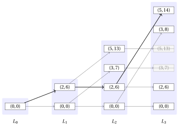

# 17.2.2 A first DP algorithm: An implementation with lists { #1722-an-implementation-with-lists }

**Part 3 · Dynamic programming · Chapter 17** · [:material-book-open-variant: Chapter 17: 0/1 knapsack (KP)](index.md) · [:material-file-pdf-box: Lecture notes, volume 3 (PDF)](../../pdf/lecture-notes-3-dynamic-programming.pdf) · [:material-pencil: Exercises: 0/1 knapsack (KP)](../../exercises/dp-knapsack.md) · [:material-gesture-tap: App: DP table for the knapsack](../../lab/dp-knapsack-table.md)

- <u>Step 1</u>: computation of the optimal value

    - The DP algorithm of this section stores one value for every pair given by an item and a capacity value, that is $(n+1)(c+1)$ values in total. Each row of the matrix ${v}$ is non-decreasing in the capacity value and changes only at a few capacity values: every other cell repeats the value of the cell on its left.

    - This subsection describes a <strong>different implementation of the same DP algorithm</strong>. The recursive decomposition and the optimal substructure are the ones of formula $\eqref{eq:1}$: what changes is the data structure. Instead of a whole row of the matrix, only the pairs at which the row changes are stored, that is only the pairs that are actually obtained by a subset of items. These pairs are kept in a list, one list for each item.

    !!! chiave ""

        A <strong>state</strong> is a pair $(w,p)$, where $w$ is the total weight and $p$ is the total profit of a subset of items whose total weight does not exceed the knapsack capacity $c$.

    - The empty subset gives the state $(0,0)$. A subset of the items $\{1,2,\dots,j\}$ gives a state obtained by summing the weights and the profits of its items.

    - Two different subsets can give the same state. In this case the two subsets are interchangeable: both occupy the same weight in the knapsack and both give the same profit, and therefore it is enough to keep one state.

    - More generally, a state can be discarded whenever another state is at least as good in both components.

        !!! chiave ""

            Given two states $(w,p)$ and $(w',p')$ with $(w,p)\ne(w',p')$, the state $(w,p)$ <strong>dominates</strong> the state $(w',p')$ if

            $$
            w\le w' \qquad \textrm{and} \qquad p\ge p'.
            $$

            A state is <strong>non-dominated</strong> if no other state dominates it.

    - A dominated state can be discarded. Indeed, let $(w,p)$ dominate $(w',p')$ and let $S'$ be a subset of the remaining items that can be added to $(w',p')$ without exceeding the capacity. Since $w\le w'$, the same subset $S'$ can also be added to $(w,p)$, and since $p\ge p'$ the resulting total profit is not smaller. Therefore no optimal solution is lost.

        !!! chiave ""

            For any $j \in \{0,1,\dots,n\}$, let $L_j$ be the list of the non-dominated states of the KP subinstance given by:

            1. a knapsack of capacity $c$,

            2. a set $\{1,2,\dots,j\}$ of available items,

            3. for each item $h \in \{1,2,\dots,j\}$, a profit $p_h$ and a weight $w_h$.

            The states of $L_j$ are sorted by strictly increasing weight.

            The recursive formula to compute $L_j$ reads as follows:

            \begin{equation*}
            \label{eq:4}
            L_j= \left\{ \begin{array}{ll}
            \big\{(0,0)\big\} & \textrm{if $j=0$,}\\[2ex]
            \textrm{nd}\big(L_{j-1}\cup M_j\big) & \textrm{if $1\le j \le n$,}
            \end{array} \right. \tag{17.2}
            \end{equation*}

            where $\textrm{nd}(S)$ denotes the list of the non-dominated states of a set $S$ of states, and

            $$
            M_j=\big\{\,(w+w_j,\;p+p_j)\;:\;(w,p)\in L_{j-1},\ w+w_j\le c\,\big\}.
            $$

    - The recursive decomposition process of formula $\eqref{eq:4}$ generates at most $2$ <strong>independent subproblems</strong> for each state of $L_{j-1}$, corresponding to whether or not to select item $j$. If item $j$ is not selected, the state is unchanged and belongs to $L_{j-1}$. If item $j$ is selected, the state becomes $(w+w_j,p+p_j)$ and belongs to $M_j$; this option is available only when $w+w_j\le c$. Here, $L_0=\{(0,0)\}$ since the only subset of an empty set of items is the empty subset.

    - Hence, every non-dominated state reachable with the items $\{1,2,\dots,j\}$ is built by combining the chosen decision on item $j$ with a non-dominated state reachable with the items $\{1,2,\dots,j-1\}$.

        $\rightsquigarrow$ <strong>Optimal Substructure verified!</strong>

    - Different subsets of the items $\{1,2,\dots,j\}$ can give the same state, and a state can also be dominated by another one. In both cases a single state is kept in $L_j$, and all the subsets that lead to it are treated at once in the following iterations.

        $\rightsquigarrow$ <strong>Overlapping Subproblems verified!</strong>

    - The optimal value of the KP instance is the largest profit stored in the last list.

        !!! chiave ""

            The optimal value of the KP instance is

            \begin{equation*}
            \label{eq:5}
            \max \big\{\, p \;:\; (w,p)\in L_n \,\big\}. \tag{17.3}
            \end{equation*}

    - In a list of non-dominated states sorted by strictly increasing weight, the profits are also strictly increasing: if a state had a weight larger than another one and a profit not larger, it would be dominated. Therefore the maximum of formula $\eqref{eq:5}$ is the profit of the last state of $L_n$.

    - The list $L_j$ holds the information of the row $j$ of the matrix ${v}$ in compressed form:

        $$
        {v}[j][k]=\max\big\{\,p \;:\; (w,p)\in L_j,\ w\le k\,\big\} \qquad \forall k \in \{0,1,\dots,c\}.
        $$

        Every state $(w,p)$ of $L_j$ is a capacity value at which the row increases, and $p$ is the new value.

        

        !!! esempio "Example 17.9: The lists of states"

            We consider the KP instance of Example 1 with a knapsack of capacity $c=5$ and the following profits and weights:

            $$
            \begin{array}{l|rrr}
            \hline  & {j = 1} & {j = 2} & {j = 3} \\
            \hline {p_j} & {6} & {7} & {8} \\
            {w_j} & {2} & {3} & {3} \\
            \hline
            \end{array}
            $$

            Each shaded band collects the states of one list. An arc entering the band of $L_j$ corresponds to the decision taken on item $j$: a horizontal arc means that item $j$ is not selected, while a slanted arc means that item $j$ is selected. The thick arcs give the states of an optimal solution.

            { .fig loading=lazy  }

            The two crossed states of the last band are dominated and are therefore discarded: $(3,7)$ is dominated by $(3,8)$ and $(5,13)$ is dominated by $(5,14)$. Selecting item $3$ from the states $(3,7)$ and $(5,13)$ of $L_2$ would give the total weights $6$ and $8$, which exceed the knapsack capacity $c=5$, and therefore no arc leaves these two states towards the states of $M_3$.

    - The lists are computed for increasing values of $j \in \{1,2,\dots,n\}$, starting from $L_0=\{(0,0)\}$: each list $L_j$ is computed from the already-computed list $L_{j-1}$, until the list $L_n$ is obtained.

    - The list $L_{j-1}$ and the list $M_j$ are both sorted by increasing weight, because $M_j$ is obtained from $L_{j-1}$ by adding the same weight $w_j$ to every state. Therefore the union of formula $\eqref{eq:4}$ is computed by scanning the two lists at the same time, as in the merge of two sorted lists.

    - To describe the scanning order we use the following convention.

        !!! chiave ""

            The state $(w,p)$ <strong>precedes</strong> the state $(w',p')$ if

            $$
            w<w' \qquad \textrm{or} \qquad \textrm{($w=w'$ and $p>p'$)}.
            $$

        - If the states are scanned in this order, a state is non-dominated if and only if its profit is strictly larger than the largest profit of the states already scanned. Indeed, every state already scanned has a weight not larger, and therefore it dominates the current state as soon as its profit is not smaller.

        This is the pseudo-code of the <strong>DP algorithm using lists</strong>:

        !!! algoritmo "Algorithm: DP\_Lists"

            

<strong>Input:</strong> A KP instance given by the number \(n\) of items, arrays \(p[1..n]\) and \(w[1..n]\) of item profits and weights, and the knapsack capacity \(c\)

<strong>Output:</strong> The optimal value of the KP instance

1<strong>Function</strong> DP_Lists(\(n,p,w,c\))

2\(L := \textnormal{new list containing the single state } (0,0)\)

3<strong>for</strong> \(j := 1\) <strong>to</strong> \(n\)  <strong>do</strong>

4\(M := \textnormal{new empty list}\)

5<strong>for</strong> \(h := 1\) <strong>to</strong> \(|L|\)  <strong>do</strong>

6<strong>if</strong> \(L[h].w + w[j] \le c\)  <strong>then</strong>

7append $(L[h].w + w[j],

8L[h].p + p[j])\(to\)M$

9<strong>end</strong>

10<strong>end</strong>

11\(L \leftarrow \textnormal{\tt Merge}(L,M)\)

12<strong>end</strong>

13<strong>return</strong> \(L[|L|].p\)

        This is the pseudo-code of the procedure that merges two lists and discards the dominated states:

        !!! algoritmo "Algorithm: Merge"

            

<strong>Input:</strong> Two lists \(L\) and \(M\) of states, both sorted by increasing weight

<strong>Output:</strong> The list of the non-dominated states of \(L\cup M\), sorted by increasing weight

1<strong>Function</strong> Merge(\(L,M\))

2\(R := \textnormal{new empty list}\)

3\(h := 1\)

4\(k := 1\)

5\(\pi := -1\)

6<strong>while</strong> \(h \le |L|\) <strong>or</strong> \(k \le |M|\)  <strong>do</strong>

7<strong>if</strong> \(k>|M|\) <strong>or</strong> (\(h\le |L|\) <strong>and</strong> \(L[h]\) precedes \(M[k]\))  <strong>then</strong>

8\((a,b) \leftarrow L[h]\)

9\(h \leftarrow h+1\)

10<strong>else</strong>

11\((a,b) \leftarrow M[k]\)

12\(k \leftarrow k+1\)

13<strong>end</strong>

14<strong>if</strong> \(b > \pi\)  <strong>then</strong>

15append \((a,b)\) to \(R\)

16\(\pi \leftarrow b\)

17<strong>end</strong>

18<strong>end</strong>

19<strong>return</strong> \(R\)

        - The list $L$ is the <strong>lookup table</strong>: at the end of the iteration for item $j$, it stores the list $L_j$.

        - The list $L$ is initialized with the single state $(0,0)$, which is the list $L_0$.

        - The outer loop, over items $j \in \{1,2,\dots,n\}$, computes one list for each item.

        - The inner loop builds the list $M$ of the states obtained by selecting item $j$. A state is added to $M$ only when the resulting total weight does not exceed the knapsack capacity.

        - The procedure <code>Merge</code> scans the two lists at the same time and keeps a state only when its profit is strictly larger than the largest profit already appended, which is stored in the auxiliary variable $\pi$. The initial value $\pi=-1$ guarantees that the first scanned state is always appended.

        - Since the states of $L$ are sorted by strictly increasing weight and strictly increasing profit, the largest profit is the one of the last state. Therefore the optimal value of the KP instance is returned as $L[|L|].p$.

        

        !!! esempio "Example 17.10: Execution of the DP algorithm"

            We consider the KP instance of Example 1 with a knapsack of capacity $c=5$ and the following profits and weights:

            $$
            \begin{array}{l|rrr}
            \hline  & {j = 1} & {j = 2} & {j = 3} \\
            \hline {p_j} & {6} & {7} & {8} \\
            {w_j} & {2} & {3} & {3} \\
            \hline
            \end{array}
            $$

            For each item $j$, the table shows the list $M_j$ of the states obtained by selecting item $j$ and the resulting list $L_j$.

            $$
            \begin{array}{c|l|l}
            \hline {j} & {M_j} & {L_j} \\
            \hline {0} & {-} & {\{(0,0)\}} \\
            {1} & {\{(2,6)\}} & {\{(0,0),(2,6)\}} \\
            {2} & {\{(3,7),(5,13)\}} & {\{(0,0),(2,6),(3,7),(5,13)\}} \\
            {3} & {\{(3,8),(5,14)\}} & {\{(0,0),(2,6),(3,8),(5,14)\}} \\
            \hline
            \end{array}
            $$

            For each state scanned by <code>Merge</code>, the table shows the value of $j$, the state, the list it is taken from, and the operation performed.

            
<table>
            <tr>
            <th>\(j\)</th>
            <th>state</th>
            <th>from</th>
            <th>Action</th>
            </tr>
            <tr>
            <td>\(1\)</td>
            <td>\((0,0)\)</td>
            <td>\(L_{0}\)</td>
            <td>\(0>\pi=-1\): append</td>
            </tr>
            <tr>
            <td>\(1\)</td>
            <td>\((2,6)\)</td>
            <td>\(M_1\)</td>
            <td>\(6>\pi=0\): append</td>
            </tr>
            <tr>
            <td>\(2\)</td>
            <td>\((0,0)\)</td>
            <td>\(L_{1}\)</td>
            <td>\(0>\pi=-1\): append</td>
            </tr>
            <tr>
            <td>\(2\)</td>
            <td>\((2,6)\)</td>
            <td>\(L_{1}\)</td>
            <td>\(6>\pi=0\): append</td>
            </tr>
            <tr>
            <td>\(2\)</td>
            <td>\((3,7)\)</td>
            <td>\(M_2\)</td>
            <td>\(7>\pi=6\): append</td>
            </tr>
            <tr>
            <td>\(2\)</td>
            <td>\((5,13)\)</td>
            <td>\(M_2\)</td>
            <td>\(13>\pi=7\): append</td>
            </tr>
            <tr>
            <td>\(3\)</td>
            <td>\((0,0)\)</td>
            <td>\(L_{2}\)</td>
            <td>\(0>\pi=-1\): append</td>
            </tr>
            <tr>
            <td>\(3\)</td>
            <td>\((2,6)\)</td>
            <td>\(L_{2}\)</td>
            <td>\(6>\pi=0\): append</td>
            </tr>
            <tr>
            <td>\(3\)</td>
            <td>\((3,8)\)</td>
            <td>\(M_3\)</td>
            <td>\(8>\pi=6\): append</td>
            </tr>
            <tr>
            <td>\(3\)</td>
            <td>\((3,7)\)</td>
            <td>\(L_{2}\)</td>
            <td>\(7\le\pi=8\): discard (dominated)</td>
            </tr>
            <tr>
            <td>\(3\)</td>
            <td>\((5,14)\)</td>
            <td>\(M_3\)</td>
            <td>\(14>\pi=8\): append</td>
            </tr>
            <tr>
            <td>\(3\)</td>
            <td>\((5,13)\)</td>
            <td>\(L_{2}\)</td>
            <td>\(13\le\pi=14\): discard (dominated)</td>
            </tr>
            </table>

            The last state of $L_3$ is $(5,14)$, and therefore the optimal value of the KP instance is $14$.

    - After the execution of the DP algorithm, the list $L$ contains the non-dominated states $L_n$ of the KP instance, sorted by strictly increasing weight and strictly increasing profit.

- <u>Step 2</u>: computation of an optimal solution

    - To compute an optimal solution, i.e., the binary vector $(x_1,x_2,\dots,x_n)$, it is necessary to store some additional information. The list $L_n$ alone gives the optimal value, but it does not say which items produce the state that attains it.

    - For each item $j$ and each position $h \in \{1,2,\dots,|L_j|\}$, in addition to the state $L_j[h]$, we store two values:

        - ${\sigma}_j[h]$, which is equal to $1$ if item $j$ is selected in the state $L_j[h]$, and is equal to $0$ otherwise;

        - ${\rho}_j[h]$, which is the position in $L_{j-1}$ of the state from which $L_j[h]$ is obtained.

    - A state taken from $L_{j-1}$ gives ${\sigma}_j[h]=0$, while a state taken from $M_j$ gives ${\sigma}_j[h]=1$. In both cases ${\rho}_j[h]$ is the position of the state of $L_{j-1}$ that generated it.

    - The DP algorithm must also keep all the lists $L_0,L_1,\dots,L_n$, and not only the last one, because the reconstruction goes backwards through them.

        

        !!! esempio "Example 17.11: Computation of the additional information"

            We consider the KP instance of Example 1. For each item $j$ and each position $h$, the table shows the state $L_j[h]$ and the stored values ${\sigma}_j[h]$ and ${\rho}_j[h]$.

            $$
            \begin{array}{c|c|c|c|c}
            \hline {j} & {h} & {L_j[h]} & {\sigma_j[h]} & {\rho_j[h]} \\
            \hline {1} & {1} & {(0,0)} & {0} & {1} \\
            {1} & {2} & {(2,6)} & {1} & {1} \\
            \hline {2} & {1} & {(0,0)} & {0} & {1} \\
            {2} & {2} & {(2,6)} & {0} & {2} \\
            {2} & {3} & {(3,7)} & {1} & {1} \\
            {2} & {4} & {(5,13)} & {1} & {2} \\
            \hline {3} & {1} & {(0,0)} & {0} & {1} \\
            {3} & {2} & {(2,6)} & {0} & {2} \\
            {3} & {3} & {(3,8)} & {1} & {1} \\
            {3} & {4} & {(5,14)} & {1} & {2} \\
            \hline
            \end{array}
            $$

            For instance, the state $L_3[4]=(5,14)$ has ${\sigma}_3[4]=1$ and ${\rho}_3[4]=2$: it is obtained by selecting item $3$ from the state $L_2[2]=(2,6)$, since $2+w_3=2+3=5$ and $6+p_3=6+8=14$.

    - Once the lists and the stored values have been computed, an optimal solution is reconstructed by scanning the items from $j=n$ down to $j=1$, starting from the last position $h=|L_n|$, which holds the state of largest profit:

        $$
        \begin{array}{ll}
        x_j \leftarrow {\sigma}_j[h],\quad h \leftarrow {\rho}_j[h] & \textrm{for $j=n,n-1,\dots,1$.}
        \end{array}
        $$

        This yields the vector $(x_1,x_2,\dots,x_n)$, where $x_j$ is equal to $1$ if item $j$ is selected in an optimal solution, and $0$ otherwise.

        !!! algoritmo "Algorithm: DP\_Lists\_Reconstruct"

            

<strong>Input:</strong> The number \(n\) of items, the lists \(L_0,L_1,\dots,L_n\), and the stored values \({\sigma}\) and \({\rho}\)

<strong>Output:</strong> An optimal solution of the KP instance

1<strong>Function</strong> DP_Lists_Reconstruct(\(n,L,\sigma,\rho\))

2\(x := \textnormal{new array}[1..n]\)

3<strong>for</strong> \(j := 1\) <strong>to</strong> \(n\) <strong>do</strong>

4\(x[j] \leftarrow 0\)

5<strong>end</strong>

6\(h := |L_n|\)

7<strong>for</strong> \(j := n\) <strong>to</strong> \(1\) <strong>do</strong>

8\(x[j] \leftarrow {\sigma}_j[h]\)

9\(h \leftarrow {\rho}_j[h]\)

10<strong>end</strong>

11<strong>return</strong> \(x\)

        

        !!! esempio "Example 17.12: Computing an optimal solution"

            After the execution of the DP algorithm on the instance of Example 1, the last list is

            $$
            L_3=\big\{(0,0),(2,6),(3,8),(5,14)\big\}
            $$

            and the optimal value is the profit of its last state, that is $14$.

            We can reconstruct an optimal solution by starting from $j=3$ and $h=|L_3|=4$ as follows:

            
<table>
            <tr>
            <th>Iteration</th>
            <th>\(j\)</th>
            <th>\(h\)</th>
            <th>\(L_j[h]\)</th>
            <th>\({\sigma}_j[h]\)</th>
            <th>\({\rho}_j[h]\)</th>
            <th>\(x[1]\)</th>
            <th>\(x[2]\)</th>
            <th>\(x[3]\)</th>
            <th>Action</th>
            </tr>
            <tr>
            <td>\(-\)</td>
            <td>\(-\)</td>
            <td>\(-\)</td>
            <td>\(-\)</td>
            <td>\(-\)</td>
            <td>\(-\)</td>
            <td>0</td>
            <td>0</td>
            <td>0</td>
            <td>\(h=4\)</td>
            </tr>
            <tr>
            <td>\(1\)</td>
            <td>\(3\)</td>
            <td>\(4\)</td>
            <td>\((5,14)\)</td>
            <td>\(1\)</td>
            <td>\(2\)</td>
            <td>0</td>
            <td>0</td>
            <td class="cella-blu">1</td>
            <td>\(h\leftarrow 2\)</td>
            </tr>
            <tr>
            <td>\(2\)</td>
            <td>\(2\)</td>
            <td>\(2\)</td>
            <td>\((2,6)\)</td>
            <td>\(0\)</td>
            <td>\(2\)</td>
            <td>0</td>
            <td>0</td>
            <td>1</td>
            <td>\(h\leftarrow 2\)</td>
            </tr>
            <tr>
            <td>\(3\)</td>
            <td>\(1\)</td>
            <td>\(2\)</td>
            <td>\((2,6)\)</td>
            <td>\(1\)</td>
            <td>\(1\)</td>
            <td class="cella-blu">1</td>
            <td>0</td>
            <td>1</td>
            <td>\(h\leftarrow 1\)</td>
            </tr>
            </table>

            Thus, the vector

            $$
            (1,0,1)
            $$

            is an optimal solution. The corresponding optimal value is $6+8=14$.

## 17.2.3 Number of steps

- Let $S(n,c)$ denote the number of steps executed by <code>DP\_Lists</code> in the worst case, where $n$ is the number of items and $c$ is the knapsack capacity.

- The states of a list have strictly increasing weights, and every weight belongs to $\{0,1,\dots,c\}$: therefore $|L_j|\le c+1$ for all $j \in \{0,1,\dots,n\}$, and $|M_j|\le|L_{j-1}|$.

- For each item, <code>DP\_Lists</code> scans $L_{j-1}$ once to build $M_j$ and then calls <code>Merge</code>, which scans $|L_{j-1}|+|M_j|\le 2(c+1)$ states and performs a constant number of operations for each of them. Therefore the number of steps executed for each item is $\Theta(c)$ in the worst case, and

    $$
    S(n,c)=\Theta(nc).
    $$

- The three implementations have the same order of growth, but they do not store the same amount of information. The matrix ${v}$ always has $(n+1)(c+1)$ cells, while the lists contain only the states that are actually reachable: a list reaches the bound $c+1$ only when every capacity value is the total weight of a subset of the items. On the KP instance of Example 1 the lists contain $1$, $2$, $4$, and $4$ states, against the $24$ cells of the matrix ${v}$.

- The list $L_j$ also satisfies $|L_j|\le 2^j$, since the items $\{1,2,\dots,j\}$ have $2^j$ subsets. Therefore

    $$
    |L_j|\le \min\big\{2^j,\,c+1\big\},
    $$

    and the number of states stays small while $j$ is small, whatever the knapsack capacity.

---

**Next:** [17.3 A second DP algorithm](a-second-dp-algorithm.md)
