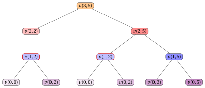

# 17.2 A first DP algorithm

**Part 3 · Dynamic programming · Chapter 17** · [:material-book-open-variant: Chapter 17: KP](index.md) · [:material-file-pdf-box: Lecture notes, volume 3 (PDF)](../../pdf/lecture-notes-3-dynamic-programming.pdf) · [:material-pencil: Exercises: KP](../../exercises/dp-knapsack.md) · [:material-gesture-tap: App: DP table for the knapsack](../../lab/dp-knapsack-table.md)

- <u>Step 1</u>: computation of the optimal value

    !!! chiave ""

        For any $j \in \{0,1,\dots,n\}$ and $k \in \{0,1,\dots,c\}$, let $v(j,k)$ be the optimal value of the KP subinstance given by:

        1. a knapsack of capacity $k$,

        2. a set $\{1,2,\dots,j\}$ of available items,

        3. for each item $h \in \{1,2,\dots,j\}$, a profit $p_h$ and a weight $w_h$.

        The recursive formula to compute $v(j,k)$ reads as follows:

        \begin{equation*}
        \label{eq:1}
        v(j,k)= \left\{ \begin{array}{ll}
        0 & \textrm{if $j=0$ or $k=0$,}\\[2ex]
        v(j-1,k) & \textrm{if $1\le j \le n$, $1\le k \le c$, and $w_j>k$,}\\[2ex]
        \begin{array}[t]{@{}l@{}}\displaystyle \max \bigg\{ v(j-1,k),\\ \qquad p_j+v(j-1,k-w_j) \bigg\}\end{array} & \begin{array}[t]{@{}l@{}}\textrm{if $1\le j \le n$,}\\ \textrm{$1\le k \le c$, $w_j\le k$.}\end{array}
        \end{array} \right. \tag{17.1}
        \end{equation*}

    - The recursive decomposition process of formula $\eqref{eq:1}$ generates at most $2$ <strong>independent subproblems</strong>, corresponding to whether or not to select item $j$ for a knapsack of capacity $k$. If $w_j>k$, item $j$ cannot be selected, and therefore the only feasible option is not to select it. Here, $v(0,k)=0$ since no item is available, and $v(j,0)=0$ since no capacity is available.

    - If $w_j\le k$, the optimal value $v(j,k)$ is obtained by trying the two possible options, selecting or not selecting item $j$, and selecting the one that maximizes the profit. The corresponding values are $p_j+v(j-1,k-w_j)$ and $v(j-1,k)$, respectively. If $w_j>k$, item $j$ cannot be selected, and therefore $v(j,k)=v(j-1,k)$.

    - Hence, an optimal solution for the subinstance with capacity $k$ and available items $\{1,2,\dots,j\}$ is built by combining the chosen decision on item $j$ with an optimal solution of the corresponding residual subproblem.

        $\rightsquigarrow$ <strong>Optimal Substructure verified!</strong>

    - Different sequences of decisions on the items, possibly made for different values of $j$ and $k$, can lead to the same subproblem, and therefore the same value $v(j,k)$ may need to be computed several times during the recursive evaluation of formula $\eqref{eq:1}$.

        $\rightsquigarrow$ <strong>Overlapping Subproblems verified!</strong>

    - A <strong>first method</strong> to compute the optimal value $v(n,c)$ of the KP instance is the <strong>top-down approach</strong>. The method starts from the call with $j=n$ and $k=c$ and evaluates formula $\eqref{eq:1}$ recursively: each call considers item $j$ and either does not select it, or also considers selecting it when it fits. The recursion stops when no items are left or when the residual capacity is equal to $0$.

    - The <strong>recursion tree</strong> of the function $v$ has one node for each recursive call, labeled with the function call it represents. The root represents the initial call. The children of a node represent the recursive calls made by that call. The leaf nodes represent the base cases.

        

        !!! esempio "Example 17.3: Recursion tree"

            We consider the KP instance of Example 1. This is the recursion tree of the top-down approach to compute $v(3,5)$:

            { .fig loading=lazy  }

            The function is called $12$ times, and the same subproblem is solved more than once: $v(1,2)$ is called $2$ times (shown with a red border), and so are $v(0,2)$ and $v(0,0)$.

    - The value $v(j,k)$ can be computed once the values required by the right-hand side of formula $\eqref{eq:1}$ are known. In particular, ${v}(j-1,k)$ is needed when item $j$ is not selected and, if $w_j\le k$, ${v}(j-1,k-w_j)$ is needed when item $j$ is selected. Therefore, for a fixed value of $j$, all values $v(j,k)$ can be computed by considering the capacity values $k$ in increasing order.

        

        !!! esempio "Example 17.4: Computing the values of the $v$ function"

            We consider the KP instance of Example 1 with a knapsack of capacity $c=5$ and the following profits and weights:

            $$
            \begin{array}{l|rrr}
            \hline  & {j = 1} & {j = 2} & {j = 3} \\
            \hline {p_j} & {6} & {7} & {8} \\
            {w_j} & {2} & {3} & {3} \\
            \hline
            \end{array}
            $$

            The values of the function $v$ are computed as follows:

            - The base cases give $v(0,k)=0$ for all $k \ge 0$.

            - Once we have computed the base cases, we can compute $v(1,2)$:

                $$
                v(1,2) = \max\{v(0,2),\, v(0,0)+p_1\} = \max\{0,\, 0+6\} = 6
                $$

            - We can also compute $v(1,5)$:

                $$
                v(1,5) = \max\{v(0,5),\, v(0,3)+p_1\} = \max\{0,\, 0+6\} = 6
                $$

            - Since $w_2=3 > k=2$, item $2$ cannot fit, so:

                $$
                v(2,2) = v(1,2) = 6
                $$

            - Once we have computed $v(1,2)$ and $v(1,5)$, we can compute $v(2,5)$:

                $$
                v(2,5) = \max\{v(1,5),\, v(1,2)+p_2\} = \max\{6,\, 6+7\} = 13
                $$

            - Once we have computed $v(2,5)$ and $v(2,2)$, we can compute $v(3,5)$:

                $$
                v(3,5) = \max\{v(2,5),\, v(2,2)+p_3\} = \max\{13,\, 6+8\} = 14
                $$

    - We can avoid solving the same subproblems repeatedly by storing the value of each subproblem as soon as it is computed. The values are stored in a <strong>lookup table</strong>.

    - Since solving any particular subproblem depends only on subproblems with a smaller value of $j$, we can solve the subproblems in increasing order of $j$ and, for each fixed value of $j$, in increasing order of capacity, starting from the base cases $v(0,k)=0$ and $v(j,0)=0$ and building up to $v(n,c)$: this observation naturally leads to a <strong>much more efficient method</strong> to compute the optimal value $v(n,c)$ of the KP instance.

    - A <strong>second method</strong> to compute the optimal value $v(n,c)$ of the KP instance is the <strong>bottom-up approach</strong>. The method starts from the base cases and evaluates formula $\eqref{eq:1}$ for increasing values of $j \in \{1,2,\dots,n\}$ and $k \in \{0,1,\dots,c\}$: each value $v(j,k)$ is computed using already-computed values, until the value $v(n,c)$ of the KP instance is obtained.

        This is the pseudo-code of the <strong>DP algorithm using the bottom-up approach</strong>:

        !!! algoritmo "Algorithm: DP"

            

<strong>Input:</strong> A KP instance given by the number \(n\) of items, arrays \(p[1..n]\) and \(w[1..n]\) of item profits and weights, and the knapsack capacity \(c\)

<strong>Output:</strong> The optimal value of the KP instance

1<strong>Function</strong> DP(\(n,p,w,c\))

2\({v} := \textnormal{new array}[0..n][0..c]\)

3<strong>for</strong> \(k := 0\) <strong>to</strong> \(c\)  <strong>do</strong>

4\({v}[0][k] \leftarrow 0\)

5<strong>end</strong>

6<strong>for</strong> \(j := 1\) <strong>to</strong> \(n\)  <strong>do</strong>

7<strong>for</strong> \(k := 0\) <strong>to</strong> \(c\)  <strong>do</strong>

8<strong>if</strong> \(k < w[j]\)  <strong>then</strong>

9\({v}[j][k] \leftarrow {v}[j-1][k]\)

10<strong>else</strong>

11<strong>if</strong> \({v}[j-1][k-w[j]] + p[j] > {v}[j-1][k]\)  <strong>then</strong>

12\({v}[j][k] \leftarrow {v}[j-1][k-w[j]] + p[j]\)

13<strong>else</strong>

14\({v}[j][k] \leftarrow {v}[j-1][k]\)

15<strong>end</strong>

16<strong>end</strong>

17<strong>end</strong>

18<strong>end</strong>

19<strong>return</strong> \({v}[n][c]\)

        - The matrix ${v}[0..n][0..c]$ is the <strong>lookup table</strong>: it stores the optimal values of all subproblems.

        - The first loop initializes the values ${v}[0][k]=0$ for all capacities $k \in \{0,1,\dots,c\}$, corresponding to the case in which no item is available.

        - The outer loop, over items $j \in \{1,2,\dots,n\}$, computes the rows of the matrix in increasing order of $j$.

        - The inner loop, over $k \in \{0,1,\dots,c\}$, computes the optimal value ${v}[j][k]$ for each capacity $k$.

        - If item $j$ does not fit, then ${v}[j][k] \leftarrow {v}[j-1][k]$.

        - Otherwise, the DP algorithm compares the value obtained by not selecting item $j$, namely ${v}[j-1][k]$, with the value obtained by selecting item $j$, namely $p[j]+{v}[j-1][k-w[j]]$.

        - Finally, the optimal value of the KP instance is returned as ${v}[n][c]$.

        

        !!! esempio "Example 17.5: Execution of the DP algorithm"

            We consider the KP instance of Example 1 with a knapsack of capacity $c=5$ and the following profits and weights:

            $$
            \begin{array}{l|rrr}
            \hline  & {j = 1} & {j = 2} & {j = 3} \\
            \hline {p_j} & {6} & {7} & {8} \\
            {w_j} & {2} & {3} & {3} \\
            \hline
            \end{array}
            $$

            For each step of the DP algorithm, the table shows the values of $j$ and $k$, the cell ${v}[j][k]$, and the operation performed.

            
<table>
            <tr>
            <th>\(j\)</th>
            <th>\(k\)</th>
            <th>\({v}[j][k]\)</th>
            <th>Action</th>
            </tr>
            <tr>
            <td>\(0\)</td>
            <td>\(0\)</td>
            <td>\(0\)</td>
            <td>\({v}[0][0]\leftarrow 0\)</td>
            </tr>
            <tr>
            <td>\(0\)</td>
            <td>\(1\)</td>
            <td>\(0\)</td>
            <td>\({v}[0][1]\leftarrow 0\)</td>
            </tr>
            <tr>
            <td>\(0\)</td>
            <td>\(2\)</td>
            <td>\(0\)</td>
            <td>\({v}[0][2]\leftarrow 0\)</td>
            </tr>
            <tr>
            <td>\(0\)</td>
            <td>\(3\)</td>
            <td>\(0\)</td>
            <td>\({v}[0][3]\leftarrow 0\)</td>
            </tr>
            <tr>
            <td>\(0\)</td>
            <td>\(4\)</td>
            <td>\(0\)</td>
            <td>\({v}[0][4]\leftarrow 0\)</td>
            </tr>
            <tr>
            <td>\(0\)</td>
            <td>\(5\)</td>
            <td>\(0\)</td>
            <td>\({v}[0][5]\leftarrow 0\)</td>
            </tr>
            <tr>
            <td>\(1\)</td>
            <td>\(0\)</td>
            <td>\(0\)</td>
            <td>\({v}[1][0]\leftarrow {v}[0][0]=0\)</td>
            </tr>
            <tr>
            <td>\(1\)</td>
            <td>\(1\)</td>
            <td>\(0\)</td>
            <td>\({v}[1][1]\leftarrow {v}[0][1]=0\)</td>
            </tr>
            <tr>
            <td>\(1\)</td>
            <td>\(2\)</td>
            <td>\(6\)</td>
            <td>\(\max\{{v}[0][2],p[1]+{v}[0][0]\}=\max\{0,6+0\}=6\)</td>
            </tr>
            <tr>
            <td>\(1\)</td>
            <td>\(3\)</td>
            <td>\(6\)</td>
            <td>\(\max\{{v}[0][3],p[1]+{v}[0][1]\}=\max\{0,6+0\}=6\)</td>
            </tr>
            <tr>
            <td>\(1\)</td>
            <td>\(4\)</td>
            <td>\(6\)</td>
            <td>\(\max\{{v}[0][4],p[1]+{v}[0][2]\}=\max\{0,6+0\}=6\)</td>
            </tr>
            <tr>
            <td>\(1\)</td>
            <td>\(5\)</td>
            <td>\(6\)</td>
            <td>\(\max\{{v}[0][5],p[1]+{v}[0][3]\}=\max\{0,6+0\}=6\)</td>
            </tr>
            <tr>
            <td>\(2\)</td>
            <td>\(0\)</td>
            <td>\(0\)</td>
            <td>\({v}[2][0]\leftarrow {v}[1][0]=0\)</td>
            </tr>
            <tr>
            <td>\(2\)</td>
            <td>\(1\)</td>
            <td>\(0\)</td>
            <td>\({v}[2][1]\leftarrow {v}[1][1]=0\)</td>
            </tr>
            <tr>
            <td>\(2\)</td>
            <td>\(2\)</td>
            <td>\(6\)</td>
            <td>\({v}[2][2]\leftarrow {v}[1][2]=6\)</td>
            </tr>
            <tr>
            <td>\(2\)</td>
            <td>\(3\)</td>
            <td>\(7\)</td>
            <td>\(\max\{{v}[1][3],p[2]+{v}[1][0]\}=\max\{6,7+0\}=7\)</td>
            </tr>
            <tr>
            <td>\(2\)</td>
            <td>\(4\)</td>
            <td>\(7\)</td>
            <td>\(\max\{{v}[1][4],p[2]+{v}[1][1]\}=\max\{6,7+0\}=7\)</td>
            </tr>
            <tr>
            <td>\(2\)</td>
            <td>\(5\)</td>
            <td>\(13\)</td>
            <td>\(\max\{{v}[1][5],p[2]+{v}[1][2]\}=\max\{6,7+6\}=13\)</td>
            </tr>
            <tr>
            <td>\(3\)</td>
            <td>\(0\)</td>
            <td>\(0\)</td>
            <td>\({v}[3][0]\leftarrow {v}[2][0]=0\)</td>
            </tr>
            <tr>
            <td>\(3\)</td>
            <td>\(1\)</td>
            <td>\(0\)</td>
            <td>\({v}[3][1]\leftarrow {v}[2][1]=0\)</td>
            </tr>
            <tr>
            <td>\(3\)</td>
            <td>\(2\)</td>
            <td>\(6\)</td>
            <td>\({v}[3][2]\leftarrow {v}[2][2]=6\)</td>
            </tr>
            <tr>
            <td>\(3\)</td>
            <td>\(3\)</td>
            <td>\(8\)</td>
            <td>\(\max\{{v}[2][3],p[3]+{v}[2][0]\}=\max\{7,8+0\}=8\)</td>
            </tr>
            <tr>
            <td>\(3\)</td>
            <td>\(4\)</td>
            <td>\(8\)</td>
            <td>\(\max\{{v}[2][4],p[3]+{v}[2][1]\}=\max\{7,8+0\}=8\)</td>
            </tr>
            <tr>
            <td>\(3\)</td>
            <td>\(5\)</td>
            <td>\(14\)</td>
            <td>\(\max\{{v}[2][5],p[3]+{v}[2][2]\}=\max\{13,8+6\}=14\)</td>
            </tr>
            </table>

            After the execution of the DP algorithm, this is the matrix ${v}$:

            $$
            \begin{array}{l|rrrrrr}
            \hline {{v}[j][k]} & {k=0} & {k=1} & {k=2} & {k=3} & {k=4} & {k=5} \\
            \hline {j=0} & 0 & 0 & 0 & 0 & 0 & 0 \\
            {j=1} & 0 & 0 & 6 & 6 & 6 & 6 \\
            {j=2} & 0 & 0 & 6 & 7 & 7 & 13 \\
            {j=3} & 0 & 0 & 6 & 8 & 8 & 14 \\
            \hline
            \end{array}
            $$

    - After the execution of the DP algorithm, the matrix ${v}$ contains the optimal value ${v}[j][k]=v(j,k)$ for every item $j \in \{0,1,\dots,n\}$ and every capacity value $k \in \{0,1,\dots,c\}$.

    - The DP algorithm computes the row $j$ of the matrix ${v}$ using only the row $j-1$. Therefore, when only the optimal value of the KP instance is required, it is not necessary to store the whole matrix: a single vector ${v}[0..c]$ is sufficient, which uses $c+1$ cells instead of the $(n+1)(c+1)$ cells of the matrix.

    - The vector is initialized with the base cases ${v}[k]=0$ for all $k \in \{0,1,\dots,c\}$, which correspond to the row $j=0$ of the matrix. Then, for each item $j \in \{1,2,\dots,n\}$, the vector is updated so that it contains the row $j$ of the matrix.

    - The order in which the cells are updated is essential. When the cell ${v}[k]$ is updated for item $j$, the value ${v}[k-w_j]$ must still be the one of the row $j-1$, that is $v(j-1,k-w_j)$. Since $k-w_j<k$, this is guaranteed if the capacity values are considered in <strong>decreasing</strong> order $k=c,c-1,\dots,w_j$: when the cell $k$ is updated, the cell $k-w_j$ has not been updated yet during the current pass.

    - If the capacity values were considered in increasing order, the value ${v}[k-w_j]$ would already be the one of the row $j$, that is $v(j,k-w_j)$, and item $j$ could be selected more than once, which is not allowed in the KP.

    - For every capacity value $k<w_j$, item $j$ does not fit and therefore ${v}[k]$ must keep the value $v(j-1,k)$: no update is performed, and the inner loop can stop at $k=w_j$.

        This is the pseudo-code of the <strong>DP algorithm using a single vector</strong>:

        !!! algoritmo "Algorithm: DP\_Vector"

            

<strong>Input:</strong> A KP instance given by the number \(n\) of items, arrays \(p[1..n]\) and \(w[1..n]\) of item profits and weights, and the knapsack capacity \(c\)

<strong>Output:</strong> The optimal value of the KP instance

1<strong>Function</strong> DP_Vector(\(n,p,w,c\))

2\({v} := \textnormal{new array}[0..c]\)

3<strong>for</strong> \(k := 0\) <strong>to</strong> \(c\)  <strong>do</strong>

4\({v}[k] \leftarrow 0\)

5<strong>end</strong>

6<strong>for</strong> \(j := 1\) <strong>to</strong> \(n\)  <strong>do</strong>

7<strong>for</strong> \(k := c\) <strong>to</strong> \(w[j]\)  <strong>do</strong>

8<strong>if</strong> \(p[j] + {v}[k-w[j]] > {v}[k]\)  <strong>then</strong>

9\({v}[k] \leftarrow p[j] + {v}[k-w[j]]\)

10<strong>end</strong>

11<strong>end</strong>

12<strong>end</strong>

13<strong>return</strong> \({v}[c]\)

        - The vector ${v}[0..c]$ is the <strong>lookup table</strong>: at the end of the pass for item $j$, it stores the row $j$ of the matrix ${v}$ of the DP algorithm.

        - The first loop initializes the values ${v}[k]=0$ for all capacities $k \in \{0,1,\dots,c\}$, corresponding to the case in which no item is available.

        - The outer loop, over items $j \in \{1,2,\dots,n\}$, performs one pass of the vector for each item.

        - The inner loop, over $k \in \{w[j],w[j]+1,\dots,c\}$, considers the capacity values in decreasing order, so that the cells that are still needed with their previous value are not yet modified.

        - The condition compares the value obtained by not selecting item $j$, namely the current value ${v}[k]$, with the value obtained by selecting item $j$, namely $p[j]+{v}[k-w[j]]$. The cell is updated only when selecting item $j$ is strictly better.

        - Finally, the optimal value of the KP instance is returned as ${v}[c]$.

        

        !!! esempio "Example 17.6: Execution of the DP algorithm using a single vector"

            We consider the KP instance of Example 1 with a knapsack of capacity $c=5$ and the following profits and weights:

            $$
            \begin{array}{l|rrr}
            \hline  & {j = 1} & {j = 2} & {j = 3} \\
            \hline {p_j} & {6} & {7} & {8} \\
            {w_j} & {2} & {3} & {3} \\
            \hline
            \end{array}
            $$

            The first loop initializes ${v}[k]=0$ for all $k \in \{0,1,\dots,5\}$. For each step of the two nested loops, the table shows the values of $j$ and $k$, the cell ${v}[k]$ after the step, and the operation performed.

            
<table>
            <tr>
            <th>\(j\)</th>
            <th>\(k\)</th>
            <th>\({v}[k]\)</th>
            <th>Action</th>
            </tr>
            <tr>
            <td>\(1\)</td>
            <td>\(5\)</td>
            <td>\(6\)</td>
            <td>\(p[1]+{v}[3]=6+0>{v}[5]=0\): \({v}[5]\leftarrow 6\)</td>
            </tr>
            <tr>
            <td>\(1\)</td>
            <td>\(4\)</td>
            <td>\(6\)</td>
            <td>\(p[1]+{v}[2]=6+0>{v}[4]=0\): \({v}[4]\leftarrow 6\)</td>
            </tr>
            <tr>
            <td>\(1\)</td>
            <td>\(3\)</td>
            <td>\(6\)</td>
            <td>\(p[1]+{v}[1]=6+0>{v}[3]=0\): \({v}[3]\leftarrow 6\)</td>
            </tr>
            <tr>
            <td>\(1\)</td>
            <td>\(2\)</td>
            <td>\(6\)</td>
            <td>\(p[1]+{v}[0]=6+0>{v}[2]=0\): \({v}[2]\leftarrow 6\)</td>
            </tr>
            <tr>
            <td>\(2\)</td>
            <td>\(5\)</td>
            <td>\(13\)</td>
            <td>\(p[2]+{v}[2]=7+6>{v}[5]=6\): \({v}[5]\leftarrow 13\)</td>
            </tr>
            <tr>
            <td>\(2\)</td>
            <td>\(4\)</td>
            <td>\(7\)</td>
            <td>\(p[2]+{v}[1]=7+0>{v}[4]=6\): \({v}[4]\leftarrow 7\)</td>
            </tr>
            <tr>
            <td>\(2\)</td>
            <td>\(3\)</td>
            <td>\(7\)</td>
            <td>\(p[2]+{v}[0]=7+0>{v}[3]=6\): \({v}[3]\leftarrow 7\)</td>
            </tr>
            <tr>
            <td>\(3\)</td>
            <td>\(5\)</td>
            <td>\(14\)</td>
            <td>\(p[3]+{v}[2]=8+6>{v}[5]=13\): \({v}[5]\leftarrow 14\)</td>
            </tr>
            <tr>
            <td>\(3\)</td>
            <td>\(4\)</td>
            <td>\(8\)</td>
            <td>\(p[3]+{v}[1]=8+0>{v}[4]=7\): \({v}[4]\leftarrow 8\)</td>
            </tr>
            <tr>
            <td>\(3\)</td>
            <td>\(3\)</td>
            <td>\(8\)</td>
            <td>\(p[3]+{v}[0]=8+0>{v}[3]=7\): \({v}[3]\leftarrow 8\)</td>
            </tr>
            </table>

            This is the content of the vector ${v}$ after the initialization and after each pass of the outer loop:

            
<table>
            <tr>
            <td>\({v}[k]\)</td>
            <td>\(0\)</td>
            <td>\(1\)</td>
            <td>\(2\)</td>
            <td>\(3\)</td>
            <td>\(4\)</td>
            <td>\(5\)</td>
            </tr>
            <tr>
            <td>initialization</td>
            <td>0</td>
            <td>0</td>
            <td>0</td>
            <td>0</td>
            <td>0</td>
            <td>0</td>
            </tr>
            <tr>
            <td>pass \(j=1\)</td>
            <td>0</td>
            <td>0</td>
            <td>6</td>
            <td>6</td>
            <td>6</td>
            <td>6</td>
            </tr>
            <tr>
            <td>pass \(j=2\)</td>
            <td>0</td>
            <td>0</td>
            <td>6</td>
            <td>7</td>
            <td>7</td>
            <td>13</td>
            </tr>
            <tr>
            <td>pass \(j=3\)</td>
            <td>0</td>
            <td>0</td>
            <td>6</td>
            <td>8</td>
            <td>8</td>
            <td>14</td>
            </tr>
            </table>

            Each pass transforms the vector ${v}$ from the row $j-1$ into the row $j$ of the matrix ${v}$ reported in [Example 17.5](#box-17-texkpbu). The optimal value of the KP instance is ${v}[5]=14$.

    - The vector version computes only the optimal value of the KP instance. The information needed to construct an optimal solution, which is described in Step 2, records the decision taken for every item $j$ and every capacity value $k$, and therefore cannot be stored in a single vector.

- <u>Step 2</u>: computation of an optimal solution

    - To compute an optimal solution, i.e., the binary vector $(x_1,x_2,\dots,x_n)$, it is necessary to store some additional information.

    - For each item $j$ and capacity value $k$, in addition to the optimal value ${v}[j][k]$, we store ${s}[j][k]$, which tells whether item $j$ is selected in an optimal solution for the subproblem restricted to items $\{1,2,\dots,j\}$ and capacity $k$.

    - More precisely, ${s}[j][k]$ is equal to $1$ if item $j$ is selected when computing the value ${v}[j][k]$, and it is equal to $0$ otherwise.

        This is the pseudo-code of the <strong>DP algorithm using the bottom-up approach</strong> with the storing of the information necessary to construct an optimal solution:

        !!! algoritmo "Algorithm: DP\_InfoSol"

            

<strong>Input:</strong> A KP instance given by the number \(n\) of items, arrays \(p[1..n]\) and \(w[1..n]\) of item profits and weights, and the knapsack capacity \(c\)

<strong>Output:</strong> The optimal value of the KP instance and the matrix of binary information \({s}[0..n][0..c]\)

1<strong>Function</strong> DP_InfoSol(\(n,p,w,c\))

2\({v} := \textnormal{new array}[0..n][0..c]\)

3\({s} := \textnormal{new array}[0..n][0..c]\)

4<strong>for</strong> \(k := 0\) <strong>to</strong> \(c\) <strong>do</strong>

5\({v}[0][k] \leftarrow 0\)

6\({s}[0][k] \leftarrow 0\)

7<strong>end</strong>

8<strong>for</strong> \(j := 1\) <strong>to</strong> \(n\) <strong>do</strong>

9<strong>for</strong> \(k := 0\) <strong>to</strong> \(c\) <strong>do</strong>

10<strong>if</strong> \(k < w[j]\) <strong>then</strong>

11\({v}[j][k] \leftarrow {v}[j-1][k]\)

12\({s}[j][k] \leftarrow 0\)

13<strong>else</strong>

14<strong>if</strong> \({v}[j-1][k-w[j]] + p[j] > {v}[j-1][k]\) <strong>then</strong>

15\({v}[j][k] \leftarrow {v}[j-1][k-w[j]] + p[j]\)

16\({s}[j][k] \leftarrow 1\)

17<strong>else</strong>

18\({v}[j][k] \leftarrow {v}[j-1][k]\)

19\({s}[j][k] \leftarrow 0\)

20<strong>end</strong>

21<strong>end</strong>

22<strong>end</strong>

23<strong>end</strong>

24<strong>return</strong> \({v}[n][c], {s}\)

        - The DP algorithm uses the additional matrix ${s}$, which keeps track of the decision made when ${v}[j][k]$ is computed. If item $j$ is selected, ${s}[j][k]\leftarrow 1$ stores this decision; otherwise, ${s}[j][k]\leftarrow 0$ stores that item $j$ is not selected.

        

        !!! esempio "Example 17.7: Computation of the additional information"

            We consider the KP instance of Example 1 with a knapsack of capacity $c=5$ and the following profits and weights:

            $$
            \begin{array}{l|rrr}
            \hline  & {j = 1} & {j = 2} & {j = 3} \\
            \hline {p_j} & {6} & {7} & {8} \\
            {w_j} & {2} & {3} & {3} \\
            \hline
            \end{array}
            $$

            For each step of the DP algorithm, the table shows the values of $j$ and $k$, the cell ${s}[j][k]$, and the operation performed.

            
<table>
            <tr>
            <th>\(j\)</th>
            <th>\(k\)</th>
            <th>\({s}[j][k]\)</th>
            <th>Action</th>
            </tr>
            <tr>
            <td>\(0\)</td>
            <td>\(0\)</td>
            <td>\(0\)</td>
            <td>\({s}[0][0]\leftarrow 0\)</td>
            </tr>
            <tr>
            <td>\(0\)</td>
            <td>\(1\)</td>
            <td>\(0\)</td>
            <td>\({s}[0][1]\leftarrow 0\)</td>
            </tr>
            <tr>
            <td>\(0\)</td>
            <td>\(2\)</td>
            <td>\(0\)</td>
            <td>\({s}[0][2]\leftarrow 0\)</td>
            </tr>
            <tr>
            <td>\(0\)</td>
            <td>\(3\)</td>
            <td>\(0\)</td>
            <td>\({s}[0][3]\leftarrow 0\)</td>
            </tr>
            <tr>
            <td>\(0\)</td>
            <td>\(4\)</td>
            <td>\(0\)</td>
            <td>\({s}[0][4]\leftarrow 0\)</td>
            </tr>
            <tr>
            <td>\(0\)</td>
            <td>\(5\)</td>
            <td>\(0\)</td>
            <td>\({s}[0][5]\leftarrow 0\)</td>
            </tr>
            <tr>
            <td>\(1\)</td>
            <td>\(0\)</td>
            <td>\(0\)</td>
            <td>\(0<2\): \({s}[1][0]\leftarrow 0\)</td>
            </tr>
            <tr>
            <td>\(1\)</td>
            <td>\(1\)</td>
            <td>\(0\)</td>
            <td>\(1<2\): \({s}[1][1]\leftarrow 0\)</td>
            </tr>
            <tr>
            <td>\(1\)</td>
            <td>\(2\)</td>
            <td>\(1\)</td>
            <td>\(p[1]+{v}[0][0]=6+0>{v}[0][2]=0\): \({s}[1][2]\leftarrow 1\)</td>
            </tr>
            <tr>
            <td>\(1\)</td>
            <td>\(3\)</td>
            <td>\(1\)</td>
            <td>\(p[1]+{v}[0][1]=6+0>{v}[0][3]=0\): \({s}[1][3]\leftarrow 1\)</td>
            </tr>
            <tr>
            <td>\(1\)</td>
            <td>\(4\)</td>
            <td>\(1\)</td>
            <td>\(p[1]+{v}[0][2]=6+0>{v}[0][4]=0\): \({s}[1][4]\leftarrow 1\)</td>
            </tr>
            <tr>
            <td>\(1\)</td>
            <td>\(5\)</td>
            <td>\(1\)</td>
            <td>\(p[1]+{v}[0][3]=6+0>{v}[0][5]=0\): \({s}[1][5]\leftarrow 1\)</td>
            </tr>
            <tr>
            <td>\(2\)</td>
            <td>\(0\)</td>
            <td>\(0\)</td>
            <td>\(0<3\): \({s}[2][0]\leftarrow 0\)</td>
            </tr>
            <tr>
            <td>\(2\)</td>
            <td>\(1\)</td>
            <td>\(0\)</td>
            <td>\(1<3\): \({s}[2][1]\leftarrow 0\)</td>
            </tr>
            <tr>
            <td>\(2\)</td>
            <td>\(2\)</td>
            <td>\(0\)</td>
            <td>\(2<3\): \({s}[2][2]\leftarrow 0\)</td>
            </tr>
            <tr>
            <td>\(2\)</td>
            <td>\(3\)</td>
            <td>\(1\)</td>
            <td>\(p[2]+{v}[1][0]=7+0>{v}[1][3]=6\): \({s}[2][3]\leftarrow 1\)</td>
            </tr>
            <tr>
            <td>\(2\)</td>
            <td>\(4\)</td>
            <td>\(1\)</td>
            <td>\(p[2]+{v}[1][1]=7+0>{v}[1][4]=6\): \({s}[2][4]\leftarrow 1\)</td>
            </tr>
            <tr>
            <td>\(2\)</td>
            <td>\(5\)</td>
            <td>\(1\)</td>
            <td>\(p[2]+{v}[1][2]=7+6>{v}[1][5]=6\): \({s}[2][5]\leftarrow 1\)</td>
            </tr>
            <tr>
            <td>\(3\)</td>
            <td>\(0\)</td>
            <td>\(0\)</td>
            <td>\(0<3\): \({s}[3][0]\leftarrow 0\)</td>
            </tr>
            <tr>
            <td>\(3\)</td>
            <td>\(1\)</td>
            <td>\(0\)</td>
            <td>\(1<3\): \({s}[3][1]\leftarrow 0\)</td>
            </tr>
            <tr>
            <td>\(3\)</td>
            <td>\(2\)</td>
            <td>\(0\)</td>
            <td>\(2<3\): \({s}[3][2]\leftarrow 0\)</td>
            </tr>
            <tr>
            <td>\(3\)</td>
            <td>\(3\)</td>
            <td>\(1\)</td>
            <td>\(p[3]+{v}[2][0]=8+0>{v}[2][3]=7\): \({s}[3][3]\leftarrow 1\)</td>
            </tr>
            <tr>
            <td>\(3\)</td>
            <td>\(4\)</td>
            <td>\(1\)</td>
            <td>\(p[3]+{v}[2][1]=8+0>{v}[2][4]=7\): \({s}[3][4]\leftarrow 1\)</td>
            </tr>
            <tr>
            <td>\(3\)</td>
            <td>\(5\)</td>
            <td>\(1\)</td>
            <td>\(p[3]+{v}[2][2]=8+6>{v}[2][5]=13\): \({s}[3][5]\leftarrow 1\)</td>
            </tr>
            </table>

            This is the matrix ${s}$ after the execution of the DP algorithm:

            $$
            \begin{array}{l|rrrrrr}
            \hline {{s}[j][k]} & {k=0} & {k=1} & {k=2} & {k=3} & {k=4} & {k=5} \\
            \hline {j=0} & 0 & 0 & 0 & 0 & 0 & 0 \\
            {j=1} & 0 & 0 & 1 & 1 & 1 & 1 \\
            {j=2} & 0 & 0 & 0 & 1 & 1 & 1 \\
            {j=3} & 0 & 0 & 0 & 1 & 1 & 1 \\
            \hline
            \end{array}
            $$

    - Once the matrix ${s}$ has been computed, an optimal solution can be reconstructed by scanning the items from $j=n$ down to $j=1$, starting from capacity $k=c$ and $x_j=0$ for all $j \in \{1,2,\dots,n\}$:

        $$
        \begin{array}{ll}
        x_j \leftarrow 1,\quad k \leftarrow k-w_j & \textrm{if ${s}[j][k]=1$,}\\[1ex]
        x_j \leftarrow 0 & \textrm{if ${s}[j][k]=0$.}
        \end{array}
        $$

        This yields the vector $(x_1,x_2,\dots,x_n)$, where $x_j$ is equal to $1$ if item $j$ is selected in an optimal solution, and $0$ otherwise.

        !!! algoritmo "Algorithm: DP\_Reconstruct"

            

<strong>Input:</strong> The number \(n\) of items, the knapsack capacity \(c\), the array \(w[1..n]\) of item weights, and the matrix \({s}[0..n][0..c]\)

<strong>Output:</strong> An optimal solution of the KP instance

1<strong>Function</strong> DP_Reconstruct(\(n,c,w,s\))

2\(x := \textnormal{new array}[1..n]\)

3<strong>for</strong> \(j := 1\) <strong>to</strong> \(n\) <strong>do</strong>

4\(x[j] \leftarrow 0\)

5<strong>end</strong>

6\(k := c\)

7<strong>for</strong> \(j := n\) <strong>to</strong> \(1\) <strong>do</strong>

8<strong>if</strong> \({s}[j][k] = 1\) <strong>then</strong>

9\(x[j] \leftarrow 1\)

10\(k \leftarrow k-w[j]\)

11<strong>end</strong>

12<strong>end</strong>

13<strong>return</strong> \(x\)

        

        !!! esempio "Example 17.8: Computing an optimal solution"

            After the execution of the DP algorithm on the instance of Example 1, we have the following matrix ${s}$:

            $$
            \begin{array}{l|rrrrrr}
            \hline {{s}[j][k]} & {k=0} & {k=1} & {k=2} & {k=3} & {k=4} & {k=5} \\
            \hline {j=0} & 0 & 0 & 0 & 0 & 0 & 0 \\
            {j=1} & 0 & 0 & 1 & 1 & 1 & 1 \\
            {j=2} & 0 & 0 & 0 & 1 & 1 & 1 \\
            {j=3} & 0 & 0 & 0 & 1 & 1 & 1 \\
            \hline
            \end{array}
            $$

            We can reconstruct an optimal solution by starting from $j=3$ and $k=5$ as follows:

            
<table>
            <tr>
            <th>Iteration</th>
            <th>\(j\)</th>
            <th>\(k\)</th>
            <th>\({s}[j][k]\)</th>
            <th>\(x[1]\)</th>
            <th>\(x[2]\)</th>
            <th>\(x[3]\)</th>
            <th>Action</th>
            </tr>
            <tr>
            <td>\(-\)</td>
            <td>\(-\)</td>
            <td>\(-\)</td>
            <td>\(-\)</td>
            <td>0</td>
            <td>0</td>
            <td>0</td>
            <td>\(k=5\)</td>
            </tr>
            <tr>
            <td>\(1\)</td>
            <td>\(3\)</td>
            <td>\(5\)</td>
            <td>\(1\)</td>
            <td>0</td>
            <td>0</td>
            <td class="cella-blu">1</td>
            <td>\(k\leftarrow 5-3=2\)</td>
            </tr>
            <tr>
            <td>\(2\)</td>
            <td>\(2\)</td>
            <td>\(2\)</td>
            <td>\(0\)</td>
            <td>0</td>
            <td>0</td>
            <td>1</td>
            <td>no update</td>
            </tr>
            <tr>
            <td>\(3\)</td>
            <td>\(1\)</td>
            <td>\(2\)</td>
            <td>\(1\)</td>
            <td class="cella-blu">1</td>
            <td>0</td>
            <td>1</td>
            <td>\(k\leftarrow 2-2=0\)</td>
            </tr>
            </table>

            Thus, the vector

            $$
            (1,0,1)
            $$

            is an optimal solution. The corresponding optimal value is $6+8=14$.

## 17.2.1 Number of steps

- Let $S(n,c)$ denote the number of steps executed by <code>DP</code> in the worst case, where $n$ is the number of items and $c$ is the knapsack capacity. We compute $S(n,c)$ by counting how many times the lines of the pseudo-code of <code>DP</code> are executed.

- In the worst case, the condition at line [11](#box-13-kpbu-h) is checked whenever the item fits. Since the item weights are positive integers, this happens at most $nc$ times. The number of executions of the relevant lines is:

    - Line [2](#box-6-kpbu-a) is executed $1$ time.

    - Line [3](#box-7-kpbu-b) is executed $c+1$ times.

    - Line [4](#box-8-kpbu-c) is executed $c+1$ times.

    - Line [6](#box-9-kpbu-d) is executed $n$ times.

    - Line [7](#box-10-kpbu-e) is executed $n(c+1)$ times.

    - Line [8](#box-11-kpbu-f) is executed $n(c+1)$ times.

    - Line [11](#box-13-kpbu-h) is executed at most $nc$ times.

    - one among Line [9](#box-12-kpbu-g), Line [12](#box-14-kpbu-i), and Line [14](#box-15-kpbu-j) is executed for each pair $(j,k)$, and therefore these assignment lines are executed $n(c+1)$ times in total.

    - Line [19](#box-16-kpbu-k) is executed $1$ time.

    Therefore, the total number of steps in the worst case is

    $$
    1+(c+1)+(c+1)+n+n(c+1)+n(c+1)+nc+n(c+1)+1.
    $$

    Thus,

    $$
    S(n,c)=4nc+4n+2c+4.
    $$

    Hence,

    $$
    S(n,c)=\Theta(nc).
    $$

    Indeed,

    $$
    \lim_{n,c\to\infty}
    \frac{4nc+4n+2c+4}{nc}
    =
    \lim_{n,c\to\infty}
    \left(4+\frac{4}{c}+\frac{2}{n}+\frac{4}{nc}\right)
    =
    4\in\mathbb{R}_{>0}.
    $$

    !!! chiave ""

        The DP algorithm executes

        $$
        S(n,c)=\Theta(nc)
        $$

        steps in the worst case.

- The version <code>DP\_InfoSol</code> stores the additional matrix ${s}$ and performs only a constant number of extra operations inside the same loops. Therefore, its number of steps remains $\Theta(nc)$.

- The version <code>DP\_Vector</code> uses a single vector instead of the matrix and executes the same two nested loops, whose inner loop performs at most $c+1$ iterations for each item. Therefore, its number of steps remains $\Theta(nc)$, while the number of cells of the lookup table decreases from $(n+1)(c+1)$ to $c+1$.

---

**Next:** [17.2.2 A first DP algorithm: An implementation with lists](a-first-dp-algorithm-an-implementation-with-lists.md)
