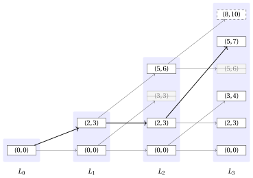

# 17.3.2 A second DP algorithm: An implementation with lists { #1732-an-implementation-with-lists }

**Part 3 · Dynamic programming · Chapter 17** · [:material-book-open-variant: Chapter 17: 0/1 knapsack (KP)](index.md) · [:material-file-pdf-box: Lecture notes, volume 3 (PDF)](../../pdf/lecture-notes-3-dynamic-programming.pdf) · [:material-presentation: Slides (1/2)](../../pdf/slides-dp-knapsack-1.pdf) · [:material-presentation: Slides (2/2)](../../pdf/slides-dp-knapsack-2.pdf) · [:material-pencil: Exercises: 0/1 knapsack (KP)](../../exercises/dp-knapsack.md) · [:material-gesture-tap: App: DP tables for the knapsack problems](../../lab/dp-knapsack-table.md)

- <u>Step 1</u>: computation of the optimal value

    - The DP algorithm of this section stores one value for every pair given by an item and a target profit, that is $(n+1)(P+1)$ values in total. Many of these values are equal to $+\infty$, because no subset of the available items has that total profit.

    - This subsection describes a <strong>different implementation of the same DP algorithm</strong>. The recursive decomposition and the optimal substructure are the ones of formula $\eqref{eq:2}$: what changes is the data structure.

    - Instead of a whole row of the matrix, only the pairs that are actually obtained by a subset of items are stored, and among them only those that can lead to an optimal solution. These pairs are kept in a list, one list for each item.

    !!! chiave ""

        A <strong>state</strong> is a pair $(w,p)$, where $w$ is the total weight and $p$ is the total profit of a subset of items.

    - The empty subset gives the state $(0,0)$. A subset of the items $\{1,2,\dots,j\}$ gives a state obtained by summing the weights and the profits of its items.

    - Two different subsets can give the same state, and in this case it is enough to keep one of them. More generally, a state can be discarded whenever another state is at least as good in both components.

        !!! chiave ""

            Given two states $(w,p)$ and $(w',p')$ with $(w,p)\ne(w',p')$, the state $(w,p)$ <strong>dominates</strong> the state $(w',p')$ if

            $$
            w\le w' \qquad \textrm{and} \qquad p\ge p'.
            $$

            A state is <strong>non-dominated</strong> if no other state dominates it.

    - A dominated state can be discarded. Indeed, let $(w,p)$ dominate $(w',p')$ and let $S'$ be a subset of the remaining items that can be added to $(w',p')$ without exceeding the capacity.

    - Since $w\le w'$, the same subset $S'$ can also be added to $(w,p)$, and since $p\ge p'$ the resulting total profit is not smaller. Therefore no optimal solution is lost.

        !!! formula ""

            For any $j \in \{0,1,\dots,n\}$, let $L_j$ be the list of the non-dominated states that can be obtained by selecting a subset of the items $\{1,2,\dots,j\}$, sorted by strictly increasing weight.

            The recursive formula to compute $L_j$ reads as follows:

            \begin{equation*}
            \label{eq:6}
            L_j= \left\{ \begin{array}{ll}
            \big\{(0,0)\big\} & \textrm{if $j=0$,}\\[2ex]
            \textrm{nd}\big(L_{j-1}\cup M_j\big) & \textrm{if $1\le j \le n$,}
            \end{array} \right. \tag{17.6}
            \end{equation*}

            where $\textrm{nd}(S)$ denotes the list of the non-dominated states of a set $S$ of states, and

            $$
            M_j=\big\{\,(w+w_j,\;p+p_j)\;:\;(w,p)\in L_{j-1}\,\big\}.
            $$

    - The recursive decomposition process of formula $\eqref{eq:6}$ generates $2$ <strong>independent subproblems</strong> for each state of $L_{j-1}$, corresponding to whether or not to select item $j$. If item $j$ is not selected, the state is unchanged and belongs to $L_{j-1}$. If item $j$ is selected, the state becomes $(w+w_j,p+p_j)$ and belongs to $M_j$.

    - Here, $L_0=\{(0,0)\}$ since the only subset of an empty set of items is the empty subset.

    - As in formula $\eqref{eq:2}$, the knapsack capacity does not appear in the recursion: the list $L_j$ collects the states of <em>all</em> the subsets of the items $\{1,2,\dots,j\}$, including those whose total weight exceeds the capacity.

    - Hence, every non-dominated state reachable with the items $\{1,2,\dots,j\}$ is built by combining the chosen decision on item $j$ with a non-dominated state reachable with the items $\{1,2,\dots,j-1\}$.

        $\rightsquigarrow$ <strong>Optimal Substructure verified!</strong>

    - Different subsets of the items $\{1,2,\dots,j\}$ can give the same state, and a state can also be dominated by another one. In both cases a single state is kept in $L_j$, and all the subsets that lead to it are treated at once in the following iterations.

        $\rightsquigarrow$ <strong>Overlapping Subproblems verified!</strong>

    - The knapsack capacity is used only at the end, exactly as in formula [(17.5)](a-second-dp-algorithm.md#mjx-eqn:eq:3): among the states of $L_n$, only those whose total weight does not exceed the capacity correspond to a feasible solution.

        !!! chiave ""

            The optimal value of the KP instance is

            \begin{equation*}
            \label{eq:7}
            \max \big\{\, p \;:\; (w,p)\in L_n,\ w\le c \,\big\}. \tag{17.7}
            \end{equation*}

    - The set in formula $\eqref{eq:7}$ is never empty, since $(0,0)\in L_n$ and $0\le c$, and therefore the maximum is always well defined.

    - The list $L_j$ holds the information of the row $j$ of the matrix ${u}$ in compressed form:

        $$
        \min\big\{\,w \;:\; (w,p)\in L_j,\ p\ge q\,\big\}=\min_{q'\ge q}\ {u}[j][q'] \qquad \forall q \in \{0,1,\dots,P\}.
        $$

        The target profits whose row entry is $+\infty$ leave no state in the list, and a target profit whose minimum weight is not smaller than the one of a larger target profit leaves no state either.

        

        !!! esempio "Example 17.20: The lists of states"

            We consider the KP instance of [Example 17.13](a-second-dp-algorithm.md#box-54-texkp2instance) with a knapsack of capacity $c=5$ and the following profits and weights:

            $$
            \begin{array}{l|rrr}
            \hline  & {j = 1} & {j = 2} & {j = 3} \\
            \hline {p_j} & {3} & {3} & {4} \\
            {w_j} & {2} & {3} & {3} \\
            \hline
            \end{array}
            $$

            Each shaded band collects the states of one list. An arc entering the band of $L_j$ corresponds to the decision taken on item $j$: a horizontal arc means that item $j$ is not selected, while a slanted arc means that item $j$ is selected. The thick arcs give the states of an optimal solution.

            { .fig loading=lazy  }

            The two crossed states are dominated and are therefore discarded: $(3,3)$ is dominated by $(2,3)$ and $(5,6)$ is dominated by $(5,7)$. The state $(8,10)$, drawn with a dashed border, has a total weight larger than the knapsack capacity $c=5$: it is kept in the list, because the capacity is not used during the recursion, and it is discarded only by formula $\eqref{eq:7}$.

    - The list $L_{j-1}$ and the list $M_j$ are both sorted by increasing weight, because $M_j$ is obtained from $L_{j-1}$ by adding the same weight $w_j$ to every state. Therefore the union of formula $\eqref{eq:6}$ is computed by scanning the two lists at the same time, as in the merge of two sorted lists.

    - To describe the scanning order we use the following convention.

        !!! chiave ""

            The state $(w,p)$ <strong>precedes</strong> the state $(w',p')$ if

            $$
            w<w' \qquad \textrm{or} \qquad \textrm{($w=w'$ and $p>p'$)}.
            $$

        - If the states are scanned in this order, a state is non-dominated if and only if its profit is strictly larger than the largest profit of the states already scanned. Indeed, every state already scanned has a weight not larger, and therefore it dominates the current state as soon as its profit is not smaller.

        This is the pseudo-code of the <strong>DP algorithm using lists</strong>:

        !!! algoritmo "Algorithm: DP2\_Lists"

            

<strong>Input:</strong> A KP instance given by the number \(n\) of items, arrays \(p[1..n]\) and \(w[1..n]\) of item profits and weights, and the knapsack capacity \(c\)

<strong>Output:</strong> The optimal value of the KP instance

1<strong>Function</strong> DP2_Lists(\(n,p,w,c\))

2\(L := \textnormal{new list containing the single state } (0,0)\)

3<strong>for</strong> \(j := 1\) <strong>to</strong> \(n\)  <strong>do</strong>

4\(M := \textnormal{new empty list}\)

5<strong>for</strong> \(h := 1\) <strong>to</strong> \(|L|\)  <strong>do</strong>

6append $(L[h].w + w[j],

7L[h].p + p[j])\(to\)M$

8<strong>end</strong>

9\(L \leftarrow \textnormal{\tt Merge}(L,M)\)

10<strong>end</strong>

11\(z := 0\)

12<strong>for</strong> \(h := 1\) <strong>to</strong> \(|L|\)  <strong>do</strong>

13<strong>if</strong> \(L[h].w \le c\)  <strong>then</strong>

14\(z \leftarrow L[h].p\)

15<strong>end</strong>

16<strong>end</strong>

17<strong>return</strong> \(z\)

        This is the pseudo-code of the procedure that merges two lists and discards the dominated states:

        !!! algoritmo "Algorithm: Merge"

            

<strong>Input:</strong> Two lists \(L\) and \(M\) of states, both sorted by increasing weight

<strong>Output:</strong> The list of the non-dominated states of \(L\cup M\), sorted by increasing weight

1<strong>Function</strong> Merge(\(L,M\))

2\(R := \textnormal{new empty list}\)

3\(h := 1\)

4\(k := 1\)

5\(\pi := -1\)

6<strong>while</strong> \(h \le |L|\) <strong>or</strong> \(k \le |M|\)  <strong>do</strong>

7<strong>if</strong> \(k>|M|\) <strong>or</strong> (\(h\le |L|\) <strong>and</strong> \(L[h]\) precedes \(M[k]\))  <strong>then</strong>

8\((a,b) \leftarrow L[h]\)

9\(h \leftarrow h+1\)

10<strong>else</strong>

11\((a,b) \leftarrow M[k]\)

12\(k \leftarrow k+1\)

13<strong>end</strong>

14<strong>if</strong> \(b > \pi\)  <strong>then</strong>

15append \((a,b)\) to \(R\)

16\(\pi \leftarrow b\)

17<strong>end</strong>

18<strong>end</strong>

19<strong>return</strong> \(R\)

        - The list $L$ is the <strong>lookup table</strong>: at the end of the iteration for item $j$, it stores the list $L_j$.

        - The list $L$ is initialized with the single state $(0,0)$, which is the list $L_0$.

        - The outer loop, over items $j \in \{1,2,\dots,n\}$, computes one list for each item.

        - The inner loop builds the list $M$ of the states obtained by selecting item $j$. No state is discarded here, because the knapsack capacity is not used during the recursion.

        - The procedure <code>Merge</code> scans the two lists at the same time and keeps a state only when its profit is strictly larger than the largest profit already appended, which is stored in the auxiliary variable $\pi$. The initial value $\pi=-1$ guarantees that the first scanned state is always appended.

        - The last loop implements formula $\eqref{eq:7}$. The states of $L$ have strictly increasing weights and strictly increasing profits, and therefore the auxiliary variable $z$ ends with the profit of the last state whose weight does not exceed the knapsack capacity.

        - Finally, the optimal value of the KP instance is returned as $z$.

        

        !!! esempio "Example 17.21: Execution of the DP algorithm"

            We consider the KP instance of [Example 17.13](a-second-dp-algorithm.md#box-54-texkp2instance) with a knapsack of capacity $c=5$ and the following profits and weights:

            $$
            \begin{array}{l|rrr}
            \hline  & {j = 1} & {j = 2} & {j = 3} \\
            \hline {p_j} & {3} & {3} & {4} \\
            {w_j} & {2} & {3} & {3} \\
            \hline
            \end{array}
            $$

            For each item $j$, the table shows the list $M_j$ of the states obtained by selecting item $j$ and the resulting list $L_j$.

            $$
            \begin{array}{c|l|l}
            \hline {j} & {M_j} & {L_j} \\
            \hline {0} & {-} & {\{(0,0)\}} \\
            {1} & {\{(2,3)\}} & {\{(0,0),(2,3)\}} \\
            {2} & {\{(3,3),(5,6)\}} & {\{(0,0),(2,3),(5,6)\}} \\
            {3} & {\{(3,4),(5,7),(8,10)\}} & {\{(0,0),(2,3),(3,4),(5,7),(8,10)\}} \\
            \hline
            \end{array}
            $$

            For each state scanned by <code>Merge</code>, the table shows the value of $j$, the state, the list it is taken from, and the operation performed.

            
<table>
            <tr>
            <th>\(j\)</th>
            <th>state</th>
            <th>from</th>
            <th>Action</th>
            </tr>
            <tr>
            <td>\(1\)</td>
            <td>\((0,0)\)</td>
            <td>\(L_{0}\)</td>
            <td>\(0>\pi=-1\): append</td>
            </tr>
            <tr>
            <td>\(1\)</td>
            <td>\((2,3)\)</td>
            <td>\(M_1\)</td>
            <td>\(3>\pi=0\): append</td>
            </tr>
            <tr>
            <td>\(2\)</td>
            <td>\((0,0)\)</td>
            <td>\(L_{1}\)</td>
            <td>\(0>\pi=-1\): append</td>
            </tr>
            <tr>
            <td>\(2\)</td>
            <td>\((2,3)\)</td>
            <td>\(L_{1}\)</td>
            <td>\(3>\pi=0\): append</td>
            </tr>
            <tr>
            <td>\(2\)</td>
            <td>\((3,3)\)</td>
            <td>\(M_2\)</td>
            <td>\(3\le\pi=3\): discard (dominated)</td>
            </tr>
            <tr>
            <td>\(2\)</td>
            <td>\((5,6)\)</td>
            <td>\(M_2\)</td>
            <td>\(6>\pi=3\): append</td>
            </tr>
            <tr>
            <td>\(3\)</td>
            <td>\((0,0)\)</td>
            <td>\(L_{2}\)</td>
            <td>\(0>\pi=-1\): append</td>
            </tr>
            <tr>
            <td>\(3\)</td>
            <td>\((2,3)\)</td>
            <td>\(L_{2}\)</td>
            <td>\(3>\pi=0\): append</td>
            </tr>
            <tr>
            <td>\(3\)</td>
            <td>\((3,4)\)</td>
            <td>\(M_3\)</td>
            <td>\(4>\pi=3\): append</td>
            </tr>
            <tr>
            <td>\(3\)</td>
            <td>\((5,7)\)</td>
            <td>\(M_3\)</td>
            <td>\(7>\pi=4\): append</td>
            </tr>
            <tr>
            <td>\(3\)</td>
            <td>\((5,6)\)</td>
            <td>\(L_{2}\)</td>
            <td>\(6\le\pi=7\): discard (dominated)</td>
            </tr>
            <tr>
            <td>\(3\)</td>
            <td>\((8,10)\)</td>
            <td>\(M_3\)</td>
            <td>\(10>\pi=7\): append</td>
            </tr>
            </table>

            The last loop scans $L_3$ and keeps the profit of the last state whose weight does not exceed $c=5$: the states $(0,0)$, $(2,3)$, $(3,4)$ and $(5,7)$ give $z\leftarrow 0$, $z\leftarrow 3$, $z\leftarrow 4$ and $z\leftarrow 7$, while the state $(8,10)$ causes no update since $8>5$. Therefore the optimal value of the KP instance is $7$.

    - After the execution of the DP algorithm, the list $L$ contains the non-dominated states $L_n$, sorted by strictly increasing weight and strictly increasing profit.

- <u>Step 2</u>: computation of an optimal solution

    - To compute an optimal solution, i.e., the binary vector $(x_1,x_2,\dots,x_n)$, it is necessary to store some additional information. The list $L_n$ alone gives the optimal value, but it does not say which items produce the state that attains it.

    - For each item $j$ and each position $h \in \{1,2,\dots,|L_j|\}$, in addition to the state $L_j[h]$, we store two values:

        - ${\sigma}_j[h]$, which is equal to $1$ if item $j$ is selected in the state $L_j[h]$, and is equal to $0$ otherwise;

        - ${\rho}_j[h]$, which is the position in $L_{j-1}$ of the state from which $L_j[h]$ is obtained.

    - A state taken from $L_{j-1}$ gives ${\sigma}_j[h]=0$, while a state taken from $M_j$ gives ${\sigma}_j[h]=1$. In both cases ${\rho}_j[h]$ is the position of the state of $L_{j-1}$ that generated it.

    - The DP algorithm must also keep all the lists $L_0,L_1,\dots,L_n$, and not only the last one, because the reconstruction goes backwards through them.

        

        !!! esempio "Example 17.22: Computation of the additional information"

            We consider the KP instance of [Example 17.13](a-second-dp-algorithm.md#box-54-texkp2instance). For each item $j$ and each position $h$, the table shows the state $L_j[h]$ and the stored values ${\sigma}_j[h]$ and ${\rho}_j[h]$.

            $$
            \begin{array}{c|c|c|c|c}
            \hline {j} & {h} & {L_j[h]} & {\sigma_j[h]} & {\rho_j[h]} \\
            \hline {1} & {1} & {(0,0)} & {0} & {1} \\
            {1} & {2} & {(2,3)} & {1} & {1} \\
            \hline {2} & {1} & {(0,0)} & {0} & {1} \\
            {2} & {2} & {(2,3)} & {0} & {2} \\
            {2} & {3} & {(5,6)} & {1} & {2} \\
            \hline {3} & {1} & {(0,0)} & {0} & {1} \\
            {3} & {2} & {(2,3)} & {0} & {2} \\
            {3} & {3} & {(3,4)} & {1} & {1} \\
            {3} & {4} & {(5,7)} & {1} & {2} \\
            {3} & {5} & {(8,10)} & {1} & {3} \\
            \hline
            \end{array}
            $$

            For instance, the state $L_3[4]=(5,7)$ has ${\sigma}_3[4]=1$ and ${\rho}_3[4]=2$: it is obtained by selecting item $3$ from the state $L_2[2]=(2,3)$, since $2+w_3=2+3=5$ and $3+p_3=3+4=7$.

    - The reconstruction starts from the position $\tilde h$ of the state that attains the maximum of formula $\eqref{eq:7}$, that is the position at which the last loop of <code>DP2\_Lists</code> updates $z$ for the last time. It is not in general the last position of $L_n$, because the last states of $L_n$ may have a total weight larger than the knapsack capacity.

    - An optimal solution is then reconstructed by scanning the items from $j=n$ down to $j=1$, starting from $h=\tilde h$:

        $$
        \begin{array}{ll}
        x_j \leftarrow {\sigma}_j[h],\quad h \leftarrow {\rho}_j[h] & \textrm{for $j=n,n-1,\dots,1$.}
        \end{array}
        $$

    - This yields the vector $(x_1,x_2,\dots,x_n)$, where $x_j$ is equal to $1$ if item $j$ is selected in an optimal solution, and $0$ otherwise.

        !!! algoritmo "Algorithm: DP2\_Lists\_Reconstruct"

            

<strong>Input:</strong> The number \(n\) of items, the position \(\tilde h\) of the optimal state in \(L_n\), and the stored values \({\sigma}\) and \({\rho}\)

<strong>Output:</strong> An optimal solution of the KP instance

1<strong>Function</strong> DP2_Lists_Reconstruct(\(n,\tilde h,\sigma,\rho\))

2\(x := \textnormal{new array}[1..n]\)

3<strong>for</strong> \(j := 1\) <strong>to</strong> \(n\) <strong>do</strong>

4\(x[j] \leftarrow 0\)

5<strong>end</strong>

6\(h := \tilde h\)

7<strong>for</strong> \(j := n\) <strong>downto</strong> \(1\) <strong>do</strong>

8\(x[j] \leftarrow {\sigma}_j[h]\)

9\(h \leftarrow {\rho}_j[h]\)

10<strong>end</strong>

11<strong>return</strong> \(x\)

        

        !!! esempio "Example 17.23: Computing an optimal solution"

            After the execution of the DP algorithm on the instance of [Example 17.13](a-second-dp-algorithm.md#box-54-texkp2instance), the last list is

            $$
            L_3=\big\{(0,0),(2,3),(3,4),(5,7),(8,10)\big\}
            $$

            and the maximum of formula $\eqref{eq:7}$ is attained by the state $L_3[4]=(5,7)$, so that $\tilde h=4$ and the optimal value is $7$.

            We can reconstruct an optimal solution by starting from $j=3$ and $h=\tilde h=4$ as follows:

            
<table>
            <tr>
            <th>Iteration</th>
            <th>\(j\)</th>
            <th>\(h\)</th>
            <th>\(L_j[h]\)</th>
            <th>\({\sigma}_j[h]\)</th>
            <th>\({\rho}_j[h]\)</th>
            <th>\(x[1]\)</th>
            <th>\(x[2]\)</th>
            <th>\(x[3]\)</th>
            <th>Action</th>
            </tr>
            <tr>
            <td>\(-\)</td>
            <td>\(-\)</td>
            <td>\(-\)</td>
            <td>\(-\)</td>
            <td>\(-\)</td>
            <td>\(-\)</td>
            <td>0</td>
            <td>0</td>
            <td>0</td>
            <td>\(h=4\)</td>
            </tr>
            <tr>
            <td>\(1\)</td>
            <td>\(3\)</td>
            <td>\(4\)</td>
            <td>\((5,7)\)</td>
            <td>\(1\)</td>
            <td>\(2\)</td>
            <td>0</td>
            <td>0</td>
            <td class="cella-blu">1</td>
            <td>\(h\leftarrow 2\)</td>
            </tr>
            <tr>
            <td>\(2\)</td>
            <td>\(2\)</td>
            <td>\(2\)</td>
            <td>\((2,3)\)</td>
            <td>\(0\)</td>
            <td>\(2\)</td>
            <td>0</td>
            <td>0</td>
            <td>1</td>
            <td>\(h\leftarrow 2\)</td>
            </tr>
            <tr>
            <td>\(3\)</td>
            <td>\(1\)</td>
            <td>\(2\)</td>
            <td>\((2,3)\)</td>
            <td>\(1\)</td>
            <td>\(1\)</td>
            <td class="cella-blu">1</td>
            <td>0</td>
            <td>1</td>
            <td>\(h\leftarrow 1\)</td>
            </tr>
            </table>

            Thus, the vector

            $$
            (1,0,1)
            $$

            is an optimal solution. The corresponding optimal value is $3+4=7$.

## 17.3.3 Number of steps

- Let $S(n,P)$ denote the number of steps executed by <code>DP2\_Lists</code> in the worst case, where $n$ is the number of items and $P=\sum_{j=1}^{n}p_j$ is the total profit of all the items.

- The states of a list have strictly increasing profits, and every profit belongs to $\{0,1,\dots,P\}$: therefore $|L_j|\le P+1$ for all $j \in \{0,1,\dots,n\}$, and $|M_j|=|L_{j-1}|$.

- For each item, <code>DP2\_Lists</code> scans $L_{j-1}$ once to build $M_j$ and then calls <code>Merge</code>, which scans $|L_{j-1}|+|M_j|\le 2(P+1)$ states and performs a constant number of operations for each of them. The final loop scans $L_n$ once. Therefore

    $$
    S(n,P)=\Theta(nP).
    $$

- The matrix ${u}$ always has $(n+1)(P+1)$ cells, most of which are equal to $+\infty$, while the lists contain only the states that are actually reachable. On the KP instance of [Example 17.13](a-second-dp-algorithm.md#box-54-texkp2instance) the lists contain $1$, $2$, $3$, and $5$ states, against the $44$ cells of the matrix ${u}$.

- The list $L_j$ also satisfies $|L_j|\le 2^j$, since the items $\{1,2,\dots,j\}$ have $2^j$ subsets. Therefore

    $$
    |L_j|\le \min\big\{2^j,\,P+1\big\}.
    $$

---

**Next:** [Typical mistakes · In summary](typical-mistakes.md)
