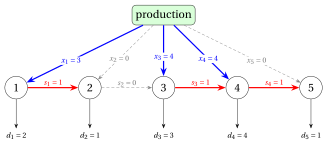

# Dynamic programming for lot sizing

**Part 3 · Dynamic programming · Chapter 17** · [:material-file-pdf-box: Lecture notes, volume 3 (PDF)](../pdf/lecture-notes-3-dynamic-programming.pdf) · [:material-pencil: Exercises](../exercises/dp-lot-sizing.md)

!!! nota "Prerequisites"

    - From this module, the chapters on lot sizing: the single-item problem, its MIP model with the variables $x_t$, $s_t$, $y_t$, and the example of the MIP course.

    - From this module, the chapter «Principles of dynamic programming» and the DP algorithms of the previous chapters: recurrence, base cases, lookup table and reconstruction of a solution.

    - From the module <em>Algorithms</em>: [pseudocode (Chapter 2)](https://fabiofurini.github.io/algorithms/basic-algorithms/02-pseudo-code/), and [the size of the input (Chapter 11)](https://fabiofurini.github.io/algorithms/analysis/11-input-size/).

!!! nota "Where we were"

    - <strong>As a problem and as a model</strong>: single-item lot sizing, its MIP model and its formulations (lot-sizing chapters).

    - <strong>Now, as a table</strong>: the DP algorithm of Wagner and Whitin gives the optimal value of the uncapacitated problem in $\Theta(m^2)$ steps, and a DP algorithm on the inventory handles the capacitated one.

!!! chiave "Objectives"

    At the end of this chapter you will be able to:

    - state the zero-inventory ordering property, and prove it with the exchange argument;

    - compute the cost $c_{j,t}$ of a production run, and the matrix of the costs, in $O(m^2)$ steps;

    - write the recurrence $v(t)$ over the last production run, run the DP algorithm by hand and reconstruct an optimal plan;

    - explain why the property fails with capacities, and write the recurrence $v(t,k)$ on the pairs (period, final inventory);

    - count the steps of the two DP algorithms, and say why the second one is pseudo-polynomial.

## 17.1 Problem definition

!!! definizione "Definition 17.1: Uncapacitated Lot-Sizing Problem"

    Given:

    1. a set $T=\{1,2,\dots,m\}$ of $m \in \Z_{\ge 1}$ <em>time periods</em>,

    2. for each period $t \in T$, a <em>demand</em> $d_t \in \Z_{\ge 1}$,

    3. for each period $t \in T$, a <em>setup cost</em> $sc_t \in \Z_{\ge 0}$, a <em>variable production cost</em> $vc_t \in \Z_{\ge 0}$ per unit, and a <em>holding cost</em> $hc_t \in \Z_{\ge 0}$ per unit in stock at the end of period $t$,

    the <strong>Uncapacitated Lot-Sizing Problem</strong> (ULS) asks to decide how many units to produce in each period, so that, starting with an empty inventory and ending with an empty inventory, the demand of every period is satisfied, and the total cost of setups, production, and holding is minimized.

- This is the lot-sizing problem of the chapter on lot sizing, restricted to a <strong>single product</strong>: we drop the product index $p$, we measure the capacity in units of product (variable production time $vt_t=1$, no setup time), and we assume that there is no initial inventory.

- For any $j,t \in T$, we denote by

    $$
    D_{j,t}=\sum_{k=j}^{t} d_k
    $$

    the total demand of periods $j,j+1,\dots,t$, with $D_{j,t}=0$ if $j>t$.

- With the variables of the chapter on lot sizing ($x_t$ production, $s_t$ inventory at the end of period $t$, $y_t$ setup), the ULS reads as follows, where $s_0=0$ and the big-M value of period $t$ is the total demand $D_{t,m}$ of the remaining periods:

!!! chiave ""

    \begin{align*}
    &&\min \sum_{t \in T} \left(sc_t\, y_t + vc_t\, x_t + hc_t\, s_t\right) \label{uls:obj} \tag{17.1}\\
    && s_{t-1} + x_t & = d_t + s_t & t \in T \label{uls:bal} \tag{17.2}\\
    && x_t & \le D_{t,m}\, y_t & t \in T \label{uls:big} \tag{17.3}\\
    && s_m & = 0 \label{uls:end} \tag{17.4}\\
    && x_t,\ s_t & \ge 0 & t \in T \tag{17.5}\\
    && y_t & \in \{0,1\} & t \in T \tag{17.6}
    \end{align*}

- Constraints $\eqref{uls:bal}$ are the flow balancing constraints, constraints $\eqref{uls:big}$ force a setup in every period with positive production, and constraint $\eqref{uls:end}$ imposes an empty inventory at the end of the horizon (with nonnegative costs, a final inventory is never useful).

!!! esempio "Example 17.1: Uncapacitated lot sizing"

    We consider $m=5$ periods with the following data:

    $$
    \begin{array}{l|rrrrr}
    \hline {t} & {1} & {2} & {3} & {4} & {5} \\
    \hline {d_t} & {20} & {10} & {30} & {40} & {10} \\
    {sc_t} & {50} & {50} & {50} & {50} & {50} \\
    {vc_t} & {0} & {0} & {0} & {0} & {0} \\
    {hc_t} & {1} & {1} & {1} & {1} & {1} \\
    \hline
    \end{array}
    $$

    We refer to this ULS instance as [Example 17.1](#box-2-texuls1). It is the uncapacitated instance used in the MIP course (setup cost $50$, holding cost $1$, no variable production cost).

### 17.1.1 Encoding of feasible solutions

!!! chiave ""

    A <em>feasible solution</em> of the ULS is a production plan that satisfies the demand of every period, starting and ending with an empty inventory.

- A ULS feasible solution can be described by a solution vector

    $$
    (x_1,x_2,\dots,x_m)
    $$

    where each component has the following meaning:

    $$
    x_t = \text{number of units produced in period } t,
    \qquad \forall t \in \{1,2,\dots,m\}.
    $$

    The inventory at the end of period $t$ is determined by the vector:

    $$
    s_t=\sum_{j=1}^{t} x_j - D_{1,t},
    \qquad \forall t \in \{1,2,\dots,m\}.
    $$

    Since the solution is feasible, the inventories are nonnegative and the last one is empty:

    $$
    s_t \ge 0 \quad \forall t \in \{1,2,\dots,m-1\}, \qquad s_m=0.
    $$

    A setup is paid in period $t$ if and only if $x_t>0$. The total cost of a feasible solution is

    $$
    \sum_{t=1,\ x_t>0}^{m} sc_t+\sum_{t=1}^{m} vc_t\, x_t+\sum_{t=1}^{m} hc_t\, s_t.
    $$

!!! esempio "Example 17.2: A feasible solution"

    We consider the ULS instance of [Example 17.1](#box-2-texuls1). The following network represents the feasible solution $\exOneSol$: each period is a node, the production $x_t$ enters node $t$, the demand $d_t$ leaves it, and the inventory $s_t$ flows from node $t$ to node $t+1$. Thick arcs carry a positive flow.

    { .fig loading=lazy  }

    The setups are in periods $1$, $3$, the inventories are $(s_1,\dots,s_{5})=(10,\allowbreak 0,\allowbreak 50,\allowbreak 10,\allowbreak 0)$, and the total cost is (there is no variable production cost)

    $$
    \underbrace{50+50}_{\text{setup}}+\underbrace{1\cdot 10+1\cdot 0+1\cdot 50+1\cdot 10+1\cdot 0}_{\text{holding}}=100+70=170.
    $$

- A production quantity can take many values, and a ULS instance has a huge number of feasible solutions (infinitely many, if the quantities are not required to be integer). The next property shows that only very few of them need to be considered.

### 17.1.2 The zero-inventory ordering property

!!! teorema "Theorem 17.2: Zero-inventory ordering (Wagner and Whitin, 1958)"

    Every ULS instance has an optimal solution in which no period with positive production starts with a positive inventory, that is,

    $$
    s_{t-1}\, x_t = 0 \qquad \forall t \in \{1,2,\dots,m\}.
    $$

- <em>Proof.</em> First, an optimal solution exists: the vector $(d_1,d_2,\dots,d_m)$ is feasible, and for each of the $2^m$ choices of the set of periods with a setup, the remaining problem is a linear program over a bounded polyhedron (since $s_m=0$, every $x_t$ is between $0$ and $D_{1,m}$), so it has an optimal solution whenever it is feasible.

- Among all optimal solutions, consider one with the <strong>smallest number of periods with positive production</strong>, and suppose, by contradiction, that there exists a period $t$ with $x_t>0$ and $s_{t-1}>0$.

- Since $s_0=0$ and $s_{t-1}>0$, something is produced before period $t$: let $j<t$ be the last period before $t$ with $x_j>0$. No unit is produced in periods $j+1,\dots,t-1$, so the inventory can only decrease from period $j$ to period $t-1$:

    $$
    s_k \ge s_{t-1} > 0 \qquad \forall k \in \{j,j+1,\dots,t-1\}.
    $$

- For a number $\varepsilon$, move $\varepsilon$ units of production from period $j$ to period $t$: replace $x_j$ by $x_j-\varepsilon$, $x_t$ by $x_t+\varepsilon$, and $s_k$ by $s_k-\varepsilon$ for all $k \in \{j,\dots,t-1\}$. All balancing constraints remain satisfied, and the new plan is feasible for every $\varepsilon$ with

    $$
    -x_t \le \varepsilon \le \min\{x_j,\ s_{t-1}\}.
    $$

- As long as $x_j$ and $x_t$ stay positive, the setups do not change and the cost changes by $\varepsilon\,\Delta$, where

    $$
    \Delta = vc_t - vc_j - \sum_{k=j}^{t-1} hc_k
    $$

    is the cost of producing one unit in period $t$ minus the cost of producing it in period $j$ and holding it until period $t$.

- If $\Delta<0$, a small $\varepsilon>0$ gives a feasible solution with a smaller cost, which contradicts optimality.

- If $\Delta\ge 0$, choose $\varepsilon=-x_t$: the whole production of period $t$ is moved to period $j$, the cost changes by $-x_t\,\Delta \le 0$, and the setup cost $sc_t\ge 0$ of period $t$ is saved. The new solution is optimal and has one period with positive production less, which contradicts the choice of the solution.

- Hence no such period $t$ exists.  $\square$

!!! chiave ""

    In an optimal solution with the zero-inventory ordering property, each period $j$ with positive production produces exactly the demands of periods $j,j+1,\dots,t$, where $t+1$ is the next period with positive production (or $t=m$ if there is none):

    $$
    x_j = D_{j,t}.
    $$

- Indeed, $s_{j-1}=0$ (zero-inventory ordering in period $j$), $s_t=0$ (zero-inventory ordering in period $t+1$, or $s_m=0$), and nothing is produced in periods $j+1,\dots,t$; summing the balancing constraints of periods $j,\dots,t$ gives $x_j=D_{j,t}$.

- Period $1$ always produces, since $s_0=0$ and $d_1\ge 1$. A solution with the zero-inventory ordering property is therefore determined by the set of its production periods, which contains period $1$ and any subset of $\{2,3,\dots,m\}$.

!!! chiave ""

    The number of ULS solutions with the zero-inventory ordering property is $2^{m-1}$, since each period $t\in\{2,3,\dots,m\}$ can independently produce or not.

- The number of these solutions grows exponentially with the number $m$ of periods:

    $$
    2^{m-1}=O(2^m).
    $$

    Therefore, enumerating them quickly becomes impractical as $m$ increases.

!!! esempio "Example 17.3: Enumeration of the solutions with the zero-inventory ordering property"

    We consider the ULS instance of [Example 17.1](#box-2-texuls1):

    $$
    \begin{array}{l|rrrrr}
    \hline {t} & {1} & {2} & {3} & {4} & {5} \\
    \hline {d_t} & {20} & {10} & {30} & {40} & {10} \\
    {sc_t} & {50} & {50} & {50} & {50} & {50} \\
    {vc_t} & {0} & {0} & {0} & {0} & {0} \\
    {hc_t} & {1} & {1} & {1} & {1} & {1} \\
    \hline
    \end{array}
    $$

    There are $2^{5-1}=16$ solutions with the zero-inventory ordering property. For each of them, the table reports the production periods, the solution vector, the inventories, and the total cost, written as setup cost plus holding cost. The optimal costs are highlighted.

    
<table>
    <tr>
    <th>Label</th>
    <th>Production periods</th>
    <th>Solution vector</th>
    <th>Inventories \((s_1,\dots,s_{5})\)</th>
    <th>Total cost</th>
    </tr>
    <tr>
    <td>\((1)\)</td>
    <td>\(\{1\}\)</td>
    <td>\((110,\allowbreak 0,\allowbreak 0,\allowbreak 0,\allowbreak 0)\)</td>
    <td>\((90,\allowbreak 80,\allowbreak 50,\allowbreak 10,\allowbreak 0)\)</td>
    <td>\(50+230=280\)</td>
    </tr>
    <tr>
    <td>\((2)\)</td>
    <td>\(\{1,5\}\)</td>
    <td>\((100,\allowbreak 0,\allowbreak 0,\allowbreak 0,\allowbreak 10)\)</td>
    <td>\((80,\allowbreak 70,\allowbreak 40,\allowbreak 0,\allowbreak 0)\)</td>
    <td>\(100+190=290\)</td>
    </tr>
    <tr>
    <td>\((3)\)</td>
    <td>\(\{1,4\}\)</td>
    <td>\((60,\allowbreak 0,\allowbreak 0,\allowbreak 50,\allowbreak 0)\)</td>
    <td>\((40,\allowbreak 30,\allowbreak 0,\allowbreak 10,\allowbreak 0)\)</td>
    <td>\(100+80=180\)</td>
    </tr>
    <tr>
    <td>\((4)\)</td>
    <td>\(\{1,4,5\}\)</td>
    <td>\((60,\allowbreak 0,\allowbreak 0,\allowbreak 40,\allowbreak 10)\)</td>
    <td>\((40,\allowbreak 30,\allowbreak 0,\allowbreak 0,\allowbreak 0)\)</td>
    <td>\(150+70=220\)</td>
    </tr>
    <tr>
    <td>\((5)\)</td>
    <td>\(\{1,3\}\)</td>
    <td>\((30,\allowbreak 0,\allowbreak 80,\allowbreak 0,\allowbreak 0)\)</td>
    <td>\((10,\allowbreak 0,\allowbreak 50,\allowbreak 10,\allowbreak 0)\)</td>
    <td class="cella-blu">\(100+70=170\)</td>
    </tr>
    <tr>
    <td>\((6)\)</td>
    <td>\(\{1,3,5\}\)</td>
    <td>\((30,\allowbreak 0,\allowbreak 70,\allowbreak 0,\allowbreak 10)\)</td>
    <td>\((10,\allowbreak 0,\allowbreak 40,\allowbreak 0,\allowbreak 0)\)</td>
    <td>\(150+50=200\)</td>
    </tr>
    <tr>
    <td>\((7)\)</td>
    <td>\(\{1,3,4\}\)</td>
    <td>\((30,\allowbreak 0,\allowbreak 30,\allowbreak 50,\allowbreak 0)\)</td>
    <td>\((10,\allowbreak 0,\allowbreak 0,\allowbreak 10,\allowbreak 0)\)</td>
    <td class="cella-blu">\(150+20=170\)</td>
    </tr>
    <tr>
    <td>\((8)\)</td>
    <td>\(\{1,3,4,5\}\)</td>
    <td>\((30,\allowbreak 0,\allowbreak 30,\allowbreak 40,\allowbreak 10)\)</td>
    <td>\((10,\allowbreak 0,\allowbreak 0,\allowbreak 0,\allowbreak 0)\)</td>
    <td>\(200+10=210\)</td>
    </tr>
    <tr>
    <td>\((9)\)</td>
    <td>\(\{1,2\}\)</td>
    <td>\((20,\allowbreak 90,\allowbreak 0,\allowbreak 0,\allowbreak 0)\)</td>
    <td>\((0,\allowbreak 80,\allowbreak 50,\allowbreak 10,\allowbreak 0)\)</td>
    <td>\(100+140=240\)</td>
    </tr>
    <tr>
    <td>\((10)\)</td>
    <td>\(\{1,2,5\}\)</td>
    <td>\((20,\allowbreak 80,\allowbreak 0,\allowbreak 0,\allowbreak 10)\)</td>
    <td>\((0,\allowbreak 70,\allowbreak 40,\allowbreak 0,\allowbreak 0)\)</td>
    <td>\(150+110=260\)</td>
    </tr>
    <tr>
    <td>\((11)\)</td>
    <td>\(\{1,2,4\}\)</td>
    <td>\((20,\allowbreak 40,\allowbreak 0,\allowbreak 50,\allowbreak 0)\)</td>
    <td>\((0,\allowbreak 30,\allowbreak 0,\allowbreak 10,\allowbreak 0)\)</td>
    <td>\(150+40=190\)</td>
    </tr>
    <tr>
    <td>\((12)\)</td>
    <td>\(\{1,2,4,5\}\)</td>
    <td>\((20,\allowbreak 40,\allowbreak 0,\allowbreak 40,\allowbreak 10)\)</td>
    <td>\((0,\allowbreak 30,\allowbreak 0,\allowbreak 0,\allowbreak 0)\)</td>
    <td>\(200+30=230\)</td>
    </tr>
    <tr>
    <td>\((13)\)</td>
    <td>\(\{1,2,3\}\)</td>
    <td>\((20,\allowbreak 10,\allowbreak 80,\allowbreak 0,\allowbreak 0)\)</td>
    <td>\((0,\allowbreak 0,\allowbreak 50,\allowbreak 10,\allowbreak 0)\)</td>
    <td>\(150+60=210\)</td>
    </tr>
    <tr>
    <td>\((14)\)</td>
    <td>\(\{1,2,3,5\}\)</td>
    <td>\((20,\allowbreak 10,\allowbreak 70,\allowbreak 0,\allowbreak 10)\)</td>
    <td>\((0,\allowbreak 0,\allowbreak 40,\allowbreak 0,\allowbreak 0)\)</td>
    <td>\(200+40=240\)</td>
    </tr>
    <tr>
    <td>\((15)\)</td>
    <td>\(\{1,2,3,4\}\)</td>
    <td>\((20,\allowbreak 10,\allowbreak 30,\allowbreak 50,\allowbreak 0)\)</td>
    <td>\((0,\allowbreak 0,\allowbreak 0,\allowbreak 10,\allowbreak 0)\)</td>
    <td>\(200+10=210\)</td>
    </tr>
    <tr>
    <td>\((16)\)</td>
    <td>\(\{1,2,3,4,5\}\)</td>
    <td>\((20,\allowbreak 10,\allowbreak 30,\allowbreak 40,\allowbreak 10)\)</td>
    <td>\((0,\allowbreak 0,\allowbreak 0,\allowbreak 0,\allowbreak 0)\)</td>
    <td>\(250+0=250\)</td>
    </tr>
    </table>

    The optimal value of the ULS instance is $\exOneOpt$, attained by $\exOneNopt$ solutions: $(\exOneSolLabel)$ and $(\exOneOtherLabel)$.

## 17.2 A DP algorithm for the ULS

### 17.2.1 The cost of a production run

- By the zero-inventory ordering property, an optimal solution is a sequence of <strong>production runs</strong>: a run produces in a period $j$ the demands of periods $j,\dots,t$, and the next run starts in period $t+1$ with an empty inventory.

- For any $j,t \in T$ with $j\le t$, let $c_{j,t}$ be the cost of the production run that produces in period $j$ the demands of periods $j,\dots,t$:

!!! chiave ""

    \begin{equation*}
    \label{eq:cjt}
    c_{j,t}= sc_j + vc_j\, D_{j,t} + \sum_{k=j}^{t-1} hc_k\, D_{k+1,t}. \tag{17.7}
    \end{equation*}

- The first term is the setup cost of period $j$, the second term is the variable cost of the $D_{j,t}$ produced units, and the last term is the holding cost: at the end of each period $k\in\{j,\dots,t-1\}$ the inventory contains the demands $D_{k+1,t}$ of the following periods of the run.

- For a fixed period $j$, the costs $c_{j,j},c_{j,j+1},\dots,c_{j,m}$ can be computed one after the other. A unit used in period $t$ and produced in period $j$ costs

    $$
    u_{j,t}=vc_j+\sum_{k=j}^{t-1} hc_k,
    $$

    so that $u_{j,j}=vc_j$, $u_{j,t}=u_{j,t-1}+hc_{t-1}$, and adding period $t$ to the run adds $d_t$ units of cost $u_{j,t}$:

    $$
    c_{j,j}=sc_j+vc_j\, d_j, \qquad c_{j,t}=c_{j,t-1}+u_{j,t}\, d_t \quad \text{if } t>j.
    $$

This is the pseudo-code that computes the matrix of the production-run costs:

!!! algoritmo "Algorithm: CostMatrix"

    

<strong>Input:</strong> A ULS instance given by the number \(m\) of periods and the arrays \(d[1..m]\), \(sc[1..m]\), \(vc[1..m]\), \(hc[1..m]\)

<strong>Output:</strong> The matrix of the production-run costs

1<strong>Function</strong> CostMatrix(\(m,d,sc,vc,hc\))

2\({c} := \textnormal{new array}[1..m][1..m]\)

3<strong>for</strong> \(j := 1\) <strong>to</strong> \(m\)  <strong>do</strong>

4\(\mathit{u} := vc[j]\)

5\(\mathit{g} := sc[j] + vc[j]\cdot d[j]\)

6\({c}[j][j] \leftarrow \mathit{g}\)

7<strong>for</strong> \(t := j+1\) <strong>to</strong> \(m\)  <strong>do</strong>

8\(\mathit{u} \leftarrow \mathit{u} + hc[t-1]\)

9\(\mathit{g} \leftarrow \mathit{g} + \mathit{u}\cdot d[t]\)

10\({c}[j][t] \leftarrow \mathit{g}\)

11<strong>end</strong>

12<strong>end</strong>

13<strong>return</strong> \({c}\)

- The variable $\mathit{u}$ is the unit cost $u_{j,t}$ and the variable $\mathit{g}$ is the cost $c_{j,t}$ of the current run; only the cells ${c}[j][t]$ with $j\le t$ are used.

!!! esempio "Example 17.4: Computation of the production-run costs"

    We consider the ULS instance of [Example 17.1](#box-2-texuls1):

    $$
    \begin{array}{l|rrrrr}
    \hline {t} & {1} & {2} & {3} & {4} & {5} \\
    \hline {d_t} & {20} & {10} & {30} & {40} & {10} \\
    {sc_t} & {50} & {50} & {50} & {50} & {50} \\
    {vc_t} & {0} & {0} & {0} & {0} & {0} \\
    {hc_t} & {1} & {1} & {1} & {1} & {1} \\
    \hline
    \end{array}
    $$

    For each step, the table shows the values of $j$ and $t$, the current value of $\mathit{u}$, the cell ${c}[j][t]$, and the operation performed; the cell ${c}[j][t]$ is highlighted in <mark>blue</mark> when assigned.

    
<table>
    <tr>
    <th>\(j\)</th>
    <th>\(t\)</th>
    <th>\(\mathit{u}\)</th>
    <th>\({c}[j][t]\)</th>
    <th>Action</th>
    </tr>
    <tr>
    <td>\(1\)</td>
    <td>\(1\)</td>
    <td>\(0\)</td>
    <td class="cella-blu">\(50\)</td>
    <td>\(\mathit{u}\leftarrow vc[1]=0\), \(\mathit{g}\leftarrow sc[1]{+}vc[1]\cdot d[1]=50{+}0\cdot 20=50\), \({c}[1][1]\leftarrow 50\)</td>
    </tr>
    <tr>
    <td>\(1\)</td>
    <td>\(2\)</td>
    <td>\(1\)</td>
    <td class="cella-blu">\(60\)</td>
    <td>\(\mathit{u}\leftarrow \mathit{u}{+}hc[1]=0{+}1=1\), \(\mathit{g}\leftarrow \mathit{g}{+}\mathit{u}\cdot d[2]=50{+}1\cdot 10=60\), \({c}[1][2]\leftarrow 60\)</td>
    </tr>
    <tr>
    <td>\(1\)</td>
    <td>\(3\)</td>
    <td>\(2\)</td>
    <td class="cella-blu">\(120\)</td>
    <td>\(\mathit{u}\leftarrow \mathit{u}{+}hc[2]=1{+}1=2\), \(\mathit{g}\leftarrow \mathit{g}{+}\mathit{u}\cdot d[3]=60{+}2\cdot 30=120\), \({c}[1][3]\leftarrow 120\)</td>
    </tr>
    <tr>
    <td>\(1\)</td>
    <td>\(4\)</td>
    <td>\(3\)</td>
    <td class="cella-blu">\(240\)</td>
    <td>\(\mathit{u}\leftarrow \mathit{u}{+}hc[3]=2{+}1=3\), \(\mathit{g}\leftarrow \mathit{g}{+}\mathit{u}\cdot d[4]=120{+}3\cdot 40=240\), \({c}[1][4]\leftarrow 240\)</td>
    </tr>
    <tr>
    <td>\(1\)</td>
    <td>\(5\)</td>
    <td>\(4\)</td>
    <td class="cella-blu">\(280\)</td>
    <td>\(\mathit{u}\leftarrow \mathit{u}{+}hc[4]=3{+}1=4\), \(\mathit{g}\leftarrow \mathit{g}{+}\mathit{u}\cdot d[5]=240{+}4\cdot 10=280\), \({c}[1][5]\leftarrow 280\)</td>
    </tr>
    <tr>
    <td>\(2\)</td>
    <td>\(2\)</td>
    <td>\(0\)</td>
    <td class="cella-blu">\(50\)</td>
    <td>\(\mathit{u}\leftarrow vc[2]=0\), \(\mathit{g}\leftarrow sc[2]{+}vc[2]\cdot d[2]=50{+}0\cdot 10=50\), \({c}[2][2]\leftarrow 50\)</td>
    </tr>
    <tr>
    <td>\(2\)</td>
    <td>\(3\)</td>
    <td>\(1\)</td>
    <td class="cella-blu">\(80\)</td>
    <td>\(\mathit{u}\leftarrow \mathit{u}{+}hc[2]=0{+}1=1\), \(\mathit{g}\leftarrow \mathit{g}{+}\mathit{u}\cdot d[3]=50{+}1\cdot 30=80\), \({c}[2][3]\leftarrow 80\)</td>
    </tr>
    <tr>
    <td>\(2\)</td>
    <td>\(4\)</td>
    <td>\(2\)</td>
    <td class="cella-blu">\(160\)</td>
    <td>\(\mathit{u}\leftarrow \mathit{u}{+}hc[3]=1{+}1=2\), \(\mathit{g}\leftarrow \mathit{g}{+}\mathit{u}\cdot d[4]=80{+}2\cdot 40=160\), \({c}[2][4]\leftarrow 160\)</td>
    </tr>
    <tr>
    <td>\(2\)</td>
    <td>\(5\)</td>
    <td>\(3\)</td>
    <td class="cella-blu">\(190\)</td>
    <td>\(\mathit{u}\leftarrow \mathit{u}{+}hc[4]=2{+}1=3\), \(\mathit{g}\leftarrow \mathit{g}{+}\mathit{u}\cdot d[5]=160{+}3\cdot 10=190\), \({c}[2][5]\leftarrow 190\)</td>
    </tr>
    <tr>
    <td>\(3\)</td>
    <td>\(3\)</td>
    <td>\(0\)</td>
    <td class="cella-blu">\(50\)</td>
    <td>\(\mathit{u}\leftarrow vc[3]=0\), \(\mathit{g}\leftarrow sc[3]{+}vc[3]\cdot d[3]=50{+}0\cdot 30=50\), \({c}[3][3]\leftarrow 50\)</td>
    </tr>
    <tr>
    <td>\(3\)</td>
    <td>\(4\)</td>
    <td>\(1\)</td>
    <td class="cella-blu">\(90\)</td>
    <td>\(\mathit{u}\leftarrow \mathit{u}{+}hc[3]=0{+}1=1\), \(\mathit{g}\leftarrow \mathit{g}{+}\mathit{u}\cdot d[4]=50{+}1\cdot 40=90\), \({c}[3][4]\leftarrow 90\)</td>
    </tr>
    <tr>
    <td>\(3\)</td>
    <td>\(5\)</td>
    <td>\(2\)</td>
    <td class="cella-blu">\(110\)</td>
    <td>\(\mathit{u}\leftarrow \mathit{u}{+}hc[4]=1{+}1=2\), \(\mathit{g}\leftarrow \mathit{g}{+}\mathit{u}\cdot d[5]=90{+}2\cdot 10=110\), \({c}[3][5]\leftarrow 110\)</td>
    </tr>
    <tr>
    <td>\(4\)</td>
    <td>\(4\)</td>
    <td>\(0\)</td>
    <td class="cella-blu">\(50\)</td>
    <td>\(\mathit{u}\leftarrow vc[4]=0\), \(\mathit{g}\leftarrow sc[4]{+}vc[4]\cdot d[4]=50{+}0\cdot 40=50\), \({c}[4][4]\leftarrow 50\)</td>
    </tr>
    <tr>
    <td>\(4\)</td>
    <td>\(5\)</td>
    <td>\(1\)</td>
    <td class="cella-blu">\(60\)</td>
    <td>\(\mathit{u}\leftarrow \mathit{u}{+}hc[4]=0{+}1=1\), \(\mathit{g}\leftarrow \mathit{g}{+}\mathit{u}\cdot d[5]=50{+}1\cdot 10=60\), \({c}[4][5]\leftarrow 60\)</td>
    </tr>
    <tr>
    <td>\(5\)</td>
    <td>\(5\)</td>
    <td>\(0\)</td>
    <td class="cella-blu">\(50\)</td>
    <td>\(\mathit{u}\leftarrow vc[5]=0\), \(\mathit{g}\leftarrow sc[5]{+}vc[5]\cdot d[5]=50{+}0\cdot 10=50\), \({c}[5][5]\leftarrow 50\)</td>
    </tr>
    </table>

    This is the matrix ${c}$ after the execution of the algorithm (for instance, $\exOneCOneThree$ by formula $\eqref{eq:cjt}$):

    $$
    \begin{array}{l|rrrrr}
    \hline {{c}[j][t]} & {t=1} & {t=2} & {t=3} & {t=4} & {t=5} \\
    \hline {j=1} & {50} & {60} & {120} & {240} & {280} \\
    {j=2} & {-} & {50} & {80} & {160} & {190} \\
    {j=3} & {-} & {-} & {50} & {90} & {110} \\
    {j=4} & {-} & {-} & {-} & {50} & {60} \\
    {j=5} & {-} & {-} & {-} & {-} & {50} \\
    \hline
    \end{array}
    $$

### 17.2.2 Step 1 and Step 2

- <u>Step 1</u>: computation of the optimal value

    !!! chiave ""

        For any $t \in \{1,2,\dots,m\}$, let $v(t)$ be the optimal value of the ULS subinstance given by:

        1. a set $\{1,2,\dots,t\}$ of $t$ time periods,

        2. for each period $j \in \{1,2,\dots,t\}$, a demand $d_j$,

        3. for each period $j \in \{1,2,\dots,t\}$, a setup cost $sc_j$, a variable production cost $vc_j$, and a holding cost $hc_j$.

        The recursive formula to compute $v(t)$ reads as follows:

        \begin{equation*}
        \label{eq:ww}
        v(t)= \left\{ \begin{array}{ll}
        \displaystyle \min \bigg\{ v(j-1) + c_{j,t} : j \in \{1,2,\dots,t\}\bigg\} & \textrm{if $1\le t \le m$,}\\[2ex]
        0 & \textrm{if $t=0$.}
        \end{array} \right. \tag{17.8}
        \end{equation*}

    - The subinstance with periods $\{1,\dots,t\}$ is a ULS instance of the same type: its inventory must be empty at the end of period $t$. Here, $v(0)=0$, since an empty set of periods has no demand and no cost.

    - The recursive decomposition process of formula $\eqref{eq:ww}$ generates $t$ <strong>independent subproblems</strong>, each corresponding to a possible choice of the period $j$ of the <strong>last production run</strong>, which produces the demands of periods $j,\dots,t$. By the zero-inventory ordering property applied to the subinstance, the inventory is empty at the end of period $j-1$, and the residual subproblem is the ULS subinstance with periods $\{1,\dots,j-1\}$.

    - The optimal value $v(t)$ is obtained by trying all possible periods of the last production run and selecting the one that minimizes the sum $v(j-1)+c_{j,t}$ of the optimal value of the residual subproblem and the cost of the last run.

    - Hence, an optimal solution for periods $\{1,\dots,t\}$ is built by combining the chosen last production run in period $j$ with an optimal solution of the residual subproblem with periods $\{1,\dots,j-1\}$.

        $\rightsquigarrow$ <strong>Optimal Substructure verified!</strong>

    - Different choices of the last production run, possibly made for different values of $t$, can lead to the same residual set of periods, and therefore the same value $v(t)$ may need to be computed several times during the recursive evaluation of formula $\eqref{eq:ww}$.

        $\rightsquigarrow$ <strong>Overlapping Subproblems verified!</strong>

    - A <strong>first method</strong> to compute the optimal value $v(m)$ of the ULS instance is the <strong>top-down approach</strong>. The method starts from the call with $t=m$ and evaluates formula $\eqref{eq:ww}$ recursively: each call for periods $\{1,\dots,t\}$ triggers further calls for periods $\{1,\dots,j-1\}$, for all $j \in \{1,2,\dots,t\}$, until the base case $v(0)$ is reached.

    - The <strong>recursion tree</strong> of the function $v$ has one node for each recursive call, labeled with the function call it represents. The root represents the initial call. The children of a node represent the recursive calls made by that call. The leaf nodes represent the base cases.

        

        !!! esempio "Example 17.5: Recursion tree"

            We consider the first four periods of the ULS instance of [Example 17.1](#box-2-texuls1) (with five periods the tree has $32$ nodes). This is the recursion tree of the top-down approach to compute $v(4)$:

            { .fig loading=lazy  }

            The children of a node $v(t)$ are ordered by $j\in\{1,\dots,t\}$: the child $v(j-1)$ corresponds to a last production run in period $j$. The function $v$ is called $16$ times, and the same subproblems are solved multiple times: $v(2)$ is called $2$ times, $v(1)$ is called $4$ times, and $v(0)$ is called $8$ times. All the other calls are made only once.

    - The value $v(t)$, for a generic period $t$, can be computed once the values $v(j)$ are known for all smaller periods $j<t$.

        

        !!! esempio "Example 17.6: Computing the values of the $v$ function"

            We consider the ULS instance of [Example 17.1](#box-2-texuls1), with the matrix ${c}$ of the production-run costs:

            $$
            \begin{array}{l|rrrrr}
            \hline {{c}[j][t]} & {t=1} & {t=2} & {t=3} & {t=4} & {t=5} \\
            \hline {j=1} & {50} & {60} & {120} & {240} & {280} \\
            {j=2} & {-} & {50} & {80} & {160} & {190} \\
            {j=3} & {-} & {-} & {50} & {90} & {110} \\
            {j=4} & {-} & {-} & {-} & {50} & {60} \\
            {j=5} & {-} & {-} & {-} & {-} & {50} \\
            \hline
            \end{array}
            $$

            The value of the function $v$ can be computed by starting from the base case $v(0)=0$ and then computing the values of $v(1)$, $v(2)$, $v(3)$, $v(4)$, and $v(5)$ in order, as follows:

            - Since we know the value of $v(0)$, we can compute $v(1)$, as follows:

                $$
                v(1)=v(0)+c_{1,1}=0+50=50
                $$

            - Once we have computed $v(1)$ and $v(0)$, we can compute $v(2)$, as follows:

                \begin{align*}
                v(2)&=\min\{v(0)+c_{1,2},v(1)+c_{2,2}\}\\
                &=\min\{0+60,50+50\}=60
                \end{align*}

            - Once we have computed $v(2)$, $v(1)$ and $v(0)$, we can compute $v(3)$, as follows:

                \begin{align*}
                v(3)&=\min\{v(0)+c_{1,3},v(1)+c_{2,3},v(2)+c_{3,3}\}\\
                &=\min\{0+120,50+80,60+50\}=110
                \end{align*}

            - Once we have computed $v(3)$, $v(2)$, $v(1)$ and $v(0)$, we can compute $v(4)$, as follows:

                \begin{align*}
                v(4)&=\min\{v(0)+c_{1,4},v(1)+c_{2,4},v(2)+c_{3,4},v(3)+c_{4,4}\}\\
                &=\min\{0+240,50+160,60+90,110+50\}=150
                \end{align*}

            - Once we have computed $v(4)$, $v(3)$, $v(2)$, $v(1)$ and $v(0)$, we can compute $v(5)$, as follows:

                \begin{align*}
                v(5)&=\min\{v(0)+c_{1,5},v(1)+c_{2,5},v(2)+c_{3,5},v(3)+c_{4,5},v(4)+c_{5,5}\}\\
                &=\min\{0+280,50+190,60+110,110+60,150+50\}=170
                \end{align*}

    - We can avoid solving the same subproblems repeatedly by storing the value of each subproblem as soon as it is computed. The values are stored in a <strong>lookup table</strong>, the vector ${v}[0..m]$, whose cell ${v}[t]$ contains $v(t)$.

    - Since solving a subproblem with value $v(t)$ depends only on subproblems with values $v(j-1)$, with $j-1<t$, we can solve the subproblems for increasing values of $t$, starting from the base case $v(0)=0$ and building up to $v(m)$: this observation naturally leads to a <strong>much more efficient method</strong> to compute the optimal value $v(m)$ of the ULS instance.

    - A <strong>second method</strong> to compute the optimal value $v(m)$ of the ULS instance is the <strong>bottom-up approach</strong>. The method starts from the base case $v(0)=0$ and evaluates formula $\eqref{eq:ww}$ for increasing periods $t \in \{1,2,\dots,m\}$: each value $v(t)$ is computed using the already-computed values $v(0), v(1), \dots, v(t-1)$, until the value $v(m)$ of the ULS instance is obtained.

        This is the pseudo-code of the <strong>DP algorithm using the bottom-up approach</strong>:

        !!! algoritmo "Algorithm: DP\_WW"

            

<strong>Input:</strong> A ULS instance given by the number \(m\) of periods and the arrays \(d[1..m]\), \(sc[1..m]\), \(vc[1..m]\), \(hc[1..m]\)

<strong>Output:</strong> The optimal value

1<strong>Function</strong> DP_WW(\(m,d,sc,vc,hc\))

2\({c} := \textnormal{CostMatrix}(m,d,sc,vc,hc)\)

3\({v} := \textnormal{new array}[0..m]\)

4\({v}[0] \leftarrow 0\)

5<strong>for</strong> \(t := 1\) <strong>to</strong> \(m\)  <strong>do</strong>

6\(\mathit{b} := +\infty\)

7<strong>for</strong> \(j := 1\) <strong>to</strong> \(t\)  <strong>do</strong>

8<strong>if</strong> \({v}[j-1] + {c}[j][t] < \mathit{b}\)  <strong>then</strong>

9\(\mathit{b} \leftarrow {v}[j-1] + {c}[j][t]\)

10<strong>end</strong>

11<strong>end</strong>

12\({v}[t] \leftarrow \mathit{b}\)

13<strong>end</strong>

14<strong>return</strong> \({v}[m]\)

        - The matrix ${c}$ contains the production-run costs, computed by the algorithm CostMatrix.

        - The vector ${v}[0..m]$ is the <strong>lookup table</strong>: it stores the optimal values of all subproblems, with the base case ${v}[0]=0$.

        - The outer loop, over $t \in \{1,2,\dots,m\}$, computes ${v}[t]$ in increasing order of the last period.

        - The inner loop, over $j \in \{1,2,\dots,t\}$, evaluates all possible periods of the last production run and keeps in $\mathit{b}$ the smallest value ${v}[j-1]+{c}[j][t]$; the variable $\mathit{b}$ starts from $+\infty$, so the first comparison always updates it.

        - At the end of the inner loop, ${v}[t] \leftarrow \mathit{b}$ stores the optimal value ${v}[t]$.

        - Finally, the optimal value ${v}[m]$ of the ULS instance is returned.

        

        !!! esempio "Example 17.7: Execution of the DP algorithm"

            We consider the ULS instance of [Example 17.1](#box-2-texuls1), with the matrix ${c}$ of the production-run costs:

            $$
            \begin{array}{l|rrrrr}
            \hline {{c}[j][t]} & {t=1} & {t=2} & {t=3} & {t=4} & {t=5} \\
            \hline {j=1} & {50} & {60} & {120} & {240} & {280} \\
            {j=2} & {-} & {50} & {80} & {160} & {190} \\
            {j=3} & {-} & {-} & {50} & {90} & {110} \\
            {j=4} & {-} & {-} & {-} & {50} & {60} \\
            {j=5} & {-} & {-} & {-} & {-} & {50} \\
            \hline
            \end{array}
            $$

            For each step of the DP algorithm, the table shows the values of $t$ and $j$, the current value of $\mathit{b}$, and the cell ${v}[t]$. The cell of $\mathit{b}$ is highlighted in <mark>red</mark> when updated; the cell of ${v}[t]$ is highlighted in <mark>blue</mark> when assigned.

            
<table>
            <tr>
            <th>\(t\)</th>
            <th>\(j\)</th>
            <th>\({v}[t]\)</th>
            <th>\(\mathit{b}\)</th>
            <th>Action</th>
            </tr>
            <tr>
            <td>\(-\)</td>
            <td>\(-\)</td>
            <td class="cella-blu">0</td>
            <td>\(-\)</td>
            <td>\({v}[0]\leftarrow 0\)</td>
            </tr>
            <tr>
            <td></td>
            <td>\(-\)</td>
            <td>\(-\)</td>
            <td>\(+\infty\)</td>
            <td>\(\mathit{b}\leftarrow +\infty\)</td>
            </tr>
            <tr>
            <td>1</td>
            <td>1</td>
            <td>\(-\)</td>
            <td class="cella-rossa">50</td>
            <td>\({v}[0]{+}{c}[1][1]=0{+}50=50<+\infty\): \(\mathit{b}\leftarrow 50\)</td>
            </tr>
            <tr>
            <td></td>
            <td>\(-\)</td>
            <td class="cella-blu">50</td>
            <td>50</td>
            <td>\({v}[1]\leftarrow \mathit{b}=50\)</td>
            </tr>
            <tr>
            <td></td>
            <td>\(-\)</td>
            <td>\(-\)</td>
            <td>\(+\infty\)</td>
            <td>\(\mathit{b}\leftarrow +\infty\)</td>
            </tr>
            <tr>
            <td>2</td>
            <td>1</td>
            <td>\(-\)</td>
            <td class="cella-rossa">60</td>
            <td>\({v}[0]{+}{c}[1][2]=0{+}60=60<+\infty\): \(\mathit{b}\leftarrow 60\)</td>
            </tr>
            <tr>
            <td></td>
            <td>2</td>
            <td>\(-\)</td>
            <td>60</td>
            <td>\({v}[1]{+}{c}[2][2]=50{+}50=100>60\): no update</td>
            </tr>
            <tr>
            <td></td>
            <td>\(-\)</td>
            <td class="cella-blu">60</td>
            <td>60</td>
            <td>\({v}[2]\leftarrow \mathit{b}=60\)</td>
            </tr>
            <tr>
            <td></td>
            <td>\(-\)</td>
            <td>\(-\)</td>
            <td>\(+\infty\)</td>
            <td>\(\mathit{b}\leftarrow +\infty\)</td>
            </tr>
            <tr>
            <td>3</td>
            <td>1</td>
            <td>\(-\)</td>
            <td class="cella-rossa">120</td>
            <td>\({v}[0]{+}{c}[1][3]=0{+}120=120<+\infty\): \(\mathit{b}\leftarrow 120\)</td>
            </tr>
            <tr>
            <td></td>
            <td>2</td>
            <td>\(-\)</td>
            <td>120</td>
            <td>\({v}[1]{+}{c}[2][3]=50{+}80=130>120\): no update</td>
            </tr>
            <tr>
            <td></td>
            <td>3</td>
            <td>\(-\)</td>
            <td class="cella-rossa">110</td>
            <td>\({v}[2]{+}{c}[3][3]=60{+}50=110<120\): \(\mathit{b}\leftarrow 110\)</td>
            </tr>
            <tr>
            <td></td>
            <td>\(-\)</td>
            <td class="cella-blu">110</td>
            <td>110</td>
            <td>\({v}[3]\leftarrow \mathit{b}=110\)</td>
            </tr>
            <tr>
            <td></td>
            <td>\(-\)</td>
            <td>\(-\)</td>
            <td>\(+\infty\)</td>
            <td>\(\mathit{b}\leftarrow +\infty\)</td>
            </tr>
            <tr>
            <td>4</td>
            <td>1</td>
            <td>\(-\)</td>
            <td class="cella-rossa">240</td>
            <td>\({v}[0]{+}{c}[1][4]=0{+}240=240<+\infty\): \(\mathit{b}\leftarrow 240\)</td>
            </tr>
            <tr>
            <td></td>
            <td>2</td>
            <td>\(-\)</td>
            <td class="cella-rossa">210</td>
            <td>\({v}[1]{+}{c}[2][4]=50{+}160=210<240\): \(\mathit{b}\leftarrow 210\)</td>
            </tr>
            <tr>
            <td></td>
            <td>3</td>
            <td>\(-\)</td>
            <td class="cella-rossa">150</td>
            <td>\({v}[2]{+}{c}[3][4]=60{+}90=150<210\): \(\mathit{b}\leftarrow 150\)</td>
            </tr>
            <tr>
            <td></td>
            <td>4</td>
            <td>\(-\)</td>
            <td>150</td>
            <td>\({v}[3]{+}{c}[4][4]=110{+}50=160>150\): no update</td>
            </tr>
            <tr>
            <td></td>
            <td>\(-\)</td>
            <td class="cella-blu">150</td>
            <td>150</td>
            <td>\({v}[4]\leftarrow \mathit{b}=150\)</td>
            </tr>
            <tr>
            <td></td>
            <td>\(-\)</td>
            <td>\(-\)</td>
            <td>\(+\infty\)</td>
            <td>\(\mathit{b}\leftarrow +\infty\)</td>
            </tr>
            <tr>
            <td>5</td>
            <td>1</td>
            <td>\(-\)</td>
            <td class="cella-rossa">280</td>
            <td>\({v}[0]{+}{c}[1][5]=0{+}280=280<+\infty\): \(\mathit{b}\leftarrow 280\)</td>
            </tr>
            <tr>
            <td></td>
            <td>2</td>
            <td>\(-\)</td>
            <td class="cella-rossa">240</td>
            <td>\({v}[1]{+}{c}[2][5]=50{+}190=240<280\): \(\mathit{b}\leftarrow 240\)</td>
            </tr>
            <tr>
            <td></td>
            <td>3</td>
            <td>\(-\)</td>
            <td class="cella-rossa">170</td>
            <td>\({v}[2]{+}{c}[3][5]=60{+}110=170<240\): \(\mathit{b}\leftarrow 170\)</td>
            </tr>
            <tr>
            <td></td>
            <td>4</td>
            <td>\(-\)</td>
            <td>170</td>
            <td>\({v}[3]{+}{c}[4][5]=110{+}60=170=\mathit{b}\): no update</td>
            </tr>
            <tr>
            <td></td>
            <td>5</td>
            <td>\(-\)</td>
            <td>170</td>
            <td>\({v}[4]{+}{c}[5][5]=150{+}50=200>170\): no update</td>
            </tr>
            <tr>
            <td></td>
            <td>\(-\)</td>
            <td class="cella-blu">170</td>
            <td>170</td>
            <td>\({v}[5]\leftarrow \mathit{b}=170\)</td>
            </tr>
            </table>

            This is the vector ${v}$ after the execution of the DP algorithm:

            $$
            \begin{array}{c|cccccc}
            \hline  & {t=0} & {t=1} & {t=2} & {t=3} & {t=4} & {t=5} \\
            \hline {{v}[t]} & 0 & 50 & 60 & 110 & 150 & 170 \\
            \hline
            \end{array}
            $$

    - After the execution of the DP algorithm, the vector ${v}$ contains the optimal value ${v}[t]$ for every set of periods $\{1,\dots,t\}$.

    - <em>Remark (shortest path).</em> Formula $\eqref{eq:ww}$ computes a shortest path in a network with nodes $0,1,\dots,m$ and one arc from node $j-1$ to node $t$, of cost $c_{j,t}$, for every $j\le t$. The value $v(t)$ is the length of a shortest path from node $0$ to node $t$. This is the shortest-path formulation of the lot-sizing chapters: an arc is a production run.

- <u>Step 2</u>: computation of an optimal solution

    - To compute an optimal solution, it is necessary to store some additional information.

    - For each period $t$, in addition to the optimal value ${v}[t]$, we store ${r}[t]$, the period of the last production run in an optimal solution for periods $\{1,\dots,t\}$.

    - Starting from $t=m$, the value ${r}[t]$ gives the period of the last production run, which produces $D_{{r}[t],t}$ units; the remaining periods are $\{1,\dots,{r}[t]-1\}$, and the same rule can be applied again, and so on, until no period remains.

        This is the pseudo-code of the <strong>DP algorithm using the bottom-up approach</strong> with the storing of the information necessary to compute an optimal solution:

        !!! algoritmo "Algorithm: DP\_WW\_InfoSol"

            

<strong>Input:</strong> A ULS instance given by the number \(m\) of periods and the arrays \(d[1..m]\), \(sc[1..m]\), \(vc[1..m]\), \(hc[1..m]\)

<strong>Output:</strong> The optimal value and the information vector \({r}[1..m]\)

1<strong>Function</strong> DP_WW_InfoSol(\(m,d,sc,vc,hc\))

2\({c} := \textnormal{CostMatrix}(m,d,sc,vc,hc)\)

3\({v} := \textnormal{new array}[0..m]\)

4\({r} := \textnormal{new array}[1..m]\)

5\({v}[0] \leftarrow 0\)

6<strong>for</strong> \(t := 1\) <strong>to</strong> \(m\) <strong>do</strong>

7\(\mathit{b} := +\infty\)

8\(\mathit{a} := 0\)

9<strong>for</strong> \(j := 1\) <strong>to</strong> \(t\) <strong>do</strong>

10<strong>if</strong> \({v}[j-1] + {c}[j][t] < \mathit{b}\) <strong>then</strong>

11\(\mathit{b} \leftarrow {v}[j-1] + {c}[j][t]\)

12\(\mathit{a} \leftarrow j\)

13<strong>end</strong>

14<strong>end</strong>

15\({v}[t] \leftarrow \mathit{b}\)

16\({r}[t] \leftarrow \mathit{a}\)

17<strong>end</strong>

18<strong>return</strong> \({v}[m], {r}\)

        - The DP algorithm uses the additional temporary variable $\mathit{a}$ to keep track of the decision made when $\mathit{b}$ is updated. If the last production run in period $j$ is selected, $\mathit{a}\leftarrow j$ stores this decision. At the end of the inner loop, ${r}[t]\leftarrow \mathit{a}$ stores the period of the selected last production run, together with the optimal value ${v}[t]\leftarrow \mathit{b}$.

        - Because of the strict comparison, in case of ties the smallest period $j$ is stored.

        

        !!! esempio "Example 17.8: Computation of the additional information"

            We consider the ULS instance of [Example 17.1](#box-2-texuls1), with the matrix ${c}$ of the production-run costs:

            $$
            \begin{array}{l|rrrrr}
            \hline {{c}[j][t]} & {t=1} & {t=2} & {t=3} & {t=4} & {t=5} \\
            \hline {j=1} & {50} & {60} & {120} & {240} & {280} \\
            {j=2} & {-} & {50} & {80} & {160} & {190} \\
            {j=3} & {-} & {-} & {50} & {90} & {110} \\
            {j=4} & {-} & {-} & {-} & {50} & {60} \\
            {j=5} & {-} & {-} & {-} & {-} & {50} \\
            \hline
            \end{array}
            $$

            For each step of the DP algorithm, the table shows the values of $t$ and $j$, the cell ${r}[t]$, the current value of $\mathit{b}$, and the current value of $\mathit{a}$. The cell of $\mathit{b}$ is highlighted in <mark>red</mark> when updated; the cell of $\mathit{a}$ and the cell of ${r}[t]$ are highlighted in <mark>blue</mark> when updated.

            
<table>
            <tr>
            <th>\(t\)</th>
            <th>\(j\)</th>
            <th>\({r}[t]\)</th>
            <th>\(\mathit{b}\)</th>
            <th>\(\mathit{a}\)</th>
            <th>Action</th>
            </tr>
            <tr>
            <td>\(-\)</td>
            <td>\(-\)</td>
            <td>\(-\)</td>
            <td>\(-\)</td>
            <td>\(-\)</td>
            <td>Initial state</td>
            </tr>
            <tr>
            <td></td>
            <td>\(-\)</td>
            <td>\(-\)</td>
            <td>\(+\infty\)</td>
            <td>0</td>
            <td>\(\mathit{b}\leftarrow +\infty\), \(\mathit{a}\leftarrow 0\)</td>
            </tr>
            <tr>
            <td>1</td>
            <td>1</td>
            <td>\(-\)</td>
            <td class="cella-rossa">50</td>
            <td class="cella-blu">1</td>
            <td>\({v}[0]{+}{c}[1][1]=0{+}50=50<+\infty\): \(\mathit{b}\leftarrow 50\), \(\mathit{a}\leftarrow 1\)</td>
            </tr>
            <tr>
            <td></td>
            <td>\(-\)</td>
            <td class="cella-blu">1</td>
            <td>50</td>
            <td>1</td>
            <td>\({v}[1]\leftarrow \mathit{b}=50\), \({r}[1]\leftarrow \mathit{a}=1\)</td>
            </tr>
            <tr>
            <td></td>
            <td>\(-\)</td>
            <td>\(-\)</td>
            <td>\(+\infty\)</td>
            <td>0</td>
            <td>\(\mathit{b}\leftarrow +\infty\), \(\mathit{a}\leftarrow 0\)</td>
            </tr>
            <tr>
            <td>2</td>
            <td>1</td>
            <td>\(-\)</td>
            <td class="cella-rossa">60</td>
            <td class="cella-blu">1</td>
            <td>\({v}[0]{+}{c}[1][2]=0{+}60=60<+\infty\): \(\mathit{b}\leftarrow 60\), \(\mathit{a}\leftarrow 1\)</td>
            </tr>
            <tr>
            <td></td>
            <td>2</td>
            <td>\(-\)</td>
            <td>60</td>
            <td>1</td>
            <td>\({v}[1]{+}{c}[2][2]=50{+}50=100>60\): no update</td>
            </tr>
            <tr>
            <td></td>
            <td>\(-\)</td>
            <td class="cella-blu">1</td>
            <td>60</td>
            <td>1</td>
            <td>\({v}[2]\leftarrow \mathit{b}=60\), \({r}[2]\leftarrow \mathit{a}=1\)</td>
            </tr>
            <tr>
            <td></td>
            <td>\(-\)</td>
            <td>\(-\)</td>
            <td>\(+\infty\)</td>
            <td>0</td>
            <td>\(\mathit{b}\leftarrow +\infty\), \(\mathit{a}\leftarrow 0\)</td>
            </tr>
            <tr>
            <td>3</td>
            <td>1</td>
            <td>\(-\)</td>
            <td class="cella-rossa">120</td>
            <td class="cella-blu">1</td>
            <td>\({v}[0]{+}{c}[1][3]=0{+}120=120<+\infty\): \(\mathit{b}\leftarrow 120\), \(\mathit{a}\leftarrow 1\)</td>
            </tr>
            <tr>
            <td></td>
            <td>2</td>
            <td>\(-\)</td>
            <td>120</td>
            <td>1</td>
            <td>\({v}[1]{+}{c}[2][3]=50{+}80=130>120\): no update</td>
            </tr>
            <tr>
            <td></td>
            <td>3</td>
            <td>\(-\)</td>
            <td class="cella-rossa">110</td>
            <td class="cella-blu">3</td>
            <td>\({v}[2]{+}{c}[3][3]=60{+}50=110<120\): \(\mathit{b}\leftarrow 110\), \(\mathit{a}\leftarrow 3\)</td>
            </tr>
            <tr>
            <td></td>
            <td>\(-\)</td>
            <td class="cella-blu">3</td>
            <td>110</td>
            <td>3</td>
            <td>\({v}[3]\leftarrow \mathit{b}=110\), \({r}[3]\leftarrow \mathit{a}=3\)</td>
            </tr>
            <tr>
            <td></td>
            <td>\(-\)</td>
            <td>\(-\)</td>
            <td>\(+\infty\)</td>
            <td>0</td>
            <td>\(\mathit{b}\leftarrow +\infty\), \(\mathit{a}\leftarrow 0\)</td>
            </tr>
            <tr>
            <td>4</td>
            <td>1</td>
            <td>\(-\)</td>
            <td class="cella-rossa">240</td>
            <td class="cella-blu">1</td>
            <td>\({v}[0]{+}{c}[1][4]=0{+}240=240<+\infty\): \(\mathit{b}\leftarrow 240\), \(\mathit{a}\leftarrow 1\)</td>
            </tr>
            <tr>
            <td></td>
            <td>2</td>
            <td>\(-\)</td>
            <td class="cella-rossa">210</td>
            <td class="cella-blu">2</td>
            <td>\({v}[1]{+}{c}[2][4]=50{+}160=210<240\): \(\mathit{b}\leftarrow 210\), \(\mathit{a}\leftarrow 2\)</td>
            </tr>
            <tr>
            <td></td>
            <td>3</td>
            <td>\(-\)</td>
            <td class="cella-rossa">150</td>
            <td class="cella-blu">3</td>
            <td>\({v}[2]{+}{c}[3][4]=60{+}90=150<210\): \(\mathit{b}\leftarrow 150\), \(\mathit{a}\leftarrow 3\)</td>
            </tr>
            <tr>
            <td></td>
            <td>4</td>
            <td>\(-\)</td>
            <td>150</td>
            <td>3</td>
            <td>\({v}[3]{+}{c}[4][4]=110{+}50=160>150\): no update</td>
            </tr>
            <tr>
            <td></td>
            <td>\(-\)</td>
            <td class="cella-blu">3</td>
            <td>150</td>
            <td>3</td>
            <td>\({v}[4]\leftarrow \mathit{b}=150\), \({r}[4]\leftarrow \mathit{a}=3\)</td>
            </tr>
            <tr>
            <td></td>
            <td>\(-\)</td>
            <td>\(-\)</td>
            <td>\(+\infty\)</td>
            <td>0</td>
            <td>\(\mathit{b}\leftarrow +\infty\), \(\mathit{a}\leftarrow 0\)</td>
            </tr>
            <tr>
            <td>5</td>
            <td>1</td>
            <td>\(-\)</td>
            <td class="cella-rossa">280</td>
            <td class="cella-blu">1</td>
            <td>\({v}[0]{+}{c}[1][5]=0{+}280=280<+\infty\): \(\mathit{b}\leftarrow 280\), \(\mathit{a}\leftarrow 1\)</td>
            </tr>
            <tr>
            <td></td>
            <td>2</td>
            <td>\(-\)</td>
            <td class="cella-rossa">240</td>
            <td class="cella-blu">2</td>
            <td>\({v}[1]{+}{c}[2][5]=50{+}190=240<280\): \(\mathit{b}\leftarrow 240\), \(\mathit{a}\leftarrow 2\)</td>
            </tr>
            <tr>
            <td></td>
            <td>3</td>
            <td>\(-\)</td>
            <td class="cella-rossa">170</td>
            <td class="cella-blu">3</td>
            <td>\({v}[2]{+}{c}[3][5]=60{+}110=170<240\): \(\mathit{b}\leftarrow 170\), \(\mathit{a}\leftarrow 3\)</td>
            </tr>
            <tr>
            <td></td>
            <td>4</td>
            <td>\(-\)</td>
            <td>170</td>
            <td>3</td>
            <td>\({v}[3]{+}{c}[4][5]=110{+}60=170=\mathit{b}\): no update</td>
            </tr>
            <tr>
            <td></td>
            <td>5</td>
            <td>\(-\)</td>
            <td>170</td>
            <td>3</td>
            <td>\({v}[4]{+}{c}[5][5]=150{+}50=200>170\): no update</td>
            </tr>
            <tr>
            <td></td>
            <td>\(-\)</td>
            <td class="cella-blu">3</td>
            <td>170</td>
            <td>3</td>
            <td>\({v}[5]\leftarrow \mathit{b}=170\), \({r}[5]\leftarrow \mathit{a}=3\)</td>
            </tr>
            </table>

            This is the vector ${r}$ after the execution of the DP algorithm:

            $$
            \begin{array}{c|ccccc}
            \hline  & {t=1} & {t=2} & {t=3} & {t=4} & {t=5} \\
            \hline {{r}[t]} & 1 & 1 & 3 & 3 & 3 \\
            \hline
            \end{array}
            $$

    - Once the vector ${r}$ has been computed, an optimal solution of the ULS instance can be computed by repeatedly applying the following rule, starting from $t=m$ and $x_j=0$ for all $j \in \{1,2,\dots,m\}$:

        $$
        x_{{r}[t]} \leftarrow D_{{r}[t],t},
        \qquad
        t \leftarrow {r}[t]-1,
        $$

        until $t=0$. This yields the vector $(x_1,x_2,\dots,x_m)$, where each entry $x_j$ is the number of units produced in period $j$ in an optimal solution.

    - The following pseudo-code implements the computation of an optimal solution, given the vector ${r}$.

        !!! algoritmo "Algorithm: DP\_WW\_SolComputation"

            

<strong>Input:</strong> The number \(m\) of periods and the demands \(d[1..m]\) of the ULS instance, and the vector \({r}[1..m]\)

<strong>Output:</strong> An optimal solution of the ULS instance

1<strong>Function</strong> DP_WW_SolComputation(\(m,d,{r}\))

2\(x := \textnormal{new array}[1..m]\)

3<strong>for</strong> \(j := 1\) <strong>to</strong> \(m\) <strong>do</strong>

4\(x[j] \leftarrow 0\)

5<strong>end</strong>

6\(t := m\)

7<strong>while</strong> \(t > 0\) <strong>do</strong>

8\(x[{r}[t]] \leftarrow \sum_{k={r}[t]}^{t} d[k]\)

9\(t \leftarrow {r}[t] - 1\)

10<strong>end</strong>

11<strong>return</strong> \(x\)

        

        !!! esempio "Example 17.9: Computing an optimal solution"

            After the execution of the DP algorithm on the instance of [Example 17.1](#box-2-texuls1), we have the following vector ${r}$:

            $$
            \begin{array}{c|ccccc}
            \hline  & {t=1} & {t=2} & {t=3} & {t=4} & {t=5} \\
            \hline {{r}[t]} & 1 & 1 & 3 & 3 & 3 \\
            \hline
            \end{array}
            $$

            We can compute an optimal solution for $m=5$ periods as follows:

            
<table>
            <tr>
            <th>Iteration</th>
            <th>\(t\)</th>
            <th>\({r}[t]\)</th>
            <th>\(x[1]\)</th>
            <th>\(x[2]\)</th>
            <th>\(x[3]\)</th>
            <th>\(x[4]\)</th>
            <th>\(x[5]\)</th>
            <th>\(t\leftarrow {r}[t]-1\)</th>
            </tr>
            <tr>
            <td>\(-\)</td>
            <td>\(-\)</td>
            <td>\(-\)</td>
            <td>0</td>
            <td>0</td>
            <td>0</td>
            <td>0</td>
            <td>0</td>
            <td>\(t=5\)</td>
            </tr>
            <tr>
            <td>\(1\)</td>
            <td>\(5\)</td>
            <td>\(3\)</td>
            <td>0</td>
            <td>0</td>
            <td class="cella-blu">80</td>
            <td>0</td>
            <td>0</td>
            <td>\(t=3-1=2\)</td>
            </tr>
            <tr>
            <td>\(2\)</td>
            <td>\(2\)</td>
            <td>\(1\)</td>
            <td class="cella-blu">30</td>
            <td>0</td>
            <td>80</td>
            <td>0</td>
            <td>0</td>
            <td>\(t=1-1=0\)</td>
            </tr>
            </table>

            - $t=5$, ${r}[5]=3$: the last production run of periods $1,\dots,5$ is in period $3$ and covers the demands of periods $3,\dots,5$, so $x[3]\leftarrow d_{3}+d_{4}+d_{5}=30+40+10=80$

            - $t=2$, ${r}[2]=1$: the last production run of periods $1,\dots,2$ is in period $1$ and covers the demands of periods $1,\dots,2$, so $x[1]\leftarrow d_{1}+d_{2}=20+10=30$

            An optimal solution is the vector:

            $$
            (30,\allowbreak 0,\allowbreak 80,\allowbreak 0,\allowbreak 0)
            $$

            The corresponding optimal value is ${v}[5]=\exOneOpt$, the same value obtained by the enumeration of [Example 17.3](#box-5-texulsenum) and by Gurobi on the MIP model.

    - <em>Remark (ties).</em> In the computation of ${v}[5]$, the run in period $4$ gives the same value as the run in period $3$, but the strict comparison keeps $j=3$. Choosing $j=4$ instead leads to the other optimal solution $\exOneOtherSol$ of [Example 17.3](#box-5-texulsenum). The DP algorithm returns one optimal solution, not all of them.

### 17.2.3 Number of steps

- Let $S_c(m)$ denote the number of steps executed by CostMatrix in the worst case, where $m$ is the number of periods. The number of executions of its lines is:

    - Line [2](#box-6-cm-a) is executed $1$ time.

    - Line [3](#box-7-cm-b), Line [4](#box-8-cm-c), Line [5](#box-9-cm-d), and Line [6](#box-10-cm-e) are executed $m$ times each.

    - Line [7](#box-11-cm-f), Line [8](#box-12-cm-g), Line [9](#box-13-cm-h), and Line [10](#box-14-cm-i) are executed $\displaystyle\sum_{j=1}^{m}(m-j)=\frac{m(m-1)}{2}$ times each.

    - Line [13](#box-15-cm-j) is executed $1$ time.

    Therefore,

    $$
    S_c(m)=2+4m+4\cdot\frac{m(m-1)}{2}=2m^2+2m+2.
    $$

- Let $S(m)$ denote the number of steps executed by DP\_WW in the worst case. Line [2](#box-19-ww-a) executes CostMatrix, that is, $S_c(m)$ steps. In the worst case, the condition at line [8](#box-25-ww-g) is true at every iteration of the inner loop, and therefore line [9](#box-26-ww-h) is executed as often as line [8](#box-25-ww-g). The number of executions of the other lines is:

    - Line [3](#box-20-ww-b) is executed $1$ time.

    - Line [4](#box-21-ww-c) is executed $1$ time.

    - Line [5](#box-22-ww-d) is executed $m$ times.

    - Line [6](#box-23-ww-e) is executed $m$ times.

    - Line [7](#box-24-ww-f) is executed $\displaystyle\sum_{t=1}^{m}t$ times.

    - Line [8](#box-25-ww-g) is executed $\displaystyle\sum_{t=1}^{m}t$ times.

    - Line [9](#box-26-ww-h) is executed $\displaystyle\sum_{t=1}^{m}t$ times.

    - Line [12](#box-27-ww-i) is executed $m$ times.

    - Line [14](#box-28-ww-j) is executed $1$ time.

    Therefore, the total number of steps in the worst case is

    $$
    S(m)=S_c(m)+3+3m+3\sum_{t=1}^{m}t
    =2m^2+2m+2+3+3m+3\cdot\frac{m(m+1)}{2}
    =\frac{7m^2+13m+10}{2}.
    $$

    Hence,

    $$
    S(m)=\Theta(m^2).
    $$

    Indeed,

    $$
    \lim_{m\to\infty}
    \frac{\frac{7m^2+13m+10}{2}}{m^2}
    =
    \lim_{m\to\infty}
    \frac{1}{2}\left(7+\frac{13}{m}+\frac{10}{m^2}\right)
    =
    \frac{7}{2}\in\mathbb{R}_{>0}.
    $$

    !!! chiave ""

        The DP algorithm executes

        $$
        S(m)=\Theta(m^2)
        $$

        steps in the worst case.

- DP\_WW\_InfoSol only adds a constant number of operations inside the same loops, and therefore its number of steps has the same order of growth.

## 17.3 A DP algorithm for the capacitated case

- In most production systems the quantity that can be produced in a period is limited by the capacity of the resource.

!!! definizione "Definition 17.3: Capacitated Lot-Sizing Problem"

    Given:

    1. a set $T=\{1,2,\dots,m\}$ of $m \in \Z_{\ge 1}$ <em>time periods</em>,

    2. for each period $t \in T$, a <em>demand</em> $d_t \in \Z_{\ge 1}$,

    3. for each period $t \in T$, a <em>setup cost</em> $sc_t \in \Z_{\ge 0}$, a <em>variable production cost</em> $vc_t \in \Z_{\ge 0}$ per unit, and a <em>holding cost</em> $hc_t \in \Z_{\ge 0}$ per unit in stock at the end of period $t$,

    4. for each period $t \in T$, a <em>capacity</em> $cap_t \in \Z_{\ge 1}$, the maximum number of units that can be produced in period $t$,

    the <strong>Capacitated Lot-Sizing Problem</strong> (CLS) asks to decide how many units to produce in each period, without exceeding the capacities, so that, starting with an empty inventory and ending with an empty inventory, the demand of every period is satisfied, and the total cost of setups, production, and holding is minimized.

- The MIP model is the model of the ULS with the additional constraints $x_t\le cap_t$, for all $t\in T$ (the big-M value of period $t$ becomes $\min\{cap_t, D_{t,m}\}$). A feasible solution is encoded by the same vector $(x_1,x_2,\dots,x_m)$ as in the ULS, with the additional requirement $x_t \le cap_t$ for all $t\in T$.

- A CLS instance is feasible if and only if the capacities of the first $t$ periods cover the demands of the first $t$ periods, $\sum_{j=1}^{t} cap_j \ge D_{1,t}$, for all $t \in T$.

- Since all data are integer, we can restrict the production quantities to integer values: once the setups are fixed, the remaining problem is a minimum-cost flow problem with integer demands and capacities, which has an integer optimal solution.

- The <strong>zero-inventory ordering property does not hold</strong> for the CLS: a period may have to produce while units are still in stock, because the capacity does not allow to produce everything in the period where it would be cheapest.

!!! esempio "Example 17.10: Capacitated lot sizing"

    We consider [Example 17.1](#box-2-texuls1) measured in units of $10$ products (hence the holding cost is $10$ per unit), with a constant capacity of $4$ units per period:

    $$
    \begin{array}{l|rrrrr}
    \hline {t} & {1} & {2} & {3} & {4} & {5} \\
    \hline {d_t} & {2} & {1} & {3} & {4} & {1} \\
    {sc_t} & {50} & {50} & {50} & {50} & {50} \\
    {vc_t} & {0} & {0} & {0} & {0} & {0} \\
    {hc_t} & {10} & {10} & {10} & {10} & {10} \\
    {cap_t} & {4} & {4} & {4} & {4} & {4} \\
    \hline
    \end{array}
    $$

    We refer to this CLS instance as [Example 17.10](#box-33-texcls1). The optimal solution of [Example 17.1](#box-2-texuls1), in units of $10$, is the vector $\exTwoWWSol$, of cost $\exTwoWWOpt$: it is not feasible for [Example 17.10](#box-33-texcls1), since period $3$ produces more than $4$ units.

- <u>Step 1</u>: computation of the optimal value

- For any period $t\in\{1,\dots,m\}$, the <strong>production cost function</strong> of period $t$ is

    $$
    f_t(x)= \left\{ \begin{array}{ll}
    0 & \textrm{if $x=0$,}\\[1ex]
    sc_t+vc_t\,x & \textrm{if $x\in\{1,2,\dots,cap_t\}$.}
    \end{array} \right.
    $$

    The inventory at the end of period $t$ never exceeds the demand $D_{t+1,m}$ of the following periods, since the inventory must be empty at the end of period $m$.

    !!! chiave ""

        For any $t \in \{1,2,\dots,m\}$ and $k \in \{0,1,\dots,D_{t+1,m}\}$, let $v(t,k)$ be the optimal value of the CLS subinstance given by:

        1. a set $\{1,2,\dots,t\}$ of $t$ time periods,

        2. for each period $j \in \{1,2,\dots,t\}$, a demand $d_j$,

        3. for each period $j \in \{1,2,\dots,t\}$, a setup cost $sc_j$, a variable production cost $vc_j$, and a holding cost $hc_j$,

        4. for each period $j \in \{1,2,\dots,t\}$, a capacity $cap_j$,

        5. an inventory equal to $k$ at the end of period $t$.

        The recursive formula to compute $v(t,k)$ reads as follows:

        \begin{equation*}
        \label{eq:cls}
        v(t,k)= \left\{ \begin{array}{ll}
        \begin{array}[t]{@{}l@{}}\displaystyle \min \bigg\{ v(t-1,k+d_t-x) + f_t(x) : x \in X_t(k)\bigg\}\\ {}+ hc_t\,k\end{array} & \textrm{if $1\le t \le m$,}\\[2ex]
        0 & \textrm{if $t=0$ and $k=0$,}\\[2ex]
        +\infty & \textrm{if $t=0$ and $k>0$,}
        \end{array} \right. \tag{17.9}
        \end{equation*}

        where $X_t(k)=\{0,1,\dots,\min\{cap_t,\,k+d_t\}\}$ is the set of the possible productions of period $t$.

    - The pair $(t,k)$ is the <strong>state</strong>: the last period of the subinstance and the inventory at its end. For $t=m$ and $k=0$ we obtain the CLS instance itself, so its optimal value is $v(m,0)$.

    - The recursive decomposition process of formula $\eqref{eq:cls}$ generates at most $cap_t+1$ <strong>independent subproblems</strong>, each corresponding to a possible choice of the production $x$ of the last period $t$.

    - If $x$ units are produced in period $t$ and $k$ units remain at its end, the inventory at the end of period $t-1$ is $k+d_t-x$: the residual subproblem is the CLS subinstance with periods $\{1,\dots,t-1\}$ and final inventory $k+d_t-x$.

    - The production $x$ is at most $cap_t$, and at most $k+d_t$ because the inventory at the end of period $t-1$ cannot be negative. Moreover $k+d_t-x\le D_{t+1,m}+d_t=D_{t,m}$, so the residual subproblem is a state.

    - The base case is $v(0,0)=0$: no period, no inventory, no cost.

    - For $k>0$ we set $v(0,k)=+\infty$: the initial inventory is empty, so no feasible solution has a positive inventory before period $1$. The value $+\infty$ rules out this case, and it propagates to every state that cannot be reached within the capacities, with the convention $+\infty+a=+\infty$.

    - The optimal value $v(t,k)$ is obtained by trying all possible productions $x$ of period $t$ and selecting the one that minimizes the sum $v(t-1,k+d_t-x)+f_t(x)$ of the optimal value of the residual subproblem and the production cost of period $t$; the holding cost $hc_t\,k$ of the final inventory does not depend on $x$.

    - Hence, an optimal solution of the subinstance of state $(t,k)$ is built by combining the chosen production of period $t$ with an optimal solution of the residual subproblem of state $(t-1,k+d_t-x)$.

        $\rightsquigarrow$ <strong>Optimal Substructure verified!</strong>

    - Different sequences of production decisions can lead to the same state. For instance, in [Example 17.10](#box-33-texcls1), starting from the state $(5,0)$, the decisions $x_5=0$ and $x_4=4$ lead to the state $(3,1)$, and the decisions $x_5=1$ and $x_4=3$ lead to the same state $(3,1)$.

    - Therefore the same value $v(t,k)$ may need to be computed several times during the recursive evaluation of formula $\eqref{eq:cls}$.

        $\rightsquigarrow$ <strong>Overlapping Subproblems verified!</strong>

    - A <strong>first method</strong> to compute the optimal value $v(m,0)$ of the CLS instance is the <strong>top-down approach</strong>. The method starts from the call with $(t,k)=(m,0)$ and evaluates formula $\eqref{eq:cls}$ recursively: each call for a state $(t,k)$ triggers further calls for the states $(t-1,k+d_t-x)$, for all $x \in \{0,\dots,\min\{cap_t,k+d_t\}\}$, until one of the base cases $v(0,k)$ is reached.

    - The value $v(t,k)$ can be computed once the values $v(t-1,k')$ are known for all $k'\in\{0,\dots,D_{t,m}\}$. We can avoid solving the same subproblems repeatedly by storing the value of each subproblem as soon as it is computed, in a <strong>lookup table</strong>: the matrix ${v}[0..m][0..D_{1,m}]$, whose cell ${v}[t][k]$ contains $v(t,k)$ for $k\le D_{t+1,m}$ (the other cells are not used).

    - A <strong>second method</strong> to compute the optimal value $v(m,0)$ of the CLS instance is the <strong>bottom-up approach</strong>. The method starts from the base cases $v(0,0)=0$ and $v(0,k)=+\infty$ for all $k\in\{1,\dots,D_{1,m}\}$.

    - It evaluates formula $\eqref{eq:cls}$ for increasing values of $t\in\{1,\dots,m\}$ and, for each fixed $t$, for $k \in \{0,1,\dots,D_{t+1,m}\}$: each value $v(t,k)$ uses already-computed values of row $t-1$, until $v(m,0)$ is obtained.

        This is the pseudo-code of the <strong>DP algorithm using the bottom-up approach</strong>:

        !!! algoritmo "Algorithm: DP\_CLS"

            

<strong>Input:</strong> A CLS instance given by the number \(m\) of periods and the arrays \(d[1..m]\), \(sc[1..m]\), \(vc[1..m]\), \(hc[1..m]\), \(cap[1..m]\)

<strong>Output:</strong> The optimal value

1<strong>Function</strong> DP_CLS(\(m,d,sc,vc,hc,cap\))

2\({R} := \textnormal{new array}[0..m]\)

3\({R}[m] \leftarrow 0\)

4<strong>for</strong> \(t := m-1\) <strong>downto</strong> \(0\)  <strong>do</strong>

5\({R}[t] \leftarrow {R}[t+1] + d[t+1]\)

6<strong>end</strong>

7\({v} := \textnormal{new array}[0..m][0..{R}[0]]\)

8\({v}[0][0] \leftarrow 0\)

9<strong>for</strong> \(k := 1\) <strong>to</strong> \({R}[0]\)  <strong>do</strong>

10\({v}[0][k] \leftarrow +\infty\)

11<strong>end</strong>

12<strong>for</strong> \(t := 1\) <strong>to</strong> \(m\)  <strong>do</strong>

13<strong>for</strong> \(k := 0\) <strong>to</strong> \({R}[t]\)  <strong>do</strong>

14\(\mathit{b} := +\infty\)

15<strong>for</strong> \(x := 0\) <strong>to</strong> \(\min\{cap[t],\,k+d[t]\}\)  <strong>do</strong>

16<strong>if</strong> \({v}[t-1][k+d[t]-x] + f_t(x) + hc[t]\cdot k < \mathit{b}\)  <strong>then</strong>

17\(\mathit{b} \leftarrow {v}[t-1][k+d[t]-x] + f_t(x) + hc[t]\cdot k\)

18<strong>end</strong>

19<strong>end</strong>

20\({v}[t][k] \leftarrow \mathit{b}\)

21<strong>end</strong>

22<strong>end</strong>

23<strong>return</strong> \({v}[m][0]\)

        - The vector ${R}[0..m]$ contains the remaining demands ${R}[t]=D_{t+1,m}$, computed backwards from ${R}[m]=0$: the states of period $t$ are the pairs $(t,k)$ with $k\le {R}[t]$.

        - The matrix ${v}$ is the <strong>lookup table</strong>. The initialization sets ${v}[0][0]=0$ and ${v}[0][k]=+\infty$ for all $k\in\{1,\dots,{R}[0]\}$, since the initial inventory is empty.

        - The outer loop, over $t \in \{1,2,\dots,m\}$, considers the periods in increasing order, and the second loop, over $k\in\{0,\dots,{R}[t]\}$, considers all final inventories of period $t$.

        - The inner loop, over the production $x$ of period $t$, keeps in $\mathit{b}$ the smallest value ${v}[t-1][k+d[t]-x]+f_t(x)+hc[t]\cdot k$; the value $f_t(x)$ is $0$ for $x=0$ and $sc[t]+vc[t]\cdot x$ otherwise. If all candidates are $+\infty$, the comparison is never true and ${v}[t][k]=+\infty$: the state $(t,k)$ cannot be reached within the capacities.

        - Finally, the optimal value ${v}[m][0]$ of the CLS instance is returned.

        

        !!! esempio "Example 17.11: Execution of the DP algorithm"

            We consider the CLS instance of [Example 17.10](#box-33-texcls1):

            $$
            \begin{array}{l|rrrrr}
            \hline {t} & {1} & {2} & {3} & {4} & {5} \\
            \hline {d_t} & {2} & {1} & {3} & {4} & {1} \\
            {sc_t} & {50} & {50} & {50} & {50} & {50} \\
            {vc_t} & {0} & {0} & {0} & {0} & {0} \\
            {hc_t} & {10} & {10} & {10} & {10} & {10} \\
            {cap_t} & {4} & {4} & {4} & {4} & {4} \\
            \hline
            \end{array}
            $$

            The remaining demands are $({R}[0],\dots,{R}[5])=\exTwoR$.

            For each step of the DP algorithm, the table shows the values of $t$ and $k$, the cell ${v}[t][k]$, and the operation performed. The candidates of the minimum are listed for $x=0,1,\dots,\min\{cap_t,k+d_t\}$.

            
<table>
            <tr>
            <th>\(t\)</th>
            <th>\(k\)</th>
            <th>\({v}[t][k]\)</th>
            <th>Action</th>
            </tr>
            <tr>
            <td>\(0\)</td>
            <td>\(0\)</td>
            <td>\(0\)</td>
            <td>\({v}[0][0]\leftarrow 0\)</td>
            </tr>
            <tr>
            <td>\(0\)</td>
            <td>\(1\)</td>
            <td>\(+\infty\)</td>
            <td>\({v}[0][1]\leftarrow +\infty\)</td>
            </tr>
            <tr>
            <td>\(0\)</td>
            <td>\(2\)</td>
            <td>\(+\infty\)</td>
            <td>\({v}[0][2]\leftarrow +\infty\)</td>
            </tr>
            <tr>
            <td>\(0\)</td>
            <td>\(3\)</td>
            <td>\(+\infty\)</td>
            <td>\({v}[0][3]\leftarrow +\infty\)</td>
            </tr>
            <tr>
            <td>\(0\)</td>
            <td>\(4\)</td>
            <td>\(+\infty\)</td>
            <td>\({v}[0][4]\leftarrow +\infty\)</td>
            </tr>
            <tr>
            <td>\(0\)</td>
            <td>\(5\)</td>
            <td>\(+\infty\)</td>
            <td>\({v}[0][5]\leftarrow +\infty\)</td>
            </tr>
            <tr>
            <td>\(0\)</td>
            <td>\(6\)</td>
            <td>\(+\infty\)</td>
            <td>\({v}[0][6]\leftarrow +\infty\)</td>
            </tr>
            <tr>
            <td>\(0\)</td>
            <td>\(7\)</td>
            <td>\(+\infty\)</td>
            <td>\({v}[0][7]\leftarrow +\infty\)</td>
            </tr>
            <tr>
            <td>\(0\)</td>
            <td>\(8\)</td>
            <td>\(+\infty\)</td>
            <td>\({v}[0][8]\leftarrow +\infty\)</td>
            </tr>
            <tr>
            <td>\(0\)</td>
            <td>\(9\)</td>
            <td>\(+\infty\)</td>
            <td>\({v}[0][9]\leftarrow +\infty\)</td>
            </tr>
            <tr>
            <td>\(0\)</td>
            <td>\(10\)</td>
            <td>\(+\infty\)</td>
            <td>\({v}[0][10]\leftarrow +\infty\)</td>
            </tr>
            <tr>
            <td>\(0\)</td>
            <td>\(11\)</td>
            <td>\(+\infty\)</td>
            <td>\({v}[0][11]\leftarrow +\infty\)</td>
            </tr>
            <tr>
            <td>\(1\)</td>
            <td>\(0\)</td>
            <td>\(50\)</td>
            <td>\(\min\{{v}[0][2]{+}f_{1}(0),\allowbreak {v}[0][1]{+}f_{1}(1),\allowbreak {v}[0][0]{+}f_{1}(2)\}{+}hc_{1}\cdot 0\) \(=\min\{+\infty,\allowbreak +\infty,\allowbreak 0{+}50\}{+}10\cdot 0=50\)</td>
            </tr>
            <tr>
            <td>\(1\)</td>
            <td>\(1\)</td>
            <td>\(60\)</td>
            <td>\(\min\{{v}[0][3]{+}f_{1}(0),\allowbreak {v}[0][2]{+}f_{1}(1),\allowbreak {v}[0][1]{+}f_{1}(2),\allowbreak {v}[0][0]{+}f_{1}(3)\}{+}hc_{1}\cdot 1\) \(=\min\{+\infty,\allowbreak +\infty,\allowbreak +\infty,\allowbreak 0{+}50\}{+}10\cdot 1=60\)</td>
            </tr>
            <tr>
            <td>\(1\)</td>
            <td>\(2\)</td>
            <td>\(70\)</td>
            <td>\(\min\{{v}[0][4]{+}f_{1}(0),\allowbreak {v}[0][3]{+}f_{1}(1),\allowbreak {v}[0][2]{+}f_{1}(2),\allowbreak {v}[0][1]{+}f_{1}(3),\allowbreak {v}[0][0]{+}f_{1}(4)\}{+}hc_{1}\cdot 2\) \(=\min\{+\infty,\allowbreak +\infty,\allowbreak +\infty,\allowbreak +\infty,\allowbreak 0{+}50\}{+}10\cdot 2=70\)</td>
            </tr>
            <tr>
            <td>\(1\)</td>
            <td>\(3\)</td>
            <td>\(+\infty\)</td>
            <td>the candidates use the cells \({v}[0][1],\dots,{v}[0][5]\), which are all \(+\infty\): \({v}[1][3]\leftarrow +\infty\)</td>
            </tr>
            <tr>
            <td>\(1\)</td>
            <td>\(4\)</td>
            <td>\(+\infty\)</td>
            <td>the candidates use the cells \({v}[0][2],\dots,{v}[0][6]\), which are all \(+\infty\): \({v}[1][4]\leftarrow +\infty\)</td>
            </tr>
            <tr>
            <td>\(1\)</td>
            <td>\(5\)</td>
            <td>\(+\infty\)</td>
            <td>the candidates use the cells \({v}[0][3],\dots,{v}[0][7]\), which are all \(+\infty\): \({v}[1][5]\leftarrow +\infty\)</td>
            </tr>
            <tr>
            <td>\(1\)</td>
            <td>\(6\)</td>
            <td>\(+\infty\)</td>
            <td>the candidates use the cells \({v}[0][4],\dots,{v}[0][8]\), which are all \(+\infty\): \({v}[1][6]\leftarrow +\infty\)</td>
            </tr>
            <tr>
            <td>\(1\)</td>
            <td>\(7\)</td>
            <td>\(+\infty\)</td>
            <td>the candidates use the cells \({v}[0][5],\dots,{v}[0][9]\), which are all \(+\infty\): \({v}[1][7]\leftarrow +\infty\)</td>
            </tr>
            <tr>
            <td>\(1\)</td>
            <td>\(8\)</td>
            <td>\(+\infty\)</td>
            <td>the candidates use the cells \({v}[0][6],\dots,{v}[0][10]\), which are all \(+\infty\): \({v}[1][8]\leftarrow +\infty\)</td>
            </tr>
            <tr>
            <td>\(1\)</td>
            <td>\(9\)</td>
            <td>\(+\infty\)</td>
            <td>the candidates use the cells \({v}[0][7],\dots,{v}[0][11]\), which are all \(+\infty\): \({v}[1][9]\leftarrow +\infty\)</td>
            </tr>
            <tr>
            <td>\(2\)</td>
            <td>\(0\)</td>
            <td>\(60\)</td>
            <td>\(\min\{{v}[1][1]{+}f_{2}(0),\allowbreak {v}[1][0]{+}f_{2}(1)\}{+}hc_{2}\cdot 0\) \(=\min\{60{+}0,\allowbreak 50{+}50\}{+}10\cdot 0=60\)</td>
            </tr>
            <tr>
            <td>\(2\)</td>
            <td>\(1\)</td>
            <td>\(80\)</td>
            <td>\(\min\{{v}[1][2]{+}f_{2}(0),\allowbreak {v}[1][1]{+}f_{2}(1),\allowbreak {v}[1][0]{+}f_{2}(2)\}{+}hc_{2}\cdot 1\) \(=\min\{70{+}0,\allowbreak 60{+}50,\allowbreak 50{+}50\}{+}10\cdot 1=80\)</td>
            </tr>
            <tr>
            <td>\(2\)</td>
            <td>\(2\)</td>
            <td>\(120\)</td>
            <td>\(\min\{{v}[1][3]{+}f_{2}(0),\allowbreak {v}[1][2]{+}f_{2}(1),\allowbreak {v}[1][1]{+}f_{2}(2),\allowbreak {v}[1][0]{+}f_{2}(3)\}{+}hc_{2}\cdot 2\) \(=\min\{+\infty,\allowbreak 70{+}50,\allowbreak 60{+}50,\allowbreak 50{+}50\}{+}10\cdot 2=120\)</td>
            </tr>
            <tr>
            <td>\(2\)</td>
            <td>\(3\)</td>
            <td>\(130\)</td>
            <td>\(\min\{{v}[1][4]{+}f_{2}(0),\allowbreak {v}[1][3]{+}f_{2}(1),\allowbreak {v}[1][2]{+}f_{2}(2),\allowbreak {v}[1][1]{+}f_{2}(3),\allowbreak {v}[1][0]{+}f_{2}(4)\}{+}hc_{2}\cdot 3\) \(=\min\{+\infty,\allowbreak +\infty,\allowbreak 70{+}50,\allowbreak 60{+}50,\allowbreak 50{+}50\}{+}10\cdot 3=130\)</td>
            </tr>
            <tr>
            <td>\(2\)</td>
            <td>\(4\)</td>
            <td>\(150\)</td>
            <td>\(\min\{{v}[1][5]{+}f_{2}(0),\allowbreak {v}[1][4]{+}f_{2}(1),\allowbreak {v}[1][3]{+}f_{2}(2),\allowbreak {v}[1][2]{+}f_{2}(3),\allowbreak {v}[1][1]{+}f_{2}(4)\}{+}hc_{2}\cdot 4\) \(=\min\{+\infty,\allowbreak +\infty,\allowbreak +\infty,\allowbreak 70{+}50,\allowbreak 60{+}50\}{+}10\cdot 4=150\)</td>
            </tr>
            <tr>
            <td>\(2\)</td>
            <td>\(5\)</td>
            <td>\(170\)</td>
            <td>\(\min\{{v}[1][6]{+}f_{2}(0),\allowbreak {v}[1][5]{+}f_{2}(1),\allowbreak {v}[1][4]{+}f_{2}(2),\allowbreak {v}[1][3]{+}f_{2}(3),\allowbreak {v}[1][2]{+}f_{2}(4)\}{+}hc_{2}\cdot 5\) \(=\min\{+\infty,\allowbreak +\infty,\allowbreak +\infty,\allowbreak +\infty,\allowbreak 70{+}50\}{+}10\cdot 5=170\)</td>
            </tr>
            <tr>
            <td>\(2\)</td>
            <td>\(6\)</td>
            <td>\(+\infty\)</td>
            <td>the candidates use the cells \({v}[1][3],\dots,{v}[1][7]\), which are all \(+\infty\): \({v}[2][6]\leftarrow +\infty\)</td>
            </tr>
            <tr>
            <td>\(2\)</td>
            <td>\(7\)</td>
            <td>\(+\infty\)</td>
            <td>the candidates use the cells \({v}[1][4],\dots,{v}[1][8]\), which are all \(+\infty\): \({v}[2][7]\leftarrow +\infty\)</td>
            </tr>
            <tr>
            <td>\(2\)</td>
            <td>\(8\)</td>
            <td>\(+\infty\)</td>
            <td>the candidates use the cells \({v}[1][5],\dots,{v}[1][9]\), which are all \(+\infty\): \({v}[2][8]\leftarrow +\infty\)</td>
            </tr>
            <tr>
            <td>\(3\)</td>
            <td>\(0\)</td>
            <td>\(110\)</td>
            <td>\(\min\{{v}[2][3]{+}f_{3}(0),\allowbreak {v}[2][2]{+}f_{3}(1),\allowbreak {v}[2][1]{+}f_{3}(2),\allowbreak {v}[2][0]{+}f_{3}(3)\}{+}hc_{3}\cdot 0\) \(=\min\{130{+}0,\allowbreak 120{+}50,\allowbreak 80{+}50,\allowbreak 60{+}50\}{+}10\cdot 0=110\)</td>
            </tr>
            <tr>
            <td>\(3\)</td>
            <td>\(1\)</td>
            <td>\(120\)</td>
            <td>\(\min\{{v}[2][4]{+}f_{3}(0),\allowbreak {v}[2][3]{+}f_{3}(1),\allowbreak {v}[2][2]{+}f_{3}(2),\allowbreak {v}[2][1]{+}f_{3}(3),\allowbreak {v}[2][0]{+}f_{3}(4)\}{+}hc_{3}\cdot 1\) \(=\min\{150{+}0,\allowbreak 130{+}50,\allowbreak 120{+}50,\allowbreak 80{+}50,\allowbreak 60{+}50\}{+}10\cdot 1=120\)</td>
            </tr>
            <tr>
            <td>\(3\)</td>
            <td>\(2\)</td>
            <td>\(150\)</td>
            <td>\(\min\{{v}[2][5]{+}f_{3}(0),\allowbreak {v}[2][4]{+}f_{3}(1),\allowbreak {v}[2][3]{+}f_{3}(2),\allowbreak {v}[2][2]{+}f_{3}(3),\allowbreak {v}[2][1]{+}f_{3}(4)\}{+}hc_{3}\cdot 2\) \(=\min\{170{+}0,\allowbreak 150{+}50,\allowbreak 130{+}50,\allowbreak 120{+}50,\allowbreak 80{+}50\}{+}10\cdot 2=150\)</td>
            </tr>
            <tr>
            <td>\(3\)</td>
            <td>\(3\)</td>
            <td>\(200\)</td>
            <td>\(\min\{{v}[2][6]{+}f_{3}(0),\allowbreak {v}[2][5]{+}f_{3}(1),\allowbreak {v}[2][4]{+}f_{3}(2),\allowbreak {v}[2][3]{+}f_{3}(3),\allowbreak {v}[2][2]{+}f_{3}(4)\}{+}hc_{3}\cdot 3\) \(=\min\{+\infty,\allowbreak 170{+}50,\allowbreak 150{+}50,\allowbreak 130{+}50,\allowbreak 120{+}50\}{+}10\cdot 3=200\)</td>
            </tr>
            <tr>
            <td>\(3\)</td>
            <td>\(4\)</td>
            <td>\(220\)</td>
            <td>\(\min\{{v}[2][7]{+}f_{3}(0),\allowbreak {v}[2][6]{+}f_{3}(1),\allowbreak {v}[2][5]{+}f_{3}(2),\allowbreak {v}[2][4]{+}f_{3}(3),\allowbreak {v}[2][3]{+}f_{3}(4)\}{+}hc_{3}\cdot 4\) \(=\min\{+\infty,\allowbreak +\infty,\allowbreak 170{+}50,\allowbreak 150{+}50,\allowbreak 130{+}50\}{+}10\cdot 4=220\)</td>
            </tr>
            <tr>
            <td>\(3\)</td>
            <td>\(5\)</td>
            <td>\(250\)</td>
            <td>\(\min\{{v}[2][8]{+}f_{3}(0),\allowbreak {v}[2][7]{+}f_{3}(1),\allowbreak {v}[2][6]{+}f_{3}(2),\allowbreak {v}[2][5]{+}f_{3}(3),\allowbreak {v}[2][4]{+}f_{3}(4)\}{+}hc_{3}\cdot 5\) \(=\min\{+\infty,\allowbreak +\infty,\allowbreak +\infty,\allowbreak 170{+}50,\allowbreak 150{+}50\}{+}10\cdot 5=250\)</td>
            </tr>
            <tr>
            <td>\(4\)</td>
            <td>\(0\)</td>
            <td>\(160\)</td>
            <td>\(\min\{{v}[3][4]{+}f_{4}(0),\allowbreak {v}[3][3]{+}f_{4}(1),\allowbreak {v}[3][2]{+}f_{4}(2),\allowbreak {v}[3][1]{+}f_{4}(3),\allowbreak {v}[3][0]{+}f_{4}(4)\}{+}hc_{4}\cdot 0\) \(=\min\{220{+}0,\allowbreak 200{+}50,\allowbreak 150{+}50,\allowbreak 120{+}50,\allowbreak 110{+}50\}{+}10\cdot 0=160\)</td>
            </tr>
            <tr>
            <td>\(4\)</td>
            <td>\(1\)</td>
            <td>\(180\)</td>
            <td>\(\min\{{v}[3][5]{+}f_{4}(0),\allowbreak {v}[3][4]{+}f_{4}(1),\allowbreak {v}[3][3]{+}f_{4}(2),\allowbreak {v}[3][2]{+}f_{4}(3),\allowbreak {v}[3][1]{+}f_{4}(4)\}{+}hc_{4}\cdot 1\) \(=\min\{250{+}0,\allowbreak 220{+}50,\allowbreak 200{+}50,\allowbreak 150{+}50,\allowbreak 120{+}50\}{+}10\cdot 1=180\)</td>
            </tr>
            <tr>
            <td>\(5\)</td>
            <td>\(0\)</td>
            <td>\(180\)</td>
            <td>\(\min\{{v}[4][1]{+}f_{5}(0),\allowbreak {v}[4][0]{+}f_{5}(1)\}{+}hc_{5}\cdot 0\) \(=\min\{180{+}0,\allowbreak 160{+}50\}{+}10\cdot 0=180\)</td>
            </tr>
            </table>

            This is the matrix ${v}$ after the execution of the DP algorithm (a dot marks a pair $(t,k)$ with $k>D_{t+1,m}$, which is not a state):

            $$
            \begin{array}{l|rrrrrrrrrrrr}
            \hline {{v}[t][k]} & {0} & {1} & {2} & {3} & {4} & {5} & {6} & {7} & {8} & {9} & {10} & {11} \\
            \hline {t=0} & {0} & {+\infty} & {+\infty} & {+\infty} & {+\infty} & {+\infty} & {+\infty} & {+\infty} & {+\infty} & {+\infty} & {+\infty} & {+\infty} \\
            {t=1} & {50} & {60} & {70} & {+\infty} & {+\infty} & {+\infty} & {+\infty} & {+\infty} & {+\infty} & {+\infty} & {\cdot} & {\cdot} \\
            {t=2} & {60} & {80} & {120} & {130} & {150} & {170} & {+\infty} & {+\infty} & {+\infty} & {\cdot} & {\cdot} & {\cdot} \\
            {t=3} & {110} & {120} & {150} & {200} & {220} & {250} & {\cdot} & {\cdot} & {\cdot} & {\cdot} & {\cdot} & {\cdot} \\
            {t=4} & {160} & {180} & {\cdot} & {\cdot} & {\cdot} & {\cdot} & {\cdot} & {\cdot} & {\cdot} & {\cdot} & {\cdot} & {\cdot} \\
            {t=5} & {180} & {\cdot} & {\cdot} & {\cdot} & {\cdot} & {\cdot} & {\cdot} & {\cdot} & {\cdot} & {\cdot} & {\cdot} & {\cdot} \\
            \hline
            \end{array}
            $$

            The optimal value of the CLS instance is ${v}[5][0]=\exTwoOpt$.

    - After the execution of the DP algorithm, the matrix ${v}$ contains the optimal value ${v}[t][k]$ for every state $(t,k)$.

- <u>Step 2</u>: computation of an optimal solution

    - To compute an optimal solution, it is necessary to store some additional information.

    - For each state $(t,k)$, in addition to the optimal value ${v}[t][k]$, we store ${r}[t][k]$, the production of period $t$ in an optimal solution of the subinstance of state $(t,k)$; for the states with value $+\infty$ we store $0$.

    - Starting from $(t,k)=(m,0)$, the value ${r}[t][k]$ gives the production of period $t$; the inventory at the end of period $t-1$ is then $k+d_t-{r}[t][k]$, and the same rule can be applied again to period $t-1$, and so on, until $t=0$.

        This is the pseudo-code of the <strong>DP algorithm using the bottom-up approach</strong> with the storing of the information necessary to compute an optimal solution:

        !!! algoritmo "Algorithm: DP\_CLS\_InfoSol"

            

<strong>Input:</strong> A CLS instance given by the number \(m\) of periods and the arrays \(d[1..m]\), \(sc[1..m]\), \(vc[1..m]\), \(hc[1..m]\), \(cap[1..m]\)

<strong>Output:</strong> The optimal value and the information matrix \({r}[0..m][0..D_{1,m}]\)

1<strong>Function</strong> DP_CLS_InfoSol(\(m,d,sc,vc,hc,cap\))

2\({R} := \textnormal{new array}[0..m]\)

3\({R}[m] \leftarrow 0\)

4<strong>for</strong> \(t := m-1\) <strong>downto</strong> \(0\) <strong>do</strong>

5\({R}[t] \leftarrow {R}[t+1] + d[t+1]\)

6<strong>end</strong>

7\({v} := \textnormal{new array}[0..m][0..{R}[0]]\)

8\({r} := \textnormal{new array}[0..m][0..{R}[0]]\)

9\({v}[0][0] \leftarrow 0\)

10\({r}[0][0] \leftarrow 0\)

11<strong>for</strong> \(k := 1\) <strong>to</strong> \({R}[0]\) <strong>do</strong>

12\({v}[0][k] \leftarrow +\infty\)

13\({r}[0][k] \leftarrow 0\)

14<strong>end</strong>

15<strong>for</strong> \(t := 1\) <strong>to</strong> \(m\) <strong>do</strong>

16<strong>for</strong> \(k := 0\) <strong>to</strong> \({R}[t]\) <strong>do</strong>

17\(\mathit{b} := +\infty\)

18\(\mathit{a} := 0\)

19<strong>for</strong> \(x := 0\) <strong>to</strong> \(\min\{cap[t],\,k+d[t]\}\) <strong>do</strong>

20<strong>if</strong> \({v}[t-1][k+d[t]-x] + f_t(x) + hc[t]\cdot k < \mathit{b}\) <strong>then</strong>

21\(\mathit{b} \leftarrow {v}[t-1][k+d[t]-x] + f_t(x) + hc[t]\cdot k\)

22\(\mathit{a} \leftarrow x\)

23<strong>end</strong>

24<strong>end</strong>

25\({v}[t][k] \leftarrow \mathit{b}\)

26\({r}[t][k] \leftarrow \mathit{a}\)

27<strong>end</strong>

28<strong>end</strong>

29<strong>return</strong> \({v}[m][0], {r}\)

        - The DP algorithm uses the additional temporary variable $\mathit{a}$ to keep track of the decision made when $\mathit{b}$ is updated: if the production $x$ is selected, $\mathit{a}\leftarrow x$ stores this decision, and at the end of the inner loop ${r}[t][k]\leftarrow\mathit{a}$ stores it, together with the optimal value ${v}[t][k]\leftarrow\mathit{b}$. Because of the strict comparison, in case of ties the smallest production is stored.

        

        !!! esempio "Example 17.12: Computation of the additional information"

            We consider the CLS instance of [Example 17.10](#box-33-texcls1):

            $$
            \begin{array}{l|rrrrr}
            \hline {t} & {1} & {2} & {3} & {4} & {5} \\
            \hline {d_t} & {2} & {1} & {3} & {4} & {1} \\
            {sc_t} & {50} & {50} & {50} & {50} & {50} \\
            {vc_t} & {0} & {0} & {0} & {0} & {0} \\
            {hc_t} & {10} & {10} & {10} & {10} & {10} \\
            {cap_t} & {4} & {4} & {4} & {4} & {4} \\
            \hline
            \end{array}
            $$

            For each step of the DP algorithm, the table shows the values of $t$ and $k$, the cell ${r}[t][k]$, and the production $x$ for which the minimum of the corresponding row of [Example 17.11](#box-50-texclsbu) is attained first.

            
<table>
            <tr>
            <th>\(t\)</th>
            <th>\(k\)</th>
            <th>\({r}[t][k]\)</th>
            <th>Action</th>
            </tr>
            <tr>
            <td>\(0\)</td>
            <td>\(0\)</td>
            <td>0</td>
            <td>\({r}[0][0]\leftarrow 0\)</td>
            </tr>
            <tr>
            <td>\(0\)</td>
            <td>\(1\)</td>
            <td>0</td>
            <td>\({r}[0][1]\leftarrow 0\)</td>
            </tr>
            <tr>
            <td>\(0\)</td>
            <td>\(2\)</td>
            <td>0</td>
            <td>\({r}[0][2]\leftarrow 0\)</td>
            </tr>
            <tr>
            <td>\(0\)</td>
            <td>\(3\)</td>
            <td>0</td>
            <td>\({r}[0][3]\leftarrow 0\)</td>
            </tr>
            <tr>
            <td>\(0\)</td>
            <td>\(4\)</td>
            <td>0</td>
            <td>\({r}[0][4]\leftarrow 0\)</td>
            </tr>
            <tr>
            <td>\(0\)</td>
            <td>\(5\)</td>
            <td>0</td>
            <td>\({r}[0][5]\leftarrow 0\)</td>
            </tr>
            <tr>
            <td>\(0\)</td>
            <td>\(6\)</td>
            <td>0</td>
            <td>\({r}[0][6]\leftarrow 0\)</td>
            </tr>
            <tr>
            <td>\(0\)</td>
            <td>\(7\)</td>
            <td>0</td>
            <td>\({r}[0][7]\leftarrow 0\)</td>
            </tr>
            <tr>
            <td>\(0\)</td>
            <td>\(8\)</td>
            <td>0</td>
            <td>\({r}[0][8]\leftarrow 0\)</td>
            </tr>
            <tr>
            <td>\(0\)</td>
            <td>\(9\)</td>
            <td>0</td>
            <td>\({r}[0][9]\leftarrow 0\)</td>
            </tr>
            <tr>
            <td>\(0\)</td>
            <td>\(10\)</td>
            <td>0</td>
            <td>\({r}[0][10]\leftarrow 0\)</td>
            </tr>
            <tr>
            <td>\(0\)</td>
            <td>\(11\)</td>
            <td>0</td>
            <td>\({r}[0][11]\leftarrow 0\)</td>
            </tr>
            <tr>
            <td>\(1\)</td>
            <td>\(0\)</td>
            <td>\(2\)</td>
            <td>first minimum at \(x=2\), i.e., \({v}[0][0]{+}f_{1}(2){+}hc_{1}\cdot 0=0{+}50{+}0=50\): \({r}[1][0]\leftarrow 2\)</td>
            </tr>
            <tr>
            <td>\(1\)</td>
            <td>\(1\)</td>
            <td>\(3\)</td>
            <td>first minimum at \(x=3\), i.e., \({v}[0][0]{+}f_{1}(3){+}hc_{1}\cdot 1=0{+}50{+}10=60\): \({r}[1][1]\leftarrow 3\)</td>
            </tr>
            <tr>
            <td>\(1\)</td>
            <td>\(2\)</td>
            <td>\(4\)</td>
            <td>first minimum at \(x=4\), i.e., \({v}[0][0]{+}f_{1}(4){+}hc_{1}\cdot 2=0{+}50{+}20=70\): \({r}[1][2]\leftarrow 4\)</td>
            </tr>
            <tr>
            <td>\(1\)</td>
            <td>\(3\)</td>
            <td>\(0\)</td>
            <td>all candidates equal \(+\infty\): \({r}[1][3]\leftarrow 0\)</td>
            </tr>
            <tr>
            <td>\(1\)</td>
            <td>\(4\)</td>
            <td>\(0\)</td>
            <td>all candidates equal \(+\infty\): \({r}[1][4]\leftarrow 0\)</td>
            </tr>
            <tr>
            <td>\(1\)</td>
            <td>\(5\)</td>
            <td>\(0\)</td>
            <td>all candidates equal \(+\infty\): \({r}[1][5]\leftarrow 0\)</td>
            </tr>
            <tr>
            <td>\(1\)</td>
            <td>\(6\)</td>
            <td>\(0\)</td>
            <td>all candidates equal \(+\infty\): \({r}[1][6]\leftarrow 0\)</td>
            </tr>
            <tr>
            <td>\(1\)</td>
            <td>\(7\)</td>
            <td>\(0\)</td>
            <td>all candidates equal \(+\infty\): \({r}[1][7]\leftarrow 0\)</td>
            </tr>
            <tr>
            <td>\(1\)</td>
            <td>\(8\)</td>
            <td>\(0\)</td>
            <td>all candidates equal \(+\infty\): \({r}[1][8]\leftarrow 0\)</td>
            </tr>
            <tr>
            <td>\(1\)</td>
            <td>\(9\)</td>
            <td>\(0\)</td>
            <td>all candidates equal \(+\infty\): \({r}[1][9]\leftarrow 0\)</td>
            </tr>
            <tr>
            <td>\(2\)</td>
            <td>\(0\)</td>
            <td>\(0\)</td>
            <td>first minimum at \(x=0\), i.e., \({v}[1][1]{+}f_{2}(0){+}hc_{2}\cdot 0=60{+}0{+}0=60\): \({r}[2][0]\leftarrow 0\)</td>
            </tr>
            <tr>
            <td>\(2\)</td>
            <td>\(1\)</td>
            <td>\(0\)</td>
            <td>first minimum at \(x=0\), i.e., \({v}[1][2]{+}f_{2}(0){+}hc_{2}\cdot 1=70{+}0{+}10=80\): \({r}[2][1]\leftarrow 0\)</td>
            </tr>
            <tr>
            <td>\(2\)</td>
            <td>\(2\)</td>
            <td>\(3\)</td>
            <td>first minimum at \(x=3\), i.e., \({v}[1][0]{+}f_{2}(3){+}hc_{2}\cdot 2=50{+}50{+}20=120\): \({r}[2][2]\leftarrow 3\)</td>
            </tr>
            <tr>
            <td>\(2\)</td>
            <td>\(3\)</td>
            <td>\(4\)</td>
            <td>first minimum at \(x=4\), i.e., \({v}[1][0]{+}f_{2}(4){+}hc_{2}\cdot 3=50{+}50{+}30=130\): \({r}[2][3]\leftarrow 4\)</td>
            </tr>
            <tr>
            <td>\(2\)</td>
            <td>\(4\)</td>
            <td>\(4\)</td>
            <td>first minimum at \(x=4\), i.e., \({v}[1][1]{+}f_{2}(4){+}hc_{2}\cdot 4=60{+}50{+}40=150\): \({r}[2][4]\leftarrow 4\)</td>
            </tr>
            <tr>
            <td>\(2\)</td>
            <td>\(5\)</td>
            <td>\(4\)</td>
            <td>first minimum at \(x=4\), i.e., \({v}[1][2]{+}f_{2}(4){+}hc_{2}\cdot 5=70{+}50{+}50=170\): \({r}[2][5]\leftarrow 4\)</td>
            </tr>
            <tr>
            <td>\(2\)</td>
            <td>\(6\)</td>
            <td>\(0\)</td>
            <td>all candidates equal \(+\infty\): \({r}[2][6]\leftarrow 0\)</td>
            </tr>
            <tr>
            <td>\(2\)</td>
            <td>\(7\)</td>
            <td>\(0\)</td>
            <td>all candidates equal \(+\infty\): \({r}[2][7]\leftarrow 0\)</td>
            </tr>
            <tr>
            <td>\(2\)</td>
            <td>\(8\)</td>
            <td>\(0\)</td>
            <td>all candidates equal \(+\infty\): \({r}[2][8]\leftarrow 0\)</td>
            </tr>
            <tr>
            <td>\(3\)</td>
            <td>\(0\)</td>
            <td>\(3\)</td>
            <td>first minimum at \(x=3\), i.e., \({v}[2][0]{+}f_{3}(3){+}hc_{3}\cdot 0=60{+}50{+}0=110\): \({r}[3][0]\leftarrow 3\)</td>
            </tr>
            <tr>
            <td>\(3\)</td>
            <td>\(1\)</td>
            <td>\(4\)</td>
            <td>first minimum at \(x=4\), i.e., \({v}[2][0]{+}f_{3}(4){+}hc_{3}\cdot 1=60{+}50{+}10=120\): \({r}[3][1]\leftarrow 4\)</td>
            </tr>
            <tr>
            <td>\(3\)</td>
            <td>\(2\)</td>
            <td>\(4\)</td>
            <td>first minimum at \(x=4\), i.e., \({v}[2][1]{+}f_{3}(4){+}hc_{3}\cdot 2=80{+}50{+}20=150\): \({r}[3][2]\leftarrow 4\)</td>
            </tr>
            <tr>
            <td>\(3\)</td>
            <td>\(3\)</td>
            <td>\(4\)</td>
            <td>first minimum at \(x=4\), i.e., \({v}[2][2]{+}f_{3}(4){+}hc_{3}\cdot 3=120{+}50{+}30=200\): \({r}[3][3]\leftarrow 4\)</td>
            </tr>
            <tr>
            <td>\(3\)</td>
            <td>\(4\)</td>
            <td>\(4\)</td>
            <td>first minimum at \(x=4\), i.e., \({v}[2][3]{+}f_{3}(4){+}hc_{3}\cdot 4=130{+}50{+}40=220\): \({r}[3][4]\leftarrow 4\)</td>
            </tr>
            <tr>
            <td>\(3\)</td>
            <td>\(5\)</td>
            <td>\(4\)</td>
            <td>first minimum at \(x=4\), i.e., \({v}[2][4]{+}f_{3}(4){+}hc_{3}\cdot 5=150{+}50{+}50=250\): \({r}[3][5]\leftarrow 4\)</td>
            </tr>
            <tr>
            <td>\(4\)</td>
            <td>\(0\)</td>
            <td>\(4\)</td>
            <td>first minimum at \(x=4\), i.e., \({v}[3][0]{+}f_{4}(4){+}hc_{4}\cdot 0=110{+}50{+}0=160\): \({r}[4][0]\leftarrow 4\)</td>
            </tr>
            <tr>
            <td>\(4\)</td>
            <td>\(1\)</td>
            <td>\(4\)</td>
            <td>first minimum at \(x=4\), i.e., \({v}[3][1]{+}f_{4}(4){+}hc_{4}\cdot 1=120{+}50{+}10=180\): \({r}[4][1]\leftarrow 4\)</td>
            </tr>
            <tr>
            <td>\(5\)</td>
            <td>\(0\)</td>
            <td>\(0\)</td>
            <td>first minimum at \(x=0\), i.e., \({v}[4][1]{+}f_{5}(0){+}hc_{5}\cdot 0=180{+}0{+}0=180\): \({r}[5][0]\leftarrow 0\)</td>
            </tr>
            </table>

            This is the matrix ${r}$ after the execution of the DP algorithm:

            $$
            \begin{array}{l|rrrrrrrrrrrr}
            \hline {{r}[t][k]} & {0} & {1} & {2} & {3} & {4} & {5} & {6} & {7} & {8} & {9} & {10} & {11} \\
            \hline {t=0} & {0} & {0} & {0} & {0} & {0} & {0} & {0} & {0} & {0} & {0} & {0} & {0} \\
            {t=1} & {2} & {3} & {4} & {0} & {0} & {0} & {0} & {0} & {0} & {0} & {\cdot} & {\cdot} \\
            {t=2} & {0} & {0} & {3} & {4} & {4} & {4} & {0} & {0} & {0} & {\cdot} & {\cdot} & {\cdot} \\
            {t=3} & {3} & {4} & {4} & {4} & {4} & {4} & {\cdot} & {\cdot} & {\cdot} & {\cdot} & {\cdot} & {\cdot} \\
            {t=4} & {4} & {4} & {\cdot} & {\cdot} & {\cdot} & {\cdot} & {\cdot} & {\cdot} & {\cdot} & {\cdot} & {\cdot} & {\cdot} \\
            {t=5} & {0} & {\cdot} & {\cdot} & {\cdot} & {\cdot} & {\cdot} & {\cdot} & {\cdot} & {\cdot} & {\cdot} & {\cdot} & {\cdot} \\
            \hline
            \end{array}
            $$

    - Once the matrix ${r}$ has been computed, an optimal solution of the CLS instance can be computed by applying the following rule for $t=m,m-1,\dots,1$, starting from $k=0$:

        $$
        x_t \leftarrow {r}[t][k],
        \qquad
        k \leftarrow k+d_t-x_t.
        $$

        This yields the vector $(x_1,x_2,\dots,x_m)$, where each entry $x_t$ is the number of units produced in period $t$ in an optimal solution.

    - The following pseudo-code implements the computation of an optimal solution, given the matrix ${r}$.

        !!! algoritmo "Algorithm: DP\_CLS\_SolComputation"

            

<strong>Input:</strong> The number \(m\) of periods and the demands \(d[1..m]\) of the CLS instance, and the matrix \({r}[0..m][0..D_{1,m}]\)

<strong>Output:</strong> An optimal solution of the CLS instance

1<strong>Function</strong> DP_CLS_SolComputation(\(m,d,{r}\))

2\(x := \textnormal{new array}[1..m]\)

3\(k := 0\)

4<strong>for</strong> \(t := m\) <strong>downto</strong> \(1\) <strong>do</strong>

5\(x[t] \leftarrow {r}[t][k]\)

6\(k \leftarrow k + d[t] - x[t]\)

7<strong>end</strong>

8<strong>return</strong> \(x\)

        

        !!! esempio "Example 17.13: Computing an optimal solution"

            After the execution of the DP algorithm on the instance of [Example 17.10](#box-33-texcls1), we have the matrix ${r}$ of [Example 17.12](#box-51-texclsbuinfo). We can compute an optimal solution as follows:

            
<table>
            <tr>
            <th>Iteration</th>
            <th>\(t\)</th>
            <th>\(k\)</th>
            <th>\({r}[t][k]\)</th>
            <th>\(x[1]\)</th>
            <th>\(x[2]\)</th>
            <th>\(x[3]\)</th>
            <th>\(x[4]\)</th>
            <th>\(x[5]\)</th>
            <th>\(k\leftarrow k+d[t]-x[t]\)</th>
            </tr>
            <tr>
            <td>\(-\)</td>
            <td>\(-\)</td>
            <td>\(-\)</td>
            <td>\(-\)</td>
            <td>0</td>
            <td>0</td>
            <td>0</td>
            <td>0</td>
            <td>0</td>
            <td>\(t=5\), \(k=0\)</td>
            </tr>
            <tr>
            <td>\(1\)</td>
            <td>\(5\)</td>
            <td>\(0\)</td>
            <td>\(0\)</td>
            <td>0</td>
            <td>0</td>
            <td>0</td>
            <td>0</td>
            <td class="cella-blu">0</td>
            <td>\(k=0+1-0=1\)</td>
            </tr>
            <tr>
            <td>\(2\)</td>
            <td>\(4\)</td>
            <td>\(1\)</td>
            <td>\(4\)</td>
            <td>0</td>
            <td>0</td>
            <td>0</td>
            <td class="cella-blu">4</td>
            <td>0</td>
            <td>\(k=1+4-4=1\)</td>
            </tr>
            <tr>
            <td>\(3\)</td>
            <td>\(3\)</td>
            <td>\(1\)</td>
            <td>\(4\)</td>
            <td>0</td>
            <td>0</td>
            <td class="cella-blu">4</td>
            <td>4</td>
            <td>0</td>
            <td>\(k=1+3-4=0\)</td>
            </tr>
            <tr>
            <td>\(4\)</td>
            <td>\(2\)</td>
            <td>\(0\)</td>
            <td>\(0\)</td>
            <td>0</td>
            <td class="cella-blu">0</td>
            <td>4</td>
            <td>4</td>
            <td>0</td>
            <td>\(k=0+1-0=1\)</td>
            </tr>
            <tr>
            <td>\(5\)</td>
            <td>\(1\)</td>
            <td>\(1\)</td>
            <td>\(3\)</td>
            <td class="cella-blu">3</td>
            <td>0</td>
            <td>4</td>
            <td>4</td>
            <td>0</td>
            <td>\(k=1+2-3=0\)</td>
            </tr>
            </table>

            An optimal solution is the vector:

            $$
            (3,\allowbreak 0,\allowbreak 4,\allowbreak 4,\allowbreak 0)
            $$

            The setups are in periods $1$, $3$, $4$, the inventories are $(s_1,\dots,s_{5})=(1,\allowbreak 0,\allowbreak 1,\allowbreak 1,\allowbreak 0)$, and the total cost is (there is no variable production cost)

            $$
            \underbrace{50+50+50}_{\text{setup}}+\underbrace{10\cdot 1+10\cdot 0+10\cdot 1+10\cdot 1+10\cdot 0}_{\text{holding}}=150+30=180.
            $$

            The corresponding optimal value is ${v}[5][0]=\exTwoOpt$, the same value given by Gurobi on the MIP model; the capacity costs $\exTwoOpt-\exTwoWWOpt$ with respect to [Example 17.1](#box-2-texuls1). The network of the solution is:

            { .fig loading=lazy  }

            Period $\exTwoNonZIO$ produces although one unit is in stock at the end of period $3$: the solution does not have the zero-inventory ordering property (and it is the unique optimal solution with integer quantities).

### 17.3.1 Number of steps

- Let $S(m,D,C)$ denote the number of steps executed by DP\_CLS in the worst case, where $m$ is the number of periods, $D=D_{1,m}$ is the total demand, and $C=\max_{t\in T} cap_t$ is the largest capacity. For every $t\ge 1$ we have ${R}[t]+1\le D$ (since $d_1\ge 1$), and the inner loop has at most $C+1$ iterations. In the worst case, the condition at line [16](#box-46-cl-m) is always true. The number of executions of the lines is:

    - Line [2](#box-34-cl-a), Line [3](#box-35-cl-b), Line [7](#box-38-cl-e), and Line [8](#box-39-cl-f) are executed $1$ time each.

    - Line [4](#box-36-cl-c) and Line [5](#box-37-cl-d) are executed $m$ times each.

    - Line [9](#box-40-cl-g) and Line [10](#box-41-cl-h) are executed $D$ times each.

    - Line [12](#box-42-cl-i) is executed $m$ times.

    - Line [13](#box-43-cl-j), Line [14](#box-44-cl-k), and Line [20](#box-48-cl-o) are executed $\displaystyle\sum_{t=1}^{m}({R}[t]+1)\le mD$ times each.

    - Line [15](#box-45-cl-l), Line [16](#box-46-cl-m), and Line [17](#box-47-cl-n) are executed at most $mD(C+1)$ times each.

    - Line [23](#box-49-cl-p) is executed $1$ time.

    Therefore,

    $$
    S(m,D,C)\le 5+3m+2D+3mD+3mD(C+1)=5+3m+2D+6mD+3mDC,
    $$

    and hence

    $$
    S(m,D,C)=O(mDC).
    $$

    !!! chiave ""

        The DP algorithm executes

        $$
        S(m,D,C)=O(m\,D\,C)
        $$

        steps in the worst case. The number of steps depends on the values $D$ and $C$, not only on the number $m$ of periods: the DP algorithm is <strong>pseudo-polynomial</strong>.

- DP\_CLS\_InfoSol only adds a constant number of operations inside the same loops, and therefore its number of steps has the same order of growth.

- <em>Example.</em> The capacitated instance of the MIP heuristics notes has $6$ periods, demands $(50,\allowbreak 30,\allowbreak 10,\allowbreak 10,\allowbreak 40,\allowbreak 10)$, setup cost $40$, holding cost $1$, and capacity $80$. Measured in units of $10$, it has $\heurCells$ states with $t\ge 1$.

- The DP algorithm gives the optimal value $\heurOpt$, with the production plan $\heurSol$ (in the original units): the same value proved optimal by the MIP solver.

### 17.3.2 The case of constant capacity

- With general capacities $cap_t$ the CLS is NP-hard, so a polynomial algorithm is not expected and the pseudo-polynomial DP algorithm is a natural exact method for small values of $D$ and $C$.

- When the capacity is the same in all periods, $cap_t=C$ for all $t\in T$, the CLS can be solved in polynomial time, because the zero-inventory ordering property is replaced by a weaker one:

!!! chiave ""

    If $cap_t=C$ for all $t\in T$, there is an optimal solution in which, between two consecutive periods with empty inventory, at most one period produces a quantity strictly between $0$ and $C$; all the other periods produce $0$ or $C$.

- We do not develop the polynomial algorithms based on this property here.

- [Example 17.10](#box-33-texcls1) has constant capacity $C=4$. Its optimal solution $\exTwoSol$ has inventories $\exTwoInv$, empty at the end of periods $0$, $2$, and $5$.

- In periods $1$–$2$ only period $1$ produces a quantity strictly between $0$ and $4$, and in periods $3$–$5$ every period produces $0$ or $4$, as stated by the property.

## 17.4 Typical mistakes

!!! attenzione "Warning"

    - <strong>Applying the zero-inventory ordering property with capacities.</strong> With capacities a period can produce while units are in stock: in Example 2 the unique optimal plan violates the property.

    - <strong>Computing the cost of a run from scratch.</strong> Computing every $c_{j,t}$ from its definition costs $O(m^3)$ steps inside the DP algorithm; the incremental computation of CostMatrix keeps $\Theta(m^2)$.

    - <strong>Forgetting the empty final inventory.</strong> The subinstance with periods $\{1,\dots,t\}$ ends with an empty inventory: this is why the run in period $j$ produces exactly $D_{j,t}$ units.

    - <strong>Reading one optimal plan as the only one.</strong> Example 1 has two optimal plans: the DP algorithm returns the one with the smallest period $j$, because it updates only on a strictly smaller value.

    - <strong>Calling $O(mDC)$ polynomial.</strong> The running time contains the total demand $D$ and the largest capacity $C$, which are numbers of the input: the DP algorithm is pseudo-polynomial.

## 17.5 In summary

!!! chiave "In summary"

    - If all costs are non-negative, the uncapacitated problem has an optimal plan in which a period produces only when the inventory is zero (Wagner and Whitin), so $x_j=D_{j,t}$ for every production run.

    - The cost $c_{j,t}$ of every run is computed in $\Theta(m^2)$ steps, and the recurrence $v(t)=\min_j\{v(j-1)+c_{j,t}\}$ gives the optimal value in $\Theta(m^2)$ steps; it is a shortest path.

    - With capacities the property fails: the state is the pair (period, final inventory), and the DP algorithm takes $O(mDC)$ steps, which is pseudo-polynomial.

    - With a constant capacity a weaker property holds, and the problem is polynomial; with general capacities it is NP-hard.

    <strong>Dashboard of the lot-sizing examples.</strong>

    
<table>
    <tr>
    <th>Instance</th>
    <th>Lower bound</th>
    <th>Upper bound</th>
    <th>Origin</th>
    </tr>
    <tr>
    <td>Example 1 (uncapacitated, \(m=5\))</td>
    <td>\(\exOneOpt\)</td>
    <td>\(\exOneOpt\)</td>
    <td>DP algorithm of Wagner and Whitin</td>
    </tr>
    <tr>
    <td>Example 2 (capacitated, \(C=4\))</td>
    <td>\(\exTwoOpt\)</td>
    <td>\(\exTwoOpt\)</td>
    <td>DP algorithm on (period, inventory)</td>
    </tr>
    </table>

