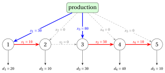

# DP for the uncapacitated lot sizing problem

**Part 3 · Dynamic programming · Chapter 25** · [:material-file-pdf-box: Lecture notes, volume 3 (PDF)](../../pdf/lecture-notes-3-dynamic-programming.pdf) · [:material-presentation: Slides](../../pdf/slides-dp-lot-sizing.pdf) · [:material-pencil: Exercises: Uncapacitated lot sizing (ULS)](../../exercises/dp-lot-sizing.md) · [:material-gesture-tap: App: Wagner-Whitin for uncapacitated lot sizing](../../lab/wagner-whitin-lot-sizing.md)

!!! nota "Prerequisites"

    - From this module, the chapters [«Lot sizing problems»](https://fabiofurini.github.io/combinatorial-optimization/combinatorial-optimization-problems/lot-sizing/) and [«Formulations of lot sizing problems»](https://fabiofurini.github.io/combinatorial-optimization/formulations/lot-sizing-formulations/): the single-item problem, its reference instance, and its ILP model with the variables $x_t$, $s_t$, $y_t$.

    - From this module, the chapter [«Principles of dynamic programming»](https://fabiofurini.github.io/combinatorial-optimization/dynamic-programming/dp-principles/) and the DP algorithms of the previous chapters: recurrence, base cases, lookup table and reconstruction of a solution.

    - From the module <em>Algorithms</em>: [pseudocode (Chapter 2)](https://fabiofurini.github.io/algorithms/basic-algorithms/02-pseudo-code/), and [the size of the input (Chapter 11)](https://fabiofurini.github.io/algorithms/analysis/11-input-size/).

!!! nota "Where we were"

    - <strong>As a problem and as a model</strong>: single-item lot sizing and its ILP formulations (Chapter 8 [«Lot sizing problems»](../../combinatorial-optimization-problems/lot-sizing/index.md) and Chapter 15 [«Formulations of lot sizing problems»](../../formulations/lot-sizing-formulations/index.md)).

    - <strong>Now, as a table</strong>: the DP algorithm of Wagner and Whitin gives the optimal value of the uncapacitated problem in $\Theta(m^2)$ steps.

!!! chiave "Objectives"

    At the end of this chapter you will be able to:

    - state the zero-inventory ordering property, and prove it with the exchange argument;

    - compute the cost $c_{j,t}$ of a production run, and the matrix of the costs, in $O(m^2)$ steps;

    - write the recurrence $v(t)$ over the last production run, run the DP algorithm by hand and reconstruct an optimal plan;

    - read the recurrence as a shortest path in the network of the production runs;

    - count the steps of the DP algorithm, and show that they are $\Theta(m^2)$.

The problem of this chapter is the [uncapacitated lot sizing problem (ULS)](https://fabiofurini.github.io/combinatorial-optimization/catalogue/uncapacitated-lot-sizing-problem/): its definition and its assumptions are on its page.

## 25.1 Notation, model and feasible solutions

- For any $j,t \in T$, we denote by

    $$
    D_{j,t}=\sum_{k=j}^{t} d_k
    $$

    the total demand of periods $j,j+1,\dots,t$, with $D_{j,t}=0$ if $j>t$.

- The ILP model is the $\mathrm{ILP}_{\mathrm{ULS}}$ model of [Chapter 15 «Formulations of lot sizing problems»](https://fabiofurini.github.io/combinatorial-optimization/formulations/lot-sizing-formulations/), section «ILP models for the variants»: the $\mathrm{ILP}_{\mathrm{CLSP}}$ model without the capacity constraints and with the big-M value $D_{t,m}$ of period $t$, the total demand of the remaining periods. Its variables are the production $x_t$, the inventory $s_t$ at the end of period $t$, and the setup $y_t\in\{0,1\}$, for every period $t \in T$.

!!! chiave ""

    We recall the $\mathrm{ILP}_{\mathrm{ULS}}$ model of the uncapacitated lot sizing problem (ULS):

    

    \begin{align*}
    && \min ~~ \sum_{t \in T} \left(sc_t\, y_t + vc_t\, x_t + hc_t\, s_t\right) \label{uls:obj} \tag{25.1a}\\[1ex]
    && \text{subject to} \quad s_{t-1} + x_t & = d_t + s_t, & \forall t \in T, \label{uls:bal} \tag{25.1b}\\[1ex]
    && x_t & \le D_{t,m}\, y_t, & \forall t \in T, \label{uls:big} \tag{25.1c}\\[1ex]
    && s_0 = s_m & = 0, \label{uls:end} \tag{25.1d}\\[1ex]
    && x_t & \in \Z_{\ge 0}, & \forall t \in T, \label{uls:domx} \tag{25.1e}\\[1ex]
    && s_t & \in \Z_{\ge 0}, & \forall t \in T, \label{uls:doms} \tag{25.1f}\\[1ex]
    && y_t & \in \{0,1\}, & \forall t \in T. \label{uls:domy} \tag{25.1g}
    \end{align*}

    This ILP model is referred to as the $\mathrm{ILP}_{\mathrm{ULS}}$ model.

- Description of the objective function and constraints of the $\mathrm{ILP}_{\mathrm{ULS}}$ model:

    - the objective function $\eqref{uls:obj}$ minimizes the total cost of setups, production and holding;

    - constraints $\eqref{uls:bal}$ are the flow balancing constraints;

    - constraints $\eqref{uls:big}$ force a setup in every period with positive production;

    - constraint $\eqref{uls:end}$ imposes an empty inventory at the beginning and at the end of the horizon;

    - finally, constraints $\eqref{uls:domx}$–$\eqref{uls:domy}$ define the variables of the ILP model.

!!! esempio "Example 25.1: Uncapacitated lot sizing"

    We consider $m=5$ periods with the following data:

    $$
    \begin{array}{l|rrrrr}
    \hline {t} & {1} & {2} & {3} & {4} & {5} \\
    \hline {d_t} & {20} & {10} & {30} & {40} & {10} \\
    {sc_t} & {50} & {50} & {50} & {50} & {50} \\
    {vc_t} & {0} & {0} & {0} & {0} & {0} \\
    {hc_t} & {1} & {1} & {1} & {1} & {1} \\
    \hline
    \end{array}
    $$

    We refer to this ULS instance as [Example 25.1](#box-1-texuls1). It is the reference instance of Chapter 8 [«Lot sizing problems»](../../combinatorial-optimization-problems/lot-sizing/index.md), counted in single items instead of units of ten and without the capacities (setup cost $50$, holding cost $1$, no variable production cost).

### 25.1.1 Encoding of feasible solutions

!!! chiave ""

    A <em>feasible solution</em> of the ULS is a production plan that satisfies the demand of every period, starting and ending with an empty inventory.

- A ULS feasible solution can be described by a solution vector

    $$
    (x_1,x_2,\dots,x_m)
    $$

    where each component has the following meaning:

    $$
    x_t = \text{number of units produced in period } t,
    \qquad \forall t \in \{1,2,\dots,m\}.
    $$

    The inventory at the end of period $t$ is determined by the vector:

    $$
    s_t=\sum_{j=1}^{t} x_j - D_{1,t},
    \qquad \forall t \in \{1,2,\dots,m\}.
    $$

    Since the solution is feasible, the inventories are non-negative and the last one is empty:

    $$
    s_t \ge 0 \quad \forall t \in \{1,2,\dots,m-1\}, \qquad s_m=0.
    $$

    A setup is paid in period $t$ if and only if $x_t>0$. The total cost of a feasible solution is

    $$
    \sum_{t=1,\ x_t>0}^{m} sc_t+\sum_{t=1}^{m} vc_t\, x_t+\sum_{t=1}^{m} hc_t\, s_t.
    $$

!!! esempio "Example 25.2: A feasible solution"

    We consider the ULS instance of [Example 25.1](#box-1-texuls1). The following network represents the feasible solution $(30,\allowbreak 0,\allowbreak 80,\allowbreak 0,\allowbreak 0)$: each period is a node, the production $x_t$ enters node $t$, the demand $d_t$ leaves it, and the inventory $s_t$ flows from node $t$ to node $t+1$. Thick arcs carry a positive flow.

    { .fig loading=lazy  }

    The setups are in periods $1$, $3$, the inventories are $(s_1,\dots,s_{5})=(10,\allowbreak 0,\allowbreak 50,\allowbreak 10,\allowbreak 0)$, and the total cost is (there is no variable production cost)

    $$
    \underbrace{50+50}_{\text{setup}}+\underbrace{1\cdot 10+1\cdot 0+1\cdot 50+1\cdot 10+1\cdot 0}_{\text{holding}}=100+70=170.
    $$

- A production quantity can take many values, and a ULS instance has a huge number of feasible solutions (infinitely many, if the quantities are not required to be integer). The next property shows that only very few of them need to be considered.

### 25.1.2 The zero-inventory ordering property

!!! teorema "Theorem 25.1: Zero-inventory ordering (Wagner and Whitin, 1958)"

    Every ULS instance has an optimal solution in which no period with positive production starts with a positive inventory, that is,

    $$
    s_{t-1}\, x_t = 0 \qquad \forall t \in \{1,2,\dots,m\}.
    $$

- <em>Proof.</em> First, an optimal solution exists: the vector $(d_1,d_2,\dots,d_m)$ is feasible, and for each of the $2^m$ choices of the set of periods with a setup, the remaining problem is a linear program over a bounded polyhedron (since $s_m=0$, every $x_t$ is between $0$ and $D_{1,m}$), so it has an optimal solution whenever it is feasible.

- Among all optimal solutions, consider one with the <strong>smallest number of periods with positive production</strong>, and suppose, by contradiction, that there exists a period $t$ with $x_t>0$ and $s_{t-1}>0$.

- Since $s_0=0$ and $s_{t-1}>0$, something is produced before period $t$: let $j<t$ be the last period before $t$ with $x_j>0$. No unit is produced in periods $j+1,\dots,t-1$, so the inventory can only decrease from period $j$ to period $t-1$:

    $$
    s_k \ge s_{t-1} > 0 \qquad \forall k \in \{j,j+1,\dots,t-1\}.
    $$

- For a number $\varepsilon$, move $\varepsilon$ units of production from period $j$ to period $t$: replace $x_j$ by $x_j-\varepsilon$, $x_t$ by $x_t+\varepsilon$, and $s_k$ by $s_k-\varepsilon$ for all $k \in \{j,\dots,t-1\}$. All balancing constraints remain satisfied, and the new plan is feasible for every $\varepsilon$ with

    $$
    -x_t \le \varepsilon \le \min\{x_j,\ s_{t-1}\}.
    $$

- As long as $x_j$ and $x_t$ stay positive, the setups do not change and the cost changes by $\varepsilon\,\Delta$, where

    $$
    \Delta = vc_t - vc_j - \sum_{k=j}^{t-1} hc_k
    $$

    is the cost of producing one unit in period $t$ minus the cost of producing it in period $j$ and holding it until period $t$.

- If $\Delta<0$, a small $\varepsilon>0$ gives a feasible solution with a smaller cost, which contradicts optimality.

- If $\Delta\ge 0$, choose $\varepsilon=-x_t$: the whole production of period $t$ is moved to period $j$, the cost changes by $-x_t\,\Delta \le 0$, and the setup cost $sc_t\ge 0$ of period $t$ is saved. The new solution is optimal and has one period with positive production less, which contradicts the choice of the solution.

- Hence no such period $t$ exists.  $\square$

!!! chiave ""

    In an optimal solution with the zero-inventory ordering property, each period $j$ with positive production produces exactly the demands of periods $j,j+1,\dots,t$, where $t+1$ is the next period with positive production (or $t=m$ if there is none):

    $$
    x_j = D_{j,t}.
    $$

- Indeed, $s_{j-1}=0$ (zero-inventory ordering in period $j$), $s_t=0$ (zero-inventory ordering in period $t+1$, or $s_m=0$), and nothing is produced in periods $j+1,\dots,t$; summing the balancing constraints of periods $j,\dots,t$ gives $x_j=D_{j,t}$.

- Period $1$ always produces, since $s_0=0$ and $d_1\ge 1$. A solution with the zero-inventory ordering property is therefore determined by the set of its production periods, which contains period $1$ and any subset of $\{2,3,\dots,m\}$.

!!! chiave ""

    The number of ULS solutions with the zero-inventory ordering property is $2^{m-1}$, since each period $t\in\{2,3,\dots,m\}$ can independently produce or not.

- The number of these solutions grows exponentially with the number $m$ of periods:

    $$
    2^{m-1}=O(2^m).
    $$

    Therefore, enumerating them quickly becomes impractical as $m$ increases.

!!! esempio "Example 25.3: Enumeration of the solutions with the zero-inventory ordering property"

    We consider the ULS instance of [Example 25.1](#box-1-texuls1):

    $$
    \begin{array}{l|rrrrr}
    \hline {t} & {1} & {2} & {3} & {4} & {5} \\
    \hline {d_t} & {20} & {10} & {30} & {40} & {10} \\
    {sc_t} & {50} & {50} & {50} & {50} & {50} \\
    {vc_t} & {0} & {0} & {0} & {0} & {0} \\
    {hc_t} & {1} & {1} & {1} & {1} & {1} \\
    \hline
    \end{array}
    $$

    There are $2^{5-1}=16$ solutions with the zero-inventory ordering property. For each of them, the table reports the production periods, the solution vector, the inventories, and the total cost, written as setup cost plus holding cost. The optimal costs are highlighted.

    
<table>
    <tr>
    <th>Label</th>
    <th>Production periods</th>
    <th>Solution vector</th>
    <th>Inventories \((s_1,\dots,s_{5})\)</th>
    <th>Total cost</th>
    </tr>
    <tr>
    <td>\((1)\)</td>
    <td>\(\{1\}\)</td>
    <td>\((110,\allowbreak 0,\allowbreak 0,\allowbreak 0,\allowbreak 0)\)</td>
    <td>\((90,\allowbreak 80,\allowbreak 50,\allowbreak 10,\allowbreak 0)\)</td>
    <td>\(50+230=280\)</td>
    </tr>
    <tr>
    <td>\((2)\)</td>
    <td>\(\{1,5\}\)</td>
    <td>\((100,\allowbreak 0,\allowbreak 0,\allowbreak 0,\allowbreak 10)\)</td>
    <td>\((80,\allowbreak 70,\allowbreak 40,\allowbreak 0,\allowbreak 0)\)</td>
    <td>\(100+190=290\)</td>
    </tr>
    <tr>
    <td>\((3)\)</td>
    <td>\(\{1,4\}\)</td>
    <td>\((60,\allowbreak 0,\allowbreak 0,\allowbreak 50,\allowbreak 0)\)</td>
    <td>\((40,\allowbreak 30,\allowbreak 0,\allowbreak 10,\allowbreak 0)\)</td>
    <td>\(100+80=180\)</td>
    </tr>
    <tr>
    <td>\((4)\)</td>
    <td>\(\{1,4,5\}\)</td>
    <td>\((60,\allowbreak 0,\allowbreak 0,\allowbreak 40,\allowbreak 10)\)</td>
    <td>\((40,\allowbreak 30,\allowbreak 0,\allowbreak 0,\allowbreak 0)\)</td>
    <td>\(150+70=220\)</td>
    </tr>
    <tr>
    <td>\((5)\)</td>
    <td>\(\{1,3\}\)</td>
    <td>\((30,\allowbreak 0,\allowbreak 80,\allowbreak 0,\allowbreak 0)\)</td>
    <td>\((10,\allowbreak 0,\allowbreak 50,\allowbreak 10,\allowbreak 0)\)</td>
    <td class="cella-blu">\(100+70=170\)</td>
    </tr>
    <tr>
    <td>\((6)\)</td>
    <td>\(\{1,3,5\}\)</td>
    <td>\((30,\allowbreak 0,\allowbreak 70,\allowbreak 0,\allowbreak 10)\)</td>
    <td>\((10,\allowbreak 0,\allowbreak 40,\allowbreak 0,\allowbreak 0)\)</td>
    <td>\(150+50=200\)</td>
    </tr>
    <tr>
    <td>\((7)\)</td>
    <td>\(\{1,3,4\}\)</td>
    <td>\((30,\allowbreak 0,\allowbreak 30,\allowbreak 50,\allowbreak 0)\)</td>
    <td>\((10,\allowbreak 0,\allowbreak 0,\allowbreak 10,\allowbreak 0)\)</td>
    <td class="cella-blu">\(150+20=170\)</td>
    </tr>
    <tr>
    <td>\((8)\)</td>
    <td>\(\{1,3,4,5\}\)</td>
    <td>\((30,\allowbreak 0,\allowbreak 30,\allowbreak 40,\allowbreak 10)\)</td>
    <td>\((10,\allowbreak 0,\allowbreak 0,\allowbreak 0,\allowbreak 0)\)</td>
    <td>\(200+10=210\)</td>
    </tr>
    <tr>
    <td>\((9)\)</td>
    <td>\(\{1,2\}\)</td>
    <td>\((20,\allowbreak 90,\allowbreak 0,\allowbreak 0,\allowbreak 0)\)</td>
    <td>\((0,\allowbreak 80,\allowbreak 50,\allowbreak 10,\allowbreak 0)\)</td>
    <td>\(100+140=240\)</td>
    </tr>
    <tr>
    <td>\((10)\)</td>
    <td>\(\{1,2,5\}\)</td>
    <td>\((20,\allowbreak 80,\allowbreak 0,\allowbreak 0,\allowbreak 10)\)</td>
    <td>\((0,\allowbreak 70,\allowbreak 40,\allowbreak 0,\allowbreak 0)\)</td>
    <td>\(150+110=260\)</td>
    </tr>
    <tr>
    <td>\((11)\)</td>
    <td>\(\{1,2,4\}\)</td>
    <td>\((20,\allowbreak 40,\allowbreak 0,\allowbreak 50,\allowbreak 0)\)</td>
    <td>\((0,\allowbreak 30,\allowbreak 0,\allowbreak 10,\allowbreak 0)\)</td>
    <td>\(150+40=190\)</td>
    </tr>
    <tr>
    <td>\((12)\)</td>
    <td>\(\{1,2,4,5\}\)</td>
    <td>\((20,\allowbreak 40,\allowbreak 0,\allowbreak 40,\allowbreak 10)\)</td>
    <td>\((0,\allowbreak 30,\allowbreak 0,\allowbreak 0,\allowbreak 0)\)</td>
    <td>\(200+30=230\)</td>
    </tr>
    <tr>
    <td>\((13)\)</td>
    <td>\(\{1,2,3\}\)</td>
    <td>\((20,\allowbreak 10,\allowbreak 80,\allowbreak 0,\allowbreak 0)\)</td>
    <td>\((0,\allowbreak 0,\allowbreak 50,\allowbreak 10,\allowbreak 0)\)</td>
    <td>\(150+60=210\)</td>
    </tr>
    <tr>
    <td>\((14)\)</td>
    <td>\(\{1,2,3,5\}\)</td>
    <td>\((20,\allowbreak 10,\allowbreak 70,\allowbreak 0,\allowbreak 10)\)</td>
    <td>\((0,\allowbreak 0,\allowbreak 40,\allowbreak 0,\allowbreak 0)\)</td>
    <td>\(200+40=240\)</td>
    </tr>
    <tr>
    <td>\((15)\)</td>
    <td>\(\{1,2,3,4\}\)</td>
    <td>\((20,\allowbreak 10,\allowbreak 30,\allowbreak 50,\allowbreak 0)\)</td>
    <td>\((0,\allowbreak 0,\allowbreak 0,\allowbreak 10,\allowbreak 0)\)</td>
    <td>\(200+10=210\)</td>
    </tr>
    <tr>
    <td>\((16)\)</td>
    <td>\(\{1,2,3,4,5\}\)</td>
    <td>\((20,\allowbreak 10,\allowbreak 30,\allowbreak 40,\allowbreak 10)\)</td>
    <td>\((0,\allowbreak 0,\allowbreak 0,\allowbreak 0,\allowbreak 0)\)</td>
    <td>\(250+0=250\)</td>
    </tr>
    </table>

    The optimal value of the ULS instance is $170$, attained by $2$ solutions: $(5)$ and $(7)$.

-   **Overview**

    Notation, model and feasible solutions · Encoding of feasible solutions · The zero-inventory ordering property

    [:octicons-arrow-right-24: Open](#251-notation-model-and-feasible-solutions)

-   **25.2 A DP algorithm for the ULS**

    [:octicons-arrow-right-24: Open](a-dp-algorithm-for-the-uls.md)

-   **25.2.2 A DP algorithm for the ULS: Step 1 and Step 2**

    [:octicons-arrow-right-24: Open](a-dp-algorithm-for-the-uls-step-1-and-step-2.md)

-   **Typical mistakes · In summary**

    In summary

    [:octicons-arrow-right-24: Open](typical-mistakes.md)

---

**Next:** [25.2 A DP algorithm for the ULS](a-dp-algorithm-for-the-uls.md)

---

**Exercises on this chapter:** [:material-pencil: Uncapacitated lot sizing (ULS)](../../exercises/dp-lot-sizing.md)

<!-- laboratorio-interattivo: sezione generata da interattivi.py -->

:material-flask-outline: **In the interactive lab:** [Wagner-Whitin for uncapacitated lot sizing](../../lab/wagner-whitin-lot-sizing.md).