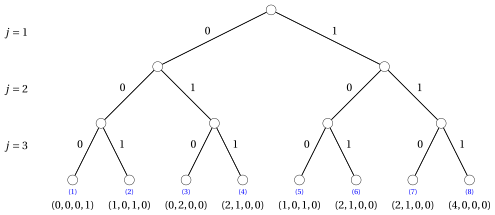
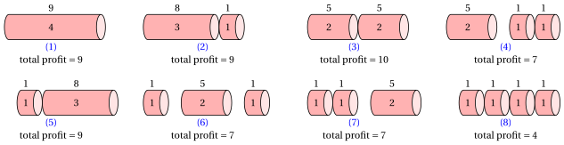
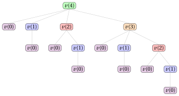
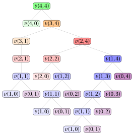
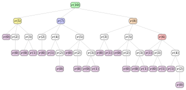

# Rod cutting and coin change

**Part 3 · Dynamic programming · Chapter 16** · [:material-file-pdf-box: Lecture notes, volume 3 (PDF)](../pdf/lecture-notes-3-dynamic-programming.pdf) · [:material-pencil: Exercises](../exercises/dp-rod-cutting-coin-change.md)

## 16.1 A DP algorithm for the Rod Cutting Problem

!!! nota "Prerequisites"

    - From this module, the chapter «Principles of dynamic programming»: optimal substructure, overlapping subproblems, recurrence relations, base cases, and the top-down and bottom-up approaches.

    - From this module, the chapter «Dynamic programming for knapsack problems»: the pairs (item, capacity) and the reconstruction of a solution, which return here.

    - From the module <em>Algorithms</em>: how to read pseudocode and how to count the steps of an algorithm.

!!! chiave "Objectives"

    At the end of this chapter you will be able to:

    - state the RCP, encode a solution as a vector of numbers of pieces, and explain why cutting patterns and vectors are different objects;

    - write the recurrence $v(\ell)$ and explain it, base case included;

    - run the DP algorithm by hand with the top-down and the bottom-up approach, and with the running best value $m$;

    - reconstruct an optimal solution from the vector ${s}$, for the rod and for every shorter rod;

    - write the second recurrence $v(j,\ell)$ on pairs (largest piece length, rod length) and count the steps of the DP algorithm.

### 16.1.1 Problem definition

!!! definizione "Definition 16.1: Rod-Cutting Problem"

    Given:

    1. a rod of <em>length</em> $n \in \Z_{\ge 1}$,

    2. a set $\{1,2,\dots,n\}$ of $n$ possible piece lengths,

    3. for each piece length $\ell \in \{1,2,\dots,n\}$, a <em>profit</em> $p_\ell \in \Z_{\ge 1}$,

    the <strong>Rod-Cutting Problem</strong> (RCP) asks to decide how many copies of each piece length to cut, so that the total length of the obtained pieces is equal to the rod length, and the total profit of the obtained pieces is maximized.

!!! esempio "Example 16.1: Rod cutting problem"

    We consider a rod of length $n = 4$ and a set $\{1,2,3,4\}$ of $4$ possible piece lengths with the following profits:

    
<table>
    <tr>
    <th></th>
    <th>\(\ell = 1\)</th>
    <th>\(\ell = 2\)</th>
    <th>\(\ell = 3\)</th>
    <th>\(\ell = 4\)</th>
    </tr>
    <tr>
    <td>\(p_\ell\)</td>
    <td>\(1\)</td>
    <td>\(5\)</td>
    <td>\(8\)</td>
    <td>\(9\)</td>
    </tr>
    </table>

    We refer to this RCP instance as Example 1.

!!! chiave ""

    The number of possible solutions of the RCP is $2^{n-1}$ since we can cut a rod of length $n$ in $2^{n-1}$ different ways, with an independent option of cutting (or not) at each possible cutting position.

- The number of possible RCP solutions grows exponentially with the length $n$ of the rod:

    $$
    2^{n-1} = O(2^n).
    $$

    Therefore, enumerating all possible solutions quickly becomes impractical as $n$ increases.

#### Encoding of feasible solutions

!!! chiave ""

    A <em>feasible solution</em> of the RCP is a way of cutting the rod into pieces, such that the total length of the pieces is equal to the rod length.

- An RCP feasible solution can be described by an integer solution vector

    $$
    (x_1,x_2,\dots,x_n)
    $$

    where each component has the following meaning:

    $$
    x_\ell = \text{number of pieces of length } \ell,
    \qquad \forall \ell \in \{1,2,\dots,n\};
    $$

    The number of pieces is

    $$
    \sum_{\ell=1}^{n} x_\ell.
    $$

    Since the solution is feasible, the total length of the pieces must be equal to the rod length:

    $$
    \sum_{\ell=1}^{n} \ell \, x_\ell = n.
    $$

    The total profit of a feasible solution is

    $$
    \sum_{\ell=1}^{n} p_\ell x_\ell.
    $$

- Notice that two or more cutting patterns may have the same vector representation: the vector records how many pieces of each length are obtained, but it does not specify the order in which the pieces are cut. However, cutting patterns with the same vector representation have the same total profit, since the order in which the pieces are cut does not affect the obtained pieces and therefore does not affect the total profit.

!!! esempio "Example 16.2: Enumeration of all possible RCP solutions"

    We consider the RCP instance of  Example 1 with a rod of length $n = 4$ and the profits associated with the possible piece lengths are:

    
<table>
    <tr>
    <th></th>
    <th>\(\ell = 1\)</th>
    <th>\(\ell = 2\)</th>
    <th>\(\ell = 3\)</th>
    <th>\(\ell = 4\)</th>
    </tr>
    <tr>
    <td>\(p_\ell\)</td>
    <td>\(1\)</td>
    <td>\(5\)</td>
    <td>\(8\)</td>
    <td>\(9\)</td>
    </tr>
    </table>

    There are $2^{4-1} = 8$ feasible solutions, corresponding to the different ways of cutting the rod.

    In the following binary tree, each level corresponds to a possible cutting position: an edge labeled $1$ means that the rod is cut at that length, while an edge labeled $0$ means that it is not cut at that length. Each leaf represents one complete cutting pattern and reports the corresponding vector.

    { .fig .ovale loading=lazy style="width:100%" }

    The figure below shows all possible cutting patterns associated with the leaves of the previous tree, through the labels $(1),(2),\dots,(8)$. For each obtained piece, the number written inside the piece is its length, while the number above it is its profit.

    { .fig .ovale loading=lazy style="width:100%" }

    
<table>
    <tr>
    <th>Label</th>
    <th>Solution vector</th>
    <th>Number of pieces</th>
    <th>Total profit</th>
    </tr>
    <tr>
    <td>\((1)\)</td>
    <td>\((0,0,0,1)\)</td>
    <td>\(1\)</td>
    <td>\(9\)</td>
    </tr>
    <tr>
    <td>\((2)\)</td>
    <td>\((1,0,1,0)\)</td>
    <td>\(2\)</td>
    <td>\(8+1=9\)</td>
    </tr>
    <tr>
    <td>\((3)\)</td>
    <td>\((0,2,0,0)\)</td>
    <td>\(2\)</td>
    <td>\(5+5=10\)</td>
    </tr>
    <tr>
    <td>\((4)\)</td>
    <td>\((2,1,0,0)\)</td>
    <td>\(3\)</td>
    <td>\(5+1+1=7\)</td>
    </tr>
    <tr>
    <td>\((5)\)</td>
    <td>\((1,0,1,0)\)</td>
    <td>\(2\)</td>
    <td>\(1+8=9\)</td>
    </tr>
    <tr>
    <td>\((6)\)</td>
    <td>\((2,1,0,0)\)</td>
    <td>\(3\)</td>
    <td>\(1+5+1=7\)</td>
    </tr>
    <tr>
    <td>\((7)\)</td>
    <td>\((2,1,0,0)\)</td>
    <td>\(3\)</td>
    <td>\(1+1+5=7\)</td>
    </tr>
    <tr>
    <td>\((8)\)</td>
    <td>\((4,0,0,0)\)</td>
    <td>\(4\)</td>
    <td>\(1+1+1+1=4\)</td>
    </tr>
    </table>

### 16.1.2 A first DP algorithm

- <u>Step 1</u>: computation of the optimal value

    !!! chiave ""

        For any $\ell \in \{0,1,\dots,n\}$, let $v(\ell)$ be the optimal value of the RCP subinstance given by:

        1. a rod of length $\ell$,

        2. a set $\{1,2,\dots,\ell\}$ of $\ell$ possible piece lengths,

        3. for each piece length $j \in \{1,2,\dots,\ell\}$, a profit $p_j$.

        The recursive formula to compute $v(\ell)$ reads as follows:

        \begin{equation*}
        \label{eq:1}
        v(\ell)= \left\{ \begin{array}{ll}
        \displaystyle \max \bigg\{ p_j + v(\ell-j) : j \in \{1,2,\dots,\ell\}\bigg\} & \textrm{if $1\le \ell \le n$,}\\[2ex]
        0 & \textrm{if $\ell=0$.}
        \end{array} \right. \tag{16.1}
        \end{equation*}

    - The recursive decomposition process of formula $\eqref{eq:1}$ generates $\ell$ <strong>independent subproblems</strong>, each corresponding to a possible choice of cutting a first piece of length $j$ from a rod of length $\ell$.  Here, $v(0)=0$ since a rod of length $0$ cannot be cut and has profit $0$.

    - The optimal value $v(\ell)$ is obtained by trying all possible first-piece lengths and selecting the one that maximizes the sum $p_j+v(\ell-j)$ of the profit of the first piece and the optimal value of the residual subproblem.

    - Hence, an optimal solution for a rod of length $\ell$ is built by combining the chosen first piece of length $j$ with an optimal solution of the residual subproblem of length $\ell-j$.

        $\rightsquigarrow$ <strong>Optimal Substructure verified!</strong>

    - Different choices of the first-piece length, possibly made for different values of $\ell$, can lead to the same residual length, and therefore the same value $v(\ell)$ may need to be computed several times during the recursive evaluation of formula $\eqref{eq:1}$.

        $\rightsquigarrow$ <strong>Overlapping Subproblems verified!</strong>

    - A <strong>first method</strong> to compute the optimal value $v(n)$ of the RCP instance is the <strong>top-down approach</strong>. The method starts from the call with $\ell=n$ and evaluates formula $\eqref{eq:1}$ recursively: each call for a rod of length $\ell$ triggers further calls for rods of length $\ell-j$, for all $j \in \{1,2,\dots,\ell\}$, until the base case $v(0)$ is reached.

    - The <strong>recursion tree</strong> of the function $v$ has one node for each recursive call, labeled with the function call it represents. The root represents the initial call. The children of a node represent the recursive calls made by that call. The leaf nodes represent the base cases.

        

        !!! esempio "Example 16.3: Recursion tree"

            We consider the RCP instance of Example 1. This is the recursion tree of the top-down approach to compute $v(4)$:

            { .fig loading=lazy  }

            The function $v$ is called $16$ times, and the same subproblems are solved multiple times: $v(2)$ is called $2$ times, $v(1)$ is called $4$ times, and $v(0)$ is called $8$ times. All the other calls are made only once.

    - The value $v(\ell)$, for a generic rod length $\ell$, can be computed once the values $v(j)$ are known for all smaller lengths $j<\ell$.

        

        !!! esempio "Example 16.4: Computing the values of the $v$ function"

            We consider the RCP instance of  Example 1 with a rod of length $n = 4$ and the profits associated with the possible piece lengths are:

            
<table>
            <tr>
            <th></th>
            <th>\(\ell = 1\)</th>
            <th>\(\ell = 2\)</th>
            <th>\(\ell = 3\)</th>
            <th>\(\ell = 4\)</th>
            </tr>
            <tr>
            <td>\(p_\ell\)</td>
            <td>\(1\)</td>
            <td>\(5\)</td>
            <td>\(8\)</td>
            <td>\(9\)</td>
            </tr>
            </table>

            The value of the function $v$ can be computed by starting from the base case $v(0)=0$ and then computing the values of $v(1)$, $v(2)$, $v(3)$, and $v(4)$ in order, as follows:

            - Since we know the value of $v(0)$, we can compute $v(1)$, as follows:

                $$
                v(1)=p_1 + v(0) = 1 + 0 = 1
                $$

            - Once we have computed  $v(1)$, we can compute $v(2)$, as follows:

                $$
                v(2)= \max\{p_1+v(1),p_2+v(0)\} = \max\{1+1,5+0\} = 5
                $$

            - Once we have computed $v(2)$ and $v(1)$, we can compute $v(3)$, as follows:

                $$
                v(3)= \max\{p_1+v(2),p_2+v(1),p_3+v(0)\} = \max\{1+5,5+1,8+0\} = 8
                $$

            - Once we have computed $v(3)$, $v(2)$ and $v(1)$, we can compute $v(4)$, as follows:

                \begin{align*}
                v(4)&= \max\{p_1+v(3),p_2+v(2),p_3+v(1),p_4+v(0)\}\\ &= \max\{1+8,5+5,8+1,9+0\} = 10
                \end{align*}

    - We can avoid solving the same subproblems repeatedly by storing the value of each subproblem as soon as it is computed. The values are stored in a <strong>lookup table</strong>.

    - Since solving a subproblem with value $v(\ell)$ depends only on subproblems with values $v(j)$, with $j<\ell$, we can solve the subproblems for increasing values of $\ell$, starting from the base case $v(0)=0$ and building up to $v(n)$: this observation naturally leads to a <strong>much more efficient method</strong> to compute the optimal value $v(n)$ of the RCP instance.

    - A <strong>second method</strong> to compute the optimal value $v(n)$ of the RCP instance is the <strong>bottom-up approach</strong>. The method starts from the base case $v(0)=0$ and evaluates formula $\eqref{eq:1}$ for increasing rod lengths $\ell \in \{1,2,\dots,n\}$: each value $v(\ell)$ is computed using the already-computed values $v(0), v(1), \dots, v(\ell-1)$, until the value $v(n)$ of the RCP instance is obtained.

        

        This is the pseudo-code of the <strong>DP algorithm using the bottom-up approach</strong>:

        !!! algoritmo "Algorithm: DP1"

            

<strong>Input:</strong> An RCP instance given by the length \(n\) of the rod and an array \(p[1..n]\) of piece profits

<strong>Output:</strong> The optimal value of the RCP instance

1<strong>Function</strong> DP1(\(n,p\))

2\({v} := \textnormal{new array}[0..n]\)

3\({v}[0] \leftarrow 0\)

4<strong>for</strong> \(\ell := 1\) <strong>to</strong> \(n\)  <strong>do</strong>

5\(\mathit{m} := 0\)

6<strong>for</strong> \(j := 1\) <strong>to</strong> \(\ell\)  <strong>do</strong>

7<strong>if</strong> \(\mathit{m} < p[j] + {v}[\ell-j]\)  <strong>then</strong>

8\(\mathit{m} \leftarrow p[j] + {v}[\ell-j]\)

9<strong>end</strong>

10<strong>end</strong>

11\({v}[\ell] \leftarrow \mathit{m}\)

12<strong>end</strong>

13<strong>return</strong> \({v}[n]\)

        

        - The vector ${v}[0..n]$ is the <strong>lookup table</strong>: it stores the optimal values of all subproblems, with the base case ${v}[0]=0$.

        - The outer loop, over $\ell \in \{1,2,\dots,n\}$, computes ${v}[\ell]$ in increasing order of rod length.

        - The inner loop, over $j \in \{1,2,\dots,\ell\}$, evaluates all possible first-piece lengths and keeps in $\mathit{m}$ the largest value $p[j]+{v}[\ell-j]$.

        - At the end of the inner loop, ${v}[\ell] \leftarrow \mathit{m}$ stores the optimal value ${v}[\ell]$.

        - Finally, the optimal value ${v}[n]$ of the RCP instance is returned.

        

        !!! esempio "Example 16.5: Execution of the DP algorithm"

            We consider the RCP instance of  Example 1 with a rod of length $n = 4$ and the profits associated with the possible piece lengths are:

            
<table>
            <tr>
            <th></th>
            <th>\(\ell = 1\)</th>
            <th>\(\ell = 2\)</th>
            <th>\(\ell = 3\)</th>
            <th>\(\ell = 4\)</th>
            </tr>
            <tr>
            <td>\(p_\ell\)</td>
            <td>\(1\)</td>
            <td>\(5\)</td>
            <td>\(8\)</td>
            <td>\(9\)</td>
            </tr>
            </table>

            For each step of the DP algorithm, the table shows the values of $\ell$ and $j$, the current value of $\mathit{m}$, and the cell ${v}[\ell]$. The cell of $\mathit{m}$ is highlighted in <mark>red</mark> when updated; the cell of ${v}[\ell]$ is highlighted in <mark>blue</mark> when assigned.

            
<table>
            <tr>
            <th>\(\ell\)</th>
            <th>\(j\)</th>
            <th>\({v}[\ell]\)</th>
            <th>\(\mathit{m}\)</th>
            <th>Action</th>
            </tr>
            <tr>
            <td>\(-\)</td>
            <td>\(-\)</td>
            <td class="cella-blu">0</td>
            <td>\(-\)</td>
            <td>\({v}[0]\leftarrow 0\)</td>
            </tr>
            <tr>
            <td></td>
            <td>\(-\)</td>
            <td>\(-\)</td>
            <td>0</td>
            <td>\(\mathit{m}\leftarrow 0\)</td>
            </tr>
            <tr>
            <td>1</td>
            <td>1</td>
            <td>\(-\)</td>
            <td class="cella-rossa">1</td>
            <td>\(p[1]{+}{v}[0]=1{+}0=1>0\): \(\mathit{m}\leftarrow 1\)</td>
            </tr>
            <tr>
            <td></td>
            <td>\(-\)</td>
            <td class="cella-blu">1</td>
            <td>1</td>
            <td>\({v}[1]\leftarrow \mathit{m}=1\)</td>
            </tr>
            <tr>
            <td></td>
            <td>\(-\)</td>
            <td>\(-\)</td>
            <td>0</td>
            <td>\(\mathit{m}\leftarrow 0\)</td>
            </tr>
            <tr>
            <td>2</td>
            <td>1</td>
            <td>\(-\)</td>
            <td class="cella-rossa">2</td>
            <td>\(p[1]{+}{v}[1]=1{+}1=2>0\): \(\mathit{m}\leftarrow 2\)</td>
            </tr>
            <tr>
            <td></td>
            <td>2</td>
            <td>\(-\)</td>
            <td class="cella-rossa">5</td>
            <td>\(p[2]{+}{v}[0]=5{+}0=5>2\): \(\mathit{m}\leftarrow 5\)</td>
            </tr>
            <tr>
            <td></td>
            <td>\(-\)</td>
            <td class="cella-blu">5</td>
            <td>5</td>
            <td>\({v}[2]\leftarrow \mathit{m}=5\)</td>
            </tr>
            <tr>
            <td></td>
            <td>\(-\)</td>
            <td>\(-\)</td>
            <td>0</td>
            <td>\(\mathit{m}\leftarrow 0\)</td>
            </tr>
            <tr>
            <td>3</td>
            <td>1</td>
            <td>\(-\)</td>
            <td class="cella-rossa">6</td>
            <td>\(p[1]{+}{v}[2]=1{+}5=6>0\): \(\mathit{m}\leftarrow 6\)</td>
            </tr>
            <tr>
            <td></td>
            <td>2</td>
            <td>\(-\)</td>
            <td>6</td>
            <td>\(p[2]{+}{v}[1]=5{+}1=6=\mathit{m}\): no update</td>
            </tr>
            <tr>
            <td></td>
            <td>3</td>
            <td>\(-\)</td>
            <td class="cella-rossa">8</td>
            <td>\(p[3]{+}{v}[0]=8{+}0=8>6\): \(\mathit{m}\leftarrow 8\)</td>
            </tr>
            <tr>
            <td></td>
            <td>\(-\)</td>
            <td class="cella-blu">8</td>
            <td>8</td>
            <td>\({v}[3]\leftarrow \mathit{m}=8\)</td>
            </tr>
            <tr>
            <td></td>
            <td>\(-\)</td>
            <td>\(-\)</td>
            <td>0</td>
            <td>\(\mathit{m}\leftarrow 0\)</td>
            </tr>
            <tr>
            <td>4</td>
            <td>1</td>
            <td>\(-\)</td>
            <td class="cella-rossa">9</td>
            <td>\(p[1]{+}{v}[3]=1{+}8=9>0\): \(\mathit{m}\leftarrow 9\)</td>
            </tr>
            <tr>
            <td></td>
            <td>2</td>
            <td>\(-\)</td>
            <td class="cella-rossa">10</td>
            <td>\(p[2]{+}{v}[2]=5{+}5=10>9\): \(\mathit{m}\leftarrow 10\)</td>
            </tr>
            <tr>
            <td></td>
            <td>3</td>
            <td>\(-\)</td>
            <td>10</td>
            <td>\(p[3]{+}{v}[1]=8{+}1=9<10\): no update</td>
            </tr>
            <tr>
            <td></td>
            <td>4</td>
            <td>\(-\)</td>
            <td>10</td>
            <td>\(p[4]{+}{v}[0]=9{+}0=9<10\): no update</td>
            </tr>
            <tr>
            <td></td>
            <td>\(-\)</td>
            <td class="cella-blu">10</td>
            <td>10</td>
            <td>\({v}[4]\leftarrow \mathit{m}=10\)</td>
            </tr>
            </table>

            This is the vector ${v}$ after the execution of the DP algorithm:

            
<table>
            <tr>
            <th></th>
            <th>\(\ell = 0\)</th>
            <th>\(\ell=1\)</th>
            <th>\(\ell=2\)</th>
            <th>\(\ell=3\)</th>
            <th>\(\ell=4\)</th>
            </tr>
            <tr>
            <td>\({v}[\ell]\)</td>
            <td>0</td>
            <td>1</td>
            <td>5</td>
            <td>8</td>
            <td>10</td>
            </tr>
            </table>

    - After the execution of the DP algorithm, the vector ${v}$ contains the optimal value ${v}[\ell]$ for every rod length.

- <u>Step 2</u>: computation of an optimal solution

    - To compute an optimal solution, it is necessary to store some additional information.

    - For each rod length $\ell$, in addition to the optimal value ${v}[\ell]$, we store ${s}[\ell]$, the size of the first piece to cut off in an optimal solution for a rod of length $\ell$.

    - Starting from $\ell=n$, the value ${s}[\ell]$ gives the length of the first piece to cut; the remaining rod has length $\ell-{s}[\ell]$, and the same rule can be applied again, and so on, until the residual length reaches $0$.

        

        This is the pseudo-code of the <strong>DP algorithm using the bottom-up approach</strong> with the storing of the information necessary to compute an optimal solution:

        !!! algoritmo "Algorithm: DP1\_InfoSol"

            

<strong>Input:</strong> An RCP instance given by the length \(n\) of the rod and an array \(p[1..n]\) of piece profits

<strong>Output:</strong> The optimal value of the RCP instance and the information vector \({s}[1..n]\)

1<strong>Function</strong> DP1_InfoSol(\(n,p\))

2\({v} := \textnormal{new array}[0..n]\)

3\({s} := \textnormal{new array}[1..n]\)

4\({v}[0] \leftarrow 0\)

5<strong>for</strong> \(\ell := 1\) <strong>to</strong> \(n\) <strong>do</strong>

6\(\mathit{m} := 0\)

7\(\mathit{t} := 0\)

8<strong>for</strong> \(j := 1\) <strong>to</strong> \(\ell\) <strong>do</strong>

9<strong>if</strong> \(\mathit{m} < p[j] + {v}[\ell-j]\) <strong>then</strong>

10\(\mathit{m} \leftarrow p[j] + {v}[\ell-j]\)

11\(\mathit{t} \leftarrow j\)

12<strong>end</strong>

13<strong>end</strong>

14\({v}[\ell] \leftarrow \mathit{m}\)

15\({s}[\ell] \leftarrow \mathit{t}\)

16<strong>end</strong>

17<strong>return</strong> \({v}[n], {s}\)

        

        - The DP algorithm uses the additional temporary variable $\mathit{t}$ to keep track of the decision made when $\mathit{m}$ is updated. If a first piece of length $j$ is selected, $\mathit{t}\leftarrow j$ stores this decision. At the end of the inner loop, ${s}[\ell]\leftarrow \mathit{t}$ stores the length of the selected first piece, together with the optimal value ${v}[\ell]\leftarrow \mathit{m}$.

        

        !!! esempio "Example 16.6: Computation of the additional information"

            We consider the RCP instance of  Example 1 with a rod of length $n = 4$ and the profits associated with the possible piece lengths are:

            
<table>
            <tr>
            <th></th>
            <th>\(\ell = 1\)</th>
            <th>\(\ell = 2\)</th>
            <th>\(\ell = 3\)</th>
            <th>\(\ell = 4\)</th>
            </tr>
            <tr>
            <td>\(p_\ell\)</td>
            <td>\(1\)</td>
            <td>\(5\)</td>
            <td>\(8\)</td>
            <td>\(9\)</td>
            </tr>
            </table>

            For each step of the DP algorithm, the table shows the values of $\ell$ and $j$, the cell ${s}[\ell]$, the current value of $\mathit{m}$, and the current value of $\mathit{t}$. The cell of $\mathit{m}$ is highlighted in <mark>red</mark> when updated; the cell of $\mathit{t}$ and the cell of ${s}[\ell]$ are highlighted in <mark>blue</mark> when updated.

            
<table>
            <tr>
            <th>\(\ell\)</th>
            <th>\(j\)</th>
            <th>\({s}[\ell]\)</th>
            <th>\(\mathit{m}\)</th>
            <th>\(\mathit{t}\)</th>
            <th>Action</th>
            </tr>
            <tr>
            <td>\(-\)</td>
            <td>\(-\)</td>
            <td>\(-\)</td>
            <td>\(-\)</td>
            <td>\(-\)</td>
            <td>Initial state</td>
            </tr>
            <tr>
            <td></td>
            <td>\(-\)</td>
            <td>\(-\)</td>
            <td>0</td>
            <td>0</td>
            <td>\(\mathit{m}\leftarrow 0\), \(\mathit{t}\leftarrow 0\)</td>
            </tr>
            <tr>
            <td>1</td>
            <td>1</td>
            <td>\(-\)</td>
            <td class="cella-rossa">1</td>
            <td class="cella-blu">1</td>
            <td>\(1{+}0=1>0\): \(\mathit{m}\leftarrow 1\), \(\mathit{t}\leftarrow 1\)</td>
            </tr>
            <tr>
            <td></td>
            <td>\(-\)</td>
            <td class="cella-blu">1</td>
            <td>1</td>
            <td>1</td>
            <td>\({v}[1]\leftarrow \mathit{m}=1\), \({s}[1]\leftarrow \mathit{t}=1\)</td>
            </tr>
            <tr>
            <td></td>
            <td>\(-\)</td>
            <td>\(-\)</td>
            <td>0</td>
            <td>0</td>
            <td>\(\mathit{m}\leftarrow 0\), \(\mathit{t}\leftarrow 0\)</td>
            </tr>
            <tr>
            <td>2</td>
            <td>1</td>
            <td>\(-\)</td>
            <td class="cella-rossa">2</td>
            <td class="cella-blu">1</td>
            <td>\(1{+}1=2>0\): \(\mathit{m}\leftarrow 2\), \(\mathit{t}\leftarrow 1\)</td>
            </tr>
            <tr>
            <td></td>
            <td>2</td>
            <td>\(-\)</td>
            <td class="cella-rossa">5</td>
            <td class="cella-blu">2</td>
            <td>\(5{+}0=5>2\): \(\mathit{m}\leftarrow 5\), \(\mathit{t}\leftarrow 2\)</td>
            </tr>
            <tr>
            <td></td>
            <td>\(-\)</td>
            <td class="cella-blu">2</td>
            <td>5</td>
            <td>2</td>
            <td>\({v}[2]\leftarrow \mathit{m}=5\), \({s}[2]\leftarrow \mathit{t}=2\)</td>
            </tr>
            <tr>
            <td></td>
            <td>\(-\)</td>
            <td>\(-\)</td>
            <td>0</td>
            <td>0</td>
            <td>\(\mathit{m}\leftarrow 0\), \(\mathit{t}\leftarrow 0\)</td>
            </tr>
            <tr>
            <td>3</td>
            <td>1</td>
            <td>\(-\)</td>
            <td class="cella-rossa">6</td>
            <td class="cella-blu">1</td>
            <td>\(1{+}5=6>0\): \(\mathit{m}\leftarrow 6\), \(\mathit{t}\leftarrow 1\)</td>
            </tr>
            <tr>
            <td></td>
            <td>2</td>
            <td>\(-\)</td>
            <td>6</td>
            <td>1</td>
            <td>\(5{+}1=6=\mathit{m}\): no update</td>
            </tr>
            <tr>
            <td></td>
            <td>3</td>
            <td>\(-\)</td>
            <td class="cella-rossa">8</td>
            <td class="cella-blu">3</td>
            <td>\(8{+}0=8>6\): \(\mathit{m}\leftarrow 8\), \(\mathit{t}\leftarrow 3\)</td>
            </tr>
            <tr>
            <td></td>
            <td>\(-\)</td>
            <td class="cella-blu">3</td>
            <td>8</td>
            <td>3</td>
            <td>\({v}[3]\leftarrow \mathit{m}=8\), \({s}[3]\leftarrow \mathit{t}=3\)</td>
            </tr>
            <tr>
            <td></td>
            <td>\(-\)</td>
            <td>\(-\)</td>
            <td>0</td>
            <td>0</td>
            <td>\(\mathit{m}\leftarrow 0\), \(\mathit{t}\leftarrow 0\)</td>
            </tr>
            <tr>
            <td>4</td>
            <td>1</td>
            <td>\(-\)</td>
            <td class="cella-rossa">9</td>
            <td class="cella-blu">1</td>
            <td>\(1{+}8=9>0\): \(\mathit{m}\leftarrow 9\), \(\mathit{t}\leftarrow 1\)</td>
            </tr>
            <tr>
            <td></td>
            <td>2</td>
            <td>\(-\)</td>
            <td class="cella-rossa">10</td>
            <td class="cella-blu">2</td>
            <td>\(5{+}5=10>9\): \(\mathit{m}\leftarrow 10\), \(\mathit{t}\leftarrow 2\)</td>
            </tr>
            <tr>
            <td></td>
            <td>3</td>
            <td>\(-\)</td>
            <td>10</td>
            <td>2</td>
            <td>\(8{+}1=9<10\): no update</td>
            </tr>
            <tr>
            <td></td>
            <td>4</td>
            <td>\(-\)</td>
            <td>10</td>
            <td>2</td>
            <td>\(9{+}0=9<10\): no update</td>
            </tr>
            <tr>
            <td></td>
            <td>\(-\)</td>
            <td class="cella-blu">2</td>
            <td>10</td>
            <td>2</td>
            <td>\({v}[4]\leftarrow \mathit{m}=10\), \({s}[4]\leftarrow \mathit{t}=2\)</td>
            </tr>
            </table>

            This is the vector ${s}$ after the execution of the DP algorithm:

            
<table>
            <tr>
            <th></th>
            <th>\(\ell=1\)</th>
            <th>\(\ell=2\)</th>
            <th>\(\ell=3\)</th>
            <th>\(\ell=4\)</th>
            </tr>
            <tr>
            <td>\({s}[\ell]\)</td>
            <td>1</td>
            <td>2</td>
            <td>3</td>
            <td>2</td>
            </tr>
            </table>

    - Once the vector ${s}$ has been computed, an optimal solution of the RCP instance can be computed by repeatedly applying the following rule, starting from $j=n$ and $x_{\ell}=0$ for all $\ell \in \{1,2,\dots,n\}$:

        $$
        x_{{s}[j]} \leftarrow x_{{s}[j]}+1,
        \qquad
        j \leftarrow j-{s}[j],
        $$

        until $j=0$. This yields the vector $(x_1,x_2,\dots,x_n)$, where each entry $x_{\ell}$ is the number of pieces of length $\ell$ in an optimal solution.

    - The following pseudo-code implements the computation of an optimal solution, given the vector ${s}$.

        !!! algoritmo "Algorithm: DP1\_SolComputation"

            

<strong>Input:</strong> The rod length \(n\) of the RCP instance and the vector \({s}[1..n]\)

<strong>Output:</strong> An optimal solution of the RCP instance

1<strong>Function</strong> DP1_SolComputation(\(n,{s}\))

2\(x := \textnormal{new array}[1..n]\)

3<strong>for</strong> \(\ell := 1\) <strong>to</strong> \(n\) <strong>do</strong>

4\(x[\ell] \leftarrow 0\)

5<strong>end</strong>

6\(j := n\)

7<strong>while</strong> \(j > 0\) <strong>do</strong>

8\(x[{s}[j]] \leftarrow x[{s}[j]]+1\)

9\(j \leftarrow j - {s}[j]\)

10<strong>end</strong>

11<strong>return</strong> \(x\)

        

        !!! esempio "Example 16.7: Computing an optimal solution"

            After the execution of the DP algorithm on the instance of Example 1, we have the following vector ${s}$:

            
<table>
            <tr>
            <th></th>
            <th>\(\ell=1\)</th>
            <th>\(\ell=2\)</th>
            <th>\(\ell=3\)</th>
            <th>\(\ell=4\)</th>
            </tr>
            <tr>
            <td>\({s}[\ell]\)</td>
            <td>1</td>
            <td>2</td>
            <td>3</td>
            <td>2</td>
            </tr>
            </table>

            We can compute an optimal solution for a rod of length $n=4$ as follows:

            
<table>
            <tr>
            <th>Iteration</th>
            <th>\(j\)</th>
            <th>\({s}[j]\)</th>
            <th>\(x[1]\)</th>
            <th>\(x[2]\)</th>
            <th>\(x[3]\)</th>
            <th>\(x[4]\)</th>
            <th>\(j \leftarrow j-{s}[j]\)</th>
            </tr>
            <tr>
            <td>\(-\)</td>
            <td>\(-\)</td>
            <td>\(-\)</td>
            <td>0</td>
            <td>0</td>
            <td>0</td>
            <td>0</td>
            <td>\(j=4\)</td>
            </tr>
            <tr>
            <td>\(1\)</td>
            <td>\(4\)</td>
            <td>\(2\)</td>
            <td>0</td>
            <td class="cella-blu">1</td>
            <td>0</td>
            <td>0</td>
            <td>\(j=4-2=2\)</td>
            </tr>
            <tr>
            <td>\(2\)</td>
            <td>\(2\)</td>
            <td>\(2\)</td>
            <td>0</td>
            <td class="cella-blu">2</td>
            <td>0</td>
            <td>0</td>
            <td>\(j=2-2=0\)</td>
            </tr>
            </table>

            An optimal solution is the vector:

            $$
            (0,2,0,0)
            $$

    - The same computation procedure, based on the vector $s$, can be applied starting from any rod length $\ell$.

        

        !!! esempio "Example 16.8: Computing optimal solutions for rod lengths 3 and 2"

            After the execution of the DP algorithm on the instance of Example 1, we have the following vector ${s}$:

            
<table>
            <tr>
            <th></th>
            <th>\(\ell=1\)</th>
            <th>\(\ell=2\)</th>
            <th>\(\ell=3\)</th>
            <th>\(\ell=4\)</th>
            </tr>
            <tr>
            <td>\({s}[\ell]\)</td>
            <td>1</td>
            <td>2</td>
            <td>3</td>
            <td>2</td>
            </tr>
            </table>

            We can compute an optimal solution for a rod of length $n=3$ as follows:

            
<table>
            <tr>
            <th>Iteration</th>
            <th>\(j\)</th>
            <th>\({s}[j]\)</th>
            <th>\(x[1]\)</th>
            <th>\(x[2]\)</th>
            <th>\(x[3]\)</th>
            <th>\(x[4]\)</th>
            <th>\(j \leftarrow j-{s}[j]\)</th>
            </tr>
            <tr>
            <td>\(-\)</td>
            <td>\(-\)</td>
            <td>\(-\)</td>
            <td>0</td>
            <td>0</td>
            <td>0</td>
            <td>0</td>
            <td>\(j=3\)</td>
            </tr>
            <tr>
            <td>\(1\)</td>
            <td>\(3\)</td>
            <td>\(3\)</td>
            <td>0</td>
            <td>0</td>
            <td class="cella-blu">1</td>
            <td>0</td>
            <td>\(j=3-3=0\)</td>
            </tr>
            </table>

            An optimal solution is the vector:

            $$
            (0,0,1,0)
            $$

            We can compute an optimal solution for a rod of length $n=2$ as follows:

            
<table>
            <tr>
            <th>Iteration</th>
            <th>\(j\)</th>
            <th>\({s}[j]\)</th>
            <th>\(x[1]\)</th>
            <th>\(x[2]\)</th>
            <th>\(x[3]\)</th>
            <th>\(x[4]\)</th>
            <th>\(j \leftarrow j-{s}[j]\)</th>
            </tr>
            <tr>
            <td>\(-\)</td>
            <td>\(-\)</td>
            <td>\(-\)</td>
            <td>0</td>
            <td>0</td>
            <td>0</td>
            <td>0</td>
            <td>\(j=2\)</td>
            </tr>
            <tr>
            <td>\(1\)</td>
            <td>\(2\)</td>
            <td>\(2\)</td>
            <td>0</td>
            <td class="cella-blu">1</td>
            <td>0</td>
            <td>0</td>
            <td>\(j=2-2=0\)</td>
            </tr>
            </table>

            An optimal solution is the vector:

            $$
            (0,1,0,0)
            $$

#### Number of steps

- Let $S(n)$ denote the number of steps executed by <code>DP1</code> in the worst case, where $n$ is the rod length. We compute $S(n)$ by counting how many times Line [2](#box-6-bu-a)–Line [13](#box-14-bu-i) are executed.

- In the worst case, the condition at line [7](#box-11-bu-f) is true at every iteration of the inner loop, and therefore line [8](#box-12-bu-g) is executed as often as line [7](#box-11-bu-f). The number of executions of the relevant lines is:

    - Line [2](#box-6-bu-a) is executed $1$ time.

    - Line [3](#box-7-bu-b) is executed $1$ time.

    - Line [4](#box-8-bu-c) is executed $n$ times.

    - Line [5](#box-9-bu-d) is executed $n$ times.

    - Line [6](#box-10-bu-e) is executed $\displaystyle\sum_{\ell=1}^{n}\ell$ times.

    - Line [7](#box-11-bu-f) is executed $\displaystyle\sum_{\ell=1}^{n}\ell$ times.

    - Line [8](#box-12-bu-g) is executed $\displaystyle\sum_{\ell=1}^{n}\ell$ times.

    - Line [11](#box-13-bu-h) is executed $n$ times.

    - Line [13](#box-14-bu-i) is executed $1$ time.

    Therefore, the total number of steps in the worst case is

    $$
    1+1+n+n+\sum_{\ell=1}^{n}\ell+\sum_{\ell=1}^{n}\ell+\sum_{\ell=1}^{n}\ell+n+1
    =
    3+3n+3\sum_{\ell=1}^{n}\ell.
    $$

    Using $\sum_{\ell=1}^{n}\ell=\dfrac{n(n+1)}{2}$, we obtain

    $$
    S(n)=3+3n+3\cdot\frac{n(n+1)}{2}
    =
    \frac{3n^2+9n+6}{2}.
    $$

    Hence,

    $$
    S(n)=\Theta(n^2).
    $$

    Indeed,

    $$
    \lim_{n\to\infty}
    \frac{\frac{3n^2+9n+6}{2}}{n^2}
    =
    \lim_{n\to\infty}
    \frac{1}{2}\left(3+\frac{9}{n}+\frac{6}{n^2}\right)
    =
    \frac{3}{2}\in\mathbb{R}_{>0}.
    $$

    !!! chiave ""

        The DP algorithm executes

        $$
        S(n)=\Theta(n^2)
        $$

        steps in the worst case.

### 16.1.3 A second DP algorithm

- <u>Step 1</u>: computation of the optimal value

    !!! chiave ""

        For any $j \in \{0,1,\dots,n\}$ and $\ell \in \{0,1,\dots,n\}$, let $v(j,\ell)$ be the optimal value of the RCP subinstance given by:

        1. a rod of length $\ell$,

        2. a set $\{1,2,\dots,j\}$ of $j$ possible piece lengths,

        3. for each piece length $k \in \{1,2,\dots,j\}$, a profit $p_k$.

        The recursive formula to compute $v(j,\ell)$ reads as follows:

        \begin{equation*}
        \label{eq:rcpalt}
        v(j,\ell)= \left\{ \begin{array}{ll}
        \displaystyle \max \bigg\{ v(j-1,\ell),\; p_j + v(j,\ell-j) \bigg\} & \textrm{if $1\le j \le \ell$,}\\[2ex]
        v(j-1,\ell) & \textrm{if $1 \le \ell < j$,}\\[2ex]
        0 & \textrm{if $\ell=0$,}\\[2ex]
        -\infty & \textrm{if $j=0$ and $\ell>0$.}
        \end{array} \right. \tag{16.2}
        \end{equation*}

    - The recursive decomposition process of formula $\eqref{eq:rcpalt}$ generates at most $2$ <strong>independent subproblems</strong>, corresponding to whether or not to cut a piece of length $j$ from a rod of length $\ell$. If $j>\ell$, a piece of length $j$ cannot be cut from the rod, and therefore the only feasible option is not to cut it. Here, $v(j,0)=0$ since a rod of length $0$ cannot be cut and has profit $0$. Moreover, $v(0,\ell)=-\infty$ for $\ell>0$: in this case no positive piece length is available, so no feasible solution exists for a rod of positive length. The value $-\infty$ is used to rule out this infeasible case.

    - If $1 \le j \le \ell$, the optimal value $v(j,\ell)$ is obtained by trying the two possible options, cutting or not cutting a first piece of length $j$, and selecting the one that maximizes the profit. The corresponding values are $p_j+v(j,\ell-j)$ and $v(j-1,\ell)$, respectively. If $1 \le \ell < j$, piece length $j$ cannot be used, and therefore $v(j,\ell)=v(j-1,\ell)$.

    - Hence, an optimal solution for a rod of length $\ell$ with largest available piece length $j$ is built by combining the chosen decision on piece length $j$ with an optimal solution of the corresponding residual subproblem.

        $\rightsquigarrow$ <strong>Optimal Substructure verified!</strong>

    - Different sequences of decisions on the piece lengths, possibly made for different values of $j$ and $\ell$, can lead to the same subproblem, and therefore the same value $v(j,\ell)$ may need to be computed several times during the recursive evaluation of formula $\eqref{eq:rcpalt}$.

        $\rightsquigarrow$ <strong>Overlapping Subproblems verified!</strong>

    - A <strong>first method</strong> to compute the optimal value $v(n,n)$ of the RCP instance is the <strong>top-down approach</strong>. The method starts from the call with $(j,\ell)=(n,n)$ and evaluates formula $\eqref{eq:rcpalt}$ recursively: each call for a rod of length $\ell$ and largest available piece length $j$ triggers further calls corresponding to the feasible decisions on piece length $j$, until one of the base cases $v(j,0)$ or $v(0,\ell)$ is reached.

    - The <strong>recursion tree</strong> of the function $v$ has one node for each recursive call, labeled with the function call it represents. The root represents the initial call. The children of a node represent the recursive calls made by that call. The leaf nodes represent the base cases.

        

        !!! esempio "Example 16.9: Recursion tree"

            We consider the RCP instance of Example 1. This is the recursion tree of the top-down approach to compute $v(4,4)$:

            { .fig loading=lazy  }

            The function $v$ is called $25$ times, and the same subproblems are solved multiple times: $v(1,2)$ is called $2$ times, $v(0,2)$ is called $2$ times, $v(1,1)$ is called $3$ times, $v(0,1)$ is called $3$ times, and $v(1,0)$ is called $3$ times. All the other calls are made only once.

    - The value $v(j,\ell)$ can be computed once $v(j-1,\ell)$ is known and, when $j\le\ell$, $v(j,\ell-j)$ is also known. Therefore, for a fixed value of $j$, all values $v(j,\ell)$ can be computed by considering the values of $\ell$ in increasing order. Starting from the base cases $v(j,0)=0$ and $v(0,\ell)=-\infty$, the values of the function $v$ can be computed row by row, moving to the next value of $j$ only after all values $v(j,\ell)$ for the current value of $j$ have been computed.

        

        !!! esempio "Example 16.10: Computing the values of the $v$ function"

            We consider the RCP instance of  Example 1 with a rod of length $n = 4$ and the profits associated with the possible piece lengths are:

            
<table>
            <tr>
            <th></th>
            <th>\(\ell = 1\)</th>
            <th>\(\ell = 2\)</th>
            <th>\(\ell = 3\)</th>
            <th>\(\ell = 4\)</th>
            </tr>
            <tr>
            <td>\(p_\ell\)</td>
            <td>\(1\)</td>
            <td>\(5\)</td>
            <td>\(8\)</td>
            <td>\(9\)</td>
            </tr>
            </table>

            The values of the function $v$ are computed as follows:

            - For $j=1$, only pieces of length $1$ can be used. Therefore:

                $$
                v(1,0)=0,
                $$

                $$
                v(1,1)=\max\{v(0,1),p_1+v(1,0)\}=\max\{-\infty,1+0\}=1,
                $$

                $$
                v(1,2)=\max\{v(0,2),p_1+v(1,1)\}=\max\{-\infty,1+1\}=2,
                $$

                $$
                v(1,3)=\max\{v(0,3),p_1+v(1,2)\}=\max\{-\infty,1+2\}=3,
                $$

                $$
                v(1,4)=\max\{v(0,4),p_1+v(1,3)\}=\max\{-\infty,1+3\}=4.
                $$

            - For $j=2$, pieces of length $1$ and $2$ can be used. We obtain:

                $$
                v(2,0)=0,\qquad v(2,1)=v(1,1)=1,
                $$

                $$
                v(2,2)=\max\{v(1,2),p_2+v(2,0)\}=\max\{2,5+0\}=5,
                $$

                $$
                v(2,3)=\max\{v(1,3),p_2+v(2,1)\}=\max\{3,5+1\}=6,
                $$

                $$
                v(2,4)=\max\{v(1,4),p_2+v(2,2)\}=\max\{4,5+5\}=10.
                $$

            - For $j=3$, pieces of length $1$, $2$, and $3$ can be used. We obtain:

                $$
                v(3,0)=0,\qquad v(3,1)=v(2,1)=1,\qquad v(3,2)=v(2,2)=5,
                $$

                $$
                v(3,3)=\max\{v(2,3),p_3+v(3,0)\}=\max\{6,8+0\}=8,
                $$

                $$
                v(3,4)=\max\{v(2,4),p_3+v(3,1)\}=\max\{10,8+1\}=10.
                $$

            - For $j=4$, all piece lengths are available. We obtain:

                $$
                \begin{gathered}
                v(4,0)=0,\qquad v(4,1)=v(3,1)=1,\\ v(4,2)=v(3,2)=5,\qquad v(4,3)=v(3,3)=8,
                \end{gathered}
                $$

                $$
                v(4,4)=\max\{v(3,4),p_4+v(4,0)\}=\max\{10,9+0\}=10.
                $$

    - We can avoid solving the same subproblems repeatedly by storing the value of each subproblem as soon as it is computed. The values are stored in a <strong>lookup table</strong>.

    - Since solving any particular subproblem depends only on subproblems with a smaller value of $j$, or with the same value of $j$ and a smaller rod length, we can solve the subproblems in increasing order of $j$ and, for each fixed value of $j$, in increasing order of rod length, starting from the base cases $v(0,0)=0$ and $v(0,\ell)=-\infty$ for all $\ell \in \{1,\dots,n\}$ and building up to $v(n,n)$: this observation naturally leads to a <strong>much more efficient method</strong> to compute the optimal value $v(n,n)$ of the RCP instance.

    - A <strong>second method</strong> to compute the optimal value $v(n,n)$ of the RCP instance is the <strong>bottom-up approach</strong>. The method starts from the base cases $v(0,0)=0$ and $v(0,\ell)=-\infty$ for all $\ell \in \{1,\dots,n\}$ and evaluates formula $\eqref{eq:rcpalt}$ for increasing values of $j \in \{1,2,\dots,n\}$ and $\ell \in \{0,1,\dots,n\}$: each value $v(j,\ell)$ is computed using already-computed values, until the value $v(n,n)$ of the RCP instance is obtained.

        

        This is the pseudo-code of the <strong>DP algorithm using the bottom-up approach</strong>:

        !!! algoritmo "Algorithm: DP2"

            

<strong>Input:</strong> An RCP instance given by the length \(n\) of the rod and an array \(p[1..n]\) of piece profits

<strong>Output:</strong> The optimal value of the RCP instance

1<strong>Function</strong> DP2(\(n,p\))

2\({v} := \textnormal{new array}[0..n][0..n]\)

3\({v}[0][0] \leftarrow 0\)

4<strong>for</strong> \(\ell := 1\) <strong>to</strong> \(n\)  <strong>do</strong>

5\({v}[0][\ell] \leftarrow -\infty\)

6<strong>end</strong>

7<strong>for</strong> \(j := 1\) <strong>to</strong> \(n\)  <strong>do</strong>

8<strong>for</strong> \(\ell := 0\) <strong>to</strong> \(n\)  <strong>do</strong>

9<strong>if</strong> \(j > \ell\)  <strong>then</strong>

10\({v}[j][\ell] \leftarrow {v}[j-1][\ell]\)

11<strong>else</strong>

12<strong>if</strong> \(p[j] + {v}[j][\ell-j] > {v}[j-1][\ell]\)  <strong>then</strong>

13\({v}[j][\ell] \leftarrow p[j] + {v}[j][\ell-j]\)

14<strong>else</strong>

15\({v}[j][\ell] \leftarrow {v}[j-1][\ell]\)

16<strong>end</strong>

17<strong>end</strong>

18<strong>end</strong>

19<strong>end</strong>

20<strong>return</strong> \({v}[n][n]\)

        

        - The matrix ${v}[0..n][0..n]$ is the <strong>lookup table</strong>: it stores the optimal values of all subproblems.

        - The initialization sets ${v}[0][0]=0$ and ${v}[0][\ell]=-\infty$ for all rod lengths $\ell \in \{1,\dots,n\}$, since a positive length cannot be filled if no piece length is available.

        - The outer loop, over $j \in \{1,2,\dots,n\}$, considers the available piece lengths in increasing order.

        - The inner loop, over $\ell \in \{0,1,\dots,n\}$, computes the best value for each rod length using only pieces of length at most $j$.

        - If $j>\ell$, piece length $j$ cannot be used, and therefore ${v}[j][\ell] \leftarrow {v}[j-1][\ell]$.

        - Otherwise, the DP algorithm compares the value obtained by not using piece length $j$, namely ${v}[j-1][\ell]$, with the value obtained by using one piece of length $j$, namely $p[j]+{v}[j][\ell-j]$.

        - Finally, the optimal value of the RCP instance is returned as ${v}[n][n]$.

        

        !!! esempio "Example 16.11: Execution of the DP algorithm"

            We consider the RCP instance of  Example 1 with a rod of length $n = 4$ and the profits associated with the possible piece lengths are:

            
<table>
            <tr>
            <th></th>
            <th>\(\ell = 1\)</th>
            <th>\(\ell = 2\)</th>
            <th>\(\ell = 3\)</th>
            <th>\(\ell = 4\)</th>
            </tr>
            <tr>
            <td>\(p_\ell\)</td>
            <td>\(1\)</td>
            <td>\(5\)</td>
            <td>\(8\)</td>
            <td>\(9\)</td>
            </tr>
            </table>

            For each step of the DP algorithm, the table shows the values of $j$ and $\ell$, the cell ${v}[j][\ell]$, and the operation performed.

            
<table>
            <tr>
            <th>\(j\)</th>
            <th>\(\ell\)</th>
            <th>\({v}[j][\ell]\)</th>
            <th>Action</th>
            </tr>
            <tr>
            <td>\(0\)</td>
            <td>\(0\)</td>
            <td>0</td>
            <td>\({v}[0][0]\leftarrow 0\)</td>
            </tr>
            <tr>
            <td>\(0\)</td>
            <td>\(1\)</td>
            <td>\(-\infty\)</td>
            <td>\({v}[0][1]\leftarrow -\infty\)</td>
            </tr>
            <tr>
            <td>\(0\)</td>
            <td>\(2\)</td>
            <td>\(-\infty\)</td>
            <td>\({v}[0][2]\leftarrow -\infty\)</td>
            </tr>
            <tr>
            <td>\(0\)</td>
            <td>\(3\)</td>
            <td>\(-\infty\)</td>
            <td>\({v}[0][3]\leftarrow -\infty\)</td>
            </tr>
            <tr>
            <td>\(0\)</td>
            <td>\(4\)</td>
            <td>\(-\infty\)</td>
            <td>\({v}[0][4]\leftarrow -\infty\)</td>
            </tr>
            <tr>
            <td>\(1\)</td>
            <td>\(0\)</td>
            <td>0</td>
            <td>\({v}[1][0]\leftarrow {v}[0][0]=0\)</td>
            </tr>
            <tr>
            <td>\(1\)</td>
            <td>\(1\)</td>
            <td>1</td>
            <td>\(\max\{{v}[0][1],p[1]+{v}[1][0]\}=\max\{-\infty,1+0\}=1\)</td>
            </tr>
            <tr>
            <td>\(1\)</td>
            <td>\(2\)</td>
            <td>2</td>
            <td>\(\max\{{v}[0][2],p[1]+{v}[1][1]\}=\max\{-\infty,1+1\}=2\)</td>
            </tr>
            <tr>
            <td>\(1\)</td>
            <td>\(3\)</td>
            <td>3</td>
            <td>\(\max\{{v}[0][3],p[1]+{v}[1][2]\}=\max\{-\infty,1+2\}=3\)</td>
            </tr>
            <tr>
            <td>\(1\)</td>
            <td>\(4\)</td>
            <td>4</td>
            <td>\(\max\{{v}[0][4],p[1]+{v}[1][3]\}=\max\{-\infty,1+3\}=4\)</td>
            </tr>
            <tr>
            <td>\(2\)</td>
            <td>\(0\)</td>
            <td>0</td>
            <td>\({v}[2][0]\leftarrow {v}[1][0]=0\)</td>
            </tr>
            <tr>
            <td>\(2\)</td>
            <td>\(1\)</td>
            <td>1</td>
            <td>\(2>1\): \({v}[2][1]\leftarrow {v}[1][1]=1\)</td>
            </tr>
            <tr>
            <td>\(2\)</td>
            <td>\(2\)</td>
            <td>5</td>
            <td>\(\max\{{v}[1][2],p[2]+{v}[2][0]\}=\max\{2,5+0\}=5\)</td>
            </tr>
            <tr>
            <td>\(2\)</td>
            <td>\(3\)</td>
            <td>6</td>
            <td>\(\max\{{v}[1][3],p[2]+{v}[2][1]\}=\max\{3,5+1\}=6\)</td>
            </tr>
            <tr>
            <td>\(2\)</td>
            <td>\(4\)</td>
            <td>10</td>
            <td>\(\max\{{v}[1][4],p[2]+{v}[2][2]\}=\max\{4,5+5\}=10\)</td>
            </tr>
            <tr>
            <td>\(3\)</td>
            <td>\(0\)</td>
            <td>0</td>
            <td>\({v}[3][0]\leftarrow {v}[2][0]=0\)</td>
            </tr>
            <tr>
            <td>\(3\)</td>
            <td>\(1\)</td>
            <td>1</td>
            <td>\(3>1\): \({v}[3][1]\leftarrow {v}[2][1]=1\)</td>
            </tr>
            <tr>
            <td>\(3\)</td>
            <td>\(2\)</td>
            <td>5</td>
            <td>\(3>2\): \({v}[3][2]\leftarrow {v}[2][2]=5\)</td>
            </tr>
            <tr>
            <td>\(3\)</td>
            <td>\(3\)</td>
            <td>8</td>
            <td>\(\max\{{v}[2][3],p[3]+{v}[3][0]\}=\max\{6,8+0\}=8\)</td>
            </tr>
            <tr>
            <td>\(3\)</td>
            <td>\(4\)</td>
            <td>10</td>
            <td>\(\max\{{v}[2][4],p[3]+{v}[3][1]\}=\max\{10,8+1\}=10\)</td>
            </tr>
            <tr>
            <td>\(4\)</td>
            <td>\(0\)</td>
            <td>0</td>
            <td>\({v}[4][0]\leftarrow {v}[3][0]=0\)</td>
            </tr>
            <tr>
            <td>\(4\)</td>
            <td>\(1\)</td>
            <td>1</td>
            <td>\(4>1\): \({v}[4][1]\leftarrow {v}[3][1]=1\)</td>
            </tr>
            <tr>
            <td>\(4\)</td>
            <td>\(2\)</td>
            <td>5</td>
            <td>\(4>2\): \({v}[4][2]\leftarrow {v}[3][2]=5\)</td>
            </tr>
            <tr>
            <td>\(4\)</td>
            <td>\(3\)</td>
            <td>8</td>
            <td>\(4>3\): \({v}[4][3]\leftarrow {v}[3][3]=8\)</td>
            </tr>
            <tr>
            <td>\(4\)</td>
            <td>\(4\)</td>
            <td>10</td>
            <td>\(\max\{{v}[3][4],p[4]+{v}[4][0]\}=\max\{10,9+0\}=10\)</td>
            </tr>
            </table>

            This is the matrix ${v}$ after the execution of the DP algorithm:

            
<table>
            <tr>
            <td>\({v}[j][\ell]\)</td>
            <td>\(\ell=0\)</td>
            <td>\(\ell=1\)</td>
            <td>\(\ell=2\)</td>
            <td>\(\ell=3\)</td>
            <td>\(\ell=4\)</td>
            </tr>
            <tr>
            <td>\(j=0\)</td>
            <td>0</td>
            <td>\(-\infty\)</td>
            <td>\(-\infty\)</td>
            <td>\(-\infty\)</td>
            <td>\(-\infty\)</td>
            </tr>
            <tr>
            <td>\(j=1\)</td>
            <td>0</td>
            <td>1</td>
            <td>2</td>
            <td>3</td>
            <td>4</td>
            </tr>
            <tr>
            <td>\(j=2\)</td>
            <td>0</td>
            <td>1</td>
            <td>5</td>
            <td>6</td>
            <td>10</td>
            </tr>
            <tr>
            <td>\(j=3\)</td>
            <td>0</td>
            <td>1</td>
            <td>5</td>
            <td>8</td>
            <td>10</td>
            </tr>
            <tr>
            <td>\(j=4\)</td>
            <td>0</td>
            <td>1</td>
            <td>5</td>
            <td>8</td>
            <td>10</td>
            </tr>
            </table>

    - After the execution of the DP algorithm, the matrix ${v}$ contains the optimal value ${v}[j][\ell]$ for every subproblem $(j,\ell)$.

- <u>Step 2</u>: computation of an optimal solution

    - To compute an optimal solution, it is necessary to store some additional information.

    - For each value $j$ of the largest available piece length and each rod length $\ell$, in addition to the optimal value ${v}[j][\ell]$, we store ${s}[j][\ell]$, which is equal to $1$ if one piece of length $j$ is used and to $0$ otherwise.

    - Starting from $j=n$ and $\ell=n$, if ${s}[j][\ell]=0$, then piece length $j$ is not used and $j$ is decreased by $1$. If ${s}[j][\ell]=1$, then one piece of length $j$ is used and the residual rod length becomes $\ell-j$. The procedure stops when the residual length reaches $0$.

        

        This is the pseudo-code of the <strong>DP algorithm using the bottom-up approach</strong> with the storing of the information necessary to compute an optimal solution:

        !!! algoritmo "Algorithm: DP2\_InfoSol"

            

<strong>Input:</strong> An RCP instance given by the length \(n\) of the rod and an array \(p[1..n]\) of piece profits

<strong>Output:</strong> The optimal value of the RCP instance and the matrix of binary information \({s}[0..n][0..n]\)

1<strong>Function</strong> DP2_InfoSol(\(n,p\))

2\({v} := \textnormal{new array}[0..n][0..n]\)

3\({s} := \textnormal{new array}[0..n][0..n]\)

4\({v}[0][0] \leftarrow 0\)

5\({s}[0][0] \leftarrow 0\)

6<strong>for</strong> \(\ell := 1\) <strong>to</strong> \(n\) <strong>do</strong>

7\({v}[0][\ell] \leftarrow -\infty\)

8\({s}[0][\ell] \leftarrow 0\)

9<strong>end</strong>

10<strong>for</strong> \(j := 1\) <strong>to</strong> \(n\) <strong>do</strong>

11<strong>for</strong> \(\ell := 0\) <strong>to</strong> \(n\) <strong>do</strong>

12<strong>if</strong> \(j > \ell\) <strong>then</strong>

13\({v}[j][\ell] \leftarrow {v}[j-1][\ell]\)

14\({s}[j][\ell] \leftarrow 0\)

15<strong>else</strong>

16<strong>if</strong> \(p[j] + {v}[j][\ell-j] > {v}[j-1][\ell]\) <strong>then</strong>

17\({v}[j][\ell] \leftarrow p[j] + {v}[j][\ell-j]\)

18\({s}[j][\ell] \leftarrow 1\)

19<strong>else</strong>

20\({v}[j][\ell] \leftarrow {v}[j-1][\ell]\)

21\({s}[j][\ell] \leftarrow 0\)

22<strong>end</strong>

23<strong>end</strong>

24<strong>end</strong>

25<strong>end</strong>

26<strong>return</strong> \({v}[n][n], {s}\)

        

        - The DP algorithm uses the additional matrix ${s}$, which keeps track of the decision made when ${v}[j][\ell]$ is computed. If one piece of length $j$ is selected, ${s}[j][\ell]\leftarrow 1$ stores this decision; otherwise, ${s}[j][\ell]\leftarrow 0$ stores that piece length $j$ is not used.

        

        !!! esempio "Example 16.12: Computation of the additional information"

            We consider the RCP instance of  Example 1 with a rod of length $n = 4$ and the profits associated with the possible piece lengths are:

            
<table>
            <tr>
            <th></th>
            <th>\(\ell = 1\)</th>
            <th>\(\ell = 2\)</th>
            <th>\(\ell = 3\)</th>
            <th>\(\ell = 4\)</th>
            </tr>
            <tr>
            <td>\(p_\ell\)</td>
            <td>\(1\)</td>
            <td>\(5\)</td>
            <td>\(8\)</td>
            <td>\(9\)</td>
            </tr>
            </table>

            For each step of the DP algorithm, the table shows the values of $j$ and $\ell$, the cell ${s}[j][\ell]$, and the operation performed.

            
<table>
            <tr>
            <th>\(j\)</th>
            <th>\(\ell\)</th>
            <th>\({s}[j][\ell]\)</th>
            <th>Action</th>
            </tr>
            <tr>
            <td>\(0\)</td>
            <td>\(0\)</td>
            <td>0</td>
            <td>\({s}[0][0]\leftarrow 0\)</td>
            </tr>
            <tr>
            <td>\(0\)</td>
            <td>\(1\)</td>
            <td>0</td>
            <td>\({s}[0][1]\leftarrow 0\)</td>
            </tr>
            <tr>
            <td>\(0\)</td>
            <td>\(2\)</td>
            <td>0</td>
            <td>\({s}[0][2]\leftarrow 0\)</td>
            </tr>
            <tr>
            <td>\(0\)</td>
            <td>\(3\)</td>
            <td>0</td>
            <td>\({s}[0][3]\leftarrow 0\)</td>
            </tr>
            <tr>
            <td>\(0\)</td>
            <td>\(4\)</td>
            <td>0</td>
            <td>\({s}[0][4]\leftarrow 0\)</td>
            </tr>
            <tr>
            <td>\(1\)</td>
            <td>\(0\)</td>
            <td>0</td>
            <td>\(1>0\): \({s}[1][0]\leftarrow 0\)</td>
            </tr>
            <tr>
            <td>\(1\)</td>
            <td>\(1\)</td>
            <td>1</td>
            <td>\(p[1]+{v}[1][0]=1+0>{v}[0][1]=-\infty\): \({s}[1][1]\leftarrow 1\)</td>
            </tr>
            <tr>
            <td>\(1\)</td>
            <td>\(2\)</td>
            <td>1</td>
            <td>\(p[1]+{v}[1][1]=1+1>{v}[0][2]=-\infty\): \({s}[1][2]\leftarrow 1\)</td>
            </tr>
            <tr>
            <td>\(1\)</td>
            <td>\(3\)</td>
            <td>1</td>
            <td>\(p[1]+{v}[1][2]=1+2>{v}[0][3]=-\infty\): \({s}[1][3]\leftarrow 1\)</td>
            </tr>
            <tr>
            <td>\(1\)</td>
            <td>\(4\)</td>
            <td>1</td>
            <td>\(p[1]+{v}[1][3]=1+3>{v}[0][4]=-\infty\): \({s}[1][4]\leftarrow 1\)</td>
            </tr>
            <tr>
            <td>\(2\)</td>
            <td>\(0\)</td>
            <td>0</td>
            <td>\(2>0\): \({s}[2][0]\leftarrow 0\)</td>
            </tr>
            <tr>
            <td>\(2\)</td>
            <td>\(1\)</td>
            <td>0</td>
            <td>\(2>1\): \({s}[2][1]\leftarrow 0\)</td>
            </tr>
            <tr>
            <td>\(2\)</td>
            <td>\(2\)</td>
            <td>1</td>
            <td>\(p[2]+{v}[2][0]=5+0>{v}[1][2]=2\): \({s}[2][2]\leftarrow 1\)</td>
            </tr>
            <tr>
            <td>\(2\)</td>
            <td>\(3\)</td>
            <td>1</td>
            <td>\(p[2]+{v}[2][1]=5+1>{v}[1][3]=3\): \({s}[2][3]\leftarrow 1\)</td>
            </tr>
            <tr>
            <td>\(2\)</td>
            <td>\(4\)</td>
            <td>1</td>
            <td>\(p[2]+{v}[2][2]=5+5>{v}[1][4]=4\): \({s}[2][4]\leftarrow 1\)</td>
            </tr>
            <tr>
            <td>\(3\)</td>
            <td>\(0\)</td>
            <td>0</td>
            <td>\(3>0\): \({s}[3][0]\leftarrow 0\)</td>
            </tr>
            <tr>
            <td>\(3\)</td>
            <td>\(1\)</td>
            <td>0</td>
            <td>\(3>1\): \({s}[3][1]\leftarrow 0\)</td>
            </tr>
            <tr>
            <td>\(3\)</td>
            <td>\(2\)</td>
            <td>0</td>
            <td>\(3>2\): \({s}[3][2]\leftarrow 0\)</td>
            </tr>
            <tr>
            <td>\(3\)</td>
            <td>\(3\)</td>
            <td>1</td>
            <td>\(p[3]+{v}[3][0]=8+0>{v}[2][3]=6\): \({s}[3][3]\leftarrow 1\)</td>
            </tr>
            <tr>
            <td>\(3\)</td>
            <td>\(4\)</td>
            <td>0</td>
            <td>\(p[3]+{v}[3][1]=8+1\le {v}[2][4]=10\): \({s}[3][4]\leftarrow 0\)</td>
            </tr>
            <tr>
            <td>\(4\)</td>
            <td>\(0\)</td>
            <td>0</td>
            <td>\(4>0\): \({s}[4][0]\leftarrow 0\)</td>
            </tr>
            <tr>
            <td>\(4\)</td>
            <td>\(1\)</td>
            <td>0</td>
            <td>\(4>1\): \({s}[4][1]\leftarrow 0\)</td>
            </tr>
            <tr>
            <td>\(4\)</td>
            <td>\(2\)</td>
            <td>0</td>
            <td>\(4>2\): \({s}[4][2]\leftarrow 0\)</td>
            </tr>
            <tr>
            <td>\(4\)</td>
            <td>\(3\)</td>
            <td>0</td>
            <td>\(4>3\): \({s}[4][3]\leftarrow 0\)</td>
            </tr>
            <tr>
            <td>\(4\)</td>
            <td>\(4\)</td>
            <td>0</td>
            <td>\(p[4]+{v}[4][0]=9+0\le {v}[3][4]=10\): \({s}[4][4]\leftarrow 0\)</td>
            </tr>
            </table>

            This is the matrix ${s}$ after the execution of the DP algorithm:

            
<table>
            <tr>
            <td>\({s}[j][\ell]\)</td>
            <td>\(\ell=0\)</td>
            <td>\(\ell=1\)</td>
            <td>\(\ell=2\)</td>
            <td>\(\ell=3\)</td>
            <td>\(\ell=4\)</td>
            </tr>
            <tr>
            <td>\(j=0\)</td>
            <td>0</td>
            <td>0</td>
            <td>0</td>
            <td>0</td>
            <td>0</td>
            </tr>
            <tr>
            <td>\(j=1\)</td>
            <td>0</td>
            <td>1</td>
            <td>1</td>
            <td>1</td>
            <td>1</td>
            </tr>
            <tr>
            <td>\(j=2\)</td>
            <td>0</td>
            <td>0</td>
            <td>1</td>
            <td>1</td>
            <td>1</td>
            </tr>
            <tr>
            <td>\(j=3\)</td>
            <td>0</td>
            <td>0</td>
            <td>0</td>
            <td>1</td>
            <td>0</td>
            </tr>
            <tr>
            <td>\(j=4\)</td>
            <td>0</td>
            <td>0</td>
            <td>0</td>
            <td>0</td>
            <td>0</td>
            </tr>
            </table>

    - Once the matrix ${s}$ has been computed, an optimal solution for a rod of length $n$ can be computed by repeatedly applying the following rule, starting from $(j,\ell)=(n,n)$ and $x_h=0$ for all $h \in \{1,2,\dots,n\}$:

        $$
        \begin{array}{ll}
        j \leftarrow j-1 & \textrm{if ${s}[j][\ell]=0$,}\\[1ex]
        x_j \leftarrow x_j+1,\quad \ell \leftarrow \ell-j & \textrm{if ${s}[j][\ell]=1$.}
        \end{array}
        $$

        The procedure stops when $\ell=0$. This yields the vector $(x_1,x_2,\dots,x_n)$, where each entry $x_h$ is the number of pieces of length $h$ in an optimal solution.

    - The following pseudo-code implements the computation of an optimal solution, given the matrix ${s}$.

        !!! algoritmo "Algorithm: DP2\_SolComputation"

            

<strong>Input:</strong> The rod length \(n\) and the matrix \({s}[0..n][0..n]\)

<strong>Output:</strong> An optimal solution of the RCP instance

1<strong>Function</strong> DP2_SolComputation(\(n,{s}\))

2\(x := \textnormal{new array}[1..n]\)

3<strong>for</strong> \(h := 1\) <strong>to</strong> \(n\) <strong>do</strong>

4\(x[h] \leftarrow 0\)

5<strong>end</strong>

6\(j := n\)

7\(\ell := n\)

8<strong>while</strong> \(\ell > 0\) <strong>do</strong>

9<strong>if</strong> \({s}[j][\ell] = 0\) <strong>then</strong>

10\(j \leftarrow j-1\)

11<strong>else</strong>

12\(x[j] \leftarrow x[j]+1\)

13\(\ell \leftarrow \ell-j\)

14<strong>end</strong>

15<strong>end</strong>

16<strong>return</strong> \(x\)

        

        !!! esempio "Example 16.13: Computing an optimal solution"

            After the execution of the DP algorithm on the instance of Example 1, we have the following matrix ${s}$:

            
<table>
            <tr>
            <td>\({s}[j][\ell]\)</td>
            <td>\(\ell=0\)</td>
            <td>\(\ell=1\)</td>
            <td>\(\ell=2\)</td>
            <td>\(\ell=3\)</td>
            <td>\(\ell=4\)</td>
            </tr>
            <tr>
            <td>\(j=0\)</td>
            <td>0</td>
            <td>0</td>
            <td>0</td>
            <td>0</td>
            <td>0</td>
            </tr>
            <tr>
            <td>\(j=1\)</td>
            <td>0</td>
            <td>1</td>
            <td>1</td>
            <td>1</td>
            <td>1</td>
            </tr>
            <tr>
            <td>\(j=2\)</td>
            <td>0</td>
            <td>0</td>
            <td>1</td>
            <td>1</td>
            <td>1</td>
            </tr>
            <tr>
            <td>\(j=3\)</td>
            <td>0</td>
            <td>0</td>
            <td>0</td>
            <td>1</td>
            <td>0</td>
            </tr>
            <tr>
            <td>\(j=4\)</td>
            <td>0</td>
            <td>0</td>
            <td>0</td>
            <td>0</td>
            <td>0</td>
            </tr>
            </table>

            We can compute an optimal solution for a rod of length $n=4$ as follows:

            
<table>
            <tr>
            <th>Iteration</th>
            <th>\(j\)</th>
            <th>\(\ell\)</th>
            <th>\({s}[j][\ell]\)</th>
            <th>\(x[1]\)</th>
            <th>\(x[2]\)</th>
            <th>\(x[3]\)</th>
            <th>\(x[4]\)</th>
            <th>Action</th>
            </tr>
            <tr>
            <td>\(1\)</td>
            <td>\(4\)</td>
            <td>\(4\)</td>
            <td>\(0\)</td>
            <td>0</td>
            <td>0</td>
            <td>0</td>
            <td>0</td>
            <td>\(j\leftarrow 3\)</td>
            </tr>
            <tr>
            <td>\(2\)</td>
            <td>\(3\)</td>
            <td>\(4\)</td>
            <td>\(0\)</td>
            <td>0</td>
            <td>0</td>
            <td>0</td>
            <td>0</td>
            <td>\(j\leftarrow 2\)</td>
            </tr>
            <tr>
            <td>\(3\)</td>
            <td>\(2\)</td>
            <td>\(4\)</td>
            <td>\(1\)</td>
            <td>0</td>
            <td class="cella-blu">1</td>
            <td>0</td>
            <td>0</td>
            <td>\(x[2]\leftarrow 1\), \(\ell\leftarrow 4-2=2\)</td>
            </tr>
            <tr>
            <td>\(4\)</td>
            <td>\(2\)</td>
            <td>\(2\)</td>
            <td>\(1\)</td>
            <td>0</td>
            <td class="cella-blu">2</td>
            <td>0</td>
            <td>0</td>
            <td>\(x[2]\leftarrow 2\), \(\ell\leftarrow 2-2=0\)</td>
            </tr>
            </table>

            An optimal solution is the vector:

            $$
            (0,2,0,0)
            $$

    - The same computation procedure, based on the matrix ${s}$, can be applied to any rod length $\ell \le n$ by starting from $j=n$.

        

        !!! esempio "Example 16.14: Computing optimal solutions"

            After the execution of the DP algorithm on the instance of Example 1, we have the following matrix ${s}$:

            
<table>
            <tr>
            <td>\({s}[j][\ell]\)</td>
            <td>\(\ell=0\)</td>
            <td>\(\ell=1\)</td>
            <td>\(\ell=2\)</td>
            <td>\(\ell=3\)</td>
            <td>\(\ell=4\)</td>
            </tr>
            <tr>
            <td>\(j=0\)</td>
            <td>0</td>
            <td>0</td>
            <td>0</td>
            <td>0</td>
            <td>0</td>
            </tr>
            <tr>
            <td>\(j=1\)</td>
            <td>0</td>
            <td>1</td>
            <td>1</td>
            <td>1</td>
            <td>1</td>
            </tr>
            <tr>
            <td>\(j=2\)</td>
            <td>0</td>
            <td>0</td>
            <td>1</td>
            <td>1</td>
            <td>1</td>
            </tr>
            <tr>
            <td>\(j=3\)</td>
            <td>0</td>
            <td>0</td>
            <td>0</td>
            <td>1</td>
            <td>0</td>
            </tr>
            <tr>
            <td>\(j=4\)</td>
            <td>0</td>
            <td>0</td>
            <td>0</td>
            <td>0</td>
            <td>0</td>
            </tr>
            </table>

            We can compute an optimal solution for a rod of length $\ell=3$ as follows:

            
<table>
            <tr>
            <th>Iteration</th>
            <th>\(j\)</th>
            <th>\(\ell\)</th>
            <th>\({s}[j][\ell]\)</th>
            <th>\(x[1]\)</th>
            <th>\(x[2]\)</th>
            <th>\(x[3]\)</th>
            <th>\(x[4]\)</th>
            <th>Action</th>
            </tr>
            <tr>
            <td>\(1\)</td>
            <td>\(4\)</td>
            <td>\(3\)</td>
            <td>\(0\)</td>
            <td>0</td>
            <td>0</td>
            <td>0</td>
            <td>0</td>
            <td>\(j\leftarrow 3\)</td>
            </tr>
            <tr>
            <td>\(2\)</td>
            <td>\(3\)</td>
            <td>\(3\)</td>
            <td>\(1\)</td>
            <td>0</td>
            <td>0</td>
            <td class="cella-blu">1</td>
            <td>0</td>
            <td>\(x[3]\leftarrow 1\), \(\ell\leftarrow 3-3=0\)</td>
            </tr>
            </table>

            An optimal solution is the vector:

            $$
            (0,0,1,0)
            $$

            We can compute an optimal solution for a rod of length $\ell=2$ as follows:

            
<table>
            <tr>
            <th>Iteration</th>
            <th>\(j\)</th>
            <th>\(\ell\)</th>
            <th>\({s}[j][\ell]\)</th>
            <th>\(x[1]\)</th>
            <th>\(x[2]\)</th>
            <th>\(x[3]\)</th>
            <th>\(x[4]\)</th>
            <th>Action</th>
            </tr>
            <tr>
            <td>\(1\)</td>
            <td>\(4\)</td>
            <td>\(2\)</td>
            <td>\(0\)</td>
            <td>0</td>
            <td>0</td>
            <td>0</td>
            <td>0</td>
            <td>\(j\leftarrow 3\)</td>
            </tr>
            <tr>
            <td>\(2\)</td>
            <td>\(3\)</td>
            <td>\(2\)</td>
            <td>\(0\)</td>
            <td>0</td>
            <td>0</td>
            <td>0</td>
            <td>0</td>
            <td>\(j\leftarrow 2\)</td>
            </tr>
            <tr>
            <td>\(3\)</td>
            <td>\(2\)</td>
            <td>\(2\)</td>
            <td>\(1\)</td>
            <td>0</td>
            <td class="cella-blu">1</td>
            <td>0</td>
            <td>0</td>
            <td>\(x[2]\leftarrow 1\), \(\ell\leftarrow 2-2=0\)</td>
            </tr>
            </table>

            An optimal solution is the vector:

            $$
            (0,1,0,0)
            $$

#### Number of steps

- Let $S(n)$ denote the number of steps executed by <code>DP2</code> in the worst case, where $n$ is the rod length. We compute $S(n)$ by counting how many times the lines of the pseudo-code of <code>DP2</code> are executed.

- The number of times each line of code is executed is:

    - Line [2](#box-21-bu2-a) is executed $1$ time.

    - Line [3](#box-22-bu2-b) is executed $1$ time.

    - Line [4](#box-23-bu2-c) is executed $n$ times.

    - Line [5](#box-24-bu2-d) is executed $n$ times.

    - Line [7](#box-25-bu2-e) is executed $n$ times.

    - Line [8](#box-26-bu2-f) is executed $n(n+1)$ times.

    - Line [9](#box-27-bu2-g) is executed $n(n+1)$ times.

    - Line [12](#box-29-bu2-i) is checked only when $j\le \ell$, that is

        $$
        \sum_{j=1}^{n}(n-j+1)=\sum_{j=1}^{n}j=\frac{n(n+1)}{2}
        $$

        times.

    - One among Line [10](#box-28-bu2-h), Line [13](#box-30-bu2-j), and Line [15](#box-31-bu2-k) is executed for each pair $(j,\ell)$, and therefore these assignment lines are executed $n(n+1)$ times in total.

    - Line [20](#box-32-bu2-l) is executed $1$ time.

    Therefore, the total number of steps in the worst case is

    $$
    1+1+n+n+n+n(n+1)+n(n+1)+\frac{n(n+1)}{2}+n(n+1)+1.
    $$

    Thus,

    $$
    S(n)=3+3n+3n(n+1)+\frac{n(n+1)}{2}
    =
    \frac{7n^2+13n+6}{2}.
    $$

    Hence,

    $$
    S(n)=\Theta(n^2).
    $$

    Indeed,

    $$
    \lim_{n\to\infty}
    \frac{\frac{7n^2+13n+6}{2}}{n^2}
    =
    \lim_{n\to\infty}
    \frac{1}{2}\left(7+\frac{13}{n}+\frac{6}{n^2}\right)
    =
    \frac{7}{2}\in\mathbb{R}_{>0}.
    $$

    !!! chiave ""

        The DP algorithm executes

        $$
        S(n)=\Theta(n^2)
        $$

        steps in the worst case.

### 16.1.4 Typical mistakes

!!! attenzione "Warning"

    - <strong>Counting vectors instead of cutting patterns.</strong> The $2^{n-1}$ cutting patterns of a rod of length $n$ are more than the solution vectors, because different patterns can give the same vector.

    - <strong>Forgetting the base case.</strong> $v(0)=0$ is used when the first piece has the length of the whole rod: $v(\ell)$ contains the term $p_\ell+v(0)$.

    - <strong>Using row $j-1$ in the second recurrence.</strong> The term $p_j+v(j,\ell-j)$ stays in row $j$: otherwise a piece length could be cut only once.

    - <strong>Stopping the reconstruction early.</strong> The rule $x_{{s}[\ell]}\leftarrow x_{{s}[\ell]}+1$, $\ell\leftarrow\ell-{s}[\ell]$ is repeated until $\ell=0$; the last piece completes the rod.

### 16.1.5 In summary

!!! chiave "In summary"

    - The RCP asks how to cut a rod of length $n$ into pieces, with each length available any number of times, to maximize the total profit.

    - The recurrence $v(\ell)=\max_{j\le\ell}\{p_j+v(\ell-j)\}$ has the optimal substructure and overlapping subproblems, and $v(0)=0$.

    - The vector $v$ is filled bottom-up in $\Theta(n^2)$ steps, which is polynomial because the input has $n$ profits.

    - The vector ${s}$ of the first pieces gives an optimal solution for every rod length at no extra cost.

    <strong>Dashboard of the RCP example.</strong> Example 1 (rod of length $4$):

    
<table>
    <tr>
    <th>Method</th>
    <th>Lower bound</th>
    <th>Upper bound</th>
    <th>Origin</th>
    </tr>
    <tr>
    <td>DP algorithm</td>
    <td>\(10\)</td>
    <td>\(10\)</td>
    <td>optimal value, two pieces of length \(2\)</td>
    </tr>
    </table>

## 16.2 A DP algorithm for the Coin Change Problem

!!! nota "Prerequisites"

    - From this chapter, the DP algorithms for the knapsack problems, in particular the UKP: unlimited supply of every item type, and the reconstruction of a solution.

    - From this module, the chapter «Principles of dynamic programming»: optimal substructure, overlapping subproblems, base cases.

    - From the module <em>Algorithms</em>: pseudocode conventions and the size of the input.

!!! chiave "Objectives"

    At the end of this chapter you will be able to:

    - explain why the CCP asks for an exact amount and why an instance can be infeasible;

    - write the recurrence $g(k)$ with the value $+\infty$ for the amounts that cannot be returned;

    - run the DP algorithm by hand, following the comparisons with the running best value $m$;

    - reconstruct an optimal solution as the vector $(x_1,\dots,x_n)$ when the instance is feasible;

    - count the steps of the DP algorithm.

### 16.2.1 Problem definition

!!! definizione "Definition 16.2: Coin Change Problem"

    Given:

    1. a vector $w \in \Z_{\ge 1}^n$ of $n$ <em>denominations</em>, each available in unlimited supply,

    2. an integer <em>amount of change</em> $c \in \Z_{\ge 0}$ to return,

    the <strong>Coin Change Problem</strong> (CCP) asks to decide how many coins of each denomination to use so that their total value is exactly equal to $c$, and the total number of coins used is minimized. If no combination of coins returns exactly $c$, the instance is <em>infeasible</em>.

!!! esempio "Example 16.15: CCP instance"

    We consider an amount of change $c=10$ to return, and $n=3$ denominations:

    $$
    w = (2,3,5).
    $$

    We refer to this CCP instance as Example 1.

!!! chiave ""

    Unlike the Knapsack Problem, where the total weight of the selected items must not exceed the capacity, the CCP requires the total value of the selected coins to be <em>exactly equal</em> to $c$. Moreover, since every denomination is available in unlimited supply, the number of coins of a given denomination used in a solution is not bounded a priori.

#### Encoding of feasible solutions

!!! chiave ""

    A <em>feasible solution</em> of the CCP is a choice of the number of coins of each denomination whose total value is exactly equal to the amount of change $c$.

- A CCP feasible solution can be described by the integer vector

    $$
    (x_1,x_2,\dots,x_n)
    $$

    where each component has the following meaning:

    $$
    x_j = \text{number of coins of denomination } j \text{ used}, \qquad \forall j \in \{1,2,\dots,n\}, \quad x_j \ge 0.
    $$

    Since the solution is feasible, the total value of the selected coins must be exactly equal to $c$:

    $$
    \sum_{j=1}^{n} w_j x_j = c.
    $$

    The total number of coins of a feasible solution is

    $$
    \sum_{j=1}^{n} x_j.
    $$

- Since $\sum_{j=1}^{n} w_j x_j = c$, every component $x_j$ of a feasible solution satisfies $x_j \le \lfloor c/w_j \rfloor$. Therefore, the number of feasible solutions is finite, but it grows quickly with $c$ and $n$, and enumerating all of them to find the one using the fewest coins quickly becomes impractical.

### 16.2.2 A DP algorithm

- <u>Step 1</u>: computation of the optimal value

    !!! chiave ""

        For any $k \in \{0,1,\dots,c\}$, let $g(k)$ be the optimal value of the CCP subinstance given by:

        1. an integer amount of change $k$ to return,

        2. the same set $\{1,2,\dots,n\}$ of denominations, each available in unlimited supply.

        The recursive formula to compute $g(k)$ reads as follows:

        \begin{equation*}
        \label{eq:ccp}
        g(k)= \left\{ \begin{array}{ll}
        0                                                                 & \textrm{if $k=0$,}                                              \\[2ex]
        +\infty                                                          & \textrm{if $k\ge 1$ and $w_j>k$ for every $j\in\{1,2,\dots,n\}$,} \\[2ex]
        \displaystyle \min_{j \,:\, w_j \,\le\, k} \big\{ 1 + g(k-w_j) \big\} & \textrm{if $k\ge 1$ and $w_j\le k$ for some $j\in\{1,2,\dots,n\}$.}
        \end{array} \right. \tag{16.3}
        \end{equation*}

    - The recursive decomposition process of formula $\eqref{eq:ccp}$ generates at most $n$ <strong>independent subproblems</strong>, corresponding to the possible choices of a denomination $j$, with $w_j\le k$, used as one of the coins returning the amount of change $k$. The base case is $g(0)=0$ since no coin is needed to return a null amount of change, and $g(k)=+\infty$ if no denomination is small enough to be used, since in this case the amount of change $k$ cannot be returned at all.

    - The optimal value $g(k)$ is obtained by trying every denomination $j$ with $w_j\le k$ and selecting the one that minimizes the sum $1+g(k-w_j)$ of the single coin of denomination $j$ and the optimal value of the residual subproblem, returning the remaining amount of change $k-w_j$.

    - Hence, an optimal solution for the subinstance with amount of change $k$ is built by combining the chosen coin of denomination $j$ with an optimal solution of the corresponding residual subproblem, returning the amount of change $k-w_j$.

        $\rightsquigarrow$ <strong>Optimal Substructure verified!</strong>

    - Different choices of the denomination used as the first coin, possibly made for different values of $k$, can lead to the same residual amount of change, and therefore the same value $g(k)$ may need to be computed several times during the recursive evaluation of formula $\eqref{eq:ccp}$.

        $\rightsquigarrow$ <strong>Overlapping Subproblems verified!</strong>

    - A <strong>first method</strong> to compute the optimal value $g(c)$ of the CCP instance is the <strong>top-down approach</strong>. The method starts from the call with $k=c$ and evaluates formula $\eqref{eq:ccp}$ recursively: each call tries every denomination $j$ with $w_j\le k$, until the amount of change is equal to $0$ or no denomination is small enough to be used.

    - The <strong>recursion tree</strong> of the function $g$ has one node for each recursive call, labeled with the function call it represents. The root represents the initial call. The children of a node represent the recursive calls made by that call. The leaf nodes represent the base cases.

        

        !!! esempio "Example 16.16: Recursion tree"

            We consider the CCP instance of Example 1. This is the recursion tree of the top-down approach to compute $g(10)$:

            { .fig loading=lazy  }

            The function $g$ is called $42$ times, and the same subproblems are solved multiple times: $g(0)$ is called $14$ times, $g(1)$ is called $8$ times, $g(2)$ is called $6$ times, $g(3)$ is called $5$ times, $g(4)$ is called $2$ times, and $g(5)$ is called $3$ times. All the other calls are made only once.

    - The value $g(k)$ can be computed once the values $g(k')$, for every smaller amount of change $k'<k$, are known. Therefore, all values $g(k)$ can be computed by considering the amount of change $k$ in increasing order.

        

        !!! esempio "Example 16.17: Computing the values of the $g$ function"

            We consider the CCP instance of Example 1, with amount of change $c=10$ to return and denominations $w=(2,3,5)$.

            The values of the function $g$ are computed as follows:

            - The base case gives $g(0)=0$.

            - Once we have computed $g(0)$, we can compute $g(1)$: since no denomination satisfies $w_j\le 1$, we obtain

                $$
                g(1) = +\infty.
                $$

            - Once we have computed $g(0)$, we can compute $g(2)$:

                $$
                g(2) = 1+g(0) = 1+0 = 1.
                $$

            - Once we have computed $g(1)$ and $g(2)$, we can compute $g(4)$, trying every denomination $j$ with $w_j\le 4$:

                $$
                g(4) = \min\{1+g(2),\,1+g(1)\} = \min\{1+1,\,1+\infty\} = 2.
                $$

            - Once we have computed $g(2)$, $g(4)$, and $g(5)$, we can compute $g(7)$, trying every denomination $j$ with $w_j\le 7$:

                $$
                g(7) = \min\{1+g(5),\,1+g(4),\,1+g(2)\} = \min\{1+1,\,1+2,\,1+1\} = 2.
                $$

                Here, the denominations $w_1=2$ and $w_3=5$ are tied: both give value $2$. Since the bottom-up algorithm only updates the optimal value when a strictly smaller value is found, the first denomination achieving the minimum, $w_1=2$, is the one recorded.

            - Finally, once we have computed $g(5)$, $g(7)$, and $g(8)$, we can compute $g(10)$, trying every denomination $j$ with $w_j\le 10$:

                $$
                g(10) = \min\{1+g(8),\,1+g(7),\,1+g(5)\} = \min\{1+2,\,1+2,\,1+1\} = 2.
                $$

    - We can avoid solving the same subproblems repeatedly by storing the value of each subproblem as soon as it is computed. The values are stored in a <strong>lookup table</strong>.

    - Since solving any particular subproblem depends only on subproblems with a smaller amount of change, we can solve the subproblems in increasing order of $k$, starting from the base case $g(0)=0$ and building up to $g(c)$: this observation naturally leads to a <strong>much more efficient method</strong> to compute the optimal value $g(c)$ of the CCP instance.

    - A <strong>second method</strong> to compute the optimal value $g(c)$ of the CCP instance is the <strong>bottom-up approach</strong>. The method starts from the base case and evaluates formula $\eqref{eq:ccp}$ for increasing values of $k \in \{1,2,\dots,c\}$: each value $g(k)$ is computed using already-computed values, until the value $g(c)$ of the CCP instance is obtained.

        

        This is the pseudo-code of the <strong>DP algorithm using the bottom-up approach</strong>:

        !!! algoritmo "Algorithm: CCP\_DP"

            

<strong>Input:</strong> A CCP instance given by \(n\), the array \(w[1..n]\) of denominations, and the amount of change \(c\)

<strong>Output:</strong> The optimal value

1<strong>Function</strong> CCP_DP(\(n,w,c\))

2\(g := \textnormal{new array}[0..c]\)

3\(g[0] \leftarrow 0\)

4<strong>for</strong> \(k := 1\) <strong>to</strong> \(c\)  <strong>do</strong>

5\(m := +\infty\)

6<strong>for</strong> \(j := 1\) <strong>to</strong> \(n\)  <strong>do</strong>

7<strong>if</strong> \(w[j]\le k\)  and \(1+g[k-w[j]] < m\)  <strong>then</strong>

8\(m \leftarrow 1+g[k-w[j]]\)

9<strong>end</strong>

10<strong>end</strong>

11\(g[k] \leftarrow m\)

12<strong>end</strong>

13<strong>return</strong> \(g[c]\)

        

        - The array $g[0..c]$ is the <strong>lookup table</strong>: it stores the optimal values of all subproblems.

        - The instruction $g[0] \leftarrow 0$ initializes the base case, corresponding to a null amount of change.

        - The outer loop, over $k \in \{1,2,\dots,c\}$, computes the entries of the array in increasing order of amount of change.

        - The inner loop, over $j \in \{1,2,\dots,n\}$, tries every denomination and keeps in $m$ the smallest value found so far; $m$ is initialized to $+\infty$, so that $g[k]$ remains $+\infty$ if no denomination $j$ with $w[j]\le k$ is found.

        - At the end of the inner loop, $g[k] \leftarrow m$ stores the optimal value $g[k]$.

        - Finally, the optimal value of the CCP instance is returned as $g[c]$.

        

        !!! esempio "Example 16.18: Execution of the DP algorithm"

            We consider the CCP instance of Example 1, with amount of change $c=10$ to return and denominations $w=(2,3,5)$.

            For each step of the DP algorithm, the table shows the values of $k$ and $j$, the cell $g[k]$, the current value of $m$, and the comparison performed. The cell of $m$ is highlighted in <mark>red</mark> when updated; the cell of $g[k]$ is highlighted in <mark>blue</mark> when assigned.

            
<table>
            <tr>
            <th>\(k\)</th>
            <th>\(j\)</th>
            <th>\(g[k]\)</th>
            <th>\(m\)</th>
            <th>Action</th>
            </tr>
            <tr>
            <td>\(-\)</td>
            <td>\(-\)</td>
            <td class="cella-blu">0</td>
            <td>\(-\)</td>
            <td>\(g[0]\leftarrow 0\)</td>
            </tr>
            <tr>
            <td></td>
            <td>\(-\)</td>
            <td>\(-\)</td>
            <td>\(+\infty\)</td>
            <td>\(m := +\infty\)</td>
            </tr>
            <tr>
            <td>1</td>
            <td>1</td>
            <td>\(-\)</td>
            <td>\(+\infty\)</td>
            <td>\(w[1]=2>1\): skip</td>
            </tr>
            <tr>
            <td></td>
            <td>2</td>
            <td>\(-\)</td>
            <td>\(+\infty\)</td>
            <td>\(w[2]=3>1\): skip</td>
            </tr>
            <tr>
            <td></td>
            <td>3</td>
            <td>\(-\)</td>
            <td>\(+\infty\)</td>
            <td>\(w[3]=5>1\): skip</td>
            </tr>
            <tr>
            <td></td>
            <td>\(-\)</td>
            <td class="cella-blu">\(+\infty\)</td>
            <td>\(+\infty\)</td>
            <td>\(g[1]\leftarrow m=+\infty\)</td>
            </tr>
            <tr>
            <td></td>
            <td>\(-\)</td>
            <td>\(-\)</td>
            <td>\(+\infty\)</td>
            <td>\(m := +\infty\)</td>
            </tr>
            <tr>
            <td>2</td>
            <td>1</td>
            <td>\(-\)</td>
            <td class="cella-rossa">\(1\)</td>
            <td>\(1{+}g[0]=1<m\): \(m\leftarrow 1\)</td>
            </tr>
            <tr>
            <td></td>
            <td>2</td>
            <td>\(-\)</td>
            <td>\(1\)</td>
            <td>\(w[2]=3>2\): skip</td>
            </tr>
            <tr>
            <td></td>
            <td>3</td>
            <td>\(-\)</td>
            <td>\(1\)</td>
            <td>\(w[3]=5>2\): skip</td>
            </tr>
            <tr>
            <td></td>
            <td>\(-\)</td>
            <td class="cella-blu">\(1\)</td>
            <td>\(1\)</td>
            <td>\(g[2]\leftarrow m=1\)</td>
            </tr>
            <tr>
            <td></td>
            <td>\(-\)</td>
            <td>\(-\)</td>
            <td>\(+\infty\)</td>
            <td>\(m := +\infty\)</td>
            </tr>
            <tr>
            <td>3</td>
            <td>1</td>
            <td>\(-\)</td>
            <td>\(+\infty\)</td>
            <td>\(1{+}g[1]=+\infty\not<m=+\infty\): no update</td>
            </tr>
            <tr>
            <td></td>
            <td>2</td>
            <td>\(-\)</td>
            <td class="cella-rossa">\(1\)</td>
            <td>\(1{+}g[0]=1<m\): \(m\leftarrow 1\)</td>
            </tr>
            <tr>
            <td></td>
            <td>3</td>
            <td>\(-\)</td>
            <td>\(1\)</td>
            <td>\(w[3]=5>3\): skip</td>
            </tr>
            <tr>
            <td></td>
            <td>\(-\)</td>
            <td class="cella-blu">\(1\)</td>
            <td>\(1\)</td>
            <td>\(g[3]\leftarrow m=1\)</td>
            </tr>
            <tr>
            <td></td>
            <td>\(-\)</td>
            <td>\(-\)</td>
            <td>\(+\infty\)</td>
            <td>\(m := +\infty\)</td>
            </tr>
            <tr>
            <td>4</td>
            <td>1</td>
            <td>\(-\)</td>
            <td class="cella-rossa">\(2\)</td>
            <td>\(1{+}g[2]=2<m\): \(m\leftarrow 2\)</td>
            </tr>
            <tr>
            <td></td>
            <td>2</td>
            <td>\(-\)</td>
            <td>\(2\)</td>
            <td>\(1{+}g[1]=+\infty\not<m=2\): no update</td>
            </tr>
            <tr>
            <td></td>
            <td>3</td>
            <td>\(-\)</td>
            <td>\(2\)</td>
            <td>\(w[3]=5>4\): skip</td>
            </tr>
            <tr>
            <td></td>
            <td>\(-\)</td>
            <td class="cella-blu">\(2\)</td>
            <td>\(2\)</td>
            <td>\(g[4]\leftarrow m=2\)</td>
            </tr>
            <tr>
            <td></td>
            <td>\(-\)</td>
            <td>\(-\)</td>
            <td>\(+\infty\)</td>
            <td>\(m := +\infty\)</td>
            </tr>
            <tr>
            <td>5</td>
            <td>1</td>
            <td>\(-\)</td>
            <td class="cella-rossa">\(2\)</td>
            <td>\(1{+}g[3]=2<m\): \(m\leftarrow 2\)</td>
            </tr>
            <tr>
            <td></td>
            <td>2</td>
            <td>\(-\)</td>
            <td>\(2\)</td>
            <td>\(1{+}g[2]=2\not<m=2\): no update</td>
            </tr>
            <tr>
            <td></td>
            <td>3</td>
            <td>\(-\)</td>
            <td class="cella-rossa">\(1\)</td>
            <td>\(1{+}g[0]=1<m\): \(m\leftarrow 1\)</td>
            </tr>
            <tr>
            <td></td>
            <td>\(-\)</td>
            <td class="cella-blu">\(1\)</td>
            <td>\(1\)</td>
            <td>\(g[5]\leftarrow m=1\)</td>
            </tr>
            <tr>
            <td></td>
            <td>\(-\)</td>
            <td>\(-\)</td>
            <td>\(+\infty\)</td>
            <td>\(m := +\infty\)</td>
            </tr>
            <tr>
            <td>6</td>
            <td>1</td>
            <td>\(-\)</td>
            <td class="cella-rossa">\(3\)</td>
            <td>\(1{+}g[4]=3<m\): \(m\leftarrow 3\)</td>
            </tr>
            <tr>
            <td></td>
            <td>2</td>
            <td>\(-\)</td>
            <td class="cella-rossa">\(2\)</td>
            <td>\(1{+}g[3]=2<m\): \(m\leftarrow 2\)</td>
            </tr>
            <tr>
            <td></td>
            <td>3</td>
            <td>\(-\)</td>
            <td>\(2\)</td>
            <td>\(1{+}g[1]=+\infty\not<m=2\): no update</td>
            </tr>
            <tr>
            <td></td>
            <td>\(-\)</td>
            <td class="cella-blu">\(2\)</td>
            <td>\(2\)</td>
            <td>\(g[6]\leftarrow m=2\)</td>
            </tr>
            <tr>
            <td></td>
            <td>\(-\)</td>
            <td>\(-\)</td>
            <td>\(+\infty\)</td>
            <td>\(m := +\infty\)</td>
            </tr>
            <tr>
            <td>7</td>
            <td>1</td>
            <td>\(-\)</td>
            <td class="cella-rossa">\(2\)</td>
            <td>\(1{+}g[5]=2<m\): \(m\leftarrow 2\)</td>
            </tr>
            <tr>
            <td></td>
            <td>2</td>
            <td>\(-\)</td>
            <td>\(2\)</td>
            <td>\(1{+}g[4]=3\not<m=2\): no update</td>
            </tr>
            <tr>
            <td></td>
            <td>3</td>
            <td>\(-\)</td>
            <td>\(2\)</td>
            <td>\(1{+}g[2]=2\not<m=2\): no update</td>
            </tr>
            <tr>
            <td></td>
            <td>\(-\)</td>
            <td class="cella-blu">\(2\)</td>
            <td>\(2\)</td>
            <td>\(g[7]\leftarrow m=2\)</td>
            </tr>
            <tr>
            <td></td>
            <td>\(-\)</td>
            <td>\(-\)</td>
            <td>\(+\infty\)</td>
            <td>\(m := +\infty\)</td>
            </tr>
            <tr>
            <td>8</td>
            <td>1</td>
            <td>\(-\)</td>
            <td class="cella-rossa">\(3\)</td>
            <td>\(1{+}g[6]=3<m\): \(m\leftarrow 3\)</td>
            </tr>
            <tr>
            <td></td>
            <td>2</td>
            <td>\(-\)</td>
            <td class="cella-rossa">\(2\)</td>
            <td>\(1{+}g[5]=2<m\): \(m\leftarrow 2\)</td>
            </tr>
            <tr>
            <td></td>
            <td>3</td>
            <td>\(-\)</td>
            <td>\(2\)</td>
            <td>\(1{+}g[3]=2\not<m=2\): no update</td>
            </tr>
            <tr>
            <td></td>
            <td>\(-\)</td>
            <td class="cella-blu">\(2\)</td>
            <td>\(2\)</td>
            <td>\(g[8]\leftarrow m=2\)</td>
            </tr>
            <tr>
            <td></td>
            <td>\(-\)</td>
            <td>\(-\)</td>
            <td>\(+\infty\)</td>
            <td>\(m := +\infty\)</td>
            </tr>
            <tr>
            <td>9</td>
            <td>1</td>
            <td>\(-\)</td>
            <td class="cella-rossa">\(3\)</td>
            <td>\(1{+}g[7]=3<m\): \(m\leftarrow 3\)</td>
            </tr>
            <tr>
            <td></td>
            <td>2</td>
            <td>\(-\)</td>
            <td>\(3\)</td>
            <td>\(1{+}g[6]=3\not<m=3\): no update</td>
            </tr>
            <tr>
            <td></td>
            <td>3</td>
            <td>\(-\)</td>
            <td>\(3\)</td>
            <td>\(1{+}g[4]=3\not<m=3\): no update</td>
            </tr>
            <tr>
            <td></td>
            <td>\(-\)</td>
            <td class="cella-blu">\(3\)</td>
            <td>\(3\)</td>
            <td>\(g[9]\leftarrow m=3\)</td>
            </tr>
            <tr>
            <td></td>
            <td>\(-\)</td>
            <td>\(-\)</td>
            <td>\(+\infty\)</td>
            <td>\(m := +\infty\)</td>
            </tr>
            <tr>
            <td>10</td>
            <td>1</td>
            <td>\(-\)</td>
            <td class="cella-rossa">\(3\)</td>
            <td>\(1{+}g[8]=3<m\): \(m\leftarrow 3\)</td>
            </tr>
            <tr>
            <td></td>
            <td>2</td>
            <td>\(-\)</td>
            <td>\(3\)</td>
            <td>\(1{+}g[7]=3\not<m=3\): no update</td>
            </tr>
            <tr>
            <td></td>
            <td>3</td>
            <td>\(-\)</td>
            <td class="cella-rossa">\(2\)</td>
            <td>\(1{+}g[5]=2<m\): \(m\leftarrow 2\)</td>
            </tr>
            <tr>
            <td></td>
            <td>\(-\)</td>
            <td class="cella-blu">\(2\)</td>
            <td>\(2\)</td>
            <td>\(g[10]\leftarrow m=2\)</td>
            </tr>
            </table>

            This is the array $g$ after the execution of the DP algorithm:

            
<table>
            <tr>
            <th>\(k\)</th>
            <th>0</th>
            <th>1</th>
            <th>2</th>
            <th>3</th>
            <th>4</th>
            <th>5</th>
            <th>6</th>
            <th>7</th>
            <th>8</th>
            <th>9</th>
            <th>10</th>
            </tr>
            <tr>
            <td>\(g[k]\)</td>
            <td>0</td>
            <td>\(+\infty\)</td>
            <td>1</td>
            <td>1</td>
            <td>2</td>
            <td>1</td>
            <td>2</td>
            <td>2</td>
            <td>2</td>
            <td>3</td>
            <td>2</td>
            </tr>
            </table>

    - After the execution of the DP algorithm, the array $g$ contains the optimal value $g[k]$ for every amount of change $k \in \{0,1,\dots,c\}$, where $g[c]$ is the minimum number of coins needed to return the amount of change $c$.

- <u>Step 2</u>: computation of an optimal solution

    - To compute an optimal solution, i.e., the integer vector $(x_1,x_2,\dots,x_n)$, it is necessary to store some additional information.

    - For each amount of change $k$, in addition to the optimal value $g[k]$, we store $s[k]$, the index of the denomination of the coin used to obtain the optimal value $g[k]$ in formula $\eqref{eq:ccp}$.

    - More precisely, $s[k]$ is equal to the index $j$ of the denomination $w_j$ that minimizes the right-hand side of formula $\eqref{eq:ccp}$ when computing $g[k]$.

        

        This is the pseudo-code of the <strong>DP algorithm using the bottom-up approach</strong> with the storing of the information necessary to construct an optimal solution:

        !!! algoritmo "Algorithm: CCP\_DP\_InfoSol"

            

<strong>Input:</strong> A CCP instance given by \(n\), the array \(w[1..n]\) of denominations, and the amount of change \(c\)

<strong>Output:</strong> The optimal value and the array \(s[0..c]\) of the indices of the denominations used

1<strong>Function</strong> CCP_DP_InfoSol(\(n,w,c\))

2\(g := \textnormal{new array}[0..c]\); \(s := \textnormal{new array}[0..c]\)

3\(g[0] \leftarrow 0\); \(s[0] \leftarrow 0\)

4<strong>for</strong> \(k := 1\) <strong>to</strong> \(c\) <strong>do</strong>

5\(m := +\infty\); \(t := 0\)

6<strong>for</strong> \(j := 1\) <strong>to</strong> \(n\) <strong>do</strong>

7<strong>if</strong> \(w[j]\le k\)  and \(1+g[k-w[j]] < m\) <strong>then</strong>

8\(m \leftarrow 1+g[k-w[j]]\); \(t \leftarrow j\)

9<strong>end</strong>

10<strong>end</strong>

11\(g[k] \leftarrow m\); \(s[k] \leftarrow t\)

12<strong>end</strong>

13<strong>return</strong> \(g[c], s\)

        

        - The DP algorithm uses the additional temporary variable $t$ to keep track of the decision made when $m$ is updated. If the denomination $w[j]$ is used, $t \leftarrow j$ stores its index. At the end of the inner loop, $s[k]\leftarrow t$ stores the index of the denomination of the coin used, together with the optimal value $g[k]\leftarrow m$.

        

        !!! esempio "Example 16.19: Computation of the additional information"

            We consider the CCP instance of Example 1, with amount of change $c=10$ to return and denominations $w=(2,3,5)$.

            This is the array $s$ after the execution of the DP algorithm:

            
<table>
            <tr>
            <th>\(k\)</th>
            <th>0</th>
            <th>1</th>
            <th>2</th>
            <th>3</th>
            <th>4</th>
            <th>5</th>
            <th>6</th>
            <th>7</th>
            <th>8</th>
            <th>9</th>
            <th>10</th>
            </tr>
            <tr>
            <td>\(s[k]\)</td>
            <td>0</td>
            <td>0</td>
            <td>1</td>
            <td>2</td>
            <td>1</td>
            <td>3</td>
            <td>2</td>
            <td>1</td>
            <td>2</td>
            <td>1</td>
            <td>3</td>
            </tr>
            </table>

            For example, $s[5]=3$ since formula $\eqref{eq:ccp}$ selects the denomination $w_3=5$ when computing $g[5]=1$, and $s[10]=3$ since the denomination $w_3=5$ is also selected when computing $g[10]=2$. The entry $s[1]$ is left undefined ($0$, by convention), since $g[1]=+\infty$ is infeasible.

    - Once the array $s$ has been computed, and provided that $g[c]<+\infty$, an optimal solution can be reconstructed by repeatedly using one coin of denomination $s[k]$ and moving to the residual amount of change $k-w_{s[k]}$, starting from $k=c$ and $x_j=0$ for all $j \in \{1,2,\dots,n\}$, until $k=0$:

        $$
        x_{s[k]} \leftarrow x_{s[k]}+1, \qquad k \leftarrow k - w_{s[k]}.
        $$

        This yields the vector $(x_1,x_2,\dots,x_n)$, where each entry $x_j$ is the number of coins of denomination $j$ in an optimal solution.

    - The condition $g[c]<+\infty$ is necessary: if $g[c]=+\infty$ the instance is infeasible, $s[c]=0$ and there is no solution to reconstruct. If $g[c]<+\infty$, then $s[k]\ge 1$ for every amount of change $k$ visited by the procedure.

        !!! algoritmo "Algorithm: CCP\_Reconstruct"

            

<strong>Input:</strong> The number \(n\) of denominations, the array \(w[1..n]\), the amount of change \(c\) with \(g[c]<+\infty\), and the array \(s[0..c]\)

<strong>Output:</strong> An optimal solution

1<strong>Function</strong> CCP_Reconstruct(\(n,w,c,s\))

2\(x := \textnormal{new array}[1..n]\)

3<strong>for</strong> \(j := 1\) <strong>to</strong> \(n\) <strong>do</strong>

4\(x[j] \leftarrow 0\)

5<strong>end</strong>

6\(k := c\)

7<strong>while</strong> \(k>0\) <strong>do</strong>

8\(x[s[k]] \leftarrow x[s[k]]+1\)

9\(k \leftarrow k-w[s[k]]\)

10<strong>end</strong>

11<strong>return</strong> \(x\)

        

        !!! esempio "Example 16.20: Computing an optimal solution"

            After the execution of the DP algorithm on the instance of Example 1, we have the following array $s$:

            
<table>
            <tr>
            <th>\(k\)</th>
            <th>0</th>
            <th>1</th>
            <th>2</th>
            <th>3</th>
            <th>4</th>
            <th>5</th>
            <th>6</th>
            <th>7</th>
            <th>8</th>
            <th>9</th>
            <th>10</th>
            </tr>
            <tr>
            <td>\(s[k]\)</td>
            <td>0</td>
            <td>0</td>
            <td>1</td>
            <td>2</td>
            <td>1</td>
            <td>3</td>
            <td>2</td>
            <td>1</td>
            <td>2</td>
            <td>1</td>
            <td>3</td>
            </tr>
            </table>

            We can reconstruct an optimal solution by starting from $k=10$ as follows:

            
<table>
            <tr>
            <th>Iteration</th>
            <th>\(k\)</th>
            <th>\(s[k]\)</th>
            <th>\(x[1]\)</th>
            <th>\(x[2]\)</th>
            <th>\(x[3]\)</th>
            <th>\(k \leftarrow k-w_{s[k]}\)</th>
            </tr>
            <tr>
            <td>\(-\)</td>
            <td>\(-\)</td>
            <td>\(-\)</td>
            <td>0</td>
            <td>0</td>
            <td>0</td>
            <td>\(k=10\)</td>
            </tr>
            <tr>
            <td>\(1\)</td>
            <td>\(10\)</td>
            <td>\(3\)</td>
            <td>0</td>
            <td>0</td>
            <td class="cella-blu">1</td>
            <td>\(k=10-5=5\)</td>
            </tr>
            <tr>
            <td>\(2\)</td>
            <td>\(5\)</td>
            <td>\(3\)</td>
            <td>0</td>
            <td>0</td>
            <td class="cella-blu">2</td>
            <td>\(k=5-5=0\)</td>
            </tr>
            </table>

            Thus, the vector

            $$
            (0,0,2)
            $$

            is an optimal solution: it uses two coins of denomination $w_3=5$. The corresponding total value is $2\cdot5=10=c$. The corresponding optimal value is $g(10)=2$.

#### Number of steps

- Let $S(n,c)$ denote the number of steps executed by <code>CCP\_DP</code> in the worst case, where $n$ is the number of denominations and $c$ is the amount of change. We compute $S(n,c)$ by counting how many times the lines of the pseudo-code of <code>CCP\_DP</code> are executed.

- In the worst case, the condition at line [7](#box-46-ccpbu-f) is true at every iteration of the inner loop, and therefore line [8](#box-47-ccpbu-g) is executed as often as line [7](#box-46-ccpbu-f). The number of executions of the relevant lines is:

    - Line [2](#box-41-ccpbu-a) is executed $1$ time.

    - Line [3](#box-42-ccpbu-b) is executed $1$ time.

    - Line [4](#box-43-ccpbu-c) is executed $c$ times.

    - Line [5](#box-44-ccpbu-d) is executed $c$ times.

    - Line [6](#box-45-ccpbu-e) is executed $cn$ times.

    - Line [7](#box-46-ccpbu-f) is executed $cn$ times.

    - Line [8](#box-47-ccpbu-g) is executed $cn$ times.

    - Line [11](#box-48-ccpbu-h) is executed $c$ times.

    - Line [13](#box-49-ccpbu-i) is executed $1$ time.

    Therefore, the total number of steps in the worst case is

    $$
    1+1+c+c+cn+cn+cn+c+1.
    $$

    Thus,

    $$
    S(n,c)=3+3c+3cn.
    $$

    Hence,

    $$
    S(n,c)=\Theta(nc).
    $$

    !!! chiave ""

        The DP algorithm executes

        $$
        S(n,c)=\Theta(nc)
        $$

        steps in the worst case.

    Indeed,

    $$
    \lim_{n,c\to\infty}
    \frac{3cn+3c+3}{nc}
    =
    \lim_{n,c\to\infty}
    \left(3+\frac{3}{n}+\frac{3}{nc}\right)
    =
    3\in\mathbb{R}_{>0}.
    $$

- The version <code>CCP\_DP\_InfoSol</code> stores the additional array $s$ and performs only a constant number of extra operations inside the same loops. Therefore, its number of steps remains $\Theta(nc)$.

### 16.2.3 Typical mistakes

!!! attenzione "Warning"

    - <strong>Using $0$ instead of $+\infty$.</strong> An amount that cannot be returned has $g(k)=+\infty$; with the value $0$ the DP algorithm would claim that no coin is needed.

    - <strong>Reconstructing an infeasible instance.</strong> If $g[c]=+\infty$ then $s[c]=0$ and the reconstruction would never stop: the DP algorithm must first check that $g[c]<+\infty$.

    - <strong>Storing the value of the coin instead of its index.</strong> The vector $x$ is indexed by the denominations: $s[k]$ stores the index $j$, and the coin value is $w_{s[k]}$.

    - <strong>Confusing the CCP with the UKP.</strong> The CCP asks for exactly $c$ and minimizes the number of coins; the UKP asks for at most $c$ and maximizes the profit.

### 16.2.4 In summary

!!! chiave "In summary"

    - The CCP asks for the minimum number of coins whose total value is exactly $c$; the instance is infeasible when $g(c)=+\infty$.

    - The recurrence $g(k)=\min_{j:\,w_j\le k}\{1+g(k-w_j)\}$ is computed bottom-up in $\Theta(nc)$ steps, which is pseudo-polynomial.

    - An optimal solution is read backwards from $s[c]$, the index of the last coin used, and only if $g[c]<+\infty$.

    <strong>Dashboard of the CCP example.</strong> Example 1 ($c=10$, $w=(2,3,5)$):

    
<table>
    <tr>
    <th>Method</th>
    <th>Lower bound</th>
    <th>Upper bound</th>
    <th>Origin</th>
    </tr>
    <tr>
    <td>DP algorithm</td>
    <td>\(2\)</td>
    <td>\(2\)</td>
    <td>minimum number of coins, solution \((0,0,2)\)</td>
    </tr>
    </table>

