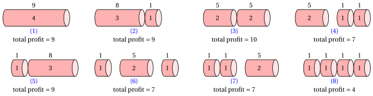

# DP for the rod cutting problem

**Part 3 · Dynamic programming · Chapter 27** · [:material-file-pdf-box: Lecture notes, volume 3 (PDF)](../../pdf/lecture-notes-3-dynamic-programming.pdf) · [:material-pencil: Exercises: Rod cutting](../../exercises/dp-rod-cutting.md)

!!! nota "Prerequisites"

    - From this module, the chapter «Principles of dynamic programming»: optimal substructure, overlapping subproblems, recurrence relations, base cases, and the top-down and bottom-up approaches.

    - From this module, the chapter [«DP for the 0/1 knapsack problem»](https://fabiofurini.github.io/combinatorial-optimization/dynamic-programming/dp-knapsack/): the pairs (item, capacity) and the reconstruction of a solution, which return here.

    - From the module <em>Algorithms</em>: how to read [pseudocode (Chapter 2)](https://fabiofurini.github.io/algorithms/basic-algorithms/02-pseudo-code/) and how to count the steps of an algorithm ([Chapter 12 «Running time»](https://fabiofurini.github.io/algorithms/analysis/12-running-time/)).

!!! chiave "Objectives"

    At the end of this chapter you will be able to:

    - state the RCP, encode a solution as a vector of numbers of pieces, and explain why cutting patterns and vectors are different objects;

    - write the recurrence $v(\ell)$ and explain it, base case included;

    - run the DP algorithm by hand with the top-down and the bottom-up approach, and with the running best value $m$;

    - reconstruct an optimal solution from the vector ${s}$, for the rod and for every shorter rod;

    - write the second recurrence $v(j,\ell)$ on pairs (largest piece length, rod length) and count the steps of the DP algorithm.

The problem of this chapter is the [rod cutting problem (RCP)](https://fabiofurini.github.io/combinatorial-optimization/catalogue/rod-cutting-problem/): its definition is on its page.

## 27.1 Instances and feasible solutions

!!! esempio "Example 27.1: Rod cutting problem"

    We consider a rod of length $n = 4$ and a set $\{1,2,3,4\}$ of $4$ possible piece lengths with the following profits:

    $$
    \begin{array}{l|rrrrrrr}
    \hline  & {\ell = 1} & {\ell = 2} & {\ell = 3} & {\ell = 4} \\
    \hline {p_\ell} & {1} & {5} & {8} & {9} \\
    \hline
    \end{array}
    $$

    We refer to this RCP instance as Example 1.

!!! chiave ""

    The number of possible solutions of the RCP is $2^{n-1}$ since we can cut a rod of length $n$ in $2^{n-1}$ different ways, with an independent option of cutting (or not) at each possible cutting position.

- The number of possible RCP solutions grows exponentially with the length $n$ of the rod:

    $$
    2^{n-1} = O(2^n).
    $$

    Therefore, enumerating all possible solutions quickly becomes impractical as $n$ increases.

### 27.1.1 Encoding of feasible solutions

!!! chiave ""

    A <em>feasible solution</em> of the RCP is a way of cutting the rod into pieces, such that the total length of the pieces is equal to the rod length.

- An RCP feasible solution can be described by an integer solution vector

    $$
    (x_1,x_2,\dots,x_n)
    $$

    where each component has the following meaning:

    $$
    x_\ell = \text{number of pieces of length } \ell,
    \qquad \forall \ell \in \{1,2,\dots,n\};
    $$

    The number of pieces is

    $$
    \sum_{\ell=1}^{n} x_\ell.
    $$

    Since the solution is feasible, the total length of the pieces must be equal to the rod length:

    $$
    \sum_{\ell=1}^{n} \ell \, x_\ell = n.
    $$

    The total profit of a feasible solution is

    $$
    \sum_{\ell=1}^{n} p_\ell x_\ell.
    $$

- Notice that two or more cutting patterns may have the same vector representation: the vector records how many pieces of each length are obtained, but it does not specify the order in which the pieces are cut. However, cutting patterns with the same vector representation have the same total profit, since the order in which the pieces are cut does not affect the obtained pieces and therefore does not affect the total profit.

!!! esempio "Example 27.2: Enumeration of all possible RCP solutions"

    We consider the RCP instance of  Example 1 with a rod of length $n = 4$ and the profits associated with the possible piece lengths are:

    $$
    \begin{array}{l|rrrrrrr}
    \hline  & {\ell = 1} & {\ell = 2} & {\ell = 3} & {\ell = 4} \\
    \hline {p_\ell} & {1} & {5} & {8} & {9} \\
    \hline
    \end{array}
    $$

    There are $2^{4-1} = 8$ feasible solutions, corresponding to the different ways of cutting the rod.

    In the following binary tree, each level corresponds to a possible cutting position: an edge labeled $1$ means that the rod is cut at that length, while an edge labeled $0$ means that it is not cut at that length. Each leaf represents one complete cutting pattern and reports the corresponding vector.

    { .fig .ovale loading=lazy style="width:100%" }

    The figure below shows all possible cutting patterns associated with the leaves of the previous tree, through the labels $(1),(2),\dots,(8)$. For each obtained piece, the number written inside the piece is its length, while the number above it is its profit.

    { .fig .ovale loading=lazy style="width:100%" }

    
<table>
    <tr>
    <th>Label</th>
    <th>Solution vector</th>
    <th>Number of pieces</th>
    <th>Total profit</th>
    </tr>
    <tr>
    <td>\((1)\)</td>
    <td>\((0,0,0,1)\)</td>
    <td>\(1\)</td>
    <td>\(9\)</td>
    </tr>
    <tr>
    <td>\((2)\)</td>
    <td>\((1,0,1,0)\)</td>
    <td>\(2\)</td>
    <td>\(8+1=9\)</td>
    </tr>
    <tr>
    <td>\((3)\)</td>
    <td>\((0,2,0,0)\)</td>
    <td>\(2\)</td>
    <td>\(5+5=10\)</td>
    </tr>
    <tr>
    <td>\((4)\)</td>
    <td>\((2,1,0,0)\)</td>
    <td>\(3\)</td>
    <td>\(5+1+1=7\)</td>
    </tr>
    <tr>
    <td>\((5)\)</td>
    <td>\((1,0,1,0)\)</td>
    <td>\(2\)</td>
    <td>\(1+8=9\)</td>
    </tr>
    <tr>
    <td>\((6)\)</td>
    <td>\((2,1,0,0)\)</td>
    <td>\(3\)</td>
    <td>\(1+5+1=7\)</td>
    </tr>
    <tr>
    <td>\((7)\)</td>
    <td>\((2,1,0,0)\)</td>
    <td>\(3\)</td>
    <td>\(1+1+5=7\)</td>
    </tr>
    <tr>
    <td>\((8)\)</td>
    <td>\((4,0,0,0)\)</td>
    <td>\(4\)</td>
    <td>\(1+1+1+1=4\)</td>
    </tr>
    </table>

-   **Overview**

    Instances and feasible solutions · Encoding of feasible solutions

    [:octicons-arrow-right-24: Open](#271-instances-and-feasible-solutions)

-   **27.2 A first DP algorithm**

    [:octicons-arrow-right-24: Open](a-first-dp-algorithm.md)

-   **27.3 A second DP algorithm**

    [:octicons-arrow-right-24: Open](a-second-dp-algorithm.md)

-   **Typical mistakes · In summary**

    In summary

    [:octicons-arrow-right-24: Open](typical-mistakes.md)

---

**Next:** [27.2 A first DP algorithm](a-first-dp-algorithm.md)

---

**Exercises on this chapter:** [:material-pencil: Rod cutting](../../exercises/dp-rod-cutting.md)
