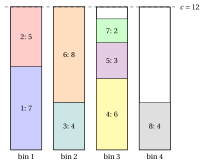
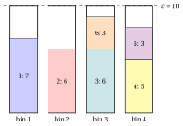
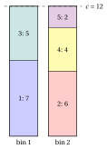
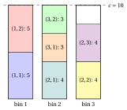
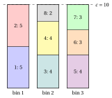
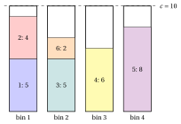
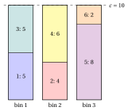

# Exercises · Packing problems

**Exercises · Chapter 3** · each solution opens with a click · [:material-book-open-variant: Chapter 3: Packing problems](../combinatorial-optimization-problems/bin-packing/index.md) · [:material-file-pdf-box: Exercises, volume 1 (PDF)](../pdf/exercises-1-combinatorial-optimization-problems.pdf)

!!! esercizio "Exercise 3.1: Checking a packing (BPP)"

    We consider the bin packing instance with capacity $c=12$ and $n=8$ items with weights

    $$
    \begin{array}{l|cccccccc}
    \hline  & {j=1} & {j=2} & {j=3} & {j=4} & {j=5} & {j=6} & {j=7} & {j=8} \\[1ex]
    \hline {w_j} & {7} & {5} & {4} & {6} & {3} & {8} & {2} & {4} \\
    \hline
    \end{array}
    $$

    and the three proposed solutions

    \begin{align*}
    \mathcal{P}_a&=\{\{1,2\},\{3,6\},\{4,5,7\},\{8\}\},\\
    \mathcal{P}_b&=\{\{1,4\},\{2,3,5\},\{6,8\},\{7\}\},\\
    \mathcal{P}_c&=\{\{1,2\},\{3,6\},\{4,5\},\{8\}\}.
    \end{align*}

    **Questions**

    1. Check the assumptions of the BPP.

    2. For each proposed solution, compute the weight of every bin and decide whether it is feasible.

    3. Compute the weight bound. Is one of the proposed solutions optimal?

    4. Draw the feasible solution.

??? soluzione "Solution"

    1. The total weight is $39>12$ and the heaviest item weighs $8\le 12$: both assumptions hold.

    2. - $\mathcal{P}_a$: the bins weigh $7+5=12$, $4+8=12$, $6+3+2=11$, $4=4$. It is a partition and every bin weighs at most $12$: feasible, with $4$ bins.

        - $\mathcal{P}_b$: the bins weigh $7+6=13$, $5+4+3=12$, $8+4=12$, $2=2$. It is a partition, but the bin $\{1,4\}$ weighs $13>12$. Not feasible.

        - $\mathcal{P}_c$: the bins weigh $7+5=12$, $4+8=12$, $6+3=9$, $4=4$. It is not a partition of $\mathscr{I}$: item $7$ is in no bin. Not feasible.

    3. $\mathrm{LB}=\lceil 39/12\rceil=4$. The feasible solution $\mathcal{P}_a$ uses $4$ bins, so it attains the bound: it is optimal and $z(I)=4$.

    4. The four bins of $\mathcal{P}_a$, with the dashed line at the capacity:

        { .fig loading=lazy  }

    !!! chiave ""

        Only $\mathcal{P}_a$ is feasible; it uses $4=\lceil 39/12\rceil$ bins and is therefore optimal.

!!! esercizio "Exercise 3.2: When the weight bound is not tight (BPP)"

    We consider the bin packing instance with capacity $c=10$ and $n=6$ items with weights

    $$
    \begin{array}{l|cccccc}
    \hline  & {j=1} & {j=2} & {j=3} & {j=4} & {j=5} & {j=6} \\[1ex]
    \hline {w_j} & {7} & {6} & {6} & {5} & {3} & {3} \\
    \hline
    \end{array}
    $$

    **Questions**

    1. Compute the weight bound.

    2. Show that no two of the items $1,2,3,4$ fit together in a bin. What lower bound on $z(I)$ follows?

    3. Find an optimal solution. Is it unique?

    4. What is the gap between the weight bound and $z(I)$?

??? soluzione "Solution"

    1. $\sum_j w_j=7+6+6+5+3+3=30$, hence $\lceil 30/10\rceil=3$.

    2. The pairs give $w_1+w_2=13$, $w_1+w_3=13$, $w_1+w_4=12$, $w_2+w_3=12$, $w_2+w_4=11$, $w_3+w_4=11$, all larger than $10$. Hence items $1,2,3,4$ are in four different bins in every feasible solution, and $z(I)\ge 4$.

    3. The solution $\{\{1\},\{2\},\{3,6\},\{4,5\}\}$ has bins of weight $7, 6, 9, 8$, all at most $10$: it uses $4$ bins and attains the bound of Question 2, so it is optimal, $z(I)=4$.

        { .fig loading=lazy  }

        It is not unique: the enumeration gives $12$ optimal partitions, since items $5$ and $6$ can go with any of the four large items that has room for them.

    4. The weight bound gives $3$ and $z(I)=4$: an absolute gap of $1$. The weight bound does not see that the large items cannot share a bin.

    !!! chiave ""

        $z(I)=4$, while the weight bound gives only $3$: the four items of weight greater than $c/2$ pairwise conflict and need four bins.

!!! esercizio "Exercise 3.3: Counting the packings (BPP)"

    We consider the bin packing instance with capacity $c=12$ and $n=5$ items with weights

    $$
    \begin{array}{l|ccccc}
    \hline  & {j=1} & {j=2} & {j=3} & {j=4} & {j=5} \\[1ex]
    \hline {w_j} & {7} & {6} & {5} & {4} & {2} \\
    \hline
    \end{array}
    $$

    **Questions**

    1. How many candidate solutions does the instance have?

    2. Which pairs of items fit together in a bin? Which triples?

    3. Count the feasible solutions, grouped by number of bins.

    4. Compute the weight bound and list all the optimal solutions.

??? soluzione "Solution"

    1. The candidates are the partitions of the $5$ items: $B(5)=52$.

    2. The pairs that fit are $\{1,3\}$ ($12$), $\{1,4\}$ ($11$), $\{1,5\}$ ($9$), $\{2,3\}$ ($11$), $\{2,4\}$ ($10$), $\{2,5\}$ ($8$), $\{3,4\}$ ($9$), $\{3,5\}$ ($7$), $\{4,5\}$ ($6$); the triples that fit are $\{2,4,5\}$ ($12$), $\{3,4,5\}$ ($11$). No four items fit together, since the four lightest weigh $17>12$.

    3. A feasible partition uses only singletons and the pairs and triples above. The enumeration gives:

        
<table>
        <tr>
        <th>bins</th>
        <th>feasible partitions</th>
        </tr>
        <tr>
        <td>\(2\)</td>
        <td>\(1\)</td>
        </tr>
        <tr>
        <td>\(3\)</td>
        <td>\(14\)</td>
        </tr>
        <tr>
        <td>\(4\)</td>
        <td>\(9\)</td>
        </tr>
        <tr>
        <td>\(5\)</td>
        <td>\(1\)</td>
        </tr>
        <tr>
        <td>total</td>
        <td>\(25\)</td>
        </tr>
        </table>

    4. $\mathrm{LB}=\lceil 24/12\rceil=2$, and there are partitions with $2$ bins: $z(I)=2$. The optimal solution is unique, $\{\{1,3\},\{2,4,5\}\}$: both bins are filled exactly.

        { .fig loading=lazy  }

    !!! chiave ""

        Of the $52$ partitions, $25$ are feasible and only one is optimal, with $z(I)=2=\lceil 24/12\rceil$.

!!! esercizio "Exercise 3.4: Copies of the items (cutting stock)"

    We consider the cutting stock instance with capacity $c=10$ and $n=3$ items, with the following weights and required copies:

    $$
    \begin{array}{l|ccc}
    \hline  & {j=1} & {j=2} & {j=3} \\[1ex]
    \hline {w_j} & {5} & {4} & {3} \\[1ex]
    {d_j} & {2} & {3} & {2} \\
    \hline
    \end{array}
    $$

    **Questions**

    1. Write the extended set of items $\hat{\mathscr{I}}$ and check the assumptions.

    2. Is the family $\{\{(1,1),(2,1)\},\{(1,2),(2,2)\},\{(3,1),(3,2)\}\}$ a feasible solution? How many bins does it use?

    3. Compute the weight bound, with the weights of all the copies.

    4. Find an optimal solution.

??? soluzione "Solution"

    1. The extended set has $\sum_j d_j=7$ copies:

        $$
        \hat{\mathscr{I}}=\{(1,1),(1,2),(2,1),(2,2),(2,3),(3,1),(3,2)\}.
        $$

        The total weight is $\sum_j d_jw_j=2\cdot 5+3\cdot 4+2\cdot 3=28>10$ and every item fits in a bin, $w_j\le 10$: both assumptions hold.

    2. The bins weigh $9$, $9$, $6$, all at most $10$, but the copy $(2,3)$ is in no bin: the family is not a partition of $\hat{\mathscr{I}}$ and it is not feasible.

    3. $\mathrm{LB}=\left\lceil \sum_j d_jw_j/c\right\rceil=\lceil 28/10\rceil=3$.

    4. The two copies of item $1$ fill a bin ($10$); one copy of item $2$ and the two copies of item $3$ fill another one ($4+3+3=10$); the last two copies of item $2$ weigh $8$. The solution

        $$
        \mathcal{P}=\{\{(1,1),(1,2)\},\{(2,1),(3,1),(3,2)\},\{(2,2),(2,3)\}\}
        $$

        uses $3$ bins and attains the bound: it is optimal, $z(I)=3$.

        { .fig loading=lazy  }

    !!! chiave ""

        With the weights of the $7$ copies the weight bound is $3$, and the packing found by pairing the copies attains it: $z(I)=3$.

!!! esercizio "Exercise 3.5: Filling every bin exactly (BPP)"

    We consider the bin packing instance with capacity $c=10$ and $n=8$ items with weights

    $$
    \begin{array}{l|cccccccc}
    \hline  & {j=1} & {j=2} & {j=3} & {j=4} & {j=5} & {j=6} & {j=7} & {j=8} \\[1ex]
    \hline {w_j} & {5} & {5} & {4} & {4} & {4} & {3} & {3} & {2} \\
    \hline
    \end{array}
    $$

    **Questions**

    1. Compute the weight bound.

    2. Show that a solution with $3$ bins must fill every bin exactly.

    3. List the ways to obtain a total weight of exactly $10$ with the weights of the instance, and use them to find a solution with $3$ bins.

    4. If item $8$ weighed $3$ instead of $2$, how many bins would be needed?

??? soluzione "Solution"

    1. $\sum_j w_j=30$, hence $\mathrm{LB}=\lceil 30/10\rceil=3$.

    2. $3$ bins hold at most $3\cdot 10=30$, and the items weigh exactly $30$: if a bin weighed less than $10$, the others could not hold the rest.

    3. As multisets of weights, a total of exactly $10$ is obtained as

        $$
        \{5,5\},\quad \{5,3,2\},\quad \{4,4,2\},\quad \{4,3,3\}.
        $$

        Each item of weight $5$ must be in a full bin, and the only multisets with a $5$ are $\{5,5\}$, $\{5,3,2\}$. There is only one item of weight $2$, so the two items of weight $5$ cannot both be in a bin $\{5,3,2\}$: they share the bin $\{5,5\}$. Then the remaining weights $4,4,4,3,3,2$ must form two full bins: $\{4,4,2\}$ and $\{4,3,3\}$. The solution is $\{\{1,2\},\{3,4,8\},\{5,6,7\}\}$:

        { .fig loading=lazy  }

        It attains the bound, so $z(I)=3$.

    4. The total weight would be $31$, and $\lceil 31/10\rceil=4$: at least $4$ bins. A solution with $4$ bins is obtained from the one above by moving item $8$ to a bin of its own, so $z(I)=4$.

    !!! chiave ""

        When $\sum_j w_j=\mathrm{LB}\cdot c$, a solution with $\mathrm{LB}$ bins fills every bin exactly; here the bins $\{5,5\}$, $\{4,4,2\}$, $\{4,3,3\}$ give $z(I)=3$.

!!! esercizio "Exercise 3.6: A greedy choice that is not optimal (BPP)"

    We consider the bin packing instance with capacity $c=10$ and $n=6$ items, with weights

    $$
    \begin{array}{l|cccccc}
    \hline  & {j=1} & {j=2} & {j=3} & {j=4} & {j=5} & {j=6} \\[1ex]
    \hline {w_j} & {5} & {4} & {5} & {6} & {8} & {2} \\
    \hline
    \end{array}
    $$

    **Questions**

    1. Apply First Fit: take the items in the order $1,2,\dots,n$ and put each one into the first open bin where it fits, opening a new bin when it fits nowhere. How many bins does it use?

    2. Compute the weight bound $\left\lceil \sum_j w_j / c \right\rceil$.

    3. Find a solution that attains the bound. What can you conclude on the solution of First Fit?

    4. Compute the absolute and the relative gap between the First Fit solution and the dual bound.

??? soluzione "Solution"

    1. The loads of the open bins after each item are:

        
<table>
        <tr>
        <th>item \(j\)</th>
        <th>\(w_j\)</th>
        <th>placed in</th>
        <th>loads</th>
        </tr>
        <tr>
        <td>\(1\)</td>
        <td>\(5\)</td>
        <td>new bin 1</td>
        <td>\((5)\)</td>
        </tr>
        <tr>
        <td>\(2\)</td>
        <td>\(4\)</td>
        <td>bin 1</td>
        <td>\((9)\)</td>
        </tr>
        <tr>
        <td>\(3\)</td>
        <td>\(5\)</td>
        <td>new bin 2</td>
        <td>\((9,5)\)</td>
        </tr>
        <tr>
        <td>\(4\)</td>
        <td>\(6\)</td>
        <td>new bin 3</td>
        <td>\((9,5,6)\)</td>
        </tr>
        <tr>
        <td>\(5\)</td>
        <td>\(8\)</td>
        <td>new bin 4</td>
        <td>\((9,5,6,8)\)</td>
        </tr>
        <tr>
        <td>\(6\)</td>
        <td>\(2\)</td>
        <td>bin 2</td>
        <td>\((9,7,6,8)\)</td>
        </tr>
        </table>

        First Fit returns $\{\{1,2\},\{3,6\},\{4\},\{5\}\}$, with $4$ bins: a primal bound $\mathrm{UB}=4$.

        { .fig loading=lazy  }

    2. $\sum_j w_j=5+4+5+6+8+2=30$, hence $\mathrm{LB}=\lceil 30/10\rceil=3$.

    3. The partition $\{\{1,3\},\{2,4\},\{5,6\}\}$ has bins of weight $10, 10, 10$, all at most $10$: it is feasible and uses $3$ bins.

        { .fig loading=lazy  }

        It attains the dual bound, so it is optimal and $z(I)=3$; the solution of First Fit is not optimal. First Fit puts item $2$ (weight $4$) with item $1$ (load $9$) and wastes the residual capacity $1$; the optimal packing puts item $1$ with item $3$ and item $2$ with item $4$, two bins filled exactly.

    4. The absolute gap is $4-3=1$ and the relative gap is $\frac{1}{3}\approx 33.3\%$.

    !!! chiave ""

        First Fit, a greedy choice, uses $4$ bins, while the weight bound gives $3$ and the partition $\{\{1,3\},\{2,4\},\{5,6\}\}$ attains it: $z(I)=3$.
