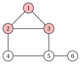
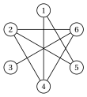
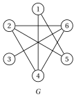
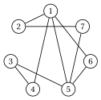
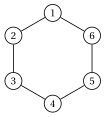
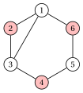
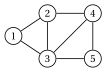
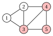

# Exercises · Formulations of clique problems

**Exercises · Chapter 12** · each solution opens with a click · [:material-book-open-variant: Chapter 12: Clique problems](../formulations/clique-formulations/index.md) · [:material-file-pdf-box: Exercises, volume 2 (PDF)](../pdf/exercises-2-formulations.pdf)

!!! chiave ""

    <strong>Formulations used in these exercises.</strong> The models of the chapter [Formulations of clique problems](https://fabiofurini.github.io/combinatorial-optimization/formulations/clique-formulations/), where $\overline{E}$ is the set of non-edges of $G$ and $\mathcal{Q}$ the set of the maximal stable sets of $G$ (the maximal cliques of the complement graph). The edge formulation $\mathrm{ILP}_{\mathrm{MCP}}$:

    \begin{align*}
    && \max ~~ \sum_{v\in V} x_v \tag{M0}\\
    && \text{subject to} \quad x_u+x_v &\le 1, & \forall\{u,v\}\in\overline{E}, \tag{M1}\\
    && x_v &\in\{0,1\}, & \forall v\in V. \tag{M2}
    \end{align*}

    The clique formulation $\mathrm{ILP}^{\mathrm{CL}}_{\mathrm{MCP}}$:

    \begin{align*}
    && \max ~~ \sum_{v\in V} x_v \tag{M3}\\
    && \text{subject to} \quad \sum_{v\in Q} x_v &\le 1, & \forall Q\in\mathcal{Q}, \tag{M4}\\
    && x_v &\in\{0,1\}, & \forall v\in V. \tag{M5}
    \end{align*}

    The relaxation $\mathrm{LP}_{\mathrm{MCP}}$ relaxes (M2) into $0\le x_v\le 1$; the relaxation $\mathrm{LP}^{\mathrm{CL}}_{\mathrm{MCP}}$ relaxes (M5) into $x_v\ge 0$, since (M4) gives $x_v\le 1$. The models $\mathrm{ILP}_{\mathrm{MSSP}}$ and $\mathrm{ILP}^{\mathrm{CL}}_{\mathrm{MSSP}}$ of the MSSP are (M0)–(M2) with (M1) written on the edges of $G$, and (M3)–(M5) with (M4) written on the maximal cliques of $G$. The model $\mathrm{ILP}^{\mathrm{VW}}_{\mathrm{MCP}}$ of the VWMCP is (M0)–(M2) with the objective function $\max \sum_{v\in V} w_v\,x_v$. The model $\mathrm{ILP}^{\mathrm{EW}}_{\mathrm{MCP}}$ of the EWMCP adds a binary variable $y_{uv}$ for each edge $\{u,v\}\in E$:

    \begin{align*}
    && \max ~~ \sum_{\{u,v\}\in E} r_{uv}\,y_{uv} \tag{M6}\\
    && \text{subject to} \quad y_{uv} &\le x_u, & \forall\{u,v\}\in E, \tag{M7}\\
    && y_{uv} &\le x_v, & \forall\{u,v\}\in E, \tag{M8}\\
    && x_u+x_v &\le 1, & \forall\{u,v\}\in\overline{E}, \tag{M9}\\
    && x_v &\in\{0,1\}, & \forall v\in V, \tag{M10}\\
    && y_{uv} &\in\{0,1\}, & \forall\{u,v\}\in E. \tag{M11}
    \end{align*}

!!! esercizio "Exercise 12.1: ILP model of the Maximum Clique Problem (MCP)"

    We consider the graph $G=(V,E)$ with $V=\{1,\dots,6\}$ and the $7$ edges

    $$
    E=\{\{1,2\},~\{1,3\},~\{2,3\},~\{2,4\},~\{3,5\},~\{4,5\},~\{5,6\}\}.
    $$

    { .fig loading=lazy  }

    **Questions**

    1. Write the non-edges of $G$. How many variables and constraints does the $\mathrm{ILP}_{\mathrm{MCP}}$ model have?

    2. Write the $\mathrm{ILP}_{\mathrm{MCP}}$ model of $G$.

    3. Solve the model with Gurobi: give $z(\mathrm{ILP}_{\mathrm{MCP}})$ and the optimal solution. Is it unique?

    4. Which ILP model of the Maximum Stable Set Problem on $\overline{G}$ do you obtain? Explain.

??? soluzione "Solution"

    1. $G$ has $\binom{6}{2}-7=8$ non-edges:

        $$
        \overline{E}=\{\{1,4\},~\{1,5\},~\{1,6\},~\{2,5\},~\{2,6\},~\{3,4\},~\{3,6\},~\{4,6\}\}.
        $$

        The model has $n=6$ binary variables and one constraint per non-edge: $8$ linear constraints.

    2. The $\mathrm{ILP}_{\mathrm{MCP}}$ model is:

        $$
        \begin{array}{rrrrrrrcl}
        {\max} & {x_1} & {+\,x_2} & {+\,x_3} & {+\,x_4} & {+\,x_5} & {+\,x_6} \\[1ex]
        \text{subject to} & {x_1} &  &  & {+\,x_4} &  &  & {\le} & {1} \\
        & {x_1} &  &  &  & {+\,x_5} &  & {\le} & {1} \\
        & {x_1} &  &  &  &  & {+\,x_6} & {\le} & {1} \\
        &  & {x_2} &  &  & {+\,x_5} &  & {\le} & {1} \\
        &  & {x_2} &  &  &  & {+\,x_6} & {\le} & {1} \\
        &  &  & {x_3} & {+\,x_4} &  &  & {\le} & {1} \\
        &  &  & {x_3} &  &  & {+\,x_6} & {\le} & {1} \\
        &  &  &  & {x_4} &  & {+\,x_6} & {\le} & {1} \\[1ex]
        & {x_1}, & {x_2}, & {x_3}, & {x_4}, & {x_5}, & {x_6} & {\in} & {\{0,1\}}
        \end{array}
        $$

    3. Gurobi returns $z(\mathrm{ILP}_{\mathrm{MCP}})=3$ with $\tilde x_1=\tilde x_2=\tilde x_3=1$ and $\tilde x_4=\tilde x_5=\tilde x_6=0$: the clique $\{1,2,3\}$. The enumeration of the cliques shows that it is the only triangle, and no clique has $4$ vertices (only vertices $2$, $3$ and $5$ have degree $3$). The optimal solution is unique.

        { .fig loading=lazy  }

    4. The same model: its constraints are written on the edges of $\overline{G}$, whose edge set is $\overline{E}$, and $x_u+x_v\le 1$ says that at most one endpoint of every edge of $\overline{G}$ is selected. It is the edge formulation of the MSSP on $\overline{G}$, and $\alpha(\overline{G})=\omega(G)=3$.

!!! esercizio "Exercise 12.2: The complement graph and the clique formulation (MCP)"

    We consider the graph $G=(V,E)$ with $V=\{1,\dots,6\}$ and the $7$ edges

    $$
    E=\{\{1,4\},~\{1,5\},~\{2,4\},~\{2,5\},~\{2,6\},~\{3,6\},~\{4,6\}\}.
    $$

    { .fig loading=lazy  }

    **Questions**

    1. Write the edges of the complement graph $\overline{G}$ and draw it next to $G$.

    2. List the maximal cliques of $\overline{G}$.

    3. Write the clique formulation $\mathrm{ILP}^{\mathrm{CL}}_{\mathrm{MCP}}$ and compare its number of constraints with the $\mathrm{ILP}_{\mathrm{MCP}}$ model.

    4. Show that every constraint of $\mathrm{ILP}_{\mathrm{MCP}}$ is implied by a constraint of $\mathrm{ILP}^{\mathrm{CL}}_{\mathrm{MCP}}$.

    5. Solve both models with Gurobi and give a maximum clique of $G$.

??? soluzione "Solution"

    1. $\overline{G}$ has the $\binom{6}{2}-7=8$ non-edges of $G$:

        $$
        \overline{E}=\{\{1,2\},~\{1,3\},~\{1,6\},~\{2,3\},~\{3,4\},~\{3,5\},~\{4,5\},~\{5,6\}\}.
        $$

        { .fig loading=lazy  }

        { .fig loading=lazy  }

    2. The maximal cliques of $\overline{G}$ are the two triangles $\{1,2,3\}$ and $\{3,4,5\}$, which share vertex $3$, and the two edges $\{1,6\}$ and $\{5,6\}$: vertex $6$ is adjacent in $\overline{G}$ only to $1$ and $5$, which are not adjacent there.

    3. The clique formulation has one constraint per maximal clique of $\overline{G}$:

        $$
        \begin{array}{rrrrrrrcl}
        {\max} & {x_1} & {+\,x_2} & {+\,x_3} & {+\,x_4} & {+\,x_5} & {+\,x_6} \\[1ex]
        \text{subject to} & {x_1} & {+\,x_2} & {+\,x_3} &  &  &  & {\le} & {1} \\
        &  &  & {x_3} & {+\,x_4} & {+\,x_5} &  & {\le} & {1} \\
        & {x_1} &  &  &  &  & {+\,x_6} & {\le} & {1} \\
        &  &  &  &  & {x_5} & {+\,x_6} & {\le} & {1} \\[1ex]
        & {x_1}, & {x_2}, & {x_3}, & {x_4}, & {x_5}, & {x_6} & {\in} & {\{0,1\}}
        \end{array}
        $$

        It has $4$ constraints, against the $8$ constraints of $\mathrm{ILP}_{\mathrm{MCP}}$ (one per edge of $\overline{G}$).

    4. Every edge of $\overline{G}$ lies in a maximal clique, and the variables are non-negative:

        
<table>
        <tr>
        <th>constraint of \(\mathrm{ILP}_{\mathrm{MCP}}\)</th>
        <th>implied by</th>
        </tr>
        <tr>
        <td>\(x_1+x_2\le 1\)</td>
        <td>\(x_1+x_2+x_3\le 1\)</td>
        </tr>
        <tr>
        <td>\(x_1+x_3\le 1\)</td>
        <td>\(x_1+x_2+x_3\le 1\)</td>
        </tr>
        <tr>
        <td>\(x_1+x_6\le 1\)</td>
        <td>\(x_1+x_6\le 1\)</td>
        </tr>
        <tr>
        <td>\(x_2+x_3\le 1\)</td>
        <td>\(x_1+x_2+x_3\le 1\)</td>
        </tr>
        <tr>
        <td>\(x_3+x_4\le 1\)</td>
        <td>\(x_3+x_4+x_5\le 1\)</td>
        </tr>
        <tr>
        <td>\(x_3+x_5\le 1\)</td>
        <td>\(x_3+x_4+x_5\le 1\)</td>
        </tr>
        <tr>
        <td>\(x_4+x_5\le 1\)</td>
        <td>\(x_3+x_4+x_5\le 1\)</td>
        </tr>
        <tr>
        <td>\(x_5+x_6\le 1\)</td>
        <td>\(x_5+x_6\le 1\)</td>
        </tr>
        </table>

    5. Both models give the optimal value $3$, with the clique $\{2,4,6\}$ of $G$: it is a stable set of $\overline{G}$, and it is the unique maximum clique (enumeration).

        { .fig loading=lazy  }

!!! esercizio "Exercise 12.3: LP bounds: edge versus clique formulation (MCP)"

    We consider the graph $G=(V,E)$ with $V=\{1,\dots,7\}$ and the $9$ edges

    \begin{align*}
    E=\{ & \{1,2\},~\{1,4\},~\{1,5\},~\{1,6\},~\{2,7\},\\
    & \{3,4\},~\{3,5\},~\{5,6\},~\{5,7\}\}.
    \end{align*}

    { .fig loading=lazy  }

    **Questions**

    1. Write the $\mathrm{LP}_{\mathrm{MCP}}$ model (edge formulation with $0\le x_v\le 1$). Show that $\bar x_v=\frac{1}{2}$ for every vertex is feasible, and compute $z(\mathrm{LP}_{\mathrm{MCP}})$ with Gurobi.

    2. List the maximal cliques of $\overline{G}$ and write the $\mathrm{LP}^{\mathrm{CL}}_{\mathrm{MCP}}$ model.

    3. Is the point $\bar x_v=\frac{1}{2}$ feasible for $\mathrm{LP}^{\mathrm{CL}}_{\mathrm{MCP}}$? Compute $z(\mathrm{LP}^{\mathrm{CL}}_{\mathrm{MCP}})$ with Gurobi, and prove the value by summing some constraints.

    4. Find $\omega(G)$ and compare the two LP bounds.

??? soluzione "Solution"

    1. The $12$ non-edges give the model

        $$
        \begin{array}{rrrrrrrrcl}
        {\max} & {x_1} & {+\,x_2} & {+\,x_3} & {+\,x_4} & {+\,x_5} & {+\,x_6} & {+\,x_7} \\[1ex]
        \text{subject to} & {x_1} &  & {+\,x_3} &  &  &  &  & {\le} & {1} \\
        & {x_1} &  &  &  &  &  & {+\,x_7} & {\le} & {1} \\
        &  & {x_2} & {+\,x_3} &  &  &  &  & {\le} & {1} \\
        &  & {x_2} &  & {+\,x_4} &  &  &  & {\le} & {1} \\
        &  & {x_2} &  &  & {+\,x_5} &  &  & {\le} & {1} \\
        &  & {x_2} &  &  &  & {+\,x_6} &  & {\le} & {1} \\
        &  &  & {x_3} &  &  & {+\,x_6} &  & {\le} & {1} \\
        &  &  & {x_3} &  &  &  & {+\,x_7} & {\le} & {1} \\
        &  &  &  & {x_4} & {+\,x_5} &  &  & {\le} & {1} \\
        &  &  &  & {x_4} &  & {+\,x_6} &  & {\le} & {1} \\
        &  &  &  & {x_4} &  &  & {+\,x_7} & {\le} & {1} \\
        &  &  &  &  &  & {x_6} & {+\,x_7} & {\le} & {1} \\
        & {x_1} &  &  &  &  &  &  & {\le} & {1} \\
        &  & {x_2} &  &  &  &  &  & {\le} & {1} \\
        &  &  & {x_3} &  &  &  &  & {\le} & {1} \\
        &  &  &  & {x_4} &  &  &  & {\le} & {1} \\
        &  &  &  &  & {x_5} &  &  & {\le} & {1} \\
        &  &  &  &  &  & {x_6} &  & {\le} & {1} \\
        &  &  &  &  &  &  & {x_7} & {\le} & {1} \\[1ex]
        & {x_1}, & {x_2}, & {x_3}, & {x_4}, & {x_5}, & {x_6}, & {x_7} & {\ge} & {0}
        \end{array}
        $$

        With $\bar x_v=\frac{1}{2}$ every constraint reads $\frac{1}{2}+\frac{1}{2}=1\le 1$, and the value is $\frac{7}{2}$. Gurobi returns $z(\mathrm{LP}_{\mathrm{MCP}})=\frac{7}{2}$: the point is optimal.

    2. The $6$ maximal cliques of $\overline{G}$ (maximal stable sets of $G$) are $\{1,3,7\}$, $\{2,3,6\}$, $\{2,4,5\}$, $\{2,4,6\}$, $\{3,6,7\}$, $\{4,6,7\}$, and the model is

        $$
        \begin{array}{rrrrrrrrcl}
        {\max} & {x_1} & {+\,x_2} & {+\,x_3} & {+\,x_4} & {+\,x_5} & {+\,x_6} & {+\,x_7} \\[1ex]
        \text{subject to} & {x_1} &  & {+\,x_3} &  &  &  & {+\,x_7} & {\le} & {1} \\
        &  & {x_2} & {+\,x_3} &  &  & {+\,x_6} &  & {\le} & {1} \\
        &  & {x_2} &  & {+\,x_4} & {+\,x_5} &  &  & {\le} & {1} \\
        &  & {x_2} &  & {+\,x_4} &  & {+\,x_6} &  & {\le} & {1} \\
        &  &  & {x_3} &  &  & {+\,x_6} & {+\,x_7} & {\le} & {1} \\
        &  &  &  & {x_4} &  & {+\,x_6} & {+\,x_7} & {\le} & {1} \\[1ex]
        & {x_1}, & {x_2}, & {x_3}, & {x_4}, & {x_5}, & {x_6}, & {x_7} & {\ge} & {0}
        \end{array}
        $$

    3. No: $\bar x_1+\bar x_3+\bar x_7=\frac{3}{2}>1$. Gurobi returns $z(\mathrm{LP}^{\mathrm{CL}}_{\mathrm{MCP}})=3$. The three constraints of $\{1,3,7\}$, $\{2,3,6\}$, $\{2,4,5\}$ cover every vertex at least once; summing them, every variable appears with coefficient at least $1$, so $\sum_{v=1}^{7}x_v\le 3$ for every feasible point.

    4. The triangle $\{1,5,6\}$ is the unique maximum clique (enumeration), so $\omega(G)=3$.

        { .fig loading=lazy  }

        The edge formulation gives $\frac{7}{2}$ (and $\lfloor\frac{7}{2}\rfloor=3$ after rounding down, since $\omega(G)$ is an integer); the clique formulation gives $3$ directly, with no gap.

!!! esercizio "Exercise 12.4: Clique number, LP bound and chromatic number (MCP)"

    The wheel $W_5$ has the vertices $V=\{1,\dots,6\}$: the vertices $1,\dots,5$ form a cycle, and vertex $6$ is adjacent to all of them.

    { .fig loading=lazy  }

    **Questions**

    1. List the maximal stable sets of $W_5$, that is, the maximal cliques of $\overline{W_5}$.

    2. Write the $\mathrm{LP}^{\mathrm{CL}}_{\mathrm{MCP}}$ model and its dual $D(\mathrm{LP}^{\mathrm{CL}}_{\mathrm{MCP}})$, and say which coloring formulation the dual relaxes.

    3. Find a primal solution and a dual solution of value $\frac{7}{2}$. What can you conclude?

    4. Deduce $\omega(W_5)$ and $\chi(W_5)$ from the integrality of the two numbers, and write the chain of the chapter.

??? soluzione "Solution"

    1. A stable set contains at most $2$ vertices of the cycle, never two consecutive ones, and vertex $6$ is adjacent to all the others. The maximal stable sets are $\{1,3\}$, $\{1,4\}$, $\{2,4\}$, $\{2,5\}$, $\{3,5\}$, $\{6\}$.

    2. With one constraint per maximal stable set:

        $$
        \begin{array}{rrrrrrrcl}
        {\max} & {x_1} & {+\,x_2} & {+\,x_3} & {+\,x_4} & {+\,x_5} & {+\,x_6} \\[1ex]
        \text{subject to} & {x_1} &  & {+\,x_3} &  &  &  & {\le} & {1} \\
        & {x_1} &  &  & {+\,x_4} &  &  & {\le} & {1} \\
        &  & {x_2} &  & {+\,x_4} &  &  & {\le} & {1} \\
        &  & {x_2} &  &  & {+\,x_5} &  & {\le} & {1} \\
        &  &  & {x_3} &  & {+\,x_5} &  & {\le} & {1} \\
        &  &  &  &  &  & {x_6} & {\le} & {1} \\[1ex]
        & {x_1}, & {x_2}, & {x_3}, & {x_4}, & {x_5}, & {x_6} & {\ge} & {0}
        \end{array}
        $$

        With a non-negative dual variable $\pi_Q$ per constraint (index $Q$ written as its vertices), the dual $D(\mathrm{LP}^{\mathrm{CL}}_{\mathrm{MCP}})$ is

        $$
        \begin{array}{rrrrrrrcl}
        {\min} & {\pi_{13}} & {+\,\pi_{14}} & {+\,\pi_{24}} & {+\,\pi_{25}} & {+\,\pi_{35}} & {+\,\pi_{6}} \\[1ex]
        \text{subject to} & {\pi_{13}} & {+\,\pi_{14}} &  &  &  &  & {\ge} & {1} \\
        &  &  & {\pi_{24}} & {+\,\pi_{25}} &  &  & {\ge} & {1} \\
        & {\pi_{13}} &  &  &  & {+\,\pi_{35}} &  & {\ge} & {1} \\
        &  & {\pi_{14}} & {+\,\pi_{24}} &  &  &  & {\ge} & {1} \\
        &  &  &  & {\pi_{25}} & {+\,\pi_{35}} &  & {\ge} & {1} \\
        &  &  &  &  &  & {\pi_{6}} & {\ge} & {1} \\[1ex]
        & {\pi_{13}}, & {\pi_{14}}, & {\pi_{24}}, & {\pi_{25}}, & {\pi_{35}}, & {\pi_{6}} & {\ge} & {0}
        \end{array}
        $$

        It is the LP relaxation of the stable set formulation $\mathrm{ILP}^{\mathrm{ST}}_{\mathrm{VCP}}$ of the VCP, with the maximal stable sets: every vertex must be covered by a chosen stable set.

    3. The primal point $\bar x_1=\dots=\bar x_5=\frac{1}{2}$, $\bar x_6=1$ satisfies all the constraints and has value $\frac{5}{2}+1=\frac{7}{2}$. The dual point $\bar\pi_Q=\frac{1}{2}$ for the five pairs and $\bar\pi_{6}=1$ covers every vertex of the cycle with $\frac{1}{2}+\frac{1}{2}=1$ and vertex $6$ with $1$, and has value $\frac{7}{2}$. Equal values: by weak duality both are optimal, and $z(\mathrm{LP}^{\mathrm{CL}}_{\mathrm{MCP}})=\frac{7}{2}$ (Gurobi agrees).

    4. $\omega(W_5)\le\frac{7}{2}$ and $\omega(W_5)$ is an integer, so $\omega(W_5)\le 3$; the triangle $\{1,2,6\}$ gives $\omega(W_5)=3$. $\chi(W_5)\ge\frac{7}{2}$, so $\chi(W_5)\ge 4$; the coloring $\{1,3\},\{2,4\},\{5\},\{6\}$ gives $\chi(W_5)=4$. The chain reads

        $$
        \omega(W_5)=3\;<\;z(\mathrm{LP}^{\mathrm{CL}}_{\mathrm{MCP}})=\frac{7}{2}\;<\;\chi(W_5)=4 .
        $$

!!! esercizio "Exercise 12.5: Feasibility in the two formulations (MCP)"

    We consider the cycle $C_6$ with the vertices $V=\{1,\dots,6\}$ and the edges $\{1,2\},\{2,3\},\{3,4\},\{4,5\},\{5,6\},\{1,6\}$,

    { .fig loading=lazy  }

    and the five points $\vet{x}=(x_1,\dots,x_6)$:

    $$
    \bar{\vet x}^{a}=(\frac{1}{2},\frac{1}{2},\frac{1}{2},\frac{1}{2},\frac{1}{2},\frac{1}{2}),\quad \bar{\vet x}^{b}=(1,1,0,0,0,0),\quad \bar{\vet x}^{c}=(1,0,1,0,0,0),
    $$

    $$
    \bar{\vet x}^{d}=(\frac{1}{2},\frac{1}{2},\frac{1}{2},0,0,0),\quad \bar{\vet x}^{e}=(\frac{1}{3},\frac{1}{3},\frac{1}{3},\frac{1}{3},\frac{1}{3},\frac{1}{3}).
    $$

    **Questions**

    1. Write the constraints of $\mathrm{LP}_{\mathrm{MCP}}$ and of $\mathrm{LP}^{\mathrm{CL}}_{\mathrm{MCP}}$ for $C_6$.

    2. For each point, decide whether it is feasible for $\mathrm{LP}_{\mathrm{MCP}}$, for $\mathrm{LP}^{\mathrm{CL}}_{\mathrm{MCP}}$ and for $\mathrm{ILP}_{\mathrm{MCP}}$.

    3. What do the values of the feasible points say about the two LP bounds?

    4. Compute the two LP bounds with Gurobi and compare them with $\omega(C_6)$.

??? soluzione "Solution"

    1. With the $9$ non-edge constraints, the $\mathrm{LP}_{\mathrm{MCP}}$ model is

        $$
        \begin{array}{rrrrrrrcl}
        {\max} & {x_1} & {+\,x_2} & {+\,x_3} & {+\,x_4} & {+\,x_5} & {+\,x_6} \\[1ex]
        \text{subject to} & {x_1} &  & {+\,x_3} &  &  &  & {\le} & {1} \\
        & {x_1} &  &  & {+\,x_4} &  &  & {\le} & {1} \\
        & {x_1} &  &  &  & {+\,x_5} &  & {\le} & {1} \\
        &  & {x_2} &  & {+\,x_4} &  &  & {\le} & {1} \\
        &  & {x_2} &  &  & {+\,x_5} &  & {\le} & {1} \\
        &  & {x_2} &  &  &  & {+\,x_6} & {\le} & {1} \\
        &  &  & {x_3} &  & {+\,x_5} &  & {\le} & {1} \\
        &  &  & {x_3} &  &  & {+\,x_6} & {\le} & {1} \\
        &  &  &  & {x_4} &  & {+\,x_6} & {\le} & {1} \\
        & {x_1} &  &  &  &  &  & {\le} & {1} \\
        &  & {x_2} &  &  &  &  & {\le} & {1} \\
        &  &  & {x_3} &  &  &  & {\le} & {1} \\
        &  &  &  & {x_4} &  &  & {\le} & {1} \\
        &  &  &  &  & {x_5} &  & {\le} & {1} \\
        &  &  &  &  &  & {x_6} & {\le} & {1} \\[1ex]
        & {x_1}, & {x_2}, & {x_3}, & {x_4}, & {x_5}, & {x_6} & {\ge} & {0}
        \end{array}
        $$

        With one constraint per maximal stable set of $C_6$, the $\mathrm{LP}^{\mathrm{CL}}_{\mathrm{MCP}}$ model is

        $$
        \begin{array}{rrrrrrrcl}
        {\max} & {x_1} & {+\,x_2} & {+\,x_3} & {+\,x_4} & {+\,x_5} & {+\,x_6} \\[1ex]
        \text{subject to} & {x_1} &  & {+\,x_3} &  & {+\,x_5} &  & {\le} & {1} \\
        &  & {x_2} &  & {+\,x_4} &  & {+\,x_6} & {\le} & {1} \\
        & {x_1} &  &  & {+\,x_4} &  &  & {\le} & {1} \\
        &  & {x_2} &  &  & {+\,x_5} &  & {\le} & {1} \\
        &  &  & {x_3} &  &  & {+\,x_6} & {\le} & {1} \\[1ex]
        & {x_1}, & {x_2}, & {x_3}, & {x_4}, & {x_5}, & {x_6} & {\ge} & {0}
        \end{array}
        $$

    2. - $\bar{\vet x}^{a}$: feasible for $\mathrm{LP}_{\mathrm{MCP}}$; the clique inequality of $\{1,3,5\}$ gives $\frac{3}{2}>1$, so infeasible for $\mathrm{LP}^{\mathrm{CL}}_{\mathrm{MCP}}$ and $\mathrm{ILP}_{\mathrm{MCP}}$.

        - $\bar{\vet x}^{b}$: feasible for all three models: it is the clique $\{1,2\}$.

        - $\bar{\vet x}^{c}$: $x_1+x_3=2>1$ violates a non-edge constraint: infeasible for all three models (every constraint of $\mathrm{LP}_{\mathrm{MCP}}$ is implied by $\mathrm{LP}^{\mathrm{CL}}_{\mathrm{MCP}}$).

        - $\bar{\vet x}^{d}$: feasible for $\mathrm{LP}_{\mathrm{MCP}}$ and $\mathrm{LP}^{\mathrm{CL}}_{\mathrm{MCP}}$, not for $\mathrm{ILP}_{\mathrm{MCP}}$ (fractional).

        - $\bar{\vet x}^{e}$: feasible for $\mathrm{LP}_{\mathrm{MCP}}$ and $\mathrm{LP}^{\mathrm{CL}}_{\mathrm{MCP}}$, not for $\mathrm{ILP}_{\mathrm{MCP}}$ (fractional).

    3. $\bar{\vet x}^{a}$ has value $3$, so $z(\mathrm{LP}_{\mathrm{MCP}})\ge 3$. In $\mathrm{LP}^{\mathrm{CL}}_{\mathrm{MCP}}$ the best feasible point among the five is $\bar{\vet x}^{e}$, of value $2$; $\bar{\vet x}^{d}$ has value $\frac{3}{2}$ and $\bar{\vet x}^{b}$ has value $2$.

    4. Gurobi returns $z(\mathrm{LP}_{\mathrm{MCP}})=3$ and $z(\mathrm{LP}^{\mathrm{CL}}_{\mathrm{MCP}})=2$. The second value is proved by summing the constraints of $\{1,3,5\}$ and $\{2,4,6\}$, which give $\sum_{v=1}^{6}x_v\le 2$. $C_6$ has no triangle, so $\omega(C_6)=2$: the clique formulation closes the gap, the edge formulation leaves $3$ against $2$.

!!! esercizio "Exercise 12.6: ILP models of the Maximum Stable Set Problem (MSSP)"

    We consider the graph $G=(V,E)$ with $V=\{1,\dots,6\}$ and the $7$ edges

    $$
    E=\{\{1,2\},~\{1,3\},~\{1,6\},~\{2,3\},~\{3,4\},~\{4,5\},~\{5,6\}\}.
    $$

    { .fig loading=lazy  }

    We look for a maximum stable set of $G$.

    **Questions**

    1. How many variables and constraints does the edge formulation $\mathrm{ILP}_{\mathrm{MSSP}}$ of $G$ have? Write it.

    2. Solve the model with Gurobi: give $z(\mathrm{ILP}_{\mathrm{MSSP}})$ and an optimal solution. Is it unique?

    3. Write the maximal cliques of $G$ and the clique formulation $\mathrm{ILP}^{\mathrm{CL}}_{\mathrm{MSSP}}$.

    4. Compare the optimal values of the LP relaxations of the two formulations (Gurobi).

??? soluzione "Solution"

    1. There are $n=6$ binary variables and one constraint $x_u+x_v\le 1$ per edge of $G$: $7$ linear constraints. The $\mathrm{ILP}_{\mathrm{MSSP}}$ model is:

        $$
        \begin{array}{rrrrrrrcl}
        {\max} & {x_1} & {+\,x_2} & {+\,x_3} & {+\,x_4} & {+\,x_5} & {+\,x_6} \\[1ex]
        \text{subject to} & {x_1} & {+\,x_2} &  &  &  &  & {\le} & {1} \\
        & {x_1} &  & {+\,x_3} &  &  &  & {\le} & {1} \\
        & {x_1} &  &  &  &  & {+\,x_6} & {\le} & {1} \\
        &  & {x_2} & {+\,x_3} &  &  &  & {\le} & {1} \\
        &  &  & {x_3} & {+\,x_4} &  &  & {\le} & {1} \\
        &  &  &  & {x_4} & {+\,x_5} &  & {\le} & {1} \\
        &  &  &  &  & {x_5} & {+\,x_6} & {\le} & {1} \\[1ex]
        & {x_1}, & {x_2}, & {x_3}, & {x_4}, & {x_5}, & {x_6} & {\in} & {\{0,1\}}
        \end{array}
        $$

    2. Gurobi returns $z(\mathrm{ILP}_{\mathrm{MSSP}})=3$ with the stable set $\{2,4,6\}$. The optimal solution is unique.

        { .fig loading=lazy  }

    3. The maximal cliques of $G$ are the triangle $\{1,2,3\}$ and the edges $\{1,6\}$, $\{3,4\}$, $\{4,5\}$, $\{5,6\}$: $5$ cliques instead of $7$ edges, since the three edges of the triangle are replaced by $x_1+x_2+x_3\le 1$. The $\mathrm{ILP}^{\mathrm{CL}}_{\mathrm{MSSP}}$ model is:

        $$
        \begin{array}{rrrrrrrcl}
        {\max} & {x_1} & {+\,x_2} & {+\,x_3} & {+\,x_4} & {+\,x_5} & {+\,x_6} \\[1ex]
        \text{subject to} & {x_1} & {+\,x_2} & {+\,x_3} &  &  &  & {\le} & {1} \\
        & {x_1} &  &  &  &  & {+\,x_6} & {\le} & {1} \\
        &  &  & {x_3} & {+\,x_4} &  &  & {\le} & {1} \\
        &  &  &  & {x_4} & {+\,x_5} &  & {\le} & {1} \\
        &  &  &  &  & {x_5} & {+\,x_6} & {\le} & {1} \\[1ex]
        & {x_1}, & {x_2}, & {x_3}, & {x_4}, & {x_5}, & {x_6} & {\in} & {\{0,1\}}
        \end{array}
        $$

        Its optimal value is again $3$.

    4. The LP relaxation of the edge formulation, with $0\le x_v\le 1$, has optimal value $3$; the LP relaxation of the clique formulation has optimal value $3$. On this graph both bounds are equal to $\alpha(G)=3$: the point $x_v=\frac{1}{2}$, of value $3$, is feasible for the edge formulation but violates $x_1+x_2+x_3\le 1$, and the bound does not change because the integer optimum also has value $3$.

!!! esercizio "Exercise 12.7: ILP model of the vertex-weighted maximum clique problem"

    We consider the graph $G=(V,E)$ with $V=\{1,\dots,6\}$ and the $7$ edges

    $$
    E=\{\{1,2\},~\{1,3\},~\{2,3\},~\{2,4\},~\{3,5\},~\{4,5\},~\{5,6\}\}.
    $$

    { .fig loading=lazy  }

    and the vertex weights

    $$
    \begin{array}{l|cccccc}
    \hline  & {v=1} & {v=2} & {v=3} & {v=4} & {v=5} & {v=6} \\
    \hline {w_v} & {2} & {3} & {4} & {6} & {5} & {7} \\
    \hline
    \end{array}
    $$

    **Questions**

    1. Write the $\mathrm{ILP}^{\mathrm{VW}}_{\mathrm{MCP}}$ model of the vertex-weighted maximum clique problem on this instance.

    2. Solve the model with Gurobi: give the optimal value and the optimal clique. Is it unique?

    3. Compare the optimal clique with the maximum clique of $G$, and explain the difference.

??? soluzione "Solution"

    1. $G$ has $\binom{6}{2}-7=8$ non-edges, one constraint each:

        $$
        \begin{array}{rrrrrrrcl}
        {\max} & {2\,x_1} & {+\,3\,x_2} & {+\,4\,x_3} & {+\,6\,x_4} & {+\,5\,x_5} & {+\,7\,x_6} \\[1ex]
        \text{subject to} & {x_1} &  &  & {+\,x_4} &  &  & {\le} & {1} \\
        & {x_1} &  &  &  & {+\,x_5} &  & {\le} & {1} \\
        & {x_1} &  &  &  &  & {+\,x_6} & {\le} & {1} \\
        &  & {x_2} &  &  & {+\,x_5} &  & {\le} & {1} \\
        &  & {x_2} &  &  &  & {+\,x_6} & {\le} & {1} \\
        &  &  & {x_3} & {+\,x_4} &  &  & {\le} & {1} \\
        &  &  & {x_3} &  &  & {+\,x_6} & {\le} & {1} \\
        &  &  &  & {x_4} &  & {+\,x_6} & {\le} & {1} \\[1ex]
        & {x_1}, & {x_2}, & {x_3}, & {x_4}, & {x_5}, & {x_6} & {\in} & {\{0,1\}}
        \end{array}
        $$

    2. Gurobi returns the optimal value $12$ with $\tilde x_5=\tilde x_6=1$: the clique $\{5,6\}$, of weight $5+7=12$. The enumeration of the cliques gives the second best value $11$ (clique $\{4,5\}$): the optimal solution is unique.

        { .fig loading=lazy  }

    3. The maximum clique of $G$ is the triangle $\{1,2,3\}$, with $3$ vertices but weight only $2+3+4=9$. The two models have the same constraints, hence the same feasible solutions (the cliques of $G$); only the objective function changes, and the light vertices of the triangle lose against the heavy edge $\{5,6\}$.

!!! esercizio "Exercise 12.8: ILP model of the edge-weighted maximum clique problem"

    We consider the graph $G=(V,E)$ with $V=\{1,\dots,5\}$ and the $7$ edges

    $$
    E=\{\{1,2\},~\{1,3\},~\{2,3\},~\{2,4\},~\{3,4\},~\{3,5\},~\{4,5\}\}.
    $$

    { .fig loading=lazy  }

    and the edge weights

    
<table>
    <tr>
    <th>edge</th>
    <th>\(\{1,2\}\)</th>
    <th>\(\{1,3\}\)</th>
    <th>\(\{2,3\}\)</th>
    <th>\(\{2,4\}\)</th>
    <th>\(\{3,4\}\)</th>
    <th>\(\{3,5\}\)</th>
    <th>\(\{4,5\}\)</th>
    </tr>
    <tr>
    <td>\(r_{uv}\)</td>
    <td>\(2\)</td>
    <td>\(3\)</td>
    <td>\(1\)</td>
    <td>\(4\)</td>
    <td>\(2\)</td>
    <td>\(5\)</td>
    <td>\(6\)</td>
    </tr>
    </table>

    **Questions**

    1. Count the variables and the constraints of the $\mathrm{ILP}^{\mathrm{EW}}_{\mathrm{MCP}}$ model of the edge-weighted maximum clique problem on this instance, and write it.

    2. Solve the model with Gurobi: give the optimal value, the optimal clique and the variables $y_{uv}$ equal to $1$.

    3. Verify the result by listing the maximal cliques of $G$ with their total edge weight.

    4. Explain why the constraints $y_{uv}\ge x_u+x_v-1$ are not needed in the model.

??? soluzione "Solution"

    1. There are $n=5$ variables $x_v$ and $m=7$ variables $y_{uv}$, so $12$ binary variables. There are $2m=14$ constraints $y_{uv}\le x_u$, $y_{uv}\le x_v$ and one constraint per non-edge, $3$ of them: $17$ linear constraints. The model is:

        $$
        \begin{array}{rlcl}
        {\max} & {2\,y_{12}+3\,y_{13}+y_{23}+4\,y_{24}+2\,y_{34}+5\,y_{35}+6\,y_{45}} &  &  \\[1ex]
        \text{subject to} & {y_{12}-x_1} & {\le} & {0} \\
        & {y_{12}-x_2} & {\le} & {0} \\
        & {y_{13}-x_1} & {\le} & {0} \\
        & {y_{13}-x_3} & {\le} & {0} \\
        & {y_{23}-x_2} & {\le} & {0} \\
        & {y_{23}-x_3} & {\le} & {0} \\
        & {y_{24}-x_2} & {\le} & {0} \\
        & {y_{24}-x_4} & {\le} & {0} \\
        & {y_{34}-x_3} & {\le} & {0} \\
        & {y_{34}-x_4} & {\le} & {0} \\
        & {y_{35}-x_3} & {\le} & {0} \\
        & {y_{35}-x_5} & {\le} & {0} \\
        & {y_{45}-x_4} & {\le} & {0} \\
        & {y_{45}-x_5} & {\le} & {0} \\
        & {x_1+x_4} & {\le} & {1} \\
        & {x_1+x_5} & {\le} & {1} \\
        & {x_2+x_5} & {\le} & {1} \\[1ex]
        & {x_1,~x_2,~x_3,~x_4,~x_5} & {\in} & {\{0,1\}} \\
        & {y_{12},~y_{13},~y_{23},~y_{24},~y_{34},~y_{35},~y_{45}} & {\in} & {\{0,1\}}
        \end{array}
        $$

    2. Gurobi returns the optimal value $13$ with $\tilde x_3=\tilde x_4=\tilde x_5=1$ and $\tilde y_{34}=\tilde y_{35}=\tilde y_{45}=1$, all the other variables equal to $0$: the clique $\{3,4,5\}$, of weight $2+5+6=13$.

        { .fig loading=lazy  }

    3. The maximal cliques of $G$ and their weights are:

        - $\{1,2,3\}$: $2+3+1=6$;

        - $\{2,3,4\}$: $1+4+2=7$;

        - $\{3,4,5\}$: $2+5+6=13$;

        Every clique is contained in one of them and the weights are positive, so the optimal value is $13$, attained only by $\{3,4,5\}$.

    4. If both endpoints of $\{u,v\}$ are selected, the constraints allow $y_{uv}=1$, and since $r_{uv}>0$ the objective function prefers $y_{uv}=1$ to $y_{uv}=0$: every optimal solution has $y_{uv}=\min\{x_u,x_v\}$. The constraint $y_{uv}\ge x_u+x_v-1$ would be needed only with negative weights.
