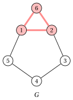
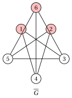
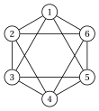
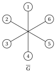
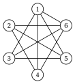
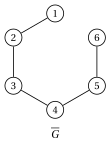
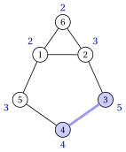

# Exercises · The maximum clique problem

**Exercises · Chapter 5** · each solution opens with a click · [:material-book-open-variant: Chapter 5: Maximum clique](../combinatorial-optimization-problems/clique/index.md) · [:material-file-pdf-box: Exercises, volume 1 (PDF)](../pdf/exercises-1-combinatorial-optimization-problems.pdf)

!!! esercizio "Exercise 5.1: Cliques, stable sets and the complement graph (MCP)"

    We consider the graph $G=(V,E)$ with $V=\{1,\dots,6\}$ and the edges

    $$
    E=\{\{1,2\},\{1,5\},\{1,6\},\{2,3\},\{2,6\},\{3,4\},\{4,5\}\}.
    $$

    drawn below:

    { .fig loading=lazy  }

    and the four subsets of vertices

    $$
    A=\{1,2,6\},\qquad B=\{1,3\},\qquad C=\{2,4,5\},\qquad D=\{3,5,6\}.
    $$

    **Questions**

    1. For each subset, decide whether it is a clique of $G$, a stable set of $G$, or neither.

    2. List all the maximal cliques of $G$ (cliques to which no vertex can be added).

    3. Write the edges of the complement graph $\overline{G}$ and draw it next to $G$.

    4. Find $\omega(G)$ and $\alpha(G)$, and check that $\omega(G)=\alpha(\overline{G})$ and $\alpha(G)=\omega(\overline{G})$.

??? soluzione "Solution"

    1. - $A$: all the pairs are edges, so $A$ is a clique (a triangle).

        - $B$: no pair is an edge, so $B$ is a stable set.

        - $C$: the pair $\{4,5\}$ is an edge and the pair $\{2,4\}$ is not, so $C$ is neither a clique nor a stable set.

        - $D$: no pair is an edge, so $D$ is a stable set.

    2. The maximal cliques are $\{1,2,6\}$ and the edges $\{1,5\}$, $\{2,3\}$, $\{3,4\}$, $\{4,5\}$: every other edge lies in the triangle $\{1,2,6\}$, and no vertex is adjacent to both endpoints of the four edges listed.

    3. $\overline{G}$ has $\binom{6}{2}-7=8$ edges:

        $$
        \overline{E}=\{\{1,3\},\{1,4\},\{2,4\},\{2,5\},\{3,5\},\{3,6\},\{4,6\},\{5,6\}\}.
        $$

        { .fig loading=lazy  }

        { .fig loading=lazy  }

        The red vertices are a clique of $G$ and a stable set of $\overline{G}$.

    4. $\omega(G)=3$: the only triangle is $\{1,2,6\}$, and a clique with $4$ vertices would contain $4$ triangles. $\alpha(G)=3$ with the unique maximum stable set $D=\{3,5,6\}$: a stable set takes at most $2$ vertices of the cycle $1,2,3,4,5$, and with vertex $6$ it cannot use $1$ or $2$. In $\overline{G}$ the set $\{1,2,6\}$ is a maximum stable set and $D$ is a maximum clique (a triangle of $\overline{G}$): $\alpha(\overline{G})=3=\omega(G)$ and $\omega(\overline{G})=3=\alpha(G)$.

    !!! chiave ""

        $A$ is the unique maximum clique, $\omega(G)=3$; $D$ is the unique maximum stable set, $\alpha(G)=3$. In $\overline{G}$ the two roles exchange.

!!! esercizio "Exercise 5.2: Counting the candidate solutions (MCP)"

    We consider the graph $G=(V,E)$ with $V=\{1,\dots,6\}$ in which every vertex is adjacent to all the others except the opposite one on the circle: the non-adjacent pairs are $\{1,4\}$, $\{2,5\}$ and $\{3,6\}$.

    { .fig loading=lazy  }

    **Questions**

    1. How many edges does $G$ have? Draw the complement graph $\overline{G}$.

    2. How many candidate solutions does the MCP have on $G$?

    3. Count the cliques of $G$ with $0,1,2,3$ vertices, reasoning on the three pairs $\{1,4\}$, $\{2,5\}$ and $\{3,6\}$. Is there a clique with $4$ vertices?

    4. Find $\omega(G)$ and the number of maximum cliques.

??? soluzione "Solution"

    1. $G$ has $\binom{6}{2}-3=12$ edges. $\overline{G}$ has only the $3$ edges $\{1,4\},\{2,5\},\{3,6\}$: three disjoint edges.

        { .fig loading=lazy  }

    2. The candidate solutions are the subsets of $V$: $2^6=64$.

    3. A subset is a clique if and only if it contains at most one vertex of each pair. For each pair there are $3$ choices (no vertex, the first one, the second one), so there are $3^3=27$ cliques:

        
<table>
        <tr>
        <th>number of vertices</th>
        <th>\(0\)</th>
        <th>\(1\)</th>
        <th>\(2\)</th>
        <th>\(3\)</th>
        <th>total</th>
        </tr>
        <tr>
        <td>cliques</td>
        <td>\(1\)</td>
        <td>\(6\)</td>
        <td>\(12\)</td>
        <td>\(8\)</td>
        <td>\(27\)</td>
        </tr>
        </table>

        With $2$ vertices: $\binom{3}{2}=3$ pairs of pairs, times $2\cdot 2$ choices, gives $12$; with $3$ vertices: $2^3=8$. A clique with $4$ vertices would take two vertices of the same pair: there is none.

    4. $\omega(G)=3$, and there are $8$ maximum cliques, for example $\{1,2,3\}$ and $\{4,5,6\}$. Only $27$ of the $64$ candidate solutions are feasible.

    !!! chiave ""

        $27$ cliques out of $64$ subsets; $\omega(G)=3$ with $8$ maximum cliques, one vertex from each non-adjacent pair.

!!! esercizio "Exercise 5.3: A clique by hand and the simple bounds (MCP)"

    The wheel $W_5$ is the graph with the vertices $V=\{1,\dots,6\}$: the vertices $1,\dots,5$ form a cycle and vertex $6$, the hub, is adjacent to all of them.

    { .fig loading=lazy  }

    **Questions**

    1. Build a clique by hand: start from a vertex of maximum degree and add, each time, the vertex of smallest index adjacent to all the vertices already chosen. Which lower bound do you get?

    2. Compute the degree bound and the edge bound.

    3. Compute the degree count bound $k^{\max}$.

    4. Find a coloring of $W_5$ with $4$ colors. Which upper bound does it give?

    5. Find $\omega(W_5)$. Which bound is tight?

??? soluzione "Solution"

    1. Vertex $6$ has degree $5$, the maximum. The vertices adjacent to $6$ are $1,\dots,5$: we add $1$. The vertices adjacent to both $6$ and $1$ are $2$ and $5$: we add $2$. No vertex is adjacent to $6$, $1$ and $2$, so we stop with $K=\{1,2,6\}$ and $\mathrm{LB}=3$.

    2. The degrees are:

        $$
        \begin{array}{c|cccccc}
        \hline {v} & {1} & {2} & {3} & {4} & {5} & {6} \\
        \hline {\deg(v)} & {3} & {3} & {3} & {3} & {3} & {5} \\
        \hline
        \end{array}
        $$

        The degree bound gives $\Delta+1=6$. The graph has $m=10$ edges; since $5\cdot 4/2=10\le 10<15=6\cdot 5/2$, the edge bound gives $5$.

    3. For $k=4$ we need $4$ vertices of degree at least $3$: all the $6$ vertices qualify. For $k=5$ we need $5$ vertices of degree at least $4$: only vertex $6$ qualifies. Hence $k^{\max}=4$.

    4. The classes $\{\{1,3\},\{2,4\},\{5\},\{6\}\}$ are stable sets: $1,3$ and $2,4$ are not consecutive on the cycle. The coloring uses $4$ colors, so $\omega(W_5)\le 4$.

        { .fig loading=lazy  }

    5. A clique with $4$ vertices would contain at least $3$ vertices of the cycle, pairwise adjacent, and the cycle with $5$ vertices has no triangle. Hence $\omega(W_5)=3$, attained by the clique of Question 1 (drawn in red above). None of the upper bounds is tight: the best ones give $4$, and the gap $(4-3)/3$ is closed only by the argument on the cycle.

    !!! chiave ""

        $\mathrm{LB}=3$ from the clique $\{1,2,6\}$; upper bounds $6$ (degree), $5$ (edges), $4$ (degree count) and $4$ (coloring); $\omega(W_5)=3$.

!!! esercizio "Exercise 5.4: Working on the complement graph (MCP)"

    We consider the graph $G=(V,E)$ with $V=\{1,\dots,6\}$ and the $10$ edges

    \begin{align*}
    E=\{ & \{1,3\},\{1,4\},\{1,5\},\{1,6\},\{2,4\},\\
    & \{2,5\},\{2,6\},\{3,5\},\{3,6\},\{4,6\}\}.
    \end{align*}

    { .fig loading=lazy  }

    **Questions**

    1. Write the edges of $\overline{G}$ and draw it. What kind of graph is it?

    2. Compute $\alpha(\overline{G})$ and list all the maximum stable sets of $\overline{G}$.

    3. Deduce $\omega(G)$ and the maximum cliques of $G$.

    4. Compute $\alpha(G)$.

??? soluzione "Solution"

    1. $\overline{G}$ has $\binom{6}{2}-10=5$ edges, $\{1,2\}$, $\{2,3\}$, $\{3,4\}$, $\{4,5\}$, $\{5,6\}$: it is the path $1,2,3,4,5,6$.

        { .fig loading=lazy  }

        On a dense graph it is easier to work on the complement.

    2. A stable set of the path contains no two consecutive vertices. With $4$ vertices out of $6$, two of them would be consecutive, so $\alpha(\overline{G})\le 3$. The stable sets with $3$ vertices are $\{1,3,5\}$, $\{1,3,6\}$, $\{1,4,6\}$, $\{2,4,6\}$: $\alpha(\overline{G})=3$, with $4$ maximum stable sets.

    3. By the proposition of the chapter, the cliques of $G$ are the stable sets of $\overline{G}$: $\omega(G)=\alpha(\overline{G})=3$, and the maximum cliques of $G$ are the four sets above. The optimal solution is not unique.

        { .fig loading=lazy  }

    4. $\alpha(G)=\omega(\overline{G})$: the path has no triangle and has edges, so $\omega(\overline{G})=2$ and $\alpha(G)=2$. For example, $\{1,2\}$ is a maximum stable set of $G$.

    !!! chiave ""

        $\overline{G}$ is a path: $\omega(G)=\alpha(\overline{G})=3$ with $4$ maximum cliques, and $\alpha(G)=\omega(\overline{G})=2$.

!!! esercizio "Exercise 5.5: Vertex-weighted maximum clique (MCP)"

    We consider the graph $G=(V,E)$ of the figure, with the vertex weights in blue:

    { .fig loading=lazy  }

    $$
    \vet{w}=(2,3,5,4,3,2).
    $$

    **Questions**

    1. List the maximal cliques of $G$ with their total weight $w(K)$.

    2. Why is it enough to look at the maximal cliques? Find the vertex-weighted maximum clique.

    3. Compare it with the optimal solution of the MCP on the same graph.

??? soluzione "Solution"

    1. The maximal cliques are the triangle $\{1,2,6\}$ and four edges of the cycle:

        
<table>
        <tr>
        <th>maximal clique \(K\)</th>
        <th>\(w(K)\)</th>
        </tr>
        <tr>
        <td>\(\{1,2,6\}\)</td>
        <td>\(2+3+2=7\)</td>
        </tr>
        <tr>
        <td>\(\{1,5\}\)</td>
        <td>\(2+3=5\)</td>
        </tr>
        <tr>
        <td>\(\{2,3\}\)</td>
        <td>\(3+5=8\)</td>
        </tr>
        <tr>
        <td>\(\{3,4\}\)</td>
        <td>\(5+4=9\)</td>
        </tr>
        <tr>
        <td>\(\{4,5\}\)</td>
        <td>\(4+3=7\)</td>
        </tr>
        </table>

    2. All the weights are positive, and every clique is contained in a maximal clique: adding vertices to a clique increases its weight. The heaviest maximal clique is $\{3,4\}$, with weight $9$: it is the unique optimal solution (Gurobi on the model with weights confirms it).

        { .fig loading=lazy  }

    3. The MCP chooses the triangle $\{1,2,6\}$, with $3$ vertices but weight $7$. The vertex-weighted problem prefers the two heavy vertices $3$ and $4$: the number of vertices does not matter, only their weight.

    !!! chiave ""

        The vertex-weighted maximum clique is $\{3,4\}$, of weight $9$; the maximum clique $\{1,2,6\}$ weighs $7$.
