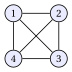

# Exercises · Formulations of coloring problems

**Exercises · Chapter 11** · each solution opens with a click · [:material-book-open-variant: Chapter 11: Coloring problems](../formulations/coloring-formulations.md) · [:material-file-pdf-box: Exercises, volume 2 (PDF)](../pdf/exercises-2-formulations.pdf)

!!! chiave ""

    <strong>Formulations used in these exercises.</strong> The model $\mathrm{ILP}_{\mathrm{VCP}}$ of the chapter [Formulations of coloring problems](https://fabiofurini.github.io/combinatorial-optimization/formulations/coloring-formulations/), with the set of colors $\mathscr{C}=\{1,\dots,k\}$:

    \begin{align*}
    && \min ~~ \sum_{c\in\mathscr{C}} y_c \tag{C0}\\
    && \text{subject to} \quad \sum_{c\in\mathscr{C}} x_{vc} &= 1, & \forall v\in V, \tag{C1}\\
    && -x_{uc}-x_{vc}+y_c &\ge 0, & \forall c\in\mathscr{C},~\forall\{u,v\}\in E, \tag{C2}\\
    && x_{vc} &\in\{0,1\}, & \forall v\in V,~\forall c\in\mathscr{C}, \tag{C3}\\
    && y_c &\in\{0,1\}, & \forall c\in\mathscr{C}. \tag{C4}
    \end{align*}

    The relaxations $\mathrm{LP}\text{-}0_{\mathrm{VCP}}$ and $\mathrm{LP}_{\mathrm{VCP}}$ of the chapter relax (C3) and (C4) into $x_{vc}\ge 0$ and $y_c\ge 0$, with also $y_c\le 1$ in $\mathrm{LP}_{\mathrm{VCP}}$. For every graph with at least one edge and every valid $k$, an optimal solution of both relaxations is

    \begin{equation*}
    \tilde x_{v1}=\tilde x_{v2}=\frac{1}{2}~~(v\in V),\qquad \tilde y_1=\tilde y_2=1, \tag{C5}
    \end{equation*}

    with all the other variables equal to $0$, and $z(\mathrm{LP}\text{-}0_{\mathrm{VCP}})=z(\mathrm{LP}_{\mathrm{VCP}})=2$. An optimal dual solution chooses one edge $\{u,v\}\in E$ and sets $\tilde\mu_u=\tilde\mu_v=1$, $\tilde\pi_{c\{u,v\}}=1$ for every color $c$, and all the other dual variables equal to $0$.

!!! esercizio "Exercise 11.1: ILP model of the Vertex Coloring Problem (1)"

    We consider the following graph $G=(V,E)$ with $5$ vertices ($n=5$) and $5$ edges ($m=5$):

    { .fig loading=lazy  }

    $$
    V=\{1,\dots,5\},
    $$

    $$
    E=\{\{1,2\},~\{2,3\},~\{3,4\},~\{4,5\},~\{1,5\}\}.
    $$

    The color classes $\{1,3\}$, $\{2,4\}$ and $\{5\}$ are a feasible coloring.

    **Questions**

    1. Explain why $k=3$ is a valid upper bound on the number of colors of an optimal solution.

    2. Count the variables and the constraints (besides the domains) of the $\mathrm{ILP}_{\mathrm{VCP}}$ model with $k=3$.

    3. Write the $\mathrm{ILP}_{\mathrm{VCP}}$ model with $k=3$ for this graph (write the edge constraints for all the colors $c$ at once).

    4. Solve the model with Gurobi. Give the optimal value and an optimal coloring, and count the optimal partitions of the vertices into color classes.

??? soluzione "Solution"

    1. The given classes contain no edge: they are a feasible coloring with $3$ colors. Hence $z(\mathrm{ILP}_{\mathrm{VCP}})\le 3$ and $k=3$ is valid.

    2. There are $k\,n=3\cdot5=15$ variables $x_{vc}$ and $k=3$ variables $y_c$, so $18$ binary variables. There are $n=5$ assignment constraints and $k\,m=3\cdot5=15$ edge constraints, so $20$ linear constraints.

    3. With $\mathscr{C}=\{1,2,3\}$ the $\mathrm{ILP}_{\mathrm{VCP}}$ model is:

        $$
        \begin{array}{rlcl}
        {\min} & {y_1+y_2+y_3} &  &  \\[1ex]
        \text{subject to} & {x_{11}+x_{12}+x_{13}} & {=} & {1} \\
        & {x_{21}+x_{22}+x_{23}} & {=} & {1} \\
        & {x_{31}+x_{32}+x_{33}} & {=} & {1} \\
        & {x_{41}+x_{42}+x_{43}} & {=} & {1} \\
        & {x_{51}+x_{52}+x_{53}} & {=} & {1} \\
        & {-x_{11}-x_{21}+y_1} & {\ge} & {0} \\
        & {-x_{21}-x_{31}+y_1} & {\ge} & {0} \\
        & {-x_{31}-x_{41}+y_1} & {\ge} & {0} \\
        & {-x_{41}-x_{51}+y_1} & {\ge} & {0} \\
        & {-x_{11}-x_{51}+y_1} & {\ge} & {0} \\
        & {-x_{12}-x_{22}+y_2} & {\ge} & {0} \\
        & {-x_{22}-x_{32}+y_2} & {\ge} & {0} \\
        & {-x_{32}-x_{42}+y_2} & {\ge} & {0} \\
        & {-x_{42}-x_{52}+y_2} & {\ge} & {0} \\
        & {-x_{12}-x_{52}+y_2} & {\ge} & {0} \\
        & {-x_{13}-x_{23}+y_3} & {\ge} & {0} \\
        & {-x_{23}-x_{33}+y_3} & {\ge} & {0} \\
        & {-x_{33}-x_{43}+y_3} & {\ge} & {0} \\
        & {-x_{43}-x_{53}+y_3} & {\ge} & {0} \\
        & {-x_{13}-x_{53}+y_3} & {\ge} & {0} \\[1ex]
        & {x_{11},~x_{12},~x_{13},~\dots,~x_{53}} & {\in} & {\{0,1\}} \\
        & {y_1,~y_2,~y_3} & {\in} & {\{0,1\}}
        \end{array}
        $$

    4. Gurobi returns $z(\mathrm{ILP}_{\mathrm{VCP}})=3$. Two colors are not enough: the cycle has an odd number of vertices, and colors that alternate along it would give the same color to vertices $1$ and $5$. An optimal coloring is $\tilde Q_1=\{1,3\}$, $\tilde Q_2=\{2,4\}$, $\tilde Q_3=\{5\}$, that is

        $$
        \tilde x_{11}=1,~~\tilde x_{31}=1,~~\tilde x_{22}=1,~~\tilde x_{42}=1,~~\tilde x_{53}=1,~~\tilde y_1=\tilde y_2=\tilde y_3=1 .
        $$

        By enumeration there are $5$ optimal partitions: one class is a single vertex, and the other four vertices form two pairs of non-adjacent vertices in a unique way. With the $3!=6$ permutations of the colors, the model has $30$ optimal solutions.

!!! esercizio "Exercise 11.2: LP relaxations of the VCP model (1)"

    We consider the following graph $G=(V,E)$ with $4$ vertices ($n=4$) and $6$ edges ($m=6$):

    { .fig loading=lazy  }

    $$
    V=\{1,\dots,4\},
    $$

    $$
    E=\{\{1,2\},~\{1,3\},~\{1,4\},~\{2,3\},~\{2,4\},~\{3,4\}\}.
    $$

    The graph is complete, and we use $k=4$ colors.

    **Questions**

    1. Solve $\mathrm{LP}\text{-}0_{\mathrm{VCP}}$, $\mathrm{LP}_{\mathrm{VCP}}$ and $\mathrm{ILP}_{\mathrm{VCP}}$ with Gurobi.

    2. Write the primal solution (C5) for this graph and verify that it is feasible for $\mathrm{LP}_{\mathrm{VCP}}$.

    3. Write the dual solution of the chapter built on the edge $\{1,2\}$ and verify that it is feasible for $D(\mathrm{LP}\text{-}0_{\mathrm{VCP}})$, with the same objective value.

    4. Compute the absolute gap and the ratio between the LP bound and the optimal value. What happens on the complete graph with $n$ vertices?

??? soluzione "Solution"

    We use the primal solution (C5) and the dual solution built on one edge, given in the box at the beginning of the chapter.

    1. Gurobi gives $z(\mathrm{LP}\text{-}0_{\mathrm{VCP}})=z(\mathrm{LP}_{\mathrm{VCP}})=2$ and $z(\mathrm{ILP}_{\mathrm{VCP}})=4$: all the vertices are pairwise adjacent, so they need $4$ different colors.

    2. The solution is $\tilde x_{v1}=\tilde x_{v2}=\frac{1}{2}$ for $v=1,\dots,4$, $\tilde x_{v3}=\tilde x_{v4}=0$, $\tilde y_1=\tilde y_2=1$ and $\tilde y_3=\tilde y_4=0$.

        - Assignment: $\frac{1}{2}+\frac{1}{2}=1$ for every vertex.

        - Edges, colors $1$ and $2$: $\tilde y_c-\tilde x_{uc}-\tilde x_{vc}=1-\frac{1}{2}-\frac{1}{2}=0$. Colors $3$ and $4$: $0-0-0=0$.

        - Bounds: $0\le\tilde y_c\le 1$ for every color.

        Its value is $\tilde y_1+\tilde y_2=2$.

    3. The dual solution is $\tilde\mu_1=\tilde\mu_2=1$, $\tilde\mu_3=\tilde\mu_4=0$, $\tilde\pi_{c\{1,2\}}=1$ for $c=1,\dots,4$, and all the other $\tilde\pi_{ce}=0$.

        - Vertices $1$ and $2$: the edge $\{1,2\}$ is incident to both, so $\tilde\mu_v-\sum_{e\in\delta(v)}\tilde\pi_{ce}=1-1=0$ for every color.

        - Vertices $3$ and $4$: $0-0=0$, since no edge incident to them has a non-zero value.

        - Colors: $\sum_{e\in E}\tilde\pi_{ce}=1\le 1$ for every color.

        Its value is $\tilde\mu_1+\tilde\mu_2=2$, equal to the primal value: by LP Weak Duality both solutions are optimal.

    4. The absolute gap is $4-2=2$ and the ratio is $\frac{z(\mathrm{LP}_{\mathrm{VCP}})}{z(\mathrm{ILP}_{\mathrm{VCP}})}=\frac{1}{2}$. On the complete graph with $n$ vertices the optimal value is $n$ and the LP bound is still $2$: the gap $n-2$ grows without limit and the ratio $\frac{2}{n}$ tends to $0$.

!!! esercizio "Exercise 11.3: Feasible solutions of the VCP model (1)"

    We consider the following graph $G=(V,E)$ with $5$ vertices ($n=5$) and $5$ edges ($m=5$):

    { .fig loading=lazy  }

    $$
    V=\{1,\dots,5\},
    $$

    $$
    E=\{\{1,2\},~\{2,3\},~\{3,4\},~\{4,5\},~\{1,5\}\}.
    $$

    We use the $\mathrm{ILP}_{\mathrm{VCP}}$ model with $k=3$ colors. The candidate solutions are (variables not listed are $0$):

    - **(a)** color $1$: $\{1,3\}$, color $2$: $\{2,4\}$, color $3$: $\{5\}$, and $y_1=y_2=y_3=1$;

    - **(b)** color $1$: $\{1,3\}$, color $2$: $\{2,4,5\}$, and $y_1=y_2=1$, $y_3=0$;

    - **(c)** color $1$: $\{1,3\}$, color $2$: $\{2,4\}$, color $3$: $\{5\}$, and $y_1=y_2=1$, $y_3=0$;

    - **(d)** $x_{v1}=x_{v2}=\frac{1}{2}$ for every vertex $v$, and $y_1=y_2=1$, $y_3=0$;

    - **(e)** $x_{vc}=\frac{1}{3}$ for every vertex $v$ and color $c$, and $y_1=y_2=y_3=\frac{2}{3}$.

    **Questions**

    1. For each candidate, check the assignment constraints and the edge constraints, and name a violated constraint when there is one.

    2. Decide which candidates are feasible for $\mathrm{ILP}_{\mathrm{VCP}}$ and which for $\mathrm{LP}_{\mathrm{VCP}}$, and give the value of the feasible ones.

    3. Which candidates are optimal for $\mathrm{LP}_{\mathrm{VCP}}$? Use Gurobi to confirm the optimal value of the relaxation.

??? soluzione "Solution"

    1. - **(a)** Every vertex has one color, and no edge has both endpoints in the same class: all the constraints hold.

        - **(b)** The edge $\{4,5\}$ has both endpoints with color $2$: the constraint $-x_{42}-x_{52}+y_2\ge 0$ reads $-1-1+1=-1<0$.

        - **(c)** Vertex $5$ takes color $3$ but $y_3=0$: the constraint $-x_{43}-x_{53}+y_3\ge 0$ reads $0-1+0=-1<0$.

        - **(d)** Each vertex has $\frac{1}{2}+\frac{1}{2}=1$; for colors $1$ and $2$ every edge gives $1-\frac{1}{2}-\frac{1}{2}=0$, for color $3$ it gives $0$: all the constraints hold.

        - **(e)** Each vertex has $3\cdot\frac{1}{3}=1$; every edge and color give $\frac{2}{3}-\frac{1}{3}-\frac{1}{3}=0$: all the constraints hold.

    2. - **(a)** Feasible for $\mathrm{ILP}_{\mathrm{VCP}}$ and for $\mathrm{LP}_{\mathrm{VCP}}$, of value $3$.

        - **(b)** Infeasible for both models.

        - **(c)** Infeasible for both models.

        - **(d)** Feasible for $\mathrm{LP}_{\mathrm{VCP}}$ only (fractional variables), of value $2$.

        - **(e)** Feasible for $\mathrm{LP}_{\mathrm{VCP}}$ only, of value $3\cdot\frac{2}{3}=2$.

    3. The value of every feasible solution of $\mathrm{LP}_{\mathrm{VCP}}$ is at least $2$, and Gurobi gives $z(\mathrm{LP}_{\mathrm{VCP}})=2$: candidates (d) and (e) are both optimal for the relaxation. Candidate (d) is the solution of the chapter; (e) shows that the optimal solution of the relaxation is not unique. Candidate (a) is optimal for $\mathrm{ILP}_{\mathrm{VCP}}$, whose value is $3$.

!!! esercizio "Exercise 11.4: Dual solutions of the VCP relaxations (1)"

    We consider the following graph $G=(V,E)$ with $6$ vertices ($n=6$) and $9$ edges ($m=9$):

    { .fig loading=lazy  }

    $$
    V=\{1,\dots,6\},
    $$

    \begin{align*}
    E=\{ & \{1,2\},~\{1,3\},~\{2,3\},~\{4,5\},~\{4,6\},\\
    & \{5,6\},~\{1,4\},~\{2,5\},~\{3,6\}\}.
    \end{align*}

    We use $k=3$ colors. Every vertex has degree $3$.

    **Questions**

    1. Write the constraints of the dual $D(\mathrm{LP}\text{-}0_{\mathrm{VCP}})$ associated with the variable $x_{1c}$ and with the variable $y_c$, for a color $c$.

    2. Verify that the dual solutions of the chapter built on the edge $\{1,4\}$ and on the edge $\{2,3\}$ are feasible, and give their value.

    3. Verify that $\tilde\mu_v=\frac{1}{3}=\frac{\deg(v)}{|E|}$ for every vertex and $\tilde\pi_{ce}=\frac{1}{9}$ for every color and edge is also an optimal dual solution.

    4. Add the bounds $y_c\le 1$, with dual variables $\lambda_c\le 0$. Give an optimal solution of $D(\mathrm{LP}_{\mathrm{VCP}})$, and compare the two relaxations with the optimal value (use Gurobi).

??? soluzione "Solution"

    We use the primal solution (C5) and the dual solution built on one edge, given in the box at the beginning of the chapter.

    1. The edges incident to vertex $1$ are $\{1,2\}$, $\{1,3\}$ and $\{1,4\}$. The constraint of $x_{1c}$ and the constraint of $y_c$ are

        $$
        \mu_1-\pi_{c\{1,2\}}-\pi_{c\{1,3\}}-\pi_{c\{1,4\}}\le 0,\qquad \sum_{e\in E}\pi_{ce}\le 1 .
        $$

    2. For the edge $\{1,4\}$: $\tilde\mu_1=\tilde\mu_4=1$ and $\tilde\pi_{c\{1,4\}}=1$ for $c=1,2,3$. Vertices $1$ and $4$ give $1-1=0$, the other vertices give $0-0=0$, and every color gives $\sum_e\tilde\pi_{ce}=1$. The value is $2$.

        For the edge $\{2,3\}$ the check is the same with vertices $2$ and $3$: also this solution is feasible, of value $2$. Both are optimal, since $z(\mathrm{LP}\text{-}0_{\mathrm{VCP}})=2$.

    3. Every vertex has $3$ incident edges, so $\tilde\mu_v-\sum_{e\in\delta(v)}\tilde\pi_{ce}=\frac{1}{3}-3\cdot\frac{1}{9}=0$. Every color gives $\sum_{e\in E}\tilde\pi_{ce}=9\cdot\frac{1}{9}=1$. The value is

        $$
        \sum_{v\in V}\tilde\mu_v=6\cdot\frac{1}{3}=2,
        $$

        the optimal value: this dual solution spreads the weight on all the edges, instead of choosing one.

    4. The previous dual solutions with $\tilde\lambda_c=0$ for every color satisfy $\sum_e\tilde\pi_{ce}+\tilde\lambda_c\le 1$ and have value $2$. Gurobi gives $z(\mathrm{LP}\text{-}0_{\mathrm{VCP}})=z(\mathrm{LP}_{\mathrm{VCP}})=2$ and $z(\mathrm{ILP}_{\mathrm{VCP}})=3$: the bounds $y_c\le 1$ do not strengthen the relaxation, which stays at $2$ while the graph needs $3$ colors (it contains the triangle $\{1,2,3\}$).

!!! esercizio "Exercise 11.5: Integrality gap of the VCP model (1)"

    We consider the following graph $G=(V,E)$ with $6$ vertices ($n=6$) and $10$ edges ($m=10$):

    { .fig loading=lazy  }

    $$
    V=\{1,\dots,6\},
    $$

    \begin{align*}
    E=\{ & \{1,2\},~\{2,3\},~\{3,4\},~\{4,5\},~\{1,5\},\\
    & \{1,6\},~\{2,6\},~\{3,6\},~\{4,6\},~\{5,6\}\}.
    \end{align*}

    The graph is a cycle on the vertices $1,\dots,5$ with vertex $6$ adjacent to all of them. The classes $\{1,3\}$, $\{2,4\}$, $\{5\}$, $\{6\}$ are a feasible coloring, so we use $k=4$.

    **Questions**

    1. Compute $z(\mathrm{LP}_{\mathrm{VCP}})$ and $z(\mathrm{ILP}_{\mathrm{VCP}})$ with Gurobi, and explain the optimal value.

    2. Compute the absolute gap and the ratio $\frac{z(\mathrm{LP}_{\mathrm{VCP}})}{z(\mathrm{ILP}_{\mathrm{VCP}})}$.

    3. Solve the relaxation again with $k=6$. Does a larger $k$ change the bound?

    4. On the complete graph with $n$ vertices, find the smallest $n$ for which the ratio is at most $\frac{1}{5}$.

??? soluzione "Solution"

    We use the primal solution (C5) and the dual solution built on one edge, given in the box at the beginning of the chapter.

    1. Gurobi gives $z(\mathrm{LP}_{\mathrm{VCP}})=2$ and $z(\mathrm{ILP}_{\mathrm{VCP}})=4$. The cycle $1,\dots,5$ needs $3$ colors, and vertex $6$, adjacent to all its vertices, needs a fourth one.

    2. The absolute gap is $4-2=2$ and the ratio is $\frac{z(\mathrm{LP}_{\mathrm{VCP}})}{z(\mathrm{ILP}_{\mathrm{VCP}})}=\frac{1}{2}$.

    3. With $k=6$ Gurobi gives again $z(\mathrm{LP}_{\mathrm{VCP}})=2$. The value $2$ does not depend on $k$: the solution of the chapter uses only colors $1$ and $2$, whatever the number of colors.

    4. On the complete graph the ratio is $\frac{2}{n}$, and $\frac{2}{n}\le\frac{1}{5}$ means $n\ge 10$. The smallest value is $n=10$.
