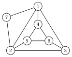
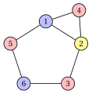
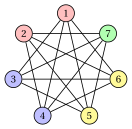
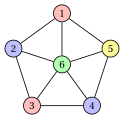
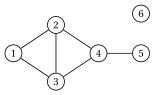
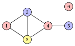

# Exercises · Vertex coloring

**Exercises · Chapter 4** · each solution opens with a click · [:material-book-open-variant: Chapter 4: Vertex coloring](../combinatorial-optimization-problems/coloring.md)

!!! esercizio "Exercise 4.1: Checking a coloring (VCP)"

    We consider the graph $G=(V,E)$ with $V=\{1,\dots,7\}$ and the edges

    $$
    E=\{\{1,2\},\{1,3\},\{1,4\},\{1,7\},\{2,3\},\{2,5\},\{2,7\},\{3,6\},\{4,5\},\{4,6\},\{5,6\}\},
    $$

    drawn below:

    { .fig loading=lazy  }

    and the three proposed solutions

    \begin{align*}
    \mathcal{Q}_a&=\{\{1,6\},\{2,4\},\{3,5,7\}\},\\
    \mathcal{Q}_b&=\{\{1,5,6\},\{2,4\},\{3,7\}\},\\
    \mathcal{Q}_c&=\{\{1,6\},\{2,4\},\{3,5\}\}.
    \end{align*}

    **Questions**

    1. For each proposed solution, decide whether it is a feasible solution of the VCP.

    2. Find a clique with $3$ vertices. What dual bound does it give?

    3. Is the feasible solution of Question 1 optimal? Draw it.

??? soluzione "Solution"

    1. - $\mathcal{Q}_a$ is a partition of $V$ and no edge joins two vertices of the same class: feasible, with $3$ colors.

        - $\mathcal{Q}_b$ is a partition of $V$, but the class $\{1,5,6\}$ contains the edge $\{5,6\}$: it is not a stable set. Not feasible.

        - $\mathcal{Q}_c$ is not a partition of $V$: vertex $7$ has no color. Not feasible.

    2. The vertices $\{1,2,3\}$ are pairwise adjacent, so they form a clique; $G$ has $3$ cliques with $3$ vertices, $\{1,2,3\}$, $\{1,2,7\}$, $\{4,5,6\}$. By the clique bound, $\chi(G)\ge \omega(G)\ge 3$.

    3. $\mathcal{Q}_a$ uses $3$ colors and attains the clique bound: it is optimal and $\chi(G)=3$.

        { .fig loading=lazy  }

    !!! chiave ""

        Only $\mathcal{Q}_a$ is feasible; it uses $3$ colors, as many as the vertices of a clique: $\chi(G)=3$.

!!! esercizio "Exercise 4.2: Neighbourhoods, cliques and stable sets (VCP)"

    We consider the graph $G=(V,E)$ with $V=\{1,\dots,6\}$ and the edges

    $$
    E=\{\{1,2\},\{1,4\},\{1,5\},\{2,3\},\{2,4\},\{3,6\},\{5,6\}\}.
    $$

    **Questions**

    1. Draw the graph and compute the neighbourhood $N(v)$ and the degree of every vertex.

    2. Check the two assumptions of the VCP.

    3. Write the edges of the complement graph $\overline{G}$.

    4. Find $\omega(G)$ and $\alpha(G)$, with a maximum clique and a maximum stable set, and compute the clique bound and the stable set bound.

    5. Find an optimal coloring.

??? soluzione "Solution"

    1. The graph, and the neighbourhoods and degrees of its vertices:

        { .fig loading=lazy  }

        $$
        \begin{array}{c|cccccc}
        \hline {v} & {1} & {2} & {3} & {4} & {5} & {6} \\
        \hline {N(v)} & {\{2,4,5\}} & {\{1,3,4\}} & {\{2,6\}} & {\{1,2\}} & {\{1,6\}} & {\{3,5\}} \\
        {\deg(v)} & {3} & {3} & {2} & {2} & {2} & {2} \\
        \hline
        \end{array}
        $$

        The degrees sum up to $14=2|E|$, since every edge is counted at both its endpoints.

    2. Every vertex has degree at least $1$, so there are no isolated vertices. No neighbourhood is contained in another one: for every pair $u\neq v$ the table shows a vertex of $N(u)$ that is not in $N(v)$. For example, $N(4)=\{1,2\}$ is contained in no other neighbourhood, since no other vertex is adjacent to both $1$ and $2$. Both assumptions hold.

    3. $\overline{G}$ has the $8$ pairs of non-adjacent vertices of $G$:

        $$
        \overline{E}=\{\{1,3\},\{1,6\},\{2,5\},\{2,6\},\{3,4\},\{3,5\},\{4,5\},\{4,6\}\}.
        $$

    4. The vertices $\{1,2,4\}$ form a triangle, so $\omega(G)\ge 3$. A clique with $4$ vertices would need $4$ vertices of degree at least $3$, and only vertices $1$ and $2$ have degree $3$: hence $\omega(G)=3$. The set $\{3,4,5\}$ is stable; a stable set with $4$ vertices would be a clique with $4$ vertices of $\overline{G}$, and the enumeration shows there is none: $\alpha(G)=3$. The clique bound gives $3$, the stable set bound $\lceil 6/3\rceil=2$.

    5. The coloring $\{\{3,4,5\},\{1,6\},\{2\}\}$ has stable classes and uses $3$ colors, as many as the clique bound: it is optimal and $\chi(G)=3$.

        { .fig loading=lazy  }

    !!! chiave ""

        $\omega(G)=3$ with the clique $\{1,2,4\}$, $\alpha(G)=3$ with the stable set $\{3,4,5\}$; the clique bound is tight and $\chi(G)=3$, while the stable set bound gives only $2$.

!!! esercizio "Exercise 4.3: The stable set bound on a complement graph (VCP)"

    The graph $G=(V,E)$ has the vertices $V=\{1,\dots,7\}$, and two distinct vertices are adjacent if and only if they are <em>not</em> consecutive on the cycle $1,2,\dots,7,1$. In other words, $G$ is the complement of the cycle $C_7$ with $7$ vertices:

    { .fig loading=lazy  }

    **Questions**

    1. How many edges does $G$ have? What is the degree of every vertex?

    2. Compute $\alpha(G)$, using the complement graph.

    3. Compute $\omega(G)$ and the clique bound.

    4. Compute the stable set bound and find an optimal coloring.

??? soluzione "Solution"

    1. $C_7$ has $7$ edges out of the $\binom{7}{2}=21$ pairs, so $G$ has $21-7=14$ edges. Every vertex is adjacent to all the vertices except itself and its two neighbours on the cycle: degree $6-2=4$.

    2. A stable set of $G$ is a clique of $\overline{G}=C_7$. The largest cliques of a cycle with $7$ vertices are its edges, since it has no triangle: $\alpha(G)=2$, for example the stable set $\{1,2\}$.

    3. A clique of $G$ is a stable set of $C_7$: a set of vertices with no two consecutive on the cycle. $\{1,3,5\}$ is such a set; with $4$ vertices out of $7$, two of them would be consecutive. Hence $\omega(G)=3$ and the clique bound gives $\chi(G)\ge 3$.

    4. $\lceil n/\alpha(G)\rceil=\lceil 7/2\rceil=4$: every color class has at most $2$ vertices, and $7$ vertices need at least $4$ classes. The coloring $\{\{1,2\},\{3,4\},\{5,6\},\{7\}\}$ uses pairs of consecutive vertices, which are not adjacent in $G$: it is feasible, uses $4$ colors and attains the bound, so $\chi(G)=4$.

        { .fig loading=lazy  }

    !!! chiave ""

        On the complement of $C_7$ the clique bound gives $3$, the stable set bound gives $\lceil 7/2\rceil=4$ and a coloring with $4$ colors closes the gap: $\chi(G)=4$.

!!! esercizio "Exercise 4.4: When both bounds are not tight (VCP)"

    The wheel $W_5$ is the graph with the vertices $V=\{1,\dots,6\}$: the vertices $1,\dots,5$ form a cycle and vertex $6$, the hub, is adjacent to all of them.

    { .fig loading=lazy  }

    **Questions**

    1. Compute $\omega(W_5)$, $\alpha(W_5)$ and the two dual bounds of the chapter.

    2. Show that the cycle $1,2,3,4,5$ cannot be colored with $2$ colors.

    3. Show that $\chi(W_5)=4$ and draw an optimal coloring.

??? soluzione "Solution"

    1. Every triangle uses the hub and an edge of the cycle, for example $\{1,2,6\}$; $4$ pairwise adjacent vertices would need $3$ pairwise adjacent vertices on the cycle, which has no triangle. Hence $\omega(W_5)=3$. A stable set contains at most $2$ vertices of the cycle with $5$ vertices, and the hub is adjacent to all of them: $\alpha(W_5)=2$, for example $\{1,3\}$. The clique bound gives $3$ and the stable set bound $\lceil 6/2\rceil=3$.

    2. With $2$ colors the colors must alternate along the cycle: $1$ gets color A, $2$ color B, $3$ color A, $4$ color B, $5$ color A. Then $5$ and $1$, which are adjacent, have the same color. A cycle with an odd number of vertices needs $3$ colors.

    3. The cycle needs at least $3$ colors, and the hub is adjacent to all the vertices of the cycle, so it needs a color of its own: $\chi(W_5)\ge 4$. The coloring $\{\{1,3\},\{2,4\},\{5\},\{6\}\}$ is feasible and uses $4$ colors, hence $\chi(W_5)=4$.

        { .fig loading=lazy  }

        Both bounds of the chapter give $3$: the gap is closed by the argument on the odd cycle.

    !!! chiave ""

        $\omega(W_5)=3$ and $\lceil 6/\alpha(W_5)\rceil=3$, but $\chi(W_5)=4$: the odd cycle needs $3$ colors and the hub a fourth one. Neither bound is tight.

!!! esercizio "Exercise 4.5: The assumptions and the reduction of the graph (VCP)"

    We consider the graph $G=(V,E)$ with $V=\{1,\dots,6\}$ and the edges

    $$
    E=\{\{1,2\},\{1,3\},\{2,3\},\{2,4\},\{3,4\},\{4,5\}\},
    $$

    drawn below:

    { .fig loading=lazy  }

    **Questions**

    1. Compute the neighbourhoods of the vertices. Which assumptions of the VCP are violated, and by which vertices?

    2. Remove the vertices allowed by the assumptions, one at a time, and compute the chromatic number of the graph that remains.

    3. Extend a coloring of the reduced graph to an optimal coloring of $G$.

    4. How many candidate solutions does $G$ have? How many of them are feasible, by number of colors?

??? soluzione "Solution"

    1. The neighbourhoods are $N(1)=\{2,3\}$, $N(2)=\{1,3,4\}$, $N(3)=\{1,2,4\}$, $N(4)=\{2,3,5\}$, $N(5)=\{4\}$, $N(6)=\emptyset$.

        - Vertex $6$ is isolated: the first assumption is violated.

        - $N(1)=\{2,3\}\subseteq N(4)=\{2,3,5\}$ and $N(5)=\{4\}\subseteq N(2)=\{1,3,4\}$: the second assumption is violated by the pairs $(1,4)$ and $(5,2)$.

    2. We remove the isolated vertex $6$, the vertex $1$ (dominated by $4$) and the vertex $5$ (dominated by $2$). The vertices $2,3,4$ remain, with the edges $\{2,3\},\{2,4\},\{3,4\}$: a triangle, whose chromatic number is $3$. Removing a vertex does not change $\chi$, so $\chi(G)=3$.

    3. We color the triangle with $\{2\},\{3\},\{4\}$ and put each removed vertex back: $1$ takes the color of $4$, $5$ the color of $2$, and $6$ any color, for example that of $4$. The coloring is $\{\{1,4,6\},\{2,5\},\{3\}\}$:

        { .fig loading=lazy  }

    4. The candidates are the partitions of the $6$ vertices: $B(6)=203$. The feasible ones, by enumeration, are:

        
<table>
        <tr>
        <th>colors</th>
        <th>feasible partitions</th>
        </tr>
        <tr>
        <td>\(3\)</td>
        <td>\(6\)</td>
        </tr>
        <tr>
        <td>\(4\)</td>
        <td>\(18\)</td>
        </tr>
        <tr>
        <td>\(5\)</td>
        <td>\(9\)</td>
        </tr>
        <tr>
        <td>\(6\)</td>
        <td>\(1\)</td>
        </tr>
        <tr>
        <td>total</td>
        <td>\(34\)</td>
        </tr>
        </table>

        There are $6$ optimal colorings with $3$ colors.

    !!! chiave ""

        The isolated vertex and the two dominated vertices can be removed: the triangle $\{2,3,4\}$ remains, and $\chi(G)=3$.
