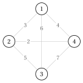
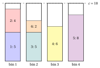
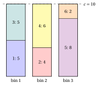
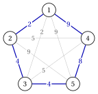
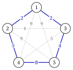

# Exercises · Combinatorial optimization problems

**Exercises · Chapter 1** · each solution opens with a click · [:material-book-open-variant: Chapter 1: Combinatorial optimization](../combinatorial-optimization-problems/combinatorial-optimization.md) · [:material-file-pdf-box: Exercises, volume 1 (PDF)](../pdf/exercises-1-combinatorial-optimization-problems.pdf)

!!! esercizio "Exercise 1.1: Ground set, feasible solutions and objective (TSP)"

    We consider the TSP instance with $4$ cities, $\mathscr{V}=\{1,2,3,4\}$, and the symmetric distances

    $$
    d_{12}=3,\quad d_{13}=6,\quad d_{14}=4,\quad d_{23}=5,\quad d_{24}=2,\quad d_{34}=7.
    $$

    The instance is drawn as a complete graph, with the distance on every edge:

    { .fig loading=lazy  }

    **Questions**

    1. Write the instance as a combinatorial optimization problem in the form of the definition of the chapter: take as ground set $\mathscr{U}$ the set of the edges, and describe the feasible solutions $\mathcal{F}$ and the objective function $f$. How many subsets does $\mathscr{U}$ have?

    2. How many subsets of $\mathscr{U}$ have exactly $4$ edges? How many of them are tours? Explain why the others are not feasible.

    3. Compute $f$ for every feasible solution and find the optimal solution and $z(I)$.

    4. Compare the number of feasible solutions with the formula $(n-1)!/2$ of the chapter.

??? soluzione "Solution"

    1. The ground set is the set of the $6$ edges of the complete graph,

        $$
        \mathscr{U}=\{\{1,2\},\{1,3\},\{1,4\},\{2,3\},\{2,4\},\{3,4\}\}.
        $$

        A subset $S\subseteq\mathscr{U}$ is feasible, $S\in\mathcal{F}$, when its edges form a single cycle through all the cities, that is a tour. The objective function is additive, with the distances as weights:

        $$
        f(S)=\sum_{\{i,j\}\in S} d_{ij}.
        $$

        The ground set has $2^{6}=64$ subsets.

    2. A tour of $4$ cities uses exactly $4$ edges, and there are $\binom{6}{4}=15$ subsets with $4$ edges. Each of them leaves out $2$ edges.

        - If the $2$ missing edges have no city in common, every city keeps $2$ edges: the $4$ edges form a cycle through all the cities. There are $3$ such pairs, $\{\{1,2\},\{3,4\}\}$, $\{\{1,3\},\{2,4\}\}$ and $\{\{1,4\},\{2,3\}\}$: $3$ tours.

        - If the $2$ missing edges meet in a city $v$, the city $v$ keeps only $1$ edge and the other three cities form a triangle: this is not a tour. There are $4\cdot 3=12$ such subsets ($4$ choices of $v$ and $\binom{3}{2}=3$ pairs of edges at $v$).

        Hence only $3$ of the $64$ subsets of $\mathscr{U}$ are feasible.

    3. The three tours, written as sequences starting from city $1$ and as sets of edges, are:

        
<table>
        <tr>
        <th>tour \(\sigma\)</th>
        <th>edges \(S\)</th>
        <th>\(f(S)=L(\sigma)\)</th>
        </tr>
        <tr>
        <td>\((1,2,3,4)\)</td>
        <td>\(\{1,2\},\{1,4\},\{2,3\},\{3,4\}\)</td>
        <td>\(3+4+5+7=19\)</td>
        </tr>
        <tr>
        <td>\((1,2,4,3)\)</td>
        <td>\(\{1,2\},\{1,3\},\{2,4\},\{3,4\}\)</td>
        <td>\(3+6+2+7=18\)</td>
        </tr>
        <tr>
        <td>\((1,3,2,4)\)</td>
        <td>\(\{1,3\},\{1,4\},\{2,3\},\{2,4\}\)</td>
        <td>\(6+4+5+2=\mathbf{17}\)</td>
        </tr>
        </table>

        The optimal solution is the tour $\tilde\sigma=(1,3,2,4)$, with $z(I)=17$:

        { .fig loading=lazy  }

        A short way to see it: the $6$ distances sum up to $27$, and a tour leaves out two edges with no city in common. The best tour leaves out the most expensive such pair, $\{1,2\}$ and $\{3,4\}$, of total $3+7=10$, and $27-10=17$.

    4. The formula gives $(4-1)!/2=3$ tours, the same number found in Question 2. The candidates of the definition, the $64$ subsets of edges, are many more than the feasible solutions.

    !!! chiave ""

        Seen as a combinatorial optimization problem on the ground set of the edges, the instance has $2^6=64$ candidate subsets and only $3$ feasible solutions, the tours. The optimal tour is $(1,3,2,4)$, with $z(I)=17$.

!!! esercizio "Exercise 1.2: A greedy choice that is not optimal (KP)"

    A fund has a budget of $c=14$ and $n=5$ candidate projects, the items $\mathscr{I}=\{1,\dots,5\}$ of a knapsack instance, with the following profits and costs (weights):

    $$
    \begin{array}{l|ccccc}
    \hline  & {j=1} & {j=2} & {j=3} & {j=4} & {j=5} \\[1ex]
    \hline {p_j} & {14} & {9} & {15} & {13} & {11} \\[1ex]
    {w_j} & {7} & {2} & {9} & {6} & {8} \\
    \hline
    \end{array}
    $$

    **Questions**

    1. Write the instance as a combinatorial optimization problem: ground set, feasible solutions and objective function. How many candidate solutions are there?

    2. List the feasible subsets, with weight and profit, and find the optimal solution by brute force.

    3. Apply the greedy algorithm of the chapter: sort the items by non-increasing efficiency $p_j/w_j$ (ties by the smallest index) and insert each item that fits. Is the greedy solution optimal?

    4. Compute the dual bound of the continuous relaxation, in which the items can be taken fractionally, and round it. What are the relative gaps of the greedy solution with respect to this bound and with respect to $z(I)$?

??? soluzione "Solution"

    1. The ground set is $\mathscr{U}=\mathscr{I}=\{1,2,3,4,5\}$. A subset $S\subseteq\mathscr{U}$ is feasible if $\sum_{j\in S} w_j\le 14$, and the objective is $f(S)=\sum_{j\in S} p_j$, to be maximized. The candidate solutions are the $2^5=32$ subsets.

    2. The three lightest items weigh $2+6+7=15>14$, so a feasible subset has at most $2$ items. The $12$ feasible subsets are:

        
<table>
        <tr>
        <th>\(S\)</th>
        <th>weight</th>
        <th>profit</th>
        <th>\(S\)</th>
        <th>weight</th>
        <th>profit</th>
        </tr>
        <tr>
        <td>\(\emptyset\)</td>
        <td>\(0\)</td>
        <td>\(0\)</td>
        <td>\(\{1,2\}\)</td>
        <td>\(9\)</td>
        <td>\(23\)</td>
        </tr>
        <tr>
        <td>\(\{1\}\)</td>
        <td>\(7\)</td>
        <td>\(14\)</td>
        <td>\(\{1,4\}\)</td>
        <td>\(13\)</td>
        <td>\(\mathbf{27}\)</td>
        </tr>
        <tr>
        <td>\(\{2\}\)</td>
        <td>\(2\)</td>
        <td>\(9\)</td>
        <td>\(\{2,3\}\)</td>
        <td>\(11\)</td>
        <td>\(24\)</td>
        </tr>
        <tr>
        <td>\(\{3\}\)</td>
        <td>\(9\)</td>
        <td>\(15\)</td>
        <td>\(\{2,4\}\)</td>
        <td>\(8\)</td>
        <td>\(22\)</td>
        </tr>
        <tr>
        <td>\(\{4\}\)</td>
        <td>\(6\)</td>
        <td>\(13\)</td>
        <td>\(\{2,5\}\)</td>
        <td>\(10\)</td>
        <td>\(20\)</td>
        </tr>
        <tr>
        <td>\(\{5\}\)</td>
        <td>\(8\)</td>
        <td>\(11\)</td>
        <td>\(\{4,5\}\)</td>
        <td>\(14\)</td>
        <td>\(24\)</td>
        </tr>
        </table>

        The optimal solution is $\tilde S=\{1,4\}$, of weight $13$, with $z(I)=27$; it is the only subset with this profit.

    3. The efficiencies are

        $$
        \frac{p_1}{w_1}=\frac{14}{7}=2,\quad \frac{p_2}{w_2}=\frac{9}{2},\quad \frac{p_3}{w_3}=\frac{15}{9}=\frac{5}{3},\quad \frac{p_4}{w_4}=\frac{13}{6},\quad \frac{p_5}{w_5}=\frac{11}{8},
        $$

        so the order is $2,4,1,3,5$. The greedy algorithm examines the items in this order:

        - item $2$ fits (weight $2$): residual capacity $12$;

        - item $4$ fits (weight $6$): residual capacity $6$;

        - item $1$ does not fit (weight $7 > 6$);

        - item $3$ does not fit (weight $9 > 6$);

        - item $5$ does not fit (weight $8 > 6$);

        It returns $\bar S=\{2,4\}$, of profit $22$: a primal bound $\mathrm{LB}=22$. It is not optimal, since $z(I)=27$. The two efficient items fill $8$ units of the budget, and the residual capacity $6$ is too small for any other item; the optimal solution gives up item $2$, the most efficient one, and uses $13$ of the $14$ units of the budget with items $1$ and $4$.

    4. In the continuous relaxation the items are taken in the same order: items $2, 4$ fill $8$ units, and the fraction $\frac{6}{7}$ of item $1$ fills the residual capacity $6$:

        $$
        \mathrm{UB}=9+13+\frac{6}{7}\cdot 14=34.
        $$

        The bound is an integer, no rounding is needed. With respect to the bound, the relative gap of the greedy solution is $\frac{34-22}{22}=\frac{6}{11}\approx 54.5\%$; with respect to the optimum it is $\frac{27-22}{22}=\frac{5}{22}\approx 22.7\%$. Without the enumeration, the bound alone cannot certify the optimum.

    !!! chiave ""

        The greedy choice by efficiency gives profit $22$, while the optimum, found by brute force over the $12$ feasible subsets, is $z(I)=27$ with $\tilde S=\{1,4\}$: $22\le z(I)=27\le 34$.

!!! esercizio "Exercise 1.3: Counting the solutions"

    We count the candidate solutions of small instances of the problems of the course.

    - **(a)** A knapsack instance with $n=6$ items.

    - **(b)** A TSP instance with $6$ cities and symmetric distances.

    - **(c)** A bin packing instance with $n=5$ items, capacity $c=8$ and weights $\vet{w}=(5,4,3,3,2)$.

    - **(d)** A $P\|C_{\max}$ instance with $4$ jobs and $m=2$ machines.

    **Questions**

    1. How many candidate solutions does instance (a) have?

    2. How many permutations of the $6$ cities of instance (b) are there, how many of them describe the same tour, and how many distinct tours are there?

    3. Compute the Bell numbers $B(1),\dots,B(5)$ with the recursion of the chapter: how many candidate solutions does instance (c) have?

    4. Count, by enumeration, the feasible solutions of instance (c), grouped by number of bins. What is the optimal number of bins?

    5. How many assignments of the jobs to the machines does instance (d) have, and how many distinct schedules?

??? soluzione "Solution"

    1. The candidates are the subsets of the $6$ items: $2^6=64$.

    2. There are $6!=720$ permutations. A tour is described by $6$ permutations, one for every starting city, and by $6$ more read in the opposite direction: $2\cdot 6=12$ permutations per tour. The distinct tours are $\frac{720}{12}=60=\frac{(6-1)!}{2}$.

    3. With $B(0)=1$ and $B(n)=\sum_{k=0}^{n-1}\binom{n-1}{k}B(k)$, each term is a binomial coefficient times a Bell number already computed:

        \begin{align*}
        B(1)&=1\cdot 1=1\\
        B(2)&=1\cdot 1+1\cdot 1=2\\
        B(3)&=1\cdot 1+2\cdot 1+1\cdot 2=5\\
        B(4)&=1\cdot 1+3\cdot 1+3\cdot 2+1\cdot 5=15\\
        B(5)&=1\cdot 1+4\cdot 1+6\cdot 2+4\cdot 5+1\cdot 15=52.
        \end{align*}

        The candidate solutions of instance (c) are the partitions of the $5$ items: $B(5)=52$.

    4. A partition is feasible if every bin weighs at most $8$. The enumeration of the $52$ partitions gives $23$ feasible ones:

        
<table>
        <tr>
        <th>bins</th>
        <th>feasible partitions</th>
        </tr>
        <tr>
        <td>\(3\)</td>
        <td>\(13\)</td>
        </tr>
        <tr>
        <td>\(4\)</td>
        <td>\(9\)</td>
        </tr>
        <tr>
        <td>\(5\)</td>
        <td>\(1\)</td>
        </tr>
        <tr>
        <td>total</td>
        <td>\(23\)</td>
        </tr>
        </table>

        The weight bound gives $\lceil 17/8\rceil=3$, and there are feasible partitions with $3$ bins, for example $\{\{1\},\{2\},\{3,4,5\}\}$; hence $z(I)=3$. The optimal solution is not unique: $13$ partitions use $3$ bins.

    5. Every job goes to one of the $2$ machines: $2^4=16$ assignments. The machines are identical, so an assignment and the one with the names of the machines exchanged are the same schedule. The assignment with all the jobs on one machine gives $1$ schedule (counted twice among the $16$ assignments), the other $14$ assignments give $\frac{14}{2}=7$ schedules with two non-empty machines: $8$ distinct schedules, the partitions of the $4$ jobs into at most $2$ sets.

    !!! chiave ""

        The candidates are $2^n$ subsets, $(n-1)!/2$ tours and $B(n)$ partitions; only a part of them is feasible, for instance $23$ of the $52$ partitions of instance (c), whose optimal value is $3$ bins.

!!! esercizio "Exercise 1.4: A greedy choice that is not optimal (BPP)"

    We consider the bin packing instance with capacity $c=10$ and $n=6$ items, with weights

    $$
    \begin{array}{l|cccccc}
    \hline  & {j=1} & {j=2} & {j=3} & {j=4} & {j=5} & {j=6} \\[1ex]
    \hline {w_j} & {5} & {4} & {5} & {6} & {8} & {2} \\
    \hline
    \end{array}
    $$

    **Questions**

    1. Apply First Fit: take the items in the order $1,2,\dots,n$ and put each one into the first open bin where it fits, opening a new bin when it fits nowhere. How many bins does it use?

    2. Compute the weight bound $\left\lceil \sum_j w_j / c \right\rceil$.

    3. Find a solution that attains the bound. What can you conclude on the solution of First Fit?

    4. Compute the absolute and the relative gap between the First Fit solution and the dual bound.

??? soluzione "Solution"

    1. The loads of the open bins after each item are:

        
<table>
        <tr>
        <th>item \(j\)</th>
        <th>\(w_j\)</th>
        <th>placed in</th>
        <th>loads</th>
        </tr>
        <tr>
        <td>\(1\)</td>
        <td>\(5\)</td>
        <td>new bin 1</td>
        <td>\((5)\)</td>
        </tr>
        <tr>
        <td>\(2\)</td>
        <td>\(4\)</td>
        <td>bin 1</td>
        <td>\((9)\)</td>
        </tr>
        <tr>
        <td>\(3\)</td>
        <td>\(5\)</td>
        <td>new bin 2</td>
        <td>\((9,5)\)</td>
        </tr>
        <tr>
        <td>\(4\)</td>
        <td>\(6\)</td>
        <td>new bin 3</td>
        <td>\((9,5,6)\)</td>
        </tr>
        <tr>
        <td>\(5\)</td>
        <td>\(8\)</td>
        <td>new bin 4</td>
        <td>\((9,5,6,8)\)</td>
        </tr>
        <tr>
        <td>\(6\)</td>
        <td>\(2\)</td>
        <td>bin 2</td>
        <td>\((9,7,6,8)\)</td>
        </tr>
        </table>

        First Fit returns $\{\{1,2\},\{3,6\},\{4\},\{5\}\}$, with $4$ bins: a primal bound $\mathrm{UB}=4$.

        { .fig loading=lazy  }

    2. $\sum_j w_j=5+4+5+6+8+2=30$, hence $\mathrm{LB}=\lceil 30/10\rceil=3$.

    3. The partition $\{\{1,3\},\{2,4\},\{5,6\}\}$ has bins of weight $10, 10, 10$, all at most $10$: it is feasible and uses $3$ bins.

        { .fig loading=lazy  }

        It attains the dual bound, so it is optimal and $z(I)=3$; the solution of First Fit is not optimal. First Fit puts item $2$ (weight $4$) with item $1$ (load $9$) and wastes the residual capacity $1$; the optimal packing puts item $1$ with item $3$ and item $2$ with item $4$, two bins filled exactly.

    4. The absolute gap is $4-3=1$ and the relative gap is $\frac{1}{3}\approx 33.3\%$.

    !!! chiave ""

        First Fit, a greedy choice, uses $4$ bins, while the weight bound gives $3$ and the partition $\{\{1,3\},\{2,4\},\{5,6\}\}$ attains it: $z(I)=3$.

!!! esercizio "Exercise 1.5: Primal bound, dual bound and gap (TSP)"

    We consider the TSP instance with $5$ cities and the symmetric distances

    $$
    \begin{array}{c|ccccc}
    \hline {d_{ij}} & {1} & {2} & {3} & {4} & {5} \\
    \hline {1} & --- & {2} & {2} & {9} & {9} \\
    {2} & {2} & --- & {4} & {5} & {9} \\
    {3} & {2} & {4} & --- & {5} & {4} \\
    {4} & {9} & {5} & {5} & --- & {8} \\
    {5} & {9} & {9} & {4} & {8} & --- \\
    \hline
    \end{array}
    $$

    **Questions**

    1. Build a tour with the nearest neighbour rule from city $1$ (ties broken by the smallest index) and compute its length. Is it a primal or a dual bound?

    2. Compute the dual bound $\left\lceil \frac12 \sum_i (a_i+b_i)\right\rceil$, where $a_i\le b_i$ are the two smallest distances from city $i$.

    3. Enumerate the $(5-1)!/2$ tours and find the optimal one.

    4. Compute the absolute and relative gaps of the nearest neighbour tour, with respect to the dual bound and with respect to $z(I)$. Why is the greedy choice of the nearest city not optimal here?

??? soluzione "Solution"

    1. The nearest neighbour rule proceeds as follows:

        - from $1$ the closest unvisited cities are $2, 3$, at distance $2$: we go to $2$ (smallest index);

        - from $2$ the closest unvisited city is $3$, at distance $4$;

        - from $3$ the closest unvisited city is $5$, at distance $4$;

        - from $5$ the closest unvisited city is $4$, at distance $8$;

        - we return from $4$ to $1$, at distance $d_{41}=9$.

        The tour is $\bar\sigma=(1,2,3,5,4)$, of length $L(\bar\sigma)=2+4+4+8+9=27$. It is the length of a feasible solution of a minimization problem, hence a primal bound: $\mathrm{UB}=27$.

        { .fig loading=lazy  }

    2. The two smallest distances of every city are:

        
<table>
        <tr>
        <th>city \(i\)</th>
        <th>\(1\)</th>
        <th>\(2\)</th>
        <th>\(3\)</th>
        <th>\(4\)</th>
        <th>\(5\)</th>
        <th>sum</th>
        </tr>
        <tr>
        <td>\(a_i\)</td>
        <td>\(2\)</td>
        <td>\(2\)</td>
        <td>\(2\)</td>
        <td>\(5\)</td>
        <td>\(4\)</td>
        <td></td>
        </tr>
        <tr>
        <td>\(b_i\)</td>
        <td>\(2\)</td>
        <td>\(4\)</td>
        <td>\(4\)</td>
        <td>\(5\)</td>
        <td>\(8\)</td>
        <td></td>
        </tr>
        <tr>
        <td>\(a_i+b_i\)</td>
        <td>\(4\)</td>
        <td>\(6\)</td>
        <td>\(6\)</td>
        <td>\(10\)</td>
        <td>\(12\)</td>
        <td>\(38\)</td>
        </tr>
        </table>

        Hence $\mathrm{LB}=\frac{38}{2}=19$ (the sum is even, no rounding is needed).

    3. The $12$ tours, all starting from city $1$, are:

        
<table>
        <tr>
        <th>tour</th>
        <th>\(L\)</th>
        <th>tour</th>
        <th>\(L\)</th>
        <th>tour</th>
        <th>\(L\)</th>
        </tr>
        <tr>
        <td>\((1,2,4,5,3)\)</td>
        <td>\(\mathbf{21}\)</td>
        <td>\((1,2,3,4,5)\)</td>
        <td>\(28\)</td>
        <td>\((1,3,4,2,5)\)</td>
        <td>\(30\)</td>
        </tr>
        <tr>
        <td>\((1,2,4,3,5)\)</td>
        <td>\(25\)</td>
        <td>\((1,3,2,4,5)\)</td>
        <td>\(28\)</td>
        <td>\((1,4,2,3,5)\)</td>
        <td>\(31\)</td>
        </tr>
        <tr>
        <td>\((1,2,5,4,3)\)</td>
        <td>\(26\)</td>
        <td>\((1,2,5,3,4)\)</td>
        <td>\(29\)</td>
        <td>\((1,3,2,5,4)\)</td>
        <td>\(32\)</td>
        </tr>
        <tr>
        <td>\((1,2,3,5,4)\)</td>
        <td>\(27\)</td>
        <td>\((1,3,5,2,4)\)</td>
        <td>\(29\)</td>
        <td>\((1,4,3,2,5)\)</td>
        <td>\(36\)</td>
        </tr>
        </table>

        The optimal tour is $\tilde\sigma=(1,2,4,5,3)$, the only one of length $z(I)=21$:

        { .fig loading=lazy  }

    4. With respect to the dual bound the absolute gap is $27-19=8$ and the relative gap is $\frac{8}{19}\approx 42.1\%$. With respect to the optimum the absolute gap is $27-21=6$ and the relative gap is $\frac{6}{21}=\frac{2}{7}\approx 28.6\%$. The rule always takes the shortest available edge and leaves the last edges to chance: the closing edges $\{5,4\}$ and $\{4,1\}$ cost $8$ and $9$.

    !!! chiave ""

        Nearest neighbour gives $\mathrm{UB}=27$, the two shortest edges give $\mathrm{LB}=19$, and the enumeration of the $12$ tours gives $z(I)=21$: $19\le z(I)=21\le 27$.
