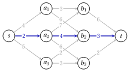
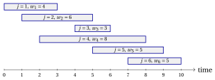
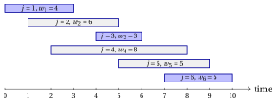

# Exercises · Principles of dynamic programming

**Exercises · Chapter 14** · each solution opens with a click · [:material-book-open-variant: Chapter 14](../dynamic-programming/dp-principles.md)

!!! esercizio "Exercise 14.1: Optimal substructure and overlapping subproblems"

    A staircase has $n=6$ steps. Stepping on step $k$ costs $c_k$, and from a step we can climb to the next one or skip one step. We start from the ground, step $0$, at no cost, and we want to reach step $6$ at minimum total cost:

    
<table>
    <tr>
    <th></th>
    <th>\(k=1\)</th>
    <th>\(k=2\)</th>
    <th>\(k=3\)</th>
    <th>\(k=4\)</th>
    <th>\(k=5\)</th>
    <th>\(k=6\)</th>
    </tr>
    <tr>
    <td>\(c_k\)</td>
    <td>\(3\)</td>
    <td>\(1\)</td>
    <td>\(4\)</td>
    <td>\(1\)</td>
    <td>\(5\)</td>
    <td>\(2\)</td>
    </tr>
    </table>

    For $k\in\{0,1,\dots,n\}$, let $v(k)$ be the minimum cost to reach step $k$.

    **Questions**

    1. Check the optimal substructure: if an optimal way to reach step $k$ arrives from step $k-1$, what can be said about its part from step $0$ to step $k-1$? Write the recurrence for $v(k)$, with the base cases.

    2. Draw the recursion tree of the top-down evaluation of $v(6)$ down to the base cases. How many times is $v(2)$ evaluated? What property does this show?

    3. Fill the lookup table bottom-up, storing also in $s[k]$ the step from which the best way arrives.

    4. Reconstruct an optimal solution from the table $s$.

??? soluzione "Solution"

    1. The part from step $0$ to step $k-1$ is a way to reach step $k-1$, and it must be optimal: a cheaper way to reach step $k-1$, followed by the last move, would reach step $k$ at a lower cost. The same holds when the last move comes from step $k-2$. Hence:

        !!! nota ""

            $$
            v(k)=\left\{\begin{array}{ll}
            c_k+\min\{v(k-1),\,v(k-2)\} & \textrm{if } 2\le k\le n,\\[1ex]
            c_1 & \textrm{if } k=1,\\[1ex]
            0 & \textrm{if } k=0.
            \end{array}\right.
            $$

    2. Each call for $k\ge 2$ calls $k-1$ and $k-2$. The tree has $25$ calls, and the numbers of evaluations of $v(0),\dots,v(6)$ are $5, 8, 5, 3, 2, 1, 1$:

        { .fig loading=lazy  }

        The value $v(2)$ is evaluated $5$ times: the subproblems <strong>overlap</strong>. With a lookup table each of the $7$ values is computed once.

    3. The values are computed for increasing $k$:

        
<table>
        <tr>
        <th>\(k\)</th>
        <th>\(\min\{v(k-1),v(k-2)\}\)</th>
        <th>\({v}[k]\)</th>
        <th>\({s}[k]\)</th>
        <th>action</th>
        </tr>
        <tr>
        <td>\(0\)</td>
        <td>—</td>
        <td>\(0\)</td>
        <td>—</td>
        <td>base case</td>
        </tr>
        <tr>
        <td>\(1\)</td>
        <td>—</td>
        <td>\(3\)</td>
        <td>\(0\)</td>
        <td>base case: \({v}[1]\leftarrow c_1=3\)</td>
        </tr>
        <tr>
        <td>\(2\)</td>
        <td>\(\min\{3,0\}\)</td>
        <td>\(1+0=1\)</td>
        <td>\(0\)</td>
        <td>from step \(0\)</td>
        </tr>
        <tr>
        <td>\(3\)</td>
        <td>\(\min\{1,3\}\)</td>
        <td>\(4+1=5\)</td>
        <td>\(2\)</td>
        <td>from step \(2\)</td>
        </tr>
        <tr>
        <td>\(4\)</td>
        <td>\(\min\{5,1\}\)</td>
        <td>\(1+1=2\)</td>
        <td>\(2\)</td>
        <td>from step \(2\)</td>
        </tr>
        <tr>
        <td>\(5\)</td>
        <td>\(\min\{2,5\}\)</td>
        <td>\(5+2=7\)</td>
        <td>\(4\)</td>
        <td>from step \(4\)</td>
        </tr>
        <tr>
        <td>\(6\)</td>
        <td>\(\min\{7,2\}\)</td>
        <td>\(2+2=4\)</td>
        <td>\(4\)</td>
        <td>from step \(4\)</td>
        </tr>
        </table>

        A tie is broken in favour of step $k-1$.

    4. Starting from $k=6$ and following $s$ backwards: $s[6]=4$, $s[4]=2$, $s[2]=0$. The optimal way is $0\to 2\to 4\to 6$, with cost $1+1+2=4=v(6)$.

    !!! chiave ""

        $v(6)=4$, reached by the steps $0\to 2\to 4\to 6$; the recursion tree evaluates $v(2)$ $5$ times, the lookup table once.

!!! esercizio "Exercise 14.2: Writing a recurrence: no two consecutive positions"

    Along a road there are $n=7$ positions for billboards, numbered in order. A billboard in position $k$ brings a profit $p_k$, and two billboards cannot be in consecutive positions:

    
<table>
    <tr>
    <th></th>
    <th>\(k=1\)</th>
    <th>\(k=2\)</th>
    <th>\(k=3\)</th>
    <th>\(k=4\)</th>
    <th>\(k=5\)</th>
    <th>\(k=6\)</th>
    <th>\(k=7\)</th>
    </tr>
    <tr>
    <td>\(p_k\)</td>
    <td>\(5\)</td>
    <td>\(8\)</td>
    <td>\(6\)</td>
    <td>\(3\)</td>
    <td>\(7\)</td>
    <td>\(9\)</td>
    <td>\(4\)</td>
    </tr>
    </table>

    We want a set of positions, no two consecutive, of maximum total profit.

    **Questions**

    1. Define the subproblems: let $v(k)$ be the optimal value when only the positions $1,\dots,k$ are available. Write a recurrence for $v(k)$, distinguishing whether position $k$ is used, and the base cases.

    2. Fill the lookup table bottom-up, storing in $s[k]$ whether position $k$ is used ($1$) or not ($0$).

    3. Reconstruct an optimal solution.

    4. Choose the positions greedily, by non-increasing profit, skipping the positions next to a chosen one. Is the result optimal?

??? soluzione "Solution"

    1. If position $k$ is not used, the best choice among $1,\dots,k$ is the best choice among $1,\dots,k-1$. If it is used, position $k-1$ is forbidden and the rest is an optimal choice among $1,\dots,k-2$ (optimal substructure: a better choice there would improve the whole). Hence:

        !!! nota ""

            $$
            v(k)=\left\{\begin{array}{ll}
            \max\{v(k-1),\;p_k+v(k-2)\} & \textrm{if } 2\le k\le n,\\[1ex]
            p_1 & \textrm{if } k=1,\\[1ex]
            0 & \textrm{if } k=0.
            \end{array}\right.
            $$

    2. The values are computed for increasing $k$ (a tie is broken in favour of not using position $k$):

        
<table>
        <tr>
        <th>\(k\)</th>
        <th>\(v(k-1)\)</th>
        <th>\(p_k+v(k-2)\)</th>
        <th>\({v}[k]\)</th>
        <th>\({s}[k]\)</th>
        </tr>
        <tr>
        <td>\(0\)</td>
        <td>—</td>
        <td>—</td>
        <td>\(0\)</td>
        <td>\(0\)</td>
        </tr>
        <tr>
        <td>\(1\)</td>
        <td>—</td>
        <td>—</td>
        <td>\(5\)</td>
        <td>\(1\)</td>
        </tr>
        <tr>
        <td>\(2\)</td>
        <td>\(5\)</td>
        <td>\(8+0=8\)</td>
        <td>\(8\)</td>
        <td>\(1\)</td>
        </tr>
        <tr>
        <td>\(3\)</td>
        <td>\(8\)</td>
        <td>\(6+5=11\)</td>
        <td>\(11\)</td>
        <td>\(1\)</td>
        </tr>
        <tr>
        <td>\(4\)</td>
        <td>\(11\)</td>
        <td>\(3+8=11\)</td>
        <td>\(11\)</td>
        <td>\(0\)</td>
        </tr>
        <tr>
        <td>\(5\)</td>
        <td>\(11\)</td>
        <td>\(7+11=18\)</td>
        <td>\(18\)</td>
        <td>\(1\)</td>
        </tr>
        <tr>
        <td>\(6\)</td>
        <td>\(18\)</td>
        <td>\(9+11=20\)</td>
        <td>\(20\)</td>
        <td>\(1\)</td>
        </tr>
        <tr>
        <td>\(7\)</td>
        <td>\(20\)</td>
        <td>\(4+18=22\)</td>
        <td>\(22\)</td>
        <td>\(1\)</td>
        </tr>
        </table>

    3. Starting from $k=7$:

        - $s[7]=1$: position $7$ is chosen, go to $k=5$;

        - $s[5]=1$: position $5$ is chosen, go to $k=3$;

        - $s[3]=1$: position $3$ is chosen, go to $k=1$;

        - $s[1]=1$: position $1$ is chosen, go to $k=0$;

        The optimal solution is $\{1,3,5,7\}$, with profit $5+6+7+4=22=v(7)$.

    4. The greedy choice takes the positions $6, 2, 4$ (in this order), of profit $8+3+9=20<22$: it is not optimal. Taking position $6$ first forbids its neighbours, which together are worth more.

    !!! chiave ""

        $v(7)=22$ with the positions $\{1,3,5,7\}$; the greedy choice by profit gives only $20$.

!!! esercizio "Exercise 14.3: Filling a DP table: paths on a grid"

    A robot moves on a grid of $3$ rows and $4$ columns, from the cell $(1,1)$ to the cell $(3,4)$, one cell down or one cell right at each move. Every cell $(i,j)$ it visits gives a profit $a_{ij}$:

    
<table>
    <tr>
    <th></th>
    <th>\(j=1\)</th>
    <th>\(j=2\)</th>
    <th>\(j=3\)</th>
    <th>\(j=4\)</th>
    </tr>
    <tr>
    <td>\(i=1\)</td>
    <td>\(3\)</td>
    <td>\(1\)</td>
    <td>\(4\)</td>
    <td>\(2\)</td>
    </tr>
    <tr>
    <td>\(i=2\)</td>
    <td>\(2\)</td>
    <td>\(6\)</td>
    <td>\(1\)</td>
    <td>\(5\)</td>
    </tr>
    <tr>
    <td>\(i=3\)</td>
    <td>\(4\)</td>
    <td>\(2\)</td>
    <td>\(3\)</td>
    <td>\(1\)</td>
    </tr>
    </table>

    We want a path of maximum total profit.

    **Questions**

    1. How many paths are there? Why is the enumeration of the paths not a good idea on large grids?

    2. Let $v(i,j)$ be the maximum profit of a path from $(1,1)$ to $(i,j)$. Write the recurrence and the base cases.

    3. Fill the table of $v(i,j)$ row by row, storing in $s(i,j)$ whether the best path arrives from above ($\uparrow$) or from the left ($\leftarrow$); a tie is broken in favour of above.

    4. Reconstruct the optimal path.

??? soluzione "Solution"

    1. A path makes $2$ moves down and $3$ moves right, in any order: $\binom{5}{2}=10$ paths. On a grid with $r$ rows and $q$ columns there are $\binom{r+q-2}{r-1}$ paths, which grows exponentially, while the table has only $rq$ cells.

    2. The last move into $(i,j)$ comes from $(i-1,j)$ or from $(i,j-1)$, and the path up to there must be optimal (optimal substructure):

        !!! nota ""

            $$
            v(i,j)=\left\{\begin{array}{ll}
            a_{ij}+\max\{v(i-1,j),\,v(i,j-1)\} & \textrm{if } i\ge 2,\ j\ge 2,\\[1ex]
            a_{1j}+v(1,j-1) & \textrm{if } i=1,\ j\ge 2,\\[1ex]
            a_{i1}+v(i-1,1) & \textrm{if } i\ge 2,\ j=1,\\[1ex]
            a_{11} & \textrm{if } i=j=1.
            \end{array}\right.
            $$

    3. The tables $v$ and $s$ are:

        
<table>
        <tr>
        <th>\(v(i,j)\)</th>
        <th>\(j=1\)</th>
        <th>\(j=2\)</th>
        <th>\(j=3\)</th>
        <th>\(j=4\)</th>
        </tr>
        <tr>
        <td>\(i=1\)</td>
        <td>\(3\)</td>
        <td>\(4\)</td>
        <td>\(8\)</td>
        <td>\(10\)</td>
        </tr>
        <tr>
        <td>\(i=2\)</td>
        <td>\(5\)</td>
        <td>\(11\)</td>
        <td>\(12\)</td>
        <td>\(17\)</td>
        </tr>
        <tr>
        <td>\(i=3\)</td>
        <td>\(9\)</td>
        <td>\(13\)</td>
        <td>\(16\)</td>
        <td>\(18\)</td>
        </tr>
        </table>

        
<table>
        <tr>
        <th></th>
        <th>\(j=1\)</th>
        <th>\(j=2\)</th>
        <th>\(j=3\)</th>
        <th>\(j=4\)</th>
        </tr>
        <tr>
        <td>\(i=1\)</td>
        <td>—</td>
        <td>\(\leftarrow\)</td>
        <td>\(\leftarrow\)</td>
        <td>\(\leftarrow\)</td>
        </tr>
        <tr>
        <td>\(i=2\)</td>
        <td>\(\uparrow\)</td>
        <td>\(\leftarrow\)</td>
        <td>\(\leftarrow\)</td>
        <td>\(\leftarrow\)</td>
        </tr>
        <tr>
        <td>\(i=3\)</td>
        <td>\(\uparrow\)</td>
        <td>\(\uparrow\)</td>
        <td>\(\leftarrow\)</td>
        <td>\(\uparrow\)</td>
        </tr>
        </table>

        For example $v(2,2)=a_{22}+\max\{v(1,2),v(2,1)\}=6+\max\{4,5\}=11$.

    4. From $(3,4)$ we follow the arrows backwards: the path is $(1,1)\to (2,1)\to (2,2)\to (2,3)\to (2,4)\to (3,4)$, with profit $3+2+6+1+5+1=18=v(3,4)$. Its cells are highlighted:

        
<table>
        <tr>
        <th>\(v(i,j)\)</th>
        <th>\(j=1\)</th>
        <th>\(j=2\)</th>
        <th>\(j=3\)</th>
        <th>\(j=4\)</th>
        </tr>
        <tr>
        <td>\(i=1\)</td>
        <td class="cella-blu">\(3\)</td>
        <td>\(4\)</td>
        <td>\(8\)</td>
        <td>\(10\)</td>
        </tr>
        <tr>
        <td>\(i=2\)</td>
        <td class="cella-blu">\(5\)</td>
        <td class="cella-blu">\(11\)</td>
        <td class="cella-blu">\(12\)</td>
        <td class="cella-blu">\(17\)</td>
        </tr>
        <tr>
        <td>\(i=3\)</td>
        <td>\(9\)</td>
        <td>\(13\)</td>
        <td>\(16\)</td>
        <td class="cella-blu">\(18\)</td>
        </tr>
        </table>

    !!! chiave ""

        The optimal path collects $v(3,4)=18$. The DP algorithm fills one cell per subproblem, $12$ here, while the number of paths grows exponentially with the size of the grid.

!!! esercizio "Exercise 14.4: Shortest path in a layered network"

    We look for a shortest path from $s$ to $t$ in the directed network $G=(N,A)$ below, where every arc $(i,j)\in A$ has a cost $c_{ij}$:

    { .fig loading=lazy  }

    For every node $i$, let $v(i)$ be the cost of a shortest path from $i$ to $t$.

    **Questions**

    1. Check the optimal substructure: if a shortest path from $s$ to $t$ passes through node $i$, what can be said about its part from $i$ to $t$? Write the recurrence for $v(i)$ and the base case.

    2. Which values $v(i)$ are needed by more than one node? What property of DP does this show?

    3. Compute the values $v(i)$ backwards, from $t$ to $s$, storing in $s(i)$ the successor of $i$ on the best path (ties broken by the node listed first).

    4. Reconstruct the shortest path and compare its cost with the enumeration of all the paths.

??? soluzione "Solution"

    1. The part from $i$ to $t$ must be a shortest path from $i$ to $t$: a shorter one would give a shorter path from $s$ to $t$. The first arc out of $i$ goes to some successor $j$, hence:

        !!! nota ""

            $$
            v(i)=\left\{\begin{array}{ll}
            \min\{c_{ij}+v(j):(i,j)\in A\} & \textrm{if } i\neq t,\\[1ex]
            0 & \textrm{if } i=t.
            \end{array}\right.
            $$

    2. The values $v(b_1)$, $v(b_2)$, $v(b_3)$ are needed by the nodes $a_1,a_2,a_3$ that point to them: $v(b_1)$ by $2$ nodes, $v(b_2)$ by $3$ and $v(b_3)$ by $2$. The subproblems overlap: with a lookup table each value is computed once.

    3. The values, from $t$ backwards:

        
<table>
        <tr>
        <th>node \(i\)</th>
        <th>\(c_{ij}+v(j)\) for \((i,j)\in A\)</th>
        <th>\(v(i)\)</th>
        <th>\(s(i)\)</th>
        </tr>
        <tr>
        <td>\(t\)</td>
        <td>—</td>
        <td>\(0\)</td>
        <td>—</td>
        </tr>
        <tr>
        <td>\(b_3\)</td>
        <td>\(2+0=2\)</td>
        <td>\(2\)</td>
        <td>\(t\)</td>
        </tr>
        <tr>
        <td>\(b_2\)</td>
        <td>\(3+0=3\)</td>
        <td>\(3\)</td>
        <td>\(t\)</td>
        </tr>
        <tr>
        <td>\(b_1\)</td>
        <td>\(6+0=6\)</td>
        <td>\(6\)</td>
        <td>\(t\)</td>
        </tr>
        <tr>
        <td>\(a_3\)</td>
        <td>\(2+3=5\), \(3+2=5\)</td>
        <td>\(5\)</td>
        <td>\(b_2\)</td>
        </tr>
        <tr>
        <td>\(a_2\)</td>
        <td>\(7+6=13\), \(4+3=7\), \(6+2=8\)</td>
        <td>\(7\)</td>
        <td>\(b_2\)</td>
        </tr>
        <tr>
        <td>\(a_1\)</td>
        <td>\(3+6=9\), \(6+3=9\)</td>
        <td>\(9\)</td>
        <td>\(b_1\)</td>
        </tr>
        <tr>
        <td>\(s\)</td>
        <td>\(4+9=13\), \(2+7=9\), \(5+5=10\)</td>
        <td>\(9\)</td>
        <td>\(a_2\)</td>
        </tr>
        </table>

    4. Following $s$ from $s$: $s\to a_2\to b_2\to t$, of cost $2+4+3=9=v(s)$:

        { .fig loading=lazy  }

        The network has $7$ paths from $s$ to $t$; their enumeration gives the same optimal path, the only one of cost $9$.

    !!! chiave ""

        $v(s)=9$, with the shortest path $s\to a_2\to b_2\to t$; the values of the nodes $b_k$ are computed once and used several times.

!!! esercizio "Exercise 14.5: A recurrence for a new problem: compatible requests"

    A room can host one event at a time. There are $n=6$ requests: request $j$ occupies the room from time $a_j$ to time $b_j$ and pays $w_j$; two requests are compatible if one ends before (or when) the other starts. The requests are numbered by non-decreasing end time:

    
<table>
    <tr>
    <th></th>
    <th>\(j=1\)</th>
    <th>\(j=2\)</th>
    <th>\(j=3\)</th>
    <th>\(j=4\)</th>
    <th>\(j=5\)</th>
    <th>\(j=6\)</th>
    </tr>
    <tr>
    <td>\(a_j\)</td>
    <td>\(0\)</td>
    <td>\(1\)</td>
    <td>\(4\)</td>
    <td>\(2\)</td>
    <td>\(5\)</td>
    <td>\(7\)</td>
    </tr>
    <tr>
    <td>\(b_j\)</td>
    <td>\(3\)</td>
    <td>\(5\)</td>
    <td>\(6\)</td>
    <td>\(8\)</td>
    <td>\(9\)</td>
    <td>\(10\)</td>
    </tr>
    <tr>
    <td>\(w_j\)</td>
    <td>\(4\)</td>
    <td>\(6\)</td>
    <td>\(3\)</td>
    <td>\(8\)</td>
    <td>\(5\)</td>
    <td>\(5\)</td>
    </tr>
    </table>

    { .fig loading=lazy  }

    We want a set of pairwise compatible requests of maximum total payment.

    **Questions**

    1. For every $j$, let $q(j)$ be the largest index $i<j$ of a request compatible with $j$ ($q(j)=0$ if there is none). Compute $q(1),\dots,q(n)$.

    2. Let $v(j)$ be the optimal value with the requests $1,\dots,j$ only. Write a recurrence for $v(j)$, distinguishing whether request $j$ is taken, and the base case.

    3. Fill the lookup table, storing in $s[j]$ whether request $j$ is taken; a tie is broken in favour of not taking it.

    4. Reconstruct an optimal solution. Does the greedy choice by non-increasing payment find it?

??? soluzione "Solution"

    1. Request $j$ starts at $a_j$, and the compatible requests with smaller index are those with $b_i\le a_j$; since the end times are sorted, they are the requests $1,\dots,q(j)$:

        
<table>
        <tr>
        <th></th>
        <th>\(j=1\)</th>
        <th>\(j=2\)</th>
        <th>\(j=3\)</th>
        <th>\(j=4\)</th>
        <th>\(j=5\)</th>
        <th>\(j=6\)</th>
        </tr>
        <tr>
        <td>\(q(j)\)</td>
        <td>\(0\)</td>
        <td>\(0\)</td>
        <td>\(1\)</td>
        <td>\(0\)</td>
        <td>\(2\)</td>
        <td>\(3\)</td>
        </tr>
        </table>

    2. If request $j$ is not taken, the best choice is among $1,\dots,j-1$. If it is taken, the requests $q(j)+1,\dots,j-1$ overlap with it, and the rest is an optimal choice among $1,\dots,q(j)$:

        !!! nota ""

            $$
            v(j)=\left\{\begin{array}{ll}
            \max\{v(j-1),\;w_j+v(q(j))\} & \textrm{if } 1\le j\le n,\\[1ex]
            0 & \textrm{if } j=0.
            \end{array}\right.
            $$

    3. The values are computed for increasing $j$:

        
<table>
        <tr>
        <th>\(j\)</th>
        <th>\(q(j)\)</th>
        <th>\(v(j-1)\)</th>
        <th>\(w_j+v(q(j))\)</th>
        <th>\({v}[j]\)</th>
        <th>\({s}[j]\)</th>
        </tr>
        <tr>
        <td>\(0\)</td>
        <td>—</td>
        <td>—</td>
        <td>—</td>
        <td>\(0\)</td>
        <td>—</td>
        </tr>
        <tr>
        <td>\(1\)</td>
        <td>\(0\)</td>
        <td>\(0\)</td>
        <td>\(4+0=4\)</td>
        <td>\(4\)</td>
        <td>\(1\)</td>
        </tr>
        <tr>
        <td>\(2\)</td>
        <td>\(0\)</td>
        <td>\(4\)</td>
        <td>\(6+0=6\)</td>
        <td>\(6\)</td>
        <td>\(1\)</td>
        </tr>
        <tr>
        <td>\(3\)</td>
        <td>\(1\)</td>
        <td>\(6\)</td>
        <td>\(3+4=7\)</td>
        <td>\(7\)</td>
        <td>\(1\)</td>
        </tr>
        <tr>
        <td>\(4\)</td>
        <td>\(0\)</td>
        <td>\(7\)</td>
        <td>\(8+0=8\)</td>
        <td>\(8\)</td>
        <td>\(1\)</td>
        </tr>
        <tr>
        <td>\(5\)</td>
        <td>\(2\)</td>
        <td>\(8\)</td>
        <td>\(5+6=11\)</td>
        <td>\(11\)</td>
        <td>\(1\)</td>
        </tr>
        <tr>
        <td>\(6\)</td>
        <td>\(3\)</td>
        <td>\(11\)</td>
        <td>\(5+7=12\)</td>
        <td>\(12\)</td>
        <td>\(1\)</td>
        </tr>
        </table>

    4. Starting from $j=6$:

        - $s[6]=1$: job $6$ is taken, go to $q(6)=3$;

        - $s[3]=1$: job $3$ is taken, go to $q(3)=1$;

        - $s[1]=1$: job $1$ is taken, go to $q(1)=0$;

        The optimal solution is $\{1,3,6\}$, with payment $4+3+5=12=v(6)$:

        { .fig loading=lazy  }

        The greedy choice by payment takes $4$, of payment $8<12$: request $4$, the richest one, overlaps with the requests $1, 3, 6$ of the optimal solution, which together pay $12$.

    !!! chiave ""

        $v(6)=12$ with the requests $\{1,3,6\}$; the greedy choice by payment gives only $8$.
