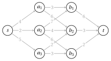

# Exercises · Principles of dynamic programming

**Exercises · Chapter 16** · each solution opens with a click · [:material-book-open-variant: Chapter 16: Principles](../dynamic-programming/dp-principles.md) · [:material-file-pdf-box: Exercises, volume 3 (PDF)](../pdf/exercises-3-dynamic-programming.pdf)

!!! esercizio "Exercise 16.1: Optimal substructure and overlapping subproblems: the 0/1 knapsack problem"

    Consider the 0/1 knapsack problem with $n=4$ items and capacity $c=8$:

    $$
    \max\Big\{\sum_{j=1}^n p_jx_j:\ \sum_{j=1}^n w_jx_j\le c,\ x_j\in\{0,1\},\ j=1,\dots,n\Big\},
    $$

    with the data

    $$
    \begin{array}{l|cccc}
    \hline  & {j=1} & {j=2} & {j=3} & {j=4} \\[1ex]
    \hline {p_j} & {3} & {5} & {4} & {5} \\[1ex]
    {w_j} & {2} & {4} & {3} & {3} \\
    \hline
    \end{array}
    $$

    For $j\in\{0,\dots,n\}$ and $k\in\{0,\dots,c\}$, let $v(j,k)$ be the optimal value with the items $1,\dots,j$ only and capacity $k$.

    **Questions**

    1. Check the optimal substructure: if an optimal solution of the subproblem $(j,k)$ takes item $j$, what can be said about its restriction to the items $1,\dots,j-1$? Write the recurrence for $v(j,k)$ and the base cases.

    2. Evaluate $v(4,8)$ top-down and list, for each $j$, the subproblems $(j,k)$ that the recursion generates. Which of them are generated more than once? What property does this show?

    3. Fill the lookup table of $v(j,k)$ row by row, storing in $s(j,k)$ whether item $j$ is taken ($1$) or not ($0$); a tie is broken in favour of not taking it.

    4. Reconstruct an optimal solution from the table $s$.

??? soluzione "Solution"

    1. Its restriction is a solution of the subproblem $(j-1,k-w_j)$, and it must be optimal: a better one, plus item $j$, would beat the optimal solution of $(j,k)$. If item $j$ is not taken, the restriction is optimal for $(j-1,k)$. Hence:

        !!! nota ""

            $$
            v(j,k)=\left\{\begin{array}{ll}
            \max\{v(j-1,k),\;p_j+v(j-1,k-w_j)\} & \textrm{if } j\ge 1,\ w_j\le k,\\[1ex]
            v(j-1,k) & \textrm{if } j\ge 1,\ w_j>k,\\[1ex]
            0 & \textrm{if } j=0.
            \end{array}\right.
            $$

    2. Each call $(j,k)$ generates $(j-1,k)$ and, if $w_j\le k$, $(j-1,k-w_j)$:

        - $j=4$: $(4,8)$;

        - $j=3$: $(3,8)$, $(3,5)$;

        - $j=2$: $(2,8)$, $(2,5)$, $(2,5)$, $(2,2)$ (repeated: $(2,5)$);

        - $j=1$: $(1,8)$, $(1,4)$, $(1,5)$, $(1,1)$, $(1,5)$, $(1,1)$, $(1,2)$ (repeated: $(1,1)$, $(1,5)$);

        - $j=0$: $(0,8)$, $(0,6)$, $(0,4)$, $(0,2)$, $(0,5)$, $(0,3)$, $(0,1)$, $(0,5)$, $(0,3)$, $(0,1)$, $(0,2)$, $(0,0)$ (repeated: $(0,1)$, $(0,2)$, $(0,3)$, $(0,5)$);

        The recursion makes $26$ calls for $19$ distinct subproblems: the subproblems <strong>overlap</strong> (items $3$ and $4$ have the same weight). A lookup table computes each value once.

    3. The tables $v$ and $s$ are:

        $$
        \begin{array}{c|ccccccccc}
        \hline {v(j,k)} & {k=0} & {1} & {2} & {3} & {4} & {5} & {6} & {7} & {8} \\
        \hline {j=0} & {0} & {0} & {0} & {0} & {0} & {0} & {0} & {0} & {0} \\
        {j=1} & {0} & {0} & {3} & {3} & {3} & {3} & {3} & {3} & {3} \\
        {j=2} & {0} & {0} & {3} & {3} & {5} & {5} & {8} & {8} & {8} \\
        {j=3} & {0} & {0} & {3} & {4} & {5} & {7} & {8} & {9} & {9} \\
        {j=4} & {0} & {0} & {3} & {5} & {5} & {8} & {9} & {10} & {12} \\
        \hline
        \end{array}
        $$

        $$
        \begin{array}{c|ccccccccc}
        \hline {s(j,k)} & {k=0} & {1} & {2} & {3} & {4} & {5} & {6} & {7} & {8} \\
        \hline {j=0} & -- & -- & -- & -- & -- & -- & -- & -- & -- \\
        {j=1} & {0} & {0} & {1} & {1} & {1} & {1} & {1} & {1} & {1} \\
        {j=2} & {0} & {0} & {0} & {0} & {1} & {1} & {1} & {1} & {1} \\
        {j=3} & {0} & {0} & {0} & {1} & {0} & {1} & {0} & {1} & {1} \\
        {j=4} & {0} & {0} & {0} & {1} & {0} & {1} & {1} & {1} & {1} \\
        \hline
        \end{array}
        $$

        For example $v(3,7)=\max\{v(2,7),\,4+v(2,4)\}=\max\{8,9\}=9$.

    4. Starting from $(4,8)$:

        - $s(4,8)=1$: item $4$ is taken, go to $(3,8-3)=(3,5)$;

        - $s(3,5)=1$: item $3$ is taken, go to $(2,5-3)=(2,2)$;

        - $s(2,2)=0$: item $2$ is not taken, go to $(1,2)$;

        - $s(1,2)=1$: item $1$ is taken, go to $(0,2-2)=(0,0)$;

        The optimal solution is $\{1,3,4\}$, of weight $2+3+3=8\le 8$ and profit $3+4+5=12=v(4,8)$. The visited cells:

        $$
        \begin{array}{c|ccccccccc}
        \hline {v(j,k)} & {k=0} & {1} & {2} & {3} & {4} & {5} & {6} & {7} & {8} \\
        \hline {j=0} & \bbox[#9999ff]{{0}} & {0} & {0} & {0} & {0} & {0} & {0} & {0} & {0} \\
        {j=1} & {0} & {0} & \bbox[#9999ff]{{3}} & {3} & {3} & {3} & {3} & {3} & {3} \\
        {j=2} & {0} & {0} & \bbox[#9999ff]{{3}} & {3} & {5} & {5} & {8} & {8} & {8} \\
        {j=3} & {0} & {0} & {3} & {4} & {5} & \bbox[#9999ff]{{7}} & {8} & {9} & {9} \\
        {j=4} & {0} & {0} & {3} & {5} & {5} & {8} & {9} & {10} & \bbox[#9999ff]{{12}} \\
        \hline
        \end{array}
        $$

    !!! chiave ""

        $v(4,8)=12$ with the items $\{1,3,4\}$; the top-down recursion makes $26$ calls for $19$ distinct subproblems, the lookup table has $(n+1)(c+1)=45$ cells.

!!! esercizio "Exercise 16.2: Writing a recurrence: subset sum via reachable sums"

    Given $n=5$ items with integer weights $w_j$ and a capacity $c=30$, the <strong>subset sum problem</strong> asks for a subset of items of maximum total weight not exceeding $c$:

    $$
    \max\Big\{\sum_{j=1}^n w_jx_j:\ \sum_{j=1}^n w_jx_j\le c,\ x_j\in\{0,1\},\ j=1,\dots,n\Big\}.
    $$

    The data are

    $$
    \begin{array}{l|ccccc}
    \hline  & {j=1} & {j=2} & {j=3} & {j=4} & {j=5} \\[1ex]
    \hline {w_j} & {6} & {9} & {11} & {14} & {17} \\
    \hline
    \end{array}
    $$

    For $j\in\{0,\dots,n\}$, let $R_j$ be the set of the <strong>reachable sums</strong>: the totals $k\le c$ of the subsets of $\{1,\dots,j\}$.

    **Questions**

    1. Write a recurrence for $R_j$, distinguishing whether item $j$ is used, with the base case. How is the optimal value $z^*$ read from $R_n$?

    2. Compute $R_1,\dots,R_n$. For every reachable sum, store the first index $j$ such that it belongs to $R_j$.

    3. Reconstruct an optimal solution.

    4. Take the items greedily by non-increasing weight, as long as they fit. Is the result optimal?

??? soluzione "Solution"

    1. A subset of $\{1,\dots,j\}$ either avoids item $j$, and then its total is in $R_{j-1}$, or uses it, and then its total is $k+w_j$ with $k\in R_{j-1}$. Hence:

        !!! nota ""

            $$
            R_j=\left\{\begin{array}{ll}
            R_{j-1}\,\cup\,\{k+w_j:\ k\in R_{j-1},\ k+w_j\le c\} & \textrm{if } 1\le j\le n,\\[1ex]
            \{0\} & \textrm{if } j=0,
            \end{array}\right.
            $$

            $$
            z^*=\max\{k:\ k\in R_n\}.
            $$

        It is the KP of the previous chapter with $p_j=w_j$, written with sets of reachable values.

    2. The row $j$ lists only the new sums; a sum belongs to $R_j$ if it appears in a row $\le j$:

        
<table>
        <tr>
        <th>\(j\)</th>
        <th>\(w_j\)</th>
        <th>sums of \(R_j\) that are not in \(R_{j-1}\)</th>
        </tr>
        <tr>
        <td>\(0\)</td>
        <td>—</td>
        <td>\(0\)</td>
        </tr>
        <tr>
        <td>\(1\)</td>
        <td>\(6\)</td>
        <td>\(6\)</td>
        </tr>
        <tr>
        <td>\(2\)</td>
        <td>\(9\)</td>
        <td>\(9, 15\)</td>
        </tr>
        <tr>
        <td>\(3\)</td>
        <td>\(11\)</td>
        <td>\(11, 17, 20, 26\)</td>
        </tr>
        <tr>
        <td>\(4\)</td>
        <td>\(14\)</td>
        <td>\(14, 23, 25, 29\)</td>
        </tr>
        <tr>
        <td>\(5\)</td>
        <td>\(17\)</td>
        <td>\(28\)</td>
        </tr>
        </table>

        So $|R_5|=13$ and $z^*=\max R_5=29$.

    3. A sum $k$ appearing first in $R_j$ uses item $j$, and $k-w_j$ lies in $R_{j-1}$:

        - $29$ first appears in $R_{4}$: item $4$ is taken, go to $29-14=15$;

        - $15$ first appears in $R_{2}$: item $2$ is taken, go to $15-9=6$;

        - $6$ first appears in $R_{1}$: item $1$ is taken, go to $6-6=0$;

        The optimal solution is $\{1,2,4\}$, of total $6+9+14=29\le 30$.

    4. The greedy choice takes the items $5, 3$, of total $11+17=28<29$: it is not optimal.

    !!! chiave ""

        $z^*=29$ with the items $\{1,2,4\}$; there are $13$ reachable sums, while the subsets are $2^5=32$. The greedy choice by weight gives only $28$.

!!! esercizio "Exercise 16.3: Reusing a recurrence: two parallel machines via subset sum"

    In the problem $P2\|C_{\max}$, $n=6$ jobs with integer processing times $p_j$ are assigned to $2$ identical machines, and the <strong>makespan</strong> $C_{\max}$, the largest load of a machine, is minimized:

    $$
    \begin{array}{l|cccccc}
    \hline  & {j=1} & {j=2} & {j=3} & {j=4} & {j=5} & {j=6} \\[1ex]
    \hline {p_j} & {13} & {11} & {10} & {5} & {4} & {3} \\
    \hline
    \end{array}
    $$

    Let $P=\sum_j p_j=46$, and let $L$ be the load of machine $1$.

    **Questions**

    1. Express $C_{\max}$ as a function of $L$. Show that minimizing $C_{\max}$ amounts to a subset sum problem, with capacity $\lfloor P/2\rfloor$, and write the recurrence of its reachable sums.

    2. Compute the reachable sums $R_1,\dots,R_n$.

    3. Reconstruct an optimal assignment and its makespan.

    4. Compare with the LPT rule: jobs by non-increasing $p_j$, each on the least loaded machine.

??? soluzione "Solution"

    1. Machine $2$ gets $P-L$, so $C_{\max}=\max\{L,\,P-L\}\ge P/2$. Up to swapping the machines we may assume $L\le P/2$, and then $C_{\max}=P-L$ is minimum when $L$ is maximum: a subset sum problem with capacity $c=\lfloor 46/2\rfloor=23$ and weights $p_j$:

        !!! nota ""

            $$
            R_j=\left\{\begin{array}{ll}
            R_{j-1}\,\cup\,\{k+p_j:\ k\in R_{j-1},\ k+p_j\le c\} & \textrm{if } 1\le j\le n,\\[1ex]
            \{0\} & \textrm{if } j=0,
            \end{array}\right.
            $$

            $$
            C^*_{\max}=P-\max\{k:\ k\in R_n\}.
            $$

    2. The row $j$ lists only the new sums:

        
<table>
        <tr>
        <th>\(j\)</th>
        <th>\(p_j\)</th>
        <th>sums of \(R_j\) that are not in \(R_{j-1}\)</th>
        </tr>
        <tr>
        <td>\(0\)</td>
        <td>—</td>
        <td>\(0\)</td>
        </tr>
        <tr>
        <td>\(1\)</td>
        <td>\(13\)</td>
        <td>\(13\)</td>
        </tr>
        <tr>
        <td>\(2\)</td>
        <td>\(11\)</td>
        <td>\(11\)</td>
        </tr>
        <tr>
        <td>\(3\)</td>
        <td>\(10\)</td>
        <td>\(10, 21, 23\)</td>
        </tr>
        <tr>
        <td>\(4\)</td>
        <td>\(5\)</td>
        <td>\(5, 15, 16, 18\)</td>
        </tr>
        <tr>
        <td>\(5\)</td>
        <td>\(4\)</td>
        <td>\(4, 9, 14, 17, 19, 20, 22\)</td>
        </tr>
        <tr>
        <td>\(6\)</td>
        <td>\(3\)</td>
        <td>\(3, 7, 8, 12\)</td>
        </tr>
        </table>

        The largest reachable sum is $L=23$, and $C^*_{\max}=46-23=23$, equal to the lower bound $\lceil P/2\rceil=23$.

    3. - $23$ first appears in $R_{3}$: item $3$ is taken, go to $23-10=13$;

        - $13$ first appears in $R_{1}$: item $1$ is taken, go to $13-13=0$;

        Machine $1$ gets the jobs $\{1,3\}$ (load $13+10=23$), machine $2$ the jobs $\{2,4,5,6\}$ (load $11+5+4+3=23$).

    4. LPT gives the machines the jobs $\{1,4,5\}$ and $\{2,3,6\}$, with loads $22$ and $24$: makespan $24>23$, not optimal.

    !!! chiave ""

        $C^*_{\max}=23$, with the jobs $\{1,3\}$ on machine $1$ and $\{2,4,5,6\}$ on machine $2$; LPT gives $24$.

!!! esercizio "Exercise 16.4: Shortest path in a layered network"

    We look for a shortest path from $s$ to $t$ in the directed network $G=(N,A)$ below, where every arc $(i,j)\in A$ has a cost $c_{ij}$:

    { .fig loading=lazy  }

    For every node $i$, let $v(i)$ be the cost of a shortest path from $i$ to $t$.

    **Questions**

    1. Check the optimal substructure: if a shortest path from $s$ to $t$ passes through node $i$, what can be said about its part from $i$ to $t$? Write the recurrence for $v(i)$ and the base case.

    2. Which values $v(i)$ are needed by more than one node? What property of DP does this show?

    3. Compute the values $v(i)$ backwards, from $t$ to $s$, storing in $s(i)$ the successor of $i$ on the best path (ties broken by the node listed first).

    4. Reconstruct the shortest path and compare its cost with the enumeration of all the paths.

??? soluzione "Solution"

    1. The part from $i$ to $t$ must be a shortest path from $i$ to $t$: a shorter one would give a shorter path from $s$ to $t$. The first arc out of $i$ goes to some successor $j$, hence:

        !!! nota ""

            $$
            v(i)=\left\{\begin{array}{ll}
            \min\{c_{ij}+v(j):(i,j)\in A\} & \textrm{if } i\neq t,\\[1ex]
            0 & \textrm{if } i=t.
            \end{array}\right.
            $$

    2. The values $v(b_1)$, $v(b_2)$, $v(b_3)$ are needed by the nodes $a_1,a_2,a_3$ that point to them: $v(b_1)$ by $2$ nodes, $v(b_2)$ by $3$ and $v(b_3)$ by $2$. The subproblems overlap: with a lookup table each value is computed once.

    3. The values, from $t$ backwards:

        
<table>
        <tr>
        <th>node \(i\)</th>
        <th>\(c_{ij}+v(j)\) for \((i,j)\in A\)</th>
        <th>\(v(i)\)</th>
        <th>\(s(i)\)</th>
        </tr>
        <tr>
        <td>\(t\)</td>
        <td>—</td>
        <td>\(0\)</td>
        <td>—</td>
        </tr>
        <tr>
        <td>\(b_3\)</td>
        <td>\(2+0=2\)</td>
        <td>\(2\)</td>
        <td>\(t\)</td>
        </tr>
        <tr>
        <td>\(b_2\)</td>
        <td>\(3+0=3\)</td>
        <td>\(3\)</td>
        <td>\(t\)</td>
        </tr>
        <tr>
        <td>\(b_1\)</td>
        <td>\(6+0=6\)</td>
        <td>\(6\)</td>
        <td>\(t\)</td>
        </tr>
        <tr>
        <td>\(a_3\)</td>
        <td>\(2+3=5\), \(3+2=5\)</td>
        <td>\(5\)</td>
        <td>\(b_2\)</td>
        </tr>
        <tr>
        <td>\(a_2\)</td>
        <td>\(7+6=13\), \(4+3=7\), \(6+2=8\)</td>
        <td>\(7\)</td>
        <td>\(b_2\)</td>
        </tr>
        <tr>
        <td>\(a_1\)</td>
        <td>\(3+6=9\), \(6+3=9\)</td>
        <td>\(9\)</td>
        <td>\(b_1\)</td>
        </tr>
        <tr>
        <td>\(s\)</td>
        <td>\(4+9=13\), \(2+7=9\), \(5+5=10\)</td>
        <td>\(9\)</td>
        <td>\(a_2\)</td>
        </tr>
        </table>

    4. Following $s$ from $s$: $s\to a_2\to b_2\to t$, of cost $2+4+3=9=v(s)$:

        { .fig loading=lazy  }

        The network has $7$ paths from $s$ to $t$; their enumeration gives the same optimal path, the only one of cost $9$.

    !!! chiave ""

        $v(s)=9$, with the shortest path $s\to a_2\to b_2\to t$; the values of the nodes $b_k$ are computed once and used several times.

!!! esercizio "Exercise 16.5: A two-index table: the multiple-choice knapsack problem"

    In the <strong>multiple-choice knapsack problem</strong> the items are partitioned into classes $K_1,\dots,K_m$, and <strong>exactly one</strong> item per class is chosen, with total weight at most $c$ and maximum total profit:

    $$
    \max\Big\{\sum_{h=1}^m\sum_{j\in K_h} p_jx_j:\ \sum_{h=1}^m\sum_{j\in K_h} w_jx_j\le c,\ \sum_{j\in K_h}x_j=1,\ h=1,\dots,m,\ x_j\in\{0,1\}\Big\}.
    $$

    Here $m=3$, $c=10$ and

    
<table>
    <tr>
    <th>class</th>
    <th colspan="3">\(K_1\)</th>
    <th colspan="3">\(K_2\)</th>
    <th colspan="3">\(K_3\)</th>
    </tr>
    <tr>
    <td>\(j\)</td>
    <td>\(1\)</td>
    <td>\(2\)</td>
    <td>\(3\)</td>
    <td>\(4\)</td>
    <td>\(5\)</td>
    <td>\(6\)</td>
    <td>\(7\)</td>
    <td>\(8\)</td>
    <td>\(9\)</td>
    </tr>
    <tr>
    <td>\(w_j\)</td>
    <td>\(2\)</td>
    <td>\(3\)</td>
    <td>\(5\)</td>
    <td>\(1\)</td>
    <td>\(4\)</td>
    <td>\(6\)</td>
    <td>\(2\)</td>
    <td>\(3\)</td>
    <td>\(4\)</td>
    </tr>
    <tr>
    <td>\(p_j\)</td>
    <td>\(3\)</td>
    <td>\(5\)</td>
    <td>\(8\)</td>
    <td>\(2\)</td>
    <td>\(6\)</td>
    <td>\(9\)</td>
    <td>\(4\)</td>
    <td>\(5\)</td>
    <td>\(7\)</td>
    </tr>
    </table>

    For $h\in\{0,\dots,m\}$ and $k\in\{0,\dots,c\}$, let $v(h,k)$ be the optimal value with the classes $K_1,\dots,K_h$ only and capacity $k$ ($v(h,k)=-\infty$ if there is no feasible choice).

    **Questions**

    1. Write the recurrence for $v(h,k)$, deciding which item of class $K_h$ is chosen, and the base cases. Why does the optimal substructure hold?

    2. Fill the table of $v(h,k)$ row by row, storing in $s(h,k)$ the item chosen in class $K_h$.

    3. Reconstruct an optimal solution.

    4. Without new computations, give the optimal value for every capacity $k\le 10$. What is the smallest capacity with a feasible solution?

??? soluzione "Solution"

    1. If item $j\in K_h$ is chosen in an optimal solution of $(h,k)$, the items of $K_1,\dots,K_{h-1}$ form an optimal solution of $(h-1,k-w_j)$: a better one would improve the whole. Hence:

        !!! nota ""

            $$
            v(h,k)=\left\{\begin{array}{ll}
            \max\{p_j+v(h-1,k-w_j):\ j\in K_h,\ w_j\le k\} & \textrm{if } h\ge 1,\\[1ex]
            0 & \textrm{if } h=0,
            \end{array}\right.
            $$

        where the maximum of an empty set is $-\infty$.

    2. The tables $v$ and $s$ are:

        $$
        \begin{array}{c|ccccccccccc}
        \hline {v(h,k)} & {k=0} & {1} & {2} & {3} & {4} & {5} & {6} & {7} & {8} & {9} & {10} \\
        \hline {h=0} & {0} & {0} & {0} & {0} & {0} & {0} & {0} & {0} & {0} & {0} & {0} \\
        {h=1} & {-\infty} & {-\infty} & {3} & {5} & {5} & {8} & {8} & {8} & {8} & {8} & {8} \\
        {h=2} & {-\infty} & {-\infty} & {-\infty} & {5} & {7} & {7} & {10} & {11} & {12} & {14} & {14} \\
        {h=3} & {-\infty} & {-\infty} & {-\infty} & {-\infty} & {-\infty} & {9} & {11} & {12} & {14} & {15} & {17} \\
        \hline
        \end{array}
        $$

        $$
        \begin{array}{c|ccccccccccc}
        \hline {s(h,k)} & {k=0} & {1} & {2} & {3} & {4} & {5} & {6} & {7} & {8} & {9} & {10} \\
        \hline {h=0} & -- & -- & -- & -- & -- & -- & -- & -- & -- & -- & -- \\
        {h=1} & -- & -- & {1} & {2} & {2} & {3} & {3} & {3} & {3} & {3} & {3} \\
        {h=2} & -- & -- & -- & {4} & {4} & {4} & {4} & {5} & {6} & {5} & {5} \\
        {h=3} & -- & -- & -- & -- & -- & {7} & {7} & {8} & {7} & {7} & {9} \\
        \hline
        \end{array}
        $$

        For example $v(2,7)=\max\{2+v(1,6),\,6+v(1,3),\,9+v(1,1)\}=11$.

    3. Starting from $(3,10)$:

        - $s(3,10)=9$: item $9$ of class $K_3$, go to $(2,10-4)=(2,6)$;

        - $s(2,6)=4$: item $4$ of class $K_2$, go to $(1,6-1)=(1,5)$;

        - $s(1,5)=3$: item $3$ of class $K_1$, go to $(0,5-5)=(0,0)$;

        The optimal solution is $\{3,4,9\}$, of weight $5+1+4=10\le 10$ and profit $8+2+7=17=v(3,10)$. The visited cells:

        $$
        \begin{array}{c|ccccccccccc}
        \hline {v(h,k)} & {k=0} & {1} & {2} & {3} & {4} & {5} & {6} & {7} & {8} & {9} & {10} \\
        \hline {h=0} & \bbox[#9999ff]{{0}} & {0} & {0} & {0} & {0} & {0} & {0} & {0} & {0} & {0} & {0} \\
        {h=1} & {-\infty} & {-\infty} & {3} & {5} & {5} & \bbox[#9999ff]{{8}} & {8} & {8} & {8} & {8} & {8} \\
        {h=2} & {-\infty} & {-\infty} & {-\infty} & {5} & {7} & {7} & \bbox[#9999ff]{{10}} & {11} & {12} & {14} & {14} \\
        {h=3} & {-\infty} & {-\infty} & {-\infty} & {-\infty} & {-\infty} & {9} & {11} & {12} & {14} & {15} & \bbox[#9999ff]{{17}} \\
        \hline
        \end{array}
        $$

    4. The row $h=3$ gives the optimal value for every capacity $k\le 10$: it is $-\infty$ for $k<5$, and the smallest feasible capacity is $5$, the sum of the lightest weights of the classes.

    !!! chiave ""

        $v(3,10)=17$ with the items $\{3,4,9\}$, one per class; the table has $(m+1)(c+1)=44$ cells, while the choices are $27$.
