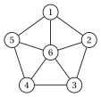
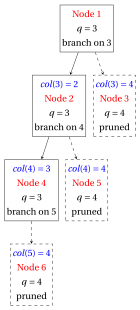
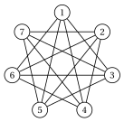
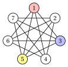
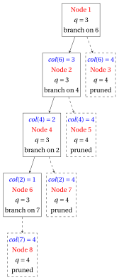
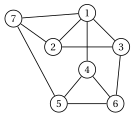
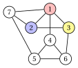
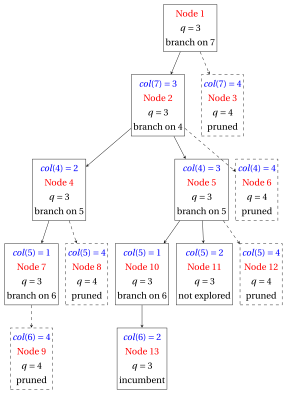
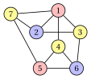
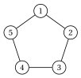

# Exercises · Vertex coloring: the DSATUR branch-and-bound

**Exercises · Chapter 42** · each solution opens with a click · [:material-book-open-variant: Chapter 42: Vertex coloring (DSATUR)](../specialized-algorithms/dsatur-branch-and-bound.md) · [:material-file-pdf-box: Exercises, volume 6 (PDF)](../pdf/exercises-6-specialized-algorithms.pdf)

!!! formula "Rules used in these exercises"

    The DSATUR branch-and-bound algorithm of the chapter [Vertex coloring: the DSATUR branch-and-bound](https://fabiofurini.github.io/combinatorial-optimization/specialized-algorithms/dsatur-branch-and-bound/). At a node $k$, with $q(k)$ colors used, colored vertices $V^k$ and uncolored vertices $U^k$:

    \begin{equation*}
    \begin{gathered}
    \mathit{sat}_k(v)=\big|\{\mathit{col}^k(u): u\in N(v)\cap V^k\}\big|, \qquad \mathit{du}_k(v)=|N(v)\cap U^k|,\\
    F_k(v)=\{\, c\le q(k): \text{no neighbour of $v$ has color $c$} \,\}.
    \end{gathered} \tag{D1}
    \end{equation*}

    - **(D2)** <strong>Bounds.</strong> $\UB$ = colors of the $DSATUR$ heuristic; $K$ = greedy clique (vertices by non-increasing degree, ties by smallest index; a vertex enters if adjacent to all of $K$), $\LB=|K|$, and $K$'s $i$-th vertex is pre-colored with color $i$.

    - **(D3)** <strong>Branching.</strong> The vertex $v\in U^k$ of maximum $\mathit{sat}_k(v)$, then maximum $\mathit{du}_k(v)$, then smallest index; one child for each $c\in F_k(v)$ and one for the new color $q(k)+1$, in increasing order of color.

    - **(D4)** <strong>Pruning.</strong> A node with $q\ge\UB$ is pruned by bound. A complete coloring with $q<\UB$ is a new incumbent: $\UB\leftarrow q$, the nodes of the list with $q\ge\UB$ are removed, and the algorithm stops if $\UB=\LB$.

    - **(D5)** <strong>Search.</strong> Depth first: the list is a stack and the child with the smallest color is extracted first; the nodes are numbered in the order of evaluation.

!!! esercizio "Exercise 42.1: The root node of the DSATUR branch-and-bound (P1)"

    We consider two graphs. The graph $G_a$ of an exam calendar, with $V=\{1,\dots,6\}$ and the edges

    $$
    E_a=\{\{1,2\},\{1,3\},\{2,3\},\{2,4\},\{3,5\},\{4,5\},\{4,6\},\{5,6\}\},
    $$

    and the cycle $G_b=C_5$, with $V=\{1,\dots,5\}$ and the edges

    $$
    E_b=\{\{1,2\},\{1,5\},\{2,3\},\{3,4\},\{4,5\}\}.
    $$

    { .fig loading=lazy  }

    **Questions**

    1. Run the $DSATUR$ heuristic on $G_a$ and give the upper bound $\UB$.

    2. Find the greedy clique of $G_a$ and the lower bound $\LB$. Does the DSATUR branch-and-bound algorithm branch?

    3. Answer the same two questions for $G_b$.

    4. For $G_b$, write the root node and execute the first iteration of the algorithm: the branching vertex, its feasible colors and the children.

??? soluzione "Solution"

    We use the rules (D1)–(D5) of the box at the beginning of the chapter.

    1. The steps of $DSATUR$ on $G_a$ are:

        
<table>
        <tr>
        <th>step</th>
        <th>\(1\)</th>
        <th>\(2\)</th>
        <th>\(3\)</th>
        <th>\(4\)</th>
        <th>\(5\)</th>
        <th>\(6\)</th>
        </tr>
        <tr>
        <td>\(v\)</td>
        <td>\(2\)</td>
        <td>\(3\)</td>
        <td>\(1\)</td>
        <td>\(4\)</td>
        <td>\(5\)</td>
        <td>\(6\)</td>
        </tr>
        <tr>
        <td>\(\mathit{sat}(v)\)</td>
        <td>\(0\)</td>
        <td>\(1\)</td>
        <td>\(2\)</td>
        <td>\(1\)</td>
        <td>\(1\)</td>
        <td>\(2\)</td>
        </tr>
        <tr>
        <td>\(\mathit{du}(v)\)</td>
        <td>\(3\)</td>
        <td>\(2\)</td>
        <td>\(0\)</td>
        <td>\(2\)</td>
        <td>\(1\)</td>
        <td>\(0\)</td>
        </tr>
        <tr>
        <td>\(\mathit{col}(v)\)</td>
        <td>\(1\)</td>
        <td>\(2\)</td>
        <td>\(3\)</td>
        <td>\(2\)</td>
        <td>\(1\)</td>
        <td>\(3\)</td>
        </tr>
        </table>

        At step $3$ vertex $1$ sees the colors $1$ and $2$, so it is chosen before the vertices with $\mathit{sat}=1$. $DSATUR$ gives $\big\{\{2,5\},~\{3,4\},~\{1,6\}\big\}$, hence $\UB=3$.

    2. The degrees are $\deg(1)=2$, $\deg(2)=3$, $\deg(3)=3$, $\deg(4)=3$, $\deg(5)=3$, $\deg(6)=2$, so the vertices are scanned in the order $2,3,4,5,1,6$. The vertices $2,3,1$ enter, in this order; every other vertex misses an edge to a vertex already in $K$. Hence $K=\{1,2,3\}$ (in the order of entry: $k_1=2$, $k_2=3$, $k_3=1$) and $\LB=3$. Since $\LB=\UB=3$, the coloring of $DSATUR$ is optimal and the algorithm stops in Step 0, without branching: $\chi(G_a)=3$.

    3. The steps of $DSATUR$ on $G_b$ are:

        
<table>
        <tr>
        <th>step</th>
        <th>\(1\)</th>
        <th>\(2\)</th>
        <th>\(3\)</th>
        <th>\(4\)</th>
        <th>\(5\)</th>
        </tr>
        <tr>
        <td>\(v\)</td>
        <td>\(1\)</td>
        <td>\(2\)</td>
        <td>\(3\)</td>
        <td>\(4\)</td>
        <td>\(5\)</td>
        </tr>
        <tr>
        <td>\(\mathit{sat}(v)\)</td>
        <td>\(0\)</td>
        <td>\(1\)</td>
        <td>\(1\)</td>
        <td>\(1\)</td>
        <td>\(2\)</td>
        </tr>
        <tr>
        <td>\(\mathit{du}(v)\)</td>
        <td>\(2\)</td>
        <td>\(1\)</td>
        <td>\(1\)</td>
        <td>\(1\)</td>
        <td>\(0\)</td>
        </tr>
        <tr>
        <td>\(\mathit{col}(v)\)</td>
        <td>\(1\)</td>
        <td>\(2\)</td>
        <td>\(1\)</td>
        <td>\(2\)</td>
        <td>\(3\)</td>
        </tr>
        </table>

        $DSATUR$ gives $\big\{\{1,3\},~\{2,4\},~\{5\}\big\}$, hence $\UB=3$. All the degrees are equal, so the vertices are scanned in the order $1,2,3,4,5$. The vertices $1,2$ enter, in this order; every other vertex misses an edge to a vertex already in $K$. Hence $K=\{1,2\}$ (in the order of entry: $k_1=1$, $k_2=2$) and $\LB=2$. Now $\LB=2<3=\UB$: the algorithm branches.

    4. Node $1$ colors $\mathit{col}^1(1)=1$, $\mathit{col}^1(2)=2$, with $q(1)=2$. The vertices $3,5$ have $\mathit{sat}=1$ and the same $\mathit{du}=1$: the smallest index wins, and the branching vertex is $3$. Its neighbour $2$ has color $2$, so $F_1(3)=\{1\}$.

        - Node $2$: $\mathit{col}(3)=1$, with $q(2)=2<\UB=3$: the node survives.

        - Node $3$: $\mathit{col}(3)=3$, the new color, with $q(3)=3\ge\UB=3$: <u>pruned by bound</u>.

        The search continues from node $2$: it is the same search as on the outer cycle of the Petersen graph, and it ends with $6$ nodes and $\chi(G_b)=3$.

    !!! chiave ""

        On $G_a$ the clique $\{2,3,1\}$ meets the $DSATUR$ bound: no branching. On $G_b$ the clique bound is $2$ and the tree is needed to prove $\chi(C_5)=3$.

!!! esercizio "Exercise 42.2: Proving a lower bound: the wheel $W_5$ (P2)"

    We consider the wheel $W_5$ (a cycle on $1,\dots,5$ and the hub $6$), the graph $G=(V,E)$ with $V=\{1,\dots,6\}$ and the edges

    $$
    E=\{\{1,2\},\{1,5\},\{1,6\},\{2,3\},\{2,6\},\{3,4\},\{3,6\},\{4,5\},\{4,6\},\{5,6\}\},
    $$

    drawn below:

    { .fig loading=lazy  }

    **Questions**

    1. Run the $DSATUR$ heuristic: give the order of the vertices, the coloring and the upper bound $\UB$.

    2. Find the greedy clique $K$, the lower bound $\LB$ and the root node of the DSATUR branch-and-bound algorithm.

    3. Execute the DSATUR branch-and-bound algorithm, iteration by iteration.

    4. Draw the branch-and-bound tree and give the chromatic number of $G$ with an optimal coloring.

??? soluzione "Solution"

    We use the rules (D1)–(D5) of the box at the beginning of the chapter.

    1. The vertex chosen at each step, its saturation degree, its degree among the uncolored vertices and its color are:

        
<table>
        <tr>
        <th>step</th>
        <th>\(1\)</th>
        <th>\(2\)</th>
        <th>\(3\)</th>
        <th>\(4\)</th>
        <th>\(5\)</th>
        <th>\(6\)</th>
        </tr>
        <tr>
        <td>\(v\)</td>
        <td>\(6\)</td>
        <td>\(1\)</td>
        <td>\(2\)</td>
        <td>\(3\)</td>
        <td>\(4\)</td>
        <td>\(5\)</td>
        </tr>
        <tr>
        <td>\(\mathit{sat}(v)\)</td>
        <td>\(0\)</td>
        <td>\(1\)</td>
        <td>\(2\)</td>
        <td>\(2\)</td>
        <td>\(2\)</td>
        <td>\(3\)</td>
        </tr>
        <tr>
        <td>\(\mathit{du}(v)\)</td>
        <td>\(5\)</td>
        <td>\(2\)</td>
        <td>\(1\)</td>
        <td>\(1\)</td>
        <td>\(1\)</td>
        <td>\(0\)</td>
        </tr>
        <tr>
        <td>\(\mathit{col}(v)\)</td>
        <td>\(1\)</td>
        <td>\(2\)</td>
        <td>\(3\)</td>
        <td>\(2\)</td>
        <td>\(3\)</td>
        <td>\(4\)</td>
        </tr>
        </table>

        $DSATUR$ gives $\big\{\{6\},~\{1,3\},~\{2,4\},~\{5\}\big\}$, hence $\UB=4$.

    2. The degrees are $\deg(1)=3$, $\deg(2)=3$, $\deg(3)=3$, $\deg(4)=3$, $\deg(5)=3$, $\deg(6)=5$, so the vertices are scanned in the order $6,1,2,3,4,5$. The vertices $6,1,2$ enter, in this order; every other vertex misses an edge to a vertex already in $K$. Hence $K=\{1,2,6\}$ (in the order of entry: $k_1=6$, $k_2=1$, $k_3=2$) and $\LB=3$. Since $\LB=3<4=\UB$, the algorithm branches. Node $1$ colors $\mathit{col}^1(6)=1$, $\mathit{col}^1(1)=2$, $\mathit{col}^1(2)=3$, with $q(1)=3$:

        { .fig loading=lazy  }

    3. \*\*Iteration 1\*\*  Node $1$ is extracted from the list, with $Q_1=\{6\}$, $Q_2=\{1\}$, $Q_3=\{2\}$ and $q(1)=3$. The vertices $3,5$ have $\mathit{sat}=2$ and the same $\mathit{du}=1$: the smallest index wins, and the branching vertex is $3$. Its feasible colors are $F_{1}(3)=\{2\}$.

        - Node $2$: $\mathit{col}(3)=2$, with $q(2)=3<\UB=4$: the node survives.

        - Node $3$: $\mathit{col}(3)=4$, the new color, with $q(3)=4\ge\UB=4$: <u>pruned by bound</u>.

        \*\*Iteration 2\*\*  Node $2$ is extracted from the list, with $Q_1=\{6\}$, $Q_2=\{1,3\}$, $Q_3=\{2\}$ and $q(2)=3$. The vertices $4,5$ have $\mathit{sat}=2$ and the same $\mathit{du}=1$: the smallest index wins, and the branching vertex is $4$. Its feasible colors are $F_{2}(4)=\{3\}$.

        - Node $4$: $\mathit{col}(4)=3$, with $q(4)=3<\UB=4$: the node survives.

        - Node $5$: $\mathit{col}(4)=4$, the new color, with $q(5)=4\ge\UB=4$: <u>pruned by bound</u>.

        \*\*Iteration 3\*\*  Node $4$ is extracted from the list, with $Q_1=\{6\}$, $Q_2=\{1,3\}$, $Q_3=\{2,4\}$ and $q(4)=3$. Vertex $5$ is the only one with $\mathit{sat}=3$: it is the branching vertex. Its feasible colors are $F_{4}(5)=\emptyset$.

        - Node $6$: $\mathit{col}(5)=4$, the new color, with $q(6)=4\ge\UB=4$: <u>pruned by bound</u>.

        <strong>Termination</strong> The list is empty: the incumbent solution of $DSATUR$ is optimal.

    4. The tree has $6$ nodes; the pruned nodes are dashed.

        { .fig loading=lazy  }

        
<table>
        <tr>
        <th>Node</th>
        <th>Parent</th>
        <th>Child</th>
        <th>\(q\)</th>
        <th>\(\UB\)</th>
        <th>Branching vertex</th>
        <th>Outcome</th>
        </tr>
        <tr>
        <td>\(1\)</td>
        <td>–</td>
        <td>root</td>
        <td>\(3\)</td>
        <td>\(4\)</td>
        <td>\(3\)</td>
        <td>branched</td>
        </tr>
        <tr>
        <td>\(2\)</td>
        <td>\(1\)</td>
        <td>\(\mathit{col}(3)=2\)</td>
        <td>\(3\)</td>
        <td>\(4\)</td>
        <td>\(4\)</td>
        <td>branched</td>
        </tr>
        <tr>
        <td>\(3\)</td>
        <td>\(1\)</td>
        <td>\(\mathit{col}(3)=4\)</td>
        <td>\(4\)</td>
        <td>\(4\)</td>
        <td>–</td>
        <td>pruned by bound</td>
        </tr>
        <tr>
        <td>\(4\)</td>
        <td>\(2\)</td>
        <td>\(\mathit{col}(4)=3\)</td>
        <td>\(3\)</td>
        <td>\(4\)</td>
        <td>\(5\)</td>
        <td>branched</td>
        </tr>
        <tr>
        <td>\(5\)</td>
        <td>\(2\)</td>
        <td>\(\mathit{col}(4)=4\)</td>
        <td>\(4\)</td>
        <td>\(4\)</td>
        <td>–</td>
        <td>pruned by bound</td>
        </tr>
        <tr>
        <td>\(6\)</td>
        <td>\(4\)</td>
        <td>\(\mathit{col}(5)=4\)</td>
        <td>\(4\)</td>
        <td>\(4\)</td>
        <td>–</td>
        <td>pruned by bound</td>
        </tr>
        </table>

        Hence $\chi(G)=4$, with the optimal coloring $\big\{\{6\},~\{1,3\},~\{2,4\},~\{5\}\big\}$:

        { .fig loading=lazy  }

        The clique bound gives only $3$: the tree proves that the odd cycle and the hub need a fourth color.

!!! esercizio "Exercise 42.3: The complement of the cycle $C_7$ (P3)"

    We consider the complement of the cycle $C_7$ (two vertices are adjacent if they are not consecutive on the cycle $1,2,\dots,7$), the graph $G=(V,E)$ with $V=\{1,\dots,7\}$ and the edges

    $$
    \begin{aligned}
    E=\{&\{1,3\},\{1,4\},\{1,5\},\{1,6\},\{2,4\},\{2,5\},\{2,6\},\\
    &\{2,7\},\{3,5\},\{3,6\},\{3,7\},\{4,6\},\{4,7\},\{5,7\}\},
    \end{aligned}
    $$

    drawn below:

    { .fig loading=lazy  }

    **Questions**

    1. Run the $DSATUR$ heuristic: give the order of the vertices, the coloring and the upper bound $\UB$.

    2. Find the greedy clique $K$, the lower bound $\LB$ and the root node of the DSATUR branch-and-bound algorithm.

    3. Execute the DSATUR branch-and-bound algorithm, iteration by iteration.

    4. Draw the branch-and-bound tree and give the chromatic number of $G$ with an optimal coloring.

??? soluzione "Solution"

    We use the rules (D1)–(D5) of the box at the beginning of the chapter.

    1. The vertex chosen at each step, its saturation degree, its degree among the uncolored vertices and its color are:

        
<table>
        <tr>
        <th>step</th>
        <th>\(1\)</th>
        <th>\(2\)</th>
        <th>\(3\)</th>
        <th>\(4\)</th>
        <th>\(5\)</th>
        <th>\(6\)</th>
        <th>\(7\)</th>
        </tr>
        <tr>
        <td>\(v\)</td>
        <td>\(1\)</td>
        <td>\(3\)</td>
        <td>\(5\)</td>
        <td>\(6\)</td>
        <td>\(4\)</td>
        <td>\(2\)</td>
        <td>\(7\)</td>
        </tr>
        <tr>
        <td>\(\mathit{sat}(v)\)</td>
        <td>\(0\)</td>
        <td>\(1\)</td>
        <td>\(2\)</td>
        <td>\(2\)</td>
        <td>\(2\)</td>
        <td>\(2\)</td>
        <td>\(3\)</td>
        </tr>
        <tr>
        <td>\(\mathit{du}(v)\)</td>
        <td>\(4\)</td>
        <td>\(3\)</td>
        <td>\(2\)</td>
        <td>\(2\)</td>
        <td>\(2\)</td>
        <td>\(1\)</td>
        <td>\(0\)</td>
        </tr>
        <tr>
        <td>\(\mathit{col}(v)\)</td>
        <td>\(1\)</td>
        <td>\(2\)</td>
        <td>\(3\)</td>
        <td>\(3\)</td>
        <td>\(2\)</td>
        <td>\(1\)</td>
        <td>\(4\)</td>
        </tr>
        </table>

        $DSATUR$ gives $\big\{\{1,2\},~\{3,4\},~\{5,6\},~\{7\}\big\}$, hence $\UB=4$.

    2. All the degrees are equal, so the vertices are scanned in the order $1,2,3,4,5,6,7$. The vertices $1,3,5$ enter, in this order; every other vertex misses an edge to a vertex already in $K$. Hence $K=\{1,3,5\}$ (in the order of entry: $k_1=1$, $k_2=3$, $k_3=5$) and $\LB=3$. Since $\LB=3<4=\UB$, the algorithm branches. Node $1$ colors $\mathit{col}^1(1)=1$, $\mathit{col}^1(3)=2$, $\mathit{col}^1(5)=3$, with $q(1)=3$:

        { .fig loading=lazy  }

    3. \*\*Iteration 1\*\*  Node $1$ is extracted from the list, with $Q_1=\{1\}$, $Q_2=\{3\}$, $Q_3=\{5\}$ and $q(1)=3$. The vertices $6,7$ have $\mathit{sat}=2$ and the same $\mathit{du}=2$: the smallest index wins, and the branching vertex is $6$. Its feasible colors are $F_{1}(6)=\{3\}$.

        - Node $2$: $\mathit{col}(6)=3$, with $q(2)=3<\UB=4$: the node survives.

        - Node $3$: $\mathit{col}(6)=4$, the new color, with $q(3)=4\ge\UB=4$: <u>pruned by bound</u>.

        \*\*Iteration 2\*\*  Node $2$ is extracted from the list, with $Q_1=\{1\}$, $Q_2=\{3\}$, $Q_3=\{5,6\}$ and $q(2)=3$. The vertices $4,7$ have $\mathit{sat}=2$ and the same $\mathit{du}=2$: the smallest index wins, and the branching vertex is $4$. Its feasible colors are $F_{2}(4)=\{2\}$.

        - Node $4$: $\mathit{col}(4)=2$, with $q(4)=3<\UB=4$: the node survives.

        - Node $5$: $\mathit{col}(4)=4$, the new color, with $q(5)=4\ge\UB=4$: <u>pruned by bound</u>.

        \*\*Iteration 3\*\*  Node $4$ is extracted from the list, with $Q_1=\{1\}$, $Q_2=\{3,4\}$, $Q_3=\{5,6\}$ and $q(4)=3$. The vertices $2,7$ have $\mathit{sat}=2$ and the same $\mathit{du}=1$: the smallest index wins, and the branching vertex is $2$. Its feasible colors are $F_{4}(2)=\{1\}$.

        - Node $6$: $\mathit{col}(2)=1$, with $q(6)=3<\UB=4$: the node survives.

        - Node $7$: $\mathit{col}(2)=4$, the new color, with $q(7)=4\ge\UB=4$: <u>pruned by bound</u>.

        \*\*Iteration 4\*\*  Node $6$ is extracted from the list, with $Q_1=\{1,2\}$, $Q_2=\{3,4\}$, $Q_3=\{5,6\}$ and $q(6)=3$. Vertex $7$ is the only one with $\mathit{sat}=3$: it is the branching vertex. Its feasible colors are $F_{6}(7)=\emptyset$.

        - Node $8$: $\mathit{col}(7)=4$, the new color, with $q(8)=4\ge\UB=4$: <u>pruned by bound</u>.

        <strong>Termination</strong> The list is empty: the incumbent solution of $DSATUR$ is optimal.

    4. The tree has $8$ nodes; the pruned nodes are dashed.

        { .fig loading=lazy  }

        
<table>
        <tr>
        <th>Node</th>
        <th>Parent</th>
        <th>Child</th>
        <th>\(q\)</th>
        <th>\(\UB\)</th>
        <th>Branching vertex</th>
        <th>Outcome</th>
        </tr>
        <tr>
        <td>\(1\)</td>
        <td>–</td>
        <td>root</td>
        <td>\(3\)</td>
        <td>\(4\)</td>
        <td>\(6\)</td>
        <td>branched</td>
        </tr>
        <tr>
        <td>\(2\)</td>
        <td>\(1\)</td>
        <td>\(\mathit{col}(6)=3\)</td>
        <td>\(3\)</td>
        <td>\(4\)</td>
        <td>\(4\)</td>
        <td>branched</td>
        </tr>
        <tr>
        <td>\(3\)</td>
        <td>\(1\)</td>
        <td>\(\mathit{col}(6)=4\)</td>
        <td>\(4\)</td>
        <td>\(4\)</td>
        <td>–</td>
        <td>pruned by bound</td>
        </tr>
        <tr>
        <td>\(4\)</td>
        <td>\(2\)</td>
        <td>\(\mathit{col}(4)=2\)</td>
        <td>\(3\)</td>
        <td>\(4\)</td>
        <td>\(2\)</td>
        <td>branched</td>
        </tr>
        <tr>
        <td>\(5\)</td>
        <td>\(2\)</td>
        <td>\(\mathit{col}(4)=4\)</td>
        <td>\(4\)</td>
        <td>\(4\)</td>
        <td>–</td>
        <td>pruned by bound</td>
        </tr>
        <tr>
        <td>\(6\)</td>
        <td>\(4\)</td>
        <td>\(\mathit{col}(2)=1\)</td>
        <td>\(3\)</td>
        <td>\(4\)</td>
        <td>\(7\)</td>
        <td>branched</td>
        </tr>
        <tr>
        <td>\(7\)</td>
        <td>\(4\)</td>
        <td>\(\mathit{col}(2)=4\)</td>
        <td>\(4\)</td>
        <td>\(4\)</td>
        <td>–</td>
        <td>pruned by bound</td>
        </tr>
        <tr>
        <td>\(8\)</td>
        <td>\(6\)</td>
        <td>\(\mathit{col}(7)=4\)</td>
        <td>\(4\)</td>
        <td>\(4\)</td>
        <td>–</td>
        <td>pruned by bound</td>
        </tr>
        </table>

        Hence $\chi(G)=4$, with the optimal coloring $\big\{\{1,2\},~\{3,4\},~\{5,6\},~\{7\}\big\}$:

        { .fig loading=lazy  }

        Every stable set of $G$ has at most $2$ vertices, so the stable set bound $\lceil 7/2\rceil=4$ of Chapter 4 confirms the result.

!!! esercizio "Exercise 42.4: Improving the incumbent solution (P4)"

    We consider a graph with $7$ vertices and $11$ edges, the graph $G=(V,E)$ with $V=\{1,\dots,7\}$ and the edges

    $$
    \begin{aligned}
    E=\{&\{1,2\},\{1,3\},\{1,4\},\{1,7\},\{2,3\},\{2,7\},\\
    &\{3,6\},\{4,5\},\{4,6\},\{5,6\},\{5,7\}\},
    \end{aligned}
    $$

    drawn below:

    { .fig loading=lazy  }

    **Questions**

    1. Run the $DSATUR$ heuristic: give the order of the vertices, the coloring and the upper bound $\UB$.

    2. Find the greedy clique $K$, the lower bound $\LB$ and the root node of the DSATUR branch-and-bound algorithm.

    3. Execute the DSATUR branch-and-bound algorithm, iteration by iteration.

    4. Draw the branch-and-bound tree and give the chromatic number of $G$ with an optimal coloring.

??? soluzione "Solution"

    We use the rules (D1)–(D5) of the box at the beginning of the chapter.

    1. The vertex chosen at each step, its saturation degree, its degree among the uncolored vertices and its color are:

        
<table>
        <tr>
        <th>step</th>
        <th>\(1\)</th>
        <th>\(2\)</th>
        <th>\(3\)</th>
        <th>\(4\)</th>
        <th>\(5\)</th>
        <th>\(6\)</th>
        <th>\(7\)</th>
        </tr>
        <tr>
        <td>\(v\)</td>
        <td>\(1\)</td>
        <td>\(2\)</td>
        <td>\(3\)</td>
        <td>\(7\)</td>
        <td>\(4\)</td>
        <td>\(5\)</td>
        <td>\(6\)</td>
        </tr>
        <tr>
        <td>\(\mathit{sat}(v)\)</td>
        <td>\(0\)</td>
        <td>\(1\)</td>
        <td>\(2\)</td>
        <td>\(2\)</td>
        <td>\(1\)</td>
        <td>\(2\)</td>
        <td>\(3\)</td>
        </tr>
        <tr>
        <td>\(\mathit{du}(v)\)</td>
        <td>\(4\)</td>
        <td>\(2\)</td>
        <td>\(1\)</td>
        <td>\(1\)</td>
        <td>\(2\)</td>
        <td>\(1\)</td>
        <td>\(0\)</td>
        </tr>
        <tr>
        <td>\(\mathit{col}(v)\)</td>
        <td>\(1\)</td>
        <td>\(2\)</td>
        <td>\(3\)</td>
        <td>\(3\)</td>
        <td>\(2\)</td>
        <td>\(1\)</td>
        <td>\(4\)</td>
        </tr>
        </table>

        $DSATUR$ gives $\big\{\{1,5\},~\{2,4\},~\{3,7\},~\{6\}\big\}$, hence $\UB=4$.

    2. The degrees are $\deg(1)=4$, $\deg(2)=3$, $\deg(3)=3$, $\deg(4)=3$, $\deg(5)=3$, $\deg(6)=3$, $\deg(7)=3$, so the vertices are scanned in the order $1,2,3,4,5,6,7$. The vertices $1,2,3$ enter, in this order; every other vertex misses an edge to a vertex already in $K$. Hence $K=\{1,2,3\}$ (in the order of entry: $k_1=1$, $k_2=2$, $k_3=3$) and $\LB=3$. Since $\LB=3<4=\UB$, the algorithm branches. Node $1$ colors $\mathit{col}^1(1)=1$, $\mathit{col}^1(2)=2$, $\mathit{col}^1(3)=3$, with $q(1)=3$:

        { .fig loading=lazy  }

    3. \*\*Iteration 1\*\*  Node $1$ is extracted from the list, with $Q_1=\{1\}$, $Q_2=\{2\}$, $Q_3=\{3\}$ and $q(1)=3$. Vertex $7$ is the only one with $\mathit{sat}=2$: it is the branching vertex. Its feasible colors are $F_{1}(7)=\{3\}$.

        - Node $2$: $\mathit{col}(7)=3$, with $q(2)=3<\UB=4$: the node survives.

        - Node $3$: $\mathit{col}(7)=4$, the new color, with $q(3)=4\ge\UB=4$: <u>pruned by bound</u>.

        \*\*Iteration 2\*\*  Node $2$ is extracted from the list, with $Q_1=\{1\}$, $Q_2=\{2\}$, $Q_3=\{3,7\}$ and $q(2)=3$. The vertices $4,5,6$ have $\mathit{sat}=1$ and the same $\mathit{du}=2$: the smallest index wins, and the branching vertex is $4$. Its feasible colors are $F_{2}(4)=\{2,3\}$.

        - Node $4$: $\mathit{col}(4)=2$, with $q(4)=3<\UB=4$: the node survives.

        - Node $5$: $\mathit{col}(4)=3$, with $q(5)=3<\UB=4$: the node survives.

        - Node $6$: $\mathit{col}(4)=4$, the new color, with $q(6)=4\ge\UB=4$: <u>pruned by bound</u>.

        \*\*Iteration 3\*\*  Node $4$ is extracted from the list, with $Q_1=\{1\}$, $Q_2=\{2,4\}$, $Q_3=\{3,7\}$ and $q(4)=3$. The vertices $5,6$ have $\mathit{sat}=2$ and the same $\mathit{du}=1$: the smallest index wins, and the branching vertex is $5$. Its feasible colors are $F_{4}(5)=\{1\}$.

        - Node $7$: $\mathit{col}(5)=1$, with $q(7)=3<\UB=4$: the node survives.

        - Node $8$: $\mathit{col}(5)=4$, the new color, with $q(8)=4\ge\UB=4$: <u>pruned by bound</u>.

        \*\*Iteration 4\*\*  Node $7$ is extracted from the list, with $Q_1=\{1,5\}$, $Q_2=\{2,4\}$, $Q_3=\{3,7\}$ and $q(7)=3$. Vertex $6$ is the only one with $\mathit{sat}=3$: it is the branching vertex. Its feasible colors are $F_{7}(6)=\emptyset$.

        - Node $9$: $\mathit{col}(6)=4$, the new color, with $q(9)=4\ge\UB=4$: <u>pruned by bound</u>.

        \*\*Iteration 5\*\*  Node $5$ is extracted from the list, with $Q_1=\{1\}$, $Q_2=\{2\}$, $Q_3=\{3,4,7\}$ and $q(5)=3$. The vertices $5,6$ have $\mathit{sat}=1$ and the same $\mathit{du}=1$: the smallest index wins, and the branching vertex is $5$. Its feasible colors are $F_{5}(5)=\{1,2\}$.

        - Node $10$: $\mathit{col}(5)=1$, with $q(10)=3<\UB=4$: the node survives.

        - Node $11$: $\mathit{col}(5)=2$, with $q(11)=3<\UB=4$: the node survives.

        - Node $12$: $\mathit{col}(5)=4$, the new color, with $q(12)=4\ge\UB=4$: <u>pruned by bound</u>.

        \*\*Iteration 6\*\*  Node $10$ is extracted from the list, with $Q_1=\{1,5\}$, $Q_2=\{2\}$, $Q_3=\{3,4,7\}$ and $q(10)=3$. Vertex $6$ is the only one with $\mathit{sat}=2$: it is the branching vertex. Its feasible colors are $F_{10}(6)=\{2\}$.

        - Node $13$: $\mathit{col}(6)=2$, with $q(13)=3<\UB=4$: a complete coloring with fewer colors: <u>new incumbent solution</u>, with $\big\{\{1,5\},~\{2,6\},~\{3,4,7\}\big\}$ and $\UB=3$.

        <strong>Termination</strong> The new incumbent solution gives $\UB=3$. The nodes of the list with $q\ge\UB$ are removed: node $11$. Since $\UB=\LB=3$, the incumbent solution is optimal: <code>STOP</code>.

    4. The tree has $13$ nodes; the pruned nodes are dashed.

        { .fig loading=lazy  }

        
<table>
        <tr>
        <th>Node</th>
        <th>Parent</th>
        <th>Child</th>
        <th>\(q\)</th>
        <th>\(\UB\)</th>
        <th>Branching vertex</th>
        <th>Outcome</th>
        </tr>
        <tr>
        <td>\(1\)</td>
        <td>–</td>
        <td>root</td>
        <td>\(3\)</td>
        <td>\(4\)</td>
        <td>\(7\)</td>
        <td>branched</td>
        </tr>
        <tr>
        <td>\(2\)</td>
        <td>\(1\)</td>
        <td>\(\mathit{col}(7)=3\)</td>
        <td>\(3\)</td>
        <td>\(4\)</td>
        <td>\(4\)</td>
        <td>branched</td>
        </tr>
        <tr>
        <td>\(3\)</td>
        <td>\(1\)</td>
        <td>\(\mathit{col}(7)=4\)</td>
        <td>\(4\)</td>
        <td>\(4\)</td>
        <td>–</td>
        <td>pruned by bound</td>
        </tr>
        <tr>
        <td>\(4\)</td>
        <td>\(2\)</td>
        <td>\(\mathit{col}(4)=2\)</td>
        <td>\(3\)</td>
        <td>\(4\)</td>
        <td>\(5\)</td>
        <td>branched</td>
        </tr>
        <tr>
        <td>\(5\)</td>
        <td>\(2\)</td>
        <td>\(\mathit{col}(4)=3\)</td>
        <td>\(3\)</td>
        <td>\(4\)</td>
        <td>\(5\)</td>
        <td>branched</td>
        </tr>
        <tr>
        <td>\(6\)</td>
        <td>\(2\)</td>
        <td>\(\mathit{col}(4)=4\)</td>
        <td>\(4\)</td>
        <td>\(4\)</td>
        <td>–</td>
        <td>pruned by bound</td>
        </tr>
        <tr>
        <td>\(7\)</td>
        <td>\(4\)</td>
        <td>\(\mathit{col}(5)=1\)</td>
        <td>\(3\)</td>
        <td>\(4\)</td>
        <td>\(6\)</td>
        <td>branched</td>
        </tr>
        <tr>
        <td>\(8\)</td>
        <td>\(4\)</td>
        <td>\(\mathit{col}(5)=4\)</td>
        <td>\(4\)</td>
        <td>\(4\)</td>
        <td>–</td>
        <td>pruned by bound</td>
        </tr>
        <tr>
        <td>\(9\)</td>
        <td>\(7\)</td>
        <td>\(\mathit{col}(6)=4\)</td>
        <td>\(4\)</td>
        <td>\(4\)</td>
        <td>–</td>
        <td>pruned by bound</td>
        </tr>
        <tr>
        <td>\(10\)</td>
        <td>\(5\)</td>
        <td>\(\mathit{col}(5)=1\)</td>
        <td>\(3\)</td>
        <td>\(4\)</td>
        <td>\(6\)</td>
        <td>branched</td>
        </tr>
        <tr>
        <td>\(11\)</td>
        <td>\(5\)</td>
        <td>\(\mathit{col}(5)=2\)</td>
        <td>\(3\)</td>
        <td>\(4\)</td>
        <td>–</td>
        <td>not explored</td>
        </tr>
        <tr>
        <td>\(12\)</td>
        <td>\(5\)</td>
        <td>\(\mathit{col}(5)=4\)</td>
        <td>\(4\)</td>
        <td>\(4\)</td>
        <td>–</td>
        <td>pruned by bound</td>
        </tr>
        <tr>
        <td>\(13\)</td>
        <td>\(10\)</td>
        <td>\(\mathit{col}(6)=2\)</td>
        <td>\(3\)</td>
        <td>\(3\)</td>
        <td>–</td>
        <td>new incumbent</td>
        </tr>
        </table>

        Hence $\chi(G)=3$, with the optimal coloring $\big\{\{1,5\},~\{2,6\},~\{3,4,7\}\big\}$:

        { .fig loading=lazy  }

        Here $DSATUR$ is not optimal: the branch-and-bound algorithm improves the incumbent solution from $4$ to $3$ colors and stops as soon as $\UB$ meets the clique bound.

!!! esercizio "Exercise 42.5: The no-symmetry branching (P5)"

    We consider the cycle $C_5$, with $V=\{1,\dots,5\}$ and the edges

    $$
    E=\{\{1,2\},\{1,5\},\{2,3\},\{3,4\},\{4,5\}\},
    $$

    drawn below. Its greedy clique is $K=\{1,2\}$, so the root node colors $\mathit{col}^1(1)=1$ and $\mathit{col}^1(2)=2$.

    { .fig loading=lazy  }

    **Questions**

    1. Draw the tree of the DSATUR branch-and-bound algorithm <em>without pruning</em> (no upper bound): at every node, the branching vertex and one child for each feasible color and for the new color. How many nodes and how many leaves does it have?

    2. List the partitions of $V$ given by the leaves, by number of colors. Are they all the partitions of $V$ into stable sets?

    3. How many assignments of the five colors $1,\dots,5$ to the vertices have no edge with equal colors? Explain the difference with the number of leaves.

    4. With the upper bound $\UB=3$ of $DSATUR$ and the pruning rule, how many nodes does the tree have?

??? soluzione "Solution"

    We use the rules (D1)–(D5) of the box at the beginning of the chapter.

    1. Each internal node shows its branching vertex, each edge the color given to it (blue), each leaf its color classes, one per line:

        { .fig loading=lazy  }

        The tree has $19$ nodes and $11$ leaves.

    2. The leaves, by number of colors:

        
<table>
        <tr>
        <th>colors</th>
        <th>leaves</th>
        <th>partitions</th>
        </tr>
        <tr>
        <td>\(3\)</td>
        <td>\(5\)</td>
        <td>\(\{\{1\},\{2,4\},\{3,5\}\}\)</td>
        </tr>
        <tr>
        <td></td>
        <td></td>
        <td>\(\{\{1,3\},\{2,4\},\{5\}\}\)</td>
        </tr>
        <tr>
        <td></td>
        <td></td>
        <td>\(\{\{1,3\},\{2,5\},\{4\}\}\)</td>
        </tr>
        <tr>
        <td></td>
        <td></td>
        <td>\(\{\{1,4\},\{2\},\{3,5\}\}\)</td>
        </tr>
        <tr>
        <td></td>
        <td></td>
        <td>\(\{\{1,4\},\{2,5\},\{3\}\}\)</td>
        </tr>
        <tr>
        <td>\(4\)</td>
        <td>\(5\)</td>
        <td>\(\{\{1\},\{2\},\{3,5\},\{4\}\}\)</td>
        </tr>
        <tr>
        <td></td>
        <td></td>
        <td>\(\{\{1\},\{2,4\},\{3\},\{5\}\}\)</td>
        </tr>
        <tr>
        <td></td>
        <td></td>
        <td>\(\{\{1\},\{2,5\},\{3\},\{4\}\}\)</td>
        </tr>
        <tr>
        <td></td>
        <td></td>
        <td>\(\{\{1,3\},\{2\},\{4\},\{5\}\}\)</td>
        </tr>
        <tr>
        <td></td>
        <td></td>
        <td>\(\{\{1,4\},\{2\},\{3\},\{5\}\}\)</td>
        </tr>
        <tr>
        <td>\(5\)</td>
        <td>\(1\)</td>
        <td>\(\{\{1\},\{2\},\{3\},\{4\},\{5\}\}\)</td>
        </tr>
        </table>

        The $11$ leaves give $11$ different partitions, and the enumeration of all the partitions of $V$ into stable sets gives the same $11$: each feasible solution appears exactly once, as the proposition on the no-symmetry branching states.

    3. By enumeration, $1020$ assignments. A partition with $q$ classes can be named with $5\cdot4\cdots(5-q+1)$ ordered choices of colors, so

        $$
        5\cdot60+5\cdot120+1\cdot120=1020.
        $$

        The labelled colorings contain each partition many times, with the colors renamed; the tree contains each one once.

    4. The pruning leaves $6$ nodes instead of $19$: every node with $q=3$ is pruned, and the search proves $\chi(C_5)=3$ along a single path (as in Exercise 1).

    !!! chiave ""

        Without pruning, the tree of $C_5$ has $11$ leaves, one per partition into stable sets, against $1020$ labelled colorings; with $\UB=3$ only $6$ nodes remain.
