# Exercises · Knapsack: branch-and-bound on the critical item

**Exercises · Chapter 41** · each solution opens with a click · [:material-book-open-variant: Chapter 41: 0/1 knapsack (KP)](../specialized-algorithms/knapsack-branch-and-bound.md) · [:material-file-pdf-box: Exercises, volume 6 (PDF)](../pdf/exercises-6-specialized-algorithms.pdf)

!!! esercizio "Exercise 41.1: Branch-and-Bound Algorithm for the 0/1 Knapsack Problem (P1)"

    We consider a knapsack capacity $c=11$ and a set $\mathscr{I}=\{1,2,3,4,5\}$ of $5$ items ($n=5$) with the following profits and weights:

    $$
    \begin{array}{l|rrrrrrrrrr}
    \hline  & {j=1} & {j=2} & {j=3} & {j=4} & {j=5} \\[0.7ex]
    \hline {p_j} & {8} & {6} & {14} & {6} & {2} \\[0.7ex]
    {w_j} & {3} & {3} & {9} & {5} & {2} \\[0.7ex]
    \hline
    \end{array}
    $$

    **Questions**

    1. Check if the items are sorted by non-increasing efficiency otherwise sort them in this order.  Write the $\mathrm{ILP}_{\mathrm{KP}}$ model and the $\mathrm{LP}_{\mathrm{KP}}$ model for the KP instance.

    2. Execute the branch-and-bound algorithm to solve the $\mathrm{ILP}_{\mathrm{KP}}$ model for the 0/1 knapsack problem (KP) using:

        1. the split-item rule as branching-variable selection strategy;

        2. the LIFO rule as branching-node selection strategy;

        3. solve first the down-branching node and then the up-branching node;

        4. set the incumbent solution ${\bar{\boldsymbol x}}(\,\mathrm{ILP}_{\mathrm{KP}}\,)$ to the following  heuristic solution :

            $$
            \bar{x}_1=1, ~~~ \bar{x}_2=1,~~~ \bar{x}_3= 0,~~\bar{x}_4=1,~~\bar{x}_5=0
            $$

            and set the lower bound $\LB$ accordingly.

    3. Determine and comment the correspondent branch-and-bound tree showing the reason why the branching nodes can be pruned.

??? soluzione "Solution"

    1. The items are sorted by non-increasing efficiency since we have:

        $$
        \frac{8}{3} ~~\ge~~ \frac{6}{3} ~~\ge~~ \frac{14}{9} ~~\ge~~ \frac{6}{5} ~~\ge~~  \frac{2}{2}
        $$

        This is the $\mathrm{ILP}_{\mathrm{KP}}$ model  for the KP instance:

        $$
        \begin{array}{rrrrrrrrrrrrr}
        {\max} & 8 \, {x_1} & + 6 \, {x_2} & + 14 \, {x_3} & + 6 \, {x_4} & + 2 \, {x_5} \\[2ex]
        & 3 \, {x_1} & + 3 \, {x_2} & + 9 \, {x_3} & + 5 \, {x_4} & + 2 \, {x_5} & {\le} & 11 \\[2ex]
        & {x_1}, & {x_2}, & {x_3}, & {x_4}, & {x_5} & { \in} & { \{0,1\}}
        \end{array}
        $$

        This is the $\mathrm{LP}_{\mathrm{KP}}$ model for the KP instance:

        $$
        \begin{array}{rrrrrrrrrrrrr}
        {\max} & 8 \, {x_1} & + 6 \, {x_2} & + 14 \, {x_3} & + 6 \, {x_4} & + 2 \, {x_5} \\[2ex]
        & 3 \, {x_1} & + 3 \, {x_2} & + 9 \, {x_3} & + 5 \, {x_4} & + 2 \, {x_5} & {\le} & 11 \\[2ex]
        & {x_1} &  &  &  &  & {\le} & 1 \\[1ex]
        &  & {x_2} &  &  &  & {\le} & 1 \\[1ex]
        &  &  & {x_3} &  &  & {\le} & 1 \\[1ex]
        &  &  &  & {x_4} &  & {\le} & 1 \\[1ex]
        &  &  &  &  & {x_5} & {\le} & 1 \\[1ex]
        & {x_1}, & {x_2}, & {x_3}, & {x_4}, & {x_5} & { \ge} & { 0}
        \end{array}
        $$

    2. Execution of the branch-and-bound algorithm to solve the $\mathrm{ILP}_{\mathrm{KP}}$ model.

        - <strong>Initialization</strong>

            For the $\mathrm{LP}^1_{\mathrm{KP}}$ problem, the split item is $s=3$ and the residual capacity is $\mathit{rc} = 5$. An  optimal solution ${ \tilde{ \boldsymbol x}}(\,\mathrm{LP}^1_{\mathrm{KP}}\,)$ is:

            $$
            \tilde{x}_1=1,~~\tilde{x}_2=1,~~\tilde{x}_3=\frac{5}{9},~~\tilde{x}_4=0,~~\tilde{x}_5=0
            $$

            the optimal value is:

            $$
            z(~\mathrm{LP}^1_{\mathrm{KP}}~) = 8 \cdot 1 + 6 \cdot 1 +  14 \cdot \frac{5}{9} =  \frac{196}{9}
            $$

            The optimal solution ${ \tilde{ \boldsymbol x}}(\,\mathrm{LP}^1_{\mathrm{KP}}\,)$ is <strong>fractional</strong> and the $\mathrm{LP}^1_{\mathrm{KP}}$ problem is <strong>feasible</strong>, so the $\mathrm{LP}^1_{\mathrm{KP}}$ problem is inserted in the problem list $L$ and the lower bound $\LB$ is set to $20$ ($\LB(\bar{\boldsymbol x})= 20$).

            Due to the current lower bound $\LB$ and upper bound $\UB$, we have:

            $$
            20 ~~\le~~ z(\mathrm{ILP}_{\mathrm{KP}}) ~~\le~~  \underbrace{\left\lfloor \dfrac{196}{9} \right\rfloor}_{=21}
            $$

        - <strong>Iteration  1</strong>

            The $\mathrm{LP}^1_{\mathrm{KP}}$ problem is extracted and deleted from the problem list $L$.

            The branching variable is $x_3$. The $\mathrm{LP}^2_{\mathrm{KP}}$ and $\mathrm{LP}^3_{\mathrm{KP}}$ problems are created by unselecting ($x_3 \le 0$) and selecting ($x_3 \ge 1$) item $3$.

            1. Solution of the $\mathrm{LP}^2_{\mathrm{KP}}$ problem

                We have

                $$
                \mathscr{I}^2 = \{1,2,4,5\},~~~\mathscr{I}^2_\text{out} = \{3\}, ~~~\mathscr{I}^2_\text{in} = \emptyset
                $$

                The capacity is $c(2)=11$ and the objective-function constant is $p(2)=0$. The split item is $s=5$ and the residual capacity is $\mathit{rc} = 0$. An  optimal solution ${ \tilde{ \boldsymbol x}}(\,\mathrm{LP}^2_{\mathrm{KP}}\,)$ is:

                $$
                \tilde{x}_1=1,~~\tilde{x}_2=1,~~\tilde{x}_4=1,~~\tilde{x}_5=0, \text{   and   }  z(~\mathrm{LP}^2_{\mathrm{KP}}~)=   20
                $$

                The $\mathrm{LP}^2_{\mathrm{KP}}$ problem is <strong>feasible</strong> and its optimal solution ${ \tilde{ \boldsymbol x}}(\,\mathrm{LP}^2_{\mathrm{KP}}\,)$ is <strong>integer</strong>. It does not improve the incumbent solution, since $z(\mathrm{LP}^2_{\mathrm{KP}})=20 \le 20=\LB$, accordingly, the branching node is <u>pruned by integrality</u> (when both criteria hold, the integrality comes first).

            2. Solution of the $\mathrm{LP}^3_{\mathrm{KP}}$ problem

                We have

                $$
                \mathscr{I}^3 = \{1,2,4,5\},~~~\mathscr{I}^3_\text{out} = \emptyset, ~~~\mathscr{I}^3_\text{in} = \{3\}
                $$

                The capacity is $c(3)=2$ and the objective-function constant is $p(3)=14$. The split item is $s=1$ and the residual capacity is $\mathit{rc} = 2$. An  optimal solution ${ \tilde{ \boldsymbol x}}(\,\mathrm{LP}^3_{\mathrm{KP}}\,)$ is:

                $$
                \tilde{x}_1=\frac{2}{3},~~\tilde{x}_2=0,~~\tilde{x}_4=0,~~\tilde{x}_5=0, \text{   and   }  z(~\mathrm{LP}^3_{\mathrm{KP}}~)= 14 + 8 \cdot \frac{2}{3}=   \frac{58}{3}
                $$

                The $\mathrm{LP}^3_{\mathrm{KP}}$ problem is <strong>feasible</strong> and we have:

                $$
                \left\lfloor z(\mathrm{LP}^3_{\mathrm{KP}}) \right\rfloor \le \LB
                \qquad \text{since} \qquad
                \underbrace{\left\lfloor\frac{58}{3} \right\rfloor}_{ = 19} \le 20
                $$

                accordingly, the branching node is <u>pruned by upper bound</u>.

            At the end of the first iteration, Node 2 is pruned by integrality and Node 3 is pruned by upper bound. The corresponding branch-and-bound tree is:

            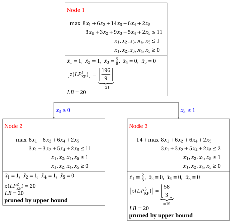{ .fig loading=lazy  }

        - <strong>Termination</strong>

            Since the problem list $L$ is empty, the $\mathrm{ILP}_{\mathrm{KP}}$ problem is solved to optimality.

            The optimal value is $z(~\mathrm{ILP}_{\mathrm{KP}}~)=20$ (the value of the lower bound $\LB$) and an optimal solution ${\tilde {\boldsymbol x}}(\,\mathrm{ILP}_{\mathrm{KP}}\,)$  is $\tilde  x_1=1,\tilde  x_2=1,\tilde  x_3=0,\tilde  x_4=1,\tilde  x_5=0$ (the incumbent solution ${\bar{\boldsymbol x}}(\mathrm{ILP}_{\mathrm{KP}})$).

    3. This is the <strong>branch-and-bound tree</strong> of the previous execution of the <strong>branch-and-bound algorithm</strong>, showing for each solved branching node the optimal value of the associated $\mathrm{LP}_{\mathrm{KP}}$ problem, the current lower bound $\LB$, and the pruning criteria.

        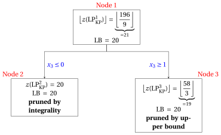{ .fig loading=lazy  }

!!! esercizio "Exercise 41.2: Branch-and-Bound Algorithm for the 0/1 Knapsack Problem (P2)"

    We consider a knapsack capacity $c=8$ and a set $\mathscr{I}=\{1,2,3,4\}$ of $4$ items ($n=4$) with the following profits and weights:

    $$
    \begin{array}{l|rrrrrrrrrrrr}
    \hline  & {j=1} & {j=2} & {j=3} & {j=4} \\[0.7ex]
    \hline {p_j} & {40} & {42} & {25} & {12} \\[0.7ex]
    {w_j} & {4} & {7} & {5} & {3} \\[0.7ex]
    \hline
    \end{array}
    $$

    **Questions**

    1. Check if the items are sorted by non-increasing efficiency otherwise sort them in this order.  Write the $\mathrm{ILP}_{\mathrm{KP}}$ model and the $\mathrm{LP}_{\mathrm{KP}}$ model for the KP instance.

    2. Execute the branch-and-bound algorithm to solve the $\mathrm{ILP}_{\mathrm{KP}}$ model for the 0/1 knapsack problem (KP) using:

        1. the split-item rule as branching-variable selection strategy;

        2. the LIFO rule as branching-node selection strategy;

        3. solve first the down-branching node and then the up-branching node;

        4. set the incumbent solution ${\bar{\boldsymbol x}}(\,\mathrm{ILP}_{\mathrm{KP}}\,)$ to the following  heuristic solution :

            $$
            \bar{x}_1=1, ~~~ \bar{x}_2=0,~~~ \bar{x}_3= 0,~~\bar{x}_4=1
            $$

            and set the lower bound $\LB$ accordingly.

    3. Determine and comment the correspondent branch-and-bound tree showing the reason why the branching nodes can be pruned.

??? soluzione "Solution"

    1. The items are sorted by non-increasing efficiency since we have:

        $$
        \frac{40}{4} ~~\ge~~ \frac{42}{7} ~~\ge~~ \frac{25}{5} ~~\ge~~ \frac{12}{3}
        $$

        This is the $\mathrm{ILP}_{\mathrm{KP}}$ model  for the KP instance:

        $$
        \begin{array}{rrrrrrrrrrrrr}
        {\max} & 40 \, {x_1} & + 42 \, {x_2} & + 25 \, {x_3} & + 12 \, {x_4} \\[1ex]
        & 4 \, {x_1} & + 7 \, {x_2} & + 5 \, {x_3} & + 3 \, {x_4} & {\le} & 8 \\[1ex]
        & {x_1}, & {x_2}, & {x_3}, & {x_4} & { \in} & { \{0,1\}}
        \end{array}
        $$

        This is the $\mathrm{LP}_{\mathrm{KP}}$ model  for the KP instance:

        $$
        \begin{array}{rrrrrrrrrrrrr}
        {\max} & 40 \, {x_1} & + 42 \, {x_2} & + 25 \, {x_3} & + 12 \, {x_4} \\[1ex]
        & 4 \, {x_1} & + 7 \, {x_2} & + 5 \, {x_3} & + 3 \, {x_4} & {\le} & 8 \\[1ex]
        & {x_1} &  &  &  & {\le} & 1 \\[1ex]
        &  & {x_2} &  &  & {\le} & 1 \\[1ex]
        &  &  & {x_3} &  & {\le} & 1 \\[1ex]
        &  &  &  & {x_4} & {\le} & 1 \\[1ex]
        & {x_1}, & {x_2}, & {x_3}, & {x_4} & { \ge} & { 0}
        \end{array}
        $$

    2. Execution of the branch-and-bound algorithm to solve the $\mathrm{ILP}_{\mathrm{KP}}$ model.

        - <strong>Initialization</strong>

            For the $\mathrm{LP}^1_{\mathrm{KP}}$ problem, the split item is $s=2$ and the residual capacity is $\mathit{rc} = 4$. An  optimal solution ${ \tilde{ \boldsymbol x}}(\,\mathrm{LP}^1_{\mathrm{KP}}\,)$ is:

            $$
            \tilde{x}_1=1,~~\tilde{x}_2=\frac{4}{7},~~\tilde{x}_3=0,~~\tilde{x}_4=0
            $$

            the optimal value is:

            $$
            z(~\mathrm{LP}^1_{\mathrm{KP}}~) = 40 \cdot 1 + 42 \cdot \frac{4}{7} =64
            $$

            The optimal solution ${ \tilde{ \boldsymbol x}}(\,\mathrm{LP}^1_{\mathrm{KP}}\,)$ is <strong>fractional</strong> and the $\mathrm{LP}^1_{\mathrm{KP}}$ problem is <strong>feasible</strong>, so the $\mathrm{LP}^1_{\mathrm{KP}}$ problem is inserted in the problem list $L$ and the lower bound $\LB$ is set to $52$ ($\LB(\bar{\boldsymbol x})= 52$).

            Due to the current lower bound $\LB$ and upper bound $\UB$, we have:

            $$
            52 ~~\le~~ z(\mathrm{ILP}_{\mathrm{KP}}) ~~\le~~  64
            $$

        - <strong>Iteration  1</strong>

            The $\mathrm{LP}^1_{\mathrm{KP}}$ problem is extracted and deleted from the problem list $L$.

            The branching variable is $x_2$. The $\mathrm{LP}^2_{\mathrm{KP}}$ and $\mathrm{LP}^3_{\mathrm{KP}}$ problems are created by unselecting ($x_2 \le 0$) and selecting ($x_2 \ge 1$) item $2$.

            1. Solution of the $\mathrm{LP}^2_{\mathrm{KP}}$ problem

                We have

                $$
                \mathscr{I}^2 = \{1,3,4\},~~~\mathscr{I}^2_\text{out} = \{2\}, ~~~\mathscr{I}^2_\text{in} = \emptyset
                $$

                The capacity is $c(2)=8$ and the objective-function constant is $p(2)=0$. The split item is $s=3$ and the residual capacity is $\mathit{rc} = 4$. An  optimal solution ${ \tilde{ \boldsymbol x}}(\,\mathrm{LP}^2_{\mathrm{KP}}\,)$ is:

                $$
                \tilde{x}_1=1,~~\tilde{x}_3=\frac{4}{5},~~\tilde{x}_4=0 \text{   and   }  z(~\mathrm{LP}^2_{\mathrm{KP}}~)=  40\cdot 1 + 25 \cdot \frac{4}{5}= 60
                $$

                The $\mathrm{LP}^2_{\mathrm{KP}}$ problem is <strong>feasible</strong> and we have:

                $$
                \left\lfloor z(\mathrm{LP}^2_{\mathrm{KP}}) \right\rfloor > \LB
                \qquad \text{since} \qquad
                60 > 52
                $$

                The optimal solution ${ \tilde{ \boldsymbol x}}(\,\mathrm{LP}^2_{\mathrm{KP}}\,)$ is <strong>fractional</strong>, accordingly, the $\mathrm{LP}^2_{\mathrm{KP}}$ problem is <strong>inserted in the problem list</strong> $L$.

            2. Solution of the $\mathrm{LP}^3_{\mathrm{KP}}$ problem

                We have

                $$
                \mathscr{I}^3 = \{1,3,4\},~~~\mathscr{I}^3_\text{out} = \emptyset, ~~~\mathscr{I}^3_\text{in} = \{2\}
                $$

                The capacity is $c(3)=1$ and the objective-function constant is $p(3)=42$. The split item is $s=1$ and the residual capacity is $\mathit{rc} = 1$. An  optimal solution ${ \tilde{ \boldsymbol x}}(\,\mathrm{LP}^3_{\mathrm{KP}}\,)$ is:

                $$
                \tilde{x}_1=\frac{1}{4},~~\tilde{x}_3=0,~~\tilde{x}_4=0 \text{   and   }  z(~\mathrm{LP}^3_{\mathrm{KP}}~)= 42 + 40 \cdot \frac{1}{4}= 52
                $$

                The $\mathrm{LP}^3_{\mathrm{KP}}$ problem is <strong>feasible</strong> and we have:

                $$
                \left\lfloor z(\mathrm{LP}^3_{\mathrm{KP}}) \right\rfloor \le \LB
                \qquad \text{since} \qquad
                52 \le 52
                $$

                accordingly, the branching node is <u>pruned by upper bound</u>.

            At the end of the first iteration, Node 2 is inserted in the problem list $L$, while Node 3 is pruned by upper bound. The corresponding branch-and-bound tree is:

            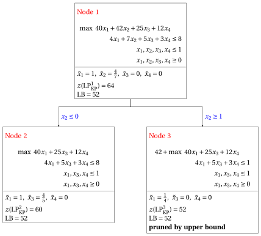{ .fig loading=lazy  }

            Due to the current lower bound $\LB$ and upper bound $\UB$, we have:

            $$
            52 ~~\le~~ z(\mathrm{ILP}_{\mathrm{KP}}) ~~\le~~ 60
            $$

        - <strong>Iteration  2</strong>

            The $\mathrm{LP}^2_{\mathrm{KP}}$ problem is extracted and deleted from the problem list $L$.

            The branching variable is $x_3$. The $\mathrm{LP}^4_{\mathrm{KP}}$ and $\mathrm{LP}^5_{\mathrm{KP}}$ problems are created by unselecting ($x_3 \le 0$) and selecting ($x_3 \ge 1$) item $3$.

            1. Solution of the $\mathrm{LP}^4_{\mathrm{KP}}$ problem

                We have

                $$
                \mathscr{I}^4 =  \{1,4\},~~~\mathscr{I}^4_\text{out} = \{2,3\}, ~~~\mathscr{I}^4_\text{in} = \emptyset
                $$

                The capacity is $c(4)=8$ and the objective-function constant is $p(4)=0$. All items fit into the knapsack. An  optimal solution ${ \tilde{ \boldsymbol x}}(\,\mathrm{LP}^4_{\mathrm{KP}}\,)$ is:

                $$
                \tilde{x}_1=1,~~\tilde{x}_4=1 \text{   and   }  z(~\mathrm{LP}^4_{\mathrm{KP}}~) = 40 \cdot 1 + 12 \cdot 1  = 52
                $$

                The $\mathrm{LP}^4_{\mathrm{KP}}$ problem is <strong>feasible</strong> and its optimal solution ${ \tilde{ \boldsymbol x}}(\,\mathrm{LP}^4_{\mathrm{KP}}\,)$ is <strong>integer</strong>. It does not improve the incumbent solution, since $z(\mathrm{LP}^4_{\mathrm{KP}})=52 \le 52=\LB$, accordingly, the branching node is <u>pruned by integrality</u> (when both criteria hold, the integrality comes first).

            2. Solution of the $\mathrm{LP}^5_{\mathrm{KP}}$ problem

                We have

                $$
                \mathscr{I}^5 = \{1,4\},~~~\mathscr{I}^5_\text{out} = \{2\}, ~~~\mathscr{I}^5_\text{in}= \{3\}
                $$

                The capacity is $c(5)=3$ and the objective-function constant is $p(5)=25$. The split item is $s=1$ and the residual capacity is $\mathit{rc} = 3$. An  optimal solution ${ \tilde{ \boldsymbol x}}(\,\mathrm{LP}^5_{\mathrm{KP}}\,)$ is:

                $$
                \tilde{x}_1=\frac{3}{4},~~\tilde{x}_2=0,~~\tilde{x}_3=1,~~\tilde{x}_4=0 \text{   and   }  z(~\mathrm{LP}^5_{\mathrm{KP}}~)= 25 + 40 \cdot \frac{3}{4} = 55
                $$

                The $\mathrm{LP}^5_{\mathrm{KP}}$ problem is <strong>feasible</strong> and we have:

                $$
                \left\lfloor z(\mathrm{LP}^5_{\mathrm{KP}}) \right\rfloor > \LB
                \qquad \text{since} \qquad
                55 > 52
                $$

                The optimal solution ${ \tilde{ \boldsymbol x}}(\,\mathrm{LP}^5_{\mathrm{KP}}\,)$ is <strong>fractional</strong>, accordingly, the $\mathrm{LP}^5_{\mathrm{KP}}$ problem is <strong>inserted in the problem list</strong> $L$.

            At the end of the second iteration, Node 5 is inserted in the problem list $L$, while Node 4 is pruned by integrality. The corresponding branch-and-bound tree is:

            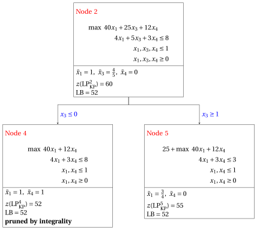{ .fig loading=lazy  }

            Due to the current lower bound $\LB$ and upper bound $\UB$, we have:

            $$
            52 ~~\le~~ z(\mathrm{ILP}_{\mathrm{KP}}) ~~\le~~ 55
            $$

        - <strong>Iteration  3</strong>

            The $\mathrm{LP}^5_{\mathrm{KP}}$ problem is extracted and deleted from the problem list $L$.

            The branching variable is $x_1$. The $\mathrm{LP}^6_{\mathrm{KP}}$ and $\mathrm{LP}^7_{\mathrm{KP}}$ problems are created by unselecting ($x_1 \le 0$) and selecting ($x_1 \ge 1$) item $1$.

            1. Solution of the $\mathrm{LP}^6_{\mathrm{KP}}$ problem

                We have

                $$
                \mathscr{I}^6 =  \{4\},~~~\mathscr{I}^6_\text{out} = \{1,2\}, ~~~\mathscr{I}^6_\text{in} = \{3\}
                $$

                The capacity is $c(6)=3$ and the objective-function constant is $p(6)=25$. All items fit into the knapsack. An  optimal solution ${ \tilde{ \boldsymbol x}}(\,\mathrm{LP}^6_{\mathrm{KP}}\,)$ is:

                $$
                \tilde{x}_4=1 \text{   and   }  z(~\mathrm{LP}^6_{\mathrm{KP}}~)= 25+12 \cdot 1=37
                $$

                The $\mathrm{LP}^6_{\mathrm{KP}}$ problem is <strong>feasible</strong> and its optimal solution ${ \tilde{ \boldsymbol x}}(\,\mathrm{LP}^6_{\mathrm{KP}}\,)$ is <strong>integer</strong>. It does not improve the incumbent solution, since $z(\mathrm{LP}^6_{\mathrm{KP}})=37 < 52=\LB$, accordingly, the branching node is <u>pruned by integrality</u> (when both criteria hold, the integrality comes first).

            2. Solution of the $\mathrm{LP}^7_{\mathrm{KP}}$ problem

                The $\mathrm{LP}^7_{\mathrm{KP}}$ problem is <strong>infeasible</strong>, accordingly the branching node is <u>pruned by infeasibility</u>.

            At the end of the third iteration, Node 6 is pruned by integrality and Node 7 is pruned by infeasibility. The corresponding branch-and-bound tree is:

            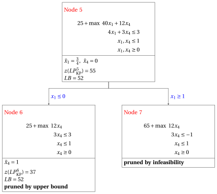{ .fig loading=lazy  }

        - <strong>Termination</strong>

            Since the problem list $L$ is empty, the $\mathrm{ILP}_{\mathrm{KP}}$ problem is solved to optimality.

            The optimal value is $z(~\mathrm{ILP}_{\mathrm{KP}}~)=52$ (the value of the lower bound $\LB$) and an optimal solution ${\tilde {\boldsymbol x}}(\,\mathrm{ILP}_{\mathrm{KP}}\,)$  is $\tilde  x_1=1,\tilde  x_2=0,\tilde  x_3=0,\tilde  x_4=1$ (the incumbent solution ${\bar{\boldsymbol x}}(\mathrm{ILP}_{\mathrm{KP}})$).

    3. This is the <strong>branch-and-bound tree</strong> of the previous execution of the <strong>branch-and-bound algorithm</strong>, showing for each solved branching node the optimal value of the associated $\mathrm{LP}_{\mathrm{KP}}$ problem, the current lower bound $\LB$, and the pruning criteria.

        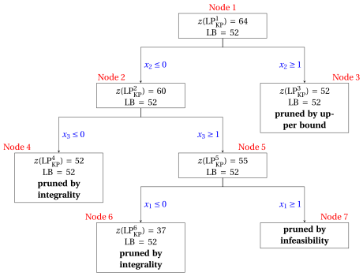{ .fig loading=lazy  }

!!! esercizio "Exercise 41.3: Branch-and-Bound Algorithm for the 0/1 Knapsack Problem (P3)"

    We consider a knapsack capacity $c=15$ and a set $\mathscr{I}=\{1,2,3,4\}$ of $4$ items ($n=4$) with the following profits and weights:

    $$
    \begin{array}{l|rrrrrrrrrrrr}
    \hline  & {j=1} & {j=2} & {j=3} & {j=4} \\[0.7ex]
    \hline {p_j} & {24} & {17} & {12} & {6} \\[0.7ex]
    {w_j} & {10} & {8} & {6} & {5} \\[0.7ex]
    \hline
    \end{array}
    $$

    **Questions**

    1. Check if the items are sorted by non-increasing efficiency otherwise sort them in this order.  Write the $\mathrm{ILP}_{\mathrm{KP}}$ model and the $\mathrm{LP}_{\mathrm{KP}}$ model for the KP instance.

    2. Execute the branch-and-bound algorithm to solve the $\mathrm{ILP}_{\mathrm{KP}}$ model for the 0/1 knapsack problem (KP) using:

        1. the split-item rule as branching-variable selection strategy;

        2. the LIFO rule as branching-node selection strategy;

        3. solve first the down-branching node and then the up-branching node;

        4. set the incumbent solution ${\bar{\boldsymbol x}}(\,\mathrm{ILP}_{\mathrm{KP}}\,)$ to the following  heuristic solution :

            $$
            \bar{x}_1=1, ~~~ \bar{x}_2=0,~~~ \bar{x}_3= 0,~~\bar{x}_4=1
            $$

            and set the lower bound $\LB$ accordingly.

    3. Determine and comment the correspondent branch-and-bound tree showing the reason why the branching nodes can be pruned.

??? soluzione "Solution"

    1. The items are sorted by non-increasing efficiency since we have:

        $$
        \frac{24}{10} ~~\ge~~\frac{17}{8} ~~\ge~~\frac{12}{6} ~~\ge~~\frac{6}{5}
        $$

        This is the $\mathrm{ILP}_{\mathrm{KP}}$ model for the KP instance:

        $$
        \begin{array}{rrrrrrrrrrrrr}
        {\max} & 24 \, {x_1} & + 17 \, {x_2} & + 12 \, {x_3} & + 6 \, {x_4} \\[1ex]
        & 10 \, {x_1} & + 8 \, {x_2} & + 6 \, {x_3} & + 5 \, {x_4} & {\le} & 15 \\[1ex]
        & {x_1}, & {x_2}, & {x_3}, & {x_4} & { \in} & { \{0,1\}}
        \end{array}
        $$

        This is the $\mathrm{LP}_{\mathrm{KP}}$ model  for the KP instance:

        $$
        \begin{array}{rrrrrrrrrrrrr}
        {\max} & 24 \, {x_1} & + 17 \, {x_2} & + 12 \, {x_3} & + 6 \, {x_4} \\[1ex]
        & 10 \, {x_1} & + 8 \, {x_2} & + 6 \, {x_3} & + 5 \, {x_4} & {\le} & 15 \\[1ex]
        & {x_1} &  &  &  & {\le} & 1 \\[1ex]
        &  & {x_2} &  &  & {\le} & 1 \\[1ex]
        &  &  & {x_3} &  & {\le} & 1 \\[1ex]
        &  &  &  & {x_4} & {\le} & 1 \\[1ex]
        & {x_1}, & {x_2}, & {x_3}, & {x_4} & { \ge} & { 0}
        \end{array}
        $$

    2. Execution of the branch-and-bound algorithm to solve the $\mathrm{ILP}_{\mathrm{KP}}$ model.

        - <strong>Initialization</strong>

            For the $\mathrm{LP}^1_{\mathrm{KP}}$ problem, the split item is $s=2$ and the residual capacity is $\mathit{rc} = 5$. An  optimal solution ${ \tilde{ \boldsymbol x}}(\,\mathrm{LP}^1_{\mathrm{KP}}\,)$ is:

            $$
            \tilde{x}_1=1,~~\tilde{x}_2=\frac{5}{8},~~\tilde{x}_3=0,~~\tilde{x}_4=0
            $$

            the optimal value is:

            $$
            z(~\mathrm{LP}^1_{\mathrm{KP}}~) = 24 \cdot 1 + 17 \cdot \frac{5}{8} =\frac{277}{8}
            $$

            The optimal solution ${ \tilde{ \boldsymbol x}}(\,\mathrm{LP}^1_{\mathrm{KP}}\,)$ is <strong>fractional</strong> and the $\mathrm{LP}^1_{\mathrm{KP}}$ problem is <strong>feasible</strong>, so the $\mathrm{LP}^1_{\mathrm{KP}}$ problem is inserted in the problem list $L$ and the lower bound $\LB$ is set to $30$ ($\LB(\bar{\boldsymbol x})= 30$).

            Due to the current lower bound $\LB$ and upper bound $\UB$, we have:

            $$
            30 ~~\le~~ z(\mathrm{ILP}_{\mathrm{KP}}) ~~\le~~  \underbrace{\left\lfloor \dfrac{277}{8} \right\rfloor}_{=34}
            $$

        - <strong>Iteration  1</strong>

            The $\mathrm{LP}^1_{\mathrm{KP}}$ problem is extracted and deleted from the problem list $L$.

            The branching variable is $x_2$. The $\mathrm{LP}^2_{\mathrm{KP}}$ and $\mathrm{LP}^3_{\mathrm{KP}}$ problems are created by unselecting ($x_2 \le 0$) and selecting ($x_2 \ge 1$) item $2$.

            1. Solution of the $\mathrm{LP}^2_{\mathrm{KP}}$ problem

                We have

                $$
                \mathscr{I}^2 = \{1,3,4\},~~~\mathscr{I}^2_\text{out} = \{2\}, ~~~\mathscr{I}^2_\text{in} = \emptyset
                $$

                The capacity is $c(2)=15$ and the objective-function constant is $p(2)=0$. The split item is $s=3$ and the residual capacity is $\mathit{rc} = 5$. An  optimal solution ${ \tilde{ \boldsymbol x}}(\,\mathrm{LP}^2_{\mathrm{KP}}\,)$ is:

                $$
                \tilde{x}_1=1,~~\tilde{x}_3=\frac{5}{6},~~\tilde{x}_4=0 \text{   and   }  z(~\mathrm{LP}^2_{\mathrm{KP}}~)=  24\cdot 1 + 12 \cdot \frac{5}{6}= 34
                $$

                The $\mathrm{LP}^2_{\mathrm{KP}}$ problem is <strong>feasible</strong> and we have:

                $$
                \left\lfloor z(\mathrm{LP}^2_{\mathrm{KP}}) \right\rfloor > \LB
                \qquad \text{since} \qquad
                34 > 30
                $$

                The optimal solution ${ \tilde{ \boldsymbol x}}(\,\mathrm{LP}^2_{\mathrm{KP}}\,)$ is <strong>fractional</strong>, accordingly, the $\mathrm{LP}^2_{\mathrm{KP}}$ problem is <strong>inserted in the problem list</strong> $L$.

            2. Solution of the $\mathrm{LP}^3_{\mathrm{KP}}$ problem

                We have

                $$
                \mathscr{I}^3 = \{1,3,4\},~~~\mathscr{I}^3_\text{out} = \emptyset, ~~~\mathscr{I}^3_\text{in} = \{2\}
                $$

                The capacity is $c(3)=7$ and the objective-function constant is $p(3)=17$. The split item is $s=1$ and the residual capacity is $\mathit{rc} = 7$. An  optimal solution ${ \tilde{ \boldsymbol x}}(\,\mathrm{LP}^3_{\mathrm{KP}}\,)$ is:

                $$
                \tilde{x}_1=\frac{7}{10},~~\tilde{x}_3=0,~~\tilde{x}_4=0 \text{   and   }  z(~\mathrm{LP}^3_{\mathrm{KP}}~)= 17 + 24 \cdot \frac{7}{10}= \frac{169}{5}
                $$

                The $\mathrm{LP}^3_{\mathrm{KP}}$ problem is <strong>feasible</strong> and we have:

                $$
                \left\lfloor z(\mathrm{LP}^3_{\mathrm{KP}}) \right\rfloor > \LB
                \qquad \text{since} \qquad
                \underbrace{\left\lfloor \frac{169}{5} \right\rfloor}_{=33} > 30
                $$

                The optimal solution ${ \tilde{ \boldsymbol x}}(\,\mathrm{LP}^3_{\mathrm{KP}}\,)$ is <strong>fractional</strong>, accordingly, the $\mathrm{LP}^3_{\mathrm{KP}}$ problem is <strong>inserted in the problem list</strong> $L$.

            At the end of the first iteration, Node 2 and Node 3 are both inserted in the problem list $L$. The corresponding branch-and-bound tree is:

            { .fig loading=lazy  }

            Due to the current lower bound $\LB$ and upper bound $\UB$, we have:

            $$
            30 ~~\le~~ z(\mathrm{ILP}_{\mathrm{KP}}) ~~\le~~ \underbrace{\max \left\{ 34,~~  \underbrace{\left\lfloor \frac{169}{5} \right\rfloor}_{=33} \right\}}_{=34}
            $$

        - <strong>Iteration  2</strong>

            The $\mathrm{LP}^3_{\mathrm{KP}}$ problem is extracted and deleted from the problem list $L$.

            The branching variable is $x_1$. The $\mathrm{LP}^4_{\mathrm{KP}}$ and $\mathrm{LP}^5_{\mathrm{KP}}$ problems are created by unselecting ($x_1 \le 0$) and selecting ($x_1 \ge 1$) item $1$.

            1. Solution of the $\mathrm{LP}^4_{\mathrm{KP}}$ problem

                We have

                $$
                \mathscr{I}^4 =  \{3,4\},~~~\mathscr{I}^4_\text{out} = \{1\}, ~~~\mathscr{I}^4_\text{in} = \{2\}
                $$

                The capacity is $c(4)=7$ and the objective-function constant is $p(4)=17$. The split item is $s=4$ and the residual capacity is $\mathit{rc} = 1$. An  optimal solution ${ \tilde{ \boldsymbol x}}(\,\mathrm{LP}^4_{\mathrm{KP}}\,)$ is:

                $$
                \tilde{x}_3=1,~~\tilde{x}_4=\frac{1}{5} \text{   and   }  z(~\mathrm{LP}^4_{\mathrm{KP}}~) = 17+ 12 \cdot 1 + 6 \cdot \frac{1}{5}  = \frac{151}{5}
                $$

                The $\mathrm{LP}^4_{\mathrm{KP}}$ problem is <strong>feasible</strong> and we have:

                $$
                \left\lfloor z(\mathrm{LP}^4_{\mathrm{KP}}) \right\rfloor \le  \LB
                \qquad \text{since} \qquad
                \underbrace{\left\lfloor \frac{151}{5} \right\rfloor}_{=30} \le 30
                $$

                accordingly, the branching node is <u>pruned by upper bound</u>.

            2. Solution of the $\mathrm{LP}^5_{\mathrm{KP}}$ problem

                The $\mathrm{LP}^5_{\mathrm{KP}}$ problem is <strong>infeasible</strong>, accordingly the branching node is <u>pruned by infeasibility</u>.

            At the end of the second iteration, Node 4 is pruned by upper bound and Node 5 is pruned by infeasibility. The corresponding branch-and-bound tree is:

            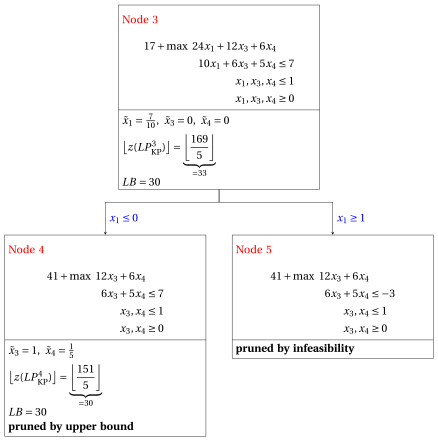{ .fig loading=lazy  }

            Due to the current lower bound $\LB$ and upper bound $\UB$, we have:

            $$
            30 ~~\le~~ z(\mathrm{ILP}_{\mathrm{KP}}) ~~\le~~ 34
            $$

        - <strong>Iteration  3</strong>

            The $\mathrm{LP}^2_{\mathrm{KP}}$ problem is extracted and deleted from the problem list $L$.

            The branching variable is $x_3$. The $\mathrm{LP}^6_{\mathrm{KP}}$ and $\mathrm{LP}^7_{\mathrm{KP}}$ problems are created by unselecting ($x_3 \le 0$) and selecting ($x_3 \ge 1$) item $3$.

            1. Solution of the $\mathrm{LP}^6_{\mathrm{KP}}$ problem

                We have

                $$
                \mathscr{I}^6 =  \{1,4\},~~~\mathscr{I}^6_\text{out} = \{2,3\}, ~~~\mathscr{I}^6_\text{in} = \emptyset
                $$

                The capacity is $c(6)=15$ and the objective-function constant is $p(6)=0$. All items fit into the knapsack. An  optimal solution ${ \tilde{ \boldsymbol x}}(\,\mathrm{LP}^6_{\mathrm{KP}}\,)$ is:

                $$
                \tilde{x}_1=1,\tilde{x}_4=1 \text{   and   }  z(~\mathrm{LP}^6_{\mathrm{KP}}~)= 24 \cdot 1+6 \cdot 1=30
                $$

                The $\mathrm{LP}^6_{\mathrm{KP}}$ problem is <strong>feasible</strong> and its optimal solution ${ \tilde{ \boldsymbol x}}(\,\mathrm{LP}^6_{\mathrm{KP}}\,)$ is <strong>integer</strong>. It does not improve the incumbent solution, since $z(\mathrm{LP}^6_{\mathrm{KP}})=30 \le 30=\LB$, accordingly, the branching node is <u>pruned by integrality</u> (when both criteria hold, the integrality comes first).

            2. Solution of the $\mathrm{LP}^7_{\mathrm{KP}}$ problem

                We have

                $$
                \mathscr{I}^7 = \{1,4\},~~~\mathscr{I}^7_\text{out} = \{2\}, ~~~\mathscr{I}^7_\text{in} = \{3\}
                $$

                The capacity is $c(7)=9$ and the objective-function constant is $p(7)=12$. The split item is $s=1$ and the residual capacity is $\mathit{rc} = 9$. An  optimal solution ${ \tilde{ \boldsymbol x}}(\,\mathrm{LP}^7_{\mathrm{KP}}\,)$ is:

                $$
                \tilde{x}_1=\frac{9}{10},~~\tilde{x}_4=0 \text{   and   }  z(~\mathrm{LP}^7_{\mathrm{KP}}~)=  12 + 24 \cdot \frac{9}{10}= \frac{168}{5}
                $$

                The $\mathrm{LP}^7_{\mathrm{KP}}$ problem is <strong>feasible</strong> and we have:

                $$
                \left\lfloor z(\mathrm{LP}^7_{\mathrm{KP}}) \right\rfloor >  \LB
                \qquad \text{since} \qquad
                \underbrace{\left\lfloor  \frac{168}{5} \right\rfloor}_{=33} > 30
                $$

                The optimal solution ${ \tilde{ \boldsymbol x}}(\,\mathrm{LP}^7_{\mathrm{KP}}\,)$ is <strong>fractional</strong>, accordingly, the $\mathrm{LP}^7_{\mathrm{KP}}$ problem is <strong>inserted in the problem list</strong> $L$.

            At the end of the third iteration, Node 6 is pruned by integrality and Node 7 is inserted in the problem list $L$. The corresponding branch-and-bound tree is:

            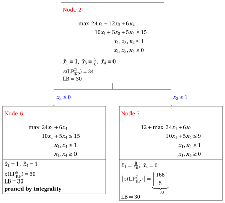{ .fig loading=lazy  }

        - <strong>Iteration  4</strong>

            The $\mathrm{LP}^7_{\mathrm{KP}}$ problem is extracted and deleted from the problem list $L$.

            The branching variable is $x_1$. The $\mathrm{LP}^8_{\mathrm{KP}}$ and $\mathrm{LP}^9_{\mathrm{KP}}$ problems are created by unselecting ($x_1 \le 0$) and selecting ($x_1 \ge 1$) item $1$.

            1. Solution of the $\mathrm{LP}^8_{\mathrm{KP}}$ problem

                We have

                $$
                \mathscr{I}^8 =  \{4\},~~~\mathscr{I}^8_\text{out} = \{1,2\}, ~~~\mathscr{I}^8_\text{in} = \{3\}
                $$

                The capacity is $c(8)=9$ and the objective-function constant is $p(8)=12$. All items fit into the knapsack. An  optimal solution ${ \tilde{ \boldsymbol x}}(\,\mathrm{LP}^8_{\mathrm{KP}}\,)$ is:

                $$
                \tilde{x}_4=1 \text{   and   }  z(~\mathrm{LP}^8_{\mathrm{KP}}~)= 12+6 \cdot 1=18
                $$

                The $\mathrm{LP}^8_{\mathrm{KP}}$ problem is <strong>feasible</strong> and its optimal solution ${ \tilde{ \boldsymbol x}}(\,\mathrm{LP}^8_{\mathrm{KP}}\,)$ is <strong>integer</strong>. It does not improve the incumbent solution, since $z(\mathrm{LP}^8_{\mathrm{KP}})=18 < 30=\LB$, accordingly, the branching node is <u>pruned by integrality</u> (when both criteria hold, the integrality comes first).

            2. Solution of the $\mathrm{LP}^9_{\mathrm{KP}}$ problem

                The $\mathrm{LP}^9_{\mathrm{KP}}$ problem is <strong>infeasible</strong>, accordingly the branching node is <u>pruned by infeasibility</u>.

            At the end of the fourth iteration, Node 8 is pruned by integrality and Node 9 is pruned by infeasibility. The corresponding branch-and-bound tree is:

            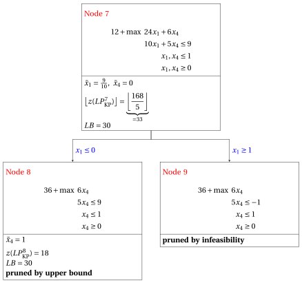{ .fig loading=lazy  }

        - <strong>Termination</strong>

            Since the problem list $L$ is empty, the $\mathrm{ILP}_{\mathrm{KP}}$ problem is solved to optimality.

            The optimal value is $z(~\mathrm{ILP}_{\mathrm{KP}}~)=30$ (the value of the lower bound $\LB$) and an optimal solution ${\tilde {\boldsymbol x}}(\,\mathrm{ILP}_{\mathrm{KP}}\,)$  is $\tilde  x_1=1,\tilde  x_2=0,\tilde  x_3=0,\tilde  x_4=1$ (the incumbent solution ${\bar{\boldsymbol x}}(\mathrm{ILP}_{\mathrm{KP}})$).

    3. This is the <strong>branch-and-bound tree</strong> of the previous execution of the <strong>branch-and-bound algorithm</strong>, showing for each solved branching node the optimal value of the associated $\mathrm{LP}_{\mathrm{KP}}$ problem, the current lower bound $\LB$, and the pruning criteria.

        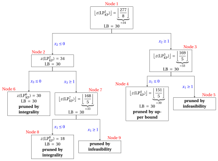{ .fig loading=lazy  }

!!! esercizio "Exercise 41.4: Branch-and-Bound Algorithm for the 0/1 Knapsack Problem (P4)"

    We consider a knapsack capacity $c=9$ and a set $\mathscr{I}=\{1,2,3,4,5,6\}$ of $6$ items ($n=6$) with the following profits and weights:

    $$
    \begin{array}{l|rrrrrrr}
    \hline  & {j = 1} & {j = 2} & {j = 3} & {j = 4} & {j = 5} & {j = 6} \\[1ex]
    \hline {p_j} & {6} & {5} & {8} & {9} & {6} & {7} \\[1ex]
    {w_j} & {2} & {3} & {6} & {7} & {5} & {9} \\[1ex]
    \hline
    \end{array}
    $$

    **Questions**

    1. Check if the items are sorted by non-increasing efficiency otherwise sort them in this order.  Write the $\mathrm{ILP}_{\mathrm{KP}}$ model and the $\mathrm{LP}_{\mathrm{KP}}$ model for the KP instance.

    2. Execute the branch-and-bound algorithm to solve the $\mathrm{ILP}_{\mathrm{KP}}$ model for the 0/1 knapsack problem (KP) using:

        1. the split-item rule as branching-variable selection strategy;

        2. the FIFO rule as branching-node selection strategy;

        3. solve first the down-branching node and then the up-branching node;

        4. set the incumbent solution ${\bar{\boldsymbol x}}(\,\mathrm{ILP}_{\mathrm{KP}}\,)$ to the following  heuristic solution :

            $$
            \bar{x}_1=1, ~~~ \bar{x}_2=1,~~~ \bar{x}_3= 0,~~\bar{x}_4=0,~~\bar{x}_5=0,~~\bar{x}_6=0
            $$

            and set the lower bound $\LB$ accordingly.

    3. Determine and comment the correspondent branch-and-bound tree showing the reason why the branching nodes can be pruned.

??? soluzione "Solution"

    1. The items are sorted by non-increasing efficiency since we have:

        $$
        \frac{6}{2} ~~\ge~~ \frac{5}{3} ~~\ge~~ \frac{8}{6} ~~\ge~~ \frac{9}{7} ~~\ge~~ \frac{6}{5} ~~\ge~~ \frac{7}{9}
        $$

        This is the $\mathrm{ILP}_{\mathrm{KP}}$ model  for the KP instance:

        $$
        \begin{array}{rrrrrrrrrrrrr}
        {\max} & 6 \, {x_1} & + 5 \, {x_2} & + 8 \, {x_3} & + 9 \, {x_4} & + 6 \, {x_5} & + 7 \, {x_6} \\[1.5ex]
        & 2 \, {x_1} & + 3 \, {x_2} & + 6 \, {x_3} & + 7 \, {x_4} & + 5 \, {x_5} & + 9 \, {x_6} & {\le} & 9 \\[1.5ex]
        & {x_1}, & {x_2}, & {x_3}, & {x_4}, & {x_5}, & {x_6} & { \in} & { \{0,1\}}
        \end{array}
        $$

        This is the $\mathrm{LP}_{\mathrm{KP}}$ model for the KP instance:

        $$
        \begin{array}{rrrrrrrrrrrrr}
        {\max} & 6 \, {x_1} & + 5 \, {x_2} & + 8 \, {x_3} & + 9 \, {x_4} & + 6 \, {x_5} & + 7 \, {x_6} \\[1ex]
        & 2 \, {x_1} & + 3 \, {x_2} & + 6 \, {x_3} & + 7 \, {x_4} & + 5 \, {x_5} & + 9 \, {x_6} & {\le} & 9 \\[1ex]
        & {x_1} &  &  &  &  &  & {\le} & 1 \\
        &  & {x_2} &  &  &  &  & {\le} & 1 \\
        &  &  & {x_3} &  &  &  & {\le} & 1 \\
        &  &  &  & {x_4} &  &  & {\le} & 1 \\
        &  &  &  &  & {x_5} &  & {\le} & 1 \\
        &  &  &  &  &  & {x_6} & {\le} & 1 \\[1ex]
        & {x_1}, & {x_2}, & {x_3}, & {x_4}, & {x_5}, & {x_6} & { \ge} & { 0}
        \end{array}
        $$

    2. Execution of the branch-and-bound algorithm to solve the $\mathrm{ILP}_{\mathrm{KP}}$ model.

        - <strong>Initialization</strong>

            For the $\mathrm{LP}^1_{\mathrm{KP}}$ problem, the split item is $s=3$ and the residual capacity is $\mathit{rc} = 4$. An  optimal solution ${ \tilde{ \boldsymbol x}}(\,\mathrm{LP}^1_{\mathrm{KP}}\,)$ is:

            $$
            \tilde{x}_1=1,~~\tilde{x}_2=1,~~\tilde{x}_3=\frac{2}{3},~~\tilde{x}_4=0,~~\tilde{x}_5=0,~~\tilde{x}_6=0
            $$

            the optimal value is:

            $$
            z(~\mathrm{LP}^1_{\mathrm{KP}}~) = 6 \cdot 1 + 5 \cdot 1 +  8 \cdot \frac{2}{3} =\frac{49}{3}
            $$

            The optimal solution ${ \tilde{ \boldsymbol x}}(\,\mathrm{LP}^1_{\mathrm{KP}}\,)$ is <strong>fractional</strong> and the $\mathrm{LP}^1_{\mathrm{KP}}$ problem is <strong>feasible</strong>, so the $\mathrm{LP}^1_{\mathrm{KP}}$ problem is inserted in the problem list $L$ and the lower bound $\LB$ is set to $11$ ($\LB(\bar{\boldsymbol x})= 11$).

            Due to the current lower bound $\LB$ and upper bound $\UB$, we have:

            $$
            11 ~~\le~~ z(\mathrm{ILP}_{\mathrm{KP}}) ~~\le~~  \underbrace{\left\lfloor \dfrac{49}{3} \right\rfloor}_{=16}
            $$

        - <strong>Iteration  1</strong>

            The $\mathrm{LP}^1_{\mathrm{KP}}$ problem is extracted and deleted from the problem list $L$.

            The branching variable is $x_3$. The $\mathrm{LP}^2_{\mathrm{KP}}$ and $\mathrm{LP}^3_{\mathrm{KP}}$ problems are created by unselecting ($x_3 \le 0$) and selecting ($x_3 \ge 1$) item $3$.

            1. Solution of the $\mathrm{LP}^2_{\mathrm{KP}}$ problem

                We have

                $$
                \mathscr{I}^2 = \{1,2,4,5,6\},~~~\mathscr{I}^2_\text{out} = \{3\}, ~~~\mathscr{I}^2_\text{in} = \emptyset
                $$

                The capacity is $c(2)=9$ and the objective-function constant is $p(2)=0$. The split item is $s=4$ and the residual capacity is $\mathit{rc} = 4$. An  optimal solution ${ \tilde{ \boldsymbol x}}(\,\mathrm{LP}^2_{\mathrm{KP}}\,)$ is:

                $$
                \begin{gathered}\tilde{x}_1=1,~~\tilde{x}_2=1,~~\tilde{x}_4=\frac{4}{7},~~\tilde{x}_5=0,~~\tilde{x}_6=0
                \qquad \text{and} \\
                z(~\mathrm{LP}^2_{\mathrm{KP}}~) =   6 \cdot 1 + 5 \cdot 1 + 9 \cdot \frac{4}{7} = \frac{113}{7}\end{gathered}
                $$

                The $\mathrm{LP}^2_{\mathrm{KP}}$ problem is <strong>feasible</strong> and we have:

                $$
                \left\lfloor z(\mathrm{LP}^2_{\mathrm{KP}}) \right\rfloor > \LB
                \qquad \text{since} \qquad
                \underbrace{\left\lfloor\frac{113}{7} \right\rfloor}_{ = 16} >11
                $$

                The optimal solution ${ \tilde{ \boldsymbol x}}(\,\mathrm{LP}^2_{\mathrm{KP}}\,)$ is <strong>fractional</strong>, accordingly, the $\mathrm{LP}^2_{\mathrm{KP}}$ problem is <strong>inserted in the problem list</strong> $L$.

            2. Solution of the $\mathrm{LP}^3_{\mathrm{KP}}$ problem

                We have

                $$
                \mathscr{I}^3 = \{1,2,4,5,6\},~~~\mathscr{I}^3_\text{out} = \emptyset, ~~~\mathscr{I}^3_\text{in} = \{3\}
                $$

                The capacity is $c(3)=3$ and the objective-function constant is $p(3)=8$. The split item is $s=2$ and the residual capacity is $\mathit{rc} = 1$. An  optimal solution ${ \tilde{ \boldsymbol x}}(\,\mathrm{LP}^3_{\mathrm{KP}}\,)$ is:

                $$
                \begin{gathered} \tilde{x}_1=1,~~\tilde{x}_2=\frac{1}{3},~~\tilde{x}_4=0,~~\tilde{x}_5=0,~~\tilde{x}_6=0 \qquad \text{and} \\  z(~\mathrm{LP}^3_{\mathrm{KP}}~) =  8 + 6 \cdot 1 + 5 \cdot \frac{1}{3} = \frac{47}{3}\end{gathered}
                $$

                The $\mathrm{LP}^3_{\mathrm{KP}}$ problem is <strong>feasible</strong> and we have:

                $$
                \left\lfloor z(\mathrm{LP}^3_{\mathrm{KP}}) \right\rfloor > \LB
                \qquad \text{since} \qquad
                \underbrace{\left\lfloor\frac{47}{3} \right\rfloor}_{ = 15} > 11
                $$

                The optimal solution ${ \tilde{ \boldsymbol x}}(\,\mathrm{LP}^3_{\mathrm{KP}}\,)$ is <strong>fractional</strong>, accordingly, the $\mathrm{LP}^3_{\mathrm{KP}}$ problem is <strong>inserted in the problem list</strong> $L$.

            At the end of the first iteration, Node 2 and Node 3 are both inserted in the problem list $L$. The corresponding branch-and-bound tree is:

            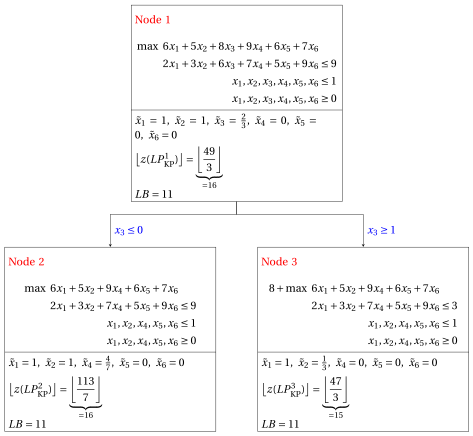{ .fig loading=lazy  }

            Due to the current lower bound $\LB$ and upper bound $\UB$, we have:

            $$
            11 ~~\le~~ z(\mathrm{ILP}_{\mathrm{KP}}) ~~\le~~ \underbrace{\max \left\{ \underbrace{\left\lfloor \frac{113}{7} \right\rfloor}_{=16},~~  \underbrace{\left\lfloor \frac{47}{3} \right\rfloor}_{=15} \right\}}_{=16}
            $$

        - <strong>Iteration  2</strong>

            The $\mathrm{LP}^2_{\mathrm{KP}}$ problem is extracted and deleted from the problem list $L$.

            The branching variable is $x_4$. The $\mathrm{LP}^4_{\mathrm{KP}}$ and $\mathrm{LP}^5_{\mathrm{KP}}$ problems are created by unselecting ($x_4 \le 0$) and selecting ($x_4 \ge 1$) item $4$.

            1. Solution of the $\mathrm{LP}^4_{\mathrm{KP}}$ problem

                We have

                $$
                \mathscr{I}^4 =  \{1,2,5,6\},~~~\mathscr{I}^4_\text{out} = \{3,4\}, ~~~\mathscr{I}^4_\text{in} = \emptyset
                $$

                The capacity is $c(4)=9$ and the objective-function constant is $p(4)=0$. The split item is $s=5$ and the residual capacity is $\mathit{rc} = 4$. An  optimal solution ${ \tilde{ \boldsymbol x}}(\,\mathrm{LP}^4_{\mathrm{KP}}\,)$ is:

                $$
                \tilde{x}_1=1,~~\tilde{x}_2=1,~~\tilde{x}_5=\frac{4}{5},~~\tilde{x}_6=0 \text{   and   }  z(~\mathrm{LP}^4_{\mathrm{KP}}~) = 6 \cdot 1 + 5 \cdot 1 + 6 \cdot \frac{4}{5} = \frac{79}{5}
                $$

                The $\mathrm{LP}^4_{\mathrm{KP}}$ problem is <strong>feasible</strong> and we have:

                $$
                \left\lfloor z(\mathrm{LP}^4_{\mathrm{KP}}) \right\rfloor >  \LB
                \qquad \text{since} \qquad
                \underbrace{\left\lfloor\frac{79}{5} \right\rfloor}_{ = 15} > 11
                $$

                The optimal solution ${ \tilde{ \boldsymbol x}}(\,\mathrm{LP}^4_{\mathrm{KP}}\,)$ is <strong>fractional</strong>, accordingly, the $\mathrm{LP}^4_{\mathrm{KP}}$ problem is <strong>inserted in the problem list</strong> $L$.

            2. Solution of the $\mathrm{LP}^5_{\mathrm{KP}}$ problem

                We have

                $$
                \mathscr{I}^5 = \{1,2,5,6\},~~~\mathscr{I}^5_\text{out} = \{3\}, ~~~ \mathscr{I}^5_\text{in}= \{4\}
                $$

                The capacity is $c(5)=2$ and the objective-function constant is $p(5)=9$. The split item is $s=2$ and the residual capacity is $\mathit{rc} = 0$. An  optimal solution ${ \tilde{ \boldsymbol x}}(\,\mathrm{LP}^5_{\mathrm{KP}}\,)$ is:

                $$
                \tilde{x}_1=1,~~\tilde{x}_2=0,~~\tilde{x}_5=0,~~\tilde{x}_6=0 \text{   and   }  z(~\mathrm{LP}^5_{\mathrm{KP}}~) = 9 + 6 \cdot 1  =  15
                $$

                The $\mathrm{LP}^5_{\mathrm{KP}}$ problem is <strong>feasible</strong> and we have:

                $$
                \left\lfloor z(\mathrm{LP}^5_{\mathrm{KP}}) \right\rfloor > \LB
                \qquad \text{since} \qquad
                15 > 11
                $$

                The optimal solution ${ \tilde{ \boldsymbol x}}(\,\mathrm{LP}^5_{\mathrm{KP}}\,)$ is <strong>integer</strong>, accordingly, the lower bound $\LB$ becomes $15$ and the incumbent solution ${\bar{\boldsymbol x}}(\mathrm{ILP}_{\mathrm{KP}})$ becomes $\bar  x_1=1,\bar  x_2=0,\bar  x_3=0,\bar  x_4=1,\bar  x_5=0,\bar  x_6=0$.

                Accordingly, the branching node is <u>pruned by integrality</u>.

                Since the lower bound is improved, the $\mathrm{LP}^3_{\mathrm{KP}}$ problem and the $\mathrm{LP}^4_{\mathrm{KP}}$ problem are <u>pruned by upper bound</u> and removed from the problem list $L$.  We have:

                $$
                \left\lfloor z(\mathrm{LP}^3_{\mathrm{KP}}) \right\rfloor \le \LB
                \qquad \text{since} \qquad
                \underbrace{\left\lfloor\frac{47}{3} \right\rfloor}_{ = 15} \le  15
                $$

                $$
                \left\lfloor z(\mathrm{LP}^4_{\mathrm{KP}}) \right\rfloor \le \LB
                \qquad \text{since} \qquad
                \underbrace{\left\lfloor\frac{79}{5} \right\rfloor}_{ = 15} \le  15
                $$

            At the end of the second iteration, Node 5 improves the lower bound to $\LB=15$ and is pruned by integrality; Node 3 and Node 4 are then pruned by upper bound. The corresponding branch-and-bound tree is:

            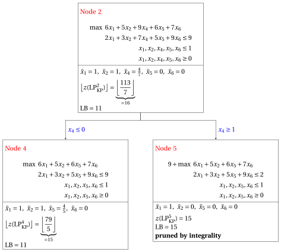{ .fig loading=lazy  }

        - <strong>Termination</strong>

            Since the problem list $L$ is empty, the $\mathrm{ILP}_{\mathrm{KP}}$ problem is solved to optimality.

            The optimal value is $z(~\mathrm{ILP}_{\mathrm{KP}}~)=15$ (the value of the lower bound $\LB$) and an optimal solution ${\tilde {\boldsymbol x}}(\,\mathrm{ILP}_{\mathrm{KP}}\,)$  is $\tilde  x_1=1,\tilde  x_2=0,\tilde  x_3=0,\tilde  x_4=1,\tilde  x_5=0,\tilde  x_6=0$ (the incumbent solution ${\bar{\boldsymbol x}}(\mathrm{ILP}_{\mathrm{KP}})$).

    3. This is the <strong>branch-and-bound tree</strong> of the previous execution of the <strong>branch-and-bound algorithm</strong>, showing for each solved branching node the optimal value of the associated $\mathrm{LP}_{\mathrm{KP}}$ problem, the current lower bound $\LB$, and the pruning criteria.

        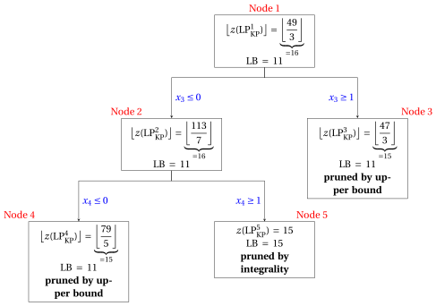{ .fig loading=lazy  }
