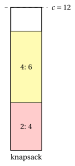
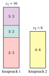

# Exercises · Knapsack problems

**Exercises · Chapter 2** · each solution opens with a click · [:material-book-open-variant: Chapter 2: Knapsack](../combinatorial-optimization-problems/knapsack.md) · [:material-file-pdf-box: Exercises, volume 1 (PDF)](../pdf/exercises-1-combinatorial-optimization-problems.pdf)

!!! esercizio "Exercise 2.1: Feasibility, value and bounds (KP)"

    We consider the knapsack instance with capacity $c=12$ and $n=5$ items, $\mathscr{I}=\{1,\dots,5\}$, with the following profits and weights:

    $$
    \begin{array}{l|ccccc}
    \hline  & {j=1} & {j=2} & {j=3} & {j=4} & {j=5} \\[1ex]
    \hline {p_j} & {6} & {12} & {5} & {13} & {8} \\[1ex]
    {w_j} & {3} & {4} & {5} & {6} & {8} \\
    \hline
    \end{array}
    $$

    **Questions**

    1. Check the two assumptions on the data of the KP.

    2. For each of the subsets $S_1=\{1,2,5\}$, $S_2=\{2,4\}$, $S_3=\{1,2,3\}$, compute the total weight, decide whether it is feasible and, if so, give its profit.

    3. Compute the cardinality bound $\bar k$ and the dual bound it gives.

    4. Compute the dual bound of the continuous relaxation (the items can be taken fractionally, in order of non-increasing efficiency) and round it.

    5. Find an optimal solution by listing the feasible subsets, and compute the gap between the best dual bound and $z(I)$.

??? soluzione "Solution"

    1. The total weight is $3+4+5+6+8=26>12$, so not all the items fit; the heaviest item weighs $8\le 12$, so every item fits alone. Both assumptions hold.

    2. - $S_1$: weight $3+4+8=15>12$, not feasible;

        - $S_2$: weight $4+6=10\le 12$, feasible, profit $12+13=25$;

        - $S_3$: weight $3+4+5=12\le 12$, feasible, profit $6+12+5=23$;

    3. The weights in non-decreasing order are $3, 4, 5, 6, 8$: the $3$ lightest items weigh $3+4+5=12\le 12$, the $4$ lightest weigh $18>12$. Hence $\bar k=3$: a feasible subset has at most $3$ items, and the $3$ largest profits give

        $$
        \mathrm{UB}=13+12+8=33.
        $$

    4. The efficiencies are $\frac{6}{3}=2,\ \frac{12}{4}=3,\ \frac{5}{5}=1,\ \frac{13}{6},\ \frac{8}{8}=1$, so the order is $2,4,1,3,5$. Items $2, 4$ weigh $10$, and the fraction $\frac{2}{3}$ of item $1$ fills the residual capacity $2$:

        $$
        \mathrm{UB}=12+13+\frac{2}{3}\cdot 6=29.
        $$

        The profits are integer, so $\mathrm{UB}=\lfloor 29\rfloor=29$; it is stronger than the cardinality bound.

    5. There are $15$ feasible subsets:

        
<table>
        <tr>
        <th>\(S\)</th>
        <th>weight</th>
        <th>profit</th>
        <th>\(S\)</th>
        <th>weight</th>
        <th>profit</th>
        </tr>
        <tr>
        <td>\(\emptyset\)</td>
        <td>\(0\)</td>
        <td>\(0\)</td>
        <td>\(\{1,4\}\)</td>
        <td>\(9\)</td>
        <td>\(19\)</td>
        </tr>
        <tr>
        <td>\(\{1\}\)</td>
        <td>\(3\)</td>
        <td>\(6\)</td>
        <td>\(\{1,5\}\)</td>
        <td>\(11\)</td>
        <td>\(14\)</td>
        </tr>
        <tr>
        <td>\(\{2\}\)</td>
        <td>\(4\)</td>
        <td>\(12\)</td>
        <td>\(\{2,3\}\)</td>
        <td>\(9\)</td>
        <td>\(17\)</td>
        </tr>
        <tr>
        <td>\(\{3\}\)</td>
        <td>\(5\)</td>
        <td>\(5\)</td>
        <td>\(\{2,4\}\)</td>
        <td>\(10\)</td>
        <td>\(\mathbf{25}\)</td>
        </tr>
        <tr>
        <td>\(\{4\}\)</td>
        <td>\(6\)</td>
        <td>\(13\)</td>
        <td>\(\{2,5\}\)</td>
        <td>\(12\)</td>
        <td>\(20\)</td>
        </tr>
        <tr>
        <td>\(\{5\}\)</td>
        <td>\(8\)</td>
        <td>\(8\)</td>
        <td>\(\{3,4\}\)</td>
        <td>\(11\)</td>
        <td>\(18\)</td>
        </tr>
        <tr>
        <td>\(\{1,2\}\)</td>
        <td>\(7\)</td>
        <td>\(18\)</td>
        <td>\(\{1,2,3\}\)</td>
        <td>\(12\)</td>
        <td>\(23\)</td>
        </tr>
        <tr>
        <td>\(\{1,3\}\)</td>
        <td>\(8\)</td>
        <td>\(11\)</td>
        <td></td>
        <td></td>
        <td></td>
        </tr>
        </table>

        The optimal solution is $\tilde S=\{2,4\}$, the only one with profit $z(I)=25$:

        { .fig loading=lazy  }

        The gap between the continuous bound and the optimum is $29-25=4$: the bound alone does not certify the optimum, the enumeration does.

    !!! chiave ""

        The optimal solution is $\tilde S=\{2,4\}$ with $z(I)=25$; the dual bounds are $33$ (cardinality) and $29$ (continuous relaxation).

!!! esercizio "Exercise 2.2: Subset sum and its solution as a KP (SSP)"

    We consider the subset sum instance with $n=6$ items and the weights

    $$
    \begin{array}{l|cccccc}
    \hline  & {j=1} & {j=2} & {j=3} & {j=4} & {j=5} & {j=6} \\[1ex]
    \hline {w_j} & {5} & {14} & {3} & {6} & {15} & {4} \\
    \hline
    \end{array}
    $$

    with the target value $c=15$.

    **Questions**

    1. Check the two assumptions of the SSP.

    2. Is the subset $\{1,4,6\}$ feasible? And the subset $\{3,4,6\}$?

    3. Find all the feasible subsets for the target $c=15$, with a short justification.

    4. Now the target is $c=16$. Solve the instance as a KP with $p_j=w_j$ and give the answer to the SSP.

??? soluzione "Solution"

    1. The total weight is $47\ge 15$ and the heaviest item weighs $15\le 15$: both assumptions hold.

    2. $w_1+w_4+w_6=5+6+4=15=15$: feasible. $w_3+w_4+w_6=3+6+4=13\neq 15$: not feasible.

    3. We look at the subsets by their heaviest item, in the order $5, 2, 4, 1, 6, 3$ of non-increasing weight.

        - Item $5$ (weight $15$) reaches the target alone: $\{5\}$.

        - Item $2$ (weight $14$) leaves $1$, and no item weighs $1$.

        - Without items $5$ and $2$ the remaining weights $6, 5, 4, 3$ sum up to $18$: a subset of them weighs $15$ exactly when the items left out weigh $3$, and the only such choice is to leave out item $3$. This gives $\{1,4,6\}$: $5+6+4=15$.

        The feasible subsets are $\{5\}$ and $\{1,4,6\}$: the answer is yes.

    4. With $p_j=w_j$ the KP maximizes the total weight of a subset with weight at most $16$. No subset weighs $16$:

        - with item $5$ or item $2$ we need $1$ or $2$ more, and no item weighs so;

        - without them, the items left out should weigh $18-16=2$, less than the lightest weight $3$.

        The best subsets weigh $z=15$, for example $\{5\}$. Since $z=15<16$, the answer to the SSP with target $16$ is no.

    !!! chiave ""

        Target $15$: yes, with $\{5\}$ and $\{1,4,6\}$. Target $16$: no, the KP with $p_j=w_j$ reaches at most $15$.

!!! esercizio "Exercise 2.3: Copies of the items (BKP and UKP)"

    We consider $n=3$ items with the following profits, weights and available copies, and a knapsack of capacity $c=10$:

    $$
    \begin{array}{l|ccc}
    \hline  & {j=1} & {j=2} & {j=3} \\[1ex]
    \hline {p_j} & {4} & {13} & {13} \\[1ex]
    {w_j} & {3} & {5} & {2} \\[1ex]
    {b_j} & {1} & {2} & {2} \\
    \hline
    \end{array}
    $$

    **Questions**

    1. Check the assumptions of the BKP and write the extended set of items $\hat{\mathscr{I}}$.

    2. A solution of the BKP is the vector $(x_1,x_2,x_3)$ of the numbers of copies, with $0\le x_j\le b_j$. How many such vectors are there? Is $(1,1,1)$ feasible? And $(0,2,1)$?

    3. Find an optimal solution of the BKP by enumeration, with a short justification.

    4. Now the items are available in an unlimited number of copies (UKP). Compute the maximum feasible numbers of copies $\hat b_j$, the number of candidate vectors, and an optimal solution.

??? soluzione "Solution"

    1. $\sum_j b_j w_j=1\cdot 3+2\cdot 5+2\cdot 2=17>10$; every item fits ($w_j\le 10$) and so do all its copies: $b_jw_j=3, 10, 4\le 10$. The extended set has $\sum_j b_j=5$ copies:

        $$
        \hat{\mathscr{I}}=\{(1,1),(2,1),(2,2),(3,1),(3,2)\}.
        $$

    2. There are $\prod_j (b_j+1)=2\cdot 3\cdot 3=18$ vectors, of which $12$ are feasible. The vector $(1,1,1)$ weighs $10\le 10$, feasible, profit $30$; the vector $(0,2,1)$ weighs $12$, not feasible.

    3. Item $3$ has the largest efficiency, $\frac{13}{2}$, and item $2$ the second, $\frac{13}{5}$. Taking all the copies of items $3$ and $2$ would weigh $14>10$. With $x_3=2$ (weight $4$) the residual capacity $6$ holds one copy of item $2$, and the last $1$ units hold nothing. The enumeration of the $12$ feasible vectors confirms that $\tilde x=(0,1,2)$, of weight $9$, is the only optimal solution, with $z(I)=39$.

    4. $\hat b_j=\lfloor c/w_j\rfloor$ gives $\hat b=(3,2,5)$, and there are $\prod_j(\hat b_j+1)=4\cdot 3\cdot 6=72$ candidate vectors, $20$ of them feasible. Item $3$ is the most efficient and its weight $2$ divides $c=10$: the solution $\tilde x=(0,0,5)$ fills the knapsack with the most efficient item, so no solution has a larger profit than $\frac{13}{2}\cdot 10=65$. It is the only optimal solution, $z(I)=65$.

    !!! chiave ""

        BKP: $\tilde x=(0,1,2)$, $z(I)=39$. UKP: $\tilde x=(0,0,5)$, $z(I)=65$. More copies can only increase the optimal value.

!!! esercizio "Exercise 2.4: Two knapsacks (MKP)"

    We consider the multiple knapsack instance with $m=2$ knapsacks of capacities $c_1=10$ and $c_2=6$, and $n=5$ items with the following profits and weights:

    $$
    \begin{array}{l|ccccc}
    \hline  & {j=1} & {j=2} & {j=3} & {j=4} & {j=5} \\[1ex]
    \hline {p_j} & {4} & {8} & {9} & {10} & {13} \\[1ex]
    {w_j} & {2} & {5} & {2} & {6} & {3} \\
    \hline
    \end{array}
    $$

    **Questions**

    1. Can all the items be inserted? How many candidate solutions are there, if each item goes into one of the knapsacks or into none?

    2. Is the solution $S_1=\{1,2,3\}$, $S_2=\{4,5\}$ feasible? What is its profit?

    3. Every feasible solution of the MKP is also a feasible solution of a KP with capacity $c_1+c_2=16$. Use this to compute a dual bound.

    4. Find an optimal solution of the MKP.

??? soluzione "Solution"

    1. The total weight is $18>c_1+c_2=16$: not all the items can be inserted. Every item has $m+1=3$ choices, so there are $3^5=243$ candidate solutions; $100$ of them are feasible.

    2. $S_1$ weighs $2+5+2=9\le 10$ and $S_2$ weighs $6+3=9>6$: the solution is not feasible.

    3. If $S_1,S_2$ is feasible for the MKP, the union $S_1\cup S_2$ weighs at most $c_1+c_2=16$, so its profit is at most the optimal value of the KP with capacity $16$. The KP has the optimal solution $\{2,3,4,5\}$, of weight $16$ and profit $40$: $\mathrm{UB}=40$.

    4. The items $\{2,3,4,5\}$ of the KP solution can be split between the two knapsacks: $S_1=\{2,3,5\}$ weighs $10\le 10$ and $S_2=\{4\}$ weighs $6\le 6$. Its profit $40$ attains the dual bound, so it is optimal: $z(I)=40$. The enumeration of the $100$ feasible solutions shows that it is the only optimal one.

        { .fig loading=lazy  }

    !!! chiave ""

        The optimal solution puts $\{2,3,5\}$ in knapsack $1$ and $\{4\}$ in knapsack $2$, with $z(I)=40$, equal to the dual bound of the KP with capacity $c_1+c_2$.

!!! esercizio "Exercise 2.5: One item per class (MCKP)"

    We consider the multiple-choice knapsack instance with capacity $c=16$ and $n=7$ items, partitioned into the classes $\mathscr{J}_1=\{1,2\}$, $\mathscr{J}_2=\{3,4,5\}$, $\mathscr{J}_3=\{6,7\}$, with the following profits and weights:

    $$
    \begin{array}{l|ccccccc}
    \hline  & {j=1} & {j=2} & {j=3} & {j=4} & {j=5} & {j=6} & {j=7} \\[1ex]
    \hline {p_j} & {5} & {8} & {14} & {13} & {11} & {12} & {6} \\[1ex]
    {w_j} & {6} & {9} & {4} & {6} & {7} & {8} & {2} \\
    \hline
    \end{array}
    $$

    **Questions**

    1. Check the feasibility condition $\sum_h \min_{j\in\mathscr{J}_h} w_j\le c$ of the assumptions.

    2. How many candidate solutions are there? Is the choice of the most profitable item of every class feasible?

    3. Find the optimal solution by enumeration.

??? soluzione "Solution"

    1. The lightest items of the classes weigh $6, 4, 2$, and $6+4+2=12\le 16$: the instance has a feasible solution.

    2. A candidate solution takes one item per class: $2\cdot 3\cdot 2=12$ candidates. The most profitable items are $2, 3, 6$, of total weight $9+4+8=21>16$: this choice is not feasible.

    3. The candidates are:

        
<table>
        <tr>
        <th>\(S\)</th>
        <th>weight</th>
        <th>profit</th>
        <th>feasible</th>
        <th>\(S\)</th>
        <th>weight</th>
        <th>profit</th>
        <th>feasible</th>
        </tr>
        <tr>
        <td>\(\{1,3,6\}\)</td>
        <td>\(18\)</td>
        <td>\(31\)</td>
        <td>no</td>
        <td>\(\{2,3,6\}\)</td>
        <td>\(21\)</td>
        <td>\(34\)</td>
        <td>no</td>
        </tr>
        <tr>
        <td>\(\{1,3,7\}\)</td>
        <td>\(12\)</td>
        <td>\(25\)</td>
        <td>yes</td>
        <td>\(\{2,3,7\}\)</td>
        <td>\(15\)</td>
        <td>\(\mathbf{28}\)</td>
        <td>yes</td>
        </tr>
        <tr>
        <td>\(\{1,4,6\}\)</td>
        <td>\(20\)</td>
        <td>\(30\)</td>
        <td>no</td>
        <td>\(\{2,4,6\}\)</td>
        <td>\(23\)</td>
        <td>\(33\)</td>
        <td>no</td>
        </tr>
        <tr>
        <td>\(\{1,4,7\}\)</td>
        <td>\(14\)</td>
        <td>\(24\)</td>
        <td>yes</td>
        <td>\(\{2,4,7\}\)</td>
        <td>\(17\)</td>
        <td>\(27\)</td>
        <td>no</td>
        </tr>
        <tr>
        <td>\(\{1,5,6\}\)</td>
        <td>\(21\)</td>
        <td>\(28\)</td>
        <td>no</td>
        <td>\(\{2,5,6\}\)</td>
        <td>\(24\)</td>
        <td>\(31\)</td>
        <td>no</td>
        </tr>
        <tr>
        <td>\(\{1,5,7\}\)</td>
        <td>\(15\)</td>
        <td>\(22\)</td>
        <td>yes</td>
        <td>\(\{2,5,7\}\)</td>
        <td>\(18\)</td>
        <td>\(25\)</td>
        <td>no</td>
        </tr>
        </table>

        Only $4$ candidates are feasible, and the best one is $\tilde S=\{2,3,7\}$, of weight $15$, with $z(I)=28$; it is the only optimal solution.

    !!! chiave ""

        The optimal solution takes items $2, 3, 7$, one per class, with $z(I)=28$: the most profitable item of every class is not a feasible choice.
