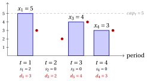
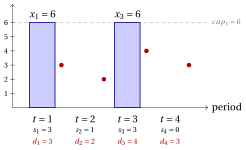
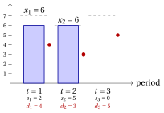

# Exercises · Capacitated lot sizing

**Exercises · Chapter 7** · each solution opens with a click · [:material-book-open-variant: Chapter 7](../combinatorial-optimization-problems/lot-sizing.md)

!!! esercizio "Exercise 7.1: Feasibility and cost of a plan (CLS)"

    We consider the capacitated lot sizing instance with $m=4$ periods and the following data:

    
<table>
    <tr>
    <th>period \(t\)</th>
    <th>\(1\)</th>
    <th>\(2\)</th>
    <th>\(3\)</th>
    <th>\(4\)</th>
    </tr>
    <tr>
    <td>demand \(d_t\)</td>
    <td>\(3\)</td>
    <td>\(2\)</td>
    <td>\(4\)</td>
    <td>\(3\)</td>
    </tr>
    <tr>
    <td>capacity \(cap_t\)</td>
    <td>\(5\)</td>
    <td>\(5\)</td>
    <td>\(5\)</td>
    <td>\(5\)</td>
    </tr>
    <tr>
    <td>setup cost \(sc_t\)</td>
    <td>\(30\)</td>
    <td>\(40\)</td>
    <td>\(30\)</td>
    <td>\(40\)</td>
    </tr>
    <tr>
    <td>production cost \(vc_t\)</td>
    <td>\(2\)</td>
    <td>\(2\)</td>
    <td>\(2\)</td>
    <td>\(2\)</td>
    </tr>
    <tr>
    <td>holding cost \(hc_t\)</td>
    <td>\(4\)</td>
    <td>\(4\)</td>
    <td>\(4\)</td>
    <td>\(4\)</td>
    </tr>
    </table>

    and the four production plans

    $$
    \vet{x}^1=(5,0,4,3),\quad \vet{x}^2=(3,6,0,3),\quad \vet{x}^3=(2,3,4,3),\quad \vet{x}^4=(5,0,5,2).
    $$

    **Questions**

    1. For each plan, compute the stocks $s_t(\vet{x})$ and decide whether the plan is feasible.

    2. Compute the cost of the feasible plans, split into setup, production and holding costs.

    3. Draw the cheaper feasible plan.

??? soluzione "Solution"

    1. The stock is $s_t=s_{t-1}+x_t-d_t$, starting from $s_0=0$:

        - $\vet{x}^1$: stocks $(2,0,0,0)$, feasible;

        - $\vet{x}^2$: stocks $(0,4,0,0)$, not feasible: $x_2=6>cap_2=5$;

        - $\vet{x}^3$: stocks $(-1,0,0,0)$, not feasible: $s_1=-1<0$, the demand of period $1$ is not covered (production cannot serve an earlier period);

        - $\vet{x}^4$: stocks $(2,0,1,0)$, feasible;

    2. A setup is paid in every period with $x_t>0$, the production cost on every unit, the holding cost on the stock at the end of every period:

        \begin{align*}
        c(\vet{x}^1)&=(30+30+40)+2\cdot 12+4\cdot 2=100+24+8=132\\
        c(\vet{x}^4)&=(30+30+40)+2\cdot 12+(4\cdot 2+4\cdot 1)=100+24+12=136.
        \end{align*}

    3. The cheaper plan is $\vet{x}^1$, of cost $132$:

        { .fig loading=lazy  }

    !!! chiave ""

        Only $\vet{x}^1$ and $\vet{x}^4$ are feasible, with costs $132$ and $136$; $\vet{x}^2$ exceeds a capacity and $\vet{x}^3$ produces too late.

!!! esercizio "Exercise 7.2: Counting the setup choices (CLS)"

    We consider again the capacitated lot sizing instance

    
<table>
    <tr>
    <th>period \(t\)</th>
    <th>\(1\)</th>
    <th>\(2\)</th>
    <th>\(3\)</th>
    <th>\(4\)</th>
    </tr>
    <tr>
    <td>demand \(d_t\)</td>
    <td>\(3\)</td>
    <td>\(2\)</td>
    <td>\(4\)</td>
    <td>\(3\)</td>
    </tr>
    <tr>
    <td>capacity \(cap_t\)</td>
    <td>\(5\)</td>
    <td>\(5\)</td>
    <td>\(5\)</td>
    <td>\(5\)</td>
    </tr>
    <tr>
    <td>setup cost \(sc_t\)</td>
    <td>\(30\)</td>
    <td>\(40\)</td>
    <td>\(30\)</td>
    <td>\(40\)</td>
    </tr>
    <tr>
    <td>production cost \(vc_t\)</td>
    <td>\(2\)</td>
    <td>\(2\)</td>
    <td>\(2\)</td>
    <td>\(2\)</td>
    </tr>
    <tr>
    <td>holding cost \(hc_t\)</td>
    <td>\(4\)</td>
    <td>\(4\)</td>
    <td>\(4\)</td>
    <td>\(4\)</td>
    </tr>
    </table>

    **Questions**

    1. How many choices of the periods with a setup are there?

    2. Compute the cumulative demands $D_t=d_1+\dots+d_t$. Which condition must the periods with a setup satisfy for a feasible plan to exist?

    3. List the feasible setup choices.

    4. Is the number of feasible plans equal to the number of feasible setup choices?

??? soluzione "Solution"

    1. A setup choice is a subset of the $4$ periods: $2^4=16$ choices.

    2. $D=(3,5,9,12)$. The production of the periods $1,\dots,t$ must cover $D_t$, and only the periods with a setup produce: the capacities of the periods with a setup among $1,\dots,t$ must sum up to at least $D_t$, for every $t$. In particular period $1$ needs a setup, since $d_1>0$; with capacity $5$ in every period, the periods $1,\dots,t$ need at least $\lceil D_t/5\rceil$ setups: $1, 1, 2, 3$.

    3. The feasible choices, with the cumulative capacities of their setup periods, are:

        
<table>
        <tr>
        <th>setups</th>
        <th>\(t=1\)</th>
        <th>\(t=2\)</th>
        <th>\(t=3\)</th>
        <th>\(t=4\)</th>
        </tr>
        <tr>
        <td>cumulative demand</td>
        <td>\(3\)</td>
        <td>\(5\)</td>
        <td>\(9\)</td>
        <td>\(12\)</td>
        </tr>
        <tr>
        <td>\(\{1,2,3\}\)</td>
        <td>\(5\)</td>
        <td>\(10\)</td>
        <td>\(15\)</td>
        <td>\(15\)</td>
        </tr>
        <tr>
        <td>\(\{1,2,4\}\)</td>
        <td>\(5\)</td>
        <td>\(10\)</td>
        <td>\(10\)</td>
        <td>\(15\)</td>
        </tr>
        <tr>
        <td>\(\{1,3,4\}\)</td>
        <td>\(5\)</td>
        <td>\(5\)</td>
        <td>\(10\)</td>
        <td>\(15\)</td>
        </tr>
        <tr>
        <td>\(\{1,2,3,4\}\)</td>
        <td>\(5\)</td>
        <td>\(10\)</td>
        <td>\(15\)</td>
        <td>\(20\)</td>
        </tr>
        </table>

        They are $4$ out of $16$.

    4. No: a setup choice can carry several plans, since the quantities can be distributed in many ways. The enumeration of the integer plans gives $50$ feasible plans for the $4$ feasible setup choices.

    !!! chiave ""

        Of the $16$ setup choices, $4$ are feasible: they all contain period $1$ and at least $3$ periods in total. They carry $50$ feasible plans.

!!! esercizio "Exercise 7.3: The best plan by enumeration of the setups (CLS)"

    We consider again the capacitated lot sizing instance

    
<table>
    <tr>
    <th>period \(t\)</th>
    <th>\(1\)</th>
    <th>\(2\)</th>
    <th>\(3\)</th>
    <th>\(4\)</th>
    </tr>
    <tr>
    <td>demand \(d_t\)</td>
    <td>\(3\)</td>
    <td>\(2\)</td>
    <td>\(4\)</td>
    <td>\(3\)</td>
    </tr>
    <tr>
    <td>capacity \(cap_t\)</td>
    <td>\(5\)</td>
    <td>\(5\)</td>
    <td>\(5\)</td>
    <td>\(5\)</td>
    </tr>
    <tr>
    <td>setup cost \(sc_t\)</td>
    <td>\(30\)</td>
    <td>\(40\)</td>
    <td>\(30\)</td>
    <td>\(40\)</td>
    </tr>
    <tr>
    <td>production cost \(vc_t\)</td>
    <td>\(2\)</td>
    <td>\(2\)</td>
    <td>\(2\)</td>
    <td>\(2\)</td>
    </tr>
    <tr>
    <td>holding cost \(hc_t\)</td>
    <td>\(4\)</td>
    <td>\(4\)</td>
    <td>\(4\)</td>
    <td>\(4\)</td>
    </tr>
    </table>

    whose feasible setup choices are those that contain period $1$ and whose capacities cover the cumulative demands.

    **Questions**

    1. Once the periods with a setup are fixed, why is it best to produce every unit as late as possible?

    2. For every feasible setup choice, compute the best plan and its cost.

    3. Which plan is optimal? Draw it.

??? soluzione "Solution"

    1. The production cost is the same in every period, so it does not depend on when a unit is produced. A unit produced earlier stays longer in stock and pays more holding cost. Hence every demand is produced in the latest period with a setup and free capacity before it, starting from the last period.

    2. For every feasible choice of the setups, the plan built in this way is:

        
<table>
        <tr>
        <th>setups</th>
        <th>plan</th>
        <th>setup</th>
        <th>production</th>
        <th>holding</th>
        <th>total</th>
        </tr>
        <tr>
        <td>\(\{1,2,3\}\)</td>
        <td>\((3,4,5,0)\)</td>
        <td>\(100\)</td>
        <td>\(24\)</td>
        <td>\(20\)</td>
        <td>\(144\)</td>
        </tr>
        <tr>
        <td>\(\{1,2,4\}\)</td>
        <td>\((4,5,0,3)\)</td>
        <td>\(110\)</td>
        <td>\(24\)</td>
        <td>\(20\)</td>
        <td>\(154\)</td>
        </tr>
        <tr>
        <td>\(\{1,3,4\}\)</td>
        <td>\((5,0,4,3)\)</td>
        <td>\(100\)</td>
        <td>\(24\)</td>
        <td>\(8\)</td>
        <td>\(\mathbf{132}\)</td>
        </tr>
        <tr>
        <td>\(\{1,2,3,4\}\)</td>
        <td>\((3,2,4,3)\)</td>
        <td>\(140\)</td>
        <td>\(24\)</td>
        <td>\(0\)</td>
        <td>\(164\)</td>
        </tr>
        </table>

    3. The optimal plan is $\tilde{\vet{x}}=(5,0,4,3)$, with setups in the periods $1, 3, 4$ and $z(I)=132$; it is the only optimal plan.

        { .fig loading=lazy  }

        The two cheapest setups, $sc_1=sc_3=30$, are not enough: with capacity $5$ two setups produce at most $10<12$ units, and the third setup goes to period $4$.

    !!! chiave ""

        Enumerating the feasible setup choices, and producing as late as possible for each of them, gives the optimal plan $(5,0,4,3)$ with $z(I)=132$.

!!! esercizio "Exercise 7.4: The effect of the capacity (CLS)"

    We consider the lot sizing instance of the previous exercises, with $4$ periods, $\vet{d}=(3,2,4,3)$, $\vet{sc}=(30,40,30,40)$, $\vet{vc}=(2,2,2,2)$, $\vet{hc}=(4,4,4,4)$, and three values of the capacity, the same in every period: $cap_t=5$, $cap_t=6$, and no capacity limit.

    **Questions**

    1. For $cap_t=5$ the optimal plan is $(5,0,4,3)$. Compute its cost.

    2. Find the optimal plan for $cap_t=6$, by enumeration of the setup choices.

    3. Find the optimal plan without capacities. In which periods does it produce, and with which stock?

    4. Compare the three optimal costs, and explain the differences.

??? soluzione "Solution"

    1. $c=(30+30+40)+2\cdot 12+4\cdot 2=100+24+8=132$.

    2. With capacity $6$ two setups can produce $12$ units, the whole demand: the setups in the periods $1$ and $3$, the cheapest ones, become feasible. Producing as late as possible gives $(6,0,6,0)$, of cost $(30+30)+2\cdot 12+(4\cdot 3+4\cdot 1+4\cdot 3)=60+24+28=112$. The enumeration of all the plans confirms that it is the only optimal one.

        { .fig loading=lazy  }

    3. Without capacities, a setup in period $1$ and one in period $3$ give $(5,0,7,0)$, of cost $(30+30)+2\cdot 12+(4\cdot 2+4\cdot 3)=60+24+20=104$. Period $1$ produces for the periods $1$ and $2$, period $3$ for the periods $3$ and $4$: every production starts with an empty stock.

    4. The optimal costs are $132$, $112$ and $104$: a larger capacity can only lower the optimal cost, since every plan feasible with a smaller capacity is still feasible with a larger one.

        - Without capacities, period $3$ produces the $7$ units of the periods $3$ and $4$.

        - With $cap_t=6$ period $3$ produces only $6$ of them: one unit is produced in period $1$ and kept in stock for two periods, $104+2\cdot 4=112$.

        - With $cap_t=5$ two setups produce at most $10<12$ units: a third setup is needed, in period $4$, and the cost becomes $132$.

    !!! chiave ""

        The optimal cost is $132$ with $cap_t=5$, $112$ with $cap_t=6$ and $104$ without capacities: the capacity forces a third setup and changes the structure of the optimal plan.

!!! esercizio "Exercise 7.5: Lot-for-lot, a lower bound and the optimum (CLS)"

    We consider the capacitated lot sizing instance with $m=3$ periods and the following data:

    
<table>
    <tr>
    <th>period \(t\)</th>
    <th>\(1\)</th>
    <th>\(2\)</th>
    <th>\(3\)</th>
    </tr>
    <tr>
    <td>demand \(d_t\)</td>
    <td>\(4\)</td>
    <td>\(3\)</td>
    <td>\(5\)</td>
    </tr>
    <tr>
    <td>capacity \(cap_t\)</td>
    <td>\(7\)</td>
    <td>\(6\)</td>
    <td>\(7\)</td>
    </tr>
    <tr>
    <td>setup cost \(sc_t\)</td>
    <td>\(50\)</td>
    <td>\(20\)</td>
    <td>\(60\)</td>
    </tr>
    <tr>
    <td>production cost \(vc_t\)</td>
    <td>\(0\)</td>
    <td>\(0\)</td>
    <td>\(0\)</td>
    </tr>
    <tr>
    <td>holding cost \(hc_t\)</td>
    <td>\(3\)</td>
    <td>\(3\)</td>
    <td>\(3\)</td>
    </tr>
    </table>

    **Questions**

    1. Compute the cost of the lot-for-lot plan.

    2. Compute the lower bound of the chapter: the smallest number $k$ of setups that the total demand requires, and the sum of the $k$ smallest setup costs.

    3. Find the optimal plan by enumeration of the setup choices. How far are the lot-for-lot plan and the lower bound from the optimal cost?

??? soluzione "Solution"

    1. Lot-for-lot produces $\vet{x}=(4,3,5)$: every demand fits in the capacity of its period, there is no stock and there are $3$ setups, $c=50+20+60=130$.

    2. The total demand is $D=12$. The largest capacity, $7$, is smaller than $D$, while the two largest sum up to $14\ge 12$: $k=2$. The two smallest setup costs are $20$ and $50$, so $z(I)\ge \LB=70$.

    3. For every feasible setup choice, the plan that produces as late as possible is:

        
<table>
        <tr>
        <th>setups</th>
        <th>plan</th>
        <th>cost</th>
        </tr>
        <tr>
        <td>\(\{1,2\}\)</td>
        <td>\((6,6,0)\)</td>
        <td>\(\mathbf{91}\)</td>
        </tr>
        <tr>
        <td>\(\{1,3\}\)</td>
        <td>\((7,0,5)\)</td>
        <td>\(119\)</td>
        </tr>
        <tr>
        <td>\(\{1,2,3\}\)</td>
        <td>\((4,3,5)\)</td>
        <td>\(130\)</td>
        </tr>
        </table>

        The optimal plan is $(6,6,0)$, with $z(I)=91$:

        { .fig loading=lazy  }

        The bounds give $70\le z(I)\le 130$, an absolute gap of $60$: lot-for-lot is $39$ above the optimum, the lower bound $21$ below it. The bound pays the setups of periods $1$ and $2$, but these two periods cannot produce the demand of period $3$ without keeping stock.

    !!! chiave ""

        Lot-for-lot costs $130$, the lower bound is $70$, and the enumeration of the setup choices gives the optimal plan $(6,6,0)$ with $z(I)=91$.
