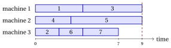
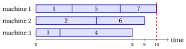

# Exercises · Parallel machine scheduling

**Exercises · Chapter 7** · each solution opens with a click · [:material-book-open-variant: Chapter 7: Machine scheduling](../combinatorial-optimization-problems/pcmax/index.md) · [:material-file-pdf-box: Exercises, volume 1 (PDF)](../pdf/exercises-1-combinatorial-optimization-problems.pdf)

!!! esercizio "Exercise 7.1: Loads, makespan and Gantt chart ($P\|C_{\max}$)"

    We consider the $P\|C_{\max}$ instance with $m=3$ machines and $n=7$ jobs, with processing times

    $$
    \begin{array}{l|ccccccc}
    \hline  & {j=1} & {j=2} & {j=3} & {j=4} & {j=5} & {j=6} & {j=7} \\[1ex]
    \hline {t_j} & {4} & {2} & {5} & {3} & {6} & {2} & {3} \\
    \hline
    \end{array}
    $$

    and the three assignments

    $$
    \mathrm{mach}^1=(1,2,3,1,2,3,1),\quad \mathrm{mach}^2=(3,1,2,3,1,2,3),\quad \mathrm{mach}^3=(1,3,1,2,2,3,3).
    $$

    **Questions**

    1. For each assignment, write the sets $J_1,J_2,J_3$, the loads and the makespan.

    2. Which assignments describe the same schedule?

    3. Draw the Gantt chart of the assignment with the smallest makespan.

    4. Compute the lower bound $\max\{\max_j t_j,\lceil \sum_j t_j/m\rceil\}$. Is that schedule optimal?

??? soluzione "Solution"

    1. - $\mathrm{mach}^1$: $J_1=\{1,4,7\},\ J_2=\{2,5\},\ J_3=\{3,6\}$, loads $(10,8,7)$, makespan $C_{\max}=10$;

        - $\mathrm{mach}^2$: $J_1=\{2,5\},\ J_2=\{3,6\},\ J_3=\{1,4,7\}$, loads $(8,7,10)$, makespan $C_{\max}=10$;

        - $\mathrm{mach}^3$: $J_1=\{1,3\},\ J_2=\{4,5\},\ J_3=\{2,6,7\}$, loads $(9,9,7)$, makespan $C_{\max}=9$;

    2. $\mathrm{mach}^1$ and $\mathrm{mach}^2$ give the same three sets of jobs, with the names of the machines changed ($1\to 3$, $2\to 1$, $3\to 2$): they are the same schedule. $\mathrm{mach}^3$ gives different sets.

    3. The smallest makespan, $9$, is that of $\mathrm{mach}^3$:

        { .fig loading=lazy  }

    4. $\sum_j t_j=25$ and $\max_j t_j=6$, so $\mathrm{LB}=\max\{6,\lceil 25/3\rceil\}=9$. The schedule of $\mathrm{mach}^3$ attains it: it is optimal, $z(I)=9$.

    !!! chiave ""

        $\mathrm{mach}^1$ and $\mathrm{mach}^2$ are the same schedule; the schedule of $\mathrm{mach}^3$ has makespan $9$, equal to the lower bound, and is optimal.

!!! esercizio "Exercise 7.2: Counting the schedules ($P\|C_{\max}$)"

    We consider a $P\|C_{\max}$ instance with $n=5$ jobs. We count the assignments and the distinct schedules for $m=2$ and for $m=3$ machines.

    **Questions**

    1. How many assignments $\mathrm{mach}$ are there with $m=2$ and with $m=3$?

    2. Compute the Stirling number $S(5,2)$, counting the partitions of the jobs into two non-empty sets.

    3. Compute $S(5,3)$, grouping the partitions into three non-empty sets by the sizes of the sets.

    4. How many distinct schedules are there with $m=2$ and with $m=3$? Why are there fewer schedules than assignments?

??? soluzione "Solution"

    1. Every job chooses one of the $m$ machines: $2^5=32$ assignments with $m=2$, $3^5=243$ with $m=3$.

    2. A partition into two sets is fixed by the set that contains job $1$ together with some of the other $4$ jobs, but not all of them: $2^4-1=15$ choices. Hence $S(5,2)=15$.

    3. The sizes of three non-empty sets with $5$ jobs are $(3,1,1)$ or $(2,2,1)$.

        - Sizes $(3,1,1)$: we choose the set of $3$ jobs, $\binom{5}{3}=10$ ways.

        - Sizes $(2,2,1)$: we choose the job alone, $5$ ways, and split the other $4$ into two pairs, $\binom{4}{2}/2=3$ ways: $15$.

        Hence $S(5,3)=10+15=25$.

    4. With $m=2$: $S(5,1)+S(5,2)=1+15=16$ schedules. With $m=3$: $S(5,1)+S(5,2)+S(5,3)=1+15+25=41$ schedules. The machines are identical: an assignment and those obtained by renaming the machines are the same schedule. With $m=2$ every schedule with two non-empty machines is given by $2$ assignments: $\frac{32-2}{2}=15$, plus the schedule with all the jobs together.

    !!! chiave ""

        With $5$ jobs there are $32$ and $243$ assignments on $2$ and $3$ machines, but only $16$ and $41$ schedules.

!!! esercizio "Exercise 7.3: A first schedule, a lower bound and the optimum ($P\|C_{\max}$)"

    We consider the $P\|C_{\max}$ instance with $m=3$ machines and $n=7$ jobs, with processing times

    $$
    \begin{array}{l|ccccccc}
    \hline  & {j=1} & {j=2} & {j=3} & {j=4} & {j=5} & {j=6} & {j=7} \\[1ex]
    \hline {t_j} & {3} & {5} & {2} & {6} & {4} & {4} & {3} \\
    \hline
    \end{array}
    $$

    **Questions**

    1. Build a schedule by taking the jobs in the order $1,2,\dots,n$ and assigning each one to the machine with the smallest load (ties broken by the smallest index). Draw its Gantt chart.

    2. Compute the lower bound of the chapter.

    3. Find an optimal schedule. Is it unique?

??? soluzione "Solution"

    1. The loads after each assignment are:

        
<table>
        <tr>
        <th>job \(j\) (\(t_j\))</th>
        <th>machine chosen</th>
        <th>loads \((L_1,L_2,L_3)\)</th>
        </tr>
        <tr>
        <td>\(1\) (\(3\))</td>
        <td>\(1\)</td>
        <td>\((3,0,0)\)</td>
        </tr>
        <tr>
        <td>\(2\) (\(5\))</td>
        <td>\(2\)</td>
        <td>\((3,5,0)\)</td>
        </tr>
        <tr>
        <td>\(3\) (\(2\))</td>
        <td>\(3\)</td>
        <td>\((3,5,2)\)</td>
        </tr>
        <tr>
        <td>\(4\) (\(6\))</td>
        <td>\(3\)</td>
        <td>\((3,5,8)\)</td>
        </tr>
        <tr>
        <td>\(5\) (\(4\))</td>
        <td>\(1\)</td>
        <td>\((7,5,8)\)</td>
        </tr>
        <tr>
        <td>\(6\) (\(4\))</td>
        <td>\(2\)</td>
        <td>\((7,9,8)\)</td>
        </tr>
        <tr>
        <td>\(7\) (\(3\))</td>
        <td>\(1\)</td>
        <td>\((10,9,8)\)</td>
        </tr>
        </table>

        We obtain $J_1=\{1,5,7\},\ J_2=\{2,6\},\ J_3=\{3,4\}$, with makespan $10$:

        { .fig loading=lazy  }

    2. $\mathrm{LB}=\max\{6,\lceil 27/3\rceil\}=9$, so $9\le z(I)\le 10$.

    3. A makespan of $9$ needs three loads of exactly $9$, since the loads sum up to $27=3\cdot9$. Job $4$ ($6$) needs a partner of length $3$, job $2$ ($5$) one of length $4$, and the remaining jobs fill the third machine. The schedule $J_1=\{4,7\},\ J_2=\{2,6\},\ J_3=\{1,3,5\}$ has loads $(9,9,9)$:

        { .fig loading=lazy  }

        It attains the bound, so $z(I)=9$. It is not unique: the enumeration of the schedules gives $4$ optimal ones, for instance jobs $1$ and $7$, both of length $3$, can be exchanged.

    !!! chiave ""

        Assigning the jobs in the input order gives makespan $10$; the schedule $J_1=\{4,7\},\ J_2=\{2,6\},\ J_3=\{1,3,5\}$ attains the lower bound, and $z(I)=9$.

!!! esercizio "Exercise 7.4: When the lower bound is not attained ($P\|C_{\max}$)"

    We consider the $P\|C_{\max}$ instance with $m=2$ machines and $n=4$ jobs, with processing times

    $$
    \begin{array}{l|cccc}
    \hline  & {j=1} & {j=2} & {j=3} & {j=4} \\[1ex]
    \hline {t_j} & {8} & {5} & {4} & {3} \\
    \hline
    \end{array}
    $$

    **Questions**

    1. Compute the lower bound of the chapter.

    2. Show that no schedule has makespan $10$.

    3. Find an optimal schedule, by enumeration of the distinct schedules.

??? soluzione "Solution"

    1. $\mathrm{LB}=\max\{8,\lceil 20/2\rceil\}=10$.

    2. The two loads sum up to $20$: a makespan of $10$ needs both loads equal to $10$, that is a set of jobs of total length exactly $10$. The totals of the subsets of jobs are $0$, $3$, $4$, $5$, $7$, $8$, $9$, $11$, $12$, $13$, $15$, $16$, $17$, $20$, and $10$ is not among them. Hence $z(I)\ge 11$.

    3. With $m=2$ there are $S(4,1)+S(4,2)=1+7=8$ schedules:

        
<table>
        <tr>
        <th>\(J_1\)</th>
        <th>\(J_2\)</th>
        <th>loads</th>
        <th>\(C_{\max}\)</th>
        </tr>
        <tr>
        <td>\(\{1,4\}\)</td>
        <td>\(\{2,3\}\)</td>
        <td>\((11,9)\)</td>
        <td>\(11\)</td>
        </tr>
        <tr>
        <td>\(\{1\}\)</td>
        <td>\(\{2,3,4\}\)</td>
        <td>\((8,12)\)</td>
        <td>\(12\)</td>
        </tr>
        <tr>
        <td>\(\{1,3\}\)</td>
        <td>\(\{2,4\}\)</td>
        <td>\((12,8)\)</td>
        <td>\(12\)</td>
        </tr>
        <tr>
        <td>\(\{1,2\}\)</td>
        <td>\(\{3,4\}\)</td>
        <td>\((13,7)\)</td>
        <td>\(13\)</td>
        </tr>
        <tr>
        <td>\(\{1,3,4\}\)</td>
        <td>\(\{2\}\)</td>
        <td>\((15,5)\)</td>
        <td>\(15\)</td>
        </tr>
        <tr>
        <td>\(\{1,2,4\}\)</td>
        <td>\(\{3\}\)</td>
        <td>\((16,4)\)</td>
        <td>\(16\)</td>
        </tr>
        <tr>
        <td>\(\{1,2,3\}\)</td>
        <td>\(\{4\}\)</td>
        <td>\((17,3)\)</td>
        <td>\(17\)</td>
        </tr>
        <tr>
        <td>\(\{1,2,3,4\}\)</td>
        <td>\(\emptyset\)</td>
        <td>\((20,0)\)</td>
        <td>\(20\)</td>
        </tr>
        </table>

        The optimal schedule is unique, $J_1=\{1,4\},\ J_2=\{2,3\}$, with $z(I)=11$:

        { .fig loading=lazy  }

    !!! chiave ""

        The lower bound gives $10$, but no set of jobs has total length $10$: the optimal makespan is $z(I)=11$, and the bound is not attained.

!!! esercizio "Exercise 7.5: Makespan and bin packing ($P\|C_{\max}$)"

    We consider the $P\|C_{\max}$ instance with $m=3$ machines and $n=5$ jobs, with processing times

    $$
    \begin{array}{l|ccccc}
    \hline  & {j=1} & {j=2} & {j=3} & {j=4} & {j=5} \\[1ex]
    \hline {t_j} & {7} & {6} & {5} & {5} & {4} \\
    \hline
    \end{array}
    $$

    We use the relation with the bin packing problem: a schedule with makespan at most $T$ exists if and only if the jobs, as items of weight $t_j$, fit into $m$ bins of capacity $T$.

    **Questions**

    1. Compute the lower bound $\mathrm{LB}$ of the chapter.

    2. Can the jobs be packed into $3$ bins of capacity $T=\mathrm{LB}$?

    3. Find the smallest $T$ for which the jobs fit into $3$ bins, and the corresponding schedule.

    4. Is the optimal schedule unique?

??? soluzione "Solution"

    1. $\mathrm{LB}=\max\{7,\lceil 27/3\rceil\}=\max\{7,9\}=9$.

    2. Three bins of capacity $9$ hold $27=27$, the total weight: every bin must be filled exactly. The item of weight $7$ needs items of total weight $2$, and every other item weighs at least $4$. Hence the jobs do not fit, and $z(I)\ge 10$.

    3. With $T=10$ the packing $\{\{1\},\{2,5\},\{3,4\}\}$ has bins of weight $7, 10, 10\le 10$. The schedule $J_1=\{1\},\ J_2=\{2,5\},\ J_3=\{3,4\}$ has makespan $10$:

        { .fig loading=lazy  }

        Hence $z(I)=10$.

    4. Yes: the enumeration of the $41$ schedules with at most $3$ machines shows that it is the only schedule with makespan $10$. Job $1$ must be alone, since with any other job its machine would exceed $10$, and the pairs $\{2,5\}$ and $\{3,4\}$ are the only way to split the other jobs within $10$.

    !!! chiave ""

        The jobs do not fit into $3$ bins of capacity $9$ and fit into $3$ bins of capacity $10$: $z(I)=10$, one more than the lower bound.
