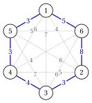
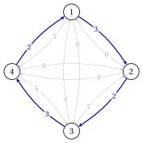
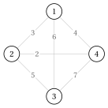
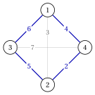
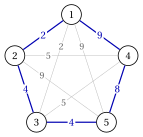
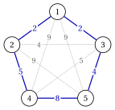

# Exercises · Routing problems

**Exercises · Chapter 6** · each solution opens with a click · [:material-book-open-variant: Chapter 6: Routing problems](../combinatorial-optimization-problems/tsp/index.md) · [:material-file-pdf-box: Exercises, volume 1 (PDF)](../pdf/exercises-1-combinatorial-optimization-problems.pdf)

!!! esercizio "Exercise 6.1: Tours and their length (TSP)"

    We consider the TSP instance with $6$ cities, $\mathscr{V}=\{1,\dots,6\}$, and the symmetric distances

    $$
    \begin{array}{c|cccccc}
    \hline {d_{ij}} & {1} & {2} & {3} & {4} & {5} & {6} \\
    \hline {1} & --- & {4} & {7} & {6} & {3} & {5} \\
    {2} & {4} & --- & {3} & {5} & {6} & {8} \\
    {3} & {7} & {3} & --- & {4} & {7} & {6} \\
    {4} & {6} & {5} & {4} & --- & {3} & {4} \\
    {5} & {3} & {6} & {7} & {3} & --- & {5} \\
    {6} & {5} & {8} & {6} & {4} & {5} & --- \\
    \hline
    \end{array}
    $$

    and the permutations

    $$
    \sigma^{1}=(1,2,3,4,5,6),\quad \sigma^{2}=(4,5,6,1,2,3),\quad \sigma^{3}=(1,6,5,4,3,2),\quad \sigma^{4}=(1,5,4,3,2,6).
    $$

    **Questions**

    1. Compute the length of each permutation, read as a tour.

    2. Which permutations describe the same tour? Explain.

    3. How many permutations of the $6$ cities are there, and how many distinct tours?

    4. The two cycles $(1,2,3)$ and $(4,5,6)$ visit every city exactly once. Do they form a tour? Compare their total length with the length of $\sigma^4$.

??? soluzione "Solution"

    1. Including the return edge $d_{\sigma_n\sigma_1}$:

        \begin{align*}
        L(\sigma^{1})&=4+3+4+3+5+5=24\\
        L(\sigma^{2})&=3+5+5+4+3+4=24\\
        L(\sigma^{3})&=5+5+3+4+3+4=24\\
        L(\sigma^{4})&=3+3+4+3+8+5=26.
        \end{align*}

    2. $\sigma^2$ starts from city $4$ and visits the cities in the same cyclic order as $\sigma^1$; $\sigma^3$ is $\sigma^1$ travelled backwards. The three permutations use the same $6$ edges and describe the same tour, of length $24$. The permutation $\sigma^4$ uses the edge $\{1,5\}$, which is not in $\sigma^1$: it is a different tour.

    3. There are $6!=720$ permutations; each tour is described by $6$ starting cities times $2$ directions, so there are $\frac{720}{12}=\frac{(6-1)!}{2}=60$ tours.

    4. No: a tour is a single cycle through all the cities, and the two cycles are disjoint. Their total length is $(4+3+7)+(3+5+4)=26$, not smaller than $L(\sigma^4)=26$, but it is not the length of a feasible solution.

        { .fig loading=lazy  }

    !!! chiave ""

        $\sigma^1,\sigma^2,\sigma^3$ are the same tour, of length $24$; $\sigma^4$ is a different tour, of length $26$. Two disjoint cycles are not a tour.

!!! esercizio "Exercise 6.2: Enumeration of the tours (TSP)"

    We consider the TSP instance with $5$ cities and the symmetric distances

    $$
    \begin{array}{c|ccccc}
    \hline {d_{ij}} & {1} & {2} & {3} & {4} & {5} \\
    \hline {1} & --- & {12} & {3} & {5} & {3} \\
    {2} & {12} & --- & {9} & {7} & {10} \\
    {3} & {3} & {9} & --- & {4} & {5} \\
    {4} & {5} & {7} & {4} & --- & {4} \\
    {5} & {3} & {10} & {5} & {4} & --- \\
    \hline
    \end{array}
    $$

    **Questions**

    1. Build a tour with the nearest neighbour rule from city $1$ (ties broken by the smallest index), and compute its length.

    2. Enumerate all the tours and find an optimal one. Is it unique?

    3. Draw the optimal tour on the complete graph of the instance.

??? soluzione "Solution"

    1. - from $1$ the closest unvisited cities are $3, 5$, at distance $3$: we go to $3$;

        - from $3$ the closest unvisited city is $4$, at distance $4$;

        - from $4$ the closest unvisited city is $5$, at distance $4$;

        - from $5$ the closest unvisited city is $2$, at distance $10$;

        - we return from $2$ to $1$, at distance $12$.

        The tour is $(1,3,4,5,2)$, of length $3+4+4+10+12=33$.

    2. There are $(5-1)!/2=12$ tours, all written from city $1$:

        
<table>
        <tr>
        <th>tour</th>
        <th>\(L\)</th>
        <th>tour</th>
        <th>\(L\)</th>
        <th>tour</th>
        <th>\(L\)</th>
        </tr>
        <tr>
        <td>\((1,3,2,4,5)\)</td>
        <td>\(\mathbf{26}\)</td>
        <td>\((1,2,4,3,5)\)</td>
        <td>\(31\)</td>
        <td>\((1,2,3,4,5)\)</td>
        <td>\(32\)</td>
        </tr>
        <tr>
        <td>\((1,3,4,2,5)\)</td>
        <td>\(27\)</td>
        <td>\((1,2,4,5,3)\)</td>
        <td>\(31\)</td>
        <td>\((1,2,5,4,3)\)</td>
        <td>\(33\)</td>
        </tr>
        <tr>
        <td>\((1,4,2,3,5)\)</td>
        <td>\(29\)</td>
        <td>\((1,3,2,5,4)\)</td>
        <td>\(31\)</td>
        <td>\((1,2,3,5,4)\)</td>
        <td>\(35\)</td>
        </tr>
        <tr>
        <td>\((1,3,5,2,4)\)</td>
        <td>\(30\)</td>
        <td>\((1,4,3,2,5)\)</td>
        <td>\(31\)</td>
        <td>\((1,2,5,3,4)\)</td>
        <td>\(36\)</td>
        </tr>
        </table>

        The tour $\tilde\sigma=(1,3,2,4,5)$ is the only optimal one, with $z(I)=26$; the nearest neighbour tour is $7$ longer.

    3. The optimal tour on the complete graph of the instance:

        { .fig loading=lazy  }

        The bold edges cost $3+9+7+4+3=26$. The tour avoids the long edges at city $2$, which is far from all the other cities, and enters and leaves it through its two shortest edges, $7$ and $9$.

    !!! chiave ""

        Nearest neighbour from city $1$ gives $33$; the enumeration of the $12$ tours gives the unique optimal tour $(1,3,2,4,5)$, with $z(I)=26$.

!!! esercizio "Exercise 6.3: Nearest neighbour from every city and a lower bound (TSP)"

    We consider again the TSP instance with $5$ cities and the symmetric distances

    $$
    \begin{array}{c|ccccc}
    \hline {d_{ij}} & {1} & {2} & {3} & {4} & {5} \\
    \hline {1} & --- & {12} & {3} & {5} & {3} \\
    {2} & {12} & --- & {9} & {7} & {10} \\
    {3} & {3} & {9} & --- & {4} & {5} \\
    {4} & {5} & {7} & {4} & --- & {4} \\
    {5} & {3} & {10} & {5} & {4} & --- \\
    \hline
    \end{array}
    $$

    whose optimal tour has length $z(I)=26$.

    **Questions**

    1. Apply the nearest neighbour rule from every starting city (ties broken by the smallest index). Which starting city gives the best tour?

    2. Compute the dual bound $\left\lceil \frac12\sum_i(a_i+b_i)\right\rceil$ of the two shortest edges.

    3. Compute the absolute and relative gaps between the best nearest neighbour tour and the dual bound. Could the bound alone certify that this tour is optimal?

??? soluzione "Solution"

    1. The tours built from the five starting cities are:

        
<table>
        <tr>
        <th>start</th>
        <th>tour</th>
        <th>length</th>
        </tr>
        <tr>
        <td>\(1\)</td>
        <td>\((1,3,4,5,2)\)</td>
        <td>\(3+4+4+10+12=33\)</td>
        </tr>
        <tr>
        <td>\(2\)</td>
        <td>\((2,4,3,1,5)\)</td>
        <td>\(7+4+3+3+10=27\)</td>
        </tr>
        <tr>
        <td>\(3\)</td>
        <td>\((3,1,5,4,2)\)</td>
        <td>\(3+3+4+7+9=26\)</td>
        </tr>
        <tr>
        <td>\(4\)</td>
        <td>\((4,3,1,5,2)\)</td>
        <td>\(4+3+3+10+7=27\)</td>
        </tr>
        <tr>
        <td>\(5\)</td>
        <td>\((5,1,3,4,2)\)</td>
        <td>\(3+3+4+7+10=27\)</td>
        </tr>
        </table>

        The best tour starts from city $3$: written from city $1$ it is $(1,3,2,4,5)$, of length $26$, which is the optimal tour. The starting city matters: from city $1$ the rule leaves the long edges for the end.

    2. The two smallest distances of every city are:

        
<table>
        <tr>
        <th>city \(i\)</th>
        <th>\(1\)</th>
        <th>\(2\)</th>
        <th>\(3\)</th>
        <th>\(4\)</th>
        <th>\(5\)</th>
        <th>sum</th>
        </tr>
        <tr>
        <td>\(a_i\)</td>
        <td>\(3\)</td>
        <td>\(7\)</td>
        <td>\(3\)</td>
        <td>\(4\)</td>
        <td>\(3\)</td>
        <td></td>
        </tr>
        <tr>
        <td>\(b_i\)</td>
        <td>\(3\)</td>
        <td>\(9\)</td>
        <td>\(4\)</td>
        <td>\(4\)</td>
        <td>\(4\)</td>
        <td></td>
        </tr>
        <tr>
        <td>\(a_i+b_i\)</td>
        <td>\(6\)</td>
        <td>\(16\)</td>
        <td>\(7\)</td>
        <td>\(8\)</td>
        <td>\(7\)</td>
        <td>\(44\)</td>
        </tr>
        </table>

        Hence $\mathrm{LB}=44/2=22$.

    3. The absolute gap is $26-22=4$ and the relative gap is $\frac{4}{22}=\frac{2}{11}\approx 18.2\%$. The bound alone cannot certify the optimum: only the enumeration of the $12$ tours shows that no tour is shorter than $26$.

    !!! chiave ""

        Starting from city $3$ the nearest neighbour rule finds the optimal tour, of length $26$; the two shortest edges give $\mathrm{LB}=22$, and the gap $4$ stays open without enumeration.

!!! esercizio "Exercise 6.4: The triangle inequality (metric TSP)"

    We consider the TSP instance with $4$ cities and the symmetric distances

    $$
    \begin{array}{c|cccc}
    \hline {d_{ij}} & {1} & {2} & {3} & {4} \\
    \hline {1} & --- & {4} & {10} & {3} \\
    {2} & {4} & --- & {5} & {2} \\
    {3} & {10} & {5} & --- & {6} \\
    {4} & {3} & {2} & {6} & --- \\
    \hline
    \end{array}
    $$

    **Questions**

    1. How many triangle inequalities $d_{ij}\le d_{ik}+d_{kj}$ must be checked? Which ones are violated?

    2. What is the largest value of $d_{13}$ that makes the instance metric, all the other distances being unchanged?

    3. Compute the lengths of the tours for the original value of $d_{13}$ and for the value of Question 2. Does the optimal tour change?

??? soluzione "Solution"

    1. One inequality for every ordered triple of distinct cities: $4\cdot3\cdot2=24$. The violated ones are those with $d_{13}=d_{31}=10$ on the left:

        $$
        d_{13}=10>d_{12}+d_{23}=4+5=9,\qquad d_{13}=10>d_{14}+d_{43}=3+6=9,
        $$

        and the same two with $d_{31}$. All the other $20$ inequalities hold. Going from $1$ to $3$ directly is longer than going through city $2$ or city $4$.

    2. $d_{13}$ must satisfy $d_{13}\le 9$ and $d_{13}\le 9$; when $d_{13}$ is on the right-hand side, decreasing it from $10$ cannot violate an inequality that already holds. The largest value is $d_{13}=9$.

    3. The three tours are:

        
<table>
        <tr>
        <th>tour</th>
        <th>\(d_{13}=10\)</th>
        <th>\(d_{13}=9\)</th>
        </tr>
        <tr>
        <td>\((1,2,3,4)\)</td>
        <td>\(4+5+6+3=18\)</td>
        <td>\(4+5+6+3=18\)</td>
        </tr>
        <tr>
        <td>\((1,2,4,3)\)</td>
        <td>\(4+2+6+10=22\)</td>
        <td>\(4+2+6+9=21\)</td>
        </tr>
        <tr>
        <td>\((1,3,2,4)\)</td>
        <td>\(10+5+2+3=20\)</td>
        <td>\(9+5+2+3=19\)</td>
        </tr>
        </table>

        In both cases the optimal tour is $(1,2,3,4)$, of length $18$: it does not use the edge $\{1,3\}$, so it is not affected. The two tours that use the edge $\{1,3\}$ get shorter by $1$.

    !!! chiave ""

        The instance is not metric because of $d_{13}=10$; with $d_{13}\le 9$ it becomes metric. The optimal tour $(1,2,3,4)$, of length $18$, does not change.

!!! esercizio "Exercise 6.5: Asymmetric distances (ATSP)"

    We consider the ATSP instance with $4$ cities and the asymmetric distances ($d_{ij}$ is the distance from city $i$ to city $j$)

    $$
    \begin{array}{c|cccc}
    \hline {d_{ij}} & {1} & {2} & {3} & {4} \\
    \hline {1} & --- & {3} & {8} & {5} \\
    {2} & {6} & --- & {2} & {9} \\
    {3} & {4} & {7} & --- & {3} \\
    {4} & {2} & {6} & {5} & --- \\
    \hline
    \end{array}
    $$

    **Questions**

    1. How many distinct tours does the instance have? Why are there more than for a symmetric instance with $4$ cities?

    2. Compute the length of every tour, pairing each tour with the same tour travelled backwards.

    3. Find the optimal tour and draw it.

??? soluzione "Solution"

    1. Every tour can start from city $1$, and the other $3$ cities can be ordered in $3!=6$ ways: $(4-1)!=6$ tours. In the symmetric case a tour and its reverse have the same length and are one solution, $(4-1)!/2=3$; here the direction matters.

    2. Each tour, written from city $1$, is paired with its reverse:

        
<table>
        <tr>
        <th>tour</th>
        <th>length</th>
        <th>reverse</th>
        <th>length</th>
        </tr>
        <tr>
        <td>\((1,2,3,4)\)</td>
        <td>\(3+2+3+2=\mathbf{10}\)</td>
        <td>\((1,4,3,2)\)</td>
        <td>\(23\)</td>
        </tr>
        <tr>
        <td>\((1,2,4,3)\)</td>
        <td>\(3+9+5+4=21\)</td>
        <td>\((1,3,4,2)\)</td>
        <td>\(23\)</td>
        </tr>
        <tr>
        <td>\((1,3,2,4)\)</td>
        <td>\(8+7+9+2=26\)</td>
        <td>\((1,4,2,3)\)</td>
        <td>\(17\)</td>
        </tr>
        </table>

        A tour and its reverse use the same pairs of cities, but in opposite directions, and their lengths differ.

    3. The optimal tour is $\tilde\sigma=(1,2,3,4)$, with $z(I)=10$; its reverse has length $23$.

        { .fig loading=lazy  }

    !!! chiave ""

        The ATSP instance has $(4-1)!=6$ tours; the optimal one is $(1,2,3,4)$, with $z(I)=10$, while the same cycle travelled backwards is much longer.

!!! esercizio "Exercise 6.6: Ground set, feasible solutions and objective (TSP)"

    We consider the TSP instance with $4$ cities, $\mathscr{V}=\{1,2,3,4\}$, and the symmetric distances

    $$
    d_{12}=3,\quad d_{13}=6,\quad d_{14}=4,\quad d_{23}=5,\quad d_{24}=2,\quad d_{34}=7.
    $$

    The instance is drawn as a complete graph, with the distance on every edge:

    { .fig loading=lazy  }

    **Questions**

    1. Write the instance as a combinatorial optimization problem in the form of the definition of the chapter [«Combinatorial optimization problems»](https://fabiofurini.github.io/combinatorial-optimization/combinatorial-optimization-problems/combinatorial-optimization/): take as ground set $\mathscr{U}$ the set of the edges, and describe the feasible solutions $\mathcal{F}$ and the objective function $f$. How many subsets does $\mathscr{U}$ have?

    2. How many subsets of $\mathscr{U}$ have exactly $4$ edges? How many of them are tours? Explain why the others are not feasible.

    3. Compute $f$ for every feasible solution and find the optimal solution and $z(I)$.

    4. Compare the number of feasible solutions with the formula $(n-1)!/2$ of the chapter.

??? soluzione "Solution"

    1. The ground set is the set of the $6$ edges of the complete graph,

        $$
        \mathscr{U}=\{\{1,2\},\{1,3\},\{1,4\},\{2,3\},\{2,4\},\{3,4\}\}.
        $$

        A subset $S\subseteq\mathscr{U}$ is feasible, $S\in\mathcal{F}$, when its edges form a single cycle through all the cities, that is a tour. The objective function is additive, with the distances as weights:

        $$
        f(S)=\sum_{\{i,j\}\in S} d_{ij}.
        $$

        The ground set has $2^{6}=64$ subsets.

    2. A tour of $4$ cities uses exactly $4$ edges, and there are $\binom{6}{4}=15$ subsets with $4$ edges. Each of them leaves out $2$ edges.

        - If the $2$ missing edges have no city in common, every city keeps $2$ edges: the $4$ edges form a cycle through all the cities. There are $3$ such pairs, $\{\{1,2\},\{3,4\}\}$, $\{\{1,3\},\{2,4\}\}$ and $\{\{1,4\},\{2,3\}\}$: $3$ tours.

        - If the $2$ missing edges meet in a city $v$, the city $v$ keeps only $1$ edge and the other three cities form a triangle: this is not a tour. There are $4\cdot 3=12$ such subsets ($4$ choices of $v$ and $\binom{3}{2}=3$ pairs of edges at $v$).

        Hence only $3$ of the $64$ subsets of $\mathscr{U}$ are feasible.

    3. The three tours, written as sequences starting from city $1$ and as sets of edges, are:

        
<table>
        <tr>
        <th>tour \(\sigma\)</th>
        <th>edges \(S\)</th>
        <th>\(f(S)=L(\sigma)\)</th>
        </tr>
        <tr>
        <td>\((1,2,3,4)\)</td>
        <td>\(\{1,2\},\{1,4\},\{2,3\},\{3,4\}\)</td>
        <td>\(3+4+5+7=19\)</td>
        </tr>
        <tr>
        <td>\((1,2,4,3)\)</td>
        <td>\(\{1,2\},\{1,3\},\{2,4\},\{3,4\}\)</td>
        <td>\(3+6+2+7=18\)</td>
        </tr>
        <tr>
        <td>\((1,3,2,4)\)</td>
        <td>\(\{1,3\},\{1,4\},\{2,3\},\{2,4\}\)</td>
        <td>\(6+4+5+2=\mathbf{17}\)</td>
        </tr>
        </table>

        The optimal solution is the tour $\tilde\sigma=(1,3,2,4)$, with $z(I)=17$:

        { .fig loading=lazy  }

        A short way to see it: the $6$ distances sum up to $27$, and a tour leaves out two edges with no city in common. The best tour leaves out the most expensive such pair, $\{1,2\}$ and $\{3,4\}$, of total $3+7=10$, and $27-10=17$.

    4. The formula gives $(4-1)!/2=3$ tours, the same number found in Question 2. The candidates of the definition, the $64$ subsets of edges, are many more than the feasible solutions.

    !!! chiave ""

        Seen as a combinatorial optimization problem on the ground set of the edges, the instance has $2^6=64$ candidate subsets and only $3$ feasible solutions, the tours. The optimal tour is $(1,3,2,4)$, with $z(I)=17$.

!!! esercizio "Exercise 6.7: Primal bound, dual bound and gap (TSP)"

    We consider the TSP instance with $5$ cities and the symmetric distances

    $$
    \begin{array}{c|ccccc}
    \hline {d_{ij}} & {1} & {2} & {3} & {4} & {5} \\
    \hline {1} & --- & {2} & {2} & {9} & {9} \\
    {2} & {2} & --- & {4} & {5} & {9} \\
    {3} & {2} & {4} & --- & {5} & {4} \\
    {4} & {9} & {5} & {5} & --- & {8} \\
    {5} & {9} & {9} & {4} & {8} & --- \\
    \hline
    \end{array}
    $$

    **Questions**

    1. Build a tour with the nearest neighbour rule from city $1$ (ties broken by the smallest index) and compute its length. Is it a primal or a dual bound?

    2. Compute the dual bound $\left\lceil \frac12 \sum_i (a_i+b_i)\right\rceil$, where $a_i\le b_i$ are the two smallest distances from city $i$.

    3. Enumerate the $(5-1)!/2$ tours and find the optimal one.

    4. Compute the absolute and relative gaps of the nearest neighbour tour, with respect to the dual bound and with respect to $z(I)$. Why is the greedy choice of the nearest city not optimal here?

??? soluzione "Solution"

    1. The nearest neighbour rule proceeds as follows:

        - from $1$ the closest unvisited cities are $2, 3$, at distance $2$: we go to $2$ (smallest index);

        - from $2$ the closest unvisited city is $3$, at distance $4$;

        - from $3$ the closest unvisited city is $5$, at distance $4$;

        - from $5$ the closest unvisited city is $4$, at distance $8$;

        - we return from $4$ to $1$, at distance $d_{41}=9$.

        The tour is $\bar\sigma=(1,2,3,5,4)$, of length $L(\bar\sigma)=2+4+4+8+9=27$. It is the length of a feasible solution of a minimization problem, hence a primal bound: $\mathrm{UB}=27$.

        { .fig loading=lazy  }

    2. The two smallest distances of every city are:

        
<table>
        <tr>
        <th>city \(i\)</th>
        <th>\(1\)</th>
        <th>\(2\)</th>
        <th>\(3\)</th>
        <th>\(4\)</th>
        <th>\(5\)</th>
        <th>sum</th>
        </tr>
        <tr>
        <td>\(a_i\)</td>
        <td>\(2\)</td>
        <td>\(2\)</td>
        <td>\(2\)</td>
        <td>\(5\)</td>
        <td>\(4\)</td>
        <td></td>
        </tr>
        <tr>
        <td>\(b_i\)</td>
        <td>\(2\)</td>
        <td>\(4\)</td>
        <td>\(4\)</td>
        <td>\(5\)</td>
        <td>\(8\)</td>
        <td></td>
        </tr>
        <tr>
        <td>\(a_i+b_i\)</td>
        <td>\(4\)</td>
        <td>\(6\)</td>
        <td>\(6\)</td>
        <td>\(10\)</td>
        <td>\(12\)</td>
        <td>\(38\)</td>
        </tr>
        </table>

        Hence $\mathrm{LB}=\frac{38}{2}=19$ (the sum is even, no rounding is needed).

    3. The $12$ tours, all starting from city $1$, are:

        
<table>
        <tr>
        <th>tour</th>
        <th>\(L\)</th>
        <th>tour</th>
        <th>\(L\)</th>
        <th>tour</th>
        <th>\(L\)</th>
        </tr>
        <tr>
        <td>\((1,2,4,5,3)\)</td>
        <td>\(\mathbf{21}\)</td>
        <td>\((1,2,3,4,5)\)</td>
        <td>\(28\)</td>
        <td>\((1,3,4,2,5)\)</td>
        <td>\(30\)</td>
        </tr>
        <tr>
        <td>\((1,2,4,3,5)\)</td>
        <td>\(25\)</td>
        <td>\((1,3,2,4,5)\)</td>
        <td>\(28\)</td>
        <td>\((1,4,2,3,5)\)</td>
        <td>\(31\)</td>
        </tr>
        <tr>
        <td>\((1,2,5,4,3)\)</td>
        <td>\(26\)</td>
        <td>\((1,2,5,3,4)\)</td>
        <td>\(29\)</td>
        <td>\((1,3,2,5,4)\)</td>
        <td>\(32\)</td>
        </tr>
        <tr>
        <td>\((1,2,3,5,4)\)</td>
        <td>\(27\)</td>
        <td>\((1,3,5,2,4)\)</td>
        <td>\(29\)</td>
        <td>\((1,4,3,2,5)\)</td>
        <td>\(36\)</td>
        </tr>
        </table>

        The optimal tour is $\tilde\sigma=(1,2,4,5,3)$, the only one of length $z(I)=21$:

        { .fig loading=lazy  }

    4. With respect to the dual bound the absolute gap is $27-19=8$ and the relative gap is $\frac{8}{19}\approx 42.1\%$. With respect to the optimum the absolute gap is $27-21=6$ and the relative gap is $\frac{6}{21}=\frac{2}{7}\approx 28.6\%$. The rule always takes the shortest available edge and leaves the last edges to chance: the closing edges $\{5,4\}$ and $\{4,1\}$ cost $8$ and $9$.

    !!! chiave ""

        Nearest neighbour gives $\mathrm{UB}=27$, the two shortest edges give $\mathrm{LB}=19$, and the enumeration of the $12$ tours gives $z(I)=21$: $19\le z(I)=21\le 27$.
