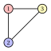

# Formulations of the vertex coloring problem

**Part 2 · Formulations and their properties · Chapter 10** · [:material-file-pdf-box: Lecture notes, volume 2 (PDF)](../pdf/lecture-notes-2-formulations.pdf) · [:material-pencil: Exercises](../exercises/coloring-formulations.md)

!!! nota "Prerequisites"

    - From the module <em>Linear Programming</em>, [Chapter 9 «Duality theory»](https://fabiofurini.github.io/linear-programming/duality/09-duality/): the dual of an LP problem, weak and strong duality.

    - From the module <em>Integer linear programming</em>, [Chapter 1 «Integer linear programming»](https://fabiofurini.github.io/integer-linear-programming/models-and-bounds/ilp/) and [Chapter 2 «LP relaxation»](https://fabiofurini.github.io/integer-linear-programming/models-and-bounds/lp-relaxation/): ILP problems, LP relaxations and bounds.

    - From this module, the chapter «Vertex coloring»: the problem and the notation on graphs.

!!! chiave "Objectives"

    At the end of this chapter you will be able to:

    - write the ILP model of the Vertex Coloring Problem and explain the role of the activation variables $y_c$;

    - write the two LP relaxations and their duals, and compute their optimal solutions;

    - prove that the optimal value of the LP relaxations is $2$ for every graph with an edge;

    - explain why this bound is very weak, and why the model is not enough to color a graph.

## 10.1 The problem in brief

!!! nota "Where we were"

    In the chapter «Vertex coloring» we met the Vertex Coloring Problem as a <em>problem</em>: definition, notation on graphs and first bounds. Here we look at it as a <em>model</em> and we study its LP relaxations. The problem returns with heuristic algorithms and approximation algorithms for the VCP.

!!! definizione "Definition 10.1: Vertex Coloring Problem"

    Given:

    1. a simple <em>graph</em> $G = (V,E)$, where

        $$
        V = \{1,2,\dots,n\}
        $$

        is the set of $n$ <em>vertices</em>, and

        $$
        E \subseteq \big\{\, \{u,v\} : u,v \in V,~ u \neq v \,\big\}
        $$

        is the set of $m$ <em>edges</em>,

    the <strong>Vertex Coloring Problem</strong> (VCP) asks to decide how to assign a color to each vertex, so that no two adjacent vertices share the same color, and the total number of colors used is minimized.

- For a vertex $v \in V$ we denote by $\delta(v)$ the set of the edges incident to $v$, by $\deg(v) = |\delta(v)|$ its degree and by $N(v)$ the set of the vertices adjacent to $v$.

- We assume that any VCP instance satisfies the problem assumptions, i.e.,

    $$
    \deg(v) \geq 1 ~~~~\text{for all}~~~~ v \in V ~~~~~~~\text{and}~~~~~~~ N(u) \not\subseteq N(v) ~~~~\text{for all}~~~~ u, v \in V,~ u \neq v
    $$

- The first assumption guarantees that the graph has no isolated vertices: they can always take any color used by the rest of the graph.

- The second assumption guarantees that no vertex can be removed without affecting the optimal value: if $N(u) \subseteq N(v)$, any coloring of $G \setminus \{u\}$ can be extended to $u$ by assigning it the color of $v$.

## 10.2 An ILP model for the Vertex Coloring Problem

- Given an upper bound $k \in \Z_{\ge 2}$ on the number of colors used in any optimal VCP solution, we introduce the following $k\;\underbrace{|V|}_{=n}$ binary variables:

    \begin{equation*}
    x_{vc} =
    \begin{cases}
    1 & \text{if vertex } v \text{ takes color } c, \\
    0 & \text{otherwise}
    \end{cases}
    \qquad \forall v \in \underbrace{\{1,2,\dots,n\}}_{=V},~\forall c \in \underbrace{\{1,2,\dots,k\}}_{=\mathscr{C}}, \tag{10.1}
    \end{equation*}

    and the following $k$ binary variables:

    \begin{equation*}
    y_{c} =
    \begin{cases}
    1 & \text{if color } c \text{ is used}, \\
    0 & \text{otherwise}
    \end{cases}
    \qquad \forall c \in \underbrace{\{1,2,\dots,k\}}_{=\mathscr{C}}. \tag{10.2}
    \end{equation*}

    The number $n$ of vertices is a valid upper bound on the minimum number of colors needed to color all the vertices since, in the worst possible case, each vertex takes a different color. Also the number of colors used in any feasible VCP solution is a valid upper bound.

!!! chiave ""

    Using these variables, an Integer Linear Programming  (ILP) model  for the Vertex Coloring Problem (VCP) reads as follows:

    

    \begin{align*}
    && \min \quad \sum_{c \in \mathscr{C}} y_{c} \label{obj_VCP}  \tag{10.3a}\\[2ex]
    && \text{subject to} \quad \sum_{c \in \mathscr{C}} x_{vc} &= 1, & \forall v \in V, \label{cons1_VCP}  \tag{10.3b}\\[2ex]
    && - x_{uc} - x_{vc} + y_c &\geq 0, & \forall c \in \mathscr{C},~\forall \{u,v\} \in E, \label{cons2_VCP}  \tag{10.3c}\\[2ex]
    && x_{vc} &\in \{0,1\}, & \forall v \in V,~ \forall c \in \mathscr{C}, \label{cons4_VCP}  \tag{10.3d}\\[2ex]
    && y_{c} &\in \{0,1\}, & \forall c \in \mathscr{C}. \label{cons3_VCP} \tag{10.3e}
    \end{align*}

    This ILP model is referred to as the $\ILP_{\VCP}$ model.

- Description of the objective function and constraints of the $\ILP_{\VCP}$ model:

    - the linear objective function $\eqref{obj_VCP}$ minimizes the total number of used colors;

    - constraints $\eqref{cons1_VCP}$ ensure that each vertex  takes exactly one color ($n$ linear constraints);

    - constraints $\eqref{cons2_VCP}$ ensure that, for each color and each edge, the two adjacent vertices cannot both take that color, and that an unused color is taken by no vertex ($k \; \underbrace{|E|}_{=m}$ linear constraints);

    - finally, constraints $\eqref{cons4_VCP}$ and $\eqref{cons3_VCP}$ define the variables of the ILP model.

<strong>Explanation of the link between the variables</strong>

- <strong>If color $c$ is assigned to a vertex, then it is used.</strong> The logical implication is

    $$
    (x_{1c} {\tt ~OR~} x_{2c} {\tt ~OR~} \dots {\tt ~OR~} x_{nc}) ~~~ \Longrightarrow ~~~ y_c .
    $$

    Every vertex has an incident edge $\{u,v\}$, and the constraint $x_{uc}+x_{vc} \le y_c$ forces $y_c=1$ as soon as $x_{vc}=1$.

- <strong>If color $c$ is not used, then no vertex takes it.</strong> This is the contrapositive of the previous implication. For $y_c=0$ the edge constraint gives $x_{uc}=x_{vc}=0$ for every edge $\{u,v\}\in E$.

- <strong>If color $c$ is used, then some vertex takes it, but only in an optimal solution.</strong> The constraints do not impose it. However, if $x_{vc}=0$ for all $v$ and $y_c=1$, setting $y_c=0$ keeps all the constraints satisfied and decreases the objective value by one. Hence, in every optimal solution, unused colors are not counted.

!!! esempio "Example 10.1: $\ILP_{\VCP}$ model"

    We consider the following graph $G = (V,E)$ with $3$ vertices ($n=3$) and $3$ edges ($m=3$):

    { .fig .ovale loading=lazy style="width:24%" }

    The vertex set $V$ and the edge set $E$ are:

    $$
    V = \big\{~ 1,~ 2,~ 3 ~\big\}, \qquad E = \big\{~ \{1,2\},~ \{1,3\},~ \{2,3\} ~\big\}.
    $$

    We refer to this VCP instance as Example 1.

    The  $\ILP_{\VCP}$ model with $k=3$ for this instance is:

    
<table>
    <tr>
    <td>\(\min\)</td>
    <td></td>
    <td></td>
    <td></td>
    <td></td>
    <td></td>
    <td></td>
    <td></td>
    <td></td>
    <td></td>
    <td>\(y_1\)</td>
    <td>\(+\) \(y_2\)</td>
    <td>\(+\) \(y_3\)</td>
    <td></td>
    </tr>
    <tr>
    <td>subject to</td>
    <td>\(x_{11}\)</td>
    <td>\(+\) \(x_{12}\)</td>
    <td>\(+\) \(x_{13}\)</td>
    <td></td>
    <td></td>
    <td></td>
    <td></td>
    <td></td>
    <td></td>
    <td></td>
    <td></td>
    <td></td>
    <td>\(=1\)</td>
    </tr>
    <tr>
    <td></td>
    <td></td>
    <td></td>
    <td></td>
    <td>\(x_{21}\)</td>
    <td>\(+\) \(x_{22}\)</td>
    <td>\(+\) \(x_{23}\)</td>
    <td></td>
    <td></td>
    <td></td>
    <td></td>
    <td></td>
    <td></td>
    <td>\(=1\)</td>
    </tr>
    <tr>
    <td></td>
    <td></td>
    <td></td>
    <td></td>
    <td></td>
    <td></td>
    <td></td>
    <td>\(x_{31}\)</td>
    <td>\(+\) \(x_{32}\)</td>
    <td>\(+\) \(x_{33}\)</td>
    <td></td>
    <td></td>
    <td></td>
    <td>\(=1\)</td>
    </tr>
    <tr>
    <td></td>
    <td>\(-x_{11}\)</td>
    <td></td>
    <td></td>
    <td>\(-x_{21}\)</td>
    <td></td>
    <td></td>
    <td></td>
    <td></td>
    <td></td>
    <td>\(+\) \(y_1\)</td>
    <td></td>
    <td></td>
    <td>\(\ge 0\)</td>
    </tr>
    <tr>
    <td></td>
    <td>\(-x_{11}\)</td>
    <td></td>
    <td></td>
    <td></td>
    <td></td>
    <td></td>
    <td>\(-x_{31}\)</td>
    <td></td>
    <td></td>
    <td>\(+\) \(y_1\)</td>
    <td></td>
    <td></td>
    <td>\(\ge 0\)</td>
    </tr>
    <tr>
    <td></td>
    <td></td>
    <td></td>
    <td></td>
    <td>\(-x_{21}\)</td>
    <td></td>
    <td></td>
    <td>\(-x_{31}\)</td>
    <td></td>
    <td></td>
    <td>\(+\) \(y_1\)</td>
    <td></td>
    <td></td>
    <td>\(\ge 0\)</td>
    </tr>
    <tr>
    <td></td>
    <td></td>
    <td>\(-x_{12}\)</td>
    <td></td>
    <td></td>
    <td>\(-x_{22}\)</td>
    <td></td>
    <td></td>
    <td></td>
    <td></td>
    <td></td>
    <td>\(+\) \(y_2\)</td>
    <td></td>
    <td>\(\ge 0\)</td>
    </tr>
    <tr>
    <td></td>
    <td></td>
    <td>\(-x_{12}\)</td>
    <td></td>
    <td></td>
    <td></td>
    <td></td>
    <td></td>
    <td>\(-x_{32}\)</td>
    <td></td>
    <td></td>
    <td>\(+\) \(y_2\)</td>
    <td></td>
    <td>\(\ge 0\)</td>
    </tr>
    <tr>
    <td></td>
    <td></td>
    <td></td>
    <td></td>
    <td></td>
    <td>\(-x_{22}\)</td>
    <td></td>
    <td></td>
    <td>\(-x_{32}\)</td>
    <td></td>
    <td></td>
    <td>\(+\) \(y_2\)</td>
    <td></td>
    <td>\(\ge 0\)</td>
    </tr>
    <tr>
    <td></td>
    <td></td>
    <td></td>
    <td>\(-x_{13}\)</td>
    <td></td>
    <td></td>
    <td>\(-x_{23}\)</td>
    <td></td>
    <td></td>
    <td></td>
    <td></td>
    <td></td>
    <td>\(+\) \(y_3\)</td>
    <td>\(\ge 0\)</td>
    </tr>
    <tr>
    <td></td>
    <td></td>
    <td></td>
    <td>\(-x_{13}\)</td>
    <td></td>
    <td></td>
    <td></td>
    <td></td>
    <td></td>
    <td>\(-x_{33}\)</td>
    <td></td>
    <td></td>
    <td>\(+\) \(y_3\)</td>
    <td>\(\ge 0\)</td>
    </tr>
    <tr>
    <td></td>
    <td></td>
    <td></td>
    <td></td>
    <td></td>
    <td></td>
    <td>\(-x_{23}\)</td>
    <td></td>
    <td></td>
    <td>\(-x_{33}\)</td>
    <td></td>
    <td></td>
    <td>\(+\) \(y_3\)</td>
    <td>\(\ge 0\)</td>
    </tr>
    <tr>
    <td></td>
    <td>\(x_{11}\),</td>
    <td>\(x_{12}\),</td>
    <td>\(x_{13}\),</td>
    <td>\(x_{21}\),</td>
    <td>\(x_{22}\),</td>
    <td>\(x_{23}\),</td>
    <td>\(x_{31}\),</td>
    <td>\(x_{32}\),</td>
    <td>\(x_{33}\),</td>
    <td>\(y_1\),</td>
    <td>\(y_2\),</td>
    <td>\(y_3\)</td>
    <td>\(\in \{0,1\}\)</td>
    </tr>
    </table>

    An optimal solution ${\tilde{\vet x}}(\ILP_{\VCP})$ is:

    $$
    \tilde x_{11}=1,~~\tilde x_{12}=\tilde  x_{13}=\tilde  x_{21}=0,~~\tilde x_{22}=1,~~\tilde  x_{23}=\tilde  x_{31}=\tilde x_{32}=0,~~\tilde  x_{33}=1,~~ \tilde y_{1}=\tilde y_{2}=\tilde  y_{3}=1
    $$

    The optimal value $z(\ILP_{\VCP})$  is $3$. 

    The associated optimal solution of the VCP is given by the color classes $\tilde{Q}_1 =\{1\}$, $\tilde{Q}_2 =\{2\}$ and $\tilde{Q}_3 =\{3\}$. The optimal partition is unique, but the $3!$ permutations of the colors give $6$ different optimal solutions.

## 10.3 A first Linear Programming relaxation

!!! chiave ""

    To obtain a Linear Programming (LP) relaxation of the $\ILP_{\VCP}$ model,  we relax  constraints $\eqref{cons4_VCP}$ and $\eqref{cons3_VCP}$  with the following ones:

    \begin{align*}
    &&x_{vc}                        &\ge 0, & \forall v \in V,~ \forall c \in \mathscr{C}, \label{cons4_VCP_LP} \tag{10.4a}\\[2ex]
    &&y_{c}                        &\ge  0, &  \forall c \in \mathscr{C}. \label{cons3_VCP_LP} \tag{10.4b}
    \end{align*}

!!! esempio "Example 10.2: $\LP\text{-}0_{\VCP}$ model"

    The  $\LP\text{-}0_{\VCP}$ model for the VCP instance of Example 1 is:

    
<table>
    <tr>
    <td>\(\min\)</td>
    <td></td>
    <td></td>
    <td></td>
    <td></td>
    <td></td>
    <td></td>
    <td></td>
    <td></td>
    <td></td>
    <td>\(y_1\)</td>
    <td>\(+\) \(y_2\)</td>
    <td>\(+\) \(y_3\)</td>
    <td></td>
    </tr>
    <tr>
    <td>subject to</td>
    <td>\(x_{11}\)</td>
    <td>\(+\) \(x_{12}\)</td>
    <td>\(+\) \(x_{13}\)</td>
    <td></td>
    <td></td>
    <td></td>
    <td></td>
    <td></td>
    <td></td>
    <td></td>
    <td></td>
    <td></td>
    <td>\(=1\)</td>
    </tr>
    <tr>
    <td></td>
    <td></td>
    <td></td>
    <td></td>
    <td>\(x_{21}\)</td>
    <td>\(+\) \(x_{22}\)</td>
    <td>\(+\) \(x_{23}\)</td>
    <td></td>
    <td></td>
    <td></td>
    <td></td>
    <td></td>
    <td></td>
    <td>\(=1\)</td>
    </tr>
    <tr>
    <td></td>
    <td></td>
    <td></td>
    <td></td>
    <td></td>
    <td></td>
    <td></td>
    <td>\(x_{31}\)</td>
    <td>\(+\) \(x_{32}\)</td>
    <td>\(+\) \(x_{33}\)</td>
    <td></td>
    <td></td>
    <td></td>
    <td>\(=1\)</td>
    </tr>
    <tr>
    <td></td>
    <td>\(-x_{11}\)</td>
    <td></td>
    <td></td>
    <td>\(-x_{21}\)</td>
    <td></td>
    <td></td>
    <td></td>
    <td></td>
    <td></td>
    <td>\(+\) \(y_1\)</td>
    <td></td>
    <td></td>
    <td>\(\ge 0\)</td>
    </tr>
    <tr>
    <td></td>
    <td>\(-x_{11}\)</td>
    <td></td>
    <td></td>
    <td></td>
    <td></td>
    <td></td>
    <td>\(-x_{31}\)</td>
    <td></td>
    <td></td>
    <td>\(+\) \(y_1\)</td>
    <td></td>
    <td></td>
    <td>\(\ge 0\)</td>
    </tr>
    <tr>
    <td></td>
    <td></td>
    <td></td>
    <td></td>
    <td>\(-x_{21}\)</td>
    <td></td>
    <td></td>
    <td>\(-x_{31}\)</td>
    <td></td>
    <td></td>
    <td>\(+\) \(y_1\)</td>
    <td></td>
    <td></td>
    <td>\(\ge 0\)</td>
    </tr>
    <tr>
    <td></td>
    <td></td>
    <td>\(-x_{12}\)</td>
    <td></td>
    <td></td>
    <td>\(-x_{22}\)</td>
    <td></td>
    <td></td>
    <td></td>
    <td></td>
    <td></td>
    <td>\(+\) \(y_2\)</td>
    <td></td>
    <td>\(\ge 0\)</td>
    </tr>
    <tr>
    <td></td>
    <td></td>
    <td>\(-x_{12}\)</td>
    <td></td>
    <td></td>
    <td></td>
    <td></td>
    <td></td>
    <td>\(-x_{32}\)</td>
    <td></td>
    <td></td>
    <td>\(+\) \(y_2\)</td>
    <td></td>
    <td>\(\ge 0\)</td>
    </tr>
    <tr>
    <td></td>
    <td></td>
    <td></td>
    <td></td>
    <td></td>
    <td>\(-x_{22}\)</td>
    <td></td>
    <td></td>
    <td>\(-x_{32}\)</td>
    <td></td>
    <td></td>
    <td>\(+\) \(y_2\)</td>
    <td></td>
    <td>\(\ge 0\)</td>
    </tr>
    <tr>
    <td></td>
    <td></td>
    <td></td>
    <td>\(-x_{13}\)</td>
    <td></td>
    <td></td>
    <td>\(-x_{23}\)</td>
    <td></td>
    <td></td>
    <td></td>
    <td></td>
    <td></td>
    <td>\(+\) \(y_3\)</td>
    <td>\(\ge 0\)</td>
    </tr>
    <tr>
    <td></td>
    <td></td>
    <td></td>
    <td>\(-x_{13}\)</td>
    <td></td>
    <td></td>
    <td></td>
    <td></td>
    <td></td>
    <td>\(-x_{33}\)</td>
    <td></td>
    <td></td>
    <td>\(+\) \(y_3\)</td>
    <td>\(\ge 0\)</td>
    </tr>
    <tr>
    <td></td>
    <td></td>
    <td></td>
    <td></td>
    <td></td>
    <td></td>
    <td>\(-x_{23}\)</td>
    <td></td>
    <td></td>
    <td>\(-x_{33}\)</td>
    <td></td>
    <td></td>
    <td>\(+\) \(y_3\)</td>
    <td>\(\ge 0\)</td>
    </tr>
    <tr>
    <td></td>
    <td>\(x_{11}\),</td>
    <td>\(x_{12}\),</td>
    <td>\(x_{13}\),</td>
    <td>\(x_{21}\),</td>
    <td>\(x_{22}\),</td>
    <td>\(x_{23}\),</td>
    <td>\(x_{31}\),</td>
    <td>\(x_{32}\),</td>
    <td>\(x_{33}\),</td>
    <td>\(y_1\),</td>
    <td>\(y_2\),</td>
    <td>\(y_3\)</td>
    <td>\(\ge 0\)</td>
    </tr>
    </table>

    An optimal solution ${\tilde{\vet x}}(\LP\text{-}0_{\VCP})$ is:

    $$
    \tilde x_{11}=\tilde x_{12}=\tilde  x_{21}=\tilde  x_{22}=\tilde x_{31}=\tilde  x_{32}=\frac{1}{2},~~\tilde  x_{13}=\tilde x_{23}=\tilde  x_{33}=0,~~ \tilde y_{1}= \tilde y_{2}=1,~~\tilde  y_{3}=0
    $$

    The optimal value $z(\LP\text{-}0_{\VCP})$ is $2$.

    Accordingly we have the lower bound:

    $$
    2 \le z(\ILP_{\VCP})
    $$

!!! chiave ""

    Using

    - a free dual variable $\mu_v$ for each  constraint $\eqref{cons1_VCP}$ ($v \in V$)

    - a non-negative dual variable $\pi_{ce}$ for each constraint $\eqref{cons2_VCP}$ ($c \in \mathscr{C},~e =\{u,v\} \in E$)

    the dual model of the $\LP\text{-}0_{\VCP}$ model  reads as follows:

    

    \begin{align*}
    &&   \max  ~~ \sum_{v \in V}  \mu_{v} \label{obj_D}  \tag{10.5a}\\[2ex]
    && \text{subject to}  \quad \mu_{v} - \sum_{e \in \delta(v)} \pi_{ce}  &\leq 0,       &  \forall v \in V,~\forall c \in \mathscr{C}, \label{cons2_D}  \tag{10.5b}\\[2ex]
    && \sum_{e \in E} \pi_{ce}   &\leq 1,       &  \forall c \in \mathscr{C},              \label{cons1_D}  \tag{10.5c}\\[2ex]
    &&\mu_{v}                        &\gtreqless  0, &  \forall v \in V,\label{cons3_D}  \tag{10.5d}\\[2ex]
    &&\pi_{ce}                        &\ge  0, &  \forall c \in \mathscr{C},~\forall e \in E.\label{cons4_D} \tag{10.5e}
    \end{align*}

!!! esempio "Example 10.3: $D(\LP\text{-}0_{\VCP})$ model"

    The  dual $D(\LP\text{-}0_{\VCP})$ model for the VCP instance of Example 1 is:

    
<table>
    <tr>
    <td>\(\max\)</td>
    <td>\(\mu_1\)</td>
    <td>\(+\) \(\mu_2\)</td>
    <td>\(+\) \(\mu_3\)</td>
    <td></td>
    <td></td>
    <td></td>
    <td></td>
    <td></td>
    <td></td>
    <td></td>
    <td></td>
    <td></td>
    <td></td>
    </tr>
    <tr>
    <td>subject to</td>
    <td>\(\mu_1\)</td>
    <td></td>
    <td></td>
    <td>\(-\pi_{112}\)</td>
    <td>\(-\pi_{113}\)</td>
    <td></td>
    <td></td>
    <td></td>
    <td></td>
    <td></td>
    <td></td>
    <td></td>
    <td>\(\le 0\)</td>
    </tr>
    <tr>
    <td></td>
    <td>\(\mu_1\)</td>
    <td></td>
    <td></td>
    <td></td>
    <td></td>
    <td></td>
    <td>\(-\pi_{212}\)</td>
    <td>\(-\pi_{213}\)</td>
    <td></td>
    <td></td>
    <td></td>
    <td></td>
    <td>\(\le 0\)</td>
    </tr>
    <tr>
    <td></td>
    <td>\(\mu_1\)</td>
    <td></td>
    <td></td>
    <td></td>
    <td></td>
    <td></td>
    <td></td>
    <td></td>
    <td></td>
    <td>\(-\pi_{312}\)</td>
    <td>\(-\pi_{313}\)</td>
    <td></td>
    <td>\(\le 0\)</td>
    </tr>
    <tr>
    <td></td>
    <td></td>
    <td>\(\mu_2\)</td>
    <td></td>
    <td>\(-\pi_{112}\)</td>
    <td></td>
    <td>\(-\pi_{123}\)</td>
    <td></td>
    <td></td>
    <td></td>
    <td></td>
    <td></td>
    <td></td>
    <td>\(\le 0\)</td>
    </tr>
    <tr>
    <td></td>
    <td></td>
    <td>\(\mu_2\)</td>
    <td></td>
    <td></td>
    <td></td>
    <td></td>
    <td>\(-\pi_{212}\)</td>
    <td></td>
    <td>\(-\pi_{223}\)</td>
    <td></td>
    <td></td>
    <td></td>
    <td>\(\le 0\)</td>
    </tr>
    <tr>
    <td></td>
    <td></td>
    <td>\(\mu_2\)</td>
    <td></td>
    <td></td>
    <td></td>
    <td></td>
    <td></td>
    <td></td>
    <td></td>
    <td>\(-\pi_{312}\)</td>
    <td></td>
    <td>\(-\pi_{323}\)</td>
    <td>\(\le 0\)</td>
    </tr>
    <tr>
    <td></td>
    <td></td>
    <td></td>
    <td>\(\mu_3\)</td>
    <td></td>
    <td>\(-\pi_{113}\)</td>
    <td>\(-\pi_{123}\)</td>
    <td></td>
    <td></td>
    <td></td>
    <td></td>
    <td></td>
    <td></td>
    <td>\(\le 0\)</td>
    </tr>
    <tr>
    <td></td>
    <td></td>
    <td></td>
    <td>\(\mu_3\)</td>
    <td></td>
    <td></td>
    <td></td>
    <td></td>
    <td>\(-\pi_{213}\)</td>
    <td>\(-\pi_{223}\)</td>
    <td></td>
    <td></td>
    <td></td>
    <td>\(\le 0\)</td>
    </tr>
    <tr>
    <td></td>
    <td></td>
    <td></td>
    <td>\(\mu_3\)</td>
    <td></td>
    <td></td>
    <td></td>
    <td></td>
    <td></td>
    <td></td>
    <td></td>
    <td>\(-\pi_{313}\)</td>
    <td>\(-\pi_{323}\)</td>
    <td>\(\le 0\)</td>
    </tr>
    <tr>
    <td></td>
    <td></td>
    <td></td>
    <td></td>
    <td>\(\pi_{112}\)</td>
    <td>\(+\pi_{113}\)</td>
    <td>\(+\pi_{123}\)</td>
    <td></td>
    <td></td>
    <td></td>
    <td></td>
    <td></td>
    <td></td>
    <td>\(\le 1\)</td>
    </tr>
    <tr>
    <td></td>
    <td></td>
    <td></td>
    <td></td>
    <td></td>
    <td></td>
    <td></td>
    <td>\(\pi_{212}\)</td>
    <td>\(+\pi_{213}\)</td>
    <td>\(+\pi_{223}\)</td>
    <td></td>
    <td></td>
    <td></td>
    <td>\(\le 1\)</td>
    </tr>
    <tr>
    <td></td>
    <td></td>
    <td></td>
    <td></td>
    <td></td>
    <td></td>
    <td></td>
    <td></td>
    <td></td>
    <td></td>
    <td>\(\pi_{312}\)</td>
    <td>\(+\pi_{313}\)</td>
    <td>\(+\pi_{323}\)</td>
    <td>\(\le 1\)</td>
    </tr>
    <tr>
    <td></td>
    <td>\(\mu_1\),</td>
    <td>\(\mu_2\),</td>
    <td>\(\mu_3\)</td>
    <td></td>
    <td></td>
    <td></td>
    <td></td>
    <td></td>
    <td></td>
    <td></td>
    <td></td>
    <td></td>
    <td>\(\gtreqless 0\)</td>
    </tr>
    <tr>
    <td></td>
    <td></td>
    <td></td>
    <td></td>
    <td>\(\pi_{112}\),</td>
    <td>\(\pi_{113}\),</td>
    <td>\(\pi_{123},\)</td>
    <td>\(\pi_{212}\),</td>
    <td>\(\pi_{213}\),</td>
    <td>\(\pi_{223},\)</td>
    <td>\(\pi_{312},\)</td>
    <td>\(\pi_{313}\),</td>
    <td>\(\pi_{323}\)</td>
    <td>\(\ge 0\)</td>
    </tr>
    </table>

    The optimal value $z(D(\LP\text{-}0_{\VCP}))$ is $2$. An optimal solution $(\tilde{\vet{\mu}},\tilde{\vet{\pi}})$ of $D(\LP\text{-}0_{\VCP})$ is:

    $$
    \tilde\mu_1=\tilde\mu_2=1,~~\tilde\mu_3=0,\qquad \tilde\pi_{112}=\tilde\pi_{212}=\tilde\pi_{312}=1,\qquad \text{all the other } \tilde\pi_{ce}=0
    $$

!!! teorema "Proposition 10.2"

    An optimal solution of  the primal $\LP\text{-}0_{\VCP}$ model is:

    

    \begin{equation*}
    \label{PPX}
    \tilde{x}_{v1}=\tilde{x}_{v2}=\frac{1}{2},  \quad \forall v \in V
    \text{    and    }
    \tilde{x}_{vc}= 0,  \quad \forall v \in V, \forall c \in\{3,4,\dots, k\}, \tag{10.6a}
    \end{equation*}

    \begin{equation*}
    \label{PPY}
    \tilde{y}_1=\tilde{y}_2=1
    \text{    and    }
    \tilde{y}_c= 0,  \quad \forall c \in\{3,4,\dots, k\}, \tag{10.6b}
    \end{equation*}

    and an optimal solution of the dual $D(\LP\text{-}0_{\VCP})$ model is:

    

    \begin{equation*}
    \label{DDL}
    \tilde{\mu}_u=\tilde{\mu}_v=1
    \text{    and    }
    \tilde{\mu}_w= 0,  \quad \forall w \in V \setminus \{u,v\}, \tag{10.7a}
    \end{equation*}

    \begin{equation*}
    \label{DDPI}
    \tilde{\pi}_{c\{u,v\}}=1,  \quad \forall c \in \mathscr{C}
    \text{    and    }
    \tilde{\pi}_{ce}= 0,  \quad \forall e \in E \setminus \{\{u,v\}\}, \tag{10.7b}
    \end{equation*}

!!! teorema "Corollary 10.3"

    The optimal value of the primal $\LP\text{-}0_{\VCP}$ and dual $D(\LP\text{-}0_{\VCP})$ models is:

    \begin{equation*}
    \label{VAL_LP0_VCP}
    z(\LP\text{-}0_{\VCP})
    =
    2
    =
    z(D(\LP\text{-}0_{\VCP})) \tag{10.8}
    \end{equation*}

- The proof proceeds in three steps:

    1. We show that [(10.6)](#eq-PP) is a feasible solution for the primal $\LP\text{-}0_{\VCP}$ model;

    2. We show that [(10.7)](#eq-DD) is a feasible solution for the dual $D(\LP\text{-}0_{\VCP})$ model;

    3. We show that both feasible solutions have the same objective function value.

    Therefore, by LP Weak Duality, [(10.6)](#eq-PP) and [(10.7)](#eq-DD) are a pair of optimal primal and dual solutions.

??? dimostrazione "Proof"

    - **1.** For every $v \in V$, we have:

        $$
        {\sum_{c \in \mathscr{C}}  \tilde{x}_{vc}} = \frac{1}{2}+\frac{1}{2}  = 1
        $$

        Thus constraints $\eqref{cons1_VCP}$ are satisfied.

        For  $c \in \{1,2\}$ and every $\{u,v\} \in E$, we have:

        $$
        \tilde{y}_c - \tilde{x}_{uc} - \tilde{x}_{vc} = 1 -\frac{1}{2} -\frac{1}{2} = 0
        $$

        and for $c \in \{3,4,\dots,k\}$ we have $\tilde{y}_c - \tilde{x}_{uc} - \tilde{x}_{vc} = 0-0-0=0$. Thus constraints $\eqref{cons2_VCP}$ are satisfied.

        We have $\tilde{x}_{vc} \geq 0$ and $\tilde{y}_c \geq 0$, for every $v \in V$ and every $c \in \mathscr{C}$, thus constraints $\eqref{cons4_VCP_LP}$ and $\eqref{cons3_VCP_LP}$ are satisfied.

        Therefore, [(10.6)](#eq-PP) provides a feasible solution for the primal $\LP\text{-}0_{\VCP}$ model.

    - **2.** For every $c\in\mathscr{C}$, we have:

        $$
        \sum_{e \in E} \tilde{\pi}_{ce} = 1
        $$

        Thus constraints $\eqref{cons1_D}$ are satisfied.

        For every $c\in\mathscr{C}$ and $w \in \{u,v\}$, we have:

        $$
        \tilde{\mu}_{w} - \sum_{e \in \delta(w)} \tilde{\pi}_{ce} = 1 - 1 =0
        $$

        For every $c\in\mathscr{C}$ and $w \in V\setminus\{u,v\}$, we have $\tilde{\mu}_w=0$ and $\tilde{\pi}_{ce}=0$ for every $e\in\delta(w)$ (since $\tilde\pi_{ce}$ is nonzero only for $e=\{u,v\}$, which is not incident to $w$), so

        $$
        \tilde{\mu}_{w} - \sum_{e \in \delta(w)} \tilde{\pi}_{ce} = 0 - 0 =0.
        $$

        Thus  the constraints $\eqref{cons2_D}$ are satisfied.

        We have $\tilde{\mu}_{v} \ge 0,~ \forall v \in V$ and $\tilde{\pi}_{ce} \ge 0$ for every $c \in \mathscr{C}$ and every $e \in E$.  Thus constraints $\eqref{cons3_D}$  and $\eqref{cons4_D}$  are satisfied.

        Therefore, [(10.7)](#eq-DD) provides a feasible solution for the dual $D(\LP\text{-}0_{\VCP})$ model.

    - **3.** For the objective functions we have:

        \begin{align*}
        {\sum_{c \in \mathscr{C}}  \tilde{y}_c} = 1 + 1 = \sum_{v \in V}  \tilde{\mu}_{v}
        \end{align*}

        thus the primal and dual objective function values are equal.

    Therefore, by LP Weak Duality, [(10.6)](#eq-PP) and [(10.7)](#eq-DD) are a pair of optimal primal and dual solutions. □

- This is an alternative proof that does not rely on the dual formulation but instead reasons directly on the minimum objective function value imposed by the constraints.

!!! teorema "Proposition 10.4"

    An optimal solution of the primal $\LP\text{-}0_{\VCP}$ model is:

    

    \begin{equation*}
    \label{PPX_alternative}
    \tilde{x}_{v1}=\tilde{x}_{v2}=\frac{1}{2},  \quad \forall v \in V
    \text{    and    }
    \tilde{x}_{vc}= 0,  \quad \forall v \in V, \forall c \in\{3,4,\dots, k\}, \tag{10.9a}
    \end{equation*}

    \begin{equation*}
    \label{PPY_alternative}
    \tilde{y}_1=\tilde{y}_2=1
    \text{    and    }
    \tilde{y}_c= 0,  \quad \forall c \in\{3,4,\dots, k\}, \tag{10.9b}
    \end{equation*}

    and the optimal value is

    \begin{equation*}
    \label{VAL_alternative}
    z(\LP\text{-}0_{\VCP}) = 2. \tag{10.10}
    \end{equation*}

??? dimostrazione "Proof"

    Summing the edge constraints $\eqref{cons2_VCP}$ over all $c\in\mathscr{C}$, for any edge $\{u,v\}\in E$, gives

    $$
    \sum_{c\in\mathscr{C}} y_c - \sum_{c\in\mathscr{C}} x_{uc} - \sum_{c\in\mathscr{C}} x_{vc}
    \;\ge\; 0
    \;\;\Longrightarrow\;\;
    \sum_{c\in\mathscr{C}} y_c \;\ge\;
    \underbrace{\sum_{c\in\mathscr{C}} x_{uc}}_{\text{by }\eqref{cons1_VCP}=1}
    +
    \underbrace{\sum_{c\in\mathscr{C}} x_{vc}}_{\text{by }\eqref{cons1_VCP}=1}
    = 2 ,
    $$

    hence

    \begin{equation*}
    \label{eq:vcp-lb}
    \sum_{c\in\mathscr{C}} y_c \;\ge\; 2 . \tag{10.11}
    \end{equation*}

    Therefore every feasible solution of $\LP\text{-}0_{\VCP}$ satisfies $\eqref{eq:vcp-lb}$. 

    Now consider the point defined in [(10.9)](#eq-PP_alternative). For every $v\in V$, we have

    $$
    \sum_{c\in\mathscr{C}} \tilde x_{vc}
    = \tfrac{1}{2}+\tfrac{1}{2}=1,
    $$

    so constraints $\eqref{cons1_VCP}$ hold. Moreover, for every $\{u,v\}\in E$ and $c\in\{1,2\}$,

    $$
    \tilde y_c - \tilde x_{uc} - \tilde x_{vc}
    = 1 - \tfrac{1}{2} - \tfrac{1}{2} = 0,
    $$

    so constraints $\eqref{cons2_VCP}$ hold with equality, while for all $c\ge 3$ both sides are zero. Finally, constraints $\eqref{cons4_VCP_LP}$ and $\eqref{cons3_VCP_LP}$ are satisfied by construction. Hence the point defined in [(10.9)](#eq-PP_alternative) is a feasible solution for $\LP\text{-}0_{\VCP}$. 

    The objective value of [(10.9)](#eq-PP_alternative) is

    $$
    \sum_{c\in\mathscr{C}} \tilde y_c
    = 1+1 = 2 ,
    $$

    which matches the lower bound $\eqref{eq:vcp-lb}$. Therefore the point [(10.9)](#eq-PP_alternative) is an optimal solution with objective value $\eqref{VAL_alternative}$. □

## 10.4 A second Linear Programming relaxation

!!! chiave ""

    To obtain a Linear Programming (LP) relaxation of the $\ILP_{\VCP}$ model,  we relax  constraints $\eqref{cons4_VCP}$ and $\eqref{cons3_VCP}$  with the following ones:

    \begin{align*}
    &&x_{vc}                        &\ge 0, & \forall v \in V,\forall c \in \mathscr{C}, \label{cons5_VCP_LP_LL} \tag{10.12a}\\[2ex]
    &&y_{c}                        &\le  1, &  \forall c \in \mathscr{C}, \label{cons3_VCP_LP_LL} \tag{10.12b}\\[2ex]
    &&y_{c}                        &\ge  0, &  \forall c \in \mathscr{C}. \label{cons4_VCP_LP_LL} \tag{10.12c}
    \end{align*}

!!! esempio "Example 10.4: $\LP_{\VCP}$ model"

    The  $\LP_{\VCP}$ model for the VCP instance of Example 1 is:

    
<table>
    <tr>
    <td>\(\min\)</td>
    <td></td>
    <td></td>
    <td></td>
    <td></td>
    <td></td>
    <td></td>
    <td></td>
    <td></td>
    <td></td>
    <td>\(y_1\)</td>
    <td>\(+\) \(y_2\)</td>
    <td>\(+\) \(y_3\)</td>
    <td></td>
    </tr>
    <tr>
    <td>subject to</td>
    <td>\(x_{11}\)</td>
    <td>\(+\) \(x_{12}\)</td>
    <td>\(+\) \(x_{13}\)</td>
    <td></td>
    <td></td>
    <td></td>
    <td></td>
    <td></td>
    <td></td>
    <td></td>
    <td></td>
    <td></td>
    <td>\(=1\)</td>
    </tr>
    <tr>
    <td></td>
    <td></td>
    <td></td>
    <td></td>
    <td>\(x_{21}\)</td>
    <td>\(+\) \(x_{22}\)</td>
    <td>\(+\) \(x_{23}\)</td>
    <td></td>
    <td></td>
    <td></td>
    <td></td>
    <td></td>
    <td></td>
    <td>\(=1\)</td>
    </tr>
    <tr>
    <td></td>
    <td></td>
    <td></td>
    <td></td>
    <td></td>
    <td></td>
    <td></td>
    <td>\(x_{31}\)</td>
    <td>\(+\) \(x_{32}\)</td>
    <td>\(+\) \(x_{33}\)</td>
    <td></td>
    <td></td>
    <td></td>
    <td>\(=1\)</td>
    </tr>
    <tr>
    <td></td>
    <td>\(-x_{11}\)</td>
    <td></td>
    <td></td>
    <td>\(-x_{21}\)</td>
    <td></td>
    <td></td>
    <td></td>
    <td></td>
    <td></td>
    <td>\(+\) \(y_1\)</td>
    <td></td>
    <td></td>
    <td>\(\ge 0\)</td>
    </tr>
    <tr>
    <td></td>
    <td>\(-x_{11}\)</td>
    <td></td>
    <td></td>
    <td></td>
    <td></td>
    <td></td>
    <td>\(-x_{31}\)</td>
    <td></td>
    <td></td>
    <td>\(+\) \(y_1\)</td>
    <td></td>
    <td></td>
    <td>\(\ge 0\)</td>
    </tr>
    <tr>
    <td></td>
    <td></td>
    <td></td>
    <td></td>
    <td>\(-x_{21}\)</td>
    <td></td>
    <td></td>
    <td>\(-x_{31}\)</td>
    <td></td>
    <td></td>
    <td>\(+\) \(y_1\)</td>
    <td></td>
    <td></td>
    <td>\(\ge 0\)</td>
    </tr>
    <tr>
    <td></td>
    <td></td>
    <td>\(-x_{12}\)</td>
    <td></td>
    <td></td>
    <td>\(-x_{22}\)</td>
    <td></td>
    <td></td>
    <td></td>
    <td></td>
    <td></td>
    <td>\(+\) \(y_2\)</td>
    <td></td>
    <td>\(\ge 0\)</td>
    </tr>
    <tr>
    <td></td>
    <td></td>
    <td>\(-x_{12}\)</td>
    <td></td>
    <td></td>
    <td></td>
    <td></td>
    <td></td>
    <td>\(-x_{32}\)</td>
    <td></td>
    <td></td>
    <td>\(+\) \(y_2\)</td>
    <td></td>
    <td>\(\ge 0\)</td>
    </tr>
    <tr>
    <td></td>
    <td></td>
    <td></td>
    <td></td>
    <td></td>
    <td>\(-x_{22}\)</td>
    <td></td>
    <td></td>
    <td>\(-x_{32}\)</td>
    <td></td>
    <td></td>
    <td>\(+\) \(y_2\)</td>
    <td></td>
    <td>\(\ge 0\)</td>
    </tr>
    <tr>
    <td></td>
    <td></td>
    <td></td>
    <td>\(-x_{13}\)</td>
    <td></td>
    <td></td>
    <td>\(-x_{23}\)</td>
    <td></td>
    <td></td>
    <td></td>
    <td></td>
    <td></td>
    <td>\(+\) \(y_3\)</td>
    <td>\(\ge 0\)</td>
    </tr>
    <tr>
    <td></td>
    <td></td>
    <td></td>
    <td>\(-x_{13}\)</td>
    <td></td>
    <td></td>
    <td></td>
    <td></td>
    <td></td>
    <td>\(-x_{33}\)</td>
    <td></td>
    <td></td>
    <td>\(+\) \(y_3\)</td>
    <td>\(\ge 0\)</td>
    </tr>
    <tr>
    <td></td>
    <td></td>
    <td></td>
    <td></td>
    <td></td>
    <td></td>
    <td>\(-x_{23}\)</td>
    <td></td>
    <td></td>
    <td>\(-x_{33}\)</td>
    <td></td>
    <td></td>
    <td>\(+\) \(y_3\)</td>
    <td>\(\ge 0\)</td>
    </tr>
    <tr>
    <td></td>
    <td></td>
    <td></td>
    <td></td>
    <td></td>
    <td></td>
    <td></td>
    <td></td>
    <td></td>
    <td></td>
    <td>\(y_1\)</td>
    <td></td>
    <td></td>
    <td>\(\le 1\)</td>
    </tr>
    <tr>
    <td></td>
    <td></td>
    <td></td>
    <td></td>
    <td></td>
    <td></td>
    <td></td>
    <td></td>
    <td></td>
    <td></td>
    <td></td>
    <td>\(y_2\)</td>
    <td></td>
    <td>\(\le 1\)</td>
    </tr>
    <tr>
    <td></td>
    <td></td>
    <td></td>
    <td></td>
    <td></td>
    <td></td>
    <td></td>
    <td></td>
    <td></td>
    <td></td>
    <td></td>
    <td></td>
    <td>\(y_3\)</td>
    <td>\(\le 1\)</td>
    </tr>
    <tr>
    <td></td>
    <td>\(x_{11}\),</td>
    <td>\(x_{12}\),</td>
    <td>\(x_{13}\),</td>
    <td>\(x_{21}\),</td>
    <td>\(x_{22}\),</td>
    <td>\(x_{23}\),</td>
    <td>\(x_{31}\),</td>
    <td>\(x_{32}\),</td>
    <td>\(x_{33}\),</td>
    <td>\(y_1\),</td>
    <td>\(y_2\),</td>
    <td>\(y_3\)</td>
    <td>\(\ge 0\)</td>
    </tr>
    </table>

    An optimal solution ${\tilde{\vet x}}(\LP_{\VCP})$ is:

    $$
    \tilde x_{11}=\tilde x_{12}=\tilde  x_{21}=\tilde  x_{22}=\tilde x_{31}=\tilde  x_{32}=\frac{1}{2},~~\tilde  x_{13}=\tilde x_{23}=\tilde  x_{33}=0,~~ \tilde y_{1}= \tilde y_{2}=1,~~\tilde  y_{3}=0
    $$

    The optimal value $z(\LP_{\VCP})$  is $2$. Accordingly we have the same lower bound.

!!! chiave ""

    Using 

    - a free dual variable $\mu_v$ for each  constraint $\eqref{cons1_VCP}$ ($v \in V$)

    - a non-negative dual variable $\pi_{ce}$ for each constraint $\eqref{cons2_VCP}$ ($c \in \mathscr{C},~e =\{u,v\} \in E$)

    - a non-positive dual variable $\lambda_c$ for each constraint $\eqref{cons3_VCP_LP_LL}$ ($\forall c \in \mathscr{C}$)

    the dual model of the $\LP_{\VCP}$ model  reads as follows:

    

    \begin{align*}
    &&   \max  ~~ \sum_{v \in V}  \mu_{v} + \sum_{c \in \mathscr{C}}  \lambda_{c} \label{obj_D_VCP}  \tag{10.13a}\\[2ex]
    && \text{subject to}  \quad \mu_{v} - \sum_{e \in \delta(v)} \pi_{ce}  &\leq 0,       &  \forall v \in V,~\forall c \in \mathscr{C}, \label{cons2_D_VCP}  \tag{10.13b}\\[1ex]
    && \sum_{e \in E} \pi_{ce} + \lambda_c   &\leq 1,       &  \forall c \in \mathscr{C},              \label{cons1_D_VCP}  \tag{10.13c}\\[1ex]
    &&\mu_{v}                        &\gtreqless  0, &  \forall v \in V,\label{cons3_D_VCP}  \tag{10.13d}\\[2ex]
    &&\pi_{ce}                        &\ge  0, &  \forall c \in \mathscr{C},~\forall e \in E,\label{cons4_D_VCP}  \tag{10.13e}\\[1ex]
    &&\lambda_{c}                        &\le  0, &  \forall c \in \mathscr{C}.\label{cons5_D_VCP} \tag{10.13f}
    \end{align*}

!!! esempio "Example 10.5: $D(\LP_{\VCP})$ model"

    The  dual $D(\LP_{\VCP})$ model for the VCP instance of Example 1 is:

    
<table>
    <tr>
    <td>\(\max\)</td>
    <td>\(\mu_1\)</td>
    <td>\(+\mu_2\)</td>
    <td>\(+\mu_3\)</td>
    <td></td>
    <td></td>
    <td></td>
    <td></td>
    <td></td>
    <td></td>
    <td></td>
    <td></td>
    <td></td>
    <td>\(\lambda_1\)</td>
    <td>\(+\lambda_2\)</td>
    <td>\(+\lambda_3\)</td>
    <td></td>
    </tr>
    <tr>
    <td>subject to</td>
    <td>\(\mu_1\)</td>
    <td></td>
    <td></td>
    <td>\(-\pi_{112}\)</td>
    <td>\(-\pi_{113}\)</td>
    <td></td>
    <td></td>
    <td></td>
    <td></td>
    <td></td>
    <td></td>
    <td></td>
    <td></td>
    <td></td>
    <td></td>
    <td>\(\le 0\)</td>
    </tr>
    <tr>
    <td></td>
    <td>\(\mu_1\)</td>
    <td></td>
    <td></td>
    <td></td>
    <td></td>
    <td></td>
    <td>\(-\pi_{212}\)</td>
    <td>\(-\pi_{213}\)</td>
    <td></td>
    <td></td>
    <td></td>
    <td></td>
    <td></td>
    <td></td>
    <td></td>
    <td>\(\le 0\)</td>
    </tr>
    <tr>
    <td></td>
    <td>\(\mu_1\)</td>
    <td></td>
    <td></td>
    <td></td>
    <td></td>
    <td></td>
    <td></td>
    <td></td>
    <td></td>
    <td>\(-\pi_{312}\)</td>
    <td>\(-\pi_{313}\)</td>
    <td></td>
    <td></td>
    <td></td>
    <td></td>
    <td>\(\le 0\)</td>
    </tr>
    <tr>
    <td></td>
    <td></td>
    <td>\(\mu_2\)</td>
    <td></td>
    <td>\(-\pi_{112}\)</td>
    <td></td>
    <td>\(-\pi_{123}\)</td>
    <td></td>
    <td></td>
    <td></td>
    <td></td>
    <td></td>
    <td></td>
    <td></td>
    <td></td>
    <td></td>
    <td>\(\le 0\)</td>
    </tr>
    <tr>
    <td></td>
    <td></td>
    <td>\(\mu_2\)</td>
    <td></td>
    <td></td>
    <td></td>
    <td></td>
    <td>\(-\pi_{212}\)</td>
    <td></td>
    <td>\(-\pi_{223}\)</td>
    <td></td>
    <td></td>
    <td></td>
    <td></td>
    <td></td>
    <td></td>
    <td>\(\le 0\)</td>
    </tr>
    <tr>
    <td></td>
    <td></td>
    <td>\(\mu_2\)</td>
    <td></td>
    <td></td>
    <td></td>
    <td></td>
    <td></td>
    <td></td>
    <td></td>
    <td>\(-\pi_{312}\)</td>
    <td></td>
    <td>\(-\pi_{323}\)</td>
    <td></td>
    <td></td>
    <td></td>
    <td>\(\le 0\)</td>
    </tr>
    <tr>
    <td></td>
    <td></td>
    <td></td>
    <td>\(\mu_3\)</td>
    <td></td>
    <td>\(-\pi_{113}\)</td>
    <td>\(-\pi_{123}\)</td>
    <td></td>
    <td></td>
    <td></td>
    <td></td>
    <td></td>
    <td></td>
    <td></td>
    <td></td>
    <td></td>
    <td>\(\le 0\)</td>
    </tr>
    <tr>
    <td></td>
    <td></td>
    <td></td>
    <td>\(\mu_3\)</td>
    <td></td>
    <td></td>
    <td></td>
    <td></td>
    <td>\(-\pi_{213}\)</td>
    <td>\(-\pi_{223}\)</td>
    <td></td>
    <td></td>
    <td></td>
    <td></td>
    <td></td>
    <td></td>
    <td>\(\le 0\)</td>
    </tr>
    <tr>
    <td></td>
    <td></td>
    <td></td>
    <td>\(\mu_3\)</td>
    <td></td>
    <td></td>
    <td></td>
    <td></td>
    <td></td>
    <td></td>
    <td></td>
    <td>\(-\pi_{313}\)</td>
    <td>\(-\pi_{323}\)</td>
    <td></td>
    <td></td>
    <td></td>
    <td>\(\le 0\)</td>
    </tr>
    <tr>
    <td></td>
    <td></td>
    <td></td>
    <td></td>
    <td>\(\pi_{112}\)</td>
    <td>\(+\pi_{113}\)</td>
    <td>\(+\pi_{123}\)</td>
    <td></td>
    <td></td>
    <td></td>
    <td></td>
    <td></td>
    <td></td>
    <td>\(+\lambda_1\)</td>
    <td></td>
    <td></td>
    <td>\(\le 1\)</td>
    </tr>
    <tr>
    <td></td>
    <td></td>
    <td></td>
    <td></td>
    <td></td>
    <td></td>
    <td></td>
    <td>\(\pi_{212}\)</td>
    <td>\(+\pi_{213}\)</td>
    <td>\(+\pi_{223}\)</td>
    <td></td>
    <td></td>
    <td></td>
    <td></td>
    <td>\(+\lambda_2\)</td>
    <td></td>
    <td>\(\le 1\)</td>
    </tr>
    <tr>
    <td></td>
    <td></td>
    <td></td>
    <td></td>
    <td></td>
    <td></td>
    <td></td>
    <td></td>
    <td></td>
    <td></td>
    <td>\(\pi_{312}\)</td>
    <td>\(+\pi_{313}\)</td>
    <td>\(+\pi_{323}\)</td>
    <td></td>
    <td></td>
    <td>\(+\lambda_3\)</td>
    <td>\(\le 1\)</td>
    </tr>
    <tr>
    <td></td>
    <td>\(\mu_1\),</td>
    <td>\(\mu_2\),</td>
    <td>\(\mu_3\)</td>
    <td></td>
    <td></td>
    <td></td>
    <td></td>
    <td></td>
    <td></td>
    <td></td>
    <td></td>
    <td></td>
    <td></td>
    <td></td>
    <td></td>
    <td>\(\gtreqless 0\)</td>
    </tr>
    <tr>
    <td></td>
    <td></td>
    <td></td>
    <td></td>
    <td>\(\pi_{112}\),</td>
    <td>\(\pi_{113}\),</td>
    <td>\(\pi_{123},\)</td>
    <td>\(\pi_{212}\),</td>
    <td>\(\pi_{213}\),</td>
    <td>\(\pi_{223},\)</td>
    <td>\(\pi_{312},\)</td>
    <td>\(\pi_{313}\),</td>
    <td>\(\pi_{323}\)</td>
    <td></td>
    <td></td>
    <td></td>
    <td>\(\ge 0\)</td>
    </tr>
    <tr>
    <td></td>
    <td></td>
    <td></td>
    <td></td>
    <td></td>
    <td></td>
    <td></td>
    <td></td>
    <td></td>
    <td></td>
    <td></td>
    <td></td>
    <td></td>
    <td>\(\lambda_1,\)</td>
    <td>\(\lambda_2,\)</td>
    <td>\(\lambda_3\)</td>
    <td>\(\le 0\)</td>
    </tr>
    </table>

    The optimal value $z(D(\LP_{\VCP}))$  is $2$. An optimal solution $(\tilde{\vet{\mu}},\tilde{\vet{\pi}},\tilde{\vet{\lambda}})$ of $D(\LP_{\VCP})$ is:

    $$
    \tilde\mu_1=\tilde\mu_2=1,~~\tilde\mu_3=0,\qquad \tilde\pi_{112}=\tilde\pi_{212}=\tilde\pi_{312}=1,\qquad \text{all the other } \tilde\pi_{ce}=0
    $$

    $$
    \tilde \lambda_{1}= 0,~~\tilde \lambda_{2}=0,~~\tilde  \lambda_{3}=0
    $$

- The constraints:

    $$
    x_{vc} \le 1,\qquad \qquad \forall v \in V,\forall c \in \mathscr{C},
    $$

    are also valid since, for every $v \in V$ and every  $c \in \mathscr{C}$, we have:

    $$
    x_{vc} \in \{0,1\} ~~~~~\Rightarrow~~~~~ x_{vc} \le 1
    $$

    but they are implied by constraints $\eqref{cons1_VCP}$.

!!! teorema "Proposition 10.5"

    An optimal solution of  the primal $\LP_{\VCP}$ model is:

    

    \begin{equation*}
    \label{PPX_BIS}
    \tilde{x}_{v1}=\tilde{x}_{v2}=\frac{1}{2},  \quad \forall v \in V
    \text{    and    }
    \tilde{x}_{vc}= 0,  \quad \forall v \in V, \forall c \in\{3,4,\dots, k\}, \tag{10.14a}
    \end{equation*}

    \begin{equation*}
    \label{PPY_BIS}
    \tilde{y}_1=\tilde{y}_2=1
    \text{    and    }
    \tilde{y}_c= 0,  \quad \forall c \in\{3,4,\dots, k\}, \tag{10.14b}
    \end{equation*}

    and an optimal solution of the dual $D(\LP_{\VCP})$ model is:

    

    \begin{equation*}
    \label{DDL_BIS}
    \tilde{\mu}_u=\tilde{\mu}_v=1
    \text{    and    }
    \tilde{\mu}_w= 0,  \quad \forall w \in V \setminus \{u,v\}, \tag{10.15a}
    \end{equation*}

    \begin{equation*}
    \label{DDPI_BIS}
    \tilde{\pi}_{c\{u,v\}}=1,~ \forall c \in \mathscr{C},
    {\rm ~~~~~}
    \tilde{\pi}_{ce}= 0,  ~ \forall e \in E \setminus \{\{u,v\}\},
    \text{    and    }
    \tilde{\lambda}_{c}= 0,  ~ \forall c \in \mathscr{C}, \tag{10.15b}
    \end{equation*}

??? dimostrazione "Proof"

    The proof is similar to the previous one. In addition it is necessary to observe that:

    $$
    \tilde{y}_c \le 1, \quad \forall c \in \mathscr{C}.
    $$

    Accordingly, also constraints $\eqref{cons3_VCP_LP_LL}$ are satisfied. □

!!! teorema "Corollary 10.6"

    The optimal value of the primal $\LP_{\VCP}$ and dual $D(\LP_{\VCP})$ models is:

    \begin{equation*}
    \label{VAL_LP_VCP}
    z(\LP_{\VCP})
    =
    2
    =
    z(D(\LP_{\VCP})) \tag{10.16}
    \end{equation*}

## 10.5 Typical mistakes

!!! attenzione "Warning"

    - <strong>Choosing $k$ too small.</strong> The number $k$ of colors must be at least the chromatic number of the graph: with fewer colors the model has no feasible solution. The value $k=n$ is always valid.

    - <strong>Trusting the LP bound.</strong> The optimal value of both relaxations is $2$ for <u>every</u> graph with at least one edge, even for the complete graph on $n$ vertices, whose optimal value is $n$.

    - <strong>Believing that the model counts only the colors that are really used.</strong> The constraints allow $y_c=1$ for a color that no vertex takes: it is the objective function that switches such colors off.

    - <strong>Ignoring the symmetry.</strong> Permuting the colors of an optimal solution gives another optimal solution: the $\ILP_{\VCP}$ model has $k!$ equivalent copies of every coloring.

    - <strong>Writing the dual solution with a wrong edge.</strong> The dual values $\tilde{\pi}_{ce}$ are non-zero only for one edge $e=\{u,v\}$, and for every color $c$: all the other edges have value zero.

## 10.6 In summary

!!! chiave "In summary"

    - The $\ILP_{\VCP}$ model has $k \cdot n$ variables $x_{vc}$ (vertex $v$ takes color $c$) and $k$ variables $y_c$ (color $c$ is used); the edge constraints forbid equal colors on adjacent vertices.

    - The two LP relaxations have the same optimal value $2$ for every graph with an edge: put $\tfrac{1}{2}$ on two colors for all the vertices.

    - The dual solution selects one edge $\{u,v\}$ and gives value $1$ to $\mu_u$, $\mu_v$ and $\pi_{c\{u,v\}}$ for every color.

    - The bound $2$ is very weak: a formulation that must color graphs needs additional valid inequalities.

    <strong>Dashboard of Example 1</strong> (triangle). Bounds on $z(\ILP_{\VCP})$ computed in this chapter:

    
<table>
    <tr>
    <th>Bound</th>
    <th>Value</th>
    <th>From</th>
    </tr>
    <tr>
    <td>First relaxation</td>
    <td>\(2\)</td>
    <td>\(z(\LP\text{-}0_{\VCP})\)</td>
    </tr>
    <tr>
    <td>Second relaxation</td>
    <td>\(2\)</td>
    <td>\(z(\LP_{\VCP})\)</td>
    </tr>
    <tr>
    <td>Optimal value</td>
    <td>\(3\)</td>
    <td>color classes \(\{1\}\), \(\{2\}\), \(\{3\}\)</td>
    </tr>
    </table>

    The gap between $2$ and $3$ is small here, but it grows with the size of the complete graph: $2$ against $n$.
