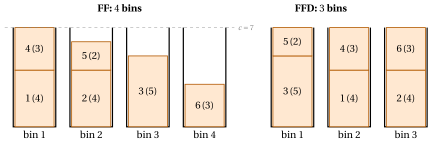

# Constructive heuristics

<div class="info-capitolo" markdown>

**Part 4 · Heuristic algorithms · Chapter 21** · [:material-file-pdf-box: Lecture notes, volume 4 (PDF)](../pdf/lecture-notes-4-heuristic-algorithms.pdf) · [:material-pencil: Exercises: Constructive](../exercises/constructive-heuristics.md) · [:material-gesture-tap: App: Bin packing heuristics](../lab/bin-packing-heuristics.md) · [:material-gesture-tap: App: List scheduling and LPT](../lab/list-scheduling-lpt.md) · [:material-gesture-tap: App: Vertex coloring: greedy and DSATUR](../lab/coloring-greedy-dsatur.md)

</div>

!!! nota "Prerequisites"

    - From this module, the chapter «Heuristic algorithms»: primal and dual bounds, the gap, and the four reference instances.

    - From this module, the chapters on the problems: the KP, the BPP, $P\,||\,C_{\max}$ and the TSP.

!!! chiave "Objectives"

    At the end of this chapter you will be able to:

    - apply the greedy algorithm to the KP with the three orders (profit, weight, efficiency);

    - execute FF, FFD and BFD for the BPP, and LIST and LPT for $P\,||\,C_{\max}$;

    - build a TSP tour by nearest neighbour and by the insertion heuristics;

    - apply randomized construction, regret insertion and the pilot method;

    - compare the results with the dual bounds, and explain when a constructive heuristic fails.

## 21.1 Constructive heuristics { #sez-sec-constructive }

<a id="box-1-def-constructive"></a>

!!! definizione "Definition 21.1: Constructive heuristic"

    A <strong>constructive heuristic</strong> is a heuristic algorithm that builds one feasible solution step by step: it starts from the empty <strong>partial solution</strong> and extends it with one element at a time, until the solution is complete.

- The elements depend on the problem: the items selected for the knapsack, the assignments of items to bins and of jobs to machines, the edges of a tour.

- The quality of the result depends on how the element to add is chosen at every step (Section [21.3](#sez-sec-greedy)).

## 21.2 The problems and the assumptions { #sez-sec-problems }

- The heuristics are illustrated on the four problems of the notes on heuristic algorithms: the knapsack problem (KP), the bin packing problem (BPP), the travelling salesman problem (TSP) and the scheduling problem $P\,||\,C_{\max}$. Their definitions are given in the notes on combinatorial optimization problems, and the assumptions and the notation in the notes on the definitions of heuristic algorithms; we recall the essentials.

- As in the other notes, $\mathscr{A}(I)$ denotes the value of the solution computed by the heuristic $\mathscr{A}$ on the instance $I$, and $z(I)$ the optimal value. For $P\,||\,C_{\max}$, $L_h=\sum_{j\in J_h}t_j$ is the <strong>load</strong> of machine $h$, and the vector $mach$ stores the machine $mach_j$ of every job $j$; for the BPP, the vector $bin$ stores the bin $bin_i$ of every item $i$, and $rc$ denotes a residual capacity.

- The examples use the four <strong>reference instances</strong> of the notes on the definitions of heuristic algorithms, whose optimal values are known:

<div class="tabella" markdown="0"><table>
<tr>
<th>problem</th>
<th>reference instance</th>
<th>optimum</th>
</tr>
<tr>
<td>KP</td>
<td><span class="arithmatex">\(p=(10,7,6,4)\)</span>, <span class="arithmatex">\(w=(5,4,3,3)\)</span>, <span class="arithmatex">\(c=9\)</span></td>
<td><span class="arithmatex">\(\{1,2\}\)</span>, <span class="arithmatex">\(z(I)=17\)</span></td>
</tr>
<tr>
<td>BPP</td>
<td><span class="arithmatex">\(w=(4,4,5,3,2,3)\)</span>, <span class="arithmatex">\(c=7\)</span></td>
<td><span class="arithmatex">\(\{1,4\},\{2,6\},\{3,5\}\)</span>, <span class="arithmatex">\(z(I)=3\)</span></td>
</tr>
<tr>
<td><span class="arithmatex">\(P\,||\,C_{\max}\)</span></td>
<td><span class="arithmatex">\(t=(5,5,4,4,3,3,3)\)</span>, <span class="arithmatex">\(m=3\)</span></td>
<td><span class="arithmatex">\(\{1,3\},\{2,4\},\{5,6,7\}\)</span>, <span class="arithmatex">\(z(I)=9\)</span></td>
</tr>
<tr>
<td>TSP</td>
<td><span class="arithmatex">\(5\)</span> cities, distances below</td>
<td><span class="arithmatex">\(\sigma=(1,3,5,2,4)\)</span>, <span class="arithmatex">\(z(I)=18\)</span></td>
</tr>
</table></div>

- In the figures, the five cities of the TSP reference instance are always drawn in the same positions, on a pentagon, in the order $(1,3,5,2,4)$ of the optimal tour: the optimal tour is then the boundary of the pentagon, and every tour that uses a diagonal is visibly different from it. The figure shows the distances of the instance and, in bold, its optimal tour.

$$
\begin{array}{c|ccccc}
\hline {d_{ij}} & {1} & {2} & {3} & {4} & {5} \\
\hline {1} & --- & {5} & {2} & {2} & {9} \\
{2} & {5} & --- & {4} & {3} & {4} \\
{3} & {2} & {4} & --- & {4} & {7} \\
{4} & {2} & {3} & {4} & --- & {7} \\
{5} & {9} & {4} & {7} & {7} & --- \\
\hline
\end{array}
$$

{ .fig loading=lazy  }

## 21.3 The greedy paradigm { #sez-sec-greedy }

- A solution of each of the four problems is made of <strong>elements</strong>: the items selected for the knapsack, the assignments of items to bins and of jobs to machines, the edges of a tour. A constructive heuristic starts from the empty <strong>partial solution</strong> and adds one element at a time.

- At every step three questions must be answered: <strong>which elements can be added</strong> (the candidates), <strong>which one is added</strong> (the selection criterion), and <strong>whether the result can still be completed to a feasible solution</strong> (the feasibility test). A <strong>greedy</strong> heuristic answers the second question in the simplest way: it adds the candidate that looks best <em>now</em>, according to a criterion that measures the immediate benefit of the element.

<a id="box-2-def-greedy"></a>

!!! definizione "Definition 21.2: Greedy algorithm"

    A <strong>greedy algorithm</strong> is a constructive heuristic that builds a solution by repeatedly selecting, among the candidate elements, the one that is best according to a <em>selection criterion</em>; the element is added to the partial solution if the feasibility test allows it, and is discarded otherwise.

!!! chiave ""

    In a greedy algorithm each decision is taken once and for all: <em>a choice, once made, is never revised</em>.

- The pseudo-code below is a template rather than an algorithm: the set of candidates, the criterion and the test are the three parts that every specific heuristic of these notes fills in.

!!! algoritmo "Algorithm: Greedy template"

    <div class="pseudocodice" markdown="0"><div class="pc" style="--liv:0"><strong>Input:</strong> an instance <span class="arithmatex">\(I\)</span>, the set <span class="arithmatex">\(C\)</span> of the elements of the solutions</div><div class="pc" style="--liv:0"><strong>Output:</strong> a feasible solution <span class="arithmatex">\(S\)</span></div><div class="pc" style="--liv:0"><span class="pc-n">1</span><strong>Function</strong> Greedy(<span class="arithmatex">\(I\)</span>)</div><div class="pc" style="--liv:1"><span class="pc-n">2</span><span class="arithmatex">\(S := \emptyset\)</span> <span class="pc-com">▹ empty partial solution</span></div><div class="pc" style="--liv:1"><span class="pc-n">3</span><strong>while</strong> <span class="arithmatex">\(C \neq \emptyset\)</span> <strong>and</strong> <span class="arithmatex">\(S\)</span> is not complete <strong>do</strong></div><div class="pc" style="--liv:2"><span class="pc-n">4</span><span class="arithmatex">\(e :=\)</span> the best element of <span class="arithmatex">\(C\)</span> according to the selection criterion</div><div class="pc" style="--liv:2"><span class="pc-n">5</span><span class="arithmatex">\(C \leftarrow C \setminus \{e\}\)</span> <span class="pc-com">▹ <span class="arithmatex">\(e\)</span> is examined only once</span></div><div class="pc" style="--liv:2"><span class="pc-n">6</span><strong>if</strong> <span class="arithmatex">\(S \cup \{e\}\)</span> passes the feasibility test <strong>then</strong></div><div class="pc" style="--liv:3"><span class="pc-n">7</span><span class="arithmatex">\(S \leftarrow S \cup \{e\}\)</span> <span class="pc-com">▹ the choice is final</span></div><div class="pc" style="--liv:2"><span class="pc-n">8</span><strong>end</strong></div><div class="pc" style="--liv:1"><span class="pc-n">9</span><strong>end</strong></div><div class="pc" style="--liv:1"><span class="pc-n">10</span><strong>return</strong> <span class="arithmatex">\(S\)</span></div></div>

- <strong>The order decides everything.</strong> The template examines the elements in the order induced by the selection criterion, and an element rejected or accepted early cannot be reconsidered later. Two greedy heuristics with the same candidates and the same feasibility test, but with different criteria, can produce very different solutions: changing the criterion is the main design decision.

- <strong>Static and dynamic criteria.</strong> A criterion is <em>static</em> if the value of an element does not depend on the partial solution: the elements can then be sorted once at the beginning, and the heuristic scans the sorted list (efficiency of the KP items, weight of the BPP items, processing time of the jobs). A criterion is <em>dynamic</em> if the value of an element changes as the solution grows, and it must be recomputed at every step (distance from the last city of a partial tour, residual capacity of the bins, load of the machines).

- <strong>Myopia.</strong> The criterion looks only at the immediate effect of a choice, not at its consequences on the choices still to be made. This is what makes greedy heuristics fast, and also what makes them fail: a choice that is good now can force bad choices later.

- <strong>Running time.</strong> With a static criterion the running time is typically dominated by the sorting, $O(n\log n)$, plus the cost of the feasibility tests; with a dynamic criterion it is the number of steps times the cost of re-evaluating the candidates, typically $O(n^2)$ or $O(n^3)$.

- <strong>When greedy is exact.</strong> For some problems a greedy algorithm always finds an optimal solution: Kruskal's algorithm for the minimum spanning tree problem examines the edges by non-decreasing cost and accepts an edge if it does not close a cycle; the fractional knapsack problem is solved optimally by taking the items by non-increasing efficiency. For the four NP-hard problems of these notes no greedy algorithm is exact, and the question becomes <em>which</em> criterion gives good solutions.

- The following table shows how the template is filled in for the four problems; the sections that follow study each of them.

<div class="tabella" markdown="0"><table>
<tr>
<th>problem</th>
<th>element</th>
<th>selection criterion</th>
<th>feasibility test</th>
</tr>
<tr>
<td>KP</td>
<td>an item</td>
<td>profit, weight or efficiency (static)</td>
<td>the item fits into the residual capacity</td>
</tr>
<tr>
<td>BPP</td>
<td>an item and a bin</td>
<td>item: input order or weight (static); bin: first, best, worst (dynamic)</td>
<td>the item fits into the bin</td>
</tr>
<tr>
<td><span class="arithmatex">\(P\,||\,C_{\max}\)</span></td>
<td>a job and a machine</td>
<td>job: input order or processing time (static); machine: least loaded (dynamic)</td>
<td>always feasible</td>
</tr>
<tr>
<td>TSP</td>
<td>a city and its position</td>
<td>nearest, farthest, cheapest (dynamic)</td>
<td>always feasible</td>
</tr>
</table></div>

## 21.4 The knapsack problem: which order? { #sez-sec-KP }

- For the KP the elements are the items, and the feasibility test is the capacity constraint: an item is selected if its weight does not exceed the residual capacity $rc$. Since the test is fixed, a greedy heuristic for the KP is completely determined by the <strong>order</strong> in which the items are examined. Three orders are natural:

!!! chiave ""

    <div class="tabella" markdown="0"><table>
    <tr>
    <th>by <strong>profit</strong> (<span class="arithmatex">\(GR_{p}\)</span>):</th>
    <th>non-increasing <span class="arithmatex">\(p_i\)</span></th>
    <th>most valuable items first</th>
    </tr>
    <tr>
    <td>by <strong>weight</strong> (<span class="arithmatex">\(GR_{w}\)</span>):</td>
    <td>non-decreasing <span class="arithmatex">\(w_i\)</span></td>
    <td>as many items as possible</td>
    </tr>
    <tr>
    <td>by <strong>efficiency</strong> (<span class="arithmatex">\(GR\)</span>):</td>
    <td>non-increasing <span class="arithmatex">\(\dfrac{p_i}{w_i}\)</span></td>
    <td>best value per unit of weight</td>
    </tr>
    </table></div>

    Ties are broken in favour of the item with the smallest index.

- The greedy by efficiency is the algorithm $GR$ of the notes on approximation algorithms for the KP, where it is analysed together with the Ext-Greedy algorithm $GR^e$; here we compare it with the other two orders.

!!! chiave ""

    The <em>greedy algorithm with order</em> $\rho$ is a constructive heuristic for the KP. It examines the items in the order $\rho=(\rho_1,\dots,\rho_n)$, a permutation of $\mathscr{I}$, starting from the empty knapsack, and selects each item if and only if it fits into the residual capacity.

!!! algoritmo "Algorithm: Greedy with order"

    <div class="pseudocodice" markdown="0"><div class="pc" style="--liv:0"><strong>Input:</strong> KP instance with <span class="arithmatex">\(n\)</span> items, profits <span class="arithmatex">\(p[1..n]\)</span>, weights <span class="arithmatex">\(w[1..n]\)</span>, capacity <span class="arithmatex">\(c\)</span>; order <span class="arithmatex">\(\rho[1..n]\)</span></div><div class="pc" style="--liv:0"><strong>Output:</strong> Feasible KP solution <span class="arithmatex">\(x[1..n]\)</span></div><div class="pc" style="--liv:0"><span class="pc-n">1</span><strong>Function</strong> GreedyOrderKP(<span class="arithmatex">\(n, c, w, p, \rho\)</span>)</div><div class="pc" style="--liv:1"><span class="pc-n">2</span><strong>for</strong> <span class="arithmatex">\(i := 1\)</span> <strong>to</strong> <span class="arithmatex">\(n\)</span> <strong>do</strong></div><div class="pc" style="--liv:2"><span class="pc-n">3</span><span class="arithmatex">\(x[i] \leftarrow 0\)</span> <span class="pc-com">▹ item <span class="arithmatex">\(i\)</span> is initially not selected</span></div><div class="pc" style="--liv:1"><span class="pc-n">4</span><strong>end</strong></div><div class="pc" style="--liv:1"><span class="pc-n">5</span><span class="arithmatex">\(rc := c\)</span> <span class="pc-com">▹ residual capacity</span></div><div class="pc" style="--liv:1"><span class="pc-n">6</span><strong>for</strong> <span class="arithmatex">\(k := 1\)</span> <strong>to</strong> <span class="arithmatex">\(n\)</span> <strong>do</strong></div><div class="pc" style="--liv:2"><span class="pc-n">7</span><span class="arithmatex">\(i := \rho[k]\)</span> <span class="pc-com">▹ <span class="arithmatex">\(k\)</span>-th item in the order</span></div><div class="pc" style="--liv:2"><span class="pc-n">8</span><strong>if</strong> <span class="arithmatex">\(w[i] \le rc\)</span> <strong>then</strong></div><div class="pc" style="--liv:3"><span class="pc-n">9</span><span class="arithmatex">\(x[i] \leftarrow 1\)</span>
    <span class="arithmatex">\(rc \leftarrow rc - w[i]\)</span> <span class="pc-com">▹ select item <span class="arithmatex">\(i\)</span> update residual capacity</span></div><div class="pc" style="--liv:2"><span class="pc-n">10</span><strong>end</strong></div><div class="pc" style="--liv:1"><span class="pc-n">11</span><strong>end</strong></div><div class="pc" style="--liv:1"><span class="pc-n">12</span><strong>return</strong> <span class="arithmatex">\(x\)</span></div></div>

- The three heuristics differ only in the order $\rho$, computed once by sorting the items in $O(n\log n)$ time. Each criterion captures one aspect of a good solution and ignores the other: the profit ignores how much capacity an item consumes, the weight ignores how much an item is worth, and the efficiency balances the two, but ignores how well the items fill the knapsack.

<a id="box-3-ex-kp3"></a>

!!! esempio "Example 21.1: Three orders on the KP reference instance"

    On the KP reference instance ($c=9$) the three orders are

    <div class="tabella" markdown="0"><table>
    <tr>
    <th>criterion</th>
    <th>values</th>
    <th>order <span class="arithmatex">\(\rho\)</span></th>
    </tr>
    <tr>
    <td>profit</td>
    <td><span class="arithmatex">\(p=(10,7,6,4)\)</span></td>
    <td><span class="arithmatex">\((1,2,3,4)\)</span></td>
    </tr>
    <tr>
    <td>weight</td>
    <td><span class="arithmatex">\(w=(5,4,3,3)\)</span></td>
    <td><span class="arithmatex">\((3,4,2,1)\)</span></td>
    </tr>
    <tr>
    <td>efficiency</td>
    <td><span class="arithmatex">\(\frac{p}{w}=\left(\frac{10}{5},\frac{7}{4},\frac{6}{3},\frac{4}{3}\right)=(2,\,1.75,\,2,\,1.33)\)</span></td>
    <td><span class="arithmatex">\((1,3,2,4)\)</span></td>
    </tr>
    </table></div>

    (items $3$ and $4$ have the same weight, items $1$ and $3$ the same efficiency, and the ties are broken by the index). The executions, with the residual capacity after each step, are:

    <div class="tabella" markdown="0"><table>
    <tr>
    <th></th>
    <th>step 1</th>
    <th>step 2</th>
    <th>step 3</th>
    <th>step 4</th>
    </tr>
    <tr>
    <td><span class="arithmatex">\(GR_p\)</span></td>
    <td>item <span class="arithmatex">\(1\)</span>: in, <span class="arithmatex">\(rc=4\)</span></td>
    <td>item <span class="arithmatex">\(2\)</span>: in, <span class="arithmatex">\(rc=0\)</span></td>
    <td>item <span class="arithmatex">\(3\)</span>: out</td>
    <td>item <span class="arithmatex">\(4\)</span>: out</td>
    </tr>
    <tr>
    <td><span class="arithmatex">\(GR_w\)</span></td>
    <td>item <span class="arithmatex">\(3\)</span>: in, <span class="arithmatex">\(rc=6\)</span></td>
    <td>item <span class="arithmatex">\(4\)</span>: in, <span class="arithmatex">\(rc=3\)</span></td>
    <td>item <span class="arithmatex">\(2\)</span>: out</td>
    <td>item <span class="arithmatex">\(1\)</span>: out</td>
    </tr>
    <tr>
    <td><span class="arithmatex">\(GR\)</span></td>
    <td>item <span class="arithmatex">\(1\)</span>: in, <span class="arithmatex">\(rc=4\)</span></td>
    <td>item <span class="arithmatex">\(3\)</span>: in, <span class="arithmatex">\(rc=1\)</span></td>
    <td>item <span class="arithmatex">\(2\)</span>: out</td>
    <td>item <span class="arithmatex">\(4\)</span>: out</td>
    </tr>
    </table></div>

    Hence

    $$
    GR_p(I)=p_1+p_2=17, \qquad GR_w(I)=p_3+p_4=10, \qquad GR(I)=p_1+p_3=16 .
    $$

    The greedy by profit finds the optimal solution $\{1,2\}$, which fills the knapsack exactly; the greedy by efficiency, after items $1$ and $3$, is left with $rc=1$, too little for any other item; the greedy by weight takes the two light items, which are also the least valuable ones.

- On this instance the “naive” criterion wins. This is not a general rule: no order is the best on every instance, and <strong>each of the three orders can be arbitrarily bad</strong>. Let $c\ge 3$:

    - <strong>profit</strong>: one item with $p_1=2$, $w_1=c$ and $c$ items with $p_i=1$, $w_i=1$. $GR_p$ takes item $1$, which fills the knapsack: $GR_p(I)=2$, while the $c$ light items together give $z(I)=c$;

    - <strong>weight</strong>: two items with $p_1=1$, $w_1=1$ and $p_2=c$, $w_2=c$. $GR_w$ takes item $1$ and item $2$ no longer fits: $GR_w(I)=1$, while $z(I)=c$;

    - <strong>efficiency</strong>: two items with $p_1=2$, $w_1=1$ and $p_2=c$, $w_2=c$: this is the instance used in the notes on approximation algorithms to show that $r(GR)=+\infty$; here $GR(I)=2$ and $z(I)=c$.

    In all three cases the ratio $\frac{z(I)}{\mathscr{A}(I)}$ grows with $c$.

- The remedy studied in the notes on approximation algorithms is to <strong>combine</strong> two solutions: the Ext-Greedy algorithm returns the better of the solution of $GR$ and of the best single item, and this simple combination guarantees $\frac{z(I)}{GR^e(I)}\le 2$. Running several greedy heuristics and keeping the best solution is a general and cheap way to protect against the weakness of each single criterion.

## 21.5 The bin packing problem: first sort, then pack { #sez-sec-BPP }

- The notes on approximation algorithms for the BPP study four greedy heuristics that process the items <strong>in the input order</strong> and differ in the rule used to choose the bin: Next Fit (NF) keeps a single open bin, while First Fit (FF), Best Fit (BF) and Worst Fit (WF) keep all the bins and choose, among those in which the item fits, the first opened, the fullest or the emptiest one. On the BPP reference instance ($c=7$, $w=(4,4,5,3,2,3)$, $z(I)=3$) they give

    $$
    NF(I)=5, \qquad FF(I)=4, \qquad BF(I)=3, \qquad WF(I)=4 .
    $$

- In those heuristics the <em>bin</em> is chosen by a criterion, but the <em>item</em> is not: the items arrive in the order of the input, which may be a bad one. When the whole instance is known in advance — the <em>offline</em> setting — nothing forces us to accept that order. The idea of this section is to choose the order of the items too: <strong>first sort, then pack</strong>.

- <strong>Why the large items first.</strong> The difficult items of a BPP instance are the large ones: two items larger than $\frac{c}{2}$ never share a bin, and a large item fits only into a bin that is still almost empty. Small items, on the contrary, can fill the gaps left in any bin. If the small items come first, they are spread over the bins and occupy the space that the large items will need later; if the large items come first, each of them gets its own bin, and the small items are then used to fill the gaps.

### 21.5.1 First Fit Decreasing { #sez-sec-FFD }

!!! chiave ""

    The <em>First Fit Decreasing Algorithm</em> (denoted by FFD) is a constructive heuristic for the BPP. It first sorts the items by non-increasing weight, and then packs them in this order by First Fit: each item is packed into the first bin, in the order in which the bins were opened, in which it fits; if it fits into no bin, a new bin is opened.

!!! algoritmo "Algorithm: First Fit Decreasing"

    <div class="pseudocodice" markdown="0"><div class="pc" style="--liv:0"><strong>Input:</strong> BPP instance <span class="arithmatex">\(I\)</span> with <span class="arithmatex">\(n\)</span> items, weights <span class="arithmatex">\(w[1..n]\)</span>, capacity <span class="arithmatex">\(c\)</span></div><div class="pc" style="--liv:0"><strong>Output:</strong> Item-bin assignment <span class="arithmatex">\(bin[1..n]\)</span> and number of used bins <span class="arithmatex">\(nb\)</span></div><div class="pc" style="--liv:0"><span class="pc-n">1</span><strong>Function</strong> FirstFitDecreasing(<span class="arithmatex">\(n, w, c\)</span>)</div><div class="pc" style="--liv:1"><span class="pc-n">2</span><span class="arithmatex">\(\rho :=\)</span> the items sorted by non-increasing weight
    <span class="arithmatex">\(bin := \text{new array}[1..n]\)</span>
    <span class="arithmatex">\(rc := \text{new array}[1..n]\)</span>
    <span class="arithmatex">\(nb := 0\)</span> <span class="pc-com">▹ first sort item-bin assignment residual capacities number of bins</span></div><div class="pc" style="--liv:1"><span class="pc-n">3</span><strong>for</strong> <span class="arithmatex">\(k := 1\)</span> <strong>to</strong> <span class="arithmatex">\(n\)</span> <strong>do</strong></div><div class="pc" style="--liv:2"><span class="pc-n">4</span><span class="arithmatex">\(i := \rho[k]\)</span>
    <span class="arithmatex">\(s := -1\)</span> <span class="pc-com">▹ then pack: <span class="arithmatex">\(k\)</span>-th largest item selected bin</span></div><div class="pc" style="--liv:2"><span class="pc-n">5</span><strong>for</strong> <span class="arithmatex">\(b := 1\)</span> <strong>to</strong> <span class="arithmatex">\(nb\)</span> <strong>do</strong></div><div class="pc" style="--liv:3"><span class="pc-n">6</span><strong>if</strong> <span class="arithmatex">\(w[i] \le rc[b]\)</span> <strong>then</strong></div><div class="pc" style="--liv:4"><span class="pc-n">7</span><span class="arithmatex">\(s \leftarrow b\)</span></div><div class="pc" style="--liv:4"><span class="pc-n">8</span><strong>break</strong></div><div class="pc" style="--liv:3"><span class="pc-n">9</span><strong>end</strong></div><div class="pc" style="--liv:2"><span class="pc-n">10</span><strong>end</strong></div><div class="pc" style="--liv:2"><span class="pc-n">11</span><strong>if</strong> <span class="arithmatex">\(s = -1\)</span> <strong>then</strong></div><div class="pc" style="--liv:3"><span class="pc-n">12</span><span class="arithmatex">\(nb \leftarrow nb + 1\)</span> 
    <span class="arithmatex">\(rc[nb] \leftarrow c\)</span> <span class="pc-com">▹ open new bin</span></div><div class="pc" style="--liv:3"><span class="pc-n">13</span><span class="arithmatex">\(s \leftarrow nb\)</span></div><div class="pc" style="--liv:2"><span class="pc-n">14</span><strong>end</strong></div><div class="pc" style="--liv:2"><span class="pc-n">15</span><span class="arithmatex">\(bin[i] \leftarrow s\)</span> 
    <span class="arithmatex">\(rc[s] \leftarrow rc[s] - w[i]\)</span> <span class="pc-com">▹ assign item</span></div><div class="pc" style="--liv:1"><span class="pc-n">16</span><strong>end</strong></div><div class="pc" style="--liv:1"><span class="pc-n">17</span><strong>return</strong> <span class="arithmatex">\(bin\)</span>, <span class="arithmatex">\(nb\)</span></div></div>

- The packing loop is exactly the loop of FF: the only difference is the line that computes the order $\rho$. Sorting costs $O(n\log n)$, and FFD runs in the same time as FF, $O(n^2)$ with the simple scan of the bins.

<a id="box-4-ex-ffd"></a>

!!! esempio "Example 21.2: FF and FFD on the BPP reference instance"

    <strong>FF</strong>, in the input order: items $1$, $2$ and $3$ (weights $4,4,5$) open one bin each, because no two of them fit together; item $4$ (weight $3$) goes into bin $1$ ($rc[1]=0$); item $5$ (weight $2$) goes into bin $2$ ($rc[2]=1$); item $6$ (weight $3$) fits into no bin, whose residual capacities are $0,1,2$, and opens bin $4$. Hence $FF(I)=4$.

    <strong>FFD</strong>. The weights sorted by non-increasing value are $5,4,4,3,3,2$, i.e., $\rho=(3,1,2,4,6,5)$ (ties by index). Then:

    1. Item $3$ (weight $5$): no bin is open, FFD opens bin $1$; $rc[1]=7-5=2$.

    2. Item $1$ (weight $4$): $4> rc[1]=2$, FFD opens bin $2$; $rc[2]=7-4=3$.

    3. Item $2$ (weight $4$): $4>rc[1]=2$, $4>rc[2]=3$, FFD opens bin $3$; $rc[3]=7-4=3$.

    4. Item $4$ (weight $3$): $3>rc[1]=2$, $3\le rc[2]=3$: bin $2$; $rc[2]=0$.

    5. Item $6$ (weight $3$): $3>rc[1]=2$, $3>rc[2]=0$, $3\le rc[3]=3$: bin $3$; $rc[3]=0$.

    6. Item $5$ (weight $2$): $2\le rc[1]=2$: bin $1$; $rc[1]=0$.

    Hence $bin=(2,3,1,2,1,3)$, the packing patterns are

    $$
    P_1=\{3,5\}, \qquad P_2=\{1,4\}, \qquad P_3=\{2,6\},
    $$

    and $FFD(I)=3=\left\lceil\frac{21}{7}\right\rceil$: the solution is optimal, and all three bins are full.

    { .fig loading=lazy  }

    In FF the small item $5$ arrives before the large item $6$ and takes the space that item $6$ would need in bin $2$; in FFD item $5$ comes last and fills the gap of bin $1$.

### 21.5.2 Best Fit Decreasing { #sez-sec-BFD }

!!! chiave ""

    The <em>Best Fit Decreasing Algorithm</em> (denoted by BFD) is a constructive heuristic for the BPP. It first sorts the items by non-increasing weight, and then packs them in this order by Best Fit: each item is packed into the bin with the smallest residual capacity among those in which it fits (in case of ties, the bin opened first); if it fits into no bin, a new bin is opened.

!!! algoritmo "Algorithm: Best Fit Decreasing"

    <div class="pseudocodice" markdown="0"><div class="pc" style="--liv:0"><strong>Input:</strong> BPP instance <span class="arithmatex">\(I\)</span> with <span class="arithmatex">\(n\)</span> items, weights <span class="arithmatex">\(w[1..n]\)</span>, capacity <span class="arithmatex">\(c\)</span></div><div class="pc" style="--liv:0"><strong>Output:</strong> Item-bin assignment <span class="arithmatex">\(bin[1..n]\)</span> and number of used bins <span class="arithmatex">\(nb\)</span></div><div class="pc" style="--liv:0"><span class="pc-n">1</span><strong>Function</strong> BestFitDecreasing(<span class="arithmatex">\(n, w, c\)</span>)</div><div class="pc" style="--liv:1"><span class="pc-n">2</span><span class="arithmatex">\(\rho :=\)</span> the items sorted by non-increasing weight
    <span class="arithmatex">\(bin := \text{new array}[1..n]\)</span>
    <span class="arithmatex">\(rc := \text{new array}[1..n]\)</span>
    <span class="arithmatex">\(nb := 0\)</span> <span class="pc-com">▹ first sort item-bin assignment residual capacities number of bins</span></div><div class="pc" style="--liv:1"><span class="pc-n">3</span><strong>for</strong> <span class="arithmatex">\(k := 1\)</span> <strong>to</strong> <span class="arithmatex">\(n\)</span> <strong>do</strong></div><div class="pc" style="--liv:2"><span class="pc-n">4</span><span class="arithmatex">\(i := \rho[k]\)</span>
    <span class="arithmatex">\(s := -1\)</span> <span class="pc-com">▹ then pack: <span class="arithmatex">\(k\)</span>-th largest item selected bin</span></div><div class="pc" style="--liv:2"><span class="pc-n">5</span><strong>for</strong> <span class="arithmatex">\(b := 1\)</span> <strong>to</strong> <span class="arithmatex">\(nb\)</span> <strong>do</strong></div><div class="pc" style="--liv:3"><span class="pc-n">6</span><strong>if</strong> <span class="arithmatex">\(w[i] \le rc[b]\)</span> <strong>and</strong> <span class="arithmatex">\((s=-1\)</span> <strong>or</strong> <span class="arithmatex">\(rc[b] < rc[s])\)</span> <strong>then</strong></div><div class="pc" style="--liv:4"><span class="pc-n">7</span><span class="arithmatex">\(s \leftarrow b\)</span> <span class="pc-com">▹ fullest bin found so far</span></div><div class="pc" style="--liv:3"><span class="pc-n">8</span><strong>end</strong></div><div class="pc" style="--liv:2"><span class="pc-n">9</span><strong>end</strong></div><div class="pc" style="--liv:2"><span class="pc-n">10</span><strong>if</strong> <span class="arithmatex">\(s = -1\)</span> <strong>then</strong></div><div class="pc" style="--liv:3"><span class="pc-n">11</span><span class="arithmatex">\(nb \leftarrow nb + 1\)</span> 
    <span class="arithmatex">\(rc[nb] \leftarrow c\)</span> <span class="pc-com">▹ open new bin</span></div><div class="pc" style="--liv:3"><span class="pc-n">12</span><span class="arithmatex">\(s \leftarrow nb\)</span></div><div class="pc" style="--liv:2"><span class="pc-n">13</span><strong>end</strong></div><div class="pc" style="--liv:2"><span class="pc-n">14</span><span class="arithmatex">\(bin[i] \leftarrow s\)</span> 
    <span class="arithmatex">\(rc[s] \leftarrow rc[s] - w[i]\)</span> <span class="pc-com">▹ assign item</span></div><div class="pc" style="--liv:1"><span class="pc-n">15</span><strong>end</strong></div><div class="pc" style="--liv:1"><span class="pc-n">16</span><strong>return</strong> <span class="arithmatex">\(bin\)</span>, <span class="arithmatex">\(nb\)</span></div></div>

- Again, the packing loop is that of BF, preceded by the sorting.

<a id="box-5-ex-bfd"></a>

!!! esempio "Example 21.3: BFD on the BPP reference instance"

    The order is $\rho=(3,1,2,4,6,5)$, as for FFD. Items $3$, $1$ and $2$ open bins $1$, $2$, $3$, with residual capacities $2,3,3$. Item $4$ (weight $3$) fits into bins $2$ and $3$, both with residual capacity $3$: the tie is broken in favour of bin $2$, and $rc[2]=0$. Item $6$ (weight $3$) fits only into bin $3$, and $rc[3]=0$. Item $5$ (weight $2$) fits only into bin $1$, and $rc[1]=0$. BFD returns the same packing patterns as FFD, $P_1=\{3,5\}$, $P_2=\{1,4\}$, $P_3=\{2,6\}$, and $BFD(I)=3$.

### 21.5.3 What sorting gives, and what it does not

- <strong>A better guarantee.</strong> Sorting the items improves the worst case. The notes on approximation algorithms show that FF and BF have worst-case performance ratio $\frac{17}{10}$. For FFD it is known that

    $$
    FFD(I) \;\le\; \frac{11}{9}\, z(I) + \frac{6}{9} \qquad \text{for every BPP instance } I,
    $$

    and that the bound is tight. A bound of the form $\frac{11}{9}z(I)+4$ was first proved for both FFD and BFD by D.S. Johnson, A. Demers, J.D. Ullman, M.R. Garey and R.L. Graham (<em>Worst-case performance bounds for simple one-dimensional packing algorithms</em>, SIAM Journal on Computing 3 (1974) 299–325); the tight additive constant is due to G. Dósa (<em>The tight bound of First Fit Decreasing bin-packing algorithm is $FFD(I)\le 11/9\,OPT(I)+6/9$</em>, ESCAPE 2007, LNCS 4614, pp. 1–11).

- <strong>Not a better solution on every instance.</strong> A worst-case guarantee compares the algorithm with the optimum, not with another algorithm: on some instances the input order is luckier than the sorted one.

<a id="box-6-ex-ffdworse"></a>

!!! esempio "Example 21.4: Sorting can hurt"

    Let $c=7$ and $w=(2,2,3,2,2,3)$, with total weight $14$, so that $z(I)\ge\left\lceil\frac{14}{7}\right\rceil=2$.

    <strong>FF</strong> packs items $1,2,3$ into bin $1$ ($2+2+3=7$) and items $4,5,6$ into bin $2$ ($2+2+3=7$): $FF(I)=2$, which is optimal.

    <strong>FFD</strong> examines the items in the order $\rho=(3,6,1,2,4,5)$. Items $3$ and $6$ go into bin $1$ ($rc[1]=1$); items $1$, $2$, $4$ do not fit into bin $1$ and go into bin $2$ ($rc[2]=1$); item $5$ fits into neither bin and opens bin $3$: $FFD(I)=3$.

    The two items of weight $3$, packed together by FFD, waste one unit of capacity in bin $1$; the input order happened to pair each of them with two items of weight $2$, filling both bins exactly.

## 21.6 Scheduling on parallel machines: longest jobs first { #sez-sec-PCM }

- For $P\,||\,C_{\max}$ the elements are the assignments of jobs to machines, and every assignment is feasible. A natural greedy rule assigns each job to the machine that is currently <strong>least loaded</strong>, so that the loads grow as evenly as possible. As for the BPP, the rule chooses the machine, and the order of the jobs is a second, independent, choice.

### 21.6.1 List scheduling { #sez-sec-LIST }

!!! chiave ""

    The <em>List Scheduling Algorithm</em> (denoted by $LIST$) is a constructive heuristic for $P\,||\,C_{\max}$. It examines the jobs in the order of a given list $\rho$ and assigns each job to a machine with the smallest current load (in case of ties, the machine with the smallest index).

!!! algoritmo "Algorithm: List Scheduling"

    <div class="pseudocodice" markdown="0"><div class="pc" style="--liv:0"><strong>Input:</strong> <span class="arithmatex">\(P\,||\,C_{\max}\)</span> instance with <span class="arithmatex">\(n\)</span> jobs, times <span class="arithmatex">\(t[1..n]\)</span>, <span class="arithmatex">\(m\)</span> machines; list <span class="arithmatex">\(\rho[1..n]\)</span></div><div class="pc" style="--liv:0"><strong>Output:</strong> Job-machine assignment <span class="arithmatex">\(mach[1..n]\)</span> and makespan <span class="arithmatex">\(C_{\max}\)</span></div><div class="pc" style="--liv:0"><span class="pc-n">1</span><strong>Function</strong> ListScheduling(<span class="arithmatex">\(n, m, t, \rho\)</span>)</div><div class="pc" style="--liv:1"><span class="pc-n">2</span><span class="arithmatex">\(mach := \text{new array}[1..n]\)</span> <span class="pc-com">▹ job-machine assignment</span></div><div class="pc" style="--liv:1"><span class="pc-n">3</span><strong>for</strong> <span class="arithmatex">\(h := 1\)</span> <strong>to</strong> <span class="arithmatex">\(m\)</span> <strong>do</strong></div><div class="pc" style="--liv:2"><span class="pc-n">4</span><span class="arithmatex">\(L[h] \leftarrow 0\)</span> <span class="pc-com">▹ loads of the machines</span></div><div class="pc" style="--liv:1"><span class="pc-n">5</span><strong>end</strong></div><div class="pc" style="--liv:1"><span class="pc-n">6</span><strong>for</strong> <span class="arithmatex">\(k := 1\)</span> <strong>to</strong> <span class="arithmatex">\(n\)</span> <strong>do</strong></div><div class="pc" style="--liv:2"><span class="pc-n">7</span><span class="arithmatex">\(j := \rho[k]\)</span>
    <span class="arithmatex">\(s :=\)</span> a machine with minimum <span class="arithmatex">\(L[s]\)</span> (smallest index)
    <span class="arithmatex">\(mach[j] \leftarrow s\)</span>
    <span class="arithmatex">\(L[s] \leftarrow L[s] + t[j]\)</span> <span class="pc-com">▹ <span class="arithmatex">\(k\)</span>-th job of the list least loaded machine assign job <span class="arithmatex">\(j\)</span> to machine <span class="arithmatex">\(s\)</span></span></div><div class="pc" style="--liv:1"><span class="pc-n">8</span><strong>end</strong></div><div class="pc" style="--liv:1"><span class="pc-n">9</span><strong>return</strong> <span class="arithmatex">\(mach\)</span>, <span class="arithmatex">\(C_{\max}=\max_h L[h]\)</span></div></div>

- $LIST$ is the scheduling counterpart of an <em>online</em> rule: it does not need to know the future jobs, and it is used, for example, when jobs arrive one at a time. With a linear scan of the machines it runs in $O(nm)$ time, and in $O(n\log m)$ time with a heap of the loads.

- On the reference instance, $t=(5,5,4,4,3,3,3)$, the jobs are listed by non-increasing processing time, which is a favourable order. To see the effect of the order, the example examines the same jobs in the reverse list.

<a id="box-7-ex-list"></a>

!!! esempio "Example 21.5: $LIST$ on the reference instance, shortest jobs first"

    Consider the list $\rho=(7,6,5,4,3,2,1)$, i.e., the jobs by non-decreasing processing time. The loads before each assignment and the chosen machine are:

    <div class="tabella" markdown="0"><table>
    <tr>
    <th>job <span class="arithmatex">\(j\)</span></th>
    <th><span class="arithmatex">\(t_j\)</span></th>
    <th>loads <span class="arithmatex">\((L_1,L_2,L_3)\)</span> before</th>
    <th>machine</th>
    </tr>
    <tr>
    <td><span class="arithmatex">\(7\)</span></td>
    <td><span class="arithmatex">\(3\)</span></td>
    <td><span class="arithmatex">\((0,0,0)\)</span></td>
    <td><span class="arithmatex">\(1\)</span></td>
    </tr>
    <tr>
    <td><span class="arithmatex">\(6\)</span></td>
    <td><span class="arithmatex">\(3\)</span></td>
    <td><span class="arithmatex">\((3,0,0)\)</span></td>
    <td><span class="arithmatex">\(2\)</span></td>
    </tr>
    <tr>
    <td><span class="arithmatex">\(5\)</span></td>
    <td><span class="arithmatex">\(3\)</span></td>
    <td><span class="arithmatex">\((3,3,0)\)</span></td>
    <td><span class="arithmatex">\(3\)</span></td>
    </tr>
    <tr>
    <td><span class="arithmatex">\(4\)</span></td>
    <td><span class="arithmatex">\(4\)</span></td>
    <td><span class="arithmatex">\((3,3,3)\)</span></td>
    <td><span class="arithmatex">\(1\)</span></td>
    </tr>
    <tr>
    <td><span class="arithmatex">\(3\)</span></td>
    <td><span class="arithmatex">\(4\)</span></td>
    <td><span class="arithmatex">\((7,3,3)\)</span></td>
    <td><span class="arithmatex">\(2\)</span></td>
    </tr>
    <tr>
    <td><span class="arithmatex">\(2\)</span></td>
    <td><span class="arithmatex">\(5\)</span></td>
    <td><span class="arithmatex">\((7,7,3)\)</span></td>
    <td><span class="arithmatex">\(3\)</span></td>
    </tr>
    <tr>
    <td><span class="arithmatex">\(1\)</span></td>
    <td><span class="arithmatex">\(5\)</span></td>
    <td><span class="arithmatex">\((7,7,8)\)</span></td>
    <td><span class="arithmatex">\(1\)</span></td>
    </tr>
    </table></div>

    The final loads are $(12,7,8)$, with $J_1=\{7,4,1\}$, $J_2=\{6,3\}$, $J_3=\{5,2\}$, and $LIST(I)=12$:

    { .fig loading=lazy  }

    The last job of the list is one of the longest: when it arrives, the least loaded machine already has load $7$, and the makespan jumps to $12$, three units above the lower bound $9$ (dashed grey line).

<a id="box-8-prop-graham66"></a>

!!! teorema "Proposition 21.3"

    For every $P\,||\,C_{\max}$ instance $I$ and every list $\rho$,

    $$
    LIST(I) \;\le\; \left(2-\frac{1}{m}\right) z(I) .
    $$

??? dimostrazione "Proof"

    Proof omitted. The result is due to

    R.L. Graham, <em>Bounds for certain multiprocessing anomalies</em>, Bell System Technical Journal 45 (1966) 1563–1581. <span class="qed">□</span>

!!! chiave ""

    $LIST$ is a $\left(2-\frac{1}{m}\right)$-approximation algorithm for $P\,||\,C_{\max}$, whatever the order of the list.

- On the example, $LIST(I)=12\le \frac{5}{3}\cdot 9=15$.

### 21.6.2 Longest processing time first { #sez-sec-LPT }

!!! chiave ""

    The <em>Longest Processing Time first Algorithm</em> (denoted by $LPT$) is a constructive heuristic for $P\,||\,C_{\max}$. It sorts the jobs by non-increasing processing time and applies $LIST$ to this list: each job, from the longest to the shortest, is assigned to a least loaded machine.

!!! algoritmo "Algorithm: Longest Processing Time first"

    <div class="pseudocodice" markdown="0"><div class="pc" style="--liv:0"><strong>Input:</strong> <span class="arithmatex">\(P\,||\,C_{\max}\)</span> instance with <span class="arithmatex">\(n\)</span> jobs, times <span class="arithmatex">\(t[1..n]\)</span>, <span class="arithmatex">\(m\)</span> machines</div><div class="pc" style="--liv:0"><strong>Output:</strong> Job-machine assignment <span class="arithmatex">\(mach[1..n]\)</span> and makespan <span class="arithmatex">\(C_{\max}\)</span></div><div class="pc" style="--liv:0"><span class="pc-n">1</span><strong>Function</strong> LPT(<span class="arithmatex">\(n, m, t\)</span>)</div><div class="pc" style="--liv:1"><span class="pc-n">2</span><span class="arithmatex">\(\rho :=\)</span> the jobs sorted by non-increasing <span class="arithmatex">\(t[j]\)</span> (ties by index) <span class="pc-com">▹ longest jobs first</span></div><div class="pc" style="--liv:1"><span class="pc-n">3</span><strong>return</strong> ListScheduling(<span class="arithmatex">\(n, m, t, \rho\)</span>)</div></div>

- <strong>Why the longest jobs first.</strong> The makespan is decided by the job that finishes last. If the jobs are short at the end of the list, the last assignments can only add a little to the least loaded machine, and they act as “sand” that levels the loads. The parallel with FFD is exact: the large elements first, the small ones to fill the gaps.

- $LPT$ runs in $O(n\log n + n\log m)$ time.

<a id="box-9-ex-lpt"></a>

!!! esempio "Example 21.6: $LPT$ on the reference instance"

    The jobs are already sorted, $\rho=(1,2,3,4,5,6,7)$. Jobs $1$, $2$, $3$ go to the three empty machines, with loads $(5,5,4)$; job $4$ goes to machine $3$, the least loaded: $(5,5,8)$; job $5$ goes to machine $1$: $(8,5,8)$; job $6$ to machine $2$: $(8,8,8)$; job $7$ finds three machines with load $8$ and goes to machine $1$: $(11,8,8)$. Hence $J_1=\{1,5,7\}$, $J_2=\{2,6\}$, $J_3=\{3,4\}$, $mach=(1,2,3,3,1,2,1)$, and $LPT(I)=11$:

    { .fig loading=lazy  }

    The elementary lower bound of the notes on combinatorial optimization problems, already used in the notes on the definitions of heuristic algorithms, gives $z(I)\ge\max\left\{\max_j t_j,\left\lceil\frac{\sum_j t_j}{m}\right\rceil\right\}=\max\{5,9\}=9$, and $z(I)=9$. Sorting improves the makespan from $12$ to $11$, but $LPT$ is not optimal: after six jobs the loads are perfectly balanced, $(8,8,8)$, and the seventh job unbalances them by $3$.

<a id="box-10-prop-graham69"></a>

!!! teorema "Proposition 21.4"

    For every $P\,||\,C_{\max}$ instance $I$,

    $$
    LPT(I) \;\le\; \left(\frac{4}{3}-\frac{1}{3m}\right) z(I) .
    $$

??? dimostrazione "Proof"

    Proof omitted. The result is due to

    R.L. Graham, <em>Bounds on multiprocessing timing anomalies</em>, SIAM Journal on Applied Mathematics 17 (1969) 416–429. <span class="qed">□</span>

!!! chiave ""

    $LPT$ is a $\left(\frac{4}{3}-\frac{1}{3m}\right)$-approximation algorithm for $P\,||\,C_{\max}$: sorting the list lowers the guarantee of $LIST$ from $2-\frac{1}{m}$ to $\frac{4}{3}-\frac{1}{3m}$.

- For $m=3$ the bound is $\frac{4}{3}-\frac{1}{9}=\frac{11}{9}$, and on the reference instance

    $$
    \frac{LPT(I)}{z(I)}=\frac{11}{9}.
    $$

    The reference instance attains Graham's bound exactly: it belongs to the family of instances, given by Graham, with $2m+1$ jobs of processing times $2m-1,2m-1,2m-2,2m-2,\dots,m+1,m+1,m,m,m$, on which $LPT$ gives $4m-1$ and the optimum is $3m$. For $m=3$ these are the times $(5,5,4,4,3,3,3)$. The bound of [Proposition 21.4](#box-10-prop-graham69) therefore cannot be improved.

## 21.7 The travelling salesman problem: append or insert? { #sez-sec-TSP }

- For the TSP every permutation of the cities is a feasible tour, so the feasibility test is trivial, and the whole design is in the selection criterion. Two families of constructive heuristics are natural, and they differ in <strong>where</strong> the new city is placed:

    - <strong>append</strong>: the partial solution is a path, and the new city is added at its end;

    - <strong>insert</strong>: the partial solution is a closed subtour, and the new city is inserted between two consecutive cities, wherever it costs least.

### 21.7.1 Nearest neighbour { #sez-sec-NN }

!!! chiave ""

    The <em>Nearest Neighbour Algorithm</em> (denoted by $NN$) is a constructive heuristic for the TSP. Starting from a given city $s$, it repeatedly moves from the last visited city to the <em>nearest</em> city not yet visited (in case of ties, the one with the smallest index); when all the cities have been visited, it goes back to $s$.

!!! algoritmo "Algorithm: Nearest Neighbour"

    <div class="pseudocodice" markdown="0"><div class="pc" style="--liv:0"><strong>Input:</strong> TSP instance with <span class="arithmatex">\(n\)</span> cities, distances <span class="arithmatex">\(d[1..n][1..n]\)</span>; starting city <span class="arithmatex">\(s\)</span></div><div class="pc" style="--liv:0"><strong>Output:</strong> Tour <span class="arithmatex">\(\sigma[1..n]\)</span></div><div class="pc" style="--liv:0"><span class="pc-n">1</span><strong>Function</strong> NearestNeighbour(<span class="arithmatex">\(n, d, s\)</span>)</div><div class="pc" style="--liv:1"><span class="pc-n">2</span><span class="arithmatex">\(\sigma[1] \leftarrow s\)</span>
    <span class="arithmatex">\(visited := \{s\}\)</span> <span class="pc-com">▹ the path starts at <span class="arithmatex">\(s\)</span></span></div><div class="pc" style="--liv:1"><span class="pc-n">3</span><strong>for</strong> <span class="arithmatex">\(len := 2\)</span> <strong>to</strong> <span class="arithmatex">\(n\)</span> <strong>do</strong></div><div class="pc" style="--liv:2"><span class="pc-n">4</span><span class="arithmatex">\(last := \sigma[len-1]\)</span>
    <span class="arithmatex">\(k :=\)</span> the city <span class="arithmatex">\(j\notin visited\)</span> with minimum <span class="arithmatex">\(d[last][j]\)</span> (smallest index) <span class="pc-com">▹ last city of the path</span></div><div class="pc" style="--liv:2"><span class="pc-n">5</span><span class="arithmatex">\(\sigma[len] \leftarrow k\)</span>
    <span class="arithmatex">\(visited \leftarrow visited \cup \{k\}\)</span> <span class="pc-com">▹ append <span class="arithmatex">\(k\)</span> at the end</span></div><div class="pc" style="--liv:1"><span class="pc-n">6</span><strong>end</strong></div><div class="pc" style="--liv:1"><span class="pc-n">7</span><strong>return</strong> <span class="arithmatex">\(\sigma\)</span> <span class="pc-com">▹ the tour closes with the edge <span class="arithmatex">\((\sigma[n],s)\)</span></span></div></div>

- The criterion is dynamic: the distances that matter are those from the last city, which changes at every step. $NN$ runs in $O(n^2)$ time.

- <strong>The weakness of $NN$</strong> is visible in its last steps: the cities that are left are those that were never the nearest to anything, often far from each other and from $s$, and the closing edge back to $s$ is not chosen at all, it is forced.

<a id="box-11-ex-nn"></a>

!!! esempio "Example 21.7: $NN$ on the TSP reference instance"

    Starting from city $1$:

    1. from city $1$ the distances to $2,3,4,5$ are $5,2,2,9$: cities $3$ and $4$ are the nearest, and the tie is broken in favour of city $3$;

    2. from city $3$ the distances to $2,4,5$ are $4,4,7$: city $2$ (tie with $4$);

    3. from city $2$ the distances to $4,5$ are $3,4$: city $4$;

    4. from city $4$ only city $5$ is left, at distance $7$;

    5. the tour closes with the edge $(5,1)$, of length $9$.

    Hence $\sigma=(1,3,2,4,5)$ and

    $$
    NN(I)=d_{13}+d_{32}+d_{24}+d_{45}+d_{51}=2+4+3+7+9=25 ,
    $$

    $39\%$ more than $z(I)=18$; this is the tour used in the notes on the definitions of heuristic algorithms to illustrate the gap. The four edges chosen by the criterion have length $2+4+3+7=16$, and the forced closing edge alone costs $9$, the largest distance of the instance.

    { .fig loading=lazy  }

### 21.7.2 Multi-start nearest neighbour { #sez-sec-MSNN }

- The result of $NN$ depends on the starting city, which is an arbitrary choice: the tour is a cycle and has no natural first city. Since $NN$ is fast, it can simply be run from every city.

!!! chiave ""

    The <em>multi-start nearest neighbour algorithm</em> runs $NN$ once from every city $s\in\mathscr{V}$ and returns the shortest of the $n$ tours obtained (in case of ties, the first one found).

!!! algoritmo "Algorithm: Multi-start Nearest Neighbour"

    <div class="pseudocodice" markdown="0"><div class="pc" style="--liv:0"><strong>Input:</strong> TSP instance with <span class="arithmatex">\(n\)</span> cities, distances <span class="arithmatex">\(d[1..n][1..n]\)</span></div><div class="pc" style="--liv:0"><strong>Output:</strong> Tour <span class="arithmatex">\(\sigma^{best}[1..n]\)</span></div><div class="pc" style="--liv:0"><span class="pc-n">1</span><strong>Function</strong> MultiStartNN(<span class="arithmatex">\(n, d\)</span>)</div><div class="pc" style="--liv:1"><span class="pc-n">2</span><span class="arithmatex">\(L^{best} := +\infty\)</span></div><div class="pc" style="--liv:1"><span class="pc-n">3</span><strong>for</strong> <span class="arithmatex">\(s := 1\)</span> <strong>to</strong> <span class="arithmatex">\(n\)</span> <strong>do</strong></div><div class="pc" style="--liv:2"><span class="pc-n">4</span><span class="arithmatex">\(\sigma :=\)</span> NearestNeighbour(<span class="arithmatex">\(n, d, s\)</span>)</div><div class="pc" style="--liv:2"><span class="pc-n">5</span><strong>if</strong> <span class="arithmatex">\(L(\sigma) < L^{best}\)</span> <strong>then</strong></div><div class="pc" style="--liv:3"><span class="pc-n">6</span><span class="arithmatex">\(\sigma^{best} \leftarrow \sigma\)</span>, <span class="arithmatex">\(L^{best} \leftarrow L(\sigma)\)</span> <span class="pc-com">▹ new best tour</span></div><div class="pc" style="--liv:2"><span class="pc-n">7</span><strong>end</strong></div><div class="pc" style="--liv:1"><span class="pc-n">8</span><strong>end</strong></div><div class="pc" style="--liv:1"><span class="pc-n">9</span><strong>return</strong> <span class="arithmatex">\(\sigma^{best}\)</span></div></div>

- The running time is $n$ times that of $NN$, i.e., $O(n^3)$. Multi-start is the simplest way to turn an arbitrary choice into a search: each start gives a different solution, and the best one is kept.

<a id="box-12-ex-msnn"></a>

!!! esempio "Example 21.8: Multi-start $NN$ on the TSP reference instance"

    The five runs of $NN$ give

    <div class="tabella" markdown="0"><table>
    <tr>
    <th>start <span class="arithmatex">\(s\)</span></th>
    <th><span class="arithmatex">\(1\)</span></th>
    <th><span class="arithmatex">\(2\)</span></th>
    <th><span class="arithmatex">\(3\)</span></th>
    <th><span class="arithmatex">\(4\)</span></th>
    <th><span class="arithmatex">\(5\)</span></th>
    </tr>
    <tr>
    <td>tour</td>
    <td><span class="arithmatex">\((1,3,2,4,5)\)</span></td>
    <td><span class="arithmatex">\((2,4,1,3,5)\)</span></td>
    <td><span class="arithmatex">\((3,1,4,2,5)\)</span></td>
    <td><span class="arithmatex">\((4,1,3,2,5)\)</span></td>
    <td><span class="arithmatex">\((5,2,4,1,3)\)</span></td>
    </tr>
    <tr>
    <td><span class="arithmatex">\(L\)</span></td>
    <td><span class="arithmatex">\(25\)</span></td>
    <td><span class="arithmatex">\(18\)</span></td>
    <td><span class="arithmatex">\(18\)</span></td>
    <td><span class="arithmatex">\(19\)</span></td>
    <td><span class="arithmatex">\(18\)</span></td>
    </tr>
    </table></div>

    The tours from cities $2$, $3$ and $5$ are the optimal tour $(1,3,5,2,4)$, traversed from different cities and in different directions; the multi-start returns the tour from city $2$, of length $18=z(I)$.

    { .fig loading=lazy  }

### 21.7.3 Insertion heuristics { #sez-sec-INS }

- $NN$ can only add a city at the end of a path. An <strong>insertion heuristic</strong> keeps a closed <em>subtour</em> $T$ through some of the cities, and inserts the new city wherever it is cheapest. Inserting city $k$ between two consecutive cities $i$ and $j$ of $T$ replaces the edge $(i,j)$ with the edges $(i,k)$ and $(k,j)$, and increases the length by the <strong>insertion cost</strong>

!!! chiave ""

    $$
    \Delta(i,k,j) \;=\; d_{ik} + d_{kj} - d_{ij} \qquad \text{for every edge } (i,j) \text{ of the subtour } T .
    $$

    On metric instances $\Delta(i,k,j)\ge 0$, by the triangle inequality.

- Each step makes two decisions: <strong>which</strong> city is inserted (the selection rule) and <strong>where</strong> (always the edge of minimum insertion cost). The three classical heuristics differ only in the selection rule. Let $d(q,T)=\min_{i\in T} d_{qi}$ be the distance of city $q$ from the subtour.

!!! chiave ""

    The <em>insertion heuristics</em> for the TSP start from the subtour $T=(s)$ and, until all the cities are in $T$, select a city $k\notin T$ and insert it into the edge of $T$ of minimum insertion cost:

    <div class="tabella" markdown="0"><table>
    <tr>
    <th><strong>nearest insertion</strong> (<span class="arithmatex">\(NI\)</span>):</th>
    <th><span class="arithmatex">\(k\)</span> minimizes <span class="arithmatex">\(d(q,T)\)</span>, the distance from the subtour</th>
    </tr>
    <tr>
    <td><strong>farthest insertion</strong> (<span class="arithmatex">\(FI\)</span>):</td>
    <td><span class="arithmatex">\(k\)</span> maximizes <span class="arithmatex">\(d(q,T)\)</span></td>
    </tr>
    <tr>
    <td><strong>cheapest insertion</strong> (<span class="arithmatex">\(CI\)</span>):</td>
    <td><span class="arithmatex">\(k\)</span> minimizes <span class="arithmatex">\(\min\limits_{(i,j)\in T}\Delta(i,q,j)\)</span>, the cost of its insertion</td>
    </tr>
    </table></div>

    Ties are broken in favour of the smallest index, for the city and for the edge.

!!! algoritmo "Algorithm: Insertion (NI, FI, CI)"

    <div class="pseudocodice" markdown="0"><div class="pc" style="--liv:0"><strong>Input:</strong> TSP instance with <span class="arithmatex">\(n\)</span> cities, distances <span class="arithmatex">\(d[1..n][1..n]\)</span>; starting city <span class="arithmatex">\(s\)</span>; <span class="arithmatex">\(rule\in\{NI,FI,CI\}\)</span></div><div class="pc" style="--liv:0"><strong>Output:</strong> Tour <span class="arithmatex">\(\sigma[1..n]\)</span></div><div class="pc" style="--liv:0"><span class="pc-n">1</span><strong>Function</strong> Insertion(<span class="arithmatex">\(n, d, s, rule\)</span>)</div><div class="pc" style="--liv:1"><span class="pc-n">2</span><span class="arithmatex">\(\sigma := (s)\)</span> <span class="pc-com">▹ subtour with one city</span></div><div class="pc" style="--liv:1"><span class="pc-n">3</span><strong>for</strong> <span class="arithmatex">\(len := 1\)</span> <strong>to</strong> <span class="arithmatex">\(n-1\)</span> <strong>do</strong></div><div class="pc" style="--liv:2"><span class="pc-n">4</span><span class="arithmatex">\(k :=\)</span> the city <span class="arithmatex">\(q\notin\sigma\)</span> selected by <span class="arithmatex">\(rule\)</span>
    <span class="arithmatex">\(a :=\)</span> the position <span class="arithmatex">\(a\in\{1,\dots,len\}\)</span> minimizing <span class="arithmatex">\(\Delta(\sigma[a],k,\sigma[a+1])\)</span>, with <span class="arithmatex">\(\sigma[len+1]=\sigma[1]\)</span>
    insert <span class="arithmatex">\(k\)</span> between <span class="arithmatex">\(\sigma[a]\)</span> and <span class="arithmatex">\(\sigma[a+1]\)</span> <span class="pc-com">▹ which city where</span></div><div class="pc" style="--liv:1"><span class="pc-n">5</span><strong>end</strong></div><div class="pc" style="--liv:1"><span class="pc-n">6</span><strong>return</strong> <span class="arithmatex">\(\sigma\)</span></div></div>

- <strong>The subtour with one city.</strong> The subtour $(s)$ is a closed tour with a single “edge” $(s,s)$ of length $0$, so inserting $k$ costs $d_{sk}+d_{ks}-0=2d_{sk}$, and the subtour $(s,k)$ goes from $s$ to $k$ and back. No special case is needed.

- <strong>Append or insert.</strong> Every tour built by $NN$ could also be built by an insertion heuristic, but not conversely: inserting anywhere keeps the subtour closed at every step, so the length of the closing edge is paid, and controlled, from the beginning.

- <strong>The intuition behind FI.</strong> Taking the <em>farthest</em> city looks absurd for a greedy algorithm, but it builds first the outline of the tour, through the cities that are far apart, and then inserts the remaining cities, which are “on the way” and cost little.

- With the distances $d(q,T)$ and the minimum insertion costs updated incrementally after each insertion, $NI$ and $FI$ run in $O(n^2)$ time; a simple implementation of $CI$ runs in $O(n^3)$.

<a id="box-13-ex-ni"></a>

!!! esempio "Example 21.9: $NI$ and $CI$ on the TSP reference instance"

    Starting from $T=(1)$. At each step we list, for every city $q\notin T$, its distance $d(q,T)$ and its insertion costs on the edges of $T$, in the order of $T$.

    <div class="tabella" markdown="0"><table>
    <tr>
    <th>subtour <span class="arithmatex">\(T\)</span></th>
    <th><span class="arithmatex">\(d(q,T)\)</span></th>
    <th>insertion costs</th>
    <th>inserted</th>
    </tr>
    <tr>
    <td><span class="arithmatex">\((1)\)</span></td>
    <td><span class="arithmatex">\(2{:}\,5,\ 3{:}\,2,\ 4{:}\,2,\ 5{:}\,9\)</span></td>
    <td><span class="arithmatex">\(2{:}\,10,\ 3{:}\,4,\ 4{:}\,4,\ 5{:}\,18\)</span></td>
    <td><span class="arithmatex">\(3\)</span> on <span class="arithmatex">\((1,1)\)</span>, cost <span class="arithmatex">\(4\)</span></td>
    </tr>
    <tr>
    <td><span class="arithmatex">\((1,3)\)</span></td>
    <td><span class="arithmatex">\(2{:}\,4,\ 4{:}\,2,\ 5{:}\,7\)</span></td>
    <td><span class="arithmatex">\(2{:}\,(7,7),\ 4{:}\,(4,4),\ 5{:}\,(14,14)\)</span></td>
    <td><span class="arithmatex">\(4\)</span> on <span class="arithmatex">\((1,3)\)</span>, cost <span class="arithmatex">\(4\)</span></td>
    </tr>
    <tr>
    <td><span class="arithmatex">\((1,4,3)\)</span></td>
    <td><span class="arithmatex">\(2{:}\,3,\ 5{:}\,7\)</span></td>
    <td><span class="arithmatex">\(2{:}\,(6,3,7),\ 5{:}\,(14,10,14)\)</span></td>
    <td><span class="arithmatex">\(2\)</span> on <span class="arithmatex">\((4,3)\)</span>, cost <span class="arithmatex">\(3\)</span></td>
    </tr>
    <tr>
    <td><span class="arithmatex">\((1,4,2,3)\)</span></td>
    <td><span class="arithmatex">\(5{:}\,4\)</span></td>
    <td><span class="arithmatex">\(5{:}\,(14,8,7,14)\)</span></td>
    <td><span class="arithmatex">\(5\)</span> on <span class="arithmatex">\((2,3)\)</span>, cost <span class="arithmatex">\(7\)</span></td>
    </tr>
    </table></div>

    $NI$ selects the city with the smallest $d(q,T)$, $CI$ the city with the smallest insertion cost: on this instance the two rules select the same cities at every step (city $3$ at the first step by the tie with city $4$). Both return $\sigma=(1,4,2,5,3)$, and

    $$
    NI(I)=CI(I)=4+4+3+7=18=z(I),
    $$

    the optimal tour $(1,3,5,2,4)$ traversed in the opposite direction. The subtours grow as follows (new edges in red):

    { .fig loading=lazy  }

<a id="box-14-ex-fi"></a>

!!! esempio "Example 21.10: $FI$ on the TSP reference instance"

    Starting from $T=(1)$:

    <div class="tabella" markdown="0"><table>
    <tr>
    <th>subtour <span class="arithmatex">\(T\)</span></th>
    <th><span class="arithmatex">\(d(q,T)\)</span></th>
    <th>insertion costs of the selected city</th>
    <th>inserted</th>
    </tr>
    <tr>
    <td><span class="arithmatex">\((1)\)</span></td>
    <td><span class="arithmatex">\(2{:}\,5,\ 3{:}\,2,\ 4{:}\,2,\ 5{:}\,9\)</span></td>
    <td><span class="arithmatex">\(5{:}\,18\)</span></td>
    <td><span class="arithmatex">\(5\)</span> on <span class="arithmatex">\((1,1)\)</span>, cost <span class="arithmatex">\(18\)</span></td>
    </tr>
    <tr>
    <td><span class="arithmatex">\((1,5)\)</span></td>
    <td><span class="arithmatex">\(2{:}\,4,\ 3{:}\,2,\ 4{:}\,2\)</span></td>
    <td><span class="arithmatex">\(2{:}\,(0,0)\)</span></td>
    <td><span class="arithmatex">\(2\)</span> on <span class="arithmatex">\((1,5)\)</span>, cost <span class="arithmatex">\(0\)</span></td>
    </tr>
    <tr>
    <td><span class="arithmatex">\((1,2,5)\)</span></td>
    <td><span class="arithmatex">\(3{:}\,2,\ 4{:}\,2\)</span></td>
    <td><span class="arithmatex">\(3{:}\,(1,7,0)\)</span></td>
    <td><span class="arithmatex">\(3\)</span> on <span class="arithmatex">\((5,1)\)</span>, cost <span class="arithmatex">\(0\)</span></td>
    </tr>
    <tr>
    <td><span class="arithmatex">\((1,2,5,3)\)</span></td>
    <td><span class="arithmatex">\(4{:}\,2\)</span></td>
    <td><span class="arithmatex">\(4{:}\,(0,6,4,4)\)</span></td>
    <td><span class="arithmatex">\(4\)</span> on <span class="arithmatex">\((1,2)\)</span>, cost <span class="arithmatex">\(0\)</span></td>
    </tr>
    </table></div>

    At the first step $FI$ takes city $5$, the farthest from city $1$, and the subtour $(1,5)$ already has length $2d_{15}=18$. Cities $2$, $3$ and $4$ lie “on the way” and are inserted at zero cost, because $d_{12}+d_{25}=d_{15}$, $d_{53}+d_{31}=d_{51}$ and $d_{14}+d_{42}=d_{12}$. Hence $\sigma=(1,4,2,5,3)$ and $FI(I)=18=z(I)$: the same tour as $NI$ and $CI$, built in a completely different order.

    { .fig loading=lazy  }

- <strong>What is known in the worst case.</strong> On metric instances, $NI$ and $CI$ never return a tour longer than twice the optimal one, while the ratio of $NN$ can grow like $\log n$ and only a logarithmic bound is known for $FI$ (D.J. Rosenkrantz, R.E. Stearns, P.M. Lewis, <em>An analysis of several heuristics for the traveling salesman problem</em>, SIAM Journal on Computing 6 (1977) 563–581). In practice, on Euclidean instances, $FI$ is usually the best of the insertion heuristics, and $NN$ tours are typically about $25\%$ longer than the optimum.

### 21.7.4 A comparison on a larger instance { #sez-sec-TSP6 }

- On the reference instance the three insertion heuristics, from every starting city, all find the optimal tour, and the differences between the rules do not show. To compare them we use a second TSP instance, with $6$ cities in the plane and distances equal to the Euclidean distances rounded to the nearest integer. The instance is metric (checked on all the triples of cities).

<a id="box-15-ex-tsp6"></a>

!!! esempio "Example 21.11: A TSP instance with $6$ cities"

    The cities have coordinates

    $$
    1{:}\,(2,1),\quad 2{:}\,(5,5),\quad 3{:}\,(4,4),\quad 4{:}\,(0,5),\quad 5{:}\,(7,0),\quad 6{:}\,(4,1),
    $$

    and distances

    $$
    \begin{array}{c|cccccc}
    \hline {d_{ij}} & {1} & {2} & {3} & {4} & {5} & {6} \\
    \hline {1} & --- & {5} & {4} & {4} & {5} & {2} \\
    {2} & {5} & --- & {1} & {5} & {5} & {4} \\
    {3} & {4} & {1} & --- & {4} & {5} & {3} \\
    {4} & {4} & {5} & {4} & --- & {9} & {6} \\
    {5} & {5} & {5} & {5} & {9} & --- & {3} \\
    {6} & {2} & {4} & {3} & {6} & {3} & --- \\
    \hline
    \end{array}
    $$

    The instance has $\frac{5!}{2}=60$ distinct tours; enumerating them, the unique optimal tour is $(1,4,3,2,5,6)$, with $z(I)=19$, and only $7$ tours have length smaller than $24$. The heuristics of this section give:

    <div class="tabella" markdown="0"><table>
    <tr>
    <th></th>
    <th colspan="6">starting city</th>
    </tr>
    <tr>
    <td></td>
    <td><span class="arithmatex">\(1\)</span></td>
    <td><span class="arithmatex">\(2\)</span></td>
    <td><span class="arithmatex">\(3\)</span></td>
    <td><span class="arithmatex">\(4\)</span></td>
    <td><span class="arithmatex">\(5\)</span></td>
    <td><span class="arithmatex">\(6\)</span></td>
    </tr>
    <tr>
    <td><span class="arithmatex">\(NN\)</span></td>
    <td><span class="arithmatex">\(25\)</span></td>
    <td><span class="arithmatex">\(24\)</span></td>
    <td><span class="arithmatex">\(25\)</span></td>
    <td><span class="arithmatex">\(24\)</span></td>
    <td><span class="arithmatex">\(24\)</span></td>
    <td><span class="arithmatex">\(24\)</span></td>
    </tr>
    </table></div>

    <div class="tabella" markdown="0"><table>
    <tr>
    <th>from city <span class="arithmatex">\(1\)</span></th>
    <th><span class="arithmatex">\(L\)</span></th>
    </tr>
    <tr>
    <td><span class="arithmatex">\(NI\)</span></td>
    <td><span class="arithmatex">\(23\)</span></td>
    </tr>
    <tr>
    <td><span class="arithmatex">\(FI\)</span></td>
    <td><span class="arithmatex">\(19\)</span></td>
    </tr>
    <tr>
    <td><span class="arithmatex">\(CI\)</span></td>
    <td><span class="arithmatex">\(20\)</span></td>
    </tr>
    </table></div>

    The best tour of the multi-start $NN$ has length $24$, $26\%$ above the optimum, while $FI$ finds the optimal tour $(1,6,5,2,3,4)$ (the optimal tour in the opposite direction):

    { .fig loading=lazy  }

    All six $NN$ tours contain the edge $(4,5)$, of length $9$, the longest of the instance: cities $4$ and $5$ are at opposite ends of the instance, and $NN$, from whatever city it starts, leaves at least one of them to the last steps, when the only way left is the long one.

## 21.8 Randomized construction { #sez-sec-RCL }

- A greedy heuristic is deterministic: run twice on the same instance, it returns the same solution. The multi-start $NN$ obtains different solutions by changing the starting city, but the number of starts is limited to $n$. A more flexible way to obtain many different, and still good, solutions is to <strong>randomize the choice</strong>: at each step, instead of the best candidate, choose at random one of the <em>good</em> candidates.

- The good candidates form the <strong>restricted candidate list</strong> (RCL). For a minimization criterion with values $g(q)$ of the candidates $q$, let $g^{\min}$ and $g^{\max}$ be the smallest and the largest value; the <em>value-based</em> RCL with parameter $\alpha\in[0,1]$ is

!!! chiave ""

    $$
    RCL \;=\; \Big\{\, q \;:\; g(q) \;\le\; g^{\min} + \alpha\,\big(g^{\max}-g^{\min}\big) \Big\} .
    $$

    With $\alpha=0$ the RCL contains only the best candidates, and the construction is greedy (with random tie-breaking); with $\alpha=1$ it contains all the candidates, and the construction is purely random.

- An alternative is the <em>cardinality-based</em> RCL, made of the $k$ best candidates for a fixed $k$. Randomized construction is the first ingredient of the metaheuristic GRASP (T.A. Feo, M.G.C. Resende, <em>Greedy randomized adaptive search procedures</em>, Journal of Global Optimization 6 (1995) 109–133).

- <strong>Random numbers.</strong> To make examples and exercises reproducible, the notes on heuristic algorithms use the <em>minimal standard</em> generator of Park and Miller, which produces a sequence of numbers $u_1,u_2,\dots$ in $(0,1)$ from an integer <strong>seed</strong>:

!!! chiave ""

    $$
    seed \;\leftarrow\; (16807\cdot seed) \bmod 2147483647, \qquad\qquad u \;=\; \frac{seed}{2147483647} .
    $$

- The modulus is $2^{31}-1$, a prime number; with $64$-bit integers the product never overflows. The same seed gives the same sequence on every computer and in every programming language. A candidate is drawn from an RCL with $|RCL|$ elements, listed by increasing index, by taking the element in position $\lfloor u\cdot|RCL|\rfloor+1$; a random number is used only when $|RCL|\ge 2$.

!!! chiave ""

    The <em>randomized nearest neighbour algorithm</em> (denoted by $RNN_\alpha$) is a constructive heuristic for the TSP. Starting from city $s$, at each step it builds the RCL of the unvisited cities whose distance from the last city is at most $d^{\min}+\alpha\,(d^{\max}-d^{\min})$, and appends a city drawn uniformly at random from the RCL.

!!! algoritmo "Algorithm: Randomized Nearest Neighbour"

    <div class="pseudocodice" markdown="0"><div class="pc" style="--liv:0"><strong>Input:</strong> TSP instance with <span class="arithmatex">\(n\)</span> cities, distances <span class="arithmatex">\(d[1..n][1..n]\)</span>; starting city <span class="arithmatex">\(s\)</span>; <span class="arithmatex">\(\alpha\in[0,1]\)</span>; <span class="arithmatex">\(seed\)</span></div><div class="pc" style="--liv:0"><strong>Output:</strong> Tour <span class="arithmatex">\(\sigma[1..n]\)</span></div><div class="pc" style="--liv:0"><span class="pc-n">1</span><strong>Function</strong> RandomizedNN(<span class="arithmatex">\(n, d, s, \alpha, seed\)</span>)</div><div class="pc" style="--liv:1"><span class="pc-n">2</span><span class="arithmatex">\(\sigma[1] \leftarrow s\)</span>, <span class="arithmatex">\(visited := \{s\}\)</span></div><div class="pc" style="--liv:1"><span class="pc-n">3</span><strong>for</strong> <span class="arithmatex">\(len := 2\)</span> <strong>to</strong> <span class="arithmatex">\(n\)</span> <strong>do</strong></div><div class="pc" style="--liv:2"><span class="pc-n">4</span><span class="arithmatex">\(last := \sigma[len-1]\)</span></div><div class="pc" style="--liv:2"><span class="pc-n">5</span><span class="arithmatex">\(d^{\min} := \min_{j\notin visited} d[last][j]\)</span>, <span class="arithmatex">\(d^{\max} := \max_{j\notin visited} d[last][j]\)</span></div><div class="pc" style="--liv:2"><span class="pc-n">6</span><span class="arithmatex">\(RCL := \{\, j\notin visited : d[last][j] \le d^{\min}+\alpha\,(d^{\max}-d^{\min})\,\}\)</span> <span class="pc-com">▹ by index</span></div><div class="pc" style="--liv:2"><span class="pc-n">7</span><strong>if</strong> <span class="arithmatex">\(|RCL| \ge 2\)</span> <strong>then</strong></div><div class="pc" style="--liv:3"><span class="pc-n">8</span><span class="arithmatex">\(u :=\)</span> ParkMiller(<span class="arithmatex">\(seed\)</span>)
    <span class="arithmatex">\(k :=\)</span> the element in position <span class="arithmatex">\(\lfloor u\cdot|RCL|\rfloor+1\)</span> of <span class="arithmatex">\(RCL\)</span> <span class="pc-com">▹ random number in <span class="arithmatex">\((0,1)\)</span></span></div><div class="pc" style="--liv:2"><span class="pc-n">9</span><strong>else</strong></div><div class="pc" style="--liv:3"><span class="pc-n">10</span><span class="arithmatex">\(k :=\)</span> the only element of <span class="arithmatex">\(RCL\)</span></div><div class="pc" style="--liv:2"><span class="pc-n">11</span><strong>end</strong></div><div class="pc" style="--liv:2"><span class="pc-n">12</span><span class="arithmatex">\(\sigma[len] \leftarrow k\)</span>, <span class="arithmatex">\(visited \leftarrow visited\cup\{k\}\)</span></div><div class="pc" style="--liv:1"><span class="pc-n">13</span><strong>end</strong></div><div class="pc" style="--liv:1"><span class="pc-n">14</span><strong>return</strong> <span class="arithmatex">\(\sigma\)</span></div></div>

- Repeating the construction with the same generator — the seed is <em>not</em> reset between two runs — gives different tours; the best one is kept. The parameter $\alpha$ balances quality and variety: a small $\alpha$ gives tours close to the $NN$ tour, a large $\alpha$ gives very different but usually poor tours.

<a id="box-16-ex-rnn"></a>

!!! esempio "Example 21.12: $RNN_{0.3}$ on the TSP reference instance"

    We run $RNN_\alpha$ four times from city $1$, with $\alpha=0.3$ and initial seed $1$. The generator gives

    $$
    \begin{array}{ccccccccc}
    \hline {u_1} & {u_2} & {u_3} & {u_4} & {u_5} & {u_6} & {u_7} & {u_8} & {u_9} \\
    \hline {0.0000} & {0.1315} & {0.7556} & {0.4587} & {0.5328} & {0.2190} & {0.0470} & {0.6789} & {0.6793} \\
    \hline
    \end{array}
    $$

    ($u_1=\frac{16807}{2147483647}\approx 0.0000078$). From city $1$ the distances to $2,3,4,5$ are $5,2,2,9$, so the threshold is $2+0.3\cdot(9-2)=4.1$ and $RCL=\{3,4\}$.

    <strong>Run 1.</strong> $u_1$: position $\lfloor 0.0000\cdot 2\rfloor+1=1$, city $3$. From $3$ the distances to $2,4,5$ are $4,4,7$, threshold $4+0.3\cdot 3=4.9$, $RCL=\{2,4\}$; $u_2$: position $1$, city $2$. From $2$ the distances to $4,5$ are $3,4$, threshold $3.3$, $RCL=\{4\}$: city $4$, then city $5$. Tour $(1,3,2,4,5)$, $L=25$: the $NN$ tour.

    <strong>Run 2.</strong> $u_3$: position $\lfloor 0.7556\cdot 2\rfloor+1=2$, city $4$. From $4$ the distances to $2,3,5$ are $3,4,7$, threshold $3+0.3\cdot 4=4.2$, $RCL=\{2,3\}$; $u_4$: position $1$, city $2$. From $2$ the distances to $3,5$ are $4,4$: $d^{\min}=d^{\max}=4$ and $RCL=\{3,5\}$; $u_5$: position $\lfloor 0.5328\cdot 2\rfloor+1=2$, city $5$; then city $3$. Tour $(1,4,2,5,3)$, $L=18=z(I)$.

    <strong>Run 3.</strong> $u_6$: city $3$; $u_7$: city $2$; then cities $4$ and $5$. Tour $(1,3,2,4,5)$, $L=25$.

    <strong>Run 4.</strong> $u_8$: city $4$; $RCL=\{2,3\}$ and $u_9$: position $2$, city $3$. From $3$ the distances to $2,5$ are $4,7$, threshold $4.9$, $RCL=\{2\}$: city $2$, then city $5$. Tour $(1,4,3,2,5)$, $L=2+4+4+4+9=23$.

    The four runs give $25,18,25,23$: the second one finds the optimal tour, which $NN$ from city $1$ misses. The randomization has turned a single deterministic answer into a small search.

## 21.9 Look-ahead and regret { #sez-sec-LOOK }

- A greedy criterion asks: <em>which choice is best now?</em> Its myopia can be reduced by asking two different questions:

    - <strong>regret</strong>: <em>what do I lose if I postpone this choice?</em> An element that has a single good option should be served before it loses it; an element with many equivalent options can wait;

    - <strong>look-ahead</strong>: <em>where does this choice lead?</em> Each candidate is evaluated by completing the partial solution with a fast heuristic, and the candidate with the best completed solution is chosen.

    Both ideas cost more time per step than the plain greedy criterion, and both keep the essential feature of a constructive heuristic: the choice made is final.

### 21.9.1 Regret insertion { #sez-sec-REG }

- For an insertion heuristic, let $\Delta^{1}_q\le\Delta^{2}_q$ be the two smallest insertion costs of city $q$ over the edges of the current subtour (with $\Delta^2_q=\Delta^1_q$ if the subtour has a single edge). The <strong>regret</strong> of $q$ is

!!! chiave ""

    $$
    reg_q \;=\; \Delta^{2}_q - \Delta^{1}_q \;\ge\; 0 :
    $$

    the extra cost paid for $q$ if its best edge is used by another city before $q$ is inserted.

!!! chiave ""

    The <em>regret-2 insertion algorithm</em> (denoted by $REG_2$) is a constructive heuristic for the TSP. Starting from the subtour $(s)$, at each step it inserts the city with the <em>largest regret</em>, in case of ties the one with the smallest $\Delta^1_q$ and then the smallest index, into its edge of minimum insertion cost.

!!! algoritmo "Algorithm: Regret-2 Insertion"

    <div class="pseudocodice" markdown="0"><div class="pc" style="--liv:0"><strong>Input:</strong> TSP instance with <span class="arithmatex">\(n\)</span> cities, distances <span class="arithmatex">\(d[1..n][1..n]\)</span>; starting city <span class="arithmatex">\(s\)</span></div><div class="pc" style="--liv:0"><strong>Output:</strong> Tour <span class="arithmatex">\(\sigma[1..n]\)</span></div><div class="pc" style="--liv:0"><span class="pc-n">1</span><strong>Function</strong> Regret2Insertion(<span class="arithmatex">\(n, d, s\)</span>)</div><div class="pc" style="--liv:1"><span class="pc-n">2</span><span class="arithmatex">\(\sigma := (s)\)</span></div><div class="pc" style="--liv:1"><span class="pc-n">3</span><strong>for</strong> <span class="arithmatex">\(len := 1\)</span> <strong>to</strong> <span class="arithmatex">\(n-1\)</span> <strong>do</strong></div><div class="pc" style="--liv:2"><span class="pc-n">4</span><strong>for each</strong> city <span class="arithmatex">\(q\notin\sigma\)</span> <strong>do</strong></div><div class="pc" style="--liv:3"><span class="pc-n">5</span><span class="arithmatex">\(\Delta^1_q, \Delta^2_q :=\)</span> the two smallest values of <span class="arithmatex">\(\Delta(\sigma[a],q,\sigma[a+1])\)</span>, <span class="arithmatex">\(a=1,\dots,len\)</span></div><div class="pc" style="--liv:3"><span class="pc-n">6</span><span class="arithmatex">\(reg_q := \Delta^2_q-\Delta^1_q\)</span> <span class="pc-com">▹ regret of <span class="arithmatex">\(q\)</span></span></div><div class="pc" style="--liv:2"><span class="pc-n">7</span><strong>end</strong></div><div class="pc" style="--liv:2"><span class="pc-n">8</span><span class="arithmatex">\(k :=\)</span> the city with maximum <span class="arithmatex">\(reg_q\)</span> (ties: minimum <span class="arithmatex">\(\Delta^1_q\)</span>, then smallest index)</div><div class="pc" style="--liv:2"><span class="pc-n">9</span>insert <span class="arithmatex">\(k\)</span> into its edge of minimum insertion cost</div><div class="pc" style="--liv:1"><span class="pc-n">10</span><strong>end</strong></div><div class="pc" style="--liv:1"><span class="pc-n">11</span><strong>return</strong> <span class="arithmatex">\(\sigma\)</span></div></div>

- Regret-$k$ heuristics generalize the idea, summing the differences between the best option and the $k-1$ next ones; they are widely used for vehicle routing problems, where a customer may have a single feasible route left (J.-Y. Potvin, J.-M. Rousseau, <em>A parallel route building algorithm for the vehicle routing and scheduling problem with time windows</em>, European Journal of Operational Research 66 (1993) 331–340). The same idea applies to any assignment-like construction, such as items to bins.

- As long as all the regrets are $0$, the tie-breaking rule makes $REG_2$ behave like $CI$.

<a id="box-17-ex-reg"></a>

!!! esempio "Example 21.13: $REG_2$ against $CI$ on the $6$-city instance"

    On the instance of [Example 21.11](#box-15-ex-tsp6), from city $1$. In the first two steps all the regrets are $0$ (the subtours $(1)$ and $(1,6)$ have one edge, or two copies of the same edge), and both $REG_2$ and $CI$ insert city $6$ (cost $4$) and then city $3$ (cost $5$), obtaining $(1,3,6)$ of length $9$. At the third step the insertion costs on the edges $(1,3)$, $(3,6)$, $(6,1)$ are

    <div class="tabella" markdown="0"><table>
    <tr>
    <th>city <span class="arithmatex">\(q\)</span></th>
    <th>costs</th>
    <th><span class="arithmatex">\(\Delta^1_q\)</span></th>
    <th><span class="arithmatex">\(\Delta^2_q\)</span></th>
    <th><span class="arithmatex">\(reg_q\)</span></th>
    </tr>
    <tr>
    <td><span class="arithmatex">\(2\)</span></td>
    <td><span class="arithmatex">\((2,2,7)\)</span></td>
    <td><span class="arithmatex">\(2\)</span></td>
    <td><span class="arithmatex">\(2\)</span></td>
    <td><span class="arithmatex">\(0\)</span></td>
    </tr>
    <tr>
    <td><span class="arithmatex">\(4\)</span></td>
    <td><span class="arithmatex">\((4,7,8)\)</span></td>
    <td><span class="arithmatex">\(4\)</span></td>
    <td><span class="arithmatex">\(7\)</span></td>
    <td><span class="arithmatex">\(3\)</span></td>
    </tr>
    <tr>
    <td><span class="arithmatex">\(5\)</span></td>
    <td><span class="arithmatex">\((6,5,6)\)</span></td>
    <td><span class="arithmatex">\(5\)</span></td>
    <td><span class="arithmatex">\(6\)</span></td>
    <td><span class="arithmatex">\(1\)</span></td>
    </tr>
    </table></div>

    <strong>$CI$</strong> inserts city $2$, the cheapest, on the edge $(1,3)$. <strong>$REG_2$</strong> inserts city $4$, the one with the largest regret, on the edge $(1,3)$: this edge is the only good place for city $4$, while city $2$ has two equally good places and can wait. The two constructions then continue:

    <div class="tabella" markdown="0"><table>
    <tr>
    <th></th>
    <th><span class="arithmatex">\(CI\)</span></th>
    <th><span class="arithmatex">\(REG_2\)</span></th>
    </tr>
    <tr>
    <td>step 3</td>
    <td><span class="arithmatex">\(2\)</span> on <span class="arithmatex">\((1,3)\)</span>, cost <span class="arithmatex">\(2\)</span>: <span class="arithmatex">\((1,2,3,6)\)</span></td>
    <td><span class="arithmatex">\(4\)</span> on <span class="arithmatex">\((1,3)\)</span>, cost <span class="arithmatex">\(4\)</span>: <span class="arithmatex">\((1,4,3,6)\)</span></td>
    </tr>
    <tr>
    <td>step 4</td>
    <td><span class="arithmatex">\(4\)</span> on <span class="arithmatex">\((1,2)\)</span>, cost <span class="arithmatex">\(4\)</span>: <span class="arithmatex">\((1,4,2,3,6)\)</span></td>
    <td><span class="arithmatex">\(5\)</span> on <span class="arithmatex">\((3,6)\)</span>, cost <span class="arithmatex">\(5\)</span>: <span class="arithmatex">\((1,4,3,5,6)\)</span></td>
    </tr>
    <tr>
    <td>step 5</td>
    <td><span class="arithmatex">\(5\)</span> on <span class="arithmatex">\((3,6)\)</span>, cost <span class="arithmatex">\(5\)</span>: <span class="arithmatex">\((1,4,2,3,5,6)\)</span></td>
    <td><span class="arithmatex">\(2\)</span> on <span class="arithmatex">\((3,5)\)</span>, cost <span class="arithmatex">\(1\)</span>: <span class="arithmatex">\((1,4,3,2,5,6)\)</span></td>
    </tr>
    <tr>
    <td>length</td>
    <td><span class="arithmatex">\(4+5+2+4+5=20\)</span></td>
    <td><span class="arithmatex">\(4+5+4+5+1=19\)</span></td>
    </tr>
    </table></div>

    At step $4$ of $REG_2$ the costs of city $2$ on the edges of $(1,4,3,6)$ are $(6,2,2,7)$, regret $0$, and those of city $5$ are $(10,10,5,6)$, regret $1$: city $5$ goes first. City $2$, postponed twice, is finally inserted for $1$ instead of $2$, between cities $3$ and $5$. $REG_2(I)=19=z(I)$, while $CI(I)=20$.

### 21.9.2 Look-ahead: the pilot method { #sez-sec-PILOT }

!!! chiave ""

    The <em>pilot method</em> turns a constructive heuristic $\mathscr{H}$, the <em>pilot</em>, into a stronger one. At each step it tries every candidate: the partial solution extended with the candidate is completed by $\mathscr{H}$, and the candidate whose completed solution is best is added for good. With $NN$ as pilot (denoted by $PILOT$-$NN$), the candidates are the next cities of the tour.

!!! algoritmo "Algorithm: Pilot method with nearest neighbour"

    <div class="pseudocodice" markdown="0"><div class="pc" style="--liv:0"><strong>Input:</strong> TSP instance with <span class="arithmatex">\(n\)</span> cities, distances <span class="arithmatex">\(d[1..n][1..n]\)</span>; starting city <span class="arithmatex">\(s\)</span></div><div class="pc" style="--liv:0"><strong>Output:</strong> Tour <span class="arithmatex">\(\sigma[1..n]\)</span></div><div class="pc" style="--liv:0"><span class="pc-n">1</span><strong>Function</strong> PilotNN(<span class="arithmatex">\(n, d, s\)</span>)</div><div class="pc" style="--liv:1"><span class="pc-n">2</span><span class="arithmatex">\(\sigma := (s)\)</span></div><div class="pc" style="--liv:1"><span class="pc-n">3</span><strong>for</strong> <span class="arithmatex">\(len := 2\)</span> <strong>to</strong> <span class="arithmatex">\(n\)</span> <strong>do</strong></div><div class="pc" style="--liv:2"><span class="pc-n">4</span><strong>for each</strong> city <span class="arithmatex">\(q\notin\sigma\)</span> <strong>do</strong></div><div class="pc" style="--liv:3"><span class="pc-n">5</span><span class="arithmatex">\(\tau_q :=\)</span> the path <span class="arithmatex">\(\sigma\)</span> extended with <span class="arithmatex">\(q\)</span> and completed by <span class="arithmatex">\(NN\)</span> <span class="pc-com">▹ look ahead</span></div><div class="pc" style="--liv:2"><span class="pc-n">6</span><strong>end</strong></div><div class="pc" style="--liv:2"><span class="pc-n">7</span><span class="arithmatex">\(k :=\)</span> the city <span class="arithmatex">\(q\)</span> with minimum <span class="arithmatex">\(L(\tau_q)\)</span> (smallest index)</div><div class="pc" style="--liv:2"><span class="pc-n">8</span>append <span class="arithmatex">\(k\)</span> to <span class="arithmatex">\(\sigma\)</span> <span class="pc-com">▹ the choice is final</span></div><div class="pc" style="--liv:1"><span class="pc-n">9</span><strong>end</strong></div><div class="pc" style="--liv:1"><span class="pc-n">10</span><strong>return</strong> <span class="arithmatex">\(\sigma\)</span></div></div>

- The pilot method is due to C. Duin and S. Voß (<em>The pilot method: a strategy for heuristic repetition with application to the Steiner problem in graphs</em>, Networks 34 (1999) 181–191). Each step runs the pilot once per candidate: with $NN$ as pilot the running time is $O(n^4)$ instead of $O(n^2)$.

- <strong>The pilot method is never worse than its pilot.</strong> At the first step, the candidate chosen by $NN$ is among those tried, and its completion is the $NN$ tour from $s$, so the best completion found has length at most $NN(I)$. At every later step, the completion of the chosen candidate is again among the completions tried at the next step (the candidate that $NN$ would append), so the length of the best completion never increases. The final tour is the last completion, hence $PILOT$-$NN(I)\le NN(I)$ from the same starting city.

<a id="box-18-ex-pilot"></a>

!!! esempio "Example 21.14: $PILOT$-$NN$ on the TSP reference instance"

    From city $1$, the candidates and their $NN$ completions are:

    <div class="tabella" markdown="0"><table>
    <tr>
    <th>partial path</th>
    <th>candidates: completed tour and length</th>
    <th>chosen</th>
    </tr>
    <tr>
    <td><span class="arithmatex">\((1)\)</span></td>
    <td><span class="arithmatex">\(2\)</span>: <span class="arithmatex">\((1,2,4,3,5)\)</span> <span class="arithmatex">\(28\)</span>; <span class="arithmatex">\(3\)</span>: <span class="arithmatex">\((1,3,2,4,5)\)</span> <span class="arithmatex">\(25\)</span>; <span class="arithmatex">\(4\)</span>: <span class="arithmatex">\((1,4,2,3,5)\)</span> <span class="arithmatex">\(25\)</span>; <span class="arithmatex">\(5\)</span>: <span class="arithmatex">\((1,5,2,4,3)\)</span> <span class="arithmatex">\(22\)</span></td>
    <td><span class="arithmatex">\(5\)</span></td>
    </tr>
    <tr>
    <td><span class="arithmatex">\((1,5)\)</span></td>
    <td><span class="arithmatex">\(2\)</span>: <span class="arithmatex">\((1,5,2,4,3)\)</span> <span class="arithmatex">\(22\)</span>; <span class="arithmatex">\(3\)</span>: <span class="arithmatex">\((1,5,3,2,4)\)</span> <span class="arithmatex">\(25\)</span>; <span class="arithmatex">\(4\)</span>: <span class="arithmatex">\((1,5,4,2,3)\)</span> <span class="arithmatex">\(25\)</span></td>
    <td><span class="arithmatex">\(2\)</span></td>
    </tr>
    <tr>
    <td><span class="arithmatex">\((1,5,2)\)</span></td>
    <td><span class="arithmatex">\(3\)</span>: <span class="arithmatex">\((1,5,2,3,4)\)</span> <span class="arithmatex">\(23\)</span>; <span class="arithmatex">\(4\)</span>: <span class="arithmatex">\((1,5,2,4,3)\)</span> <span class="arithmatex">\(22\)</span></td>
    <td><span class="arithmatex">\(4\)</span></td>
    </tr>
    <tr>
    <td><span class="arithmatex">\((1,5,2,4)\)</span></td>
    <td><span class="arithmatex">\(3\)</span>: <span class="arithmatex">\((1,5,2,4,3)\)</span> <span class="arithmatex">\(22\)</span></td>
    <td><span class="arithmatex">\(3\)</span></td>
    </tr>
    </table></div>

    $PILOT$-$NN$ goes first to city $5$, the <em>farthest</em> from city $1$, something $NN$ would never do, and returns $(1,5,2,4,3)$ with $L=9+4+3+4+2=22$, against $NN(I)=25$ from the same city. The optimum $18$ is not reached: the look-ahead is only as good as the pilot that performs it. On the $6$-city instance of [Example 21.11](#box-15-ex-tsp6), $PILOT$-$NN$ from city $1$ gives $20$, against $25$ for $NN$.

## 21.10 What constructive heuristics give, and what they do not { #sez-sec-WHAT }

- The table collects the results on the four reference instances, with the dual bounds of the notes on the definitions of heuristic algorithms ($\UB$ for the KP, $\LB$ for the other problems) and the gap of the best heuristic solution.

<div class="tabella" markdown="0"><table>
<tr>
<th>problem</th>
<th>heuristic</th>
<th>values</th>
<th>dual bound</th>
<th>gap</th>
<th><span class="arithmatex">\(z(I)\)</span></th>
</tr>
<tr>
<td>KP</td>
<td><span class="arithmatex">\(GR_p\)</span>, <span class="arithmatex">\(GR\)</span>, <span class="arithmatex">\(GR_w\)</span></td>
<td><span class="arithmatex">\(17\)</span>, <span class="arithmatex">\(16\)</span>, <span class="arithmatex">\(10\)</span></td>
<td><span class="arithmatex">\(\UB=17\)</span></td>
<td><span class="arithmatex">\(0\%\)</span></td>
<td><span class="arithmatex">\(17\)</span></td>
</tr>
<tr>
<td>BPP</td>
<td>FF, FFD, BFD</td>
<td><span class="arithmatex">\(4\)</span>, <span class="arithmatex">\(3\)</span>, <span class="arithmatex">\(3\)</span></td>
<td><span class="arithmatex">\(\LB=3\)</span></td>
<td><span class="arithmatex">\(0\%\)</span></td>
<td><span class="arithmatex">\(3\)</span></td>
</tr>
<tr>
<td><span class="arithmatex">\(P\,||\,C_{\max}\)</span></td>
<td><span class="arithmatex">\(LIST\)</span> (reverse list), <span class="arithmatex">\(LPT\)</span></td>
<td><span class="arithmatex">\(12\)</span>, <span class="arithmatex">\(11\)</span></td>
<td><span class="arithmatex">\(\LB=9\)</span></td>
<td><span class="arithmatex">\(22.2\%\)</span></td>
<td><span class="arithmatex">\(9\)</span></td>
</tr>
<tr>
<td>TSP</td>
<td><span class="arithmatex">\(NN\)</span>, multi-start <span class="arithmatex">\(NN\)</span>, <span class="arithmatex">\(NI\)</span>, <span class="arithmatex">\(FI\)</span>, <span class="arithmatex">\(CI\)</span></td>
<td><span class="arithmatex">\(25\)</span>, <span class="arithmatex">\(18\)</span>, <span class="arithmatex">\(18\)</span>, <span class="arithmatex">\(18\)</span>, <span class="arithmatex">\(18\)</span></td>
<td><span class="arithmatex">\(\LB=17\)</span></td>
<td><span class="arithmatex">\(5.9\%\)</span></td>
<td><span class="arithmatex">\(18\)</span></td>
</tr>
</table></div>

- <strong>A primal bound, and nothing more.</strong> A constructive heuristic returns a feasible solution, and its value is a primal bound. For the KP and the BPP the best heuristic value meets the dual bound, and the solution is <em>proved</em> optimal; for the TSP the tour of length $18$ is optimal, but the dual bound $17$ cannot prove it; for $P\,||\,C_{\max}$ the gap of $22.2\%$ is real. The heuristic itself never knows in which of these situations it is.

- <strong>A choice is never revised.</strong> Every heuristic of these notes stops as soon as the solution is complete, and every decision taken along the way is final. In the $LPT$ schedule, job $7$ is put on machine $1$ when the three loads are equal, and the makespan $11$ is fixed at that moment; in the $NN$ tour from city $1$, the edge $(5,1)$ of length $9$ is the consequence of the very first choices. Looking at the Gantt chart or at the tour, a better solution seems close; but a constructive heuristic has no mechanism to go back.

- <strong>The order decides everything.</strong> The examples of these notes show the same lesson on four problems: sorting the elements in the right order (efficiency, decreasing weights, longest jobs first) is the main design choice; still, no order is the best on every instance ([Example 21.1](#box-3-ex-kp3), [Example 21.4](#box-6-ex-ffdworse)), and running several orders, several starting points or several randomized constructions, and keeping the best solution, is a cheap and effective protection.

- <strong>Cheap, and useful as a start.</strong> Constructive heuristics are fast, and they are rarely used alone: their solutions are the starting points of the methods that try to improve a complete solution. The next notes, on local search, start from the solutions computed here and modify them, a little at a time, as long as they improve.

!!! chiave ""

    A constructive heuristic builds one solution, one element at a time, choosing at each step the element that looks best now. The order of the choices decides the quality of the result, and a choice, once made, is never revised.

## 21.11 Typical mistakes

!!! attenzione "Warning"

    - <strong>Expecting the greedy by efficiency to be optimal.</strong> It can be arbitrarily bad, and so can each of the other two orders: the notes contain a family of instances for each of them.

    - <strong>Believing that sorting always helps.</strong> FFD can be worse than FF ([Example 21.4](#box-6-ex-ffdworse)).

    - <strong>Breaking ties in the wrong way.</strong> Every example uses one fixed rule (smallest index, first bin that fits, fullest bin for BF): changing it changes the solution.

    - <strong>Forgetting the closing edge.</strong> The length of a tour includes the edge from the last city back to the first one; the cost of an insertion is $d_{ik}+d_{kj}-d_{ij}$, and every position, closing edge included, must be tried.

    - <strong>Reading $\mathscr{A}(I)$ as a bound on $z(I)$.</strong> It is only a primal bound.

## 21.12 In summary

!!! chiave "In summary"

    - A constructive heuristic builds one solution, one element at a time, and never revises a choice.

    - The order of the choices is the main design decision: efficiency for the KP, decreasing weights for the BPP, longest jobs first for $P\,||\,C_{\max}$; no order wins on every instance.

    - Several orders, starting points or randomized constructions, keeping the best solution, are a cheap protection.

    - The solutions are starting points for local search.

    <strong>Dashboard of the reference instances.</strong> Best constructive value and dual bound:

    <div class="tabella" markdown="0"><table>
    <tr>
    <th>problem</th>
    <th>best heuristic value</th>
    <th>dual bound</th>
    <th>gap</th>
    <th><span class="arithmatex">\(z(I)\)</span></th>
    </tr>
    <tr>
    <td>KP (max)</td>
    <td><span class="arithmatex">\(17\)</span> (<span class="arithmatex">\(GR_p\)</span>)</td>
    <td><span class="arithmatex">\(\mathrm{UB}(I)=17\)</span></td>
    <td><span class="arithmatex">\(0\%\)</span></td>
    <td><span class="arithmatex">\(17\)</span></td>
    </tr>
    <tr>
    <td>BPP (min)</td>
    <td><span class="arithmatex">\(3\)</span> (FFD, BFD)</td>
    <td><span class="arithmatex">\(\mathrm{LB}(I)=3\)</span></td>
    <td><span class="arithmatex">\(0\%\)</span></td>
    <td><span class="arithmatex">\(3\)</span></td>
    </tr>
    <tr>
    <td><span class="arithmatex">\(P\,||\,C_{\max}\)</span> (min)</td>
    <td><span class="arithmatex">\(11\)</span> (<span class="arithmatex">\(LPT\)</span>)</td>
    <td><span class="arithmatex">\(\mathrm{LB}(I)=9\)</span></td>
    <td><span class="arithmatex">\(22.2\%\)</span></td>
    <td><span class="arithmatex">\(9\)</span></td>
    </tr>
    <tr>
    <td>TSP (min)</td>
    <td><span class="arithmatex">\(18\)</span> (multi-start <span class="arithmatex">\(NN\)</span>, <span class="arithmatex">\(NI\)</span>, <span class="arithmatex">\(FI\)</span>, <span class="arithmatex">\(CI\)</span>)</td>
    <td><span class="arithmatex">\(\mathrm{LB}(I)=17\)</span></td>
    <td><span class="arithmatex">\(5.9\%\)</span></td>
    <td><span class="arithmatex">\(18\)</span></td>
    </tr>
    </table></div>

## 21.13 <code>C++</code> implementation { #sez-sec-CODE }

- The folder <code>CONSTR\_HEUR\_CODE</code> contains a <code>C++</code> implementation of the heuristics of these notes, one function per file, with the same names and the same steps as the pseudo-codes. Items, bins, jobs, machines and cities are indexed from $0$; the algorithmic logic is unchanged, and ties are always broken in favour of the smallest index.

- The command <code>make</code> builds the program, and <code>make test</code> runs every example of these notes and every instance of the exercises, comparing each value and each solution with those computed by an independent implementation in Python: $202$ checks, $0$ errors.

- The header <code>Constr\_heuristics.h</code> declares all the functions:

??? codice "Constr\_heuristics.h"

    ```cpp
    #ifndef CONSTR_HEURISTICS_HEADER
    #define CONSTR_HEURISTICS_HEADER

    // constructive heuristics for the KP, the BPP, P||Cmax and the TSP
    // items, bins, jobs, machines and cities are indexed starting from 0
    // ties are always broken in favour of the smallest index

    // sorting
    void KPOrder(int n, int* p, int* w, int criterion, int* order);   // 0 profit, 1 weight, 2 efficiency
    void DecreasingOrder(int n, int* a, int* order);

    // KP: returns the profit, x[i] = 1 if item i is selected
    int GreedyOrderKP(int n, int c, int* w, int* p, int* order, int* x);

    // BPP: returns the number of bins, bin[i] = bin of item i
    int FirstFitDecreasing(int n, int c, int* w, int* bin);
    int BestFitDecreasing(int n, int c, int* w, int* bin);

    // P||Cmax: returns the makespan, mach[j] = machine of job j
    int ListScheduling(int n, int m, int* t, int* order, int* mach);
    int LPT(int n, int m, int* t, int* mach);

    // TSP: d is the n x n distance matrix; every function returns the length of the tour
    int TourLength(int n, int** d, int* tour);
    int NearestNeighbour(int n, int** d, int s, int* tour);
    int MultiStartNN(int n, int** d, int* tour);
    int Insertion(int n, int** d, int s, int rule, int* tour);           // 0 NI, 1 FI, 2 CI
    int Regret2Insertion(int n, int** d, int s, int* tour);
    int PilotNN(int n, int** d, int s, int* tour);

    // randomized construction
    double ParkMiller(long long* seed);
    int RandomizedNN(int n, int** d, int s, int alpha_num, int alpha_den, long long* seed, int* tour);

    #endif
    ```

### 21.13.1 Sorting

- The orders of the KP items (Section [21.4](#sez-sec-KP)) and the decreasing order used by FFD, BFD and $LPT$ are computed by insertion sort, which keeps the index order among equal keys. The efficiencies are compared without divisions: $\frac{p_i}{w_i}>\frac{p_j}{w_j}$ if and only if $p_iw_j>p_jw_i$.

??? codice "KPOrder.cpp"

    ```cpp
    // order[0..n-1] receives the items sorted by the criterion:
    // 0 = non-increasing profit, 1 = non-decreasing weight, 2 = non-increasing efficiency p/w
    // insertion sort: items with equal keys keep their index order

    static bool Before(int i, int j, int* p, int* w, int criterion)
    {
        if (criterion == 0) return p[i] > p[j];
        if (criterion == 1) return w[i] < w[j];
        return p[i] * w[j] > p[j] * w[i];      // p_i/w_i > p_j/w_j without divisions
    }

    void KPOrder(int n, int* p, int* w, int criterion, int* order)
    {
        for (int k = 0; k < n; k++)
        {
            int i = k;                         // item to be inserted in order[0..k-1]
            int pos = k;
            while (pos > 0 && Before(i, order[pos - 1], p, w, criterion))
            {
                order[pos] = order[pos - 1];
                pos--;
            }
            order[pos] = i;
        }
    }
    ```

??? codice "DecreasingOrder.cpp"

    ```cpp
    // order[0..n-1] receives the indices sorted by non-increasing a[i]
    // insertion sort: indices with equal values keep their order

    void DecreasingOrder(int n, int* a, int* order)
    {
        for (int k = 0; k < n; k++)
        {
            int pos = k;
            while (pos > 0 && a[k] > a[order[pos - 1]])
            {
                order[pos] = order[pos - 1];
                pos--;
            }
            order[pos] = k;
        }
    }
    ```

### 21.13.2 The knapsack problem

??? codice "GreedyOrderKP.cpp"

    ```cpp
    // the items are examined in the order given by order[0..n-1]
    // x[i] stores the selection decision for item i
    // the function returns the profit of the solution x

    int GreedyOrderKP(int n, int c, int* w, int* p, int* order, int* x)
    {
        for (int i = 0; i < n; i++)
        {
            x[i] = 0;                          // item i is initially not selected
        }
        int rc = c;                            // residual capacity
        int z = 0;                             // profit of the selected items

        for (int k = 0; k < n; k++)
        {
            int i = order[k];                  // k-th item in the order
            if (w[i] <= rc)                    // feasibility test
            {
                x[i] = 1;                      // select item i
                rc = rc - w[i];                // update residual capacity
                z = z + p[i];
            }
        }
        return z;
    }
    ```

### 21.13.3 The bin packing problem

??? codice "FirstFitDecreasing.cpp"

    ```cpp
    // the items are sorted by non-increasing weight and packed by First Fit
    // the function returns the number of bins used
    // bin[i] stores the bin assigned to item i

    int FirstFitDecreasing(int n, int c, int* w, int* bin)
    {
        int* order = new int[n];
        DecreasingOrder(n, w, order);          // sort: largest items first

        int* rc = new int[n];                  // residual capacities (at most n bins)
        int nb = 0;                            // number of bins opened so far

        for (int k = 0; k < n; k++)
        {
            int i = order[k];                  // k-th largest item
            int s = -1;                        // selected bin (-1 means: not found yet)
            for (int b = 0; b < nb; b++)       // first bin in which item i fits
            {
                if (w[i] <= rc[b])
                {
                    s = b;
                    break;
                }
            }
            if (s == -1)                       // no bin fits: open a new one
            {
                rc[nb] = c;
                s = nb;
                nb++;
            }
            bin[i] = s;                        // pack item i into bin s
            rc[s] = rc[s] - w[i];
        }

        delete[] rc;
        delete[] order;
        return nb;
    }
    ```

??? codice "BestFitDecreasing.cpp"

    ```cpp
    // the items are sorted by non-increasing weight and packed by Best Fit
    // the function returns the number of bins used
    // bin[i] stores the bin assigned to item i

    int BestFitDecreasing(int n, int c, int* w, int* bin)
    {
        int* order = new int[n];
        DecreasingOrder(n, w, order);          // sort: largest items first

        int* rc = new int[n];                  // residual capacities (at most n bins)
        int nb = 0;                            // number of bins opened so far

        for (int k = 0; k < n; k++)
        {
            int i = order[k];                  // k-th largest item
            int s = -1;                        // selected bin (-1 means: not found yet)
            for (int b = 0; b < nb; b++)       // fullest bin in which item i fits
            {
                if (w[i] <= rc[b] && (s == -1 || rc[b] < rc[s]))
                {
                    s = b;
                }
            }
            if (s == -1)                       // no bin fits: open a new one
            {
                rc[nb] = c;
                s = nb;
                nb++;
            }
            bin[i] = s;                        // pack item i into bin s
            rc[s] = rc[s] - w[i];
        }

        delete[] rc;
        delete[] order;
        return nb;
    }
    ```

### 21.13.4 Scheduling on parallel machines

??? codice "ListScheduling.cpp"

    ```cpp
    // the jobs are examined in the order given by order[0..n-1]
    // each job is assigned to the machine with the smallest current load
    // the function returns the makespan; mach[j] stores the machine of job j

    int ListScheduling(int n, int m, int* t, int* order, int* mach)
    {
        int* L = new int[m];                   // loads of the machines
        for (int h = 0; h < m; h++)
        {
            L[h] = 0;
        }

        for (int k = 0; k < n; k++)
        {
            int j = order[k];                  // k-th job of the list
            int s = 0;                         // least loaded machine
            for (int h = 1; h < m; h++)
            {
                if (L[h] < L[s]) s = h;
            }
            mach[j] = s;                       // assign job j to machine s
            L[s] = L[s] + t[j];
        }

        int Cmax = 0;                          // makespan = largest load
        for (int h = 0; h < m; h++)
        {
            if (L[h] > Cmax) Cmax = L[h];
        }
        delete[] L;
        return Cmax;
    }
    ```

??? codice "LPT.cpp"

    ```cpp
    // Longest Processing Time first: list scheduling with the jobs
    // sorted by non-increasing processing time
    // the function returns the makespan; mach[j] stores the machine of job j

    int LPT(int n, int m, int* t, int* mach)
    {
        int* order = new int[n];
        DecreasingOrder(n, t, order);          // longest jobs first
        int Cmax = ListScheduling(n, m, t, order, mach);
        delete[] order;
        return Cmax;
    }
    ```

### 21.13.5 The travelling salesman problem

- The distances are stored in an $n\times n$ matrix <code>d</code>, and a tour in an array of $n$ cities.

??? codice "TourLength.cpp"

    ```cpp
    // length of the tour tour[0], tour[1], ..., tour[n-1], tour[0]

    int TourLength(int n, int** d, int* tour)
    {
        int L = 0;
        for (int k = 0; k < n - 1; k++)
        {
            L = L + d[tour[k]][tour[k + 1]];
        }
        return L + d[tour[n - 1]][tour[0]];    // closing edge
    }
    ```

??? codice "NearestNeighbour.cpp"

    ```cpp
    // starting from city s, the tour is extended at its end with the
    // nearest city not yet visited
    // the function returns the length of the tour stored in tour[0..n-1]

    int NearestNeighbour(int n, int** d, int s, int* tour)
    {
        bool* visited = new bool[n];
        for (int i = 0; i < n; i++)
        {
            visited[i] = false;
        }
        tour[0] = s;                           // the tour starts at city s
        visited[s] = true;

        for (int len = 1; len < n; len++)
        {
            int last = tour[len - 1];          // last city of the partial tour
            int k = -1;                        // nearest unvisited city
            for (int j = 0; j < n; j++)
            {
                if (!visited[j] && (k == -1 || d[last][j] < d[last][k])) k = j;
            }
            tour[len] = k;                     // append k at the end
            visited[k] = true;
        }

        delete[] visited;
        return TourLength(n, d, tour);
    }
    ```

??? codice "MultiStartNN.cpp"

    ```cpp
    // runs the nearest neighbour heuristic from every city
    // and keeps the shortest tour (the first one found, in case of ties)
    // the function returns its length; the tour is stored in tour[0..n-1]

    int MultiStartNN(int n, int** d, int* tour)
    {
        int* cur = new int[n];
        int best = -1;                         // length of the best tour found
        for (int s = 0; s < n; s++)
        {
            int L = NearestNeighbour(n, d, s, cur);
            if (best == -1 || L < best)
            {
                best = L;
                for (int k = 0; k < n; k++) tour[k] = cur[k];
            }
        }
        delete[] cur;
        return best;
    }
    ```

- In <code>Insertion</code> the three selection rules share the same loop: the value of a candidate is its distance from the subtour ($NI$), the same distance with the sign changed, so that the minimum corresponds to the farthest city ($FI$), or its minimum insertion cost ($CI$).

??? codice "Insertion.cpp"

    ```cpp
    // insertion heuristics: starting from the subtour (s), the city selected by
    // the rule is inserted into the subtour where it increases the length the least
    // rule: 0 = nearest insertion (NI), 1 = farthest insertion (FI), 2 = cheapest insertion (CI)
    // the function returns the length of the tour stored in tour[0..n-1]

    // cheapest position for city k in the subtour tour[0..len-1]:
    // returns the increase of length, and in *pos the edge (tour[a], tour[a+1]) to break
    static int BestPosition(int len, int** d, int* tour, int k, int* pos)
    {
        int best = -1;
        for (int a = 0; a < len; a++)
        {
            int i = tour[a], j = tour[(a + 1) % len];
            int cost = d[i][k] + d[k][j] - d[i][j];
            if (best == -1 || cost < best)
            {
                best = cost;
                *pos = a;
            }
        }
        return best;
    }

    int Insertion(int n, int** d, int s, int rule, int* tour)
    {
        bool* in = new bool[n];                // in[i] = true if city i is in the subtour
        for (int i = 0; i < n; i++)
        {
            in[i] = false;
        }
        tour[0] = s;                           // the subtour (s)
        in[s] = true;

        for (int len = 1; len < n; len++)
        {
            // selection step: city k to be inserted
            int k = -1, keyk = 0, pos = 0;
            for (int q = 0; q < n; q++)
            {
                if (in[q]) continue;
                int key;                       // value of city q for the rule
                if (rule == 2)
                {
                    int a;
                    key = BestPosition(len, d, tour, q, &a);   // insertion cost
                }
                else
                {
                    key = d[q][tour[0]];       // distance from the subtour
                    for (int a = 1; a < len; a++)
                    {
                        if (d[q][tour[a]] < key) key = d[q][tour[a]];
                    }
                    if (rule == 1) key = -key; // farthest: maximize the distance
                }
                if (k == -1 || key < keyk)
                {
                    k = q;
                    keyk = key;
                }
            }
            // insertion step: k goes where it increases the length the least
            BestPosition(len, d, tour, k, &pos);
            for (int a = len; a > pos + 1; a--)
            {
                tour[a] = tour[a - 1];
            }
            tour[pos + 1] = k;
            in[k] = true;
        }

        delete[] in;
        return TourLength(n, d, tour);
    }
    ```

### 21.13.6 Randomized construction

- The threshold of the RCL is tested in integer arithmetic, with $\alpha$ given as a fraction $\frac{\alpha_{num}}{\alpha_{den}}$, so that no rounding error can change the list.

??? codice "ParkMiller.cpp"

    ```cpp
    // Park-Miller minimal standard generator:
    // seed <- 16807 * seed mod (2^31 - 1), and u = seed / (2^31 - 1) in (0,1)

    double ParkMiller(long long* seed)
    {
        *seed = (16807LL * (*seed)) % 2147483647LL;
        return (double)(*seed) / 2147483647.0;
    }
    ```

??? codice "RandomizedNN.cpp"

    ```cpp
    // randomized nearest neighbour with a value-based restricted candidate list:
    // RCL = { j unvisited : d[last][j] <= dmin + alpha (dmax - dmin) },
    // with alpha = alpha_num / alpha_den; the next city is drawn uniformly from the RCL
    // (a random number is used only when the RCL has at least two cities)
    // the function returns the length of the tour stored in tour[0..n-1]

    int RandomizedNN(int n, int** d, int s, int alpha_num, int alpha_den,
                     long long* seed, int* tour)
    {
        bool* visited = new bool[n];
        int* RCL = new int[n];
        for (int i = 0; i < n; i++)
        {
            visited[i] = false;
        }
        tour[0] = s;
        visited[s] = true;

        for (int len = 1; len < n; len++)
        {
            int last = tour[len - 1];
            int dmin = -1, dmax = -1;          // smallest and largest distance from last
            for (int j = 0; j < n; j++)
            {
                if (visited[j]) continue;
                if (dmin == -1 || d[last][j] < dmin) dmin = d[last][j];
                if (dmax == -1 || d[last][j] > dmax) dmax = d[last][j];
            }
            int size = 0;                      // restricted candidate list
            for (int j = 0; j < n; j++)
            {
                // d <= dmin + alpha (dmax - dmin), in integer arithmetic
                if (!visited[j] && alpha_den * d[last][j] <= alpha_den * dmin + alpha_num * (dmax - dmin))
                {
                    RCL[size] = j;
                    size++;
                }
            }
            int k = RCL[0];
            if (size > 1)
            {
                double u = ParkMiller(seed);   // random number in (0,1)
                k = RCL[(int)(u * size)];      // uniform choice in the RCL
            }
            tour[len] = k;
            visited[k] = true;
        }

        delete[] RCL;
        delete[] visited;
        return TourLength(n, d, tour);
    }
    ```

### 21.13.7 Regret and look-ahead

??? codice "Regret2Insertion.cpp"

    ```cpp
    // regret-2 insertion: starting from the subtour (s), insert the city with the largest
    // regret = (second cheapest insertion cost) - (cheapest insertion cost),
    // ties broken by the smaller cheapest cost, then by the smaller index,
    // at its cheapest position
    // the function returns the length of the tour stored in tour[0..n-1]

    int Regret2Insertion(int n, int** d, int s, int* tour)
    {
        bool* in = new bool[n];
        for (int i = 0; i < n; i++)
        {
            in[i] = false;
        }
        tour[0] = s;
        in[s] = true;

        for (int len = 1; len < n; len++)
        {
            int k = -1, regk = 0, c1k = 0, posk = 0;
            for (int q = 0; q < n; q++)
            {
                if (in[q]) continue;
                int c1 = -1, c2 = -1, pos = 0; // cheapest and second cheapest cost
                for (int a = 0; a < len; a++)
                {
                    int i = tour[a], j = tour[(a + 1) % len];
                    int cost = d[i][q] + d[q][j] - d[i][j];
                    if (c1 == -1 || cost < c1)
                    {
                        c2 = c1;
                        c1 = cost;
                        pos = a;
                    }
                    else if (c2 == -1 || cost < c2)
                    {
                        c2 = cost;
                    }
                }
                if (c2 == -1) c2 = c1;         // a single position: no regret
                int reg = c2 - c1;
                if (k == -1 || reg > regk || (reg == regk && c1 < c1k))
                {
                    k = q;
                    regk = reg;
                    c1k = c1;
                    posk = pos;
                }
            }
            for (int a = len; a > posk + 1; a--)   // insert k after position posk
            {
                tour[a] = tour[a - 1];
            }
            tour[posk + 1] = k;
            in[k] = true;
        }

        delete[] in;
        return TourLength(n, d, tour);
    }
    ```

??? codice "PilotNN.cpp"

    ```cpp
    // pilot method with the nearest neighbour heuristic as pilot:
    // every candidate next city is evaluated by completing the partial tour
    // with nearest neighbour; the candidate with the shortest completed tour is appended
    // the function returns the length of the tour stored in tour[0..n-1]

    int PilotNN(int n, int** d, int s, int* tour)
    {
        bool* visited = new bool[n];
        int* trial = new int[n];               // partial tour completed by the pilot
        bool* used = new bool[n];
        for (int i = 0; i < n; i++)
        {
            visited[i] = false;
        }
        tour[0] = s;
        visited[s] = true;

        for (int len = 1; len < n; len++)
        {
            int k = -1, bestL = -1;
            for (int q = 0; q < n; q++)        // candidate next city q
            {
                if (visited[q]) continue;
                for (int i = 0; i < n; i++) used[i] = visited[i];
                for (int a = 0; a < len; a++) trial[a] = tour[a];
                trial[len] = q;
                used[q] = true;
                for (int t = len + 1; t < n; t++)  // pilot: nearest neighbour completion
                {
                    int last = trial[t - 1], next = -1;
                    for (int j = 0; j < n; j++)
                    {
                        if (!used[j] && (next == -1 || d[last][j] < d[last][next])) next = j;
                    }
                    trial[t] = next;
                    used[next] = true;
                }
                int L = TourLength(n, d, trial);
                if (k == -1 || L < bestL)
                {
                    k = q;
                    bestL = L;
                }
            }
            tour[len] = k;                     // append the best candidate
            visited[k] = true;
        }

        delete[] used;
        delete[] trial;
        delete[] visited;
        return TourLength(n, d, tour);
    }
    ```

---

**Exercises on this chapter:** [:material-pencil: Constructive](../exercises/constructive-heuristics.md)

<!-- laboratorio-interattivo: sezione generata da interattivi.py -->

:material-flask-outline: **In the interactive lab:** [Bin packing heuristics](../lab/bin-packing-heuristics.md), [List scheduling and LPT](../lab/list-scheduling-lpt.md), [Vertex coloring: greedy and DSATUR](../lab/coloring-greedy-dsatur.md).