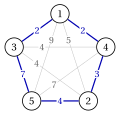

# The problems and the assumptions · The greedy paradigm

**Part 4 · Heuristic algorithms · Chapter 24** · [:material-book-open-variant: Chapter 24: Constructive](index.md) · [:material-file-pdf-box: Lecture notes, volume 4 (PDF)](../../pdf/lecture-notes-4-heuristic-algorithms.pdf) · [:material-pencil: Exercises: Constructive](../../exercises/constructive-heuristics.md) · [:material-gesture-tap: App: Bin packing heuristics](../../lab/bin-packing-heuristics.md) · [:material-gesture-tap: App: List scheduling and LPT](../../lab/list-scheduling-lpt.md)

## 24.2 The problems and the assumptions { #sez-sec-problems }

- The heuristics are illustrated on the four problems of the notes on heuristic algorithms: the knapsack problem (KP), the bin packing problem (BPP), the travelling salesman problem (TSP) and the scheduling problem $P\,||\,C_{\max}$. Their definitions are given in the notes on combinatorial optimization problems, and the assumptions and the notation in the notes on the definitions of heuristic algorithms; we recall the essentials.

- As in the other notes, $\mathscr{A}(I)$ denotes the value of the solution computed by the heuristic $\mathscr{A}$ on the instance $I$, and $z(I)$ the optimal value. For $P\,||\,C_{\max}$, $L_h=\sum_{j\in J_h}t_j$ is the <strong>load</strong> of machine $h$, and the vector $mach$ stores the machine $mach_j$ of every job $j$; for the BPP, the vector $bin$ stores the bin $bin_i$ of every item $i$, and $rc$ denotes a residual capacity.

- The examples use the four <strong>reference instances</strong> of the notes on the definitions of heuristic algorithms, whose optimal values are known:

<table>
<tr>
<th>problem</th>
<th>reference instance</th>
<th>optimum</th>
</tr>
<tr>
<td>KP</td>
<td>\(p=(10,7,6,4)\), \(w=(5,4,3,3)\), \(c=9\)</td>
<td>\(\{1,2\}\), \(z(I)=17\)</td>
</tr>
<tr>
<td>BPP</td>
<td>\(w=(4,4,5,3,2,3)\), \(c=7\)</td>
<td>\(\{1,4\},\{2,6\},\{3,5\}\), \(z(I)=3\)</td>
</tr>
<tr>
<td>\(P\,||\,C_{\max}\)</td>
<td>\(t=(5,5,4,4,3,3,3)\), \(m=3\)</td>
<td>\(\{1,3\},\{2,4\},\{5,6,7\}\), \(z(I)=9\)</td>
</tr>
<tr>
<td>TSP</td>
<td>\(5\) cities, distances below</td>
<td>\(\sigma=(1,3,5,2,4)\), \(z(I)=18\)</td>
</tr>
</table>

- In the figures, the five cities of the TSP reference instance are always drawn in the same positions, on a pentagon, in the order $(1,3,5,2,4)$ of the optimal tour: the optimal tour is then the boundary of the pentagon, and every tour that uses a diagonal is visibly different from it. The figure shows the distances of the instance and, in bold, its optimal tour.

$$
\begin{array}{c|ccccc}
\hline {d_{ij}} & {1} & {2} & {3} & {4} & {5} \\
\hline {1} & --- & {5} & {2} & {2} & {9} \\
{2} & {5} & --- & {4} & {3} & {4} \\
{3} & {2} & {4} & --- & {4} & {7} \\
{4} & {2} & {3} & {4} & --- & {7} \\
{5} & {9} & {4} & {7} & {7} & --- \\
\hline
\end{array}
$$

{ .fig loading=lazy  }

## 24.3 The greedy paradigm { #sez-sec-greedy }

- A solution of each of the four problems is made of <strong>elements</strong>: the items selected for the knapsack, the assignments of items to bins and of jobs to machines, the edges of a tour. A constructive heuristic starts from the empty <strong>partial solution</strong> and adds one element at a time.

- At every step three questions must be answered: <strong>which elements can be added</strong> (the candidates), <strong>which one is added</strong> (the selection criterion), and <strong>whether the result can still be completed to a feasible solution</strong> (the feasibility test). A <strong>greedy</strong> heuristic answers the second question in the simplest way: it adds the candidate that looks best <em>now</em>, according to a criterion that measures the immediate benefit of the element.

!!! definizione "Definition 24.2: Greedy algorithm"

    A <strong>greedy algorithm</strong> is a constructive heuristic that builds a solution by repeatedly selecting, among the candidate elements, the one that is best according to a <em>selection criterion</em>; the element is added to the partial solution if the feasibility test allows it, and is discarded otherwise.

!!! chiave ""

    In a greedy algorithm each decision is taken once and for all: <em>a choice, once made, is never revised</em>.

- The pseudo-code below is a template rather than an algorithm: the set of candidates, the criterion and the test are the three parts that every specific heuristic of these notes fills in.

!!! algoritmo "Algorithm: Greedy template"

    

<strong>Input:</strong> an instance \(I\), the set \(C\) of the elements of the solutions

<strong>Output:</strong> a feasible solution \(S\)

1<strong>Function</strong> Greedy(\(I\))

2\(S := \emptyset\) ▹ empty partial solution

3<strong>while</strong> \(C \neq \emptyset\) <strong>and</strong> \(S\) is not complete <strong>do</strong>

4\(e :=\) the best element of \(C\) according to the selection criterion

5\(C \leftarrow C \setminus \{e\}\) ▹ \(e\) is examined only once

6<strong>if</strong> \(S \cup \{e\}\) passes the feasibility test <strong>then</strong>

7\(S \leftarrow S \cup \{e\}\) ▹ the choice is final

8<strong>end</strong>

9<strong>end</strong>

10<strong>return</strong> \(S\)

- <strong>The order decides everything.</strong> The template examines the elements in the order induced by the selection criterion, and an element rejected or accepted early cannot be reconsidered later. Two greedy heuristics with the same candidates and the same feasibility test, but with different criteria, can produce very different solutions: changing the criterion is the main design decision.

- <strong>Static and dynamic criteria.</strong> A criterion is <em>static</em> if the value of an element does not depend on the partial solution: the elements can then be sorted once at the beginning, and the heuristic scans the sorted list (efficiency of the KP items, weight of the BPP items, processing time of the jobs). A criterion is <em>dynamic</em> if the value of an element changes as the solution grows, and it must be recomputed at every step (distance from the last city of a partial tour, residual capacity of the bins, load of the machines).

- <strong>Myopia.</strong> The criterion looks only at the immediate effect of a choice, not at its consequences on the choices still to be made. This is what makes greedy heuristics fast, and also what makes them fail: a choice that is good now can force bad choices later.

- <strong>Running time.</strong> With a static criterion the running time is typically dominated by the sorting, $O(n\log n)$, plus the cost of the feasibility tests; with a dynamic criterion it is the number of steps times the cost of re-evaluating the candidates, typically $O(n^2)$ or $O(n^3)$.

- <strong>When greedy is exact.</strong> For some problems a greedy algorithm always finds an optimal solution: Kruskal's algorithm for the minimum spanning tree problem examines the edges by non-decreasing cost and accepts an edge if it does not close a cycle; the fractional knapsack problem is solved optimally by taking the items by non-increasing efficiency. For the four NP-hard problems of these notes no greedy algorithm is exact, and the question becomes <em>which</em> criterion gives good solutions.

- The following table shows how the template is filled in for the four problems; the sections that follow study each of them.

<table>
<tr>
<th>problem</th>
<th>element</th>
<th>selection criterion</th>
<th>feasibility test</th>
</tr>
<tr>
<td>KP</td>
<td>an item</td>
<td>profit, weight or efficiency (static)</td>
<td>the item fits into the residual capacity</td>
</tr>
<tr>
<td>BPP</td>
<td>an item and a bin</td>
<td>item: input order or weight (static); bin: first, best, worst (dynamic)</td>
<td>the item fits into the bin</td>
</tr>
<tr>
<td>\(P\,||\,C_{\max}\)</td>
<td>a job and a machine</td>
<td>job: input order or processing time (static); machine: least loaded (dynamic)</td>
<td>always feasible</td>
</tr>
<tr>
<td>TSP</td>
<td>a city and its position</td>
<td>nearest, farthest, cheapest (dynamic)</td>
<td>always feasible</td>
</tr>
</table>

---

**Next:** [24.4 The knapsack problem: which order?](the-knapsack-problem-which-order.md)
