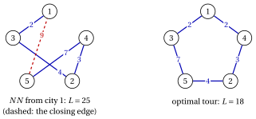
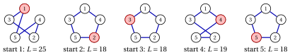
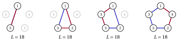
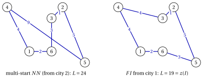

# 24.7 The travelling salesman problem: append or insert? { #sez-sec-TSP }

**Part 4 · Heuristic algorithms · Chapter 24** · [:material-book-open-variant: Chapter 24: Constructive](index.md) · [:material-file-pdf-box: Lecture notes, volume 4 (PDF)](../../pdf/lecture-notes-4-heuristic-algorithms.pdf) · [:material-pencil: Exercises: Constructive](../../exercises/constructive-heuristics.md) · [:material-gesture-tap: App: Bin packing heuristics](../../lab/bin-packing-heuristics.md) · [:material-gesture-tap: App: List scheduling and LPT](../../lab/list-scheduling-lpt.md)

- For the TSP every permutation of the cities is a feasible tour, so the feasibility test is trivial, and the whole design is in the selection criterion. Two families of constructive heuristics are natural, and they differ in <strong>where</strong> the new city is placed:

    - <strong>append</strong>: the partial solution is a path, and the new city is added at its end;

    - <strong>insert</strong>: the partial solution is a closed subtour, and the new city is inserted between two consecutive cities, wherever it costs least.

## 24.7.1 Nearest neighbour { #sez-sec-NN }

!!! chiave ""

    The <em>Nearest Neighbour Algorithm</em> (denoted by $NN$) is a constructive heuristic for the TSP. Starting from a given city $s$, it repeatedly moves from the last visited city to the <em>nearest</em> city not yet visited (in case of ties, the one with the smallest index); when all the cities have been visited, it goes back to $s$.

!!! algoritmo "Algorithm: Nearest Neighbour"

    

<strong>Input:</strong> TSP instance with \(n\) cities, distances \(d[1..n][1..n]\); starting city \(s\)

<strong>Output:</strong> Tour \(\sigma[1..n]\)

1<strong>Function</strong> NearestNeighbour(\(n, d, s\))

2\(\sigma[1] \leftarrow s\)
    \(visited := \{s\}\) ▹ the path starts at \(s\)

3<strong>for</strong> \(len := 2\) <strong>to</strong> \(n\) <strong>do</strong>

4\(last := \sigma[len-1]\)
    \(k :=\) the city \(j\notin visited\) with minimum \(d[last][j]\) (smallest index) ▹ last city of the path

5\(\sigma[len] \leftarrow k\)
    \(visited \leftarrow visited \cup \{k\}\) ▹ append \(k\) at the end

6<strong>end</strong>

7<strong>return</strong> \(\sigma\) ▹ the tour closes with the edge \((\sigma[n],s)\)

- The criterion is dynamic: the distances that matter are those from the last city, which changes at every step. $NN$ runs in $O(n^2)$ time.

- <strong>The weakness of $NN$</strong> is visible in its last steps: the cities that are left are those that were never the nearest to anything, often far from each other and from $s$, and the closing edge back to $s$ is not chosen at all, it is forced.

!!! esempio "Example 24.7: $NN$ on the TSP reference instance"

    Starting from city $1$:

    1. from city $1$ the distances to $2,3,4,5$ are $5,2,2,9$: cities $3$ and $4$ are the nearest, and the tie is broken in favour of city $3$;

    2. from city $3$ the distances to $2,4,5$ are $4,4,7$: city $2$ (tie with $4$);

    3. from city $2$ the distances to $4,5$ are $3,4$: city $4$;

    4. from city $4$ only city $5$ is left, at distance $7$;

    5. the tour closes with the edge $(5,1)$, of length $9$.

    Hence $\sigma=(1,3,2,4,5)$ and

    $$
    NN(I)=d_{13}+d_{32}+d_{24}+d_{45}+d_{51}=2+4+3+7+9=25 ,
    $$

    $39\%$ more than $z(I)=18$; this is the tour used in the notes on the definitions of heuristic algorithms to illustrate the gap. The four edges chosen by the criterion have length $2+4+3+7=16$, and the forced closing edge alone costs $9$, the largest distance of the instance.

    { .fig loading=lazy  }

## 24.7.2 Multi-start nearest neighbour { #sez-sec-MSNN }

- The result of $NN$ depends on the starting city, which is an arbitrary choice: the tour is a cycle and has no natural first city. Since $NN$ is fast, it can simply be run from every city.

!!! chiave ""

    The <em>multi-start nearest neighbour algorithm</em> runs $NN$ once from every city $s\in\mathscr{V}$ and returns the shortest of the $n$ tours obtained (in case of ties, the first one found).

!!! algoritmo "Algorithm: Multi-start Nearest Neighbour"

    

<strong>Input:</strong> TSP instance with \(n\) cities, distances \(d[1..n][1..n]\)

<strong>Output:</strong> Tour \(\sigma^{best}[1..n]\)

1<strong>Function</strong> MultiStartNN(\(n, d\))

2\(L^{best} := +\infty\)

3<strong>for</strong> \(s := 1\) <strong>to</strong> \(n\) <strong>do</strong>

4\(\sigma :=\) NearestNeighbour(\(n, d, s\))

5<strong>if</strong> \(L(\sigma) < L^{best}\) <strong>then</strong>

6\(\sigma^{best} \leftarrow \sigma\), \(L^{best} \leftarrow L(\sigma)\) ▹ new best tour

7<strong>end</strong>

8<strong>end</strong>

9<strong>return</strong> \(\sigma^{best}\)

- The running time is $n$ times that of $NN$, i.e., $O(n^3)$. Multi-start is the simplest way to turn an arbitrary choice into a search: each start gives a different solution, and the best one is kept.

!!! esempio "Example 24.8: Multi-start $NN$ on the TSP reference instance"

    The five runs of $NN$ give

    
<table>
    <tr>
    <th>start \(s\)</th>
    <th>\(1\)</th>
    <th>\(2\)</th>
    <th>\(3\)</th>
    <th>\(4\)</th>
    <th>\(5\)</th>
    </tr>
    <tr>
    <td>tour</td>
    <td>\((1,3,2,4,5)\)</td>
    <td>\((2,4,1,3,5)\)</td>
    <td>\((3,1,4,2,5)\)</td>
    <td>\((4,1,3,2,5)\)</td>
    <td>\((5,2,4,1,3)\)</td>
    </tr>
    <tr>
    <td>\(L\)</td>
    <td>\(25\)</td>
    <td>\(18\)</td>
    <td>\(18\)</td>
    <td>\(19\)</td>
    <td>\(18\)</td>
    </tr>
    </table>

    The tours from cities $2$, $3$ and $5$ are the optimal tour $(1,3,5,2,4)$, traversed from different cities and in different directions; the multi-start returns the tour from city $2$, of length $18=z(I)$.

    { .fig loading=lazy  }

## 24.7.3 Insertion heuristics { #sez-sec-INS }

- $NN$ can only add a city at the end of a path. An <strong>insertion heuristic</strong> keeps a closed <em>subtour</em> $T$ through some of the cities, and inserts the new city wherever it is cheapest. Inserting city $k$ between two consecutive cities $i$ and $j$ of $T$ replaces the edge $(i,j)$ with the edges $(i,k)$ and $(k,j)$, and increases the length by the <strong>insertion cost</strong>

!!! chiave ""

    $$
    \Delta(i,k,j) \;=\; d_{ik} + d_{kj} - d_{ij} \qquad \text{for every edge } (i,j) \text{ of the subtour } T .
    $$

    On metric instances $\Delta(i,k,j)\ge 0$, by the triangle inequality.

- Each step makes two decisions: <strong>which</strong> city is inserted (the selection rule) and <strong>where</strong> (always the edge of minimum insertion cost). The three classical heuristics differ only in the selection rule. Let $d(q,T)=\min_{i\in T} d_{qi}$ be the distance of city $q$ from the subtour.

!!! chiave ""

    The <em>insertion heuristics</em> for the TSP start from the subtour $T=(s)$ and, until all the cities are in $T$, select a city $k\notin T$ and insert it into the edge of $T$ of minimum insertion cost:

    
<table>
    <tr>
    <th><strong>nearest insertion</strong> (\(NI\)):</th>
    <th>\(k\) minimizes \(d(q,T)\), the distance from the subtour</th>
    </tr>
    <tr>
    <td><strong>farthest insertion</strong> (\(FI\)):</td>
    <td>\(k\) maximizes \(d(q,T)\)</td>
    </tr>
    <tr>
    <td><strong>cheapest insertion</strong> (\(CI\)):</td>
    <td>\(k\) minimizes \(\min\limits_{(i,j)\in T}\Delta(i,q,j)\), the cost of its insertion</td>
    </tr>
    </table>

    Ties are broken in favour of the smallest index, for the city and for the edge.

!!! algoritmo "Algorithm: Insertion (NI, FI, CI)"

    

<strong>Input:</strong> TSP instance with \(n\) cities, distances \(d[1..n][1..n]\); starting city \(s\); \(rule\in\{NI,FI,CI\}\)

<strong>Output:</strong> Tour \(\sigma[1..n]\)

1<strong>Function</strong> Insertion(\(n, d, s, rule\))

2\(\sigma := (s)\) ▹ subtour with one city

3<strong>for</strong> \(len := 1\) <strong>to</strong> \(n-1\) <strong>do</strong>

4\(k :=\) the city \(q\notin\sigma\) selected by \(rule\)
    \(a :=\) the position \(a\in\{1,\dots,len\}\) minimizing \(\Delta(\sigma[a],k,\sigma[a+1])\), with \(\sigma[len+1]=\sigma[1]\)
    insert \(k\) between \(\sigma[a]\) and \(\sigma[a+1]\) ▹ which city where

5<strong>end</strong>

6<strong>return</strong> \(\sigma\)

- <strong>The subtour with one city.</strong> The subtour $(s)$ is a closed tour with a single “edge” $(s,s)$ of length $0$, so inserting $k$ costs $d_{sk}+d_{ks}-0=2d_{sk}$, and the subtour $(s,k)$ goes from $s$ to $k$ and back. No special case is needed.

- <strong>Append or insert.</strong> Every tour built by $NN$ could also be built by an insertion heuristic, but not conversely: inserting anywhere keeps the subtour closed at every step, so the length of the closing edge is paid, and controlled, from the beginning.

- <strong>The intuition behind FI.</strong> Taking the <em>farthest</em> city looks absurd for a greedy algorithm, but it builds first the outline of the tour, through the cities that are far apart, and then inserts the remaining cities, which are “on the way” and cost little.

- With the distances $d(q,T)$ and the minimum insertion costs updated incrementally after each insertion, $NI$ and $FI$ run in $O(n^2)$ time; a simple implementation of $CI$ runs in $O(n^3)$.

!!! esempio "Example 24.9: $NI$ and $CI$ on the TSP reference instance"

    Starting from $T=(1)$. At each step we list, for every city $q\notin T$, its distance $d(q,T)$ and its insertion costs on the edges of $T$, in the order of $T$.

    
<table>
    <tr>
    <th>subtour \(T\)</th>
    <th>\(d(q,T)\)</th>
    <th>insertion costs</th>
    <th>inserted</th>
    </tr>
    <tr>
    <td>\((1)\)</td>
    <td>\(2{:}\,5,\ 3{:}\,2,\ 4{:}\,2,\ 5{:}\,9\)</td>
    <td>\(2{:}\,10,\ 3{:}\,4,\ 4{:}\,4,\ 5{:}\,18\)</td>
    <td>\(3\) on \((1,1)\), cost \(4\)</td>
    </tr>
    <tr>
    <td>\((1,3)\)</td>
    <td>\(2{:}\,4,\ 4{:}\,2,\ 5{:}\,7\)</td>
    <td>\(2{:}\,(7,7),\ 4{:}\,(4,4),\ 5{:}\,(14,14)\)</td>
    <td>\(4\) on \((1,3)\), cost \(4\)</td>
    </tr>
    <tr>
    <td>\((1,4,3)\)</td>
    <td>\(2{:}\,3,\ 5{:}\,7\)</td>
    <td>\(2{:}\,(6,3,7),\ 5{:}\,(14,10,14)\)</td>
    <td>\(2\) on \((4,3)\), cost \(3\)</td>
    </tr>
    <tr>
    <td>\((1,4,2,3)\)</td>
    <td>\(5{:}\,4\)</td>
    <td>\(5{:}\,(14,8,7,14)\)</td>
    <td>\(5\) on \((2,3)\), cost \(7\)</td>
    </tr>
    </table>

    $NI$ selects the city with the smallest $d(q,T)$, $CI$ the city with the smallest insertion cost: on this instance the two rules select the same cities at every step (city $3$ at the first step by the tie with city $4$). Both return $\sigma=(1,4,2,5,3)$, and

    $$
    NI(I)=CI(I)=4+4+3+7=18=z(I),
    $$

    the optimal tour $(1,3,5,2,4)$ traversed in the opposite direction. The subtours grow as follows (new edges in red):

    { .fig loading=lazy  }

!!! esempio "Example 24.10: $FI$ on the TSP reference instance"

    Starting from $T=(1)$:

    
<table>
    <tr>
    <th>subtour \(T\)</th>
    <th>\(d(q,T)\)</th>
    <th>insertion costs of the selected city</th>
    <th>inserted</th>
    </tr>
    <tr>
    <td>\((1)\)</td>
    <td>\(2{:}\,5,\ 3{:}\,2,\ 4{:}\,2,\ 5{:}\,9\)</td>
    <td>\(5{:}\,18\)</td>
    <td>\(5\) on \((1,1)\), cost \(18\)</td>
    </tr>
    <tr>
    <td>\((1,5)\)</td>
    <td>\(2{:}\,4,\ 3{:}\,2,\ 4{:}\,2\)</td>
    <td>\(2{:}\,(0,0)\)</td>
    <td>\(2\) on \((1,5)\), cost \(0\)</td>
    </tr>
    <tr>
    <td>\((1,2,5)\)</td>
    <td>\(3{:}\,2,\ 4{:}\,2\)</td>
    <td>\(3{:}\,(1,7,0)\)</td>
    <td>\(3\) on \((5,1)\), cost \(0\)</td>
    </tr>
    <tr>
    <td>\((1,2,5,3)\)</td>
    <td>\(4{:}\,2\)</td>
    <td>\(4{:}\,(0,6,4,4)\)</td>
    <td>\(4\) on \((1,2)\), cost \(0\)</td>
    </tr>
    </table>

    At the first step $FI$ takes city $5$, the farthest from city $1$, and the subtour $(1,5)$ already has length $2d_{15}=18$. Cities $2$, $3$ and $4$ lie “on the way” and are inserted at zero cost, because $d_{12}+d_{25}=d_{15}$, $d_{53}+d_{31}=d_{51}$ and $d_{14}+d_{42}=d_{12}$. Hence $\sigma=(1,4,2,5,3)$ and $FI(I)=18=z(I)$: the same tour as $NI$ and $CI$, built in a completely different order.

    { .fig loading=lazy  }

- <strong>What is known in the worst case.</strong> On metric instances, $NI$ and $CI$ never return a tour longer than twice the optimal one, while the ratio of $NN$ can grow like $\log n$ and only a logarithmic bound is known for $FI$ (D.J. Rosenkrantz, R.E. Stearns, P.M. Lewis, <em>An analysis of several heuristics for the traveling salesman problem</em>, SIAM Journal on Computing 6 (1977) 563–581). In practice, on Euclidean instances, $FI$ is usually the best of the insertion heuristics, and $NN$ tours are typically about $25\%$ longer than the optimum.

## 24.7.4 A comparison on a larger instance { #sez-sec-TSP6 }

- On the reference instance the three insertion heuristics, from every starting city, all find the optimal tour, and the differences between the rules do not show. To compare them we use a second TSP instance, with $6$ cities in the plane and distances equal to the Euclidean distances rounded to the nearest integer. The instance is metric (checked on all the triples of cities).

!!! esempio "Example 24.11: A TSP instance with $6$ cities"

    The cities have coordinates

    $$
    1{:}\,(2,1),\quad 2{:}\,(5,5),\quad 3{:}\,(4,4),\quad 4{:}\,(0,5),\quad 5{:}\,(7,0),\quad 6{:}\,(4,1),
    $$

    and distances

    $$
    \begin{array}{c|cccccc}
    \hline {d_{ij}} & {1} & {2} & {3} & {4} & {5} & {6} \\
    \hline {1} & --- & {5} & {4} & {4} & {5} & {2} \\
    {2} & {5} & --- & {1} & {5} & {5} & {4} \\
    {3} & {4} & {1} & --- & {4} & {5} & {3} \\
    {4} & {4} & {5} & {4} & --- & {9} & {6} \\
    {5} & {5} & {5} & {5} & {9} & --- & {3} \\
    {6} & {2} & {4} & {3} & {6} & {3} & --- \\
    \hline
    \end{array}
    $$

    The instance has $\frac{5!}{2}=60$ distinct tours; enumerating them, the unique optimal tour is $(1,4,3,2,5,6)$, with $z(I)=19$, and only $7$ tours have length smaller than $24$. The heuristics of this section give:

    
<table>
    <tr>
    <th></th>
    <th colspan="6">starting city</th>
    </tr>
    <tr>
    <td></td>
    <td>\(1\)</td>
    <td>\(2\)</td>
    <td>\(3\)</td>
    <td>\(4\)</td>
    <td>\(5\)</td>
    <td>\(6\)</td>
    </tr>
    <tr>
    <td>\(NN\)</td>
    <td>\(25\)</td>
    <td>\(24\)</td>
    <td>\(25\)</td>
    <td>\(24\)</td>
    <td>\(24\)</td>
    <td>\(24\)</td>
    </tr>
    </table>

    
<table>
    <tr>
    <th>from city \(1\)</th>
    <th>\(L\)</th>
    </tr>
    <tr>
    <td>\(NI\)</td>
    <td>\(23\)</td>
    </tr>
    <tr>
    <td>\(FI\)</td>
    <td>\(19\)</td>
    </tr>
    <tr>
    <td>\(CI\)</td>
    <td>\(20\)</td>
    </tr>
    </table>

    The best tour of the multi-start $NN$ has length $24$, $26\%$ above the optimum, while $FI$ finds the optimal tour $(1,6,5,2,3,4)$ (the optimal tour in the opposite direction):

    { .fig loading=lazy  }

    All six $NN$ tours contain the edge $(4,5)$, of length $9$, the longest of the instance: cities $4$ and $5$ are at opposite ends of the instance, and $NN$, from whatever city it starts, leaves at least one of them to the last steps, when the only way left is the long one.

---

**Next:** [24.8 Randomized construction](randomized-construction.md)
